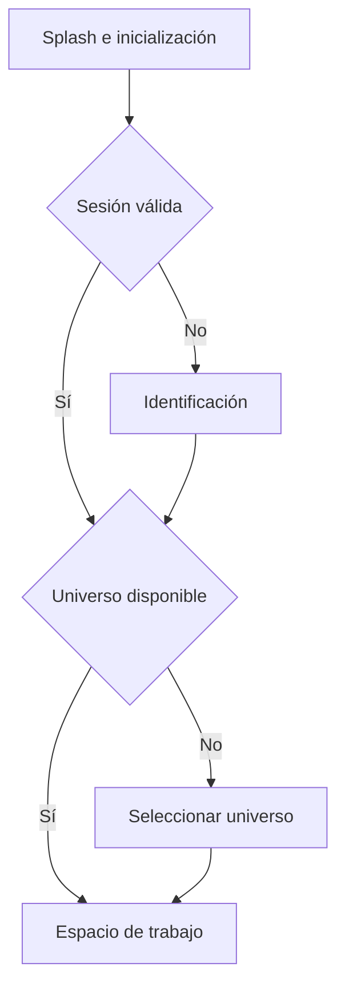
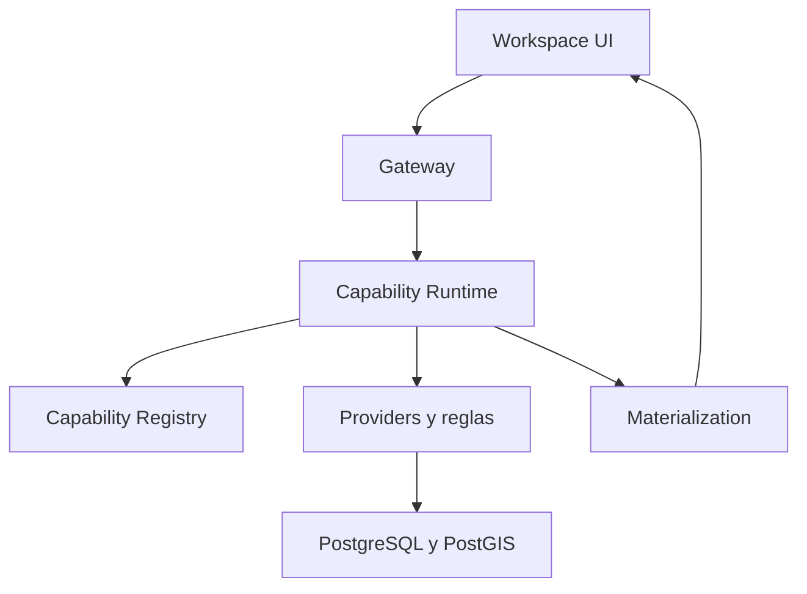

# Biblia de HEYTI-CORE V2.0

## Arquitectura, migración, experiencia, datos y reglas de verdad

**Versión del documento:** 1.0
**Fecha de consolidación:** 10 de septiembre de 2026
**Estado:** Línea base arquitectónica aprobada; implementación y verificación física pendientes por etapas
**Ámbito:** Evolución de HEYTI V1 hacia HEYTI-CORE V2.0

---

## 0. Propósito y autoridad del documento

Este documento consolida las decisiones funcionales, visuales, técnicas y operativas tomadas para construir HEYTI-CORE V2.0. Su propósito es impedir que el proyecto vuelva a fragmentarse en páginas, cálculos, fuentes y estados independientes.

Funciona como:

- definición de producto;
- contrato arquitectónico;
- mapa de migración desde V1;
- catálogo inicial de capacidades;
- política de verdad y trazabilidad;
- referencia de experiencia de usuario;
- base para pruebas, despliegue y aceptación.

No sustituye los contratos ejecutables, esquemas, pruebas ni decisiones registradas en el repositorio. Los gobierna y les da coherencia.

Cuando una implementación contradiga una regla aprobada aquí, deberá corregirse la implementación o documentarse formalmente una nueva decisión. Nunca se resolverá la contradicción mediante un comportamiento silencioso en la interfaz.

### Principio central

> **Los módulos organizan las experiencias; HEYTI-CORE gobierna las capacidades, los datos, el contexto y la verdad.**

---

# Parte I — Visión y principios rectores

## 1. Visión de HEYTI V2.0

HEYTI V2.0 será un espacio de inteligencia territorial unificado. Permitirá consultar información electoral, social y operativa; desarrollar estrategia; organizar estructura; registrar actividad de campo; y operar la jornada electoral sin obligar al usuario a reconstruir el contexto al cambiar de tarea.

La plataforma debe sentirse como un solo sistema, no como un portal que enlaza aplicaciones independientes.

### Resultado buscado

El usuario podrá:

- seleccionar un universo territorial una sola vez;
- permanecer en un solo módulo durante toda la sesión si así lo desea;
- cambiar de módulo sin perder selección, mapa ni trabajo;
- formular preguntas que crucen dominios sin abandonar la vista actual;
- comparar resultados solo cuando lo decida;
- distinguir datos observados, cálculos, estimaciones y escenarios;
- consultar la fuente y el método de cada resultado;
- seguir trabajando ante conectividad limitada, dentro de reglas controladas;
- confiar en que una ausencia de datos nunca será convertida en cero o certeza falsa.

## 2. Principios no negociables

1. **Verdad antes que apariencia.** Ninguna cifra de demostración se presentará como real.
2. **CORE es la autoridad de cálculo.** La interfaz no duplicará reglas estratégicas o electorales.
3. **El contexto es compartido.** Universo, sección, elección, sesión, permisos, mapa y comparación no pertenecen a un módulo aislado.
4. **Los módulos no son barreras.** Cualquier experiencia puede consultar una capacidad autorizada de otro dominio.
5. **La comparación es opcional.** Consultar un solo módulo es una experiencia completa y de primera clase.
6. **Procedencia visible.** Todo resultado indica de dónde proviene, para qué universo y periodo es válido y cuál es su estado de confianza.
7. **Ausencia no significa cero.** Nulo, no aplicable, cobertura incompleta, error y cero observado son estados diferentes.
8. **Disponibilidad no significa asignación.** Una persona disponible no será presentada como representante confirmado.
9. **Guardado local no significa confirmado.** En operación desconectada, el estado local y el estado confirmado por CORE se distinguirán.
10. **Privacidad desde el diseño.** La información personal se minimiza, protege y audita.
11. **Migrar por capacidades certificadas.** El progreso se mide por cadenas de verdad terminadas, no por pantallas reconstruidas.
12. **Toda liberación debe ser reversible.** Actualizaciones, datos, configuración y respaldos tendrán una ruta de recuperación probada.

## 3. Experiencias principales

HEYTI V2.0 tendrá seis módulos visibles:

| Módulo | Propósito principal | Acento conceptual |
|---|---|---|
| Análisis Territorial | Comprender resultados, competitividad, historia y geografía electoral | Azul petróleo claro |
| Ganar Todo | Construir metas, escenarios y decisiones estratégicas | Violeta estratégico |
| Campo | Conocer presencia, actores, cobertura y actividad territorial | Verde territorial |
| Estructura | Organizar responsables, roles, asignaciones y cobertura confirmada | Ámbar organizacional |
| Día D | Operar casillas, incidencias, evidencias y avance de jornada | Coral operativo |
| Social | Comprender condiciones demográficas y socioeconómicas | Turquesa social |

**ET-27 no será un séptimo módulo.** Será un conjunto de métodos y capacidades estratégicas integrado principalmente en Estructura y consultable transversalmente.

---

# Parte II — Diagnóstico de HEYTI V1

## 4. Inventario revisado

La línea base disponible contiene:

- `index.html`;
- `portal.html`;
- `analisis_territorial.html`;
- `ganar_todo.html`;
- `campo.html`;
- `estructura.html`;
- `dia_D.html`;
- `puntos_campo.geojson`.

El módulo Social no fue entregado como HTML en la muestra examinada. Existe evidencia de materialización socioeconómica en CORE, pero su experiencia V1 deberá inventariarse físicamente cuando esté disponible.

## 5. Patrón arquitectónico de V1

V1 está construida como páginas HTML independientes con lógica, estilos y datos mezclados. Los módulos reproducen mecanismos semejantes para:

- cargar archivos JSON y GeoJSON;
- crear mapas Leaflet;
- buscar territorios;
- conservar universo mediante `localStorage`;
- calcular indicadores;
- navegar por rutas HTML;
- mostrar tablas, tarjetas y modales.

Este patrón permitió avanzar rápidamente, pero produce varias fuentes de verdad, navegación frágil, duplicación y dificultad para certificar resultados.

### Riesgos transversales observados

- dependencias obtenidas por CDN;
- rutas físicas codificadas directamente;
- cálculos estratégicos en navegador;
- HTML generado con datos sin una frontera uniforme de seguridad;
- estados guardados parcialmente o solo en memoria;
- conceptos equivalentes con nombres y formatos distintos;
- ausencia de contratos entre interfaz, cálculo y datos;
- números demostrativos mezclados con resultados reales;
- módulos que reconstruyen su propio universo y mapa.

## 6. Hallazgos por acceso y módulo

### 6.1 Inicio V1

`index.html` redirige inmediatamente al portal mediante dos mecanismos: redirección HTML y JavaScript. Por ello no existe una etapa real de inicialización, validación o comunicación de estado.

### 6.2 Portal V1

El portal opera como puerta obligatoria y contiene indicadores demostrativos codificados en la página. También mantiene contexto territorial propio y navega directamente a archivos HTML. Se identificó una ruta a `socioeconomico.html` que no está presente en la muestra.

### 6.3 Análisis Territorial

Combina obtención de datos, interpretación, mapa, selección territorial y presentación dentro de la página. En V2 deberá consumir resultados certificados sin reconstruir el universo ni ejecutar reglas de negocio por su cuenta.

### 6.4 Ganar Todo

Los escenarios y metas son valiosos, pero deben separar con claridad:

- dato observado;
- meta definida;
- cálculo certificado;
- escenario editable;
- recomendación.

Una simulación nunca se mostrará como predicción oficial.

### 6.5 Campo y sus datos

El archivo revisado contiene 45 registros válidos y dos duplicados confirmados bajo la combinación nombre, teléfono y sección. Incluye información personal, por lo que su visualización, exportación y registro deberán depender de permisos.

Campo necesita distinguir presencia, relación, actividad, cobertura y vigencia. Un punto en el mapa no demuestra por sí mismo una estructura operativa.

### 6.6 Estructura y ET-27

Se encontraron riesgos críticos:

- uso de puntos de Campo como si fueran personas o roles organizacionales;
- conversión semántica de `REP_GENERAL` a `REP_SECCION`;
- referencias a variables no definidas;
- distribución automática de representantes no asignados entre casillas;
- objetivos codificados directamente;
- implementaciones repetidas y divergentes de ET-27;
- ediciones conservadas únicamente en memoria;
- identificadores aleatorios;
- distrito codificado como constante;
- riesgos de exposición de datos personales y de inyección en exportaciones.

La distribución automática es especialmente peligrosa: una sugerencia algorítmica no puede transformarse visualmente en cobertura confirmada.

### 6.7 Día D

El campo `estatus` intenta representar simultáneamente ausencia de representante, instalación, incidencia, recepción de acta y cierre. Estas dimensiones pueden coexistir y deben modelarse por separado.

También se observaron:

- estado operativo solo en memoria;
- función de carga aparentemente no utilizada;
- ausencia de información interpretada como `sin_rep`;
- mapa coloreado por presencia estática y no por operación real;
- identificadores DOM duplicados;
- opciones incompletas de transición;
- fuentes e identificadores de casilla inconsistentes.

### Regla de dominio

> **Estructura responde quién debería estar asignado; Día D responde quién llegó, qué ocurrió, cuándo ocurrió y qué evidencia existe.**

---

# Parte III — Splash, acceso y comienzo de sesión

## 7. Formulario Splash de HEYTI V2.0

La primera vista de V2.0 será un **Splash de inicialización**, también llamado pantalla de arranque. Aparecerá antes del portal o espacio de trabajo.

### Diseño

- panel de tamaño medio;
- centrado horizontal y verticalmente;
- fondo general sobrio;
- identidad visual de HEYTI;
- nombre completo de la plataforma;
- versión instalada;
- entorno, cuando sea relevante;
- mensaje breve de propósito;
- barra de avance real;
- descripción del paso que se está ejecutando;
- acción de entrada cuando la plataforma esté lista.

### Progreso real, no animación ficticia

La barra representará tareas verificables, por ejemplo:

1. iniciar interfaz local;
2. comprobar disponibilidad de CORE;
3. cargar configuración autorizada;
4. restaurar sesión válida;
5. verificar catálogos y capacidades;
6. revisar estado de datos y sincronización;
7. recuperar el último contexto seguro;
8. habilitar el espacio de trabajo.

La interfaz podrá suavizar visualmente el crecimiento de la barra, pero nunca deberá ocultar una falla detrás de un contador decorativo.

### Conducta recomendada

- En una sesión rutinaria y saludable, el Splash podrá continuar automáticamente tras una pausa breve.
- La primera vez, después de una actualización o cuando exista una advertencia, mostrará **Entrar a HEYTI**.
- Debe permanecer visible el tiempo suficiente para que nombre, versión y estado puedan leerse.
- El botón no estará habilitado hasta alcanzar un estado válido o degradado aceptado.
- Se respetará la preferencia de reducción de movimiento.

### Estados

| Estado | Conducta |
|---|---|
| Listo | Habilita entrada y permite continuidad automática |
| Sin conexión | Explica las capacidades offline disponibles |
| Degradado | Permite continuar e identifica limitaciones |
| Actualización pendiente | Informa versión y decisión requerida |
| Error recuperable | Ofrece reintentar y consultar detalle |
| Error bloqueante | Impide entrar y muestra una ruta de soporte segura |

### Flujo de acceso

El portal V1 dejará de ser una puerta obligatoria. Podrá evolucionar a una vista opcional llamada **Inicio**, con accesos recientes, estado del sistema y recomendaciones pertinentes.

---

# Parte IV — Espacio de trabajo unificado

## 8. Estructura visual

La interfaz tendrá zonas estables:

1. barra superior con identidad, universo, sección, estado de datos y sesión;
2. navegación compacta de módulos;
3. mapa persistente;
4. panel del módulo activo;
5. panel contextual de HEYTI;
6. bandeja de comparación contraída.

En condiciones normales coexistirán un mapa, un panel principal y un panel contextual compacto. No se abrirán dos módulos completos lado a lado.

## 9. Estado compartido

La implementación mantendrá contratos explícitos para:

- `SessionContext`;
- `AuthorizationContext`;
- `TerritorialContext`;
- `ElectionContext`;
- `MapContext`;
- `ModuleContext`;
- `ComparisonContext`;
- `HeytiContext`;
- `DataTrustContext`;
- `SyncContext`.

Cada módulo conservará su propio estado de trabajo, pero no creará copias independientes del universo, las rutas, la elección o el mapa.

### Cambio de módulo

> **Cambiar de módulo pausa una experiencia y recupera otra; no reinicia la sesión ni pierde el trabajo.**

Se conservarán, cuando sean compatibles:

- universo y sección;
- zoom y centro del mapa;
- capas fijadas;
- filtros;
- borradores;
- escenarios;
- selección en comparación;
- posición de paneles.

Los formularios con cambios pendientes deberán protegerse antes de una acción que pueda descartarlos.

## 10. Consulta individual y comparación

### Consulta individual

Es el modo predeterminado. Todo el ancho se dedica al módulo activo, HEYTI permanece contraído y la comparación no ocupa espacio.

El usuario no estará obligado a formular preguntas, crear una radiografía, visitar otros módulos ni comparar resultados.

### Comparación

Se activa explícitamente mediante **Fijar para comparar**, apertura de la bandeja o una solicitud a HEYTI.

Cada ficha conserva:

- módulo y capacidad;
- universo;
- resultado y unidad;
- periodo y elección;
- partido o actor, cuando aplique;
- naturaleza del dato;
- fuente;
- filtros;
- cobertura;
- fecha y versión del cálculo.

### Compatibilidad

| Resultado | Significado |
|---|---|
| Compatible | Puede integrarse en una misma visualización |
| Comparable con advertencia | Puede colocarse lado a lado con diferencias visibles |
| No combinable | Se conserva, pero no se mezcla matemáticamente |

La compatibilidad validará universo, unidad, periodo, elección, partido, naturaleza, cobertura y versión territorial.

Límites iniciales: 12 elementos, dos visualizaciones grandes y una comparación activa.

## 11. Pregúntale a HEYTI

HEYTI estará disponible desde el inicio, dentro de un módulo, desde una selección y desde la comparación.

### Principio de inteligencia transversal

> **HEYTI puede consultar cualquier capacidad autorizada desde cualquier experiencia visual, sin forzar un cambio de módulo y sin alterar el contexto territorial activo.**

Ejemplo central: mientras el usuario trabaja en Campo, selecciona un punto y pregunta quién ganó la sección en 2024. HEYTI invoca la capacidad electoral, responde dentro de Campo, muestra procedencia y evidencia, y ofrece profundizar sin cambiar automáticamente de módulo.

### Tipos de intención

- consulta puntual;
- explicación;
- exploración;
- cálculo;
- comparación;
- operación;
- captura o modificación;
- declaración de información no disponible.

Las consultas ambiguas generarán una pregunta breve. Las acciones de escritura mostrarán registros afectados, valores anteriores y nuevos, validaciones y confirmación.

---

# Parte V — Lenguaje visual y semántico

## 12. Identidad de módulo

Cada resultado transversal se identificará mediante:

> **Nombre del módulo + icono + color de acento**

El nombre y el icono son obligatorios. El color es secundario. No se colorearán superficies completas porque competirían con mapas, partidos, alertas y estados de confianza.

El sistema separará visualmente tres significados:

| Recurso | Significado |
|---|---|
| Nombre, icono y acento | Módulo de origen |
| Color electoral | Partido o categoría de datos |
| Insignia de confianza | Certificado, parcial, estimado, escenario, histórico o no disponible |

## 13. Estados de confianza

| Estado | Definición |
|---|---|
| Certificado | Validado contra una fuente autorizada y una capacidad versionada |
| Parcial | Información real con cobertura incompleta |
| Estimado | Resultado calculado mediante metodología declarada |
| Escenario | Simulación construida por el usuario |
| Histórico | Válido para una versión territorial anterior |
| No disponible | No existe información suficiente o aplicable |

El estado se comunicará con texto e icono, no solo con color.

## 14. Componentes de información

### Tarjetas

Responden una pregunta concreta y muestran valor, unidad, universo, periodo, confianza, procedencia y acceso a evidencia.

### Mapas

Responden **dónde ocurre**. Usarán una capa temática principal, leyenda vinculada, selección persistente, áreas sin información explícitas y detalle completo fuera del tooltip.

No se superpondrán varias coropletas opacas.

### Gráficas

Cada gráfica responderá una pregunta explícita. Tendrá universo, periodo, unidad, fuente, confianza y tabla accesible. Se evitarán 3D, escalas engañosas y unidades incompatibles.

### Tablas

Serán la vista de precisión. Incorporarán encabezados fijos, filtros, búsqueda, ordenamiento, unidades, virtualización, selección y exportación controlada.

### Detalle progresivo

1. dato;
2. contexto;
3. evidencia;
4. metodología.

## 15. Accesibilidad e identidad

La identidad visual será sobria, tecnológica y territorial. Se construirá primero en modo claro de alta legibilidad.

La interfaz contemplará:

- contraste suficiente;
- teclado y foco visible;
- lectores de pantalla;
- textos alternativos;
- equivalentes tabulares;
- tipografía legible;
- cifras tabulares;
- reducción de movimiento;
- iconografía de una sola familia.

---

# Parte VI — Arquitectura objetivo

## 16. Capas del sistema

### Responsabilidades

| Capa | Responsabilidad |
|---|---|
| Workspace UI | Interacción, visualización y contexto; no gobierna cálculos |
| Gateway | Entrada estable, autenticación, autorización, validación y correlación |
| Runtime | Ejecución, trazabilidad, tiempos, errores y materialización |
| Registry | Descubrimiento, versiones y contratos de capacidades |
| Providers | Acceso controlado a datos y servicios internos |
| CORE | Reglas, modelos, cálculos y verdad operacional |
| Materialization | Resultados persistentes, evidencia y consumo eficiente |

## 17. Tecnología recomendada

### Interfaz

- React;
- TypeScript;
- Vite;
- componentes compartidos;
- Leaflet detrás de un adaptador cartográfico;
- dependencias empaquetadas localmente;
- IndexedDB para persistencia offline selectiva.

### Núcleo y datos

- Python para HEYTI-CORE;
- Gateway estable hacia Kernel y Runtime;
- PostgreSQL/PostGIS;
- contratos versionados;
- migraciones reproducibles.

### Despliegue inicial

Aplicación web local servida en el equipo, abierta en navegador y opcionalmente instalada como PWA. Electron no es requisito inicial: añadiría complejidad sin resolver la arquitectura de verdad.

## 18. Contrato de ejecución

Toda invocación transportará, según aplique:

- `request_id`;
- identidad y sesión;
- permisos efectivos;
- universo territorial;
- sección seleccionada;
- elección y periodo;
- módulo solicitante;
- capacidad y versión;
- parámetros validados;
- política de caché y conectividad.

Toda respuesta transportará:

- resultado tipado;
- universo y periodo efectivos;
- fuente y cobertura;
- naturaleza y confianza;
- versión de capacidad;
- tiempo de cálculo o materialización;
- advertencias;
- evidencia consultable;
- código de error estable cuando no pueda completarse.

La interfaz no interpretará un error como un conjunto vacío.

---

# Parte VII — Catálogo inicial de capacidades

## 19. Capacidades transversales

- resolver universo territorial;
- buscar municipio, distrito, sección y casilla;
- describir sección;
- obtener geometría;
- validar compatibilidad territorial;
- consultar cobertura y procedencia;
- obtener estado de datos;
- explicar resultado;
- materializar y recuperar evidencia;
- validar permisos;
- auditar acción;
- gestionar sesión y contexto.

## 20. Capacidades por dominio

### Análisis Territorial

- resultados por elección y sección;
- ganador y margen;
- participación y abstención;
- evolución histórica;
- competitividad;
- comparación territorial;
- capas electorales.

### Ganar Todo

- votos necesarios;
- metas por territorio;
- escenarios;
- priorización;
- sensibilidad de variables;
- explicación metodológica.

### Campo

- puntos y actores autorizados;
- presencia y cobertura;
- actividad y vigencia;
- detección de duplicados;
- radiografía territorial;
- captura y actualización con evidencia.

### Estructura

- roles y responsables;
- asignaciones;
- cobertura confirmada;
- vacantes y necesidades;
- propuestas separadas de asignaciones;
- capacidades estratégicas ET-27;
- trazabilidad de cambios.

### Día D

- catálogo e identificación de casillas;
- representante esperado;
- llegada y presencia confirmada;
- instalación;
- incidencias;
- evidencias;
- actas;
- cierre;
- línea de tiempo y escalamiento.

### Social

- indicadores socioeconómicos;
- demografía;
- vivienda y servicios;
- composición territorial;
- cobertura y versión del indicador;
- relación exploratoria con variables electorales, sin afirmar causalidad automática.

---

# Parte VIII — Política de datos y verdad

## 21. Cadena de verdad

Un resultado se considerará migrado solo cuando complete:

> **Fuente → Ingesta → Base de datos → Provider → Capability → Runtime → Materialization → Interfaz → Evidencia**

Cada eslabón debe ser identificable y verificable.

## 22. Línea base conocida de CORE

La evidencia acumulada registra:

- paquete HEYTI-CORE 0.1.0;
- Kernel, Capability Registry, Session Manager, Event Bus y Capability Runtime;
- capacidades base de salud, sistema y versión;
- Python 3.10.11;
- línea base de 107 pruebas aprobadas;
- contrato `SectionDescription`;
- Gateway que delega al Kernel;
- dominios territorial, espacial, electoral, socioeconómico, Campo, Día D, metadatos y analítica.

Estas cifras son antecedentes de trabajo y deberán verificarse físicamente contra el repositorio antes de declararlas vigentes para una liberación.

## 23. Cobertura de datos conocida

| Dominio | Evidencia preliminar |
|---|---|
| Territorial | 46 municipios de Guanajuato; 3,266 geometrías; maestro de 3,310 secciones |
| Electoral | Resultados 2015, 2018, 2021 y 2024; cobertura 2015 parcial según elección |
| Social | 252,773 resultados materializados; piloto con 140 indicadores en 10 secciones |
| Campo | 45 puntos válidos; dos duplicados confirmados |
| Casillas | 8,144 registros fuente; 8,047 insertados; 97 errores; 3,228 secciones distintas |

Las diferencias territoriales y de cobertura no deben corregirse mediante herencia o relleno automático. Deben explicarse con versión, fuente y motivo.

## 24. Golden Cases

Los Golden Cases son ejemplos conocidos, revisados y ejecutables que prueban la cadena completa.

Cada caso contendrá:

- pregunta;
- universo;
- elección y periodo;
- entradas exactas;
- resultado esperado;
- tolerancia, si existe;
- fuente;
- cobertura;
- versión territorial;
- capacidad y versión;
- evidencia;
- responsable de aprobación.

### Reglas

- Los valores se obtienen de fuentes reales; nunca se inventan para completar una demostración.
- Un cambio inesperado bloquea la liberación hasta explicar su causa.
- Deben existir casos positivos, nulos, parciales, históricos, no aplicables, sin permisos y con errores.
- Los Golden Cases P0 forman parte de la puerta Go/No-Go.

## 25. Conflictos que deben resolverse explícitamente

- Objetivo V1 de dos representantes por casilla frente a configuración CORE de uno.
- Secciones existentes en una fuente y ausentes en el maestro vigente.
- Duplicados de Campo.
- Diferencias entre resultados históricos y versiones territoriales actuales.
- Identificadores de casilla no canónicos.
- Conceptos de estado de Día D comprimidos en una sola propiedad.

Ninguno de estos conflictos será resuelto por la interfaz.

---

# Parte IX — Seguridad, privacidad y auditoría

## 26. Autorización

Se aplicará RBAC combinado con atributos contextuales:

- rol;
- organización;
- universo permitido;
- módulo y capacidad;
- sensibilidad del dato;
- acción solicitada;
- conectividad y dispositivo, cuando aplique.

La política será denegar por defecto y conceder el mínimo privilegio.

## 27. Información personal

Los datos de Campo, Estructura y Día D pueden incluir nombre, teléfono, ubicación, relación política y actividad operativa. Su tratamiento exigirá:

- minimización;
- cifrado en tránsito y reposo;
- enmascaramiento;
- permisos de columna y acción;
- exportación justificada;
- caducidad de datos offline;
- borrado o revocación controlados;
- revisión jurídica aplicable.

Las respuestas transversales no deben ampliar los permisos del usuario. HEYTI puede localizar una capacidad, pero solo mostrará lo autorizado.

## 28. Auditoría

Se registrará quién, cuándo, desde qué contexto y con qué resultado:

- consultó datos sensibles;
- exportó información;
- creó o modificó registros;
- asignó responsables;
- cambió un estado operativo;
- confirmó una sincronización;
- ejecutó una capacidad crítica.

Los registros no incluirán secretos ni PII innecesaria.

---

# Parte X — Operación offline y sincronización

## 29. Alcance offline

El funcionamiento offline será selectivo, no una copia indiscriminada del sistema.

Podrán almacenarse:

- contexto y catálogos indispensables;
- geometrías del universo autorizado;
- tareas y formularios asignados;
- capturas pendientes;
- evidencias necesarias;
- últimos resultados explícitamente habilitados.

## 30. Estados de sincronización

- local pendiente;
- enviando;
- confirmado por CORE;
- rechazado;
- en conflicto;
- expirado.

Cada operación tendrá identificador idempotente. Un reintento no deberá duplicar registros.

Los conflictos no se resolverán silenciosamente. Se conservarán versiones, autoría, hora y decisión final.

IndexedDB será preferible a `localStorage` para información estructurada. Los datos sensibles offline deberán cifrarse y expirar.

---

# Parte XI — Calidad, observabilidad y rendimiento

## 31. Observabilidad

Cada solicitud tendrá correlación mediante `request_id` y, cuando aplique, `trace_id`.

Se observarán:

- disponibilidad de Gateway y CORE;
- duración por capacidad;
- errores por código;
- cobertura y frescura;
- materializaciones;
- colas offline;
- conflictos de sincronización;
- tiempos de mapa y visualización;
- uso de memoria en equipos objetivo.

Los estados de salud alimentarán el Splash y la barra superior sin revelar detalles sensibles.

## 32. Estrategia de pruebas

| Nivel | Objetivo |
|---|---|
| Unitarias | Reglas, validadores y transformaciones |
| Contrato | Compatibilidad entre UI, Gateway, Runtime y capacidades |
| Integración | Base de datos, providers, materialización y permisos |
| Golden Cases | Exactitud y trazabilidad de resultados críticos |
| Componentes UI | Estados, accesibilidad y formatos |
| E2E | Flujos completos y cambios de módulo |
| Offline | Colas, reintentos, idempotencia y conflictos |
| Seguridad | Autorización, PII, exportaciones e inyección |
| Rendimiento | Arranque, mapas, consultas y Heroína de Mil Batallas |
| Recuperación | Respaldo, restauración, actualización y reversión |

### Heroína de Mil Batallas

La validación se realizará en el equipo real objetivo, con recursos y conectividad representativos. Un comportamiento aceptable en una computadora de desarrollo no constituye aprobación.

---

# Parte XII — Migración ejecutable

## 33. Primer corte vertical certificado

El primer corte será:

> **Splash → universo → sección → descripción → resultado electoral → ganador y margen → evidencia**

La capacidad base será `describe_section`, complementada por el resultado electoral necesario. Atravesará Gateway, Runtime, Materialization e interfaz.

### Criterio de terminado

- datos reales;
- contrato tipado;
- permisos;
- estados de carga, nulo, parcial y error;
- procedencia;
- Golden Case;
- trazabilidad;
- prueba en equipo objetivo;
- sin cálculo duplicado en UI.

## 34. Spike técnico

Antes de construir todo el Workspace se implementará un spike pequeño que demuestre:

- React + TypeScript + Vite;
- dependencias locales;
- Splash real;
- conexión Gateway/CORE;
- contexto territorial;
- mapa mediante adaptador;
- tarjeta certificada;
- estados degradados;
- trazabilidad de una solicitud.

El spike debe reducir incertidumbre; no convertirse en una segunda aplicación provisional.

## 35. Oleadas de migración

1. verificar físicamente repositorios y línea base;
2. cerrar auditoría Data Truth;
3. aprobar contratos y Golden Cases;
4. construir spike;
5. construir Workspace Shell;
6. liberar primer corte electoral;
7. migrar Campo;
8. demostrar consulta transversal Campo → Análisis Territorial;
9. migrar estrategia, Social y ET-27;
10. migrar Estructura;
11. migrar Día D;
12. integrar offline, seguridad, observabilidad y rendimiento;
13. preparar candidato de liberación;
14. retirar progresivamente las rutas V1.

### Regla de avance

No se avanza porque una pantalla “ya se ve”. Se avanza cuando una capacidad tiene contrato, verdad, evidencia, prueba y comportamiento operacional aceptado.

## 36. Verificación física pendiente

Antes de iniciar implementación productiva se deberá comprobar en los repositorios reales:

- ramas y estado de trabajo;
- pruebas vigentes;
- esquema y migraciones;
- catálogos de capacidades;
- rutas del Gateway;
- datos materializados;
- fuentes configuradas;
- dependencias;
- secretos fuera del código;
- cambios locales no publicados;
- correspondencia entre los hallazgos conceptuales y la versión actual.

La documentación histórica orienta, pero el repositorio y los datos ejecutables deciden.

---

# Parte XIII — Despliegue, actualización y recuperación

## 37. Instalación local inicial

El paquete inicial incluirá:

- servicio Python de HEYTI-CORE;
- PostgreSQL/PostGIS;
- frontend compilado;
- configuración por entorno;
- migraciones;
- verificación de salud;
- scripts de arranque y cierre;
- manual operativo;
- política de respaldos.

No dependerá de CDN para iniciar.

## 38. Actualizaciones

Cada actualización tendrá:

- versión y manifiesto;
- suma de comprobación y firma;
- compatibilidad de esquema;
- respaldo previo;
- migración transaccional cuando sea posible;
- prueba posterior;
- reversión documentada.

## 39. Respaldo y restauración

Un respaldo no se considerará válido hasta haber realizado un simulacro de restauración.

Se protegerán:

- base de datos;
- configuración;
- evidencias;
- materializaciones que no puedan regenerarse;
- bitácoras exigidas;
- colas offline pendientes.

---

# Parte XIV — Demostración y Go/No-Go

## 40. Relato de demostración

La demostración deberá probar coherencia, no una colección de pantallas:

1. Splash identifica HEYTI V2.0 y valida servicios.
2. El usuario entra a un universo real.
3. Consulta una sección y recibe información certificada.
4. Abre Campo y selecciona un punto.
5. Sin abandonar Campo pregunta quién ganó esa sección.
6. HEYTI responde mediante Análisis Territorial, con procedencia y evidencia.
7. El usuario fija resultados y compara solo si lo desea.
8. Se muestra un estado degradado u offline controlado.
9. Se recupera la operación sin perder el contexto.

### Momento decisivo

> **El módulo permanece abierto, pero la inteligencia cruza el sistema.**

## 41. Puerta Go/No-Go

Será **No-Go** si ocurre cualquiera de estas condiciones:

- un Golden Case P0 falla;
- se muestra una cifra incorrecta o sin procedencia;
- una estimación aparece como certificada;
- se expone información personal sin autorización;
- una propuesta aparece como asignación confirmada;
- un guardado local aparece como confirmado por CORE;
- no existe recuperación segura;
- una actualización o migración queda a medias;
- el equipo objetivo no puede operar con rendimiento aceptable.

La demostración usará candidato de liberación, datos congelados, guion probado, respaldo y ruta de contingencia.

---

# Parte XV — Roadmap y gobierno

## 42. Frentes de trabajo

| Frente | Entregable rector |
|---|---|
| Data Truth | Inventario, cobertura, reconciliación y Golden Cases |
| CORE | Capacidades versionadas y probadas |
| Gateway | Contratos, autorización y errores estables |
| Workspace | Shell, contextos y navegación persistente |
| UX/UI | Sistema visual, accesibilidad y estados |
| Mapas | Adaptador, capas y selección compartida |
| Seguridad | Permisos, privacidad, auditoría y exportación |
| Offline | Persistencia, colas, idempotencia y conflictos |
| Plataforma | Instalación, actualización, respaldo y salud |
| QA | Pirámide de pruebas y puertas de liberación |

## 43. Registro de decisiones

Cada decisión material deberá registrar:

- identificador;
- fecha;
- problema;
- opciones;
- decisión;
- consecuencias;
- responsable;
- artefactos afectados;
- condición para revisarla.

Las excepciones temporales tendrán fecha de caducidad y propietario.

## 44. Definición global de terminado

Una capacidad o experiencia está terminada cuando:

- satisface un caso de uso aprobado;
- usa contratos versionados;
- tiene fuente y cobertura conocidas;
- respeta autorización y privacidad;
- distingue estados de confianza;
- tiene pruebas suficientes;
- tiene observabilidad;
- funciona en el equipo objetivo;
- contempla error y recuperación;
- está documentada;
- no introduce otra fuente de verdad.

## 45. Métricas de progreso

Se reportará:

- capacidades inventariadas;
- capacidades certificadas;
- Golden Cases aprobados;
- cadenas de verdad completas;
- deuda V1 retirada;
- cobertura de pruebas;
- errores y latencias por capacidad;
- conflictos de datos abiertos;
- riesgos P0/P1;
- preparación para Go/No-Go.

El número de pantallas maquetadas no será una métrica primaria.

---

# Parte XVI — Decisiones consolidadas

## 46. Decisiones aprobadas

1. V2 inicia con un Splash funcional antes de cualquier portal.
2. El portal se convierte en Inicio opcional.
3. El espacio de trabajo comparte sesión, universo, elección y mapa.
4. Existen seis módulos visibles.
5. ET-27 es una familia de capacidades, no un módulo independiente.
6. La consulta de un solo módulo es completamente válida.
7. La comparación solo aparece por solicitud.
8. HEYTI consulta capacidades de otros dominios sin cambiar de módulo.
9. La procedencia se identifica con nombre, icono y acento.
10. React, TypeScript y Vite constituyen la dirección de frontend.
11. Python y HEYTI-CORE conservan la autoridad de reglas.
12. Leaflet se encapsula mediante un adaptador.
13. La primera liberación local no requiere Electron.
14. Las dependencias de ejecución se empaquetan localmente.
15. El almacenamiento offline estructurado usa IndexedDB y reglas de caducidad.
16. La migración se realiza por capacidades verticales certificadas.
17. Los Golden Cases bloquean regresiones de verdad.
18. Campo, Estructura y Día D mantienen fronteras semánticas explícitas.
19. La autorización se evalúa también en consultas transversales.
20. Toda liberación requiere respaldo, restauración y reversión probados.

## 47. Preguntas abiertas controladas

- tonos exactos y tipografía final;
- política de autenticación para cada entorno;
- objetivo oficial de representantes por casilla;
- tratamiento definitivo de secciones históricas y no encontradas;
- alcance offline por perfil;
- política de retención y exportación de PII;
- contratos finales de cada capability;
- estrategia de empaquetado Windows;
- metas numéricas de rendimiento;
- inventario físico del módulo Social V1.

Estas preguntas no invalidan la arquitectura, pero deben cerrarse antes del hito que dependa de ellas.

---

# Parte XVII — Siguiente etapa

## 48. Acción inmediata recomendada

La siguiente etapa no es dibujar todos los módulos. Es ejecutar la verificación física y construir el primer corte vertical certificado.

Orden inmediato:

1. abrir y congelar una línea base verificable de ambos repositorios;
2. ejecutar pruebas y registrar versiones;
3. reconciliar Data Truth electoral y territorial;
4. elegir Golden Cases reales;
5. cerrar contratos de `describe_section` y resultado electoral;
6. construir el spike con Splash y Workspace mínimo;
7. probarlo en la Heroína de Mil Batallas;
8. aceptar o corregir antes de escalar.

## 49. Cierre

HEYTI V2.0 no será una reconstrucción estética de V1. Será la consolidación de sus capacidades valiosas dentro de una arquitectura que conserva contexto, distingue estados, protege información y permite que la inteligencia atraviese los módulos sin perder verdad.

> **Una interfaz puede ser atractiva. Un sistema de inteligencia debe, además, ser correcto, explicable, trazable, resistente y digno de confianza.**

---

## Control del documento

| Campo | Valor |
|---|---|
| Edición | 1.0 |
| Clasificación | Documento rector del proyecto |
| Estado | Línea base para revisión y ejecución |
| Próxima revisión | Al completar la verificación física y el primer vertical certificado |
| Nombre recomendado de próxima edición | Biblia de HEYTI-CORE V2.0 — Edición 1.1 |
