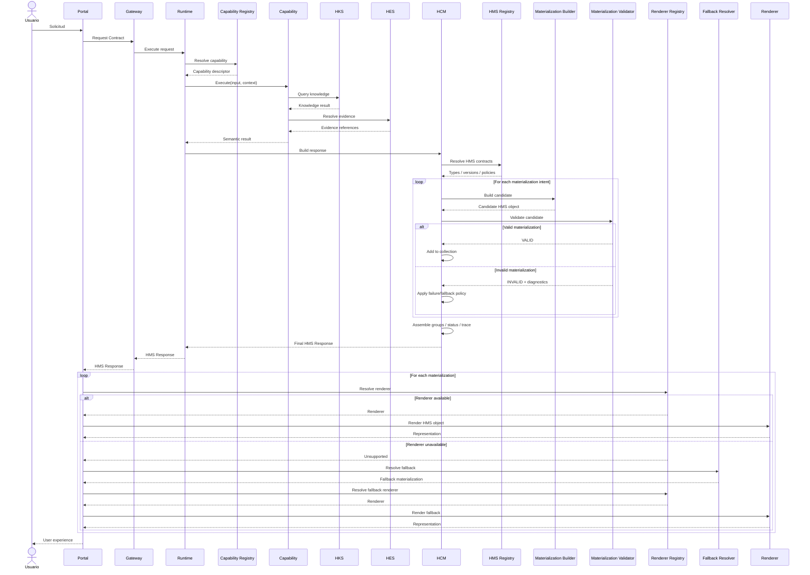
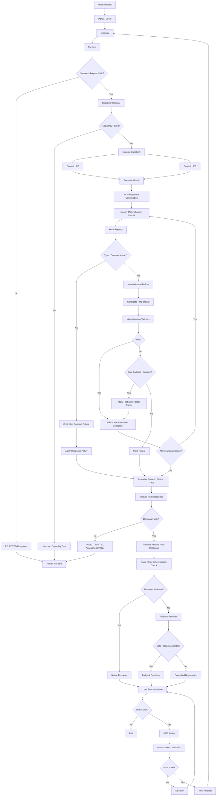

# HEYTI Materialization Standards (HMS) v1.0

## Prólogo

HEYTI ha alcanzado un punto de evolución en el que producir conocimiento correcto ya no es suficiente.

El sistema debe ser capaz de transformar ese conocimiento en respuestas estructuradas, trazables, interpretables y visualmente consumibles por las diferentes interfaces que forman parte del ecosistema AT 27–30.

Durante las etapas anteriores de construcción de HEYTI se establecieron progresivamente los componentes fundamentales para alcanzar este punto: el sistema de conocimiento, las evidencias, las capacidades cognitivas, el Runtime, los contratos operacionales y los mecanismos responsables de construir una respuesta.

Esta evolución establece una cadena arquitectónica fundamental:

**conocer → interpretar → ejecutar → construir → materializar → presentar**

La materialización ocupa una posición crítica dentro de esta cadena.

No constituye simplemente una decisión de diseño visual ni un mecanismo para convertir información en gráficas, tablas o mapas.

En HEYTI, **materializar significa transformar el resultado estructurado de una ejecución cognitiva en una representación formal que pueda ser consumida, interpretada y presentada sin alterar su significado original**.

Una misma respuesta de HEYTI puede contener simultáneamente:

- una explicación textual;
- uno o varios indicadores;
- estadísticas;
- tablas;
- mapas;
- gráficas;
- evidencias;
- advertencias;
- niveles de confianza;
- recomendaciones;
- referencias;
- elementos interactivos;
- metadatos de ejecución;
- información de trazabilidad.

Cada uno de estos elementos necesita reglas explícitas.

Sin ellas, cada capability podría definir arbitrariamente la forma de presentar sus resultados, cada interfaz tendría que interpretar estructuras diferentes y el Runtime terminaría acoplándose progresivamente a decisiones particulares de presentación.

Ese escenario es incompatible con la arquitectura de HEYTI.

Por esta razón se establece **HEYTI Materialization Standards (HMS)** como el estándar arquitectónico responsable de definir las reglas mediante las cuales los resultados producidos por HEYTI se convierten en objetos de materialización.

HMS establece una separación formal entre tres responsabilidades:

1. **Conocimiento**, responsable de aquello que HEYTI conoce.
2. **Ejecución**, responsable de determinar y construir aquello que HEYTI responde.
3. **Presentación**, responsable de representar esa respuesta ante el usuario.

Esta separación preserva uno de los principios fundamentales de la arquitectura:

> **HEYTI no debe confundir conocimiento con presentación.**

Una capability no debe diseñar una pantalla.

El Runtime no debe dibujar una gráfica.

El HKS no debe decidir cómo se representa un indicador.

El Portal no debe reconstruir el razonamiento que produjo una respuesta.

Cada componente debe conservar su responsabilidad arquitectónica.

HMS constituye el contrato que permite que estas responsabilidades permanezcan desacopladas.

---

## La materialización como lenguaje común

HEYTI puede ser consultado desde diferentes superficies de interacción.

Hoy existe un ecosistema compuesto por módulos como:

- Portal;
- Análisis Territorial;
- Ganar Todo;
- Campo;
- Día D;
- Estructura;
- componentes socioeconómicos;
- futuras interfaces específicas de HEYTI.

En el futuro podrán incorporarse además:

- aplicaciones móviles;
- dashboards;
- servicios API;
- reportes automatizados;
- documentos;
- sistemas externos;
- interfaces conversacionales;
- sistemas de voz;
- nuevas superficies todavía no diseñadas.

La arquitectura no debe obligar a las capabilities a conocer cada una de estas interfaces.

Una capability debe producir conocimiento estructurado.

HMS debe proporcionar la forma estándar de expresar cómo ese conocimiento puede materializarse.

La interfaz correspondiente decidirá finalmente cómo renderizarlo dentro de sus capacidades.

Por tanto:

> **La capability declara qué debe materializarse; el cliente decide cómo debe renderizarse.**

Esta distinción será fundamental durante todo este documento.

---

## De una respuesta a un conjunto de objetos

Una respuesta moderna de HEYTI no debe entenderse como una cadena de texto.

Debe entenderse como un **conjunto estructurado de objetos semánticos y visualizables**.

Conceptualmente:

User Request
     │
     ▼
HEYTI Runtime
     │
     ▼
Capability Execution
     │
     ▼
Knowledge + Evidence
     │
     ▼
Response Construction
     │
     ▼
Materialization Contract
     │
     ├── TEXT
     ├── KPI
     ├── METRIC
     ├── TABLE
     ├── CHART
     ├── MAP
     ├── EVIDENCE
     ├── WARNING
     ├── RECOMMENDATION
     └── ...
     │
     ▼
Presentation Layer
     │
     ├── Portal
     ├── Web UI
     ├── Mobile
     ├── API
     ├── Dashboard
     └── Document

...

# 1. Introducción y alcance de HMS

## 1.1 Introducción

HEYTI Materialization Standards (HMS) establece el estándar arquitectónico mediante el cual los resultados producidos por HEYTI pueden ser expresados como objetos estructurados, interoperables, trazables y susceptibles de representación.

HMS surge de una necesidad concreta de la evolución de HEYTI:

> **Una respuesta cognitivamente correcta no garantiza por sí misma una presentación correcta.**

El conocimiento puede ser verdadero y la ejecución puede ser correcta, pero una representación inadecuada puede:

- eliminar contexto;
- ocultar incertidumbre;
- perder evidencia;
- introducir ambigüedad;
- alterar jerarquías de información;
- generar interpretaciones incorrectas;
- acoplar innecesariamente las capabilities a una interfaz específica.

Por esta razón, HEYTI necesita una capa contractual que determine cómo los resultados construidos por su arquitectura pueden convertirse en unidades formalmente materializables.

HMS constituye esa capa.

---

## 1.2 Definición de HMS

**HEYTI Materialization Standards (HMS)** es el conjunto normativo de principios, contratos, tipos, reglas y estructuras que gobiernan la materialización de respuestas dentro del ecosistema HEYTI.

Formalmente:
```
HMS =
    Materialization Principles
  + Materialization Types
  + Object Contracts
  + Composition Rules
  + Validation Rules
  + Traceability Rules
  + Presentation Independence
  + Extension Rules
```


# 2. Fundamentos y definición formal de Materialization

## 2.1 Propósito del capítulo

Antes de definir tipos de objetos, schemas, reglas de composición o mecanismos de renderizado, HMS debe establecer con precisión qué significa **materialización** dentro de la arquitectura HEYTI.

El término puede confundirse fácilmente con conceptos relacionados como:

- respuesta;
- visualización;
- renderizado;
- serialización;
- presentación;
- exportación;
- transformación de datos.

Para evitar ambigüedad arquitectónica, HMS adopta una definición formal y establece fronteras explícitas entre estos conceptos.

El principio fundamental es:

> **Materializar no significa dibujar una respuesta; significa expresar formalmente una parte de esa respuesta como un objeto semántico susceptible de representación.**

---

## 2.2 Definición de Materialization

Dentro de HEYTI, una **Materialization** es una representación estructurada, tipada, validable y trazable de un contenido semántico producido o autorizado por una respuesta del sistema, preparada para ser consumida por uno o más clientes de presentación.

Formalmente:
```text
Materialization =
    Type
  + Semantic Content
  + Identity
  + Context
  + Metadata
  + Traceability
  + Optional Presentation Hints
```

## 2.3 Materialización como representación intermedia

HMS introduce una representación intermedia entre la respuesta cognitiva y la presentación final.

```text
Cognitive Result
       │
       ▼
Response
       │
       ▼
Materialization
       │
       ▼
Renderer
       │
       ▼
Visual / Interactive Output
```


## 2.4 Qué materializa HEYTI

HEYTI no materializa conocimiento arbitrariamente.

Materializa elementos que forman parte de una respuesta válida.

Por ejemplo, una respuesta sobre una sección electoral podría contener:


Response
│
├── Summary
├── Metrics
├── Historical Trend
├── Geographic Context
├── Findings
├── Evidence
├── Warnings
└── Recommendations
```

HMS podría expresar estos componentes como:


Summary
    ↓
TEXT

Metrics
    ↓
KPI

Historical Trend
    ↓
CHART

Geographic Context
    ↓
MAP

Findings
    ↓
LIST

Evidence
    ↓
EVIDENCE

Warnings
    ↓
WARNING

Recommendations
    ↓
RECOMMENDATION
```

La materialización no crea estos contenidos.

Los expresa.

---

## 2.5 Qué NO es una materialización

Una materialización no debe confundirse con ninguno de los siguientes conceptos.

### 2.5.1 No es conocimiento

Un objeto HMS puede transportar conocimiento, pero no constituye por sí mismo una fuente autoritativa de conocimiento.

```text
HKS / Data / Evidence
        │
        ▼
Knowledge
        │
        ▼
Response
        │
        ▼
Materialization
```

Por tanto:

> **HMS consume significado; no establece verdad.**

### 2.5.2 No es razonamiento

HMS no determina conclusiones.

No decide:

- qué sección es prioritaria;
- qué tendencia es relevante;
- qué evidencia debe prevalecer;
- qué recomendación debe emitirse;
- qué nivel de confianza corresponde.

Estas decisiones pertenecen a las capas cognitivas y contractuales correspondientes.

HMS recibe el resultado autorizado y lo expresa mediante objetos estándar.

### 2.5.3 No es una Response completa

Una `Response` y una `Materialization` son conceptos diferentes.

La respuesta constituye el contrato global de una ejecución.

Una materialización constituye una unidad expresiva dentro de esa respuesta.

Conceptualmente:

```text
Response
│
├── execution metadata
├── status
├── capability
├── traceability
├── diagnostics
├── materializations[]
└── additional contract information
```

Por tanto:

```text
Materialization ⊂ Response
```

Una respuesta puede contener cero, una o múltiples materializaciones dependiendo del resultado de la ejecución y del contrato aplicable.

---

## 2.6 Materialization no es Visualization

Esta distinción es fundamental.

Una **Materialization** define un objeto semánticamente representable.

Una **Visualization** constituye una representación visual específica de dicho objeto.

Ejemplo:

```text
HMS Object

type = KPI
label = "Participación"
value = 58.4
unit = percent
```

Una interfaz podría representarlo como:

```text
┌─────────────────────┐
│ Participación       │
│                     │
│       58.4 %        │
└─────────────────────┘
```

Otra podría representarlo como:

```text
Participación: 58.4 %
████████████░░░░░░░░
```

Otra podría expresarlo verbalmente:

```text
"La participación registrada es de 58.4 por ciento."
```

Las representaciones son diferentes.

La materialización es la misma.

Por tanto:

```text
Materialization ≠ Visualization
```

---

## 2.7 Materialization no es Rendering

Rendering es el proceso técnico mediante el cual un cliente transforma un objeto materializable en una salida concreta.

```text
Materialization
      │
      ▼
Renderer
      │
      ▼
Rendered Output
```

Ejemplos de renderers futuros:

```text
KPI Renderer
Table Renderer
Chart Renderer
Map Renderer
Text Renderer
Document Renderer
Voice Renderer
```

HMS especifica el contrato de entrada.

El renderer implementa la representación.

---

## 2.8 Materialization no es Serialization

Serializar significa convertir una estructura a un formato transportable o persistible.

Por ejemplo:

```text
Object
   ↓
JSON
```

La serialización puede transportar una materialización, pero no la define conceptualmente.

Una materialización podría serializarse como:

- JSON;
- MessagePack;
- otra representación compatible futura.

Por tanto:

```text
Materialization ≠ JSON
```

aunque JSON pueda constituir el formato inicial de intercambio utilizado por HEYTI.

La arquitectura deberá evitar confundir el contrato semántico con su codificación física.

---

## 2.9 Materialization no es Presentation

Presentation es una responsabilidad más amplia.

Puede incluir:

- layout;
- navegación;
- estilos;
- jerarquía visual;
- interacción;
- accesibilidad;
- comportamiento responsive;
- composición de pantallas;
- experiencia de usuario.

HMS puede proporcionar información semántica que ayude a estas decisiones.

Pero no sustituye a la capa de presentación.

```text
HMS
 ↓
what can be represented

Presentation Layer
 ↓
how the experience is organized
```

---

## 2.10 Materialization no es Export

Exportar significa generar una representación destinada a transferencia, descarga o almacenamiento externo.

Ejemplos:

```text
PDF
CSV
XLSX
PNG
GeoJSON
PPTX
```

Una exportación puede originarse a partir de materializaciones HMS.

Sin embargo:

```text
Materialization
      │
      ▼
Export Renderer
      │
      ▼
PDF / CSV / XLSX / ...
```

El archivo final no constituye necesariamente el objeto HMS original.

---

## 2.11 Materialization como objeto tipado

Toda materialización deberá declarar explícitamente su tipo.

Conceptualmente:

```json
{
  "type": "KPI"
}
```

El tipo determina:

- significado estructural;
- campos permitidos;
- campos requeridos;
- reglas de validación;
- capacidades mínimas esperadas del consumidor;
- estrategias posibles de fallback.

Por tanto:

> **No existirán materializaciones oficiales anónimas o sin tipo.**

---

## 2.12 Identidad de la materialización

Cuando la trazabilidad, composición o interacción lo requiera, una materialización deberá poseer identidad estable dentro de la respuesta.

Ejemplo:

```json
{
  "id": "electoral.participation.2024",
  "type": "KPI"
}
```

El identificador permite:

- referencias internas;
- auditoría;
- interacción;
- composición;
- logging;
- diagnóstico;
- testing;
- actualización controlada.

El identificador no deberá utilizarse como texto de presentación.

Su función es arquitectónica.

---

## 2.13 Contenido semántico

El núcleo de toda materialización es su contenido semántico.

Por ejemplo:

```json
{
  "type": "KPI",
  "label": "Lista nominal",
  "value": 1487,
  "unit": "persons"
}
```

Los datos:

```text
Lista nominal
1487
persons
```

constituyen contenido semántico.

El color, tamaño, posición o animación con que posteriormente se muestre el KPI no forman parte de ese significado.

---

## 2.14 Contexto

Algunas materializaciones necesitan contexto para ser correctamente interpretadas.

Por ejemplo:

```json
{
  "type": "METRIC",
  "label": "Participación",
  "value": 58.4,
  "unit": "percent",
  "context": {
    "year": 2024,
    "scope": "section",
    "section": "1234"
  }
}
```

Sin contexto, el valor `58.4` puede resultar ambiguo.

El estándar deberá permitir transportar el contexto mínimo necesario sin duplicar indiscriminadamente información ya disponible en niveles superiores del contrato.

---

## 2.15 Metadata

La metadata describe características del objeto sin constituir necesariamente su contenido principal.

Podrá incluir, según el tipo y contrato:

```text
created_at
schema_version
source_refs
evidence_refs
confidence_ref
execution_ref
capability_ref
```

HMS deberá distinguir cuidadosamente entre:

```text
content
```

y:

```text
metadata
```

Esta separación facilitará validación, auditoría y evolución del estándar.

---

## 2.16 Trazabilidad

Una materialización no debe convertirse en un punto muerto dentro de la arquitectura.

Cuando corresponda, deberá poder relacionarse con su origen.

Conceptualmente:

```text
materialization_id
       │
       ▼
response_id
       │
       ▼
execution_id
       │
       ▼
capability_id
       │
       ▼
evidence_refs
       │
       ▼
knowledge_sources
```

No necesariamente toda la cadena estará embebida físicamente dentro de cada objeto.

Podrá resolverse mediante referencias.

El requisito fundamental es:

> **La materialización no debe destruir la posibilidad de reconstruir procedencia.**

---

## 2.17 Presentation Hints

HMS podrá permitir hints de presentación cuando aporten intención semántica sin imponer implementación visual.

Ejemplo válido:

```json
{
  "type": "WARNING",
  "severity": "critical"
}
```

Ejemplo potencialmente inválido dentro del núcleo HMS:

```json
{
  "background": "#ff0000",
  "font_size": "24px",
  "position": "top-right"
}
```

La primera estructura expresa significado.

La segunda impone una implementación visual.

Regla:

> **Un presentation hint deberá expresar intención, prioridad o comportamiento semántico; no diseño gráfico concreto.**

---

## 2.18 Materializaciones atómicas

Una materialización atómica representa una unidad que puede interpretarse de manera independiente dentro de su contexto.

Ejemplos:

```text
TEXT
KPI
METRIC
WARNING
EVIDENCE
RECOMMENDATION
IMAGE
REFERENCE
```

Conceptualmente:

```text
Atomic Materialization
        │
        └── meaningful unit
```

Esto no significa que carezca de relaciones con otros objetos.

Significa que posee identidad semántica propia.

---

## 2.19 Materializaciones compuestas

Algunas materializaciones necesitan contener o relacionar múltiples unidades.

Ejemplos conceptuales:

```text
TABLE
CHART
MAP
TIMELINE
GRAPH
TREE
```

Una gráfica, por ejemplo, puede requerir:

```text
CHART
│
├── dimensions
├── series
├── labels
├── units
└── references
```

Una materialización compuesta deberá conservar contratos explícitos para sus componentes.

No podrá convertirse en un contenedor arbitrario.

---

## 2.20 Colecciones de materializaciones

Una respuesta puede contener múltiples objetos HMS.

Ejemplo:

```json
{
  "materializations": [
    {
      "id": "summary",
      "type": "TEXT"
    },
    {
      "id": "ln_2024",
      "type": "KPI"
    },
    {
      "id": "trend",
      "type": "CHART"
    },
    {
      "id": "territory",
      "type": "MAP"
    }
  ]
}
```

El orden de la colección podrá tener significado cuando el contrato así lo indique.

Sin embargo, el orden visual definitivo continuará siendo responsabilidad del cliente.

---

## 2.21 Relaciones entre materializaciones

Los objetos HMS podrán relacionarse.

Por ejemplo:

```text
RECOMMENDATION
      │
      ├── supported_by → EVIDENCE
      │
      └── relates_to → MAP
```

o:

```text
WARNING
   │
   └── affects → KPI
```

Estas relaciones deberán expresarse mediante referencias explícitas y no mediante dependencias implícitas del layout.

Correcto:

```text
warning.affects = "electoral.margin"
```

Incorrecto:

```text
"la advertencia corresponde a la tarjeta situada arriba"
```

El significado nunca deberá depender de la posición visual.

---

## 2.22 Materialización primaria y complementaria

Una respuesta podrá distinguir entre materializaciones centrales y complementarias.

Por ejemplo:

```text
DescribeSection

PRIMARY
├── TEXT summary
├── KPI electoral margin
└── MAP section

SUPPORTING
├── CHART historical trend
├── EVIDENCE
└── REFERENCE
```

Esta clasificación deberá expresar importancia semántica, no posición gráfica.

Un renderer podrá utilizarla para establecer jerarquía visual.

---

## 2.23 Materialización y ausencia de datos

La ausencia de información constituye un estado que debe ser tratado explícitamente.

HMS no deberá permitir que un renderer confunda:

```text
0
```

con:

```text
null
```

ni:

```text
null
```

con:

```text
unknown
```

ni:

```text
unknown
```

con:

```text
not_applicable
```

Conceptualmente deberán distinguirse estados como:

```text
AVAILABLE
MISSING
UNKNOWN
NOT_APPLICABLE
RESTRICTED
NOT_COMPUTABLE
```

La taxonomía definitiva será formalizada posteriormente.

Principio:

> **La ausencia de información también debe materializarse honestamente.**

---

## 2.24 Materialización y confianza

Una materialización puede estar asociada a un nivel de confianza.

Ejemplo conceptual:

```text
KPI
 │
 └── confidence_ref
```

o:

```text
RECOMMENDATION
 │
 └── confidence_ref
```

El renderer podrá utilizar esta información para comunicar incertidumbre.

Pero no podrá modificarla.

```text
Confidence produced upstream
          │
          ▼
HMS preserves
          │
          ▼
Renderer communicates
```

---

## 2.25 Materialización y evidencia

Una afirmación materializada puede requerir evidencia.

Ejemplo:

```json
{
  "id": "finding.turnout_decline",
  "type": "WARNING",
  "evidence_refs": [
    "evidence.electoral.2021",
    "evidence.electoral.2024"
  ]
}
```

La materialización no necesita duplicar necesariamente toda la evidencia.

Debe preservar la relación.

---

## 2.26 Materialización y explicabilidad

Algunas materializaciones podrán vincularse con información explicativa.

Por ejemplo:

```text
RECOMMENDATION
       │
       ├── evidence_refs
       ├── confidence_ref
       └── explanation_ref
```

Esto permitirá que futuras interfaces implementen interacciones como:

```text
¿Por qué HEYTI recomienda esto?
```

sin obligar al frontend a reconstruir el razonamiento.

---

## 2.27 Materialización e interacción

Un objeto HMS podrá declarar capacidades de interacción.

Por ejemplo, un MAP podría permitir conceptualmente:

```text
select_feature
inspect_section
request_detail
```

Sin embargo, HMS no deberá incorporar código ejecutable de interfaz.

Incorrecto:

```javascript
onclick = () => openSection(...)
```

Correcto conceptualmente:

```json
{
  "actions": [
    {
      "type": "REQUEST_DETAIL",
      "target": "section"
    }
  ]
}
```

La interfaz decide cómo implementar esa acción.

---

## 2.28 Materialización determinista

Cuando dos ejecuciones tengan:

- mismo conocimiento;
- misma versión;
- mismos parámetros;
- misma capability;
- mismo resultado cognitivo;
- mismo contrato HMS;

las materializaciones semánticas deberían ser equivalentes.

Formalmente:

```text
Same Semantic Input
        +
Same HMS Contract
        =
Semantically Equivalent Materialization
```

La representación visual puede variar.

El significado materializado no.

---

## 2.29 Inmutabilidad semántica

Una vez que una materialización forma parte de una respuesta emitida, su contenido semántico no deberá ser modificado silenciosamente.

Si cambia el contenido deberá existir:

- nueva respuesta;
- nueva versión;
- nuevo objeto;
- o mecanismo explícito de actualización definido por contrato.

Esto protege:

- auditoría;
- reproducibilidad;
- trazabilidad;
- testing;
- confianza.

---

## 2.30 Materialización mínima válida

Conceptualmente, una materialización mínima deberá poder responder al menos:

```text
¿Qué soy?
¿Qué represento?
¿Cómo puedo identificarme?
¿Mi contenido es válido?
```

Esto conduce a una estructura base conceptual:

```json
{
  "id": "example.object",
  "type": "TEXT",
  "content": {},
  "meta": {}
}
```

La estructura definitiva será establecida en los capítulos contractuales posteriores.

Este ejemplo no constituye todavía el schema oficial.

---

## 2.31 Ciclo de vida conceptual

El ciclo de vida de una materialización puede expresarse como:

```text
1. Cognitive result exists
           │
           ▼
2. Response construction
           │
           ▼
3. Materialization intent identified
           │
           ▼
4. HMS object constructed
           │
           ▼
5. HMS validation
           │
           ├── INVALID → controlled handling
           │
           └── VALID
                  │
                  ▼
6. Response assembly
           │
           ▼
7. Transport
           │
           ▼
8. Client interpretation
           │
           ▼
9. Rendering
```

Este flujo será refinado posteriormente al definir el Materialization Pipeline.

---

## 2.32 Invariantes fundamentales

Toda implementación futura de HMS deberá preservar los siguientes invariantes:

### HMS-I01 — Tipado

Toda materialización posee un tipo reconocido.

### HMS-I02 — Preservación semántica

El significado no puede ser alterado por el renderer.

### HMS-I03 — No invención

La materialización no introduce conocimiento no autorizado por la respuesta.

### HMS-I04 — Validabilidad

Todo objeto puede ser validado contra un contrato conocido.

### HMS-I05 — Trazabilidad

La procedencia puede reconstruirse cuando sea requerida.

### HMS-I06 — Neutralidad tecnológica

El significado no depende de una tecnología de frontend específica.

### HMS-I07 — Independencia visual

El contrato semántico no impone diseño gráfico concreto.

### HMS-I08 — Honestidad

La materialización preserva incertidumbre, ausencia de datos, advertencias y limitaciones.

### HMS-I09 — Extensibilidad controlada

Nuevos tipos pueden incorporarse sin convertir HMS en un esquema arbitrario.

### HMS-I10 — Identidad

Los objetos que necesiten referencia, interacción o trazabilidad poseen identificadores estables dentro de su contexto contractual.

---

## 2.33 Ecuación conceptual de HMS

A partir de las definiciones anteriores puede establecerse:

```text
Knowledge
   +
Evidence
   +
Capability Execution
   ↓
Semantic Result
   ↓
HCM Response
   ↓
HMS Materialization
   ↓
Renderer
   ↓
User Representation
```

Ninguna flecha autoriza a la capa siguiente a reescribir el significado producido por la anterior.

---

## 2.34 Regla de frontera cognitiva

HMS establece una frontera particularmente importante:

```text
Before HMS
────────────
Meaning may be constructed.

After HMS
───────────
Meaning may only be represented.
```

Por tanto:

> **Una vez que el contenido cruza la frontera HMS, ningún componente de presentación deberá realizar nuevas inferencias cognitivas necesarias para completar la respuesta.**

Si una interfaz necesita inferir algo para poder mostrar correctamente una respuesta, el contrato está incompleto o la responsabilidad se encuentra en la capa equivocada.

---

## 2.35 Prueba conceptual de correcta materialización

Para determinar si un objeto pertenece correctamente a HMS pueden formularse cinco preguntas:

1. **¿El contenido ya fue determinado por una capa autorizada?**
2. **¿El objeto expresa ese contenido sin generar conocimiento nuevo?**
3. **¿Puede validarse mediante un contrato explícito?**
4. **¿Puede ser interpretado por un cliente sin conocer la lógica interna de la capability?**
5. **¿Puede representarse mediante tecnologías distintas conservando el mismo significado?**

Si las cinco respuestas son afirmativas, el objeto es un candidato válido para materialización HMS.

Si alguna respuesta es negativa, deberá revisarse la asignación de responsabilidades.

---

## 2.36 Ejemplo conceptual completo

Supóngase que HEYTI determina:

```text
Sección: 1234
Lista nominal 2024: 1,487
Participación: 58.4 %
Margen: 2.7 %
Clasificación: competitiva
```

La capa cognitiva determina esos resultados.

HMS podría expresarlos conceptualmente como:

```json
{
  "materializations": [
    {
      "id": "section.summary",
      "type": "TEXT",
      "content": {
        "text": "La sección 1234 presenta un escenario electoral competitivo."
      }
    },
    {
      "id": "section.nominal_list",
      "type": "KPI",
      "content": {
        "label": "Lista nominal",
        "value": 1487,
        "unit": "persons"
      }
    },
    {
      "id": "section.turnout",
      "type": "KPI",
      "content": {
        "label": "Participación",
        "value": 58.4,
        "unit": "percent"
      }
    },
    {
      "id": "section.margin",
      "type": "KPI",
      "content": {
        "label": "Margen",
        "value": 2.7,
        "unit": "percent"
      }
    }
  ]
}
```

El ejemplo es ilustrativo.

Los schemas definitivos se establecerán posteriormente.

Un Portal podría transformar esos objetos en tarjetas.

Una API podría devolverlos estructuralmente.

Un generador documental podría producir una tabla.

Una interfaz conversacional podría verbalizarlos.

Pero ninguno de esos consumidores deberá recalcular:

```text
"competitiva"
```

a partir de:

```text
margin = 2.7
```

La clasificación debe haber sido determinada antes de HMS si forma parte del significado oficial de la respuesta.

---

## 2.37 Consecuencia arquitectónica

Esta separación produce una regla de enorme importancia para la futura interfaz de HEYTI:

> **La inteligencia debe permanecer detrás del contrato; la interfaz debe consumir inteligencia, no reconstruirla.**

Esto permitirá que Portal y las futuras interfaces evolucionen sin convertirse en motores cognitivos paralelos.

También permitirá sustituir tecnologías visuales sin modificar las capabilities.

---

## 2.38 Declaración normativa del capítulo

A partir de HMS v1.0 queda establecido que:

> **Una Materialization es un objeto semántico estructurado derivado de una respuesta válida y preparado para representación independiente de tecnología.**

Asimismo:

> **Materialization, Visualization, Rendering, Serialization, Presentation y Export son conceptos arquitectónicamente distintos y no deberán utilizarse como sinónimos.**

Y:

> **Toda inferencia necesaria para establecer el significado oficial de una respuesta deberá ocurrir antes de la frontera HMS.**

Finalmente:

> **Después de la frontera HMS, los consumidores podrán transformar la forma de representación, pero no el significado del contenido.**

---

## 2.39 Cierre

La materialización constituye el puente entre inteligencia y experiencia.

Pero para que ese puente sea arquitectónicamente seguro debe existir una frontera inequívoca:

```text
HEYTI decides
     │
     ▼
HMS expresses
     │
     ▼
Renderer represents
     │
     ▼
User interprets
```

HEYTI decide qué significa la respuesta.

HMS expresa formalmente aquello que puede ser presentado.

El renderer determina cómo representarlo.

El usuario recibe una experiencia comprensible.

Esta separación permitirá construir interfaces cada vez más sofisticadas sin trasladar hacia ellas responsabilidades cognitivas que pertenecen al Core.

Con esta definición queda establecida la base conceptual necesaria para comenzar a construir el vocabulario formal de HMS.

# 3. Modelo y Arquitectura Formal de HMS

## 3.1 Propósito del capítulo

Los capítulos anteriores establecieron la naturaleza, alcance y principios fundamentales de HEYTI Materialization Standards.

El siguiente paso consiste en transformar esos principios en una arquitectura formal.

Este capítulo define:

- la posición de HMS dentro del ecosistema HEYTI;
- sus fronteras arquitectónicas;
- los componentes conceptuales que participan en la materialización;
- las responsabilidades de cada componente;
- el flujo de información;
- los puntos de validación;
- las relaciones con HKS, HES, capabilities, Runtime y HCM;
- la relación con renderers y clientes;
- los principios de desacoplamiento;
- las invariantes arquitectónicas que deberán preservarse durante la implementación.

El objetivo no es todavía definir el schema definitivo de cada tipo de materialización.

El objetivo es establecer **la arquitectura dentro de la cual esos contratos existirán**.

---

## 3.2 Principio arquitectónico central

HMS se fundamenta en una separación estricta de responsabilidades.

La cadena general de HEYTI puede expresarse como:

```text
Knowledge
    │
    ▼
Evidence
    │
    ▼
Capability
    │
    ▼
Runtime
    │
    ▼
HCM
    │
    ▼
HMS
    │
    ▼
Renderer
    │
    ▼
User Experience
```

Cada capa responde una pregunta diferente:

```text
HKS
¿Qué conoce HEYTI?

HES
¿Qué evidencia sustenta lo que conoce o afirma?

Capability
¿Qué operación cognitiva debe realizarse?

Runtime
¿Cómo se ejecuta esa capacidad?

HCM
¿Cómo se construye la respuesta?

HMS
¿Cómo se expresa aquello que puede materializarse?

Renderer
¿Cómo se representa?

Presentation Client
¿Cómo se integra esa representación en una experiencia?

User
¿Cómo consume e interpreta el resultado?
```

Esta separación constituye una de las principales garantías de mantenibilidad del sistema.

---

## 3.3 HMS dentro de la arquitectura HEYTI

La posición formal de HMS puede representarse de la siguiente manera:

```text
┌─────────────────────────────────────┐
│         KNOWLEDGE SYSTEM            │
│                                     │
│                HKS                  │
└─────────────────┬───────────────────┘
                  │
                  ▼
┌─────────────────────────────────────┐
│          EVIDENCE SYSTEM            │
│                                     │
│                HES                  │
└─────────────────┬───────────────────┘
                  │
                  ▼
┌─────────────────────────────────────┐
│            CAPABILITIES             │
│                                     │
│     Cognitive / Operational Logic   │
└─────────────────┬───────────────────┘
                  │
                  ▼
┌─────────────────────────────────────┐
│              RUNTIME                │
│                                     │
│ Execution / Orchestration / Events  │
└─────────────────┬───────────────────┘
                  │
                  ▼
┌─────────────────────────────────────┐
│                HCM                  │
│                                     │
│        Response Construction        │
└─────────────────┬───────────────────┘
                  │
                  ▼
╔═════════════════════════════════════╗
║                HMS                  ║
║                                     ║
║       Materialization Contract      ║
╚═════════════════╤═══════════════════╝
                  │
                  ▼
┌─────────────────────────────────────┐
│            RENDERERS                │
│                                     │
│ Text / KPI / Chart / Map / ...      │
└─────────────────┬───────────────────┘
                  │
                  ▼
┌─────────────────────────────────────┐
│        PRESENTATION CLIENTS         │
│                                     │
│ Portal / Web / Mobile / API / Docs  │
└─────────────────┬───────────────────┘
                  │
                  ▼
              USER
```

HMS constituye, por tanto, una **frontera contractual** entre la construcción de la respuesta y su representación.

---

## 3.4 Las dos fronteras de HMS

HMS posee dos fronteras principales.

### Frontera de entrada

Separa HMS de las capas responsables de construir significado.

```text
HCM Response
     │
     ▼
════════════════════
 HMS INPUT BOUNDARY
════════════════════
     │
     ▼
Materialization
```

Después de cruzar esta frontera, HMS no debe realizar razonamiento cognitivo nuevo.

### Frontera de salida

Separa HMS de las tecnologías responsables de representación.

```text
Materialization
     │
     ▼
═════════════════════
 HMS OUTPUT BOUNDARY
═════════════════════
     │
     ▼
Renderer
```

Antes de cruzar esta frontera, HMS no debe incorporar decisiones concretas de diseño gráfico.

Estas dos fronteras protegen el estándar de contaminación arquitectónica en ambas direcciones.

---

## 3.5 Modelo lógico de HMS

El modelo lógico de HMS se compone conceptualmente de las siguientes funciones:

```text
HMS
│
├── Materialization Vocabulary
│
├── Base Object Contract
│
├── Type Contracts
│
├── Composition Rules
│
├── Relationship Rules
│
├── Metadata Rules
│
├── Traceability Rules
│
├── Validation Rules
│
├── Interaction Contracts
│
├── Fallback Rules
└── Extension Governance
```

Estos elementos no representan necesariamente módulos de software independientes.

Representan responsabilidades arquitectónicas que deberán existir en el estándar y, posteriormente, en su implementación.

---

## 3.6 Materialization Vocabulary

El **Materialization Vocabulary** define el conjunto oficial de tipos reconocidos por HMS.

Ejemplos iniciales:

```text
TEXT
MARKDOWN
LIST
TABLE

KPI
METRIC

CHART
MAP
TIMELINE
GRAPH
TREE
IMAGE

EVIDENCE
REFERENCE

WARNING
ALERT
RECOMMENDATION

JSON
DOWNLOAD
DOCUMENT
```

El vocabulario constituye un contrato controlado.

Una capability no deberá crear arbitrariamente tipos como:

```text
MY_SPECIAL_CHART
SUPER_KPI
CUSTOM_MAP_123
```

sin pasar por el mecanismo formal de extensión de HMS.

---

## 3.7 Base Object Contract

Todo tipo HMS deberá derivar conceptualmente de un contrato base.

Ejemplo conceptual:

```json
{
  "id": "materialization.identifier",
  "type": "TYPE",
  "version": "1.0",
  "content": {},
  "meta": {},
  "relationships": [],
  "actions": []
}
```

Este ejemplo todavía no constituye el schema definitivo.

El contrato base permitirá compartir propiedades comunes entre diferentes tipos.

Entre ellas podrán encontrarse:

- identidad;
- tipo;
- versión;
- estado;
- contenido;
- contexto;
- metadata;
- referencias;
- relaciones;
- acciones;
- trazabilidad.

---

## 3.8 Type Contracts

Cada tipo HMS deberá extender el contrato base mediante reglas propias.

Por ejemplo:

```text
BaseMaterialization
        │
        ├── TextMaterialization
        ├── KPIMaterialization
        ├── TableMaterialization
        ├── ChartMaterialization
        ├── MapMaterialization
        ├── EvidenceMaterialization
        └── RecommendationMaterialization
```

Cada contrato específico deberá determinar:

- campos obligatorios;
- campos opcionales;
- tipos de datos;
- restricciones;
- relaciones permitidas;
- acciones compatibles;
- fallbacks posibles.

Esto evita que `type` sea simplemente una etiqueta sin significado contractual.

---

## 3.9 Materialization Builder

La arquitectura podrá incorporar un componente responsable de construir objetos compatibles con HMS.

Conceptualmente:

```text
Semantic Response Component
          │
          ▼
Materialization Builder
          │
          ▼
HMS Object
```

Su responsabilidad será transformar una intención de materialización ya determinada en una estructura válida.

El Materialization Builder:

**sí puede:**

- construir estructuras HMS;
- asignar campos;
- normalizar formatos;
- incorporar referencias;
- aplicar defaults contractuales permitidos;
- preparar objetos para validación.

**no puede:**

- inventar hallazgos;
- calcular nuevas conclusiones cognitivas;
- cambiar niveles de confianza;
- crear evidencia inexistente;
- decidir prioridades estratégicas.

---

## 3.10 Materialization Validator

Antes de formar parte de una respuesta oficial, un objeto HMS deberá poder ser validado.

```text
Materialization Builder
          │
          ▼
Candidate HMS Object
          │
          ▼
Materialization Validator
          │
     ┌────┴────┐
     │         │
   VALID     INVALID
     │         │
     ▼         ▼
Response    Controlled
Assembly    Error Handling
```

La validación podrá incluir:

- existencia del tipo;
- cumplimiento del schema;
- presencia de campos obligatorios;
- formato de identificadores;
- tipos de datos;
- consistencia de unidades;
- referencias válidas;
- relaciones permitidas;
- compatibilidad de acciones;
- versión contractual.

---

## 3.11 El Validator no corrige significado

El Materialization Validator deberá aplicar una regla estricta:

> **Validar no significa reinterpretar.**

Si recibe:

```json
{
  "type": "KPI",
  "value": "desconocido"
}
```

y el contrato exige un valor numérico acompañado de un estado de disponibilidad, el validator no deberá inventar:

```json
{
  "value": 0
}
```

Deberá rechazar o señalar el objeto según la política correspondiente.

La corrección silenciosa puede destruir significado.

---

## 3.12 Materialization Registry

HMS deberá disponer conceptualmente de un registro oficial de tipos.

```text
Materialization Registry
│
├── TEXT
├── KPI
├── TABLE
├── CHART
├── MAP
├── EVIDENCE
├── WARNING
├── RECOMMENDATION
└── ...
```

Cada entrada deberá permitir conocer, al menos:

```text
type_id
schema_version
status
contract
supported_relationships
supported_actions
fallback_policy
```

El Registry permitirá responder:

> **¿Este tipo forma parte oficialmente de HMS?**

---

## 3.13 Diferencia entre Materialization Registry y Capability Registry

Estos registros cumplen funciones distintas.

```text
Capability Registry
        │
        └── ¿Qué puede ejecutar HEYTI?

Materialization Registry
        │
        └── ¿Qué puede expresar HEYTI como materialización?
```

No deberán fusionarse.

Una capability puede utilizar múltiples tipos HMS.

Un tipo HMS puede ser utilizado por múltiples capabilities.

La relación es:

```text
Capability 1 ─┐
Capability 2 ─┼──► KPI
Capability 3 ─┘

Capability 1 ─┐
Capability 4 ─┼──► MAP
Capability 7 ─┘
```

Esto constituye una relación muchos-a-muchos.

---

## 3.14 Materialization Collection

Una respuesta podrá contener una colección ordenada de materializaciones.

Conceptualmente:

```text
MaterializationCollection
│
├── Materialization A
├── Materialization B
├── Materialization C
└── Materialization N
```

La colección podrá contener metadata propia relacionada con:

- orden semántico;
- agrupación;
- prioridad;
- contexto común;
- relaciones globales.

La colección no deberá convertirse en una definición de layout.

---

## 3.15 Materialization Group

HMS podrá permitir agrupaciones semánticas.

Por ejemplo:

```text
GROUP: electoral_overview
│
├── KPI participation
├── KPI margin
├── KPI nominal_list
└── CHART historical_results
```

Otro grupo:

```text
GROUP: territorial_context
│
├── MAP section
├── TEXT description
└── EVIDENCE territorial_sources
```

El grupo expresa relación conceptual.

No necesariamente:

```text
fila 1
columna 2
panel derecho
```

Estas últimas son decisiones de presentación.

---

## 3.16 Relaciones explícitas

Los objetos HMS podrán relacionarse mediante referencias.

Ejemplo:

```text
WARNING turnout_decline
       │
       ├── affects
       │      ↓
       │    KPI turnout
       │
       └── supported_by
              ↓
           EVIDENCE historical_results
```

Conceptualmente:

```json
{
  "relationships": [
    {
      "type": "AFFECTS",
      "target": "kpi.turnout"
    },
    {
      "type": "SUPPORTED_BY",
      "target": "evidence.historical_results"
    }
  ]
}
```

La taxonomía oficial de relaciones se definirá posteriormente.

---

## 3.17 Grafo de materialización

Debido a la existencia de relaciones, una colección HMS puede conceptualizarse como un grafo.

```text
[KPI Margin]
     │
     │ affects
     ▼
[WARNING Competitive]
     │
     │ supported_by
     ▼
[EVIDENCE Results]
```

Por tanto:

```text
Materializations = Nodes
Relationships    = Edges
```

Esto permitirá futuras experiencias donde el usuario pueda navegar desde una conclusión hacia:

- evidencia;
- explicación;
- indicador;
- mapa;
- recomendación;
- fuente.

---

## 3.18 Traceability Layer

HMS deberá preservar referencias suficientes para mantener continuidad con la arquitectura de trazabilidad de HEYTI.

Conceptualmente:

```text
Materialization
      │
      ▼
Response
      │
      ▼
Execution
      │
      ▼
Capability
      │
      ▼
Evidence
      │
      ▼
Knowledge
      │
      ▼
Source
```

HMS no necesariamente almacenará toda la cadena.

Deberá preservar los identificadores necesarios para reconstruirla.

---

## 3.19 Metadata Layer

La metadata HMS deberá proporcionar información técnica o contextual sobre el objeto sin mezclarse con su contenido semántico principal.

Ejemplo conceptual:

```json
{
  "meta": {
    "schema_version": "1.0",
    "created_at": "2026-08-08T16:00:00-06:00",
    "response_ref": "response.example",
    "execution_ref": "execution.example"
  }
}
```

La metadata podrá crecer mediante extensiones controladas.

No deberá utilizarse como depósito arbitrario para campos que no se sabe dónde colocar.

---

## 3.20 Context Layer

HMS deberá permitir declarar el contexto necesario para interpretar una materialización.

Ejemplo:

```json
{
  "context": {
    "scope": "section",
    "section_id": "1234",
    "year": 2024
  }
}
```

El contexto puede ser:

- heredado de la respuesta;
- definido a nivel de grupo;
- específico de una materialización.

Deberá evitarse la duplicación innecesaria.

---

## 3.21 Herencia contextual

Cuando varias materializaciones compartan contexto, éste podrá declararse en un nivel superior.

Ejemplo conceptual:

```text
Response Context
│
├── state = Guanajuato
├── section = 1234
└── year = 2024
        │
        ├── KPI turnout
        ├── KPI margin
        ├── CHART results
        └── MAP section
```

Una materialización deberá redefinir contexto únicamente cuando necesite especializarlo o diferenciarlo.

Esto reduce:

- redundancia;
- tamaño de respuesta;
- riesgo de inconsistencias.

---

## 3.22 Evidence References

Los objetos HMS que representen afirmaciones susceptibles de sustentación deberán poder relacionarse con evidencia.

```text
Materialization
      │
      └── evidence_refs[]
```

Ejemplo conceptual:

```json
{
  "evidence_refs": [
    "hes:evidence:2024:section:1234:results"
  ]
}
```

La referencia deberá ser resoluble por los componentes autorizados.

HMS no deberá imponer que toda la evidencia sea embebida.

---

## 3.23 Confidence References

De manera similar, los objetos podrán referenciar información de confianza.

```text
Materialization
      │
      └── confidence_ref
```

Esto permite separar:

```text
semantic content
```

de:

```text
confidence assessment
```

sin perder su relación.

La interfaz podrá comunicar la confianza.

No podrá recalcularla.

---

## 3.24 Explainability References

Cuando una materialización derive de una conclusión o recomendación que requiera explicación, podrá existir:

```text
explanation_ref
```

Conceptualmente:

```text
RECOMMENDATION
       │
       ├── evidence_ref
       ├── confidence_ref
       └── explanation_ref
```

Esto permitirá experiencias futuras como:

```text
Resultado
   │
   ├── Ver evidencia
   ├── Ver nivel de confianza
   └── ¿Por qué HEYTI dice esto?
```

sin trasladar razonamiento al frontend.

---

## 3.25 Action Contract

Algunas materializaciones podrán declarar acciones disponibles.

Ejemplo:

```json
{
  "actions": [
    {
      "type": "REQUEST_DETAIL",
      "target": {
        "entity_type": "section",
        "entity_id": "1234"
      }
    }
  ]
}
```

La acción expresa intención.

No implementación.

Por tanto:

```text
HMS Action
     │
     ▼
Client interprets
     │
     ▼
Client decides interaction mechanism
```

Un cliente web podría usar un clic.

Un cliente móvil podría usar un toque.

Una interfaz de voz podría usar una instrucción verbal.

La intención permanece constante.

---

## 3.26 Action Resolver

En una implementación futura podrá existir un mecanismo responsable de traducir acciones HMS hacia operaciones autorizadas del sistema.

Conceptualmente:

```text
HMS Action
    │
    ▼
Client
    │
    ▼
Action Request
    │
    ▼
Gateway / Runtime
    │
    ▼
Capability
```

Esto permite interactividad sin introducir referencias directas desde HMS hacia funciones JavaScript, rutas frontend o componentes concretos.

---

## 3.27 Renderer Capability Model

No todos los clientes podrán representar todos los tipos HMS.

Por ello, conceptualmente podrá existir un modelo de capacidades del renderer.

Ejemplo:

```text
RendererCapabilities
│
├── TEXT       YES
├── KPI        YES
├── TABLE      YES
├── CHART      YES
├── MAP        NO
├── TIMELINE   YES
└── GRAPH      NO
```

Este modelo permitirá aplicar degradación controlada.

---

## 3.28 Fallback Resolver

Cuando un renderer no soporte una materialización, deberá existir una política de fallback.

```text
HMS Object
    │
    ▼
Renderer supports type?
    │
 ┌──┴───┐
 │      │
YES     NO
 │      │
 ▼      ▼
Native  Fallback Resolver
Render       │
             ▼
      Alternative Representation
```

Ejemplos conceptuales:

```text
MAP
 ↓
TABLE of geographic attributes

CHART
 ↓
TABLE of series values

GRAPH
 ↓
LIST of relationships

IMAGE
 ↓
TEXT description
```

El fallback deberá estar definido por contrato y no improvisado por cada cliente.

---

## 3.29 Regla de degradación semántica mínima

Un fallback puede perder riqueza visual.

No debe perder significado esencial.

Formalmente:

```text
SemanticInformation(Fallback)
≈
EssentialSemanticInformation(Source)
```

No necesariamente:

```text
VisualExperience(Fallback)
=
VisualExperience(Source)
```

El objetivo es preservar comprensión, no apariencia.

---

## 3.30 Pipeline arquitectónico de HMS

El flujo conceptual completo puede representarse como:

```text
Capability Result
       │
       ▼
HCM Response Construction
       │
       ▼
Materialization Intent
       │
       ▼
Materialization Builder
       │
       ▼
Candidate HMS Object
       │
       ▼
Materialization Registry
       │
       ├── type unknown
       │       ↓
       │   controlled failure
       │
       └── type known
               │
               ▼
Materialization Validator
       │
       ├── INVALID
       │      ↓
       │ controlled handling
       │
       └── VALID
              │
              ▼
Materialization Collection
              │
              ▼
HCM Response Contract
              │
              ▼
Transport
              │
              ▼
Presentation Client
              │
              ▼
Renderer Capability Check
              │
         ┌────┴────┐
         │         │
      SUPPORTED  UNSUPPORTED
         │         │
         ▼         ▼
      Renderer   Fallback
         │         │
         └────┬────┘
              ▼
       User Representation
```

Este pipeline establece claramente dónde termina la construcción semántica y dónde comienza la representación.

---

## 3.31 Responsabilidad del HCM

Dentro de esta arquitectura, HCM conserva la responsabilidad de construir el contrato global de respuesta.

HCM deberá poder:

- recibir el resultado de ejecución;
- construir la respuesta;
- integrar materializaciones válidas;
- preservar metadata global;
- preservar estado;
- preservar trazabilidad;
- producir el contrato final.

HCM no deberá convertirse en un renderer.

---

## 3.32 Responsabilidad de HMS

HMS será responsable de definir:

- vocabulario;
- contratos;
- schemas;
- tipos;
- metadata;
- relaciones;
- acciones;
- validación;
- fallbacks;
- extensibilidad;
- compatibilidad.

HMS no será responsable de:

- razonamiento;
- ejecución;
- almacenamiento de conocimiento;
- renderizado visual;
- diseño UX;
- navegación.

---

## 3.33 Responsabilidad del Renderer

El renderer será responsable de:

- interpretar un tipo HMS compatible;
- transformar el contrato en una representación;
- respetar significado;
- respetar estados;
- respetar severidad;
- comunicar incertidumbre cuando corresponda;
- aplicar reglas de accesibilidad;
- aplicar diseño visual;
- ejecutar interacciones autorizadas mediante los mecanismos correspondientes.

El renderer no podrá:

- cambiar datos;
- inventar contenido;
- recalcular conclusiones;
- eliminar advertencias relevantes;
- aumentar artificialmente confianza;
- sustituir evidencia;
- modificar el significado.

---

## 3.34 Responsabilidad del Presentation Client

El Presentation Client organiza la experiencia completa.

Podrá decidir:

- qué renderers utilizar;
- composición de pantalla;
- navegación;
- distribución;
- responsive behavior;
- interacción;
- accesibilidad;
- mecanismos de selección;
- contexto de sesión.

Pero deberá hacerlo sobre contratos HMS, sin introducir lógica cognitiva paralela.

---

## 3.35 Portal como consumidor HMS

El Portal de AT 27–30 deberá evolucionar hacia un consumidor de materializaciones HMS.

Conceptualmente:

```text
HEYTI
 │
 ▼
HMS Response
 │
 ▼
Portal
 │
 ├── TEXT Renderer
 ├── KPI Renderer
 ├── TABLE Renderer
 ├── CHART Renderer
 ├── MAP Renderer
 ├── WARNING Renderer
 └── RECOMMENDATION Renderer
```

Esto permitirá que el Portal represente resultados de diferentes capabilities mediante componentes reutilizables.

---

## 3.36 Módulos existentes como consumidores

Los módulos actuales podrán integrarse progresivamente con HMS.

Conceptualmente:

```text
                 HMS
                  │
        ┌─────────┼─────────┐
        │         │         │
        ▼         ▼         ▼
   Territorial  Campo     Día D
        │         │         │
        ▼         ▼         ▼
     Renderer  Renderer  Renderer
```

También podrán participar otros módulos del ecosistema AT 27–30 conforme avance la integración.

La adopción podrá ser gradual.

No será necesario reescribir todos los módulos simultáneamente.

---

## 3.37 Independencia respecto de las fuentes de datos

Los renderers no deberán consultar directamente las fuentes de conocimiento para completar materializaciones.

Incorrecto:

```text
MAP Renderer
     │
     └── query database
```

Correcto:

```text
Capability / HCM
      │
      ▼
HMS MAP
      │
      ▼
MAP Renderer
```

Si el renderer necesita consultar la base de datos para comprender el objeto, existe una ruptura de responsabilidades.

---

## 3.38 Independencia respecto de las capabilities

De manera similar, un renderer no deberá contener reglas como:

```text
if capability == "DescribeSection":
    render_this_way()
```

cuando el comportamiento pueda determinarse mediante el tipo HMS.

La forma preferida será:

```text
if materialization.type == "MAP":
    use MapRenderer
```

Esto desacopla la presentación del catálogo de capabilities.

---

## 3.39 Selección de renderer por tipo

Conceptualmente:

```text
HMS Object
    │
    ▼
type
    │
    ├── TEXT ───────────► TextRenderer
    ├── KPI ────────────► KPIRenderer
    ├── TABLE ──────────► TableRenderer
    ├── CHART ──────────► ChartRenderer
    ├── MAP ────────────► MapRenderer
    ├── WARNING ────────► WarningRenderer
    └── RECOMMENDATION ─► RecommendationRenderer
```

Esta regla permitirá reutilización transversal.

---

## 3.40 Versionado

HMS deberá ser versionado.

El versionado podrá ocurrir en distintos niveles:

```text
HMS Standard Version
        │
        ├── Base Contract Version
        ├── Type Contract Version
        └── Extension Version
```

Ejemplo conceptual:

```text
HMS 1.0
KPI Contract 1.0
MAP Contract 1.1
```

La política concreta de versionado se definirá posteriormente.

---

## 3.41 Compatibilidad

Los consumidores deberán poder determinar si comprenden una versión contractual.

Conceptualmente:

```text
HMS Object
    │
    ▼
schema_version = 1.0
    │
    ▼
Renderer
    │
    ├── compatible → render
    │
    └── incompatible → fallback / controlled handling
```

La incompatibilidad nunca deberá producir interpretación silenciosamente incorrecta.

---

## 3.42 Extensiones

HMS deberá permitir extensiones controladas.

Ejemplo futuro:

```text
Base HMS
│
├── Core Types
│
└── Extensions
     │
     ├── GEO_LAYER
     ├── SCENARIO
     ├── SIMULATION
     ├── FORECAST
     └── NETWORK
```

Una extensión deberá:

1. poseer identificador;
2. declarar versión;
3. definir schema;
4. establecer semántica;
5. definir fallback;
6. documentar relaciones;
7. establecer compatibilidad;
8. ser registrada.

---

## 3.43 Prohibición de extensiones opacas

No deberá permitirse utilizar un tipo genérico como:

```text
CUSTOM
```

para introducir estructuras arbitrarias sin gobernanza.

Ejemplo prohibido:

```json
{
  "type": "CUSTOM",
  "whatever": {}
}
```

Esto convertiría HMS en un contenedor sin contrato.

Toda extensión deberá ser explícita y gobernada.

---

## 3.44 Manejo de errores

Los errores de materialización deberán distinguirse de los errores cognitivos o de ejecución.

Ejemplo:

```text
Runtime Error
      ≠
Capability Error
      ≠
Response Construction Error
      ≠
Materialization Validation Error
      ≠
Renderer Error
```

Esta separación será fundamental para diagnóstico y observabilidad.

---

## 3.45 Observabilidad

La arquitectura deberá permitir observar el ciclo de vida de las materializaciones.

Eventos futuros podrían incluir conceptualmente:

```text
materialization.requested
materialization.built
materialization.validated
materialization.rejected
materialization.attached
materialization.rendered
materialization.fallback_used
materialization.render_failed
```

La definición definitiva de eventos pertenecerá a la implementación y gobernanza correspondiente.

HMS únicamente establece la necesidad arquitectónica de observabilidad.

---

## 3.46 Auditoría

La auditoría deberá poder reconstruir, cuando sea necesario:

```text
¿Qué capability produjo el resultado?

¿Qué ejecución lo originó?

¿Qué respuesta lo transportó?

¿Qué materialización fue construida?

¿Qué contrato HMS utilizó?

¿Qué evidencia estaba asociada?

¿Qué renderer la presentó?

¿Se utilizó fallback?
```

Esto extiende la trazabilidad desde el conocimiento hasta la experiencia presentada al usuario.

---

## 3.47 Testing

HMS deberá facilitar pruebas independientes por capa.

Ejemplos:

```text
Capability Test
      ↓
¿resultado cognitivo correcto?

HCM Test
      ↓
¿respuesta correctamente construida?

HMS Test
      ↓
¿materialización válida?

Renderer Test
      ↓
¿representación correcta del contrato?

Integration Test
      ↓
¿flujo completo preserva significado?
```

Esta separación permitirá detectar con precisión dónde se produce un defecto.

---

## 3.48 Seguridad

Las materializaciones deberán respetar las políticas de acceso existentes.

HMS no deberá convertirse en un mecanismo para evadir restricciones.

Por ejemplo:

```text
Knowledge
   │
   ├── authorized
   │      ↓
   │  materializable
   │
   └── restricted
          ↓
     must remain restricted
```

Un objeto `DOWNLOAD`, `DOCUMENT`, `TABLE` o `MAP` no deberá exponer información que la respuesta no esté autorizada a revelar.

---

## 3.49 Privacidad y minimización

Las materializaciones deberán transportar únicamente la información necesaria para cumplir su propósito.

Principio:

> **Que un dato exista en el sistema no significa que deba formar parte de una materialización.**

La selección de contenido deberá respetar:

- autorización;
- necesidad;
- contexto;
- minimización;
- políticas de seguridad;
- reglas de negocio.

---

## 3.50 Accesibilidad

Aunque HMS no define la implementación visual, deberá permitir que los renderers construyan experiencias accesibles.

Por ejemplo, determinados contratos podrán permitir:

```text
label
description
alternative_text
semantic_role
```

cuando sean necesarios.

Un MAP o IMAGE no debería depender exclusivamente de información visual cuando exista una representación alternativa razonable.

---

## 3.51 Internacionalización

HMS deberá evitar acoplar sus contratos estructurales a un único idioma.

Por ejemplo:

```json
{
  "type": "KPI",
  "label": "Participación"
}
```

puede constituir contenido localizado, mientras que:

```text
type = KPI
```

debe permanecer como identificador contractual estable.

En futuras versiones podrá incorporarse soporte explícito para:

```text
locale
language
translation_key
localized_content
```

cuando sea necesario.

---

## 3.52 Determinismo contractual

Un tipo HMS deberá poseer significado estable.

Si:

```text
type = KPI
```

un consumidor no deberá necesitar conocer qué capability lo produjo para interpretar su estructura básica.

Formalmente:

```text
Meaning(type)
≠
function(capability)
```

El contrato depende del tipo HMS.

No de la capability de origen.

---

## 3.53 Separación entre semántica y apariencia

La arquitectura formal de HMS establece dos espacios diferentes:

```text
SEMANTIC SPACE
──────────────
type
value
unit
status
severity
relationships
evidence
confidence
context

VISUAL SPACE
────────────
color
font
size
position
animation
layout
spacing
theme
```

HMS gobierna principalmente el primero.

Los renderers gobiernan principalmente el segundo.

Podrán existir hints controlados entre ambos, pero nunca deberán confundirse.

---

## 3.54 Regla de completitud contractual

Una materialización deberá contener suficiente información para que un consumidor compatible pueda interpretarla sin realizar consultas cognitivas adicionales.

Esto significa:

```text
HMS Object
   +
Contract Knowledge
   =
Enough Semantic Information
```

No:

```text
HMS Object
   +
Capability Internal Knowledge
   +
Database Query
   +
Frontend Guessing
   =
Representation
```

La segunda situación indicaría un contrato incompleto.

---

## 3.55 Regla de autonomía del consumidor

Un consumidor compatible con HMS deberá poder procesar una materialización sin conocer:

- código interno de la capability;
- reglas internas del HKS;
- implementación de HES;
- algoritmo utilizado;
- estructura interna del Runtime.

Debe conocer únicamente:

- el contrato HMS;
- el tipo;
- la versión;
- las capacidades necesarias para representarlo.

---

## 3.56 Regla de no dependencia circular

HMS no deberá introducir dependencias circulares.

Incorrecto:

```text
Capability
   ↓
HMS
   ↓
Renderer
   ↓
Capability
```

cuando el renderer llama nuevamente a la capability para completar el significado del objeto.

La interacción posterior del usuario puede generar una **nueva solicitud** al Runtime.

Eso es distinto.

Correcto:

```text
Initial Execution
      │
      ▼
HMS Object
      │
      ▼
Renderer
      │
      ▼
User Action
      │
      ▼
New Request
      │
      ▼
Runtime
```

Cada interacción inicia un nuevo ciclo contractual.

---

## 3.57 Modelo de interacción desacoplada

La interacción deberá respetar:

```text
Materialization
      │
      ▼
Declared Action
      │
      ▼
Presentation Client
      │
      ▼
Request Contract
      │
      ▼
Gateway / Runtime
      │
      ▼
Capability
```

Esto evita que los objetos HMS contengan lógica ejecutable acoplada a una interfaz.

---

## 3.58 Arquitectura multicliente

HMS deberá permitir que una misma respuesta sea consumida por diferentes clientes.

```text
                    ┌── Web Portal
                    │
                    ├── Mobile
HMS Response ───────┼── API
                    │
                    ├── Dashboard
                    │
                    ├── Report Generator
                    │
                    └── Voice Interface
```

Cada cliente puede implementar un subconjunto de renderers.

La respuesta semántica permanece común.

---

## 3.59 Arquitectura multimaterialización

Una misma respuesta puede utilizar múltiples tipos HMS simultáneamente.

Ejemplo:

```text
DescribeSection Response
│
├── TEXT
├── KPI
├── KPI
├── TABLE
├── CHART
├── MAP
├── WARNING
├── EVIDENCE
└── RECOMMENDATION
```

Esto permite construir experiencias ricas sin crear un contrato específico para cada pantalla.

---

## 3.60 Arquitectura multicapability

Diferentes capabilities podrán producir los mismos tipos HMS.

```text
DescribeSection ───────► MAP
CompareSections ───────► MAP
AnalyzeTerritory ──────► MAP

DescribeSection ───────► KPI
EvaluateCoverage ──────► KPI
AnalyzeTrend ──────────► KPI
```

Esto maximiza reutilización de renderers.

---

## 3.61 Desacoplamiento obtenido

La arquitectura HMS transforma:

```text
N capabilities × M interfaces
```

de potenciales integraciones específicas hacia:

```text
N capabilities
      │
      ▼
HMS
      │
      ▼
M interfaces
```

El contrato común reduce significativamente la complejidad de integración.

---

## 3.62 Modelo arquitectónico resumido

El modelo formal puede resumirse en cinco dominios:

```text
DOMAIN 1 — KNOWLEDGE
HKS / HES / Data

DOMAIN 2 — EXECUTION
Capabilities / Runtime

DOMAIN 3 — RESPONSE
HCM

DOMAIN 4 — MATERIALIZATION
HMS

DOMAIN 5 — PRESENTATION
Renderers / Clients
```

Y cuatro fronteras:

```text
Knowledge → Execution
Execution → Response
Response → Materialization
Materialization → Presentation
```

Cada frontera deberá poseer contratos explícitos.

---

## 3.63 Invariantes arquitectónicas de HMS

A partir de este capítulo quedan establecidos los siguientes invariantes.

### HMS-A01 — Frontera cognitiva

HMS no genera significado nuevo.

### HMS-A02 — Frontera visual

HMS no define representación gráfica concreta.

### HMS-A03 — Contrato tipado

Toda materialización pertenece a un tipo registrado.

### HMS-A04 — Validación previa

Toda materialización oficial debe ser validable antes de ser consumida.

### HMS-A05 — Independencia de capability

El contrato de un tipo no depende de una capability específica.

### HMS-A06 — Independencia de renderer

Una capability no depende de un renderer específico.

### HMS-A07 — Trazabilidad preservada

La materialización conserva la posibilidad de reconstruir su procedencia.

### HMS-A08 — Fallback controlado

La ausencia de renderer nativo no autoriza interpretaciones arbitrarias.

### HMS-A09 — Extensibilidad gobernada

Todo nuevo tipo deberá incorporarse mediante mecanismos explícitos.

### HMS-A10 — Ausencia de dependencias circulares

La presentación no vuelve hacia la capability para completar silenciosamente el significado de una materialización ya emitida.

### HMS-A11 — Semántica estable

El significado contractual de un tipo HMS debe permanecer estable dentro de una versión.

### HMS-A12 — Honestidad preservada

Los renderers no podrán ocultar o transformar estados de incertidumbre, ausencia, restricción o advertencia de forma que alteren su significado.

---

## 3.64 Diagrama maestro de responsabilidades

```text
┌─────────────────────────────────────────────────────────────┐
│ HKS / HES                                                   │
│                                                             │
│ Conocimiento + Evidencia                                    │
└───────────────────────────┬─────────────────────────────────┘
                            │
                            ▼
┌─────────────────────────────────────────────────────────────┐
│ CAPABILITY                                                  │
│                                                             │
│ Interpreta / analiza / determina resultado                  │
└───────────────────────────┬─────────────────────────────────┘
                            │
                            ▼
┌─────────────────────────────────────────────────────────────┐
│ RUNTIME                                                     │
│                                                             │
│ Ejecuta / coordina / controla ciclo operacional             │
└───────────────────────────┬─────────────────────────────────┘
                            │
                            ▼
┌─────────────────────────────────────────────────────────────┐
│ HCM                                                         │
│                                                             │
│ Construye Response Contract                                 │
└───────────────────────────┬─────────────────────────────────┘
                            │
                            ▼
╔═════════════════════════════════════════════════════════════╗
║ HMS                                                         ║
║                                                             ║
║ Tipifica                                                     ║
║ Estructura                                                   ║
║ Relaciona                                                    ║
║ Valida                                                       ║
║ Preserva trazabilidad                                       ║
║ Define fallback                                             ║
╚═══════════════════════════╤═════════════════════════════════╝
                            │
                            ▼
┌─────────────────────────────────────────────────────────────┐
│ RENDERER                                                    │
│                                                             │
│ Interpreta contrato / representa                            │
└───────────────────────────┬─────────────────────────────────┘
                            │
                            ▼
┌─────────────────────────────────────────────────────────────┐
│ PRESENTATION CLIENT                                         │
│                                                             │
│ Organiza experiencia / interacción / navegación             │
└───────────────────────────┬─────────────────────────────────┘
                            │
                            ▼
                         USUARIO
```

La regla esencial del diagrama es:

```text
HKS/HES know.
Capability decides.
Runtime executes.
HCM constructs.
HMS expresses.
Renderer represents.
Client organizes.
User consumes.
```

---

## 3.65 Flujo operacional resumido

Una ejecución materializable deberá seguir conceptualmente:

```text
1. User Request
       ↓
2. Gateway / Runtime
       ↓
3. Capability Resolution
       ↓
4. Capability Execution
       ↓
5. HKS / HES Consultation
       ↓
6. Semantic Result
       ↓
7. HCM Response Construction
       ↓
8. Materialization Intent
       ↓
9. HMS Object Construction
       ↓
10. Type Resolution
       ↓
11. Contract Validation
       ↓
12. Response Assembly
       ↓
13. Delivery
       ↓
14. Renderer Selection
       ↓
15. Native Render or Fallback
       ↓
16. User Representation
```

En ningún paso posterior al punto 8 deberá introducirse razonamiento cognitivo necesario para completar el significado oficial de la respuesta.

---

## 3.66 Ejemplo arquitectónico — DescribeSection

Supóngase una solicitud:

```text
"Describe la sección 1234."
```

El flujo conceptual será:

```text
User
 │
 ▼
Portal
 │
 ▼
Runtime
 │
 ▼
DescribeSection
 │
 ├── HKS
 ├── HES
 └── Data
 │
 ▼
Semantic Result
 │
 ▼
HCM
 │
 ▼
Response
 │
 ├── TEXT summary
 ├── KPI nominal_list
 ├── KPI turnout
 ├── KPI margin
 ├── CHART historical_results
 ├── MAP territorial_context
 ├── EVIDENCE sources
 └── RECOMMENDATION actions
 │
 ▼
HMS Validation
 │
 ▼
Portal
 │
 ├── TextRenderer
 ├── KPIRenderer
 ├── ChartRenderer
 ├── MapRenderer
 ├── EvidenceRenderer
 └── RecommendationRenderer
 │
 ▼
User Experience
```

La capability `DescribeSection` no necesita saber cómo se dibuja el mapa.

El `MapRenderer` no necesita saber cómo `DescribeSection` obtuvo el conocimiento.

Ambos se comunican mediante HMS.

---

## 3.67 Ejemplo de reutilización

Posteriormente podría existir:

```text
CompareSections
```

que también produzca:

```text
KPI
TABLE
CHART
MAP
```

Los renderers existentes podrán reutilizarse.

```text
DescribeSection ─┐
                 ├──► KPI Renderer
CompareSections ─┘

DescribeSection ─┐
                 ├──► MAP Renderer
CompareSections ─┘
```

Este comportamiento constituye uno de los beneficios principales del estándar.

---

## 3.68 Criterio de integridad arquitectónica

Una implementación HMS será arquitectónicamente correcta cuando:

1. las capabilities puedan producir intención materializable sin conocer la tecnología visual;
2. HCM pueda construir respuestas sin diseñar interfaces;
3. HMS pueda validar objetos sin ejecutar razonamiento cognitivo;
4. los renderers puedan representar objetos sin consultar lógica interna de capabilities;
5. los clientes puedan organizar experiencias sin modificar significado;
6. las materializaciones puedan conservar evidencia, confianza y trazabilidad;
7. nuevos tipos puedan incorporarse mediante extensiones gobernadas;
8. nuevos clientes puedan añadirse sin modificar las capabilities existentes.

---

## 3.69 Señales de violación arquitectónica

Deberá considerarse una señal de alerta cuando aparezcan patrones como:

```text
Capability imports frontend library
```

o:

```text
Renderer queries electoral database
```

o:

```text
Portal recalculates strategic classification
```

o:

```text
HMS object contains JavaScript callback
```

o:

```text
Renderer changes confidence value
```

o:

```text
Unknown materialization type is rendered by guessing
```

o:

```text
Frontend needs capability-specific business rules
```

Estos patrones deberán ser revisados antes de incorporarse al baseline.

---

## 3.70 Declaración normativa del capítulo

A partir de HMS v1.0 queda establecido que:

> **HMS constituye la frontera contractual oficial entre la construcción semántica de una respuesta HEYTI y su representación por clientes de presentación.**

Asimismo:

> **Toda materialización oficial deberá construirse conforme a un tipo HMS reconocido, someterse a validación contractual y preservar la semántica determinada por las capas anteriores.**

También:

> **Los renderers deberán depender del contrato HMS y no de la implementación interna de las capabilities.**

Y:

> **Las capabilities deberán expresar intención materializable sin depender de tecnologías concretas de representación.**

Finalmente:

> **La evolución de la experiencia visual de HEYTI deberá construirse sobre esta frontera, preservando la separación entre conocimiento, ejecución, respuesta, materialización y presentación.**

---

## 3.71 Cierre

Con este capítulo, HMS deja de ser únicamente un conjunto de principios conceptuales y adquiere una posición arquitectónica precisa dentro de HEYTI.

La cadena queda establecida:

```text
HKS / HES
    │
    ▼
Capability
    │
    ▼
Runtime
    │
    ▼
HCM
    │
    ▼
HMS
    │
    ▼
Renderer
    │
    ▼
Presentation Client
    │
    ▼
User
```

Y las responsabilidades quedan separadas:

```text
KNOW
  ↓
DECIDE
  ↓
EXECUTE
  ↓
CONSTRUCT
  ↓
EXPRESS
  ↓
RENDER
  ↓
PRESENT
```

Esta arquitectura permite que HEYTI evolucione visualmente sin sacrificar la disciplina arquitectónica construida durante sus etapas anteriores.

Permite también que las futuras capabilities no tengan que resolver nuevamente el problema de presentación.

Y permite que Portal, los módulos existentes y las futuras interfaces puedan compartir un lenguaje común para recibir resultados del Core.

A partir de esta base ya es posible responder la siguiente pregunta fundamental:

> **¿Cuáles son exactamente los objetos que HEYTI podrá materializar?**

Esa pregunta conduce al siguiente nivel del estándar: el **Catálogo Oficial de Tipos de Materialización HMS**.

---

# 4. Catálogo Oficial de Tipos de Materialización HMS

## 4.1 Propósito del capítulo

Los capítulos anteriores establecieron:

- la frontera arquitectónica de HMS;
- la definición formal de Materialization;
- la separación entre significado y representación;
- la posición de HMS dentro del Runtime de HEYTI;
- las responsabilidades de HCM, HMS, renderers y clientes;
- los principios de validación, trazabilidad, composición y fallback.

El siguiente paso consiste en definir el **vocabulario oficial de materialización**.

Este capítulo establece el catálogo inicial de tipos reconocidos por:

```text
HEYTI Materialization Standards — HMS v1.0
```

El catálogo responde a una pregunta fundamental:

> **¿Qué clases de objetos puede expresar oficialmente HEYTI después de construir una respuesta?**

La existencia de este catálogo evita que cada capability, módulo o interfaz invente estructuras particulares para representar resultados equivalentes.

---

## 4.2 Principio del vocabulario controlado

HMS utilizará un vocabulario controlado.

Un tipo de materialización deberá existir formalmente dentro del estándar antes de ser considerado parte del contrato oficial.

Por tanto:

```text
Known HMS Type
      ↓
Valid candidate for materialization
```

mientras que:

```text
Unknown Type
      ↓
Not an official HMS materialization
```

Una capability no podrá crear unilateralmente nuevos tipos.

---

## 4.3 Identificador canónico de tipo

Cada tipo HMS deberá poseer un identificador canónico.

En HMS v1.0 los identificadores se expresarán conceptualmente mediante nombres estables en mayúsculas.

Ejemplos:

```text
TEXT
MARKDOWN
LIST
TABLE
KPI
METRIC
CHART
MAP
TIMELINE
GRAPH
TREE
IMAGE
EVIDENCE
REFERENCE
WARNING
ALERT
RECOMMENDATION
JSON
DOWNLOAD
DOCUMENT
```

Estos identificadores constituyen lenguaje contractual.

No deberán traducirse dinámicamente según el idioma de la interfaz.

Por ejemplo:

```text
type = "MAP"
```

deberá permanecer estable aunque la interfaz muestre:

```text
Mapa
Map
Carte
Mappa
```

---

## 4.4 Familias oficiales de materialización

Los tipos HMS v1.0 se organizan inicialmente en seis familias.

```text
HMS MATERIALIZATION TYPES
│
├── A. CONTENT
│   ├── TEXT
│   ├── MARKDOWN
│   ├── LIST
│   └── TABLE
│
├── B. INDICATORS
│   ├── KPI
│   └── METRIC
│
├── C. VISUAL / STRUCTURAL
│   ├── CHART
│   ├── MAP
│   ├── TIMELINE
│   ├── GRAPH
│   ├── TREE
│   └── IMAGE
│
├── D. EVIDENCE / TRACEABILITY
│   ├── EVIDENCE
│   └── REFERENCE
│
├── E. DECISION / ATTENTION
│   ├── WARNING
│   ├── ALERT
│   └── RECOMMENDATION
│
└── F. DATA / DELIVERY
    ├── JSON
    ├── DOWNLOAD
    └── DOCUMENT
```

Las familias permiten organizar el catálogo.

No sustituyen al identificador específico del tipo.

---

## 4.5 Regla de selección de tipo

La selección de un tipo HMS deberá responder a la naturaleza semántica del contenido.

No deberá seleccionarse únicamente por preferencia visual.

Ejemplo:

```text
Dato principal:
Participación = 58.4 %
```

podría expresarse como:

```text
KPI
```

si representa un indicador principal.

No deberá convertirse arbitrariamente en `CHART` únicamente porque una interfaz prefiera mostrar gráficos.

De manera similar:

```text
serie histórica 2015–2024
```

puede ser candidata natural para:

```text
CHART
```

porque existe una relación estructural entre múltiples observaciones.

---

# 4.A Familia CONTENT

## 4.6 Tipo TEXT

### Definición

`TEXT` representa contenido textual semántico simple.

Ejemplos:

- resumen;
- descripción;
- explicación;
- observación;
- conclusión textual;
- contexto narrativo.

Ejemplo conceptual:

```json
{
  "id": "section.summary",
  "type": "TEXT",
  "content": {
    "text": "La sección presenta un comportamiento electoral competitivo."
  }
}
```

### Debe utilizarse cuando

El contenido principal sea texto que no requiera estructura documental compleja.

### No debe utilizarse cuando

El contenido posea estructura tabular, métrica, geográfica o relacional que pueda expresarse mediante un tipo especializado.

### Fallback

```text
TEXT
 ↓
Plain Text
```

---

## 4.7 Tipo MARKDOWN

### Definición

`MARKDOWN` representa contenido textual enriquecido mediante una sintaxis estructurada controlada.

Puede permitir:

- encabezados;
- énfasis;
- listas;
- enlaces;
- bloques;
- estructura narrativa.

Ejemplo conceptual:

```json
{
  "id": "analysis.detail",
  "type": "MARKDOWN",
  "content": {
    "markdown": "## Diagnóstico\n\nLa sección presenta **alta competitividad**."
  }
}
```

### Diferencia con TEXT

```text
TEXT
  ↓
contenido textual simple

MARKDOWN
  ↓
contenido textual estructurado
```

### Consideración de seguridad

El renderer deberá tratar MARKDOWN como contenido declarativo.

No deberá ejecutar:

- scripts;
- HTML inseguro;
- código embebido;
- eventos;
- contenido activo no autorizado.

### Fallback

```text
MARKDOWN
   ↓
Sanitized Plain Text
```

---

## 4.8 Tipo LIST

### Definición

`LIST` representa una colección semántica ordenada o no ordenada de elementos.

Ejemplo:

```json
{
  "id": "section.findings",
  "type": "LIST",
  "content": {
    "ordered": false,
    "items": [
      "Participación superior al promedio histórico.",
      "Margen electoral reducido.",
      "Competitividad sostenida."
    ]
  }
}
```

### Casos de uso

- hallazgos;
- factores;
- características;
- acciones;
- elementos descriptivos;
- observaciones.

### Regla

Una lista no deberá utilizarse como sustituto informal de una tabla cuando existan relaciones columna-fila.

### Fallback

```text
LIST
 ↓
Numbered / Bulleted Plain Text
```

---

## 4.9 Tipo TABLE

### Definición

`TABLE` representa información estructurada mediante filas y columnas con significado explícito.

Ejemplo conceptual:

```json
{
  "id": "electoral.history",
  "type": "TABLE",
  "content": {
    "columns": [
      {
        "id": "year",
        "label": "Año"
      },
      {
        "id": "participation",
        "label": "Participación"
      }
    ],
    "rows": [
      {
        "year": 2018,
        "participation": 55.2
      },
      {
        "year": 2021,
        "participation": 57.8
      },
      {
        "year": 2024,
        "participation": 58.4
      }
    ]
  }
}
```

### Requisitos conceptuales

Una tabla deberá declarar:

- columnas;
- identificadores;
- significado de columnas;
- filas;
- unidades cuando correspondan.

### Fallback

```text
TABLE
 ↓
Structured Text Table
```

---

# 4.B Familia INDICATORS

## 4.10 Tipo KPI

### Definición

`KPI` representa un indicador clave cuyo valor posee relevancia destacada dentro de la respuesta.

Ejemplos:

```text
Lista nominal
Participación
Margen electoral
Cobertura territorial
Avance operativo
Casillas reportadas
```

Ejemplo conceptual:

```json
{
  "id": "electoral.turnout",
  "type": "KPI",
  "content": {
    "label": "Participación",
    "value": 58.4,
    "unit": "percent"
  }
}
```

### Semántica

El uso de `KPI` implica que el indicador tiene relevancia principal dentro del contexto de la respuesta.

No significa necesariamente que el valor sea positivo.

### Fallback

```text
KPI
 ↓
Label + Value + Unit
```

---

## 4.11 Tipo METRIC

### Definición

`METRIC` representa una medición cuantitativa que forma parte del análisis, pero que no necesariamente posee jerarquía de indicador clave.

Ejemplo:

```json
{
  "id": "field.visits",
  "type": "METRIC",
  "content": {
    "label": "Visitas registradas",
    "value": 37,
    "unit": "visits"
  }
}
```

### Diferencia entre KPI y METRIC

```text
METRIC
   ↓
medición

KPI
   ↓
medición con relevancia clave dentro del contexto
```

Por tanto:

```text
Every KPI may represent a metric.
Not every metric is a KPI.
```

La clasificación deberá determinarse antes de la frontera HMS.

---

## 4.12 Estados de valores cuantitativos

Los tipos `KPI` y `METRIC` deberán distinguir entre valor y disponibilidad.

Conceptualmente:

```json
{
  "value": null,
  "status": "UNKNOWN"
}
```

no equivale a:

```json
{
  "value": 0,
  "status": "AVAILABLE"
}
```

Estados futuros podrán incluir:

```text
AVAILABLE
MISSING
UNKNOWN
NOT_APPLICABLE
RESTRICTED
NOT_COMPUTABLE
```

El renderer deberá preservar esta diferencia.

---

## 4.13 Unidades

Las unidades deberán expresarse explícitamente cuando sean necesarias para interpretar el valor.

Ejemplos:

```text
percent
persons
votes
sections
casillas
points
currency
ratio
index
```

La unidad pertenece al significado.

La forma visual de presentarla pertenece al renderer.

Por ejemplo:

```text
unit = percent
```

podría representarse como:

```text
58.4 %
```

sin cambiar la semántica.

---

# 4.C Familia VISUAL / STRUCTURAL

## 4.14 Tipo CHART

### Definición

`CHART` representa datos estructurados cuya relación puede expresarse mediante una visualización gráfica.

Un `CHART` no deberá transportar exclusivamente una imagen pre-renderizada.

Deberá transportar los datos necesarios para que un renderer compatible construya la representación.

Ejemplo conceptual:

```json
{
  "id": "electoral.turnout_history",
  "type": "CHART",
  "content": {
    "chart_kind": "LINE",
    "categories": [
      "2018",
      "2021",
      "2024"
    ],
    "series": [
      {
        "id": "turnout",
        "label": "Participación",
        "values": [
          55.2,
          57.8,
          58.4
        ],
        "unit": "percent"
      }
    ]
  }
}
```

---

## 4.15 Subtipos conceptuales de CHART

HMS podrá reconocer modalidades como:

```text
LINE
BAR
COLUMN
AREA
PIE
DONUT
SCATTER
BUBBLE
STACKED_BAR
STACKED_COLUMN
```

La lista definitiva deberá gobernarse.

El tipo principal continúa siendo:

```text
CHART
```

mientras que:

```text
chart_kind
```

describe la representación estructural preferida.

---

## 4.16 Regla semántica de CHART

Una gráfica deberá transportar los datos que la sustentan.

Incorrecto:

```json
{
  "type": "CHART",
  "image": "chart.png"
}
```

como única fuente del contenido.

Preferido:

```text
CHART
│
├── categories
├── series
├── values
├── units
└── metadata
```

Esto permite:

- accesibilidad;
- fallback;
- exportación;
- testing;
- reutilización;
- cambio de renderer.

---

## 4.17 Fallback de CHART

El fallback principal deberá preservar los valores.

```text
CHART
  ↓
TABLE
  ↓
Structured Text
```

Por tanto:

```text
CHART → TABLE
```

será una relación de fallback fundamental dentro de HMS.

---

## 4.18 Tipo MAP

### Definición

`MAP` representa información geográfica o territorial estructurada.

Puede incluir:

- geometrías;
- entidades territoriales;
- puntos;
- capas;
- atributos;
- relaciones espaciales;
- referencias geográficas.

Ejemplo conceptual:

```json
{
  "id": "territorial.section_map",
  "type": "MAP",
  "content": {
    "scope": "section",
    "entity_id": "1234",
    "layers": []
  }
}
```

---

## 4.19 MAP y geometría

HMS deberá evitar acoplar el contrato exclusivamente a una biblioteca cartográfica concreta.

Por tanto:

```text
MAP
```

no significa:

```text
Leaflet Map
```

ni:

```text
Mapbox Map
```

ni:

```text
Google Map
```

ni cualquier tecnología específica.

La arquitectura será:

```text
Geographic Meaning
       ↓
HMS MAP
       ↓
Map Renderer
       ↓
Leaflet / future technology
```

---

## 4.20 Capas de MAP

Un MAP podrá contener múltiples capas conceptuales.

Ejemplo:

```text
MAP
│
├── section_geometry
├── casilla_points
├── field_points
├── strategic_layer
└── operational_layer
```

Cada capa deberá poseer identidad y significado explícitos.

El orden visual podrá ser interpretado por el renderer mediante reglas controladas.

---

## 4.21 Fallback de MAP

Cuando un cliente no soporte mapas, deberá existir representación alternativa.

Ejemplos:

```text
MAP
 ↓
TABLE of geographic entities
```

o:

```text
MAP
 ↓
LIST of locations
```

o:

```text
MAP
 ↓
TEXT territorial description
```

El fallback dependerá del contenido del mapa.

---

## 4.22 Tipo TIMELINE

### Definición

`TIMELINE` representa eventos o estados organizados temporalmente.

Ejemplo:

```json
{
  "id": "section.history",
  "type": "TIMELINE",
  "content": {
    "events": [
      {
        "date": "2018",
        "label": "Elección 2018"
      },
      {
        "date": "2021",
        "label": "Elección 2021"
      },
      {
        "date": "2024",
        "label": "Elección 2024"
      }
    ]
  }
}
```

### Fallback

```text
TIMELINE
   ↓
Ordered LIST
   ↓
TEXT
```

---

## 4.23 Tipo GRAPH

### Definición

`GRAPH` representa entidades y relaciones explícitas entre ellas.

No deberá confundirse `GRAPH` con `CHART`.

```text
CHART
  ↓
visualización de datos cuantitativos

GRAPH
  ↓
red de nodos y relaciones
```

Ejemplo:

```text
GRAPH
│
├── nodes
└── edges
```

Casos futuros:

- relaciones territoriales;
- dependencias;
- redes de evidencia;
- relaciones entre hallazgos;
- estructuras de conocimiento.

---

## 4.24 Fallback de GRAPH

```text
GRAPH
 ↓
Relationship LIST
 ↓
TABLE
```

El fallback deberá preservar nodos y relaciones.

---

## 4.25 Tipo TREE

### Definición

`TREE` representa una estructura jerárquica.

Ejemplo:

```text
Estado
└── Municipio
    └── Sección
        └── Casilla
```

Puede utilizarse para:

- jerarquías territoriales;
- taxonomías;
- estructuras organizacionales;
- descomposición de conceptos.

### Diferencia con GRAPH

```text
TREE
 ↓
jerarquía estructurada

GRAPH
 ↓
relaciones generales
```

### Fallback

```text
TREE
 ↓
Indented LIST
```

---

## 4.26 Tipo IMAGE

### Definición

`IMAGE` representa un recurso visual que forma parte legítima de una respuesta.

Puede contener:

- referencia al recurso;
- descripción;
- texto alternativo;
- metadata;
- procedencia.

Ejemplo conceptual:

```json
{
  "id": "territorial.reference_image",
  "type": "IMAGE",
  "content": {
    "resource_ref": "resource:image:example",
    "alt": "Vista de referencia territorial"
  }
}
```

### Regla

La imagen no deberá utilizarse para ocultar datos estructurados que deberían estar disponibles mediante tipos semánticos.

Por ejemplo, una gráfica no debería entregarse únicamente como IMAGE si puede expresarse como CHART.

### Fallback

```text
IMAGE
 ↓
Alternative Text / Description
```

---

# 4.D Familia EVIDENCE / TRACEABILITY

## 4.27 Tipo EVIDENCE

### Definición

`EVIDENCE` representa evidencia utilizada para sustentar una afirmación, hallazgo, conclusión o recomendación.

Ejemplo conceptual:

```json
{
  "id": "evidence.turnout_history",
  "type": "EVIDENCE",
  "content": {
    "title": "Histórico de participación electoral",
    "evidence_ref": "hes:evidence:turnout:1234"
  }
}
```

El objeto puede funcionar como puente entre HMS y HES.

---

## 4.28 EVIDENCE no crea evidencia

El tipo `EVIDENCE` no autoriza a HMS a fabricar sustentos.

La dirección correcta es:

```text
HES
 ↓
Evidence exists
 ↓
HMS EVIDENCE
 ↓
Renderer
```

Nunca:

```text
HMS
 ↓
invent evidence
 ↓
HES
```

---

## 4.29 Relaciones de EVIDENCE

`EVIDENCE` podrá relacionarse con otros objetos mediante relaciones como:

```text
SUPPORTS
VALIDATES
CONTRADICTS
QUALIFIES
```

La taxonomía definitiva deberá ser formalizada posteriormente.

Ejemplo:

```text
EVIDENCE
   │
   └── SUPPORTS
          ↓
   RECOMMENDATION
```

---

## 4.30 Tipo REFERENCE

### Definición

`REFERENCE` representa una referencia resoluble hacia una fuente, recurso, entidad o artefacto relacionado.

Ejemplos:

- fuente de datos;
- documento;
- dataset;
- sección;
- ejecución;
- evidencia;
- recurso externo autorizado.

Ejemplo conceptual:

```json
{
  "id": "reference.source",
  "type": "REFERENCE",
  "content": {
    "reference_type": "DATA_SOURCE",
    "target_ref": "source:electoral:2024"
  }
}
```

---

## 4.31 Diferencia entre EVIDENCE y REFERENCE

```text
REFERENCE
    ↓
apunta hacia algo

EVIDENCE
    ↓
representa algo utilizado como sustento
```

Una referencia puede existir sin constituir evidencia.

Una evidencia normalmente deberá ser trazable hacia una o más referencias.

---

# 4.E Familia DECISION / ATTENTION

## 4.32 Tipo WARNING

### Definición

`WARNING` representa una condición relevante que debe comunicarse al usuario porque afecta la interpretación de una respuesta.

Ejemplos:

- información incompleta;
- cobertura parcial;
- inconsistencia;
- incertidumbre elevada;
- dato desactualizado;
- limitación metodológica.

Ejemplo:

```json
{
  "id": "warning.partial_coverage",
  "type": "WARNING",
  "content": {
    "message": "La cobertura de información socioeconómica es parcial.",
    "severity": "MEDIUM"
  }
}
```

---

## 4.33 WARNING no es decoración

La severidad de una advertencia posee significado semántico.

Podrán existir niveles conceptuales como:

```text
INFO
LOW
MEDIUM
HIGH
CRITICAL
```

El renderer podrá elegir:

- icono;
- color;
- tamaño;
- posición.

Pero no podrá convertir:

```text
CRITICAL
```

en una representación que semánticamente parezca irrelevante.

---

## 4.34 Tipo ALERT

### Definición

`ALERT` representa una condición que requiere atención operacional o decisional más inmediata que una advertencia ordinaria.

Ejemplos futuros:

- incidencia crítica en Día D;
- anomalía operacional;
- riesgo territorial activo;
- ruptura de cobertura;
- evento que requiere intervención.

Conceptualmente:

```text
WARNING
   ↓
interpretation concern

ALERT
   ↓
attention / action concern
```

La frontera exacta deberá gobernarse mediante reglas de negocio.

---

## 4.35 ALERT y acciones

Un ALERT podrá asociarse con acciones autorizadas.

Ejemplo conceptual:

```json
{
  "id": "alert.casilla",
  "type": "ALERT",
  "content": {
    "message": "Incidencia operativa pendiente."
  },
  "actions": [
    {
      "type": "REQUEST_DETAIL",
      "target": "incident"
    }
  ]
}
```

La acción continúa siendo declarativa.

No contiene implementación frontend.

---

## 4.36 Tipo RECOMMENDATION

### Definición

`RECOMMENDATION` representa una recomendación previamente determinada por una capa cognitiva autorizada.

Ejemplo:

```json
{
  "id": "recommendation.field_priority",
  "type": "RECOMMENDATION",
  "content": {
    "title": "Priorizar operación territorial",
    "text": "Incrementar cobertura de campo en la sección."
  }
}
```

---

## 4.37 Recomendación y sustentación

Cuando corresponda, una recomendación deberá poder relacionarse con:

```text
evidence_refs
confidence_ref
explanation_ref
```

Conceptualmente:

```text
RECOMMENDATION
      │
      ├── EVIDENCE
      ├── CONFIDENCE
      └── EXPLANATION
```

Esto permitirá que el usuario no reciba únicamente:

```text
"haz esto"
```

sino que pueda comprender:

```text
por qué
con qué evidencia
con qué nivel de confianza
```

cuando el contrato y las políticas aplicables lo permitan.

---

## 4.38 HMS no genera recomendaciones

HMS únicamente expresa recomendaciones ya determinadas.

Incorrecto:

```text
HMS receives margin = 2.7
        ↓
HMS decides:
"prioritize section"
```

Correcto:

```text
Cognitive Layer
      ↓
Recommendation determined
      ↓
HMS RECOMMENDATION
      ↓
Renderer
```

---

# 4.F Familia DATA / DELIVERY

## 4.39 Tipo JSON

### Definición

`JSON` representa datos estructurados cuya naturaleza requiere exposición explícita como objeto de datos.

Este tipo deberá utilizarse con precaución.

HMS no deberá convertirse en:

```text
type = JSON
```

para evitar diseñar contratos especializados.

### Regla

Si el contenido puede expresarse correctamente como:

```text
KPI
TABLE
CHART
MAP
LIST
```

deberá preferirse el tipo semánticamente especializado.

`JSON` se reserva para estructuras donde la representación de datos genéricos sea parte legítima del propósito.

---

## 4.40 Tipo DOWNLOAD

### Definición

`DOWNLOAD` representa un recurso disponible para transferencia o exportación.

Ejemplos:

```text
CSV
XLSX
PDF
GeoJSON
JSON
PNG
```

Ejemplo conceptual:

```json
{
  "id": "download.section_data",
  "type": "DOWNLOAD",
  "content": {
    "resource_ref": "resource:export:section:1234",
    "media_type": "text/csv",
    "filename": "section_1234.csv"
  }
}
```

---

## 4.41 DOWNLOAD no contiene necesariamente el archivo

El objeto HMS puede contener una referencia autorizada al recurso.

```text
DOWNLOAD
   │
   └── resource_ref
```

Esto permite separar:

- metadata del recurso;
- autorización;
- almacenamiento;
- transporte.

HMS no deberá obligar a embebidos binarios dentro del contrato principal.

---

## 4.42 Tipo DOCUMENT

### Definición

`DOCUMENT` representa un artefacto documental estructurado o generado como parte de una respuesta.

Ejemplos:

- reporte;
- ficha territorial;
- resumen ejecutivo;
- diagnóstico;
- documento técnico.

Ejemplo conceptual:

```json
{
  "id": "document.section_report",
  "type": "DOCUMENT",
  "content": {
    "title": "Ficha de la sección 1234",
    "resource_ref": "resource:document:section:1234"
  }
}
```

---

## 4.43 Diferencia entre DOCUMENT y DOWNLOAD

```text
DOCUMENT
    ↓
naturaleza semántica del artefacto

DOWNLOAD
    ↓
mecanismo de disponibilidad o entrega
```

Un documento puede relacionarse con un objeto DOWNLOAD.

Ejemplo:

```text
DOCUMENT
   │
   └── AVAILABLE_AS
          ↓
       DOWNLOAD
```

Esto mantiene separada la naturaleza del contenido de su mecanismo de transferencia.

---

# 4.G Composición y convivencia de tipos

## 4.44 Una respuesta puede combinar tipos

Una respuesta HEYTI no estará limitada a un único tipo HMS.

Ejemplo:

```text
DescribeSection
│
├── TEXT
├── KPI
├── KPI
├── CHART
├── MAP
├── WARNING
├── EVIDENCE
└── RECOMMENDATION
```

Esta combinación permite representar una respuesta multidimensional.

---

## 4.45 No todos los tipos son obligatorios

La existencia de un tipo en HMS no significa que toda respuesta deba utilizarlo.

Por ejemplo:

```text
DescribeSection
```

puede producir:

```text
TEXT
KPI
MAP
```

sin necesidad de producir:

```text
ALERT
DOCUMENT
GRAPH
TIMELINE
```

La selección depende del significado de la respuesta.

---

## 4.46 Materialización mínima necesaria

HMS deberá evitar la sobrematerialización.

Incorrecto:

```text
1 valor
 ↓
TEXT
KPI
TABLE
CHART
JSON
DOCUMENT
```

si todas las representaciones duplican innecesariamente el mismo significado.

Principio:

> **Materializar lo necesario para expresar correctamente la respuesta, no todo lo técnicamente posible.**

---

## 4.47 Evitar duplicidad semántica

Dos materializaciones pueden mostrar el mismo conjunto de datos desde perspectivas diferentes cuando exista una razón legítima.

Por ejemplo:

```text
CHART
 +
TABLE
```

puede ser válido por:

- accesibilidad;
- análisis;
- exportación;
- fallback explícito.

Pero la duplicación deberá ser intencional y no accidental.

---

## 4.48 Tipo primario

Una materialización podrá declararse como principal dentro de un grupo o respuesta cuando represente el contenido central.

Ejemplo:

```text
PRIMARY
  ↓
MAP

SUPPORTING
  ├── KPI
  ├── CHART
  └── TEXT
```

La prioridad expresa jerarquía semántica.

No determina posición exacta en pantalla.

---

## 4.49 Tipos complementarios

Los tipos complementarios proporcionan contexto, evidencia o detalle.

Ejemplo:

```text
PRIMARY
RECOMMENDATION

SUPPORTING
├── EVIDENCE
├── KPI
└── TEXT
```

Esta relación deberá ser explícita cuando resulte necesaria.

---

# 4.H Matriz inicial de fallback

## 4.50 Matriz de fallback HMS v1.0

La siguiente matriz establece orientaciones iniciales.

| Tipo | Fallback principal |
|---|---|
| TEXT | Plain Text |
| MARKDOWN | Sanitized Text |
| LIST | Structured Text |
| TABLE | Structured Text |
| KPI | Label + Value + Unit |
| METRIC | Label + Value + Unit |
| CHART | TABLE |
| MAP | TABLE / LIST / TEXT |
| TIMELINE | Ordered LIST |
| GRAPH | Relationship LIST / TABLE |
| TREE | Indented LIST |
| IMAGE | Alternative Text |
| EVIDENCE | TEXT / REFERENCE |
| REFERENCE | TEXT Reference |
| WARNING | TEXT with Severity |
| ALERT | TEXT with Severity |
| RECOMMENDATION | TEXT |
| JSON | Structured Text |
| DOWNLOAD | Resource Reference |
| DOCUMENT | TEXT Summary / DOWNLOAD |

La matriz será refinada al definir los contratos particulares.

---

## 4.51 Fallback no significa conversión arbitraria

La existencia de fallback no autoriza a un renderer a inventar una transformación.

El fallback deberá ser:

- conocido;
- determinista;
- semánticamente seguro;
- documentado;
- testeable.

---

# 4.I Tipos interactivos

## 4.52 Interactividad como capacidad transversal

HMS v1.0 no definirá inicialmente una familia independiente llamada:

```text
INTERACTIVE
```

porque la interactividad puede pertenecer a múltiples tipos.

Ejemplos:

```text
MAP
 └── select_feature

TABLE
 └── request_detail

CHART
 └── inspect_point

RECOMMENDATION
 └── request_explanation

EVIDENCE
 └── open_reference
```

Por tanto:

> **La interactividad será una capacidad contractual transversal, no necesariamente un tipo de materialización.**

---

## 4.53 Acciones permitidas

Los tipos podrán declarar acciones mediante contratos explícitos.

Ejemplos conceptuales:

```text
REQUEST_DETAIL
REQUEST_EXPLANATION
OPEN_REFERENCE
SELECT_ENTITY
FILTER
DOWNLOAD_RESOURCE
NAVIGATE
```

La taxonomía definitiva será establecida en un capítulo posterior.

---

## 4.54 Interacción no equivale a ejecución embebida

Un objeto HMS nunca deberá contener lógica ejecutable de interfaz.

Prohibido:

```javascript
onclick = function() {
    fetch("/section/1234");
}
```

Permitido conceptualmente:

```json
{
  "actions": [
    {
      "type": "REQUEST_DETAIL",
      "target": {
        "entity_type": "section",
        "entity_id": "1234"
      }
    }
  ]
}
```

---

# 4.J Extensión del catálogo

## 4.55 Necesidad futura de nuevos tipos

El catálogo HMS v1.0 no pretende anticipar todas las necesidades futuras de HEYTI.

Podrían aparecer tipos como:

```text
SCENARIO
SIMULATION
FORECAST
MATRIX
GEO_LAYER
NETWORK
HEATMAP
INDICATOR_SET
COMPARISON
```

Sin embargo, no deberán incorporarse automáticamente.

---

## 4.56 Criterios para crear un nuevo tipo

Antes de incorporar un nuevo tipo deberá demostrarse que:

1. posee semántica propia;
2. no puede expresarse adecuadamente mediante un tipo existente;
3. será potencialmente reutilizable;
4. puede definirse mediante contrato estable;
5. puede validarse;
6. posee fallback razonable;
7. no introduce lógica cognitiva;
8. no está acoplado a una tecnología concreta.

---

## 4.57 Prueba de necesidad de tipo

Antes de crear:

```text
NEW_TYPE
```

deberán responderse las siguientes preguntas:

```text
¿Es realmente una nueva semántica?

¿O solamente es una nueva apariencia?

¿Es una nueva estructura?

¿O solamente una variante de un tipo existente?

¿Será reutilizable?

¿Puede validarse?

¿Puede tener fallback?
```

Si representa solamente apariencia, no deberá convertirse en un tipo HMS.

---

## 4.58 Ejemplo: HEATMAP

Supóngase la necesidad futura de un mapa de calor.

Podrían existir dos interpretaciones.

### Caso A

Es simplemente una forma de representar datos geográficos.

Entonces:

```text
type = MAP
map_kind = HEATMAP
```

podría ser suficiente.

### Caso B

Posee semántica propia y contratos que exceden MAP.

Entonces podría evaluarse:

```text
type = HEATMAP
```

La decisión deberá basarse en semántica contractual y no en preferencias visuales.

---

## 4.59 Ejemplo: COMPARISON

Una comparación podría expresarse mediante:

```text
TABLE
CHART
KPI
```

Por tanto, antes de crear:

```text
COMPARISON
```

deberá determinarse si existe realmente una estructura semántica común que justifique un nuevo contrato.

---

# 4.K Gobernanza del catálogo

## 4.60 Estados de un tipo

Un tipo HMS podrá encontrarse conceptualmente en estados como:

```text
PROPOSED
EXPERIMENTAL
ACTIVE
DEPRECATED
RETIRED
```

Esto permitirá evolucionar el catálogo sin eliminar contratos abruptamente.

---

## 4.61 Tipo ACTIVE

Un tipo `ACTIVE` forma parte del contrato oficial vigente.

Puede ser utilizado por capabilities y consumidores compatibles.

---

## 4.62 Tipo EXPERIMENTAL

Un tipo `EXPERIMENTAL` podrá utilizarse únicamente bajo condiciones controladas.

No deberá considerarse estable para integraciones permanentes.

---

## 4.63 Tipo DEPRECATED

Un tipo `DEPRECATED` continúa siendo reconocido temporalmente, pero no deberá utilizarse en nuevas implementaciones.

Deberá existir una ruta de migración.

---

## 4.64 Tipo RETIRED

Un tipo `RETIRED` deja de formar parte de las versiones activas del estándar.

Su existencia podrá mantenerse únicamente por razones históricas o de auditoría.

---

## 4.65 Materialization Registry como autoridad

El estado oficial de cada tipo deberá estar determinado por el:

```text
HMS Materialization Registry
```

y no por:

- código frontend;
- documentación aislada;
- una capability particular;
- convenciones informales.

El Registry será la autoridad para determinar:

```text
¿Existe el tipo?
¿Qué versión tiene?
¿Cuál es su estado?
¿Qué contrato utiliza?
¿Qué fallback posee?
```

---

# 4.L Matriz funcional del catálogo

## 4.66 Matriz resumida HMS v1.0

| Tipo | Familia | Propósito principal |
|---|---|---|
| TEXT | Content | Texto simple |
| MARKDOWN | Content | Texto estructurado |
| LIST | Content | Colección de elementos |
| TABLE | Content | Datos tabulares |
| KPI | Indicators | Indicador clave |
| METRIC | Indicators | Medición |
| CHART | Visual/Structural | Series y relaciones cuantitativas |
| MAP | Visual/Structural | Información geográfica |
| TIMELINE | Visual/Structural | Secuencia temporal |
| GRAPH | Visual/Structural | Red de relaciones |
| TREE | Visual/Structural | Jerarquía |
| IMAGE | Visual/Structural | Recurso visual |
| EVIDENCE | Evidence | Sustento |
| REFERENCE | Evidence | Referencia resoluble |
| WARNING | Decision/Attention | Advertencia interpretativa |
| ALERT | Decision/Attention | Atención operacional |
| RECOMMENDATION | Decision/Attention | Recomendación |
| JSON | Data/Delivery | Datos estructurados genéricos |
| DOWNLOAD | Data/Delivery | Recurso transferible |
| DOCUMENT | Data/Delivery | Artefacto documental |

---

## 4.67 Catálogo y módulos AT 27–30

El vocabulario HMS deberá ser suficientemente general para servir a los distintos dominios y módulos.

Conceptualmente:

```text
Análisis Territorial
├── MAP
├── KPI
├── CHART
├── TABLE
└── TEXT

Ganar Todo
├── KPI
├── TABLE
├── CHART
├── RECOMMENDATION
└── WARNING

Campo
├── MAP
├── KPI
├── TABLE
├── ALERT
└── LIST

Día D
├── MAP
├── KPI
├── ALERT
├── TABLE
├── TIMELINE
└── WARNING

ET-27
├── KPI
├── CHART
├── TABLE
├── WARNING
└── RECOMMENDATION

Socioeconómico
├── KPI
├── METRIC
├── CHART
├── MAP
├── TABLE
└── TEXT
```

Esta distribución es conceptual.

No constituye todavía una especificación obligatoria por módulo.

La asignación definitiva deberá depender de las capabilities y contratos que se implementen.

---

## 4.68 Catálogo y DescribeSection

`DescribeSection` constituye un excelente primer consumidor del vocabulario HMS.

Una futura respuesta podría contener:

```text
DescribeSection
│
├── TEXT
│   └── resumen territorial
│
├── KPI
│   ├── lista nominal
│   ├── participación
│   └── margen
│
├── CHART
│   └── histórico electoral
│
├── MAP
│   └── contexto territorial
│
├── WARNING
│   └── limitaciones de cobertura
│
├── EVIDENCE
│   └── fuentes utilizadas
│
└── RECOMMENDATION
    └── acciones sugeridas
```

El Portal no necesita conocer las reglas internas de `DescribeSection`.

Necesita conocer HMS.

---

## 4.69 Catálogo y reutilización de renderers

El mismo renderer podrá utilizarse transversalmente.

```text
DescribeSection ────────┐
AnalyzeTerritory ───────┼──► MapRenderer
FieldStatus ────────────┤
ElectionDayStatus ──────┘
```

Asimismo:

```text
DescribeSection ────────┐
CompareSections ────────┼──► ChartRenderer
AnalyzeTrend ───────────┤
SocioeconomicProfile ───┘
```

Esta reutilización es uno de los objetivos fundamentales de HMS.

---

# 4.M Reglas normativas del catálogo

## 4.70 HMS-T01 — Tipo obligatorio

Toda materialización deberá declarar un tipo reconocido.

---

## 4.71 HMS-T02 — Semántica estable

El identificador de tipo deberá poseer significado contractual estable dentro de una versión.

---

## 4.72 HMS-T03 — No invención

Una capability no podrá introducir unilateralmente nuevos tipos oficiales.

---

## 4.73 HMS-T04 — Especialización preferida

Cuando exista un tipo semánticamente adecuado, deberá preferirse frente a tipos genéricos como `JSON`.

---

## 4.74 HMS-T05 — Datos antes que imagen

Los tipos estructurales deberán preservar los datos subyacentes cuando éstos sean necesarios para interpretar, validar o generar fallback.

---

## 4.75 HMS-T06 — Fallback obligatorio

Todo tipo oficial deberá poseer una política de fallback o una declaración explícita de no disponibilidad de fallback.

---

## 4.76 HMS-T07 — Independencia tecnológica

Ningún tipo deberá depender de una biblioteca de presentación concreta.

---

## 4.77 HMS-T08 — Interactividad declarativa

Las acciones deberán expresarse como intención contractual y nunca como código ejecutable embebido.

---

## 4.78 HMS-T09 — Extensión gobernada

Todo nuevo tipo deberá pasar por el proceso formal de extensión de HMS.

---

## 4.79 HMS-T10 — Preservación semántica

La transformación entre tipo nativo y fallback deberá conservar el significado esencial.

---

## 4.80 HMS-T11 — Diferenciación de ausencia

Los tipos que transporten valores deberán distinguir entre cero, ausencia, desconocimiento, no aplicabilidad, restricción y no computabilidad cuando corresponda.

---

## 4.81 HMS-T12 — Evidencia preservada

Cuando una materialización dependa de evidencia, la relación deberá poder conservarse mediante referencias contractuales.

---

## 4.82 HMS-T13 — Prioridad semántica

La clasificación `PRIMARY`, `SUPPORTING` u otra equivalente deberá expresar jerarquía semántica y no coordenadas de presentación.

---

## 4.83 HMS-T14 — No sobrematerialización

La existencia de múltiples tipos posibles no obliga a generar múltiples representaciones redundantes del mismo contenido.

---

## 4.84 HMS-T15 — Renderer independiente

El significado de un tipo no podrá depender de que exista un renderer concreto.

---

# 4.N Diagrama maestro del catálogo

## 4.85 Taxonomía HMS v1.0

```text
                         HMS
                          │
        ┌─────────────────┼──────────────────┐
        │                 │                  │
        ▼                 ▼                  ▼
     CONTENT          INDICATORS      VISUAL/STRUCTURAL
        │                 │                  │
   ┌────┼────┐        ┌───┴───┐      ┌──────┼──────────────┐
   │    │    │        │       │      │      │              │
 TEXT MARKDOWN LIST   KPI   METRIC   CHART   MAP         TIMELINE
             │                         │      │
           TABLE                     GRAPH   TREE
                                      │
                                    IMAGE


                          HMS
                           │
              ┌────────────┼─────────────┐
              │            │             │
              ▼            ▼             ▼
       EVIDENCE/TRACE   DECISION      DATA/DELIVERY
              │         /ATTENTION         │
          ┌───┴───┐    ┌───┼────┐     ┌───┼───────┐
          │       │    │   │    │     │   │       │
      EVIDENCE REFERENCE WARNING ALERT RECOMMENDATION
                                         
                                      JSON
                                      DOWNLOAD
                                      DOCUMENT
```

La representación anterior es conceptual.

La fuente autoritativa futura deberá ser el Materialization Registry.

---

# 4.O Flujo de selección del tipo

## 4.86 Árbol conceptual de decisión

La selección podrá orientarse mediante preguntas como:

```text
¿El contenido es principalmente textual?
        │
        ├── simple ─────────────► TEXT
        ├── estructurado ───────► MARKDOWN
        ├── colección ──────────► LIST
        └── filas/columnas ─────► TABLE

¿Es una medición?
        │
        ├── indicador clave ────► KPI
        └── medición ordinaria ─► METRIC

¿Posee estructura visual?
        │
        ├── serie cuantitativa ─► CHART
        ├── geográfica ─────────► MAP
        ├── temporal ───────────► TIMELINE
        ├── red ────────────────► GRAPH
        ├── jerárquica ─────────► TREE
        └── recurso visual ─────► IMAGE

¿Representa sustentación?
        │
        ├── evidencia ──────────► EVIDENCE
        └── referencia ─────────► REFERENCE

¿Requiere atención o decisión?
        │
        ├── advertencia ────────► WARNING
        ├── atención inmediata ─► ALERT
        └── recomendación ──────► RECOMMENDATION

¿Representa entrega o datos genéricos?
        │
        ├── datos ──────────────► JSON
        ├── recurso descargable ► DOWNLOAD
        └── artefacto ──────────► DOCUMENT
```

Este árbol constituye una guía conceptual.

Los contratos definitivos prevalecerán sobre cualquier simplificación del diagrama.

---

## 4.87 Prueba de correcta clasificación

Antes de emitir una materialización deberán poder responderse estas preguntas:

1. ¿Existe un tipo HMS específico para este significado?
2. ¿El tipo elegido representa la semántica y no solamente la apariencia deseada?
3. ¿Los datos cumplen el contrato del tipo?
4. ¿El tipo posee fallback conocido?
5. ¿La materialización conserva contexto?
6. ¿Conserva evidencia y trazabilidad cuando corresponda?
7. ¿Puede ser interpretada sin conocer la capability que la produjo?
8. ¿Puede ser representada por más de una tecnología sin cambiar significado?

Si las respuestas son afirmativas, la clasificación puede considerarse arquitectónicamente válida.

---

# 4.P Ejemplo integrado

## 4.88 Materialización conceptual de una sección

Supóngase que HEYTI produce el siguiente resultado semántico:

```text
Sección: 1234

Lista nominal:
1,487

Participación:
58.4 %

Margen electoral:
2.7 %

Clasificación:
Competitiva

Tendencia:
Participación creciente

Cobertura socioeconómica:
Parcial

Recomendación:
Incrementar observación territorial.
```

HMS podría materializarlo conceptualmente como:

```json
{
  "materializations": [
    {
      "id": "section.summary",
      "type": "TEXT",
      "content": {
        "text": "La sección 1234 presenta un escenario electoral competitivo."
      }
    },
    {
      "id": "section.nominal_list",
      "type": "KPI",
      "content": {
        "label": "Lista nominal",
        "value": 1487,
        "unit": "persons"
      }
    },
    {
      "id": "section.turnout",
      "type": "KPI",
      "content": {
        "label": "Participación",
        "value": 58.4,
        "unit": "percent"
      }
    },
    {
      "id": "section.margin",
      "type": "KPI",
      "content": {
        "label": "Margen electoral",
        "value": 2.7,
        "unit": "percent"
      }
    },
    {
      "id": "section.history",
      "type": "CHART",
      "content": {
        "chart_kind": "LINE",
        "series": []
      }
    },
    {
      "id": "section.map",
      "type": "MAP",
      "content": {
        "scope": "section",
        "entity_id": "1234"
      }
    },
    {
      "id": "section.coverage_warning",
      "type": "WARNING",
      "content": {
        "message": "La cobertura socioeconómica disponible es parcial.",
        "severity": "MEDIUM"
      }
    },
    {
      "id": "section.recommendation",
      "type": "RECOMMENDATION",
      "content": {
        "text": "Incrementar observación territorial."
      }
    }
  ]
}
```

Este ejemplo continúa siendo conceptual.

No constituye todavía el schema definitivo HMS v1.0.

---

## 4.89 Lo que recibe el Portal

El Portal recibe tipos.

```text
TEXT
KPI
KPI
KPI
CHART
MAP
WARNING
RECOMMENDATION
```

Y resuelve:

```text
TEXT            → TextRenderer
KPI             → KPIRenderer
CHART           → ChartRenderer
MAP             → MapRenderer
WARNING         → WarningRenderer
RECOMMENDATION  → RecommendationRenderer
```

El Portal no necesita reconstruir:

```text
¿Por qué la sección es competitiva?
```

ni:

```text
¿Cómo se calculó el margen?
```

ni:

```text
¿Por qué se emitió la recomendación?
```

Esas responsabilidades ya fueron resueltas antes de HMS.

---

## 4.90 Lo que HMS consigue

El catálogo permite transformar una arquitectura potencialmente acoplada:

```text
Capability
   ↓
custom JSON
   ↓
custom frontend
```

en:

```text
Capability
   ↓
HCM
   ↓
HMS
   ↓
Reusable Renderer
```

Y, a escala:

```text
Many Capabilities
        │
        ▼
       HMS
        │
        ▼
Reusable Renderer Ecosystem
        │
        ▼
Many Presentation Clients
```

---

# 4.Q Declaración normativa

## 4.91 Declaración normativa del catálogo

A partir de HMS v1.0 queda establecido que:

> **Toda materialización oficial de HEYTI deberá pertenecer a un tipo reconocido por el Materialization Registry correspondiente a la versión del estándar utilizada.**

Asimismo:

> **Los tipos HMS representan categorías semánticas y estructurales, no componentes visuales concretos.**

También:

> **La selección de un tipo deberá basarse en el significado del contenido y no exclusivamente en la apariencia deseada.**

Además:

> **Los datos estructurados necesarios para interpretar una materialización deberán preservarse incluso cuando exista una representación visual.**

Y:

> **Toda extensión del catálogo deberá ser explícita, versionada, validable, documentada y gobernada.**

Finalmente:

> **La interactividad será declarativa y transversal; ningún objeto HMS deberá contener lógica ejecutable de presentación.**

---

# 4.R Cierre

## 4.92 Cierre

Con este capítulo, HMS dispone por primera vez de un vocabulario común para expresar resultados materializables.

La cadena conceptual queda ahora definida como:

```text
HEYTI understands
       │
       ▼
Capability decides
       │
       ▼
HCM constructs
       │
       ▼
HMS classifies
       │
       ▼
Materialization Type
       │
       ▼
Renderer interprets
       │
       ▼
User experiences
```

El catálogo inicial HMS v1.0 establece veinte tipos:

```text
TEXT
MARKDOWN
LIST
TABLE

KPI
METRIC

CHART
MAP
TIMELINE
GRAPH
TREE
IMAGE

EVIDENCE
REFERENCE

WARNING
ALERT
RECOMMENDATION

JSON
DOWNLOAD
DOCUMENT
```

Estos tipos constituyen un primer lenguaje común entre HEYTI Core y sus futuras interfaces.

Su importancia no reside únicamente en permitir que HEYTI muestre una gráfica o un mapa.

Su importancia reside en impedir que cada capability tenga que inventar una nueva forma de comunicarse con cada interfaz.

HMS establece un lenguaje intermedio común.

```text
Capability A ─┐
Capability B ─┤
Capability C ─┼──► HMS ───► Portal
Capability D ─┤       ├───► Dashboard
Capability E ─┤       ├───► Mobile
Capability N ─┘       └───► Future Client
```

Esto convierte la materialización en una capacidad transversal de la arquitectura y prepara el terreno para construir la futura experiencia visual de HEYTI sin comprometer la separación entre inteligencia y presentación.

El siguiente paso será pasar del **vocabulario** al **contrato**.

Ya sabemos qué objetos puede expresar HEYTI.

Ahora será necesario definir:

> **¿Qué estructura mínima y común debe cumplir absolutamente toda Materialization HMS?**

Esa pregunta conduce al siguiente capítulo:

**Capítulo 5 — Base Materialization Contract.**


# 5. Base Materialization Contract

## 5.1 Propósito del capítulo

Los capítulos anteriores establecieron:

- qué es una materialización;
- dónde se ubica HMS dentro de la arquitectura HEYTI;
- cuáles son los tipos oficiales iniciales;
- cómo se relacionan capabilities, HCM, HMS, renderers y clientes.

El siguiente paso consiste en definir el contrato base que deberá cumplir toda materialización oficial.

Este contrato constituye la estructura común sobre la cual se construirán los contratos especializados de:

```text
TEXT
MARKDOWN
LIST
TABLE
KPI
METRIC
CHART
MAP
TIMELINE
GRAPH
TREE
IMAGE
EVIDENCE
REFERENCE
WARNING
ALERT
RECOMMENDATION
JSON
DOWNLOAD
DOCUMENT
```

El principio fundamental será:

> **Todo tipo HMS puede especializar el contrato base, pero ningún tipo oficial puede ignorarlo arbitrariamente.**

---

## 5.2 Definición del Base Materialization Contract

El **Base Materialization Contract** define el conjunto común de propiedades, reglas, estados y relaciones que permiten identificar, validar, transportar, auditar y representar una materialización.

Conceptualmente:

```text
BaseMaterialization
│
├── identity
├── type
├── contract version
├── semantic content
├── availability
├── context
├── metadata
├── relationships
├── evidence
├── confidence
├── explainability
├── actions
├── presentation intent
└── traceability
```

No todos estos componentes deberán necesariamente estar presentes físicamente en todos los objetos.

El contrato deberá distinguir entre:

```text
REQUIRED
OPTIONAL
CONDITIONAL
```

según la naturaleza del campo.

---

## 5.3 Estructura conceptual inicial

Una materialización HMS podrá expresarse conceptualmente mediante una estructura semejante a:

```json
{
  "id": "section.turnout",
  "type": "KPI",
  "contract_version": "1.0",
  "status": "AVAILABLE",
  "content": {},
  "context": {},
  "meta": {},
  "relationships": [],
  "evidence_refs": [],
  "confidence_ref": null,
  "explanation_ref": null,
  "actions": [],
  "presentation": {},
  "trace": {}
}
```

Esta estructura representa el modelo arquitectónico base.

Los schemas técnicos definitivos podrán ser desarrollados durante la implementación.

---

## 5.4 Propiedades del contrato base

HMS v1.0 reconoce conceptualmente las siguientes propiedades de primer nivel:

```text
id
type
contract_version
status
content
context
meta
relationships
evidence_refs
confidence_ref
explanation_ref
actions
presentation
trace
```

Cada una posee una responsabilidad específica.

No deberán utilizarse indistintamente.

---

# 5.A Identidad

## 5.5 Campo `id`

El campo:

```text
id
```

identifica una materialización dentro de su contexto contractual.

Ejemplo:

```json
{
  "id": "section.turnout"
}
```

El identificador deberá ser:

- estable dentro de la respuesta;
- único dentro de su ámbito;
- legible para sistemas;
- independiente del texto visible al usuario;
- apto para referencias internas.

---

## 5.6 Identidad no es etiqueta

El identificador:

```text
section.turnout
```

no equivale a la etiqueta:

```text
Participación
```

La primera posee función arquitectónica.

La segunda posee función semántica o de presentación.

Por tanto:

```text
id ≠ label
```

---

## 5.7 Formato conceptual de identificadores

HMS recomienda identificadores semánticos estructurados.

Ejemplos:

```text
section.summary
section.turnout
section.margin
section.history
territorial.map
field.coverage
election_day.incident
```

Deberán evitarse identificadores carentes de significado como:

```text
obj1
item23
thing_x
```

salvo que exista una razón técnica explícita.

---

## 5.8 Unicidad

Dentro de una colección de materializaciones:

```text
materialization.id
```

deberá ser único.

Ejemplo inválido:

```json
{
  "materializations": [
    {
      "id": "section.turnout",
      "type": "KPI"
    },
    {
      "id": "section.turnout",
      "type": "CHART"
    }
  ]
}
```

La duplicidad impediría establecer referencias inequívocas.

---

# 5.B Tipo y versión

## 5.9 Campo `type`

Toda materialización deberá declarar:

```text
type
```

Ejemplo:

```json
{
  "type": "KPI"
}
```

El valor deberá existir dentro del Materialization Registry compatible con la versión utilizada.

---

## 5.10 `type` es obligatorio

Una estructura como:

```json
{
  "id": "section.turnout",
  "content": {
    "value": 58.4
  }
}
```

no constituye una materialización HMS válida porque no permite determinar el contrato aplicable.

Por tanto:

> **Toda materialización HMS deberá poseer un tipo explícito.**

---

## 5.11 Campo `contract_version`

Cada materialización deberá poder indicar la versión del contrato que utiliza.

Ejemplo:

```json
{
  "contract_version": "1.0"
}
```

Esto permite que un consumidor determine:

```text
¿Conozco esta versión?
¿Puedo interpretarla?
¿Debo utilizar fallback?
```

---

## 5.12 Diferencia entre estándar y contrato

Deberá distinguirse:

```text
HMS Standard Version
```

de:

```text
Materialization Contract Version
```

Conceptualmente:

```text
HMS 1.0
│
├── Base Contract 1.0
├── KPI Contract 1.0
├── MAP Contract 1.0
└── CHART Contract 1.0
```

Esta separación permitirá evolucionar contratos particulares sin modificar innecesariamente toda la familia HMS.

---

# 5.C Estado de disponibilidad

## 5.13 Campo `status`

Toda materialización deberá poder expresar el estado de disponibilidad de su contenido.

Estados iniciales conceptuales:

```text
AVAILABLE
MISSING
UNKNOWN
NOT_APPLICABLE
RESTRICTED
NOT_COMPUTABLE
ERROR
```

La taxonomía podrá refinarse posteriormente.

---

## 5.14 Estado `AVAILABLE`

Significa que el contenido necesario para interpretar la materialización se encuentra disponible.

Ejemplo:

```json
{
  "status": "AVAILABLE",
  "content": {
    "value": 58.4
  }
}
```

---

## 5.15 Estado `MISSING`

Significa que el dato debería existir dentro del contexto, pero no está disponible.

Ejemplo conceptual:

```json
{
  "status": "MISSING",
  "content": null
}
```

Esto no equivale a cero.

---

## 5.16 Estado `UNKNOWN`

Significa que el sistema no puede determinar actualmente el valor o contenido.

```text
UNKNOWN
```

no significa:

```text
MISSING
```

Un dato puede existir pero ser desconocido para la ejecución actual.

---

## 5.17 Estado `NOT_APPLICABLE`

Indica que el concepto no corresponde al contexto consultado.

Ejemplo:

```text
Indicador no aplicable a este tipo de entidad.
```

No deberá presentarse como ausencia de datos.

---

## 5.18 Estado `RESTRICTED`

Indica que el contenido existe o puede existir, pero su acceso no está autorizado para el contexto actual.

El renderer deberá comunicar la restricción sin intentar reconstruir o consultar el dato por otros medios.

---

## 5.19 Estado `NOT_COMPUTABLE`

Indica que el valor no puede calcularse debido a insuficiencia o incompatibilidad de los datos requeridos.

Ejemplo:

```text
Margen no computable porque faltan resultados válidos.
```

---

## 5.20 Estado `ERROR`

Indica que ocurrió un error específico durante la preparación o resolución del contenido materializable.

Este estado deberá utilizarse con disciplina.

No deberá convertirse en sustituto genérico de cualquier condición desconocida.

---

## 5.21 Regla de estado explícito

Cuando exista ambigüedad entre:

```text
0
null
missing
unknown
restricted
not applicable
```

el contrato deberá expresarla explícitamente mediante `status`.

Esto constituye una aplicación directa de la Ley de Honestidad Cognitiva de HEYTI.

---

# 5.D Contenido semántico

## 5.22 Campo `content`

El campo:

```text
content
```

contiene el núcleo semántico específico de la materialización.

Su estructura depende del tipo.

Ejemplo KPI:

```json
{
  "type": "KPI",
  "content": {
    "label": "Participación",
    "value": 58.4,
    "unit": "percent"
  }
}
```

Ejemplo TEXT:

```json
{
  "type": "TEXT",
  "content": {
    "text": "La sección presenta alta competitividad."
  }
}
```

---

## 5.23 `content` no es depósito arbitrario

No deberá utilizarse:

```text
content
```

como contenedor para cualquier información que no encuentre otro lugar.

Los campos deberán corresponder al contrato específico del tipo.

Ejemplo incorrecto:

```json
{
  "type": "KPI",
  "content": {
    "value": 58.4,
    "random_frontend_config": {},
    "database_connection": {},
    "internal_notes": {}
  }
}
```

---

## 5.24 Contenido mínimo

Cada tipo deberá definir cuál es su contenido mínimo válido.

Por ejemplo, conceptualmente:

```text
KPI
│
├── label
├── value OR explicit status
└── unit when required
```

Mientras que:

```text
MAP
│
├── geographic scope
└── geographic content/reference
```

La definición detallada pertenecerá a los contratos especializados.

---

# 5.E Contexto

## 5.25 Campo `context`

El campo:

```text
context
```

describe el ámbito necesario para interpretar correctamente una materialización.

Ejemplo:

```json
{
  "context": {
    "entity_type": "section",
    "entity_id": "1234",
    "year": 2024
  }
}
```

---

## 5.26 Contexto mínimo suficiente

El contexto deberá contener únicamente lo necesario.

Incorrecto:

```text
copiar toda la Response dentro de cada materialización
```

Correcto:

```text
heredar contexto común
+
declarar especialización cuando sea necesaria
```

---

## 5.27 Herencia de contexto

Una respuesta puede declarar:

```json
{
  "context": {
    "state": "Guanajuato",
    "section": "1234"
  }
}
```

y las materializaciones heredar ese contexto.

Una materialización podría especializarlo:

```json
{
  "context": {
    "year": 2024
  }
}
```

La interpretación efectiva sería:

```text
state = Guanajuato
section = 1234
year = 2024
```

---

## 5.28 Conflicto de contexto

Cuando exista contexto heredado y contexto local, deberá existir una regla determinista.

Conceptualmente:

```text
Local Context
     overrides
Inherited Context
```

únicamente para las propiedades explícitamente declaradas.

La política definitiva deberá documentarse y testearse.

---

# 5.F Metadata

## 5.29 Campo `meta`

El campo:

```text
meta
```

contiene información técnica o administrativa relacionada con la materialización.

Ejemplo:

```json
{
  "meta": {
    "created_at": "2026-08-09T15:00:00-06:00",
    "schema_version": "1.0"
  }
}
```

---

## 5.30 Metadata permitida

Dependiendo del contrato podrán existir propiedades como:

```text
created_at
updated_at
schema_version
locale
producer
tags
classification
```

Estas propiedades deberán poseer significado documentado.

---

## 5.31 Metadata no es contenido

Un valor relevante para la interpretación principal no deberá ocultarse dentro de `meta`.

Incorrecto:

```json
{
  "meta": {
    "participation": 58.4
  }
}
```

si la participación constituye el contenido central del KPI.

Correcto:

```json
{
  "content": {
    "value": 58.4
  }
}
```

---

## 5.32 Metadata no es un cajón de basura

La existencia de:

```text
meta
```

no autoriza la incorporación ilimitada de propiedades arbitrarias.

Toda metadata de uso recurrente deberá:

- documentarse;
- versionarse cuando sea necesario;
- evitar colisiones;
- respetar la semántica del contrato.

---

# 5.G Relaciones

## 5.33 Campo `relationships`

El campo:

```text
relationships
```

permite declarar relaciones explícitas entre materializaciones u otros artefactos compatibles.

Ejemplo:

```json
{
  "relationships": [
    {
      "type": "SUPPORTED_BY",
      "target": "evidence.turnout"
    }
  ]
}
```

---

## 5.34 Estructura conceptual de relación

Una relación podrá poseer:

```text
type
target
optional metadata
```

Ejemplo:

```json
{
  "type": "AFFECTS",
  "target": "section.turnout"
}
```

---

## 5.35 Relaciones iniciales candidatas

HMS podrá reconocer relaciones como:

```text
SUPPORTS
SUPPORTED_BY
AFFECTS
RELATES_TO
EXPLAINS
EXPLAINED_BY
DERIVED_FROM
CONTRADICTS
QUALIFIES
AVAILABLE_AS
PART_OF
CONTAINS
```

La taxonomía definitiva deberá formalizarse.

---

## 5.36 Relaciones no visuales

Una relación nunca deberá depender de ubicación visual.

Incorrecto:

```text
target = "card_above"
```

Correcto:

```text
target = "section.margin"
```

El layout puede cambiar.

La relación debe permanecer estable.

---

## 5.37 Integridad referencial

Cuando una relación apunte a otra materialización dentro de la misma respuesta, el objetivo deberá existir o existir una política explícita de referencia externa.

Ejemplo inválido:

```json
{
  "type": "SUPPORTED_BY",
  "target": "evidence.nonexistent"
}
```

si no existe dicho objeto ni un mecanismo resoluble para localizarlo.

---

# 5.H Evidencia

## 5.38 Campo `evidence_refs`

El campo:

```text
evidence_refs
```

permite relacionar una materialización con evidencia sustentante.

Ejemplo:

```json
{
  "evidence_refs": [
    "hes:evidence:section:1234:2024"
  ]
}
```

---

## 5.39 Evidencia por referencia

HMS deberá preferir referencias estables cuando la evidencia se encuentre administrada por HES.

```text
Materialization
      │
      └── evidence_ref
               │
               ▼
              HES
```

Esto evita duplicar información innecesariamente.

---

## 5.40 Evidencia múltiple

Una materialización podrá estar sustentada por múltiples evidencias.

```json
{
  "evidence_refs": [
    "evidence.result.2018",
    "evidence.result.2021",
    "evidence.result.2024"
  ]
}
```

El orden no deberá implicar jerarquía salvo que el contrato lo establezca.

---

## 5.41 Ausencia de evidencia

No todas las materializaciones requerirán evidencia explícita.

Por ejemplo:

```text
TEXT
```

puede representar un mensaje operacional simple.

Pero cuando una afirmación cognitiva dependa de evidencia, la arquitectura deberá preservar esa relación.

---

# 5.I Confianza

## 5.42 Campo `confidence_ref`

El campo:

```text
confidence_ref
```

permite asociar una materialización con una evaluación de confianza producida por la capa correspondiente.

Ejemplo conceptual:

```json
{
  "confidence_ref": "confidence:section:1234:classification"
}
```

---

## 5.43 HMS no calcula confianza

La secuencia correcta es:

```text
Confidence Engine / Authorized Layer
              │
              ▼
       confidence value
              │
              ▼
            HMS
              │
              ▼
          Renderer
```

No:

```text
HMS
 ↓
guess confidence
```

---

## 5.44 Confianza y representación

El renderer podrá comunicar:

- alta confianza;
- confianza media;
- baja confianza;
- incertidumbre.

Pero deberá hacerlo respetando el valor o clasificación recibidos.

No podrá modificar la confianza para mejorar la apariencia de la respuesta.

---

# 5.J Explicabilidad

## 5.45 Campo `explanation_ref`

El campo:

```text
explanation_ref
```

permite relacionar una materialización con una explicación autorizada.

Ejemplo:

```json
{
  "explanation_ref": "explanation:section:1234:priority"
}
```

---

## 5.46 Explicabilidad desacoplada

Una recomendación puede ser presentada inicialmente de manera compacta:

```text
Priorizar sección.
```

y el usuario puede solicitar posteriormente:

```text
¿Por qué?
```

El frontend no deberá generar la explicación.

Deberá resolver:

```text
explanation_ref
```

o iniciar una nueva solicitud autorizada.

---

# 5.K Acciones

## 5.47 Campo `actions`

El campo:

```text
actions
```

declara interacciones disponibles relacionadas con una materialización.

Ejemplo:

```json
{
  "actions": [
    {
      "type": "REQUEST_DETAIL",
      "target": {
        "entity_type": "section",
        "entity_id": "1234"
      }
    }
  ]
}
```

---

## 5.48 Estructura conceptual de Action

Una acción podrá incluir:

```text
type
target
parameters
requirements
```

cuando correspondan.

Ejemplo:

```json
{
  "type": "OPEN_REFERENCE",
  "target": {
    "reference_id": "source.electoral.2024"
  }
}
```

---

## 5.49 Acciones declarativas

Las acciones deberán expresar:

```text
qué puede solicitarse
```

no:

```text
cómo la UI ejecuta la acción
```

Por tanto, HMS no deberá contener:

```text
DOM selector
JavaScript callback
HTTP fetch implementation
React component
frontend route hardcoded without contract
```

---

## 5.50 Acciones y seguridad

Una acción declarada no significa automáticamente que el usuario esté autorizado a ejecutarla.

La autorización deberá evaluarse por los componentes correspondientes.

Conceptualmente:

```text
Declared Action
      │
      ▼
User Requests Action
      │
      ▼
Authorization
      │
   ┌──┴──┐
   │     │
ALLOW   DENY
```

---

# 5.L Intención de presentación

## 5.51 Campo `presentation`

HMS podrá permitir una sección:

```text
presentation
```

destinada exclusivamente a hints semánticos de representación.

Ejemplo:

```json
{
  "presentation": {
    "priority": "PRIMARY"
  }
}
```

---

## 5.52 Qué puede contener `presentation`

Podrá contener información como:

```text
priority
emphasis
preferred_variant
compactness
visibility intent
```

siempre que estas propiedades tengan significado transversal y no estén ligadas a una tecnología concreta.

---

## 5.53 Qué NO debe contener `presentation`

No deberá contener configuraciones como:

```json
{
  "backgroundColor": "#FF0000",
  "marginTop": "14px",
  "fontFamily": "Arial",
  "left": "200px",
  "bootstrapClass": "col-md-6"
}
```

Estas decisiones pertenecen al renderer o al Presentation Client.

---

## 5.54 Prioridad semántica

Un objeto podrá declarar:

```text
PRIMARY
SECONDARY
SUPPORTING
```

o una taxonomía equivalente.

Esto permite que el cliente sepa qué materializaciones poseen mayor relevancia.

No define coordenadas de pantalla.

---

# 5.M Trazabilidad

## 5.55 Campo `trace`

El campo:

```text
trace
```

permite mantener referencias hacia el origen operacional de la materialización.

Ejemplo conceptual:

```json
{
  "trace": {
    "response_ref": "response:abc123",
    "execution_ref": "execution:def456",
    "capability_ref": "capability:describe_section"
  }
}
```

---

## 5.56 Trazabilidad mínima

No todas las materializaciones deberán repetir toda la información global.

Podrá existir trazabilidad heredada desde la Response.

El contrato deberá permitir distinguir:

```text
global trace
```

y:

```text
materialization-specific trace
```

---

## 5.57 Trazabilidad completa conceptual

La cadena deberá ser reconstruible:

```text
Materialization
       │
       ▼
Response
       │
       ▼
Execution
       │
       ▼
Capability
       │
       ▼
Evidence
       │
       ▼
Knowledge
       │
       ▼
Source
```

---

## 5.58 Materialization ID vs Trace ID

Deberá distinguirse:

```text
materialization.id
```

de:

```text
execution_ref
response_ref
trace identifiers
```

Cada uno responde preguntas diferentes.

```text
materialization.id
¿Qué objeto es dentro de la respuesta?

response_ref
¿En qué respuesta fue emitido?

execution_ref
¿Qué ejecución lo originó?
```

---

# 5.N Campos requeridos, opcionales y condicionales

## 5.59 Clasificación de campos

HMS utilizará tres categorías conceptuales:

```text
REQUIRED
OPTIONAL
CONDITIONAL
```

---

## 5.60 REQUIRED

Un campo REQUIRED deberá estar presente para que el objeto sea válido.

Inicialmente:

```text
id
type
contract_version
status
```

serán candidatos naturales a campos obligatorios.

`content` será obligatorio o condicional dependiendo del estado.

---

## 5.61 OPTIONAL

Un campo OPTIONAL puede omitirse sin invalidar el objeto cuando no sea necesario.

Ejemplo:

```text
actions
```

si el objeto no posee interacción.

---

## 5.62 CONDITIONAL

Un campo CONDITIONAL será requerido solamente cuando se cumpla determinada condición.

Ejemplo:

```text
status = AVAILABLE
    ↓
content required
```

Mientras que:

```text
status = RESTRICTED
    ↓
content may be omitted
```

---

## 5.63 Matriz conceptual inicial

| Campo | Clasificación inicial |
|---|---|
| id | REQUIRED |
| type | REQUIRED |
| contract_version | REQUIRED |
| status | REQUIRED |
| content | CONDITIONAL |
| context | OPTIONAL / INHERITABLE |
| meta | OPTIONAL |
| relationships | OPTIONAL |
| evidence_refs | CONDITIONAL |
| confidence_ref | OPTIONAL / CONDITIONAL |
| explanation_ref | OPTIONAL / CONDITIONAL |
| actions | OPTIONAL |
| presentation | OPTIONAL |
| trace | OPTIONAL / INHERITABLE |

La clasificación definitiva podrá especializarse por tipo.

---

# 5.O Validación del contrato base

## 5.64 Validación estructural

Todo objeto deberá pasar una validación estructural.

Ejemplos:

```text
¿Existe id?
¿Existe type?
¿Existe contract_version?
¿Existe status?
¿Los campos tienen tipos válidos?
```

---

## 5.65 Validación contractual

Después de validar la base deberá validarse el contrato específico del tipo.

```text
Base Validation
      │
      ▼
Type Validation
      │
      ▼
Relationship Validation
      │
      ▼
Reference Validation
```

---

## 5.66 Orden conceptual de validación

```text
1. Parseability
       ↓
2. Base Contract
       ↓
3. Registered Type
       ↓
4. Type Contract
       ↓
5. Context Consistency
       ↓
6. Relationship Integrity
       ↓
7. Reference Integrity
       ↓
8. Action Compatibility
       ↓
9. Final HMS Validation
```

---

## 5.67 Fallo del contrato base

Un objeto no deberá avanzar a validación especializada si no cumple el contrato base mínimo.

Ejemplo:

```json
{
  "value": 58.4
}
```

No posee:

```text
id
type
contract_version
status
```

por tanto no existe información suficiente para procesarlo como materialización HMS.

---

## 5.68 Validación de tipo registrado

Ejemplo:

```json
{
  "id": "example",
  "type": "MAGIC_WIDGET",
  "contract_version": "1.0",
  "status": "AVAILABLE"
}
```

Si `MAGIC_WIDGET` no está registrado:

```text
INVALID HMS TYPE
```

No deberá seleccionarse automáticamente un renderer por aproximación.

---

## 5.69 Validación de estado

Ejemplo inválido:

```json
{
  "status": "MAYBE"
}
```

si `MAYBE` no forma parte de la taxonomía reconocida.

---

## 5.70 Validación de consistencia status/content

Ejemplo:

```json
{
  "status": "AVAILABLE",
  "content": null
}
```

podrá ser inválido cuando el tipo requiera contenido disponible.

Mientras que:

```json
{
  "status": "MISSING",
  "content": null
}
```

puede ser válido.

---

# 5.P Inmutabilidad y actualización

## 5.71 Inmutabilidad semántica

Una vez emitida una respuesta, una materialización deberá considerarse semánticamente inmutable dentro de ese contrato.

No deberá modificarse silenciosamente:

```text
value
status
evidence
confidence
recommendation
```

---

## 5.72 Nueva información

Si aparece nueva información:

```text
Old Materialization
       │
       ▼
New Knowledge
       │
       ▼
New Execution
       │
       ▼
New Response
       │
       ▼
New Materialization
```

Esto protege reproducibilidad.

---

## 5.73 Actualización explícita

En sistemas interactivos futuros podrá existir una operación explícita de actualización.

Pero deberá mantener:

- versionado;
- referencia al objeto anterior;
- timestamp;
- causa;
- trazabilidad.

Nunca deberá existir mutación silenciosa.

---

# 5.Q Composición

## 5.74 Materializaciones dentro de una Response

Una Response podrá contener:

```json
{
  "materializations": []
}
```

Cada elemento deberá ser independientemente validable conforme a su contrato.

---

## 5.75 Orden semántico

El orden de la colección puede expresar secuencia recomendada de consumo.

Por ejemplo:

```text
1. SUMMARY
2. KPI
3. CHART
4. MAP
5. WARNING
6. RECOMMENDATION
```

Pero no deberá interpretarse automáticamente como coordenadas visuales.

---

## 5.76 Agrupación

Una Response podrá declarar agrupaciones conceptuales:

```text
overview
electoral
territorial
evidence
recommendations
```

Los objetos mantienen sus identificadores individuales.

---

## 5.77 Materialización compuesta no equivale a Response

Una materialización como:

```text
TABLE
```

puede contener múltiples filas.

Pero continúa siendo una sola materialización.

La Response continúa siendo el contenedor contractual superior.

---

# 5.R Ejemplo completo del contrato base

## 5.78 Ejemplo conceptual de KPI

```json
{
  "id": "section.turnout",
  "type": "KPI",
  "contract_version": "1.0",
  "status": "AVAILABLE",
  "content": {
    "label": "Participación",
    "value": 58.4,
    "unit": "percent"
  },
  "context": {
    "entity_type": "section",
    "entity_id": "1234",
    "year": 2024
  },
  "meta": {
    "schema_version": "1.0"
  },
  "relationships": [
    {
      "type": "SUPPORTED_BY",
      "target": "evidence.turnout"
    }
  ],
  "evidence_refs": [
    "hes:evidence:section:1234:turnout:2024"
  ],
  "confidence_ref": null,
  "explanation_ref": null,
  "actions": [
    {
      "type": "REQUEST_DETAIL",
      "target": {
        "entity_type": "section",
        "entity_id": "1234"
      }
    }
  ],
  "presentation": {
    "priority": "PRIMARY"
  },
  "trace": {
    "response_ref": "response:example",
    "execution_ref": "execution:example",
    "capability_ref": "capability:describe_section"
  }
}
```

Este ejemplo representa el contrato conceptual.

No debe interpretarse todavía como schema técnico final.

---

## 5.79 Ejemplo con dato desconocido

```json
{
  "id": "section.socioeconomic_metric",
  "type": "METRIC",
  "contract_version": "1.0",
  "status": "UNKNOWN",
  "content": null,
  "context": {
    "entity_type": "section",
    "entity_id": "1234"
  },
  "presentation": {
    "priority": "SUPPORTING"
  }
}
```

El renderer deberá comunicar:

```text
Dato desconocido
```

y no:

```text
0
```

---

## 5.80 Ejemplo con acceso restringido

```json
{
  "id": "field.private_information",
  "type": "TABLE",
  "contract_version": "1.0",
  "status": "RESTRICTED",
  "content": null,
  "context": {
    "entity_type": "section",
    "entity_id": "1234"
  }
}
```

El renderer podrá mostrar:

```text
Información restringida.
```

pero no deberá intentar recuperarla mediante otra fuente.

---

# 5.S Contrato y fallback

## 5.81 El contrato base sobrevive al fallback

Cuando una materialización sea convertida a fallback, deberán preservarse al menos:

```text
identity
status
meaning
context
evidence references
confidence
critical warnings
traceability
```

cuando correspondan.

---

## 5.82 Ejemplo CHART → TABLE

Original:

```text
CHART
```

Fallback:

```text
TABLE
```

La transformación deberá preservar:

- categorías;
- series;
- valores;
- unidades;
- contexto.

No necesariamente preservará:

- forma de línea;
- posición de puntos;
- elementos decorativos.

---

## 5.83 Identidad durante fallback

El sistema deberá poder identificar que la representación actual deriva de otra materialización.

Conceptualmente:

```text
source_materialization = section.turnout_history
fallback_type = TABLE
```

Esto puede ser útil para:

- auditoría;
- debugging;
- observabilidad.

---

# 5.T Contrato y seguridad

## 5.84 Seguridad por diseño

El Base Contract deberá evitar transportar accidentalmente información interna no necesaria.

No deberán incorporarse automáticamente:

```text
database credentials
filesystem paths
internal secrets
private tokens
stack traces
implementation internals
```

---

## 5.85 Datos sensibles o restringidos

La presencia de:

```text
status = RESTRICTED
```

deberá ser suficiente para impedir que los renderers intenten completar el objeto mediante acceso directo a fuentes.

---

## 5.86 Markdown y contenido activo

Los contratos que permitan contenido enriquecido deberán requerir sanitización en la capa correspondiente.

Por ejemplo:

```text
MARKDOWN
```

no deberá convertirse en un mecanismo para ejecutar código.

---

# 5.U Contrato y accesibilidad

## 5.87 Información alternativa

Tipos visuales deberán permitir información alternativa cuando resulte necesaria.

Ejemplos:

```text
IMAGE
  └── alt

MAP
  └── summary / fallback

CHART
  └── underlying values
```

Esto permite que el significado no dependa exclusivamente de una representación gráfica.

---

## 5.88 Accesibilidad como preservación semántica

La accesibilidad no deberá considerarse un añadido ornamental.

Desde HMS:

> **Si una representación alternativa es necesaria para preservar el significado ante diferentes capacidades de consumo, forma parte de la robustez contractual.**

---

# 5.V Contrato y observabilidad

## 5.89 Eventos conceptuales

La implementación podrá generar eventos como:

```text
materialization.created
materialization.validated
materialization.rejected
materialization.attached
materialization.fallback
materialization.rendered
```

El Base Contract deberá proporcionar identificadores suficientes para correlacionarlos.

---

## 5.90 Correlación

Ejemplo:

```text
materialization_id
response_ref
execution_ref
capability_ref
```

permiten correlacionar eventos durante diagnóstico.

---

# 5.W Contrato y testing

## 5.91 Pruebas mínimas del Base Contract

Toda implementación deberá poder probar al menos:

1. objeto válido;
2. ausencia de `id`;
3. ausencia de `type`;
4. tipo desconocido;
5. versión incompatible;
6. estado desconocido;
7. contenido inválido;
8. relación rota;
9. evidencia no resoluble cuando sea obligatoria;
10. action incompatible;
11. inconsistencia entre `status` y `content`;
12. duplicidad de identificadores.

---

## 5.92 Prueba de independencia

Deberá existir una prueba conceptual fundamental:

```text
Given:
valid HMS materialization

When:
renderer changes

Then:
semantic interpretation remains equivalent
```

Esta prueba valida la independencia tecnológica buscada por HMS.

---

# 5.X Reglas normativas del contrato base

## 5.93 HMS-C01 — Identidad obligatoria

Toda materialización oficial deberá poseer un identificador válido dentro de su ámbito contractual.

---

## 5.94 HMS-C02 — Tipo obligatorio

Toda materialización deberá declarar un tipo reconocido.

---

## 5.95 HMS-C03 — Versión explícita

Toda materialización deberá ser interpretable bajo una versión contractual conocida.

---

## 5.96 HMS-C04 — Estado explícito

Toda materialización deberá poder expresar claramente la disponibilidad de su contenido.

---

## 5.97 HMS-C05 — Separación content/meta

El contenido semántico y la metadata técnica deberán mantenerse conceptualmente separados.

---

## 5.98 HMS-C06 — Contexto suficiente

Toda materialización deberá disponer directa o indirectamente del contexto necesario para su interpretación.

---

## 5.99 HMS-C07 — Relaciones explícitas

Las dependencias semánticas entre objetos deberán representarse mediante referencias explícitas y no mediante posición visual.

---

## 5.100 HMS-C08 — Evidencia preservable

Toda materialización sustentada por evidencia deberá poder conservar referencias hacia ésta.

---

## 5.101 HMS-C09 — Confianza no alterable

Los niveles de confianza recibidos no podrán ser modificados por HMS ni por los renderers.

---

## 5.102 HMS-C10 — Explicabilidad referenciable

Las materializaciones que requieran explicación deberán poder relacionarse con mecanismos de explicabilidad sin obligar al frontend a reconstruir razonamiento.

---

## 5.103 HMS-C11 — Acciones declarativas

Las acciones deberán expresar intención y nunca código ejecutable de presentación.

---

## 5.104 HMS-C12 — Presentation hints limitados

Los hints de presentación deberán expresar intención semántica y no estilos concretos dependientes de tecnología.

---

## 5.105 HMS-C13 — Trazabilidad preservada

La arquitectura deberá permitir reconstruir el origen de una materialización cuando corresponda.

---

## 5.106 HMS-C14 — Inmutabilidad semántica

Una materialización emitida no deberá modificarse silenciosamente.

---

## 5.107 HMS-C15 — Validación obligatoria

Toda materialización oficial deberá ser validable antes de formar parte de una respuesta consumible.

---

## 5.108 HMS-C16 — Fallback semánticamente seguro

Las transformaciones de fallback deberán preservar el significado esencial.

---

## 5.109 HMS-C17 — Restricción respetada

Un estado restringido no podrá ser sorteado por un renderer mediante consultas directas a otras fuentes.

---

## 5.110 HMS-C18 — Ausencia honesta

Ningún cliente deberá convertir automáticamente ausencia, desconocimiento o no aplicabilidad en valores numéricos u otras afirmaciones inexistentes.

---

# 5.Y Diagrama maestro del Base Contract

## 5.111 Anatomía conceptual

```text
┌───────────────────────────────────────────────┐
│            MATERIALIZATION                   │
│                                               │
│  id                                           │
│  type                                         │
│  contract_version                             │
│  status                                       │
│                                               │
│  ┌─────────────────────────────────────────┐  │
│  │ content                                 │  │
│  │ semantic payload                        │  │
│  └─────────────────────────────────────────┘  │
│                                               │
│  context                                      │
│  meta                                         │
│                                               │
│  relationships[]                              │
│  evidence_refs[]                              │
│  confidence_ref                               │
│  explanation_ref                              │
│                                               │
│  actions[]                                    │
│  presentation                                 │
│                                               │
│  trace                                        │
└───────────────────────────────────────────────┘
```

Esta estructura constituye la anatomía común de los objetos HMS.

---

## 5.112 Flujo de construcción y validación

```text
Semantic Content
       │
       ▼
Materialization Builder
       │
       ▼
Base Contract Population
       │
       ├── id
       ├── type
       ├── version
       ├── status
       ├── content
       ├── context
       └── refs
       │
       ▼
Base Contract Validator
       │
       ▼
Type Contract Validator
       │
       ▼
Reference Validator
       │
       ▼
VALID MATERIALIZATION
       │
       ▼
Response Assembly
```

---

# 5.Z Ejemplo integrado con DescribeSection

## 5.113 Respuesta conceptual

Supóngase:

```text
DescribeSection(1234)
```

produce:

```text
Summary
Turnout
Margin
Historical Trend
Territorial Context
Coverage Warning
Recommendation
```

HCM construye la respuesta.

HMS materializa:

```text
TEXT
KPI
KPI
CHART
MAP
WARNING
RECOMMENDATION
```

---

## 5.114 Contrato conceptual simplificado

```json
{
  "materializations": [
    {
      "id": "section.summary",
      "type": "TEXT",
      "contract_version": "1.0",
      "status": "AVAILABLE",
      "content": {
        "text": "La sección 1234 presenta un escenario competitivo."
      }
    },
    {
      "id": "section.turnout",
      "type": "KPI",
      "contract_version": "1.0",
      "status": "AVAILABLE",
      "content": {
        "label": "Participación",
        "value": 58.4,
        "unit": "percent"
      }
    },
    {
      "id": "section.margin",
      "type": "KPI",
      "contract_version": "1.0",
      "status": "AVAILABLE",
      "content": {
        "label": "Margen",
        "value": 2.7,
        "unit": "percent"
      }
    }
  ]
}
```

Cada objeto puede ser validado independientemente.

---

## 5.115 Lo que NO debe hacer el Portal

El Portal no deberá:

```text
recalcular turnout
recalcular margin
decidir classification
buscar evidence directamente
inferir confidence
crear recommendation
```

Debe consumir el contrato.

---

## 5.116 Lo que SÍ debe hacer el Portal

El Portal podrá:

```text
seleccionar renderer
organizar materializaciones
aplicar layout
mostrar prioridad
mostrar estado
resolver interacciones autorizadas
utilizar fallback
```

sin cambiar el significado.

---

# 5.AA Criterio de éxito del Base Contract

## 5.117 Criterio principal

El Base Materialization Contract estará correctamente diseñado cuando:

> **cualquier tipo HMS pueda compartir una estructura común suficiente para identificación, validación, trazabilidad, seguridad, interoperabilidad y representación, sin obligar a todos los tipos a compartir el mismo contenido específico.**

Esto significa:

```text
Common Contract
      +
Specialized Type Contract
      =
Valid HMS Materialization
```

---

## 5.118 Beneficio arquitectónico

Sin contrato base:

```text
KPI       → custom structure
MAP       → custom structure
CHART     → custom structure
WARNING   → custom structure
```

Con contrato base:

```text
              BaseMaterialization
                     │
      ┌──────────────┼──────────────┐
      │              │              │
      ▼              ▼              ▼
     KPI            MAP            CHART
      │              │              │
specialized      specialized    specialized
 content          content        content
```

Esto permite construir:

- validadores reutilizables;
- auditoría común;
- logging uniforme;
- renderers predecibles;
- tests transversales;
- evolución controlada.

---

# 5.AB Declaración normativa del capítulo

## 5.119 Declaración normativa

A partir de HMS v1.0 queda establecido que:

> **Toda materialización oficial deberá derivar conceptualmente del Base Materialization Contract.**

Asimismo:

> **El contrato base deberá preservar identidad, tipo, versión, estado, contenido semántico y los mecanismos necesarios de contexto y trazabilidad.**

También:

> **Las relaciones, evidencia, confianza, explicabilidad y acciones deberán expresarse mediante referencias explícitas cuando correspondan.**

Además:

> **La ausencia de información deberá representarse mediante estados contractuales y nunca mediante valores inventados.**

Y:

> **Los hints de presentación no deberán invadir las responsabilidades de los renderers.**

Finalmente:

> **La validación del contrato base precederá a la validación especializada de cada tipo HMS.**

---

# 5.AC Cierre

## 5.120 Cierre

Con este capítulo, HMS deja de poseer únicamente un catálogo de tipos y adquiere una anatomía contractual común.

Ahora todo objeto HMS comparte una base conceptual:

```text
IDENTITY
   +
TYPE
   +
VERSION
   +
STATUS
   +
CONTENT
   +
CONTEXT
   +
METADATA
   +
RELATIONSHIPS
   +
TRACEABILITY
```

y, cuando corresponda:

```text
EVIDENCE
CONFIDENCE
EXPLAINABILITY
ACTIONS
PRESENTATION INTENT
```

Esta estructura permite que diferentes tipos evolucionen de manera especializada sin perder coherencia arquitectónica.

Por ejemplo:

```text
KPI
MAP
CHART
WARNING
RECOMMENDATION
```

pueden poseer contenidos radicalmente distintos.

Pero todos siguen siendo reconocibles como miembros del mismo sistema contractual.

La cadena HMS puede ahora expresarse como:

```text
Semantic Result
      │
      ▼
HCM Response
      │
      ▼
Base Materialization Contract
      │
      ▼
Specific Type Contract
      │
      ▼
Validation
      │
      ▼
Materialization Collection
      │
      ▼
Renderer
```

Con esto queda establecida la base necesaria para avanzar desde el contrato general hacia la siguiente pregunta:

> **¿Cómo se organiza el contrato completo de respuesta que transportará estas materializaciones?**

Esa pregunta conduce al siguiente capítulo:

**Capítulo 6 — HMS Response Object Model.**

# 6. HMS Response Object Model

## 6.1 Propósito del capítulo

Los capítulos anteriores definieron:

- qué es una materialización;
- cuál es su arquitectura;
- qué tipos oficiales existen;
- cuál es el contrato base común para toda materialización.

El siguiente paso consiste en definir el objeto superior que transporta esas materializaciones dentro de una respuesta oficial de HEYTI.

Ese objeto será denominado:

```text
HMS Response Object
```

El HMS Response Object representa la estructura contractual mediante la cual una respuesta construida por HCM integra:

- estado general;
- contexto global;
- metadata;
- materializaciones;
- agrupaciones;
- diagnósticos;
- errores controlados;
- trazabilidad;
- referencias de ejecución;
- información necesaria para que los consumidores interpreten la respuesta correctamente.

El principio rector es:

> **Una colección de materializaciones sin contexto de respuesta no constituye por sí sola una respuesta completa de HEYTI.**

---

## 6.2 Diferencia entre Response y Materialization

La diferencia conceptual deberá mantenerse estrictamente.

```text
Response
   ↓
contenedor contractual superior

Materialization
   ↓
unidad semántica representable dentro de la Response
```

Por tanto:

```text
Materialization ⊂ Response
```

y no:

```text
Response = Materialization
```

Una Response puede contener:

```text
0..N materializations
```

según el resultado de la ejecución.

---

## 6.3 Responsabilidad del HMS Response Object

El HMS Response Object deberá responder preguntas como:

```text
¿Qué ejecución produjo esta respuesta?

¿Qué capability participó?

¿Cuál fue el estado general?

¿Cuál es el contexto global?

¿Qué materializaciones contiene?

¿En qué orden semántico deben interpretarse?

¿Existen advertencias o errores?

¿Qué trazabilidad global existe?

¿Qué versión contractual se utiliza?
```

Esto evita que cada materialización tenga que repetir toda la información de contexto operacional.

---

## 6.4 Posición dentro del flujo

Conceptualmente:

```text
Capability Execution
       │
       ▼
Semantic Result
       │
       ▼
HCM
       │
       ▼
HMS Response Object
       │
       ├── context
       ├── metadata
       ├── status
       ├── materializations[]
       ├── diagnostics
       ├── errors
       └── trace
       │
       ▼
Presentation Client
```

HCM construye la respuesta.

HMS define cómo se organiza contractualmente la parte materializable y su envolvente común.

---

## 6.5 Estructura conceptual base

Una Response HMS podrá expresarse conceptualmente como:

```json
{
  "response_id": "response:abc123",
  "contract_version": "1.0",
  "status": "SUCCESS",
  "capability": {},
  "context": {},
  "meta": {},
  "materializations": [],
  "groups": [],
  "diagnostics": [],
  "errors": [],
  "trace": {}
}
```

Esta estructura representa el modelo arquitectónico inicial.

No constituye todavía un schema técnico final.

---

# 6.A Identidad de la Response

## 6.6 Campo `response_id`

Toda respuesta deberá poder ser identificada.

Ejemplo:

```json
{
  "response_id": "response:abc123"
}
```

El identificador deberá ser único dentro del ámbito operacional correspondiente.

---

## 6.7 Funciones de `response_id`

Permite:

- auditoría;
- correlación;
- tracing;
- logging;
- diagnóstico;
- referencias;
- pruebas;
- asociación con materializaciones.

Una materialización puede referirse a:

```text
response_ref
```

para mantener continuidad contractual.

---

# 6.B Versión contractual

## 6.8 Campo `contract_version`

La Response deberá declarar la versión del contrato de respuesta.

Ejemplo:

```json
{
  "contract_version": "1.0"
}
```

Esto permitirá que clientes y renderers determinen compatibilidad.

---

## 6.9 Diferencia entre Response Contract y Materialization Contract

Deberá distinguirse:

```text
Response Contract Version
```

de:

```text
Materialization Contract Version
```

Conceptualmente:

```text
HMS Response Contract 1.0
│
├── TEXT Contract 1.0
├── KPI Contract 1.0
├── MAP Contract 1.0
└── CHART Contract 1.0
```

Una Response puede transportar materializaciones con contratos compatibles específicos.

---

# 6.C Estado general

## 6.10 Campo `status`

La Response deberá declarar un estado general.

Estados conceptuales iniciales:

```text
SUCCESS
PARTIAL
EMPTY
FAILED
REJECTED
```

---

## 6.11 Estado `SUCCESS`

Significa que la ejecución produjo una respuesta válida y consumible.

No implica necesariamente que todas las materializaciones tengan:

```text
status = AVAILABLE
```

Puede existir una Response exitosa con algún dato marcado como `UNKNOWN` o `MISSING`.

---

## 6.12 Estado `PARTIAL`

Indica que la respuesta pudo construirse, pero alguna parte relevante no pudo completarse.

Ejemplo:

```text
Summary available
KPI available
MAP unavailable
Evidence incomplete
```

La Response continúa siendo consumible.

Pero debe comunicar la parcialidad.

---

## 6.13 Estado `EMPTY`

Indica que la ejecución fue válida pero no produjo materializaciones relevantes.

Ejemplo:

```text
consulta válida
+
sin resultados aplicables
```

Esto no equivale a error.

---

## 6.14 Estado `FAILED`

Indica que la respuesta no pudo construirse correctamente.

Ejemplos:

- error no recuperable de ejecución;
- error crítico de construcción;
- contrato imposible de completar.

---

## 6.15 Estado `REJECTED`

Indica que la solicitud no fue procesada por una condición contractual o de autorización.

Ejemplos:

```text
unknown capability
invalid request
unauthorized operation
invalid session
```

La distinción exacta entre rechazo y fallo deberá mantenerse.

---

## 6.16 Regla de estado agregado

El estado de la Response no deberá calcularse simplemente observando un único objeto.

Debe derivar de reglas contractuales claras.

Por ejemplo:

```text
1 materialization UNKNOWN
```

no implica automáticamente:

```text
Response = FAILED
```

---

# 6.D Capability Descriptor

## 6.17 Campo `capability`

La Response deberá poder declarar información mínima sobre la capability ejecutada.

Ejemplo:

```json
{
  "capability": {
    "id": "describe_section",
    "version": "1.0"
  }
}
```

---

## 6.18 Propósito del descriptor

Permite:

- trazabilidad;
- auditoría;
- compatibilidad;
- diagnóstico;
- reproducción.

No debe exponer necesariamente detalles internos de implementación.

---

## 6.19 Capability Descriptor no es lógica

El cliente no deberá utilizar:

```text
capability.id
```

para reconstruir el significado de materializaciones.

Incorrecto:

```text
if capability == describe_section:
    assume first KPI is turnout
```

Correcto:

```text
materialization.id
materialization.type
```

deben proporcionar la información necesaria.

---

# 6.E Contexto global

## 6.20 Campo `context`

El HMS Response Object podrá declarar contexto común a toda la respuesta.

Ejemplo:

```json
{
  "context": {
    "entity_type": "section",
    "entity_id": "1234",
    "state": "Guanajuato"
  }
}
```

---

## 6.21 Objetivo del contexto global

Evitar duplicar la misma información en cada materialización.

Sin herencia:

```text
KPI 1 → section 1234
KPI 2 → section 1234
MAP   → section 1234
CHART → section 1234
```

Con contexto global:

```text
Response Context
  section = 1234
      │
      ├── KPI 1
      ├── KPI 2
      ├── MAP
      └── CHART
```

---

## 6.22 Contexto local de materialización

Una materialización podrá especializar el contexto.

Ejemplo global:

```json
{
  "context": {
    "entity_id": "1234"
  }
}
```

Materialización:

```json
{
  "context": {
    "year": 2024
  }
}
```

Contexto efectivo:

```text
entity_id = 1234
year = 2024
```

---

## 6.23 Precedencia de contexto

La regla conceptual será:

```text
materialization local context
        overrides
response global context
```

solamente en las claves explícitamente definidas.

---

# 6.F Metadata global

## 6.24 Campo `meta`

La Response podrá declarar metadata operacional o técnica global.

Ejemplo:

```json
{
  "meta": {
    "created_at": "2026-08-09T15:00:00-06:00",
    "locale": "es-MX"
  }
}
```

---

## 6.25 Metadata candidata

Podrán existir propiedades como:

```text
created_at
completed_at
locale
knowledge_version
schema_version
producer
environment
```

siempre que estén documentadas.

---

## 6.26 `knowledge_version`

La Response deberá poder conservar referencia a la versión del conocimiento utilizada.

Ejemplo conceptual:

```json
{
  "knowledge_version": "knowledge:2026-08-09"
}
```

Esto permite responder posteriormente:

```text
¿Con qué versión de conocimiento se produjo esta respuesta?
```

---

## 6.27 Metadata no semántica

La metadata global no deberá contener resultados cognitivos.

Por ejemplo:

```text
classification = competitive
```

no debería estar oculto en `meta` si constituye parte del significado central.

---

# 6.G Materializations Collection

## 6.28 Campo `materializations`

El núcleo visible de una HMS Response será:

```text
materializations[]
```

Ejemplo:

```json
{
  "materializations": [
    {
      "id": "section.summary",
      "type": "TEXT"
    },
    {
      "id": "section.turnout",
      "type": "KPI"
    }
  ]
}
```

---

## 6.29 Reglas de colección

La colección deberá cumplir:

- identificadores únicos;
- tipos reconocidos;
- contratos válidos;
- referencias coherentes;
- contexto compatible;
- ausencia de colisiones.

---

## 6.30 Colección vacía

Una Response podrá poseer:

```json
{
  "materializations": []
}
```

cuando:

```text
status = EMPTY
```

o en determinadas respuestas fallidas o rechazadas.

El contrato deberá distinguir estos escenarios.

---

## 6.31 Orden semántico

El orden dentro de `materializations[]` podrá representar secuencia recomendada de interpretación.

Ejemplo:

```text
1. Summary
2. Principal KPIs
3. Trend
4. Territorial Context
5. Warning
6. Recommendation
```

El renderer podrá adaptar el layout.

No deberá asumir que:

```text
array position = screen position
```

---

# 6.H Agrupaciones

## 6.32 Campo `groups`

La Response podrá declarar grupos semánticos.

Ejemplo conceptual:

```json
{
  "groups": [
    {
      "id": "overview",
      "materialization_refs": [
        "section.summary",
        "section.turnout",
        "section.margin"
      ]
    }
  ]
}
```

---

## 6.33 Propósito de los grupos

Permiten organizar respuestas complejas sin introducir layout específico.

Ejemplos:

```text
overview
electoral_history
territorial_context
socioeconomic
evidence
recommendations
```

---

## 6.34 Grupos no son paneles

Incorrecto:

```text
group = right_sidebar
```

si la intención es exclusivamente visual.

Correcto:

```text
group = evidence
```

porque posee significado conceptual.

---

## 6.35 Una materialización en varios grupos

HMS podrá permitir que una materialización participe en múltiples grupos cuando exista una razón semántica válida.

Ejemplo:

```text
MAP territorial_context
```

podría pertenecer a:

```text
overview
territorial
```

si el contrato lo permite.

---

# 6.I Prioridad y secuencia

## 6.36 Prioridad semántica global

La Response podrá indicar prioridades mediante:

```text
PRIMARY
SECONDARY
SUPPORTING
```

en cada materialización o agrupación.

---

## 6.37 Secuencia recomendada

Podrá existir una propiedad conceptual:

```text
sequence
```

o una semántica equivalente para indicar orden lógico.

Ejemplo:

```text
1 summary
2 indicators
3 evidence
4 recommendation
```

Esto deberá distinguirse del layout.

---

# 6.J Diagnósticos

## 6.38 Campo `diagnostics`

La Response podrá incluir diagnósticos técnicos o contractuales destinados a consumidores autorizados.

Ejemplo:

```json
{
  "diagnostics": [
    {
      "code": "HMS_FALLBACK_USED",
      "severity": "INFO",
      "message": "MAP renderer unavailable; fallback used."
    }
  ]
}
```

---

## 6.39 Diagnóstico no es contenido de usuario

Los diagnósticos pueden utilizarse para:

- debugging;
- observabilidad;
- auditoría;
- pruebas;
- soporte técnico.

No necesariamente deben mostrarse al usuario final.

---

## 6.40 Diagnósticos vs WARNING

Deberá distinguirse:

```text
diagnostic
```

de:

```text
WARNING materialization
```

Un diagnóstico describe el comportamiento del sistema.

Una WARNING materialization comunica una condición relevante para la interpretación del contenido.

Ejemplo:

```text
diagnostic:
"Fallback renderer used"
```

versus:

```text
WARNING:
"Coverage is partial"
```

---

# 6.K Errores

## 6.41 Campo `errors`

La Response deberá poder declarar errores estructurados.

Ejemplo conceptual:

```json
{
  "errors": [
    {
      "code": "HMS_VALIDATION_ERROR",
      "message": "Invalid materialization contract.",
      "scope": "section.turnout"
    }
  ]
}
```

---

## 6.42 Error estructurado

Un error debería poder contener:

```text
code
category
message
scope
recoverable
reference
```

cuando corresponda.

---

## 6.43 Categorías conceptuales

Podrán existir categorías como:

```text
REQUEST
RUNTIME
CAPABILITY
HCM
MATERIALIZATION
VALIDATION
REFERENCE
AUTHORIZATION
DELIVERY
```

La taxonomía definitiva deberá formalizarse.

---

## 6.44 Error y stack trace

Un error destinado al contrato público no deberá incluir automáticamente:

```text
stack trace
filesystem path
internal credentials
database details
secret values
```

La información técnica detallada deberá permanecer en observabilidad interna autorizada.

---

# 6.L Partial Responses

## 6.45 Principio de respuesta parcial

HEYTI deberá preferir una respuesta parcial honesta frente a ocultar todos los resultados cuando una parte no pueda materializarse y el contrato permita recuperación.

Ejemplo:

```text
TEXT       VALID
KPI        VALID
CHART      VALID
MAP        FAILED
WARNING    VALID
```

Puede resultar en:

```text
Response status = PARTIAL
```

con las materializaciones válidas preservadas.

---

## 6.46 No degradar silenciosamente el estado

El cliente deberá poder conocer que recibió una respuesta parcial.

No deberá presentarse como:

```text
SUCCESS
```

si falta un componente contractualmente relevante.

---

## 6.47 Failure isolation

Un fallo de una materialización no deberá destruir automáticamente las demás cuando sean independientes.

Conceptualmente:

```text
Materialization A ─ VALID
Materialization B ─ INVALID
Materialization C ─ VALID
```

HMS deberá permitir políticas controladas de aislamiento.

---

# 6.M Empty Responses

## 6.48 Respuesta vacía válida

Una consulta puede ser válida pero no tener contenido materializable.

Ejemplo:

```text
"No existen incidencias registradas."
```

Dependiendo del contrato, podría representarse como:

```text
status = EMPTY
```

acompañado de un `TEXT` informativo o sin materializaciones.

---

## 6.49 EMPTY no es FAILED

```text
EMPTY
```

significa:

```text
valid execution, no applicable result
```

mientras que:

```text
FAILED
```

significa:

```text
execution/response could not complete
```

---

# 6.N Trace global

## 6.50 Campo `trace`

La Response deberá poder transportar referencias de trazabilidad global.

Ejemplo:

```json
{
  "trace": {
    "session_ref": "session:123",
    "execution_ref": "execution:456",
    "request_ref": "request:789"
  }
}
```

---

## 6.51 Cadena conceptual

```text
User Request
     │
     ▼
request_ref
     │
     ▼
session_ref
     │
     ▼
execution_ref
     │
     ▼
response_id
     │
     ▼
materialization.id
```

Esto permite correlación completa.

---

## 6.52 Trace heredado

Las materializaciones podrán heredar:

```text
response_ref
execution_ref
capability_ref
```

sin repetir toda la estructura si la Response ya la proporciona.

---

# 6.O Request Correlation

## 6.53 Campo conceptual `request_ref`

La Response deberá poder asociarse con la solicitud que la originó.

Esto permite:

```text
Request
   ↓
Execution
   ↓
Response
```

de forma auditable.

---

## 6.54 Session Correlation

Cuando la ejecución pertenezca a una sesión:

```text
session_ref
```

permitirá reconstruir continuidad operacional.

Esto es especialmente importante en interacciones conversacionales futuras.

---

# 6.P Response Assembly

## 6.55 Ensamblaje de la Response

El flujo conceptual de ensamblaje será:

```text
Capability Result
      │
      ▼
HCM
      │
      ├── Response identity
      ├── status
      ├── capability descriptor
      ├── context
      ├── metadata
      │
      ▼
Materialization Construction
      │
      ▼
Materialization Validation
      │
      ▼
Collection Assembly
      │
      ▼
Group Resolution
      │
      ▼
Diagnostics / Errors
      │
      ▼
Trace Attachment
      │
      ▼
Final HMS Response
```

---

## 6.56 Ninguna materialización inválida silenciosa

Una materialización inválida no deberá incorporarse silenciosamente a:

```text
materializations[]
```

Las opciones deberán estar gobernadas, por ejemplo:

```text
reject object
use contract-defined fallback
mark response partial
fail response
```

según severidad y dependencia.

---

# 6.Q Dependencias entre materializaciones

## 6.57 Materializaciones independientes

Ejemplo:

```text
KPI turnout
KPI nominal list
```

pueden ser independientes.

El fallo de una no necesariamente invalida la otra.

---

## 6.58 Materializaciones dependientes

Ejemplo:

```text
RECOMMENDATION
     │
     └── supported_by
             ↓
          EVIDENCE
```

Si el contrato exige evidencia obligatoria, la ausencia de EVIDENCE puede afectar la validez de la RECOMMENDATION.

---

## 6.59 Dependency validation

El ensamblaje deberá verificar relaciones necesarias antes de considerar completa la Response.

---

# 6.R Respuesta determinista

## 6.60 Determinismo semántico

Para una ejecución equivalente:

```text
same inputs
same knowledge version
same capability version
same contract version
```

la Response deberá ser semánticamente equivalente.

---

## 6.61 Orden determinista

Cuando el orden de materializaciones posea significado, éste deberá ser determinista.

No deberá depender accidentalmente de:

```text
hash map iteration
database row ordering
race conditions
renderer behavior
```

---

# 6.S Response y renderers

## 6.62 El renderer consume Response

Un cliente podrá:

1. leer estado general;
2. verificar compatibilidad;
3. obtener contexto;
4. iterar materializaciones;
5. seleccionar renderers;
6. resolver fallback;
7. organizar grupos;
8. comunicar diagnósticos cuando corresponda.

---

## 6.63 Flujo del cliente

```text
HMS Response
     │
     ▼
Validate Response Contract
     │
     ▼
Read status
     │
     ▼
Resolve context
     │
     ▼
Read materializations[]
     │
     ▼
For each materialization
     │
     ├── resolve type
     ├── resolve renderer
     ├── validate compatibility
     └── render/fallback
```

---

# 6.T Response y Portal

## 6.64 Portal como cliente inicial

El Portal podrá convertirse en uno de los primeros consumidores completos del HMS Response Object.

Conceptualmente:

```text
HEYTI Core
    │
    ▼
HMS Response
    │
    ▼
Portal Response Adapter
    │
    ├── status handling
    ├── groups
    ├── materializations
    ├── diagnostics
    └── actions
    │
    ▼
Renderer Registry
```

---

## 6.65 Portal no recibe HTML producido por capability

La integración deseada será:

```text
Capability
   ↓
semantic result
   ↓
HCM / HMS
   ↓
structured response
   ↓
Portal Renderer
```

No:

```text
Capability
   ↓
HTML
   ↓
Portal
```

Esto preserva desacoplamiento.

---

# 6.U Response y API

## 6.66 API como consumidor

Una API podrá transportar directamente la Response HMS serializada.

Por ejemplo:

```text
HTTP / future transport
        │
        ▼
HMS Response JSON
```

La API no deberá redefinir semántica innecesariamente.

---

## 6.67 Serialización no altera contrato

```text
HMS Response Object
       │
       ▼
JSON serialization
       │
       ▼
Transport
```

La serialización únicamente cambia el formato físico.

No el significado contractual.

---

# 6.V Response y Mobile

## 6.68 Cliente móvil

Un cliente móvil podrá recibir la misma Response.

```text
HMS Response
   │
   ├── KPI → mobile KPI component
   ├── MAP → mobile map
   ├── TEXT → text view
   └── WARNING → alert component
```

No requiere una capability distinta.

---

# 6.W Response y documentos

## 6.69 Generación documental

Una Response HMS podrá ser utilizada por un Document Renderer.

Ejemplo:

```text
HMS Response
     │
     ▼
Document Renderer
     │
     ├── TEXT → paragraph
     ├── KPI → highlighted metric
     ├── TABLE → document table
     ├── CHART → chart
     └── MAP → map representation
```

La misma respuesta puede producir diferentes canales de salida.

---

# 6.X Response y voz

## 6.70 Cliente conversacional o de voz

Un cliente de voz podría aplicar fallback semántico.

Ejemplo:

```text
MAP
 ↓
territorial textual summary

CHART
 ↓
trend description / structured values

KPI
 ↓
spoken indicator
```

El contrato HMS permite adaptar la forma sin alterar significado.

---

# 6.Y Observabilidad de la Response

## 6.71 Eventos conceptuales

La implementación futura podrá observar eventos como:

```text
response.created
response.assembly_started
response.materialization_added
response.materialization_rejected
response.partial
response.completed
response.failed
response.delivered
```

---

## 6.72 Correlación de eventos

Todos deberán poder correlacionarse mediante:

```text
response_id
execution_ref
request_ref
session_ref
```

cuando correspondan.

---

# 6.Z Testing de Response

## 6.73 Pruebas mínimas

La implementación deberá poder probar:

1. Response SUCCESS válida;
2. Response PARTIAL;
3. Response EMPTY;
4. Response FAILED;
5. Response REJECTED;
6. materializaciones duplicadas;
7. referencias rotas;
8. grupo con referencias inexistentes;
9. contexto heredado;
10. override de contexto;
11. error estructurado;
12. diagnóstico estructurado;
13. Response sin `response_id`;
14. versión incompatible;
15. materialización inválida durante ensamblaje.

---

## 6.74 Prueba de independencia del cliente

Dada una misma Response:

```text
Portal
Mobile
API
Document
```

deberán obtener una interpretación semántica equivalente.

La apariencia puede diferir.

---

# 6.AA Seguridad

## 6.75 Minimización de información

La Response no deberá exponer datos internos innecesarios.

Deberá transportar únicamente:

```text
what authorized consumers need
```

---

## 6.76 Errores seguros

Los errores públicos deberán ser comprensibles pero seguros.

Ejemplo:

```json
{
  "code": "DATA_SOURCE_UNAVAILABLE",
  "message": "No fue posible completar una parte de la respuesta."
}
```

No:

```text
PostgreSQL password...
internal file path...
stack trace...
```

---

## 6.77 Autorización preservada

Si una materialización posee:

```text
status = RESTRICTED
```

la Response no deberá incluir accidentalmente el dato restringido en:

```text
meta
diagnostics
errors
trace
```

---

# 6.AB Response Integrity Rules

## 6.78 HMS-R01 — Identity

Toda Response oficial deberá poseer un identificador único.

---

## 6.79 HMS-R02 — Version

Toda Response deberá declarar una versión contractual interpretable.

---

## 6.80 HMS-R03 — Status

Toda Response deberá declarar un estado general reconocido.

---

## 6.81 HMS-R04 — Capability Traceability

Toda Response deberá poder asociarse con la capability que originó su contenido.

---

## 6.82 HMS-R05 — Materialization Validation

Ninguna materialización inválida deberá incorporarse silenciosamente a la colección oficial.

---

## 6.83 HMS-R06 — Unique Materialization IDs

Los identificadores de materialización deberán ser únicos dentro de la Response.

---

## 6.84 HMS-R07 — Context Resolution

El contexto efectivo deberá poder resolverse determinísticamente.

---

## 6.85 HMS-R08 — Explicit Partiality

Las respuestas incompletas relevantes deberán declararse como parciales cuando corresponda.

---

## 6.86 HMS-R09 — Error Separation

Los errores deberán distinguirse de warnings, diagnostics y estados de ausencia.

---

## 6.87 HMS-R10 — Semantic Grouping

Los grupos deberán expresar organización semántica y no layout específico.

---

## 6.88 HMS-R11 — Referential Integrity

Toda referencia interna deberá apuntar a un objetivo válido.

---

## 6.89 HMS-R12 — Traceability

La Response deberá mantener correlación con solicitud, ejecución y sesión cuando corresponda.

---

## 6.90 HMS-R13 — Security

La Response no deberá exponer información interna o restringida fuera de los contratos autorizados.

---

## 6.91 HMS-R14 — Deterministic Semantics

Una misma ejecución contractual deberá producir una Response semánticamente equivalente.

---

## 6.92 HMS-R15 — Presentation Independence

La Response no deberá depender de un cliente concreto para completar su significado.

---

# 6.AC Diagrama maestro del Response Object

## 6.93 Anatomía conceptual

```text
┌─────────────────────────────────────────────────────┐
│ HMS RESPONSE                                        │
│                                                     │
│ response_id                                         │
│ contract_version                                    │
│ status                                              │
│                                                     │
│ capability                                          │
│ context                                             │
│ meta                                                │
│                                                     │
│ ┌─────────────────────────────────────────────────┐ │
│ │ materializations[]                              │ │
│ │                                                 │ │
│ │  TEXT                                           │ │
│ │  KPI                                            │ │
│ │  CHART                                          │ │
│ │  MAP                                            │ │
│ │  WARNING                                        │ │
│ │  ...                                            │ │
│ └─────────────────────────────────────────────────┘ │
│                                                     │
│ groups[]                                            │
│ diagnostics[]                                       │
│ errors[]                                            │
│                                                     │
│ trace                                               │
└─────────────────────────────────────────────────────┘
```

---

## 6.94 Relación Response–Materialization

```text
HMS Response
│
├── Context
├── Trace
├── Metadata
│
└── Materializations
     │
     ├── M1
     ├── M2
     ├── M3
     └── Mn
```

Cada materialización conserva identidad propia.

La Response proporciona contexto global.

---

# 6.AD Ejemplo integrado de DescribeSection

## 6.95 Ejemplo conceptual

```json
{
  "response_id": "response:describe-section:1234:001",
  "contract_version": "1.0",
  "status": "PARTIAL",
  "capability": {
    "id": "describe_section",
    "version": "1.0"
  },
  "context": {
    "entity_type": "section",
    "entity_id": "1234",
    "state": "Guanajuato"
  },
  "meta": {
    "locale": "es-MX",
    "knowledge_version": "knowledge:2026-08"
  },
  "materializations": [
    {
      "id": "section.summary",
      "type": "TEXT",
      "contract_version": "1.0",
      "status": "AVAILABLE",
      "content": {
        "text": "La sección 1234 presenta un escenario electoral competitivo."
      }
    },
    {
      "id": "section.turnout",
      "type": "KPI",
      "contract_version": "1.0",
      "status": "AVAILABLE",
      "content": {
        "label": "Participación",
        "value": 58.4,
        "unit": "percent"
      }
    },
    {
      "id": "section.margin",
      "type": "KPI",
      "contract_version": "1.0",
      "status": "AVAILABLE",
      "content": {
        "label": "Margen electoral",
        "value": 2.7,
        "unit": "percent"
      }
    },
    {
      "id": "section.socioeconomic",
      "type": "TABLE",
      "contract_version": "1.0",
      "status": "MISSING",
      "content": null
    },
    {
      "id": "section.coverage_warning",
      "type": "WARNING",
      "contract_version": "1.0",
      "status": "AVAILABLE",
      "content": {
        "message": "La información socioeconómica disponible es incompleta.",
        "severity": "MEDIUM"
      }
    }
  ],
  "groups": [
    {
      "id": "overview",
      "materialization_refs": [
        "section.summary",
        "section.turnout",
        "section.margin"
      ]
    },
    {
      "id": "limitations",
      "materialization_refs": [
        "section.socioeconomic",
        "section.coverage_warning"
      ]
    }
  ],
  "diagnostics": [],
  "errors": [],
  "trace": {
    "session_ref": "session:001",
    "request_ref": "request:001",
    "execution_ref": "execution:001"
  }
}
```

---

## 6.96 Por qué la Response es PARTIAL

En el ejemplo:

```text
summary            AVAILABLE
turnout            AVAILABLE
margin             AVAILABLE
socioeconomic      MISSING
coverage warning   AVAILABLE
```

La ausencia de información socioeconómica relevante hace que:

```text
Response status = PARTIAL
```

sin destruir los resultados disponibles.

---

# 6.AE Flujo de consumo

## 6.97 Portal

El Portal recibe:

```text
Response status = PARTIAL
```

y puede:

```text
mostrar resultados válidos
+
comunicar limitación
```

No debe bloquear toda la respuesta.

---

## 6.98 API

La API puede entregar la misma estructura para consumo externo autorizado.

---

## 6.99 Document Renderer

Puede producir:

```text
Resumen
Indicadores
Nota de limitación
```

sin inventar los datos socioeconómicos faltantes.

---

# 6.AF Relación con HCM

## 6.100 HCM construye la Response

La responsabilidad general permanece:

```text
HCM
 ↓
Response Construction
```

HCM decide:

- estado general conforme a reglas;
- contexto;
- incorporación de materializaciones;
- errores;
- diagnostics;
- trazabilidad.

---

## 6.101 HMS define el contrato

HMS determina:

```text
cómo debe estructurarse esa Response
```

para mantener interoperabilidad.

Por tanto:

```text
HCM = builder / assembler

HMS = standard / contract
```

---

# 6.AG Relación con Runtime

## 6.102 Runtime y Response

El Runtime:

```text
executes
coordinates
transports
observes
```

pero no deberá reinterpretar el contenido materializado.

---

## 6.103 Runtime metadata

Determinada información operacional puede incorporarse mediante referencias:

```text
execution_ref
session_ref
request_ref
```

sin exponer la estructura interna completa del Runtime.

---

# 6.AH Relación con HES

## 6.104 Evidence resolution

Las materializaciones pueden contener:

```text
evidence_refs
```

y la Response puede ofrecer mecanismos para que consumidores autorizados resuelvan dichas referencias.

---

## 6.105 No duplicación obligatoria

La Response no deberá incorporar automáticamente todo el contenido de HES.

Debe transportar únicamente aquello necesario.

---

# 6.AI Relación con confianza y explicabilidad

## 6.106 Confidence

Una Response podrá contener materializaciones con diferentes niveles de confianza.

El estado global no deberá utilizarse como sustituto de esa información.

```text
Response SUCCESS
```

no significa:

```text
all conclusions high confidence
```

---

## 6.107 Explainability

Las materializaciones podrán mantener:

```text
explanation_ref
```

de manera independiente.

La Response únicamente preserva el conjunto contractual.

---

# 6.AJ Regla de honestidad de Response

## 6.108 No ocultar limitaciones

Si existe información relevante:

```text
MISSING
UNKNOWN
RESTRICTED
NOT_COMPUTABLE
```

la Response deberá mantener dicha condición cuando sea necesaria para interpretar correctamente el resultado.

---

## 6.109 No convertir parcialidad en certeza

Una respuesta visualmente atractiva no deberá ocultar:

```text
status = PARTIAL
```

si el contexto decisional requiere conocerlo.

---

# 6.AK Compatibilidad

## 6.110 Cliente compatible

Un consumidor deberá poder verificar:

```text
response.contract_version
```

antes de interpretar la estructura.

---

## 6.111 Versión desconocida

Cuando un cliente no comprenda una versión:

```text
do not guess
```

Deberá aplicar:

- rechazo controlado;
- fallback compatible;
- actualización;
- mecanismo explícito definido.

---

# 6.AL Criterio de éxito

## 6.112 Criterio principal

El HMS Response Object estará correctamente diseñado cuando:

> **una misma respuesta pueda ser transportada hacia diferentes clientes sin requerir reconstrucción cognitiva, manteniendo contexto, estado, materializaciones, errores, diagnósticos y trazabilidad de forma consistente.**

---

## 6.113 Resultado arquitectónico

Sin Response Object común:

```text
Capability A
 ↓
custom response

Capability B
 ↓
different custom response

Capability C
 ↓
another response
```

Con HMS:

```text
Capability A ─┐
Capability B ─┼──► HCM ─► HMS Response
Capability C ─┘
```

Y después:

```text
HMS Response
     │
     ├── Portal
     ├── Mobile
     ├── API
     ├── Document
     └── Future Client
```

---

# 6.AM Declaración normativa

## 6.114 Declaración normativa del capítulo

A partir de HMS v1.0 queda establecido que:

> **Toda respuesta materializable oficial deberá poder expresarse mediante un HMS Response Object conforme al contrato vigente.**

Asimismo:

> **La Response constituye el contenedor contractual superior de las materializaciones y no deberá confundirse con una materialización individual.**

También:

> **La Response deberá expresar explícitamente su identidad, versión, estado y contexto suficiente para interpretar sus materializaciones.**

Además:

> **Las respuestas parciales, vacías, fallidas y rechazadas deberán distinguirse contractualmente.**

Y:

> **Los errores y diagnósticos deberán expresarse separadamente del contenido semántico destinado al usuario.**

Finalmente:

> **La Response deberá mantener trazabilidad suficiente hacia solicitud, sesión, ejecución y capability cuando corresponda, sin exponer información interna innecesaria.**

---

# 6.AN Cierre

## 6.115 Cierre

Con este capítulo, HMS dispone ya de dos niveles contractuales claramente diferenciados:

```text
LEVEL 1
Base Materialization Contract
        │
        ▼
Individual materialization

LEVEL 2
HMS Response Object
        │
        ▼
Collection + context + status + trace
```

Una materialización expresa una unidad semántica representable.

La Response expresa el conjunto completo producido por una ejecución.

La arquitectura queda ahora organizada de la siguiente manera:

```text
User Request
     │
     ▼
Runtime
     │
     ▼
Capability
     │
     ▼
Semantic Result
     │
     ▼
HCM
     │
     ▼
HMS Response Object
     │
     ├── Global Context
     ├── Global Status
     ├── Metadata
     ├── Materializations[]
     ├── Groups[]
     ├── Diagnostics[]
     ├── Errors[]
     └── Trace
     │
     ▼
Presentation Client
```

Con esta estructura, HEYTI puede entregar respuestas completas sin acoplarlas a una pantalla particular.

El Portal podrá comprender la respuesta.

Una aplicación móvil podrá comprender la misma respuesta.

Una API podrá transportarla.

Un generador documental podrá transformarla.

Y una interfaz futura que todavía no existe podrá incorporarse sin exigir que las capabilities sean rediseñadas.

La siguiente pregunta deja de ser:

> **¿Cómo transportamos las materializaciones?**

porque ya tenemos el Response Object.

La siguiente pregunta pasa a ser:

> **¿Cómo deben estructurarse específicamente los objetos que representan información visual y cuantitativa compleja?**

Esto conduce al siguiente capítulo:

**Capítulo 7 — Visual Materialization Objects and Contracts.**


# 7. Visual Materialization Objects and Contracts

## 7.1 Propósito del capítulo

Los capítulos anteriores establecieron:

- la definición formal de materialización;
- la arquitectura de HMS;
- el catálogo oficial de tipos;
- el Base Materialization Contract;
- el HMS Response Object Model.

El siguiente paso consiste en definir con mayor precisión aquellos objetos cuyo propósito principal es representar:

- indicadores;
- métricas;
- datos estructurados;
- series;
- información geográfica;
- relaciones;
- jerarquías;
- secuencias temporales;
- recursos visuales.

Este capítulo establece las reglas contractuales iniciales para:

```text
KPI
METRIC
TABLE
CHART
MAP
TIMELINE
GRAPH
TREE
IMAGE
```

El principio rector será:

> **Un objeto visual HMS deberá preservar primero el significado y después permitir su representación.**

La visualización nunca deberá sustituir al contenido semántico que la sustenta.

---

## 7.2 Visual Object no significa UI Component

Los objetos definidos en este capítulo no constituyen componentes gráficos concretos.

Por ejemplo:

```text
KPI
```

no equivale a:

```text
card
badge
tile
widget
```

De manera similar:

```text
MAP
```

no equivale a:

```text
Leaflet component
```

y:

```text
CHART
```

no equivale a:

```text
Chart.js instance
```

La relación correcta será:

```text
HMS Object
    │
    ▼
Renderer
    │
    ▼
UI Component
```

---

## 7.3 Clasificación de los objetos visuales

Los tipos de este capítulo pueden organizarse conceptualmente así:

```text
VISUAL MATERIALIZATION OBJECTS
│
├── Quantitative
│   ├── KPI
│   └── METRIC
│
├── Structured Data
│   └── TABLE
│
├── Analytical Visual
│   └── CHART
│
├── Geographic
│   └── MAP
│
├── Temporal
│   └── TIMELINE
│
├── Relational
│   ├── GRAPH
│   └── TREE
│
└── Visual Resource
    └── IMAGE
```

Esta clasificación tiene propósito conceptual.

Los contratos específicos prevalecen.

---

# 7.A KPI Contract

## 7.4 Definición de KPI

`KPI` representa un indicador cuantitativo con relevancia principal dentro del contexto de una respuesta.

Un KPI deberá comunicar de forma inequívoca:

```text
qué mide
cuál es su valor
en qué unidad
en qué contexto
con qué estado
```

---

## 7.5 Estructura conceptual de KPI

Ejemplo:

```json
{
  "id": "section.turnout",
  "type": "KPI",
  "contract_version": "1.0",
  "status": "AVAILABLE",
  "content": {
    "label": "Participación",
    "value": 58.4,
    "unit": "percent"
  }
}
```

---

## 7.6 Campos semánticos de KPI

El contenido podrá incluir:

```text
label
value
unit
comparison
trend
target
range
```

cuando sean aplicables.

No todos serán obligatorios.

---

## 7.7 Campo `label`

Describe el significado del indicador.

Ejemplo:

```text
Participación
Lista nominal
Margen electoral
Cobertura
Avance
```

Debe ser comprensible dentro del contexto.

---

## 7.8 Campo `value`

Contiene el valor principal.

Ejemplo:

```json
{
  "value": 58.4
}
```

El tipo de dato deberá estar definido por el contrato.

Puede ser:

```text
integer
number
decimal
```

según corresponda.

---

## 7.9 KPI sin valor disponible

Cuando el valor no se encuentre disponible, deberá utilizarse el estado contractual correspondiente.

Ejemplo:

```json
{
  "status": "UNKNOWN",
  "content": {
    "label": "Participación",
    "value": null,
    "unit": "percent"
  }
}
```

Nunca deberá reemplazarse automáticamente por:

```text
0
```

---

## 7.10 Campo `unit`

La unidad deberá expresarse mediante un identificador estable.

Ejemplos:

```text
percent
votes
persons
sections
casillas
ratio
index
days
hours
```

---

## 7.11 Unidad no es formato

```text
unit = percent
```

es semántica.

```text
"58.4 %"
```

es representación.

Por tanto:

```text
unit
    ↓
Renderer
    ↓
formatted value
```

---

## 7.12 Comparación de KPI

Un KPI podrá declarar comparación con un valor de referencia.

Ejemplo conceptual:

```json
{
  "comparison": {
    "reference": 55.0,
    "difference": 3.4,
    "unit": "percentage_points"
  }
}
```

La comparación deberá estar previamente determinada.

HMS no deberá calcularla silenciosamente si constituye un resultado cognitivo relevante.

---

## 7.13 Tendencia de KPI

Podrá declararse una tendencia autorizada:

```text
UP
DOWN
STABLE
UNKNOWN
```

Ejemplo:

```json
{
  "trend": "UP"
}
```

El renderer podrá utilizar un icono o recurso visual.

No deberá recalcular la tendencia.

---

## 7.14 Objetivo de KPI

Cuando exista una meta:

```json
{
  "target": {
    "value": 65,
    "unit": "percent"
  }
}
```

podrá transportarse como parte del contrato.

---

## 7.15 Rango

Un indicador podrá disponer de límites semánticos.

```json
{
  "range": {
    "min": 0,
    "max": 100
  }
}
```

Esto puede ser útil para accesibilidad, validación o visualización.

---

## 7.16 Fallback KPI

El fallback mínimo será:

```text
Label + Value + Unit + Status
```

Ejemplo:

```text
Participación: 58.4 %
```

---

# 7.B METRIC Contract

## 7.17 Definición de METRIC

`METRIC` representa una medición cuantitativa que no necesariamente posee jerarquía de indicador clave.

Ejemplo:

```json
{
  "id": "field.visits",
  "type": "METRIC",
  "status": "AVAILABLE",
  "content": {
    "label": "Visitas registradas",
    "value": 37,
    "unit": "visits"
  }
}
```

---

## 7.18 Relación KPI–METRIC

Conceptualmente:

```text
METRIC
  ↓
measurement

KPI
  ↓
key measurement
```

La diferencia es semántica.

No visual.

---

## 7.19 Regla de clasificación

La capability o capa autorizada deberá determinar si un valor constituye:

```text
KPI
```

o:

```text
METRIC
```

HMS únicamente preserva esa clasificación.

---

## 7.20 Contrato compartido

KPI y METRIC podrán compartir gran parte de su estructura:

```text
label
value
unit
status
comparison
trend
range
```

pero deberán mantenerse como tipos diferentes por su significado.

---

# 7.C TABLE Contract

## 7.21 Definición de TABLE

`TABLE` representa información estructurada en filas y columnas.

Su propósito es conservar relaciones tabulares explícitas.

---

## 7.22 Estructura conceptual

```json
{
  "id": "electoral.history",
  "type": "TABLE",
  "status": "AVAILABLE",
  "content": {
    "columns": [],
    "rows": []
  }
}
```

---

## 7.23 Columnas

Cada columna deberá poseer identidad.

Ejemplo:

```json
{
  "id": "year",
  "label": "Año",
  "data_type": "integer"
}
```

---

## 7.24 Propiedades de columna

Una columna podrá declarar:

```text
id
label
data_type
unit
nullable
semantic_role
```

cuando corresponda.

---

## 7.25 Tipos de dato de columna

Ejemplos conceptuales:

```text
string
integer
number
boolean
date
datetime
identifier
percentage
```

La taxonomía definitiva deberá gobernarse.

---

## 7.26 Filas

Cada fila representa una observación estructurada.

Ejemplo:

```json
{
  "year": 2024,
  "turnout": 58.4
}
```

Las claves deberán corresponder a identificadores de columna válidos.

---

## 7.27 Integridad de filas

Una fila no deberá introducir columnas desconocidas sin que el contrato lo permita.

Ejemplo:

```text
columns:
year
turnout
```

y fila:

```json
{
  "year": 2024,
  "turnout": 58.4,
  "random": "x"
}
```

deberá ser validada según la política contractual.

---

## 7.28 Celdas nulas

Una celda nula deberá distinguirse de:

```text
0
empty string
unknown
restricted
```

Cuando sea necesario, podrán existir estados de celda específicos.

---

## 7.29 Identidad de fila

Cuando sea útil, una fila podrá poseer:

```text
row_id
```

Ejemplo:

```json
{
  "row_id": "year:2024"
}
```

Esto facilita:

- interacción;
- selección;
- actualización;
- referencia.

---

## 7.30 Orden de filas

El orden deberá ser explícito cuando posea significado.

Ejemplos:

```text
chronological
ranking
priority
```

No deberá depender accidentalmente del origen de datos.

---

## 7.31 TABLE y paginación

Una tabla grande podrá necesitar paginación.

HMS deberá distinguir:

```text
semantic dataset
```

de:

```text
current presentation page
```

La paginación visual pertenece al cliente.

La paginación de datos podrá requerir contratos específicos si el dataset se entrega por partes.

---

## 7.32 Fallback TABLE

El fallback natural será:

```text
Structured Text
```

preservando:

- encabezados;
- filas;
- valores;
- unidades.

---

# 7.D CHART Contract

## 7.33 Definición de CHART

`CHART` representa una estructura de datos preparada para visualización analítica.

El contrato deberá contener datos suficientes para construir la gráfica y un fallback interpretable.

---

## 7.34 Estructura conceptual

```json
{
  "id": "electoral.turnout_history",
  "type": "CHART",
  "status": "AVAILABLE",
  "content": {
    "chart_kind": "LINE",
    "dimensions": [],
    "series": []
  }
}
```

---

## 7.35 `chart_kind`

Podrá sugerir una estructura visual compatible.

Ejemplos:

```text
LINE
BAR
COLUMN
AREA
PIE
DONUT
SCATTER
STACKED_BAR
STACKED_COLUMN
```

---

## 7.36 `chart_kind` no obliga biblioteca

```text
LINE
```

no significa:

```text
Chart.js Line Chart
```

El renderer decide la tecnología.

---

## 7.37 Dimensions

Las dimensiones describen el eje categórico o de dominio.

Ejemplo:

```json
{
  "id": "year",
  "label": "Año",
  "values": [
    2018,
    2021,
    2024
  ]
}
```

---

## 7.38 Series

Una serie representa valores relacionados.

Ejemplo:

```json
{
  "id": "turnout",
  "label": "Participación",
  "values": [
    55.2,
    57.8,
    58.4
  ],
  "unit": "percent"
}
```

---

## 7.39 Integridad dimensional

La longitud de una serie deberá ser compatible con la dimensión correspondiente.

Ejemplo:

```text
3 years
+
3 values
=
valid
```

Mientras que:

```text
3 years
+
2 values
```

requiere tratamiento explícito de ausencia o estructura especial.

---

## 7.40 Múltiples series

Ejemplo:

```text
PAN
MORENA
PRI
PVEM
```

pueden formar series independientes.

Cada serie deberá poseer identidad estable.

---

## 7.41 Valores subyacentes obligatorios

El contrato CHART deberá preservar los valores subyacentes.

Esto permite:

- fallback;
- accesibilidad;
- exportación;
- testing;
- transformación;
- auditoría.

---

## 7.42 CHART no es screenshot

Una imagen de una gráfica no sustituye el contrato CHART.

```text
Chart Screenshot
```

podrá ser una representación derivada.

No la fuente semántica primaria.

---

## 7.43 CHART y labels

Los labels deberán poseer significado independiente del layout.

El renderer podrá:

- rotarlos;
- abreviarlos;
- ocultarlos visualmente en determinadas condiciones;

siempre que exista acceso al significado.

---

## 7.44 CHART y escalas

Cuando sea necesario, el contrato podrá declarar:

```text
scale_type
min
max
baseline
```

si estas propiedades afectan interpretación.

---

## 7.45 Escalas engañosas

El renderer no deberá seleccionar una escala que distorsione materialmente el significado.

Ejemplo:

Una escala truncada podría exagerar diferencias pequeñas.

Por tanto:

> **La libertad visual del renderer termina cuando una decisión de representación altera la interpretación razonable de los datos.**

---

## 7.46 CHART y porcentajes

Cuando una serie represente porcentajes:

```text
unit = percent
```

deberá preservarse.

El renderer podrá aplicar formato.

---

## 7.47 Fallback CHART

La ruta preferida será:

```text
CHART
  ↓
TABLE
  ↓
Structured Text
```

---

# 7.E MAP Contract

## 7.48 Definición de MAP

`MAP` representa información con semántica geográfica.

Puede describir:

- polígonos;
- puntos;
- líneas;
- entidades territoriales;
- capas;
- relaciones espaciales;
- atributos geográficos.

---

## 7.49 Principio del MAP

> **El mapa debe transportar geografía y significado; no instrucciones para una biblioteca cartográfica concreta.**

---

## 7.50 Estructura conceptual

```json
{
  "id": "territorial.section_map",
  "type": "MAP",
  "status": "AVAILABLE",
  "content": {
    "scope": "section",
    "layers": []
  }
}
```

---

## 7.51 Scope

El campo conceptual:

```text
scope
```

puede indicar el ámbito geográfico principal.

Ejemplos:

```text
state
municipality
federal_district
local_district
section
casilla
custom_area
```

---

## 7.52 Layers

Un mapa podrá contener:

```text
layers[]
```

Cada capa representa una unidad geográfica o temática coherente.

---

## 7.53 Estructura conceptual de Layer

```json
{
  "id": "sections",
  "layer_type": "POLYGON",
  "semantic_role": "territorial_boundaries",
  "features": []
}
```

---

## 7.54 Tipos de capa

Ejemplos:

```text
POINT
LINE
POLYGON
MULTIPOINT
MULTILINE
MULTIPOLYGON
RASTER_REFERENCE
```

La taxonomía deberá alinearse con estándares geográficos cuando sea conveniente, sin acoplarse a una biblioteca visual.

---

## 7.55 Features

Una feature podrá contener:

```text
id
geometry
properties
status
relationships
actions
```

cuando corresponda.

---

## 7.56 Identidad geográfica

Una entidad territorial deberá poseer identificadores estables.

Ejemplo:

```json
{
  "entity_type": "section",
  "entity_id": "1234"
}
```

El nombre visible no deberá sustituir al identificador.

---

## 7.57 Geometry

La geometría deberá utilizar una representación estandarizable.

GeoJSON constituye un candidato natural para determinadas implementaciones.

Sin embargo, HMS deberá distinguir:

```text
geographic semantics
```

de:

```text
specific transport encoding
```

---

## 7.58 MAP y GeoJSON

Una implementación puede elegir GeoJSON como codificación geográfica.

Conceptualmente:

```text
MAP Contract
    │
    ▼
geometry encoding
    │
    └── GeoJSON
```

Pero:

```text
MAP ≠ GeoJSON
```

porque el contrato MAP incluye semántica adicional.

---

## 7.59 Atributos de feature

Ejemplo:

```json
{
  "properties": {
    "section": "1234",
    "turnout": 58.4
  }
}
```

Los atributos deberán estar documentados.

---

## 7.60 Capas temáticas

Ejemplos conceptuales:

```text
electoral competitiveness
field coverage
casilla status
socioeconomic indicator
operational risk
```

Una capa podrá representar un indicador temático.

---

## 7.61 Semántica de estilo

HMS podrá declarar categorías semánticas como:

```text
LOW
MEDIUM
HIGH
CRITICAL
```

pero no deberá imponer:

```text
#ff0000
#00ff00
```

como significado universal.

---

## 7.62 MAP y leyendas

Cuando una capa requiera interpretación categórica, el contrato deberá permitir declarar una leyenda semántica.

Ejemplo:

```text
LOW      = low priority
MEDIUM   = medium priority
HIGH     = high priority
```

El renderer decide los símbolos visuales.

---

## 7.63 MAP y selección

Una feature podrá declarar acción:

```text
SELECT_ENTITY
```

o:

```text
REQUEST_DETAIL
```

sin incluir lógica frontend.

---

## 7.64 MAP y viewport

La extensión geográfica puede formar parte del contenido cuando sea necesaria.

Pero:

```text
zoom = 12
pixel offset = 40
```

son normalmente decisiones del renderer.

---

## 7.65 MAP y coordenadas sensibles

La exposición de coordenadas deberá respetar:

- seguridad;
- privacidad;
- permisos;
- minimización.

No todo dato geográfico disponible deberá materializarse.

---

## 7.66 Fallback MAP

Podrá utilizar:

```text
TABLE
LIST
TEXT
```

dependiendo de la naturaleza de la información.

Debe preservarse:

- entidad;
- ubicación;
- atributo relevante;
- relación geográfica esencial.

---

# 7.F TIMELINE Contract

## 7.67 Definición de TIMELINE

`TIMELINE` representa una secuencia de eventos o estados vinculados al tiempo.

---

## 7.68 Estructura conceptual

```json
{
  "id": "section.timeline",
  "type": "TIMELINE",
  "status": "AVAILABLE",
  "content": {
    "events": []
  }
}
```

---

## 7.69 Event

Un evento podrá contener:

```text
id
time
label
description
status
references
```

---

## 7.70 Tiempo

Podrá representarse mediante:

```text
date
datetime
period
year
relative sequence
```

según el dominio.

---

## 7.71 Orden temporal

Los eventos deberán poseer orden determinista.

Si existen eventos simultáneos, el contrato deberá permitir ordenar o reconocer equivalencia temporal.

---

## 7.72 TIMELINE histórico electoral

Ejemplo:

```text
2018 → Election
2021 → Election
2024 → Election
2027 → Projection
```

Debe distinguirse explícitamente entre:

```text
historical
```

y:

```text
projected
```

cuando corresponda.

---

## 7.73 Fallback TIMELINE

```text
TIMELINE
   ↓
Ordered LIST
   ↓
TEXT
```

---

# 7.G GRAPH Contract

## 7.74 Definición de GRAPH

`GRAPH` representa una red general de entidades y relaciones.

Formalmente:

```text
GRAPH
│
├── nodes
└── edges
```

---

## 7.75 Nodes

Cada nodo deberá poseer:

```text
id
type or semantic role
label when needed
attributes
```

---

## 7.76 Edges

Una arista deberá poseer:

```text
source
target
relation_type
```

y opcionalmente:

```text
weight
direction
attributes
```

---

## 7.77 Integridad referencial

Todo:

```text
edge.source
edge.target
```

deberá apuntar a nodos válidos o referencias resolubles.

---

## 7.78 Grafo dirigido

Cuando la dirección importe:

```text
A → B
```

deberá expresarse explícitamente.

No deberá inferirse únicamente del orden de los elementos.

---

## 7.79 Grafo ponderado

Una relación podrá poseer peso:

```json
{
  "weight": 0.82
}
```

únicamente cuando exista una semántica definida para dicho valor.

---

## 7.80 GRAPH de evidencia

Ejemplo conceptual:

```text
Finding
   │
   ├── SUPPORTED_BY → Evidence A
   │
   └── SUPPORTED_BY → Evidence B
```

Podrá materializarse como GRAPH cuando la red completa sea relevante para el usuario.

---

## 7.81 GRAPH no sustituye relaciones base

La existencia de `GRAPH` no significa que todas las relaciones HMS deban presentarse como una materialización GRAPH.

Las relaciones contractuales internas pueden existir sin necesitar una visualización de red.

---

## 7.82 Fallback GRAPH

```text
GRAPH
 ↓
Relationship TABLE
 ↓
Relationship LIST
```

---

# 7.H TREE Contract

## 7.83 Definición de TREE

`TREE` representa una jerarquía donde cada nodo, salvo la raíz, posee una relación jerárquica definida con su superior.

---

## 7.84 Estructura conceptual

```json
{
  "id": "territorial.tree",
  "type": "TREE",
  "status": "AVAILABLE",
  "content": {
    "root": {}
  }
}
```

---

## 7.85 Nodo de TREE

Conceptualmente:

```json
{
  "id": "state:GTO",
  "label": "Guanajuato",
  "children": []
}
```

---

## 7.86 Ejemplo territorial

```text
Guanajuato
│
├── Municipality A
│   ├── Section 1001
│   └── Section 1002
│
└── Municipality B
    └── Section 2001
```

---

## 7.87 TREE y territorialidad

El TREE puede expresar jerarquía.

No sustituye al MAP.

```text
TREE
  ↓
who contains whom

MAP
  ↓
where things are
```

Ambos pueden coexistir.

---

## 7.88 Prevención de ciclos

Un TREE válido no deberá contener ciclos.

Incorrecto:

```text
A
└── B
    └── A
```

Esto convertiría la estructura en GRAPH, no TREE.

---

## 7.89 Fallback TREE

```text
TREE
 ↓
Indented LIST
```

---

# 7.I IMAGE Contract

## 7.90 Definición de IMAGE

`IMAGE` representa un recurso visual cuyo contenido visual constituye parte legítima de la respuesta.

---

## 7.91 Estructura conceptual

```json
{
  "id": "image.reference",
  "type": "IMAGE",
  "status": "AVAILABLE",
  "content": {
    "resource_ref": "resource:image:001",
    "alt": "Descripción de la imagen"
  }
}
```

---

## 7.92 Resource Reference

HMS deberá preferir:

```text
resource_ref
```

sobre embebidos binarios indiscriminados en la Response.

Esto mejora:

- tamaño de respuesta;
- transporte;
- seguridad;
- caching;
- autorización.

---

## 7.93 Alternative Text

Cuando una imagen posea significado necesario:

```text
alt
```

deberá proporcionar una descripción suficiente.

---

## 7.94 IMAGE decorativa

Una imagen puramente decorativa no debería necesitar convertirse en materialización HMS.

HMS representa contenido semántico de la respuesta.

No todos los recursos visuales de una interfaz pertenecen a HMS.

---

## 7.95 IMAGE y evidencia

Una imagen podría constituir:

```text
IMAGE
```

y también relacionarse con:

```text
EVIDENCE
```

si desempeña función probatoria.

Las funciones deberán distinguirse.

---

## 7.96 IMAGE y gráficas

Una gráfica deberá preferirse como:

```text
CHART
```

cuando existan datos estructurados.

Una captura gráfica podrá existir como IMAGE complementaria, pero no sustituir el contrato principal sin justificación.

---

## 7.97 Fallback IMAGE

```text
IMAGE
 ↓
Alternative Text
```

---

# 7.J Accesibilidad visual

## 7.98 Principio de accesibilidad

Los contratos visuales deberán permitir que su significado pueda ser comprendido por canales alternativos cuando sea razonablemente posible.

---

## 7.99 No depender sólo de color

Una categoría como:

```text
HIGH RISK
```

no deberá comunicarse únicamente mediante:

```text
color red
```

El contrato debe transportar:

```text
semantic category = HIGH
```

El renderer puede añadir color.

---

## 7.100 No depender sólo de posición

Una relación no deberá expresarse únicamente mediante:

```text
"el elemento situado a la derecha"
```

porque el layout puede cambiar.

---

## 7.101 No depender sólo de forma

Cuando una forma represente una categoría, la categoría deberá estar disponible semánticamente.

---

## 7.102 Valores subyacentes

Los tipos:

```text
CHART
MAP
GRAPH
TREE
```

deberán preservar suficiente información estructurada para generar alternativas.

---

# 7.K Semántica visual

## 7.103 Presentation Hints

Los visual objects podrán declarar hints como:

```text
priority
preferred_variant
density
emphasis
```

si estos poseen significado transversal.

---

## 7.104 Hints no obligatorios

Un renderer podrá ignorar hints de presentación no esenciales cuando:

- no los soporte;
- existan restricciones de dispositivo;
- existan requisitos de accesibilidad.

Nunca deberá ignorar significado semántico esencial.

---

## 7.105 Ejemplo

```json
{
  "presentation": {
    "priority": "PRIMARY",
    "preferred_variant": "COMPACT"
  }
}
```

No equivale a:

```text
width = 320px
height = 140px
```

---

# 7.L Unidades y formatos

## 7.106 Separación de valor y formato

Correcto:

```json
{
  "value": 58.4,
  "unit": "percent"
}
```

El renderer produce:

```text
58.4 %
```

Incorrecto como única representación semántica:

```json
{
  "value": "58.4 %"
}
```

cuando posteriormente se necesite operar o validar numéricamente el valor.

---

## 7.107 Precisión

Cuando la precisión sea semánticamente relevante, podrá declararse explícitamente.

Ejemplo:

```json
{
  "precision": 1
}
```

El renderer no deberá introducir una apariencia de precisión mayor que la sustentada por los datos.

---

## 7.108 Redondeo

Las políticas de redondeo deberán ser consistentes.

Si el valor semántico es:

```text
58.37
```

y se presenta:

```text
58.4
```

deberá existir una política definida.

El renderer no deberá modificar resultados arbitrariamente.

---

# 7.M Comparabilidad

## 7.109 Comparación de valores

Cuando diferentes objetos deban compararse, deberán compartir unidades compatibles o declarar conversiones previamente resueltas.

Ejemplo:

```text
58.4 percent
vs
61.2 percent
```

es directamente comparable.

Pero:

```text
58.4 percent
vs
1200 votes
```

no lo es sin contexto adicional.

---

## 7.110 Chart con unidades múltiples

Un CHART podrá contener series con unidades distintas únicamente cuando el contrato y el renderer puedan representar la diferencia sin inducir confusión.

---

# 7.N Honestidad visual

## 7.111 Principio

> **Una representación visual no deberá aumentar artificialmente la certeza, relevancia o magnitud de un resultado.**

---

## 7.112 Ausencia visual

Cuando:

```text
status = MISSING
```

no deberá dibujarse como:

```text
0
```

en una gráfica.

---

## 7.113 Confianza visual

Si existe:

```text
confidence = LOW
```

el renderer no deberá representarlo como una certeza absoluta.

---

## 7.114 Proyección

Los valores proyectados deberán distinguirse de los observados.

Ejemplo:

```text
2018 actual
2021 actual
2024 actual
2027 projected
```

La categoría `projected` pertenece a la semántica y deberá preservarse.

---

## 7.115 Escalas y comparaciones

Las decisiones visuales deberán evitar:

- ejes engañosos;
- proporciones distorsionadas;
- categorías omitidas sin indicación;
- agregaciones no declaradas.

---

# 7.O Visual Objects y evidencia

## 7.116 Evidencia de un KPI

Un KPI podrá incluir:

```text
evidence_refs[]
```

permitiendo navegar hacia su fuente.

---

## 7.117 Evidencia de CHART

Un CHART podrá relacionarse con:

- dataset;
- elecciones;
- evidencia histórica;
- cálculo.

---

## 7.118 Evidencia de MAP

Una capa geográfica podrá relacionarse con:

- fuente cartográfica;
- dataset territorial;
- captura de campo;
- cálculo analítico.

---

## 7.119 Evidencia no visible obligatoriamente

El renderer puede mantener la evidencia accesible mediante interacción.

No es obligatorio mostrar todas las referencias permanentemente si el contrato y la experiencia permiten acceso adecuado.

---

# 7.P Visual Objects y acciones

## 7.120 KPI Actions

Ejemplos:

```text
REQUEST_DETAIL
REQUEST_EXPLANATION
```

---

## 7.121 TABLE Actions

Ejemplos:

```text
SELECT_ROW
REQUEST_DETAIL
FILTER
DOWNLOAD_RESOURCE
```

---

## 7.122 CHART Actions

Ejemplos:

```text
INSPECT_POINT
SELECT_SERIES
REQUEST_DETAIL
```

---

## 7.123 MAP Actions

Ejemplos:

```text
SELECT_ENTITY
INSPECT_FEATURE
REQUEST_DETAIL
```

---

## 7.124 GRAPH Actions

Ejemplos:

```text
SELECT_NODE
SELECT_RELATIONSHIP
REQUEST_DETAIL
```

---

## 7.125 Acción no significa disponibilidad automática

El cliente debe verificar autorización y capacidad antes de habilitarla.

---

# 7.Q Validación KPI/METRIC

## 7.126 Reglas mínimas

Para `status = AVAILABLE`:

```text
label required
value required
unit required when necessary
```

---

## 7.127 Valor inválido

Ejemplo:

```json
{
  "value": "mucho"
}
```

será inválido si el contrato espera valor numérico.

---

## 7.128 Rango válido

Si existe:

```text
unit = percent
```

el contrato podrá validar un rango como:

```text
0..100
```

cuando la semántica lo exija.

---

# 7.R Validación TABLE

## 7.129 Columnas únicas

Los `column.id` deberán ser únicos.

---

## 7.130 Filas compatibles

Los valores deberán ser compatibles con:

```text
column.data_type
```

---

## 7.131 Estructura mínima

```text
columns[]
rows[]
```

deberá cumplir las reglas del contrato.

---

# 7.S Validación CHART

## 7.132 `chart_kind` reconocido

Debe pertenecer al catálogo soportado por la versión.

---

## 7.133 Series válidas

Cada serie deberá tener:

```text
id
values
```

y opcionalmente:

```text
label
unit
```

---

## 7.134 Dimensión compatible

La cardinalidad deberá ser consistente o manejar ausencias explícitamente.

---

## 7.135 Sin datos

Un CHART con:

```text
status = AVAILABLE
```

pero sin series ni datos relevantes podrá ser inválido.

---

# 7.T Validación MAP

## 7.136 Layers válidas

Cada layer deberá:

- tener identidad;
- declarar tipo;
- contener o referenciar contenido geográfico válido.

---

## 7.137 Geometría válida

La implementación deberá verificar estructura geográfica.

Geometrías corruptas no deberán enviarse silenciosamente al renderer.

---

## 7.138 Feature IDs

Cuando se requieran interacciones o relaciones, las features deberán poseer identificadores estables.

---

## 7.139 Coordenadas

Las coordenadas deberán respetar el sistema de referencia definido.

No deberán mezclarse sistemas de coordenadas silenciosamente.

---

# 7.U Validación TIMELINE

## 7.140 Events válidos

Cada evento deberá contener suficiente información temporal y semántica.

---

## 7.141 Orden

El contrato deberá poder ordenar los eventos de forma determinista.

---

## 7.142 Fechas inválidas

Una fecha no parseable deberá producir validación fallida o estado controlado.

---

# 7.V Validación GRAPH

## 7.143 Nodes únicos

`node.id` deberá ser único.

---

## 7.144 Edges válidos

Todo edge deberá apuntar a nodos existentes o referencias permitidas.

---

## 7.145 Relationship type

El tipo de relación deberá ser reconocido o provenir de una extensión gobernada.

---

# 7.W Validación TREE

## 7.146 Nodo raíz

Un TREE deberá poseer una raíz válida cuando el contrato así lo requiera.

---

## 7.147 Ciclos prohibidos

La estructura no deberá contener ciclos.

---

## 7.148 Identidad única

Los nodos deberán poseer identificadores consistentes cuando sean referenciables.

---

# 7.X Validación IMAGE

## 7.149 Resource resoluble

El `resource_ref` deberá apuntar a un recurso autorizado y resoluble.

---

## 7.150 Tipo de medio

Podrá declararse:

```text
media_type
```

como:

```text
image/png
image/jpeg
image/webp
image/svg+xml
```

cuando corresponda.

---

## 7.151 Alt requerido

Cuando la imagen transmita significado necesario, deberá proporcionar texto alternativo.

---

# 7.Y Fallback Matrix ampliada

## 7.152 Fallback de visual objects

| Tipo | Fallback 1 | Fallback 2 |
|---|---|---|
| KPI | Label + Value | TEXT |
| METRIC | Label + Value | TEXT |
| TABLE | Structured Text | TEXT |
| CHART | TABLE | TEXT |
| MAP | TABLE / LIST | TEXT |
| TIMELINE | Ordered LIST | TEXT |
| GRAPH | Relationship TABLE | LIST |
| TREE | Indented LIST | TEXT |
| IMAGE | Alternative Text | REFERENCE |

---

## 7.153 Fallback e identidad

Una representación fallback deberá poder conservar referencia hacia la materialización original.

Ejemplo conceptual:

```text
fallback_of = electoral.turnout_history
```

---

## 7.154 Fallback y tipo

El fallback podrá convertirse técnicamente en otro tipo HMS.

Ejemplo:

```text
CHART
   ↓
TABLE
```

El cliente deberá poder conocer que:

```text
TABLE derives from CHART
```

cuando sea relevante.

---

# 7.Z Visual Renderer Registry

## 7.155 Concepto

Un cliente podrá disponer de un registry:

```text
Visual Renderer Registry
│
├── KPI → KPIRenderer
├── METRIC → MetricRenderer
├── TABLE → TableRenderer
├── CHART → ChartRenderer
├── MAP → MapRenderer
├── TIMELINE → TimelineRenderer
├── GRAPH → GraphRenderer
├── TREE → TreeRenderer
└── IMAGE → ImageRenderer
```

---

## 7.156 Renderer capability

Cada renderer podrá declarar:

```text
supported contract version
supported variants
supported actions
accessibility capabilities
```

---

## 7.157 Renderer no modifica contrato

Puede generar estado interno de presentación.

No deberá escribir de vuelta modificaciones semánticas silenciosas sobre el objeto original.

---

# 7.AA Portal Visual Layer

## 7.158 Integración conceptual con Portal

```text
HMS Response
     │
     ▼
Portal Adapter
     │
     ▼
Renderer Registry
     │
     ├── KPI Renderer
     ├── Table Renderer
     ├── Chart Renderer
     ├── Map Renderer
     ├── Timeline Renderer
     └── ...
```

---

## 7.159 Reutilización

Análisis Territorial podría utilizar:

```text
MapRenderer
ChartRenderer
KPIRenderer
```

Ganar Todo:

```text
ChartRenderer
TableRenderer
KPIRenderer
```

Campo:

```text
MapRenderer
TableRenderer
KPIRenderer
```

Día D:

```text
MapRenderer
TableRenderer
KPIRenderer
TimelineRenderer
```

Los renderers pueden ser comunes.

---

## 7.160 No duplicar inteligencia

Un `MapRenderer` no deberá contener:

```text
reglas electorales
reglas de cobertura
reglas de clasificación estratégica
```

Debe representar los atributos ya calculados.

---

# 7.AB DescribeSection Visual Contract

## 7.161 Respuesta visual conceptual

`DescribeSection` podría producir:

```text
TEXT
KPI
KPI
KPI
CHART
MAP
WARNING
EVIDENCE
RECOMMENDATION
```

---

## 7.162 Visual subset

Los objetos visuales serían:

```text
KPI nominal list
KPI turnout
KPI margin
CHART history
MAP territory
```

---

## 7.163 Ejemplo conceptual

```json
{
  "materializations": [
    {
      "id": "section.nominal_list",
      "type": "KPI",
      "status": "AVAILABLE",
      "content": {
        "label": "Lista nominal",
        "value": 1487,
        "unit": "persons"
      }
    },
    {
      "id": "section.turnout",
      "type": "KPI",
      "status": "AVAILABLE",
      "content": {
        "label": "Participación",
        "value": 58.4,
        "unit": "percent"
      }
    },
    {
      "id": "section.margin",
      "type": "KPI",
      "status": "AVAILABLE",
      "content": {
        "label": "Margen",
        "value": 2.7,
        "unit": "percent"
      }
    },
    {
      "id": "section.history",
      "type": "CHART",
      "status": "AVAILABLE",
      "content": {
        "chart_kind": "LINE",
        "dimensions": [
          {
            "id": "year",
            "values": [2018, 2021, 2024]
          }
        ],
        "series": [
          {
            "id": "turnout",
            "label": "Participación",
            "values": [55.2, 57.8, 58.4],
            "unit": "percent"
          }
        ]
      }
    },
    {
      "id": "section.map",
      "type": "MAP",
      "status": "AVAILABLE",
      "content": {
        "scope": "section",
        "layers": []
      }
    }
  ]
}
```

---

## 7.164 Portal rendering conceptual

```text
section.nominal_list
        ↓
KPIRenderer

section.turnout
        ↓
KPIRenderer

section.margin
        ↓
KPIRenderer

section.history
        ↓
ChartRenderer

section.map
        ↓
MapRenderer
```

---

# 7.AC Reglas normativas de Visual Objects

## 7.165 HMS-V01 — Structured Semantics

Todo objeto visual deberá preservar datos estructurados suficientes para interpretar su significado.

---

## 7.166 HMS-V02 — Technology Independence

Ningún contrato visual dependerá de una biblioteca concreta de renderizado.

---

## 7.167 HMS-V03 — Values Before Pixels

Los valores semánticos prevalecerán sobre su representación gráfica.

---

## 7.168 HMS-V04 — Unit Preservation

Las unidades deberán preservarse independientemente del formato visual.

---

## 7.169 HMS-V05 — Honest Absence

Los valores ausentes no deberán representarse como cero u otro valor inventado.

---

## 7.170 HMS-V06 — Accessible Alternatives

Los tipos visuales deberán permitir fallback o representación alternativa cuando sea razonablemente necesario.

---

## 7.171 HMS-V07 — Semantic Categories

Las categorías deberán transportarse explícitamente y no depender únicamente de color, posición o forma.

---

## 7.172 HMS-V08 — No Visual Inference

El renderer no deberá calcular clasificaciones necesarias para completar el significado.

---

## 7.173 HMS-V09 — Underlying Data

CHART deberá preservar sus valores subyacentes.

---

## 7.174 HMS-V10 — Geographic Integrity

MAP deberá preservar semántica y consistencia geográfica.

---

## 7.175 HMS-V11 — Relationship Integrity

GRAPH deberá mantener integridad entre nodos y relaciones.

---

## 7.176 HMS-V12 — Hierarchical Integrity

TREE deberá mantener estructura jerárquica válida y libre de ciclos.

---

## 7.177 HMS-V13 — Temporal Integrity

TIMELINE deberá mantener semántica temporal explícita y orden determinista.

---

## 7.178 HMS-V14 — Image Semantics

IMAGE deberá poseer descripción alternativa cuando el contenido visual sea necesario para interpretar la respuesta.

---

## 7.179 HMS-V15 — Fallback Safety

Toda degradación deberá conservar el significado esencial del objeto de origen.

---

## 7.180 HMS-V16 — Visual Honesty

Los renderers no deberán utilizar escalas, omisiones o transformaciones que alteren materialmente la interpretación razonable de los datos.

---

# 7.AD Diagrama maestro de Visual Materialization

## 7.181 Arquitectura

```text
                      HMS VISUAL OBJECT
                              │
              ┌───────────────┼───────────────┐
              │               │               │
              ▼               ▼               ▼
         QUANTITATIVE     STRUCTURED      GEOGRAPHIC
              │               │               │
         ┌────┴────┐         TABLE            MAP
         │         │
        KPI      METRIC


                      HMS VISUAL OBJECT
                              │
              ┌───────────────┼───────────────┐
              │               │               │
              ▼               ▼               ▼
          ANALYTICAL       TEMPORAL        RELATIONAL
              │               │               │
            CHART          TIMELINE       ┌────┴────┐
                                        GRAPH     TREE


                      HMS VISUAL OBJECT
                              │
                              ▼
                        VISUAL RESOURCE
                              │
                            IMAGE
```

---

## 7.182 Flujo de representación

```text
Semantic Result
      │
      ▼
Visual HMS Object
      │
      ▼
Validation
      │
      ▼
Renderer Capability Check
      │
   ┌──┴───┐
   │      │
 YES      NO
   │      │
   ▼      ▼
Native   Fallback
Render    Resolver
   │      │
   └──┬───┘
      ▼
User Representation
```

---

# 7.AE Criterio de éxito

## 7.183 Criterio principal

Los Visual Materialization Contracts estarán correctamente diseñados cuando:

> **un mismo objeto pueda representarse mediante diferentes tecnologías y dispositivos, conservar su significado, ofrecer una alternativa razonable cuando el renderer nativo no exista y mantener evidencia, contexto, estado y trazabilidad sin requerir lógica cognitiva en la interfaz.**

---

## 7.184 Ejemplo de independencia

El mismo:

```text
CHART
```

podrá ser representado por:

```text
Chart.js
D3
SVG
Canvas
Document Generator
Accessible Table
Voice Summary
```

sin modificar el resultado cognitivo.

---

## 7.185 Beneficio para HEYTI

Con esta arquitectura:

```text
Capability
    ↓
HMS Visual Object
    ↓
Renderer Registry
```

la lógica visual deja de estar dispersa entre capabilities.

Esto prepara a HEYTI para desarrollar una interfaz visual rica sin convertir el Runtime o el sistema de conocimiento en una aplicación frontend.

---

# 7.AF Declaración normativa del capítulo

## 7.186 Declaración normativa

A partir de HMS v1.0 queda establecido que:

> **Los objetos KPI, METRIC, TABLE, CHART, MAP, TIMELINE, GRAPH, TREE e IMAGE constituyen tipos visuales y estructurales normalizados de HMS.**

Asimismo:

> **Cada uno deberá preservar su contenido semántico independientemente de la tecnología utilizada para representarlo.**

También:

> **CHART, MAP, GRAPH y TREE deberán mantener estructuras de datos subyacentes suficientes para permitir validación, fallback y accesibilidad.**

Además:

> **Los renderers podrán transformar apariencia, pero no podrán modificar valores, categorías, relaciones, unidades, estados o conclusiones semánticas.**

Finalmente:

> **Toda representación visual deberá respetar los principios de honestidad cognitiva, accesibilidad, trazabilidad y degradación controlada establecidos por HEYTI.**

---

# 7.AG Cierre

## 7.187 Cierre

Con este capítulo, HMS comienza a traducirse directamente en la futura experiencia visual de HEYTI.

La arquitectura ya no habla únicamente de:

```text
response
materialization
contract
```

sino también de objetos capaces de expresar:

```text
indicadores
mediciones
tablas
gráficas
mapas
líneas de tiempo
redes
jerarquías
imágenes
```

sin acoplarse a una interfaz concreta.

La cadena queda ahora establecida:

```text
HEYTI Knowledge
      │
      ▼
Capability
      │
      ▼
HCM Response
      │
      ▼
HMS Visual Object
      │
      ▼
Renderer
      │
      ▼
Visual Experience
```

El Core continúa produciendo significado.

HMS continúa expresándolo.

El renderer continúa representándolo.

Y la futura interfaz puede crecer sin asumir responsabilidades cognitivas que no le pertenecen.

Esto prepara el siguiente paso del estándar.

Hasta ahora hemos definido principalmente cómo materializar:

```text
información
mediciones
estructuras
visualizaciones
```

Pero una respuesta de HEYTI también necesita transportar algo más profundo:

```text
evidencia
referencias
confianza
explicabilidad
procedencia
```

La siguiente pregunta será:

> **¿Cómo materializa HEYTI aquello que sustenta, califica y explica sus propias afirmaciones?**

Esto conduce al:

**Capítulo 8 — Evidence, Reference and Traceability Materialization Contracts.**


# 8. Evidence, Reference and Traceability Materialization Contracts

## 8.1 Propósito del capítulo

Los capítulos anteriores establecieron:

- la arquitectura general de HMS;
- el catálogo oficial de tipos;
- el contrato base de materialización;
- el HMS Response Object;
- los contratos visuales y cuantitativos.

El siguiente paso consiste en formalizar cómo HEYTI preserva y materializa aquello que sustenta sus afirmaciones.

Este capítulo define los contratos relacionados con:

```text
EVIDENCE
REFERENCE
TRACEABILITY
SOURCE PROVENANCE
EVIDENCE RELATIONSHIPS
RESOLUTION
AUDITABILITY
```

El principio rector será:

> **Toda afirmación relevante de HEYTI deberá poder conservar, cuando corresponda, un camino verificable hacia aquello que la sustenta.**

HMS no crea evidencia.

HMS preserva, referencia y materializa evidencia previamente reconocida por las capas autorizadas.

---

## 8.2 Posición de evidencia dentro de HEYTI

La evidencia forma parte de una cadena arquitectónica más amplia.

```text
Source
  │
  ▼
Knowledge
  │
  ▼
HES
  │
  ▼
Evidence Object
  │
  ▼
Capability
  │
  ▼
Finding / Conclusion / Recommendation
  │
  ▼
HMS
  │
  ▼
EVIDENCE / REFERENCE
  │
  ▼
Renderer
  │
  ▼
User
```

La cadena deberá preservar procedencia.

---

## 8.3 HMS no sustituye a HES

HES continúa siendo responsable de administrar evidencia.

HMS no deberá convertirse en:

```text
evidence database
```

ni:

```text
evidence reasoning engine
```

La relación correcta será:

```text
HES
 │
 ├── stores / resolves / manages evidence
 │
 ▼
HMS
 │
 └── references / exposes / materializes evidence
```

---

## 8.4 Diferencia entre Evidence y Reference

Los tipos:

```text
EVIDENCE
REFERENCE
```

son relacionados, pero no equivalentes.

```text
REFERENCE
    ↓
apunta hacia un recurso

EVIDENCE
    ↓
representa un elemento utilizado como sustento
```

Por tanto:

> **Toda evidencia puede requerir referencias, pero no toda referencia constituye evidencia.**

---

# 8.A EVIDENCE Contract

## 8.5 Definición de EVIDENCE

`EVIDENCE` representa evidencia reconocida por la arquitectura de HEYTI como sustento de:

- una afirmación;
- un hallazgo;
- una clasificación;
- una recomendación;
- una advertencia;
- una conclusión.

Ejemplo conceptual:

```json
{
  "id": "evidence.turnout_history",
  "type": "EVIDENCE",
  "contract_version": "1.0",
  "status": "AVAILABLE",
  "content": {
    "title": "Histórico de participación",
    "evidence_ref": "hes:evidence:turnout:1234"
  }
}
```

---

## 8.6 Propósito semántico

El objeto EVIDENCE deberá permitir responder:

```text
¿Qué sustenta esta afirmación?

¿Dónde está esa evidencia?

¿Qué tipo de evidencia es?

¿Cuál es su procedencia?

¿Puede resolverse?

¿Está disponible?

¿Tiene limitaciones?
```

---

## 8.7 Estructura conceptual

Un objeto EVIDENCE podrá contener:

```text
title
description
evidence_ref
evidence_type
source_refs[]
status
provenance
temporal_scope
spatial_scope
quality
limitations
```

cuando corresponda.

---

## 8.8 Campo `evidence_ref`

El campo:

```text
evidence_ref
```

deberá identificar de manera resoluble el objeto de evidencia administrado por HES o por otro componente autorizado.

Ejemplo:

```text
hes:evidence:section:1234:turnout:2024
```

---

## 8.9 Identidad HMS vs identidad HES

Deberá distinguirse:

```text
materialization.id
```

de:

```text
evidence_ref
```

Ejemplo:

```text
materialization.id
= evidence.turnout_history

evidence_ref
= hes:evidence:section:1234:turnout:2024
```

El primero identifica la materialización.

El segundo identifica la evidencia de origen.

---

## 8.10 Evidence Type

Una evidencia podrá declarar una clasificación semántica.

Ejemplos conceptuales:

```text
DATASET
RECORD
DOCUMENT
OBSERVATION
MEASUREMENT
GEOGRAPHIC_SOURCE
ELECTORAL_RESULT
FIELD_CAPTURE
DERIVED_EVIDENCE
EXTERNAL_REFERENCE
```

La taxonomía definitiva deberá estar gobernada por HES y la arquitectura correspondiente.

---

## 8.11 Evidencia primaria y derivada

Podrá distinguirse conceptualmente:

```text
PRIMARY
DERIVED
```

Ejemplo:

```text
PRIMARY
  ↓
resultado electoral oficial

DERIVED
  ↓
indicador calculado a partir de resultados
```

HMS deberá preservar esta diferencia cuando sea relevante.

---

## 8.12 Evidencia no es conclusión

Incorrecto:

```text
Evidence:
"La sección es competitiva."
```

si esa frase representa una conclusión.

Correcto:

```text
Evidence:
resultados electorales + margen calculado

Conclusion:
"sección competitiva"
```

La evidencia sustenta la conclusión.

No la sustituye.

---

## 8.13 Evidencia estructurada

Cuando la evidencia posea datos estructurados, HMS podrá materializarla mediante:

```text
TABLE
JSON
REFERENCE
```

como materializaciones relacionadas.

Ejemplo:

```text
EVIDENCE
   │
   └── AVAILABLE_AS
          ↓
        TABLE
```

---

## 8.14 Evidencia resumida

No siempre será conveniente exponer toda la evidencia.

Un objeto EVIDENCE podrá mostrar:

```text
title
summary
source
date
```

manteniendo referencia hacia el contenido completo.

---

## 8.15 Limitaciones de evidencia

Una evidencia podrá declarar limitaciones.

Ejemplo conceptual:

```json
{
  "limitations": [
    "Cobertura parcial",
    "Información no disponible para todas las secciones"
  ]
}
```

El renderer deberá preservar estas limitaciones cuando afecten la interpretación.

---

# 8.B REFERENCE Contract

## 8.16 Definición de REFERENCE

`REFERENCE` representa una referencia resoluble hacia:

- fuente;
- documento;
- dataset;
- evidencia;
- ejecución;
- entidad;
- recurso;
- artefacto.

Ejemplo:

```json
{
  "id": "reference.electoral_source",
  "type": "REFERENCE",
  "contract_version": "1.0",
  "status": "AVAILABLE",
  "content": {
    "reference_type": "DATA_SOURCE",
    "target_ref": "source:electoral:2024"
  }
}
```

---

## 8.17 Propósito

REFERENCE permite separar:

```text
semantic object
```

de:

```text
resource location / identity
```

Esto evita duplicación innecesaria.

---

## 8.18 Tipos conceptuales de referencia

Ejemplos:

```text
DATA_SOURCE
DOCUMENT
DATASET
ENTITY
EVIDENCE
EXECUTION
RESPONSE
RESOURCE
URL
FILE
KNOWLEDGE_OBJECT
```

---

## 8.19 Campo `target_ref`

El campo principal será conceptualmente:

```text
target_ref
```

que deberá ser resoluble por el componente correspondiente.

---

## 8.20 Referencia no equivale a URL

Una referencia puede resolverse mediante:

```text
identifier
registry
database
HES
HKS
resource service
```

Por tanto:

```text
REFERENCE ≠ URL
```

Aunque una URL pueda ser una forma de referencia.

---

## 8.21 URLs externas

Cuando exista una URL:

```json
{
  "reference_type": "URL",
  "target_ref": "https://..."
}
```

deberán respetarse:

- seguridad;
- autorización;
- confiabilidad;
- vigencia;
- políticas de acceso.

---

# 8.C Procedencia

## 8.22 Definición de provenance

La procedencia describe:

```text
de dónde proviene la información
```

y, cuando corresponda:

```text
cómo fue transformada
```

Conceptualmente:

```text
Source
  ↓
Extraction
  ↓
Transformation
  ↓
Evidence
  ↓
Finding
```

---

## 8.23 Campo conceptual `provenance`

Podrá expresarse como:

```json
{
  "provenance": {
    "source_ref": "source:electoral:2024",
    "method": "DIRECT_IMPORT"
  }
}
```

---

## 8.24 Procedencia directa

Ejemplo:

```text
INE / IEEG result
      ↓
electoral record
```

Podrá considerarse procedencia directa si no existe transformación sustantiva.

---

## 8.25 Procedencia derivada

Ejemplo:

```text
Election Results
      ↓
Calculation
      ↓
Margin
      ↓
Classification
```

En este caso deberá poder conservarse:

```text
source
transformation
derived evidence
```

cuando corresponda.

---

## 8.26 Lineage

La cadena completa podrá denominarse:

```text
data lineage
```

o:

```text
evidence lineage
```

Conceptualmente:

```text
Source A
   │
   ▼
Data A
   │
   ▼
Transformation X
   │
   ▼
Evidence B
   │
   ▼
Finding C
```

HMS deberá preservar referencias suficientes para reconstruirla.

---

# 8.D Source References

## 8.27 `source_refs`

Un objeto EVIDENCE podrá declarar:

```text
source_refs[]
```

Ejemplo:

```json
{
  "source_refs": [
    "source:electoral:2024",
    "source:territorial:geometry"
  ]
}
```

---

## 8.28 Evidencia multisource

Una evidencia puede resultar de múltiples fuentes.

Ejemplo:

```text
Electoral Data
     +
Territorial Data
     +
Field Data
     ↓
Strategic Finding
```

La materialización deberá poder mantener estas relaciones.

---

## 8.29 Orden de fuentes

El orden de `source_refs[]` no deberá implicar automáticamente prioridad o calidad.

Si existe jerarquía deberá declararse explícitamente.

---

# 8.E Evidence Relationships

## 8.30 Relaciones fundamentales

Las relaciones conceptuales iniciales podrán incluir:

```text
SUPPORTS
SUPPORTED_BY
CONTRADICTS
QUALIFIES
DERIVED_FROM
CORROBORATES
REFERENCES
AVAILABLE_AS
```

---

## 8.31 SUPPORTS

Ejemplo:

```text
EVIDENCE A
   │
   └── SUPPORTS
          ↓
       FINDING B
```

---

## 8.32 SUPPORTED_BY

Relación inversa:

```text
FINDING B
   │
   └── SUPPORTED_BY
          ↓
      EVIDENCE A
```

---

## 8.33 CONTRADICTS

Permite expresar evidencia que contradice una afirmación o evidencia distinta.

```text
Evidence A
   │
   └── CONTRADICTS
          ↓
      Evidence B
```

HMS no deberá ocultar esta relación si es relevante para la respuesta.

---

## 8.34 QUALIFIES

Una evidencia puede no contradecir una conclusión, pero sí limitar su alcance.

```text
Evidence
   │
   └── QUALIFIES
          ↓
      Conclusion
```

Ejemplo:

```text
"El resultado es válido sólo para las secciones con cobertura disponible."
```

---

## 8.35 CORROBORATES

Permite expresar que múltiples evidencias independientes apuntan hacia el mismo resultado.

---

## 8.36 DERIVED_FROM

Ejemplo:

```text
Derived Evidence
      │
      └── DERIVED_FROM
               ↓
         Primary Evidence
```

---

# 8.F Evidencia y hallazgos

## 8.37 Finding → Evidence

Un hallazgo podrá mantener:

```text
evidence_refs[]
```

Ejemplo:

```json
{
  "id": "finding.turnout_decline",
  "type": "WARNING",
  "evidence_refs": [
    "hes:evidence:turnout:2021",
    "hes:evidence:turnout:2024"
  ]
}
```

---

## 8.38 Evidencia suficiente

HMS no determinará si la evidencia es suficiente.

Esta evaluación pertenece a las capas cognitivas o de evaluación correspondientes.

HMS únicamente preservará el resultado de dicha evaluación cuando exista.

---

# 8.G Calidad de evidencia

## 8.39 Quality Descriptor

Un objeto EVIDENCE podrá conservar una evaluación de calidad producida por una capa autorizada.

Ejemplo conceptual:

```json
{
  "quality": {
    "level": "HIGH"
  }
}
```

---

## 8.40 HMS no calcula quality

Incorrecto:

```text
HMS sees official source
    ↓
automatically sets HIGH
```

Correcto:

```text
Authorized Evidence Evaluation
    ↓
quality = HIGH
    ↓
HMS preserves
```

---

## 8.41 Dimensiones futuras

La calidad podría considerar dimensiones como:

```text
completeness
freshness
reliability
authority
consistency
coverage
```

pero su definición pertenece a HES o a estándares específicos.

---

# 8.H Temporal Scope

## 8.42 Importancia temporal

Una evidencia puede ser válida únicamente para determinado periodo.

Ejemplo:

```json
{
  "temporal_scope": {
    "year": 2024
  }
}
```

---

## 8.43 Fecha de origen vs fecha de vigencia

Deberá distinguirse conceptualmente:

```text
created_at
```

de:

```text
valid_for
```

Ejemplo:

Un dataset puede haberse cargado en 2026, pero representar información electoral de 2024.

---

## 8.44 Freshness

Cuando la actualidad sea relevante podrá existir:

```text
freshness status
```

producido por la capa correspondiente.

Ejemplo:

```text
CURRENT
AGING
STALE
UNKNOWN
```

---

# 8.I Spatial Scope

## 8.45 Alcance espacial

La evidencia puede poseer ámbito territorial.

Ejemplo:

```json
{
  "spatial_scope": {
    "entity_type": "section",
    "entity_id": "1234"
  }
}
```

---

## 8.46 Evidencia agregada

Puede existir evidencia para:

```text
state
municipality
district
section
casilla
```

El alcance deberá conservarse para evitar aplicar evidencia fuera de su ámbito válido.

---

# 8.J Evidence Resolution

## 8.47 Definición

Resolver una referencia significa obtener el recurso u objeto al que apunta.

```text
evidence_ref
    │
    ▼
Resolver
    │
    ▼
Evidence Object
```

---

## 8.48 Evidence Resolver

Conceptualmente podrá existir:

```text
Evidence Resolver
```

responsable de:

- validar referencia;
- verificar autorización;
- recuperar evidencia;
- devolver representación permitida.

---

## 8.49 HMS no accede directamente a bases

El contrato no deberá implicar que el renderer consulte directamente:

```text
PostgreSQL
filesystem
HES internal tables
```

La resolución deberá ocurrir mediante interfaces autorizadas.

---

## 8.50 Resolución fallida

Si una referencia no puede resolverse:

```text
status = MISSING
```

o:

```text
status = ERROR
```

según la causa.

No deberá inventarse contenido.

---

# 8.K Reference Resolution

## 8.51 Resolver de referencias

REFERENCE podrá utilizar un mecanismo equivalente:

```text
target_ref
   │
   ▼
Reference Resolver
   │
   ▼
Resolved Resource
```

---

## 8.52 Referencia no resoluble

Una referencia rota deberá ser detectable.

No deberá presentarse como referencia válida.

---

# 8.L Acciones sobre Evidence

## 8.53 Acciones posibles

Un objeto EVIDENCE podrá declarar:

```text
OPEN_REFERENCE
REQUEST_DETAIL
VIEW_SOURCE
REQUEST_EXPLANATION
```

según autorización.

---

## 8.54 Interacción declarativa

Ejemplo:

```json
{
  "actions": [
    {
      "type": "VIEW_SOURCE",
      "target": {
        "reference_id": "source:electoral:2024"
      }
    }
  ]
}
```

No deberá contener código de navegación concreto.

---

# 8.M Evidence Rendering

## 8.55 Evidence Renderer

Un cliente podrá disponer de:

```text
EvidenceRenderer
```

capaz de mostrar:

- título;
- tipo;
- fuente;
- fecha;
- resumen;
- calidad;
- limitaciones;
- acciones.

---

## 8.56 Representación compacta

Ejemplo:

```text
Fuente:
Resultados electorales 2024

Cobertura:
Sección 1234

Estado:
Disponible
```

---

## 8.57 Representación expandida

Puede incluir:

```text
provenance
source refs
quality
limitations
relationships
```

cuando el usuario solicite detalle.

---

# 8.N Reference Rendering

## 8.58 ReferenceRenderer

Podrá representar una referencia como:

```text
fuente
documento
dataset
link
resource
```

según el tipo.

---

## 8.59 No exponer referencias internas

Un identificador interno como:

```text
hes:evidence:abc123
```

no necesariamente debe mostrarse literalmente al usuario.

Puede resolverse a una etiqueta comprensible.

El identificador interno continúa disponible para auditoría.

---

# 8.O Evidencia y confianza

## 8.60 Diferencia

Debe mantenerse:

```text
Evidence
    ≠
Confidence
```

Una respuesta puede tener evidencia disponible y aun así poseer baja confianza.

---

## 8.61 Relación conceptual

```text
Evidence
   │
   ▼
Evaluation
   │
   ▼
Confidence
```

HMS deberá preservar ambos sin fusionarlos.

---

## 8.62 Evidence Quantity no equivale a Confidence

Tener:

```text
10 evidence refs
```

no implica automáticamente:

```text
high confidence
```

La evaluación deberá producirse antes.

---

# 8.P Evidencia contradictoria

## 8.63 Contradicción

HEYTI deberá poder conservar evidencia contradictoria.

Ejemplo:

```text
Evidence A → supports finding
Evidence B → contradicts finding
```

---

## 8.64 No ocultar contradicción relevante

Si la contradicción afecta materialmente la interpretación, HMS deberá permitir que se comunique.

Podría existir:

```text
WARNING
```

relacionado con las evidencias.

---

## 8.65 Ejemplo

```text
Finding
   │
   ├── SUPPORTED_BY → Evidence A
   └── QUALIFIED_BY → Evidence B
```

---

# 8.Q Evidencia incompleta

## 8.66 Cobertura parcial

Una evidencia podrá declarar:

```text
coverage = PARTIAL
```

si la capa correspondiente lo determina.

---

## 8.67 Consecuencia

La limitación puede relacionarse con:

```text
WARNING
confidence
response status
```

según reglas superiores.

HMS no decidirá esas consecuencias.

---

# 8.R Traceability Contract

## 8.68 Definición

Traceability permite reconstruir la cadena:

```text
User Request
      ↓
Execution
      ↓
Capability
      ↓
Knowledge
      ↓
Evidence
      ↓
Finding
      ↓
Materialization
      ↓
Response
      ↓
Rendered Output
```

---

## 8.69 Objetivo

La trazabilidad permite responder:

```text
¿De dónde salió esto?

¿Qué ejecución lo produjo?

¿Qué evidencia lo sustenta?

¿Qué capability participó?

¿Qué versión de conocimiento se utilizó?

¿Qué materialización se mostró?
```

---

## 8.70 Trace global y local

La Response podrá mantener:

```text
global trace
```

mientras una materialización puede contener:

```text
local trace
```

cuando necesite referencias específicas.

---

## 8.71 Campos conceptuales de trace

Ejemplos:

```text
request_ref
session_ref
execution_ref
response_ref
capability_ref
knowledge_version
materialization_id
```

---

## 8.72 Source Trace

Una materialización cognitiva podrá añadir:

```text
source_refs[]
evidence_refs[]
```

permitiendo ampliar la cadena hacia las fuentes.

---

# 8.S Trazabilidad documental

## 8.73 Document References

HEYTI deberá poder relacionar resultados con documentos arquitectónicos o fuentes documentales cuando estos formen parte legítima del conocimiento o evidencia.

Conceptualmente:

```text
REFERENCE
  │
  └── DOCUMENT
```

---

## 8.74 Document version

Cuando una referencia documental sea versionada deberá conservar:

```text
document_id
document_version
```

si la arquitectura correspondiente lo requiere.

---

# 8.T Trazabilidad de transformaciones

## 8.75 Transformaciones derivadas

Cuando un valor sea calculado a partir de otros:

```text
Raw Data
    ↓
Transformation
    ↓
Derived Metric
```

la trazabilidad podrá incluir:

```text
transformation_ref
```

---

## 8.76 HMS no necesita código de transformación

La materialización no deberá incluir necesariamente:

```text
Python source code
SQL query
internal function
```

Puede contener una referencia auditada hacia la transformación.

---

# 8.U Evidence Graph

## 8.77 Grafo de evidencia

Las relaciones de evidencia pueden conceptualizarse como:

```text
Source
   │
   ▼
Evidence
   │
   ▼
Finding
   │
   ▼
Recommendation
```

o:

```text
Evidence A ─┐
Evidence B ─┼──► Finding
Evidence C ─┘
```

---

## 8.78 Materialización GRAPH opcional

Cuando resulte útil para el usuario, esta red podrá materializarse como:

```text
GRAPH
```

Pero la existencia de relaciones no obliga a mostrar un grafo.

---

# 8.V Fallback

## 8.79 Fallback EVIDENCE

Ruta conceptual:

```text
EVIDENCE
    ↓
TEXT + REFERENCE
```

Debe conservar:

- título;
- estado;
- fuente;
- limitaciones relevantes;
- referencia resoluble.

---

## 8.80 Fallback REFERENCE

```text
REFERENCE
    ↓
Textual Reference
```

Ejemplo:

```text
Fuente: Resultados electorales 2024
```

---

# 8.W Validación EVIDENCE

## 8.81 Requisitos mínimos

Para:

```text
status = AVAILABLE
```

un objeto EVIDENCE deberá poseer suficiente información para identificar o resolver el sustento.

Normalmente:

```text
evidence_ref
```

o una representación embebida permitida.

---

## 8.82 Evidence ref inválido

Una referencia con formato inválido deberá ser rechazada o marcada según la política.

---

## 8.83 Evidencia sin fuente

Puede existir evidencia derivada cuya fuente no esté directamente expuesta, pero su procedencia deberá poder reconstruirse por la arquitectura autorizada.

---

# 8.X Validación REFERENCE

## 8.84 Requisitos mínimos

REFERENCE deberá poseer:

```text
reference_type
target_ref
```

cuando:

```text
status = AVAILABLE
```

---

## 8.85 Target inválido

Un `target_ref` no resoluble deberá generar diagnóstico o error según el contrato.

---

# 8.Y Integridad referencial

## 8.86 Internal references

Cuando:

```text
target
```

apunte a otra materialización de la misma Response, ésta deberá existir.

---

## 8.87 External references

Cuando la referencia sea externa, deberá existir un resolver compatible.

---

## 8.88 Dangling references

Las referencias colgantes deberán ser detectables.

```text
REFERENCE
    │
    └── target nonexistent
```

no deberá considerarse silenciosamente válida.

---

# 8.Z Seguridad

## 8.89 Evidencia restringida

Un objeto podrá declarar:

```text
status = RESTRICTED
```

sin exponer el contenido.

---

## 8.90 Metadata segura

No deberá filtrarse contenido restringido a través de:

```text
title
description
meta
diagnostics
trace
```

---

## 8.91 Source URLs

Las URLs sensibles o internas no deberán exponerse automáticamente.

---

## 8.92 Access Check

Resolver evidencia deberá implicar verificación de autorización.

```text
Evidence Request
      │
      ▼
Authorization
      │
   ┌──┴──┐
   │     │
ALLOW   DENY
```

---

# 8.AA Evidencia y privacidad

## 8.93 Minimización

Cuando una evidencia contenga datos personales o sensibles, deberá materializarse únicamente lo necesario.

---

## 8.94 Referencia en lugar de contenido

Cuando sea posible, HMS podrá utilizar:

```text
evidence_ref
```

en lugar de incluir contenido completo.

Esto reduce exposición.

---

# 8.AB Auditoría

## 8.95 Objetivo de auditoría

Una auditoría deberá poder reconstruir:

```text
Response
   ↓
Materialization
   ↓
Finding
   ↓
Evidence
   ↓
Source
```

---

## 8.96 Preguntas auditables

Idealmente deberá poder responderse:

```text
¿Qué evidencia se utilizó?

¿Qué fuentes la originaron?

¿Qué versión estaba vigente?

¿Qué capability emitió el resultado?

¿Qué ejecución ocurrió?

¿Qué limitaciones existían?
```

---

## 8.97 Renderer auditability

Cuando sea necesario, también podrá registrarse:

```text
qué evidencia fue mostrada
qué fallback fue utilizado
qué referencias fueron abiertas
```

respetando privacidad y seguridad.

---

# 8.AC Observabilidad

## 8.98 Eventos conceptuales

Podrán existir:

```text
evidence.referenced
evidence.resolution_requested
evidence.resolved
evidence.restricted
evidence.missing
evidence.resolution_failed

reference.resolved
reference.failed
```

---

## 8.99 Correlación

Los eventos deberán poder correlacionarse con:

```text
response_id
execution_ref
materialization_id
evidence_ref
```

---

# 8.AD Testing

## 8.100 Pruebas mínimas EVIDENCE

Deberán contemplarse:

1. evidencia válida;
2. evidence_ref inválido;
3. evidencia faltante;
4. evidencia restringida;
5. evidencia con múltiples fuentes;
6. evidencia derivada;
7. contradicción;
8. limitaciones;
9. resolución fallida;
10. resolución autorizada.

---

## 8.101 Pruebas mínimas REFERENCE

1. referencia válida;
2. target_ref inválido;
3. tipo desconocido;
4. recurso ausente;
5. acceso restringido;
6. referencia interna;
7. referencia externa.

---

## 8.102 Prueba de trazabilidad

Dada una materialización:

```text
RECOMMENDATION
```

deberá poder reconstruirse, cuando el contrato lo requiera:

```text
Recommendation
   ↓
Evidence
   ↓
Source
```

---

# 8.AE DescribeSection Evidence Model

## 8.103 Ejemplo conceptual

Supóngase:

```text
DescribeSection(1234)
```

produce:

```text
"La sección presenta competitividad elevada."
```

La afirmación puede estar sustentada por:

```text
2024 electoral result
margin calculation
historical comparison
```

---

## 8.104 Materializaciones

Conceptualmente:

```text
TEXT finding
KPI margin
CHART history
EVIDENCE electoral source
REFERENCE official dataset
```

---

## 8.105 Ejemplo contractual

```json
{
  "materializations": [
    {
      "id": "section.margin",
      "type": "KPI",
      "contract_version": "1.0",
      "status": "AVAILABLE",
      "content": {
        "label": "Margen electoral",
        "value": 2.7,
        "unit": "percent"
      },
      "evidence_refs": [
        "hes:evidence:section:1234:result:2024"
      ]
    },
    {
      "id": "evidence.result_2024",
      "type": "EVIDENCE",
      "contract_version": "1.0",
      "status": "AVAILABLE",
      "content": {
        "title": "Resultados electorales 2024",
        "evidence_ref": "hes:evidence:section:1234:result:2024",
        "source_refs": [
          "source:electoral:2024"
        ]
      }
    },
    {
      "id": "reference.electoral_2024",
      "type": "REFERENCE",
      "contract_version": "1.0",
      "status": "AVAILABLE",
      "content": {
        "reference_type": "DATA_SOURCE",
        "target_ref": "source:electoral:2024"
      }
    }
  ]
}
```

---

## 8.106 Navegación conceptual

El usuario podría realizar:

```text
KPI Margin
   │
   └── Ver evidencia
          │
          ▼
      EVIDENCE
          │
          └── Ver fuente
                 │
                 ▼
            REFERENCE
```

El Portal no reconstruye esta cadena.

La consume.

---

# 8.AF Evidence Renderer Ecosystem

## 8.107 Renderers

Conceptualmente:

```text
EVIDENCE
    ↓
EvidenceRenderer

REFERENCE
    ↓
ReferenceRenderer
```

---

## 8.108 Reutilización

Estos renderers podrían utilizarse en:

```text
Análisis Territorial
Ganar Todo
Campo
Día D
Socioeconómico
ET-27
```

sin conocer la lógica interna de cada capability.

---

# 8.AG Reglas normativas

## 8.109 HMS-E01 — Evidence Exists Upstream

HMS no deberá crear evidencia inexistente.

---

## 8.110 HMS-E02 — Evidence Identity

Toda evidencia materializada deberá poseer identidad suficiente para ser referenciada o resuelta.

---

## 8.111 HMS-E03 — Reference Separation

REFERENCE y EVIDENCE deberán mantenerse como conceptos distintos.

---

## 8.112 HMS-E04 — Provenance Preservation

La procedencia deberá poder reconstruirse cuando sea relevante.

---

## 8.113 HMS-E05 — Multi-source Support

HMS deberá permitir evidencia sustentada por múltiples fuentes.

---

## 8.114 HMS-E06 — Contradiction Preservation

La evidencia contradictoria relevante no deberá eliminarse silenciosamente.

---

## 8.115 HMS-E07 — Limitation Preservation

Las limitaciones de evidencia deberán preservarse cuando afecten interpretación.

---

## 8.116 HMS-E08 — Evidence Quality Preservation

Las evaluaciones de calidad recibidas deberán preservarse sin recalcularlas.

---

## 8.117 HMS-E09 — Temporal Scope

La evidencia deberá poder conservar su alcance temporal.

---

## 8.118 HMS-E10 — Spatial Scope

La evidencia deberá poder conservar su alcance territorial cuando corresponda.

---

## 8.119 HMS-E11 — Resolver Authorization

La resolución de evidencia o referencias deberá respetar autorización.

---

## 8.120 HMS-E12 — No Direct Renderer Access

Los renderers no deberán consultar directamente los repositorios internos para reconstruir evidencia.

---

## 8.121 HMS-E13 — Referential Integrity

Las referencias deberán ser resolubles o declarar explícitamente su estado.

---

## 8.122 HMS-E14 — Traceability

La cadena entre materialización, evidencia y fuente deberá poder reconstruirse cuando el contrato lo requiera.

---

## 8.123 HMS-E15 — Restricted Evidence Protection

La evidencia restringida no deberá filtrarse mediante campos secundarios.

---

## 8.124 HMS-E16 — Evidence ≠ Confidence

HMS deberá mantener separados evidencia y confianza.

---

# 8.AH Diagrama maestro

## 8.125 Arquitectura Evidence–Reference–Traceability

```text
┌──────────────────────────────┐
│           SOURCE             │
└──────────────┬───────────────┘
               │
               ▼
┌──────────────────────────────┐
│          KNOWLEDGE           │
└──────────────┬───────────────┘
               │
               ▼
┌──────────────────────────────┐
│             HES              │
│                              │
│ Evidence Management          │
└──────────────┬───────────────┘
               │
               ▼
┌──────────────────────────────┐
│          EVIDENCE            │
│                              │
│ evidence_ref                 │
│ source_refs                  │
│ provenance                   │
│ limitations                  │
└──────────────┬───────────────┘
               │
               │ SUPPORTS
               ▼
┌──────────────────────────────┐
│ FINDING / RECOMMENDATION     │
└──────────────┬───────────────┘
               │
               ▼
┌──────────────────────────────┐
│             HMS              │
│                              │
│ EVIDENCE                     │
│ REFERENCE                    │
│ TRACEABILITY                 │
└──────────────┬───────────────┘
               │
               ▼
┌──────────────────────────────┐
│          RENDERER            │
└──────────────┬───────────────┘
               │
               ▼
             USER
```

---

## 8.126 Cadena resumida

```text
SOURCE
  ↓
EVIDENCE
  ↓
CLAIM
  ↓
MATERIALIZATION
  ↓
RESPONSE
  ↓
USER
```

con trazabilidad inversa:

```text
USER VIEW
   ↑
MATERIALIZATION
   ↑
CLAIM
   ↑
EVIDENCE
   ↑
SOURCE
```

---

# 8.AI Criterio de éxito

## 8.127 Criterio principal

Los contratos de evidencia, referencia y trazabilidad estarán correctamente diseñados cuando:

> **un usuario, auditor o sistema autorizado pueda recorrer desde una afirmación materializada hasta las evidencias y fuentes que la sustentan sin que el frontend necesite reconstruir esa relación ni que HMS invente información ausente.**

---

## 8.128 Beneficio arquitectónico

Sin este modelo:

```text
Finding
 ↓
displayed text
 ↓
unknown source
```

Con HMS:

```text
Finding
 ↓
evidence_refs
 ↓
EVIDENCE
 ↓
source_refs
 ↓
REFERENCE
 ↓
Source
```

---

# 8.AJ Declaración normativa del capítulo

## 8.129 Declaración normativa

A partir de HMS v1.0 queda establecido que:

> **EVIDENCE representa sustentación reconocida por la arquitectura de HEYTI, mientras que REFERENCE representa una referencia resoluble hacia un recurso o entidad.**

Asimismo:

> **HMS no deberá crear, completar o reinterpretar evidencia; únicamente deberá preservarla, referenciarla y materializarla conforme al resultado producido por las capas autorizadas.**

También:

> **Toda evidencia relevante deberá poder mantener procedencia, alcance, fuentes y limitaciones suficientes para permitir interpretación y auditoría.**

Además:

> **Las contradicciones, restricciones y limitaciones de evidencia no deberán eliminarse cuando afecten materialmente el significado de la respuesta.**

Y:

> **La resolución de evidencia y referencias deberá ocurrir mediante mecanismos autorizados y no mediante acceso directo de los renderers a repositorios internos.**

Finalmente:

> **La trazabilidad deberá permitir reconstruir, cuando corresponda, la cadena desde una materialización hasta la evidencia, conocimiento y fuente que originaron su significado.**

---

# 8.AK Cierre

## 8.130 Cierre

Con este capítulo, HMS incorpora formalmente una propiedad esencial de HEYTI:

```text
la capacidad de mostrar no sólo qué afirma,
sino también qué sustenta esa afirmación.
```

La arquitectura deja de ser únicamente:

```text
HEYTI
 ↓
Answer
```

y se convierte en:

```text
HEYTI
 ↓
Answer
 ↓
Evidence
 ↓
Source
```

con posibilidad de recorrer la cadena en ambos sentidos.

Esto es particularmente importante porque una respuesta de inteligencia no debe depender únicamente de autoridad aparente.

Debe poder ser:

```text
explicada
sustentada
auditada
verificada
contextualizada
```

HMS proporciona el puente necesario para que esa arquitectura de evidencia pueda llegar hasta la interfaz sin trasladar HES al frontend.

La cadena resultante queda:

```text
HKS
 │
 ▼
HES
 │
 ▼
Capability
 │
 ▼
Finding
 │
 ▼
HCM
 │
 ▼
HMS
 │
 ├── EVIDENCE
 │
 ├── REFERENCE
 │
 └── TRACEABILITY
 │
 ▼
Renderer
 │
 ▼
User
```

Con esto, HEYTI puede materializar conocimiento y también conservar el camino que permite confiar, cuestionar o verificar ese conocimiento.

El siguiente paso será abordar otra dimensión fundamental.

La evidencia responde:

> **¿En qué se sustenta esta respuesta?**

Pero aún debemos formalizar:

> **¿Con qué grado de confianza debe interpretarse?**

y:

> **¿Cómo puede HEYTI explicar por qué llegó a una determinada conclusión?**

Esto conduce al:

**Capítulo 9 — Confidence and Explainability Materialization Contracts.**


# 9. Confidence and Explainability Materialization Contracts

## 9.1 Propósito del capítulo

Los capítulos anteriores establecieron:

- la arquitectura general de HMS;
- el catálogo oficial de tipos;
- el Base Materialization Contract;
- el HMS Response Object;
- los contratos visuales;
- los contratos de evidencia, referencia y trazabilidad.

El siguiente paso consiste en formalizar dos dimensiones críticas de toda respuesta de inteligencia:

```text
CONFIDENCE
EXPLAINABILITY
```

La primera responde:

> **¿Con qué grado de confianza debe interpretarse este resultado?**

La segunda responde:

> **¿Por qué HEYTI llegó a esta conclusión?**

Ambas dimensiones son esenciales para preservar la honestidad cognitiva de HEYTI.

El principio rector será:

> **HMS no calcula confianza ni genera explicaciones; HMS preserva y materializa evaluaciones de confianza y explicabilidad producidas por las capas autorizadas.**

---

## 9.2 Confianza y explicabilidad no son equivalentes

Debe mantenerse una separación estricta.

```text
CONFIDENCE
    ↓
grado de certeza o confiabilidad atribuida al resultado

EXPLAINABILITY
    ↓
capacidad de exponer por qué se obtuvo ese resultado
```

Por tanto:

```text
Confidence ≠ Explainability
```

Una conclusión puede:

```text
tener alta confianza
+
ser difícil de explicar
```

o:

```text
tener baja confianza
+
ser fácilmente explicable
```

---

## 9.3 Relación con evidencia

También deberá preservarse:

```text
Evidence
   ≠
Confidence
   ≠
Explainability
```

Conceptualmente:

```text
Evidence
   │
   ▼
Evaluation
   │
   ├── Confidence
   │
   └── Explanation
```

La evidencia participa en la evaluación.

Pero no determina automáticamente ni confianza ni explicación.

---

# 9.A Confidence Contract

## 9.4 Definición de Confidence

Confidence representa una evaluación producida por una capa autorizada acerca de la confiabilidad, certeza o solidez de un resultado.

Puede asociarse con:

- hallazgos;
- recomendaciones;
- métricas;
- clasificaciones;
- predicciones;
- advertencias;
- respuestas completas.

---

## 9.5 Confidence como referencia

HMS utilizará preferentemente:

```text
confidence_ref
```

para asociar una materialización con la evaluación correspondiente.

Ejemplo:

```json
{
  "confidence_ref": "confidence:section:1234:priority"
}
```

---

## 9.6 Confidence no es propiedad decorativa

Incorrecto:

```text
confidence = green
```

Correcto:

```text
confidence = HIGH
```

y posteriormente:

```text
Renderer
   ↓
visual representation
```

El color es una decisión visual.

El nivel de confianza es semántica.

---

## 9.7 Niveles conceptuales iniciales

Podrán existir niveles como:

```text
VERY_LOW
LOW
MEDIUM
HIGH
VERY_HIGH
```

o una taxonomía equivalente definida por el sistema autorizado.

HMS no impondrá una escala definitiva sin el estándar correspondiente.

---

## 9.8 Valor numérico

Podrá existir una representación numérica:

```json
{
  "score": 0.82
}
```

si la capa autorizada utiliza una escala definida.

La escala deberá documentarse.

Ejemplo:

```text
0.0 .. 1.0
```

---

## 9.9 Nivel y score

Podrán coexistir:

```json
{
  "score": 0.82,
  "level": "HIGH"
}
```

si la clasificación `HIGH` ya fue determinada por la capa correspondiente.

HMS no deberá derivar automáticamente:

```text
0.82 → HIGH
```

salvo que el contrato de confianza oficial así lo establezca.

---

## 9.10 Campo `confidence_ref`

La materialización podrá declarar:

```json
{
  "confidence_ref": "confidence:analysis:001"
}
```

El identificador deberá ser resoluble por el componente responsable.

---

# 9.B Confidence Object conceptual

## 9.11 Estructura conceptual

Una evaluación de confianza podría representarse mediante:

```json
{
  "id": "confidence:analysis:001",
  "status": "AVAILABLE",
  "score": 0.82,
  "level": "HIGH",
  "factors": [],
  "limitations": []
}
```

Esta estructura es conceptual.

No constituye todavía schema técnico definitivo.

---

## 9.12 Factores de confianza

Podrán existir factores como:

```text
data_completeness
source_quality
evidence_consistency
temporal_freshness
coverage
model_stability
calculation_integrity
```

si éstos son producidos por la capa autorizada.

---

## 9.13 Factores positivos y negativos

Conceptualmente:

```json
{
  "factors": [
    {
      "id": "source_quality",
      "effect": "POSITIVE"
    },
    {
      "id": "coverage",
      "effect": "NEGATIVE"
    }
  ]
}
```

HMS preserva el resultado.

No calcula el efecto.

---

## 9.14 Limitaciones

Una evaluación puede incluir:

```text
limitations[]
```

Ejemplo:

```json
{
  "limitations": [
    "Cobertura socioeconómica parcial."
  ]
}
```

---

## 9.15 Confidence desconocida

Cuando no exista evaluación:

```text
confidence_ref = null
```

o:

```text
confidence status = UNKNOWN
```

según el contrato.

No deberá asumirse:

```text
MEDIUM
```

por defecto.

---

## 9.16 Confidence no disponible

Deberá distinguirse:

```text
UNKNOWN
```

de:

```text
NOT_COMPUTABLE
```

Por ejemplo:

```text
UNKNOWN
→ no se conoce la evaluación

NOT_COMPUTABLE
→ no puede calcularse por insuficiencia de información
```

---

# 9.C Confidence Scope

## 9.17 Confianza a nivel de materialización

Ejemplo:

```text
KPI margin
   └── confidence_ref
```

---

## 9.18 Confianza a nivel de hallazgo

Ejemplo:

```text
Finding competitive_section
   └── confidence_ref
```

---

## 9.19 Confianza a nivel de recomendación

Ejemplo:

```text
RECOMMENDATION
   └── confidence_ref
```

---

## 9.20 Confianza global de Response

Una HMS Response podrá contener una evaluación global si la arquitectura correspondiente la produce.

Sin embargo:

```text
response confidence
```

no deberá sustituir:

```text
individual materialization confidence
```

cuando existan diferencias relevantes.

---

## 9.21 No propagar confianza arbitrariamente

Incorrecto:

```text
Response confidence = HIGH
      ↓
all materializations = HIGH
```

Correcto:

```text
cada objeto conserva su evaluación
```

salvo que exista una regla explícita de herencia.

---

# 9.D Evidence and Confidence

## 9.22 Evidencia no implica confianza automática

Ejemplo:

```text
Evidence available
```

no significa:

```text
Confidence HIGH
```

Puede existir:

```text
evidence conflicting
coverage partial
source outdated
```

y resultar en menor confianza.

---

## 9.23 Cantidad no equivale a calidad

```text
20 evidence refs
```

no implica mayor confianza que:

```text
1 authoritative source
```

La evaluación corresponde a las capas autorizadas.

---

## 9.24 Contradicción

La presencia de evidencia contradictoria puede influir en confianza.

Pero HMS no calcula esa influencia.

---

# 9.E Confidence Rendering

## 9.25 Confidence Renderer

Un cliente podrá disponer de:

```text
ConfidenceRenderer
```

o incorporar confidence dentro de otros renderers.

---

## 9.26 Representación compacta

Ejemplo:

```text
Confianza: Alta
```

---

## 9.27 Representación expandida

Podrá mostrar:

```text
Nivel
Score
Factores
Limitaciones
Evidencia relacionada
```

cuando el usuario requiera detalle.

---

## 9.28 No exagerar confianza

El renderer no deberá transformar:

```text
MEDIUM
```

en una representación visual equivalente a:

```text
CERTAIN
```

---

## 9.29 No ocultar baja confianza

Cuando la confianza sea relevante para interpretar la respuesta:

```text
LOW
```

no deberá omitirse únicamente por razones estéticas.

---

# 9.F Explainability Contract

## 9.30 Definición de Explainability

Explainability representa la capacidad de exponer de forma comprensible los fundamentos que llevaron a HEYTI a producir una conclusión, clasificación, recomendación o resultado.

Debe responder preguntas como:

```text
¿Por qué HEYTI dice esto?

¿Qué factores influyeron?

¿Qué evidencia se utilizó?

¿Qué reglas fueron relevantes?

¿Qué limitaciones existen?

¿Qué transformación produjo el resultado?
```

---

## 9.31 Campo `explanation_ref`

Una materialización podrá contener:

```text
explanation_ref
```

Ejemplo:

```json
{
  "explanation_ref": "explanation:section:1234:competitive"
}
```

---

## 9.32 HMS no genera explicación

La secuencia correcta:

```text
Authorized Cognitive Layer
        │
        ▼
Explanation
        │
        ▼
explanation_ref
        │
        ▼
HMS
        │
        ▼
Renderer
```

No:

```text
Renderer
   ↓
invent explanation
```

---

# 9.G Explanation Object conceptual

## 9.33 Estructura

Una explicación podrá conceptualizarse como:

```json
{
  "id": "explanation:section:1234:competitive",
  "status": "AVAILABLE",
  "summary": "La clasificación competitiva se debe al margen reducido entre las principales fuerzas.",
  "factors": [],
  "evidence_refs": [],
  "limitations": []
}
```

---

## 9.34 Summary

El campo:

```text
summary
```

proporciona una explicación compacta.

---

## 9.35 Factors

Los factores representan elementos que contribuyen al resultado.

Ejemplo:

```json
{
  "factors": [
    {
      "id": "margin",
      "label": "Margen electoral reducido",
      "effect": "SUPPORTING"
    },
    {
      "id": "historical_volatility",
      "label": "Volatilidad histórica",
      "effect": "SUPPORTING"
    }
  ]
}
```

---

## 9.36 Factores no son necesariamente evidencia

Debe distinguirse:

```text
factor
```

de:

```text
evidence
```

Ejemplo:

```text
Factor:
margen electoral reducido

Evidence:
resultados electorales 2024
```

---

## 9.37 Limitaciones de explicación

Podrán existir:

```text
limitations[]
```

Ejemplo:

```text
"La clasificación no incorpora información de campo reciente."
```

---

# 9.H Explanation Depth

## 9.38 Explicación resumida

Un cliente puede mostrar:

```text
¿Por qué?
→ Por margen electoral reducido y comportamiento histórico competitivo.
```

---

## 9.39 Explicación detallada

Puede incluir:

```text
factors
evidence
calculations
limitations
references
```

---

## 9.40 Progressive Disclosure

La explicación podrá exponerse progresivamente.

```text
Result
  ↓
Short explanation
  ↓
Detailed factors
  ↓
Evidence
  ↓
Sources
```

Esto permite evitar interfaces saturadas sin sacrificar auditabilidad.

---

# 9.I Explainability vs Internal Reasoning

## 9.41 Explicabilidad no significa exponer implementación interna

HEYTI deberá poder explicar resultados sin revelar necesariamente:

```text
source code
private implementation details
internal execution state
sensitive infrastructure
```

---

## 9.42 Explanation debe ser contractual

La explicación deberá expresar:

```text
factores relevantes
evidencia
reglas o criterios aplicados
limitaciones
```

cuando corresponda.

No deberá requerir revelar detalles irrelevantes de implementación.

---

## 9.43 Explicación comprensible

Una explicación técnicamente correcta pero incomprensible para el usuario puede resultar insuficiente como materialización de explicabilidad.

Por ello deberá existir diferenciación entre:

```text
technical trace
```

y:

```text
user-facing explanation
```

---

# 9.J Explanation and Rules

## 9.44 Reglas de negocio

Cuando una conclusión dependa de una regla explícita, la explicación podrá referenciar:

```text
business_rule_ref
```

Ejemplo:

```json
{
  "business_rule_ref": "HBR:electoral:competitive_margin"
}
```

---

## 9.45 Regla vs código

La explicación puede decir:

```text
"Se considera competitiva porque el margen se encuentra dentro del umbral definido."
```

No necesita exponer:

```python
if margin <= 3:
```

como única explicación.

---

# 9.K Explanation and Calculations

## 9.46 Cálculos

Cuando un resultado derive de un cálculo, la explicación podrá mantener:

```text
calculation_ref
```

o una representación comprensible.

---

## 9.47 Ejemplo

```text
Participación =
Votos emitidos / Lista nominal
```

puede formar parte de una explicación si resulta relevante.

---

## 9.48 No recalcular en frontend

El frontend no deberá reconstruir la explicación realizando nuevamente el cálculo.

Debe consumir el resultado y su explicación.

---

# 9.L Explainability and Evidence

## 9.49 Relación conceptual

```text
Explanation
   │
   ├── factors
   ├── evidence_refs
   ├── rule_refs
   └── limitations
```

---

## 9.50 Evidencia como soporte de explicación

La explicación puede referirse a evidencia concreta.

Ejemplo:

```text
"El margen de 2.7 puntos porcentuales se obtiene de los resultados oficiales de 2024."
```

---

# 9.M Confidence and Explainability Together

## 9.51 Ejemplo integrado

```text
Finding:
Sección competitiva

Confidence:
HIGH

Explanation:
Margen reducido + comportamiento histórico

Evidence:
Resultados 2018, 2021 y 2024
```

---

## 9.52 Contractual chain

```text
FINDING
   │
   ├── confidence_ref
   ├── explanation_ref
   └── evidence_refs
```

Esto permite que cada dimensión evolucione independientemente.

---

# 9.N Uncertainty

## 9.53 Definición

La incertidumbre representa aspectos no resueltos o limitados del resultado.

Puede estar asociada con:

- ausencia de datos;
- contradicción de evidencia;
- cobertura parcial;
- antigüedad de fuentes;
- inferencias;
- proyecciones.

---

## 9.54 Confidence vs Uncertainty

Son relacionados, pero no idénticos.

```text
Confidence
    ↓
evaluación global o específica

Uncertainty
    ↓
fuentes concretas de duda o limitación
```

---

## 9.55 Uncertainty Factors

Ejemplo conceptual:

```json
{
  "uncertainty_factors": [
    {
      "type": "PARTIAL_COVERAGE",
      "description": "Datos socioeconómicos incompletos."
    }
  ]
}
```

---

## 9.56 No ocultar incertidumbre

Si la incertidumbre modifica materialmente la interpretación, deberá poder comunicarse mediante:

```text
confidence
warning
limitations
```

según corresponda.

---

# 9.O Projections and Confidence

## 9.57 Proyecciones

Una proyección deberá distinguir:

```text
observed data
```

de:

```text
projected result
```

---

## 9.58 Confidence de proyección

Una proyección podrá poseer su propia evaluación de confianza.

Ejemplo:

```text
2027 projection
confidence = MEDIUM
```

---

## 9.59 Intervalos

Si la capa analítica produce intervalos:

```json
{
  "interval": {
    "min": 54.2,
    "max": 61.8
  }
}
```

HMS podrá preservarlos.

No deberá inventarlos.

---

# 9.P Explainability for Recommendations

## 9.60 Recommendation Explanation

Una recomendación deberá poder responder:

```text
¿Por qué se recomienda?

¿Qué problema intenta resolver?

¿Qué evidencia la sustenta?

¿Qué factores influyeron?

¿Qué confianza existe?
```

---

## 9.61 Ejemplo

```text
Recommendation:
Priorizar cobertura territorial.

Why:
La sección presenta margen reducido y baja cobertura de estructura.

Evidence:
electoral margin + field coverage.

Confidence:
HIGH.
```

---

## 9.62 Recomendación sin explicación

Podrá existir cuando:

- la explicación no esté disponible;
- no sea necesaria;
- esté restringida.

Pero deberá distinguirse claramente.

---

# 9.Q Explainability for Warnings and Alerts

## 9.63 WARNING

Una WARNING puede mantener:

```text
explanation_ref
```

para indicar por qué existe la advertencia.

---

## 9.64 ALERT

Un ALERT operativo podrá explicar:

```text
qué ocurrió
qué condición lo activó
qué datos lo sustentan
```

sin incorporar lógica ejecutable.

---

# 9.R Explainability Rendering

## 9.65 Explanation Renderer

Un cliente podrá disponer de:

```text
ExplanationRenderer
```

---

## 9.66 Compact mode

Ejemplo:

```text
¿Por qué?
Margen reducido respecto a las principales fuerzas.
```

---

## 9.67 Expanded mode

```text
Razón principal
Factores
Evidencia
Reglas
Limitaciones
Confianza
```

---

## 9.68 UI action

Una materialización podrá declarar:

```text
REQUEST_EXPLANATION
```

---

## 9.69 No generación local

Al recibir:

```text
REQUEST_EXPLANATION
```

el cliente deberá:

- resolver explicación disponible;
- o iniciar nueva solicitud autorizada.

No deberá improvisarla.

---

# 9.S Confidence Rendering Rules

## 9.70 Semantic level first

El renderer deberá leer:

```text
level
score
limitations
```

antes de decidir apariencia.

---

## 9.71 Color not sufficient

No deberá comunicar confianza únicamente con color.

Ejemplo adecuado:

```text
Confianza: Alta
```

más posible recurso visual.

---

## 9.72 Numeric confidence

Si se muestra score:

```text
0.82
```

deberá explicarse la escala si no resulta obvia.

---

## 9.73 Avoid false precision

Si la evaluación sólo sustenta:

```text
HIGH
```

el renderer no deberá inventar:

```text
83.726 %
```

---

# 9.T Confidence Fallback

## 9.74 Fallback

Una evaluación de confianza puede degradarse a:

```text
TEXT
```

Ejemplo:

```text
Confianza: Alta
```

---

## 9.75 Unknown confidence

Fallback:

```text
Confianza no determinada.
```

No:

```text
Confianza media.
```

---

# 9.U Explainability Fallback

## 9.76 Explanation fallback

```text
EXPLANATION
   ↓
TEXT / LIST
```

preservando:

- resumen;
- factores;
- limitaciones;
- referencias esenciales.

---

# 9.V Confidence Validation

## 9.77 Confidence ref válida

Una referencia deberá:

- poseer formato válido;
- ser resoluble cuando sea necesario;
- respetar autorización.

---

## 9.78 Score range

Si el sistema utiliza:

```text
0..1
```

un score:

```text
1.4
```

deberá considerarse inválido.

---

## 9.79 Level reconocido

Un nivel desconocido deberá rechazarse o manejarse mediante extensión gobernada.

---

## 9.80 Score–Level consistency

Cuando exista una regla oficial de relación entre score y nivel, deberá validarse.

HMS no deberá definir dicha regla arbitrariamente.

---

# 9.W Explainability Validation

## 9.81 Explanation ref

Debe ser válida o declarar estado correspondiente.

---

## 9.82 Factors

Todo factor deberá poseer identidad o significado suficiente.

---

## 9.83 Evidence refs

Las referencias de evidencia deberán cumplir integridad contractual.

---

## 9.84 Rule refs

Las reglas referenciadas deberán ser resolubles cuando el contrato lo requiera.

---

# 9.X Seguridad

## 9.85 Confianza restringida

En determinados contextos una evaluación detallada podría estar restringida.

Puede materializarse:

```text
status = RESTRICTED
```

sin exponer detalles.

---

## 9.86 Explicaciones sensibles

Una explicación no deberá revelar:

```text
credentials
security rules
private personal data
internal vulnerabilities
restricted sources
```

---

## 9.87 Minimización

La explicación deberá incluir únicamente aquello necesario para comprender el resultado dentro del contexto autorizado.

---

# 9.Y Honestidad Cognitiva

## 9.88 Principio central

> **La presentación de confianza y explicación nunca deberá producir una apariencia de certeza superior a la sustentada por la arquitectura cognitiva.**

---

## 9.89 No certainty inflation

Incorrecto:

```text
LOW confidence
```

renderizado como:

```text
Resultado confirmado
```

---

## 9.90 No explanation inflation

Una explicación parcial no deberá presentarse como:

```text
explicación completa
```

si existen factores relevantes no disponibles.

---

## 9.91 No hidden limitations

Las limitaciones relevantes deberán permanecer accesibles.

---

# 9.Z Auditoría

## 9.92 Preguntas auditables de Confidence

Deberá poder responderse:

```text
¿Quién o qué componente produjo la evaluación?

¿Con qué versión?

¿Qué factores fueron considerados?

¿Qué limitaciones existían?

¿Qué evidencia se utilizó?
```

cuando la arquitectura lo permita.

---

## 9.93 Preguntas auditables de Explainability

```text
¿Qué explicación estaba asociada?

¿Qué factores se declararon?

¿Qué reglas se referenciaron?

¿Qué evidencia la sustentó?
```

---

## 9.94 Versionado

Confidence y Explanation podrán poseer versiones independientes si la arquitectura correspondiente lo necesita.

---

# 9.AA Observabilidad

## 9.95 Eventos conceptuales

Podrán existir:

```text
confidence.resolution_requested
confidence.resolved
confidence.unavailable

explanation.requested
explanation.resolved
explanation.restricted
explanation.failed
```

---

## 9.96 Correlación

Eventos podrán correlacionarse mediante:

```text
materialization_id
response_id
execution_ref
confidence_ref
explanation_ref
```

---

# 9.AB Testing

## 9.97 Confidence Tests

Deberán contemplarse:

1. confidence válida;
2. confidence desconocida;
3. confidence no computable;
4. score fuera de rango;
5. level desconocido;
6. referencia rota;
7. acceso restringido;
8. múltiples factores;
9. limitaciones;
10. confidence por materialización.

---

## 9.98 Explainability Tests

1. explicación válida;
2. explicación ausente;
3. explicación restringida;
4. reference inválida;
5. factores válidos;
6. evidencia asociada;
7. reglas asociadas;
8. limitaciones;
9. fallback;
10. request explanation.

---

# 9.AC DescribeSection Example

## 9.99 Resultado conceptual

Supóngase:

```text
Sección 1234
Clasificación:
Competitiva
```

---

## 9.100 Confidence

La capa correspondiente produce:

```text
confidence = HIGH
```

---

## 9.101 Explanation

```text
La clasificación se debe principalmente a un margen electoral reducido y a la persistencia de competencia entre las principales fuerzas en elecciones recientes.
```

---

## 9.102 Evidence

```text
Resultados electorales 2018
Resultados electorales 2021
Resultados electorales 2024
```

---

## 9.103 Contrato conceptual

```json
{
  "id": "section.competitiveness",
  "type": "TEXT",
  "contract_version": "1.0",
  "status": "AVAILABLE",
  "content": {
    "text": "La sección presenta un escenario electoral competitivo."
  },
  "evidence_refs": [
    "hes:evidence:section:1234:2018",
    "hes:evidence:section:1234:2021",
    "hes:evidence:section:1234:2024"
  ],
  "confidence_ref": "confidence:section:1234:competitive",
  "explanation_ref": "explanation:section:1234:competitive",
  "actions": [
    {
      "type": "REQUEST_EXPLANATION",
      "target": {
        "materialization_id": "section.competitiveness"
      }
    }
  ]
}
```

---

## 9.104 Experiencia conceptual

El usuario inicialmente ve:

```text
Sección competitiva
Confianza: Alta
```

Puede solicitar:

```text
¿Por qué?
```

y recibir:

```text
Margen reducido
+
competencia histórica
+
evidencia electoral
```

---

# 9.AD Recomendación integrada

## 9.105 Ejemplo

```text
Recommendation:
Incrementar observación territorial.
```

---

## 9.106 Relaciones

```text
RECOMMENDATION
     │
     ├── evidence_refs
     ├── confidence_ref
     └── explanation_ref
```

---

## 9.107 Resultado

El usuario podrá recibir:

```text
Qué recomienda HEYTI
Por qué lo recomienda
Qué evidencia utiliza
Con qué confianza
Qué limitaciones existen
```

sin que Portal construya inteligencia por su cuenta.

---

# 9.AE Confidence and Explainability Registry

## 9.108 Registry conceptual

En una implementación futura podrán existir registros o resolvers para:

```text
Confidence
Explanation
```

---

## 9.109 Confidence Resolver

```text
confidence_ref
      │
      ▼
Confidence Resolver
      │
      ▼
Confidence Object
```

---

## 9.110 Explanation Resolver

```text
explanation_ref
      │
      ▼
Explanation Resolver
      │
      ▼
Explanation Object
```

---

## 9.111 Autorización

Ambos resolvers deberán respetar:

- autorización;
- privacidad;
- seguridad;
- minimización.

---

# 9.AF Relación con futuros motores

## 9.112 Confidence Engine

La arquitectura futura podrá incorporar un:

```text
Confidence Engine
```

responsable de evaluar confianza.

HMS no deberá asumir dicha función.

---

## 9.113 Explainability Engine

También podrá existir un componente responsable de producir explicaciones estructuradas.

HMS únicamente deberá ser capaz de preservarlas y materializarlas.

---

## 9.114 Desacoplamiento

```text
Confidence Engine ─────┐
                       ├──► HMS
Explainability Engine ─┘
                           │
                           ▼
                       Renderer
```

---

# 9.AG Reglas normativas

## 9.115 HMS-CF01 — Confidence Upstream

HMS no deberá calcular confianza por cuenta propia.

---

## 9.116 HMS-CF02 — Explicit Unknown

La ausencia de evaluación no deberá convertirse en un nivel de confianza predeterminado.

---

## 9.117 HMS-CF03 — Evidence Separation

La presencia o cantidad de evidencia no deberá convertirse automáticamente en confianza.

---

## 9.118 HMS-CF04 — Confidence Preservation

Los scores, niveles y limitaciones recibidos deberán preservarse.

---

## 9.119 HMS-CF05 — Scope Preservation

La confianza deberá conservar el ámbito al que corresponde.

---

## 9.120 HMS-CF06 — No Propagation by Assumption

Un nivel global no deberá aplicarse automáticamente a todos los objetos.

---

## 9.121 HMS-EX01 — Explanation Upstream

HMS no deberá inventar explicaciones.

---

## 9.122 HMS-EX02 — Explicit References

Las explicaciones deberán poder relacionarse mediante referencias contractuales.

---

## 9.123 HMS-EX03 — Factor Preservation

Los factores explicativos recibidos deberán preservarse sin reinterpretación.

---

## 9.124 HMS-EX04 — Evidence Association

Las explicaciones deberán poder relacionarse con la evidencia correspondiente.

---

## 9.125 HMS-EX05 — Limitation Preservation

Las limitaciones relevantes deberán conservarse.

---

## 9.126 HMS-EX06 — Progressive Disclosure

Los clientes podrán mostrar diferentes niveles de detalle sin cambiar el contenido semántico.

---

## 9.127 HMS-EX07 — No Frontend Reasoning

Los renderers no deberán reconstruir causalidad o justificación.

---

## 9.128 HMS-EX08 — Security

Las explicaciones deberán respetar restricciones de seguridad, privacidad y acceso.

---

## 9.129 HMS-CE01 — Cognitive Honesty

La combinación de confianza, evidencia y explicación no deberá generar una apariencia de certeza mayor a la sustentada.

---

## 9.130 HMS-CE02 — Independent Dimensions

Confidence, Evidence y Explainability deberán mantenerse como dimensiones contractualmente diferenciadas.

---

# 9.AH Diagrama maestro

## 9.131 Arquitectura Confidence–Explainability

```text
                       KNOWLEDGE
                           │
                           ▼
                       EVIDENCE
                           │
                           ▼
                    COGNITIVE RESULT
                           │
              ┌────────────┴────────────┐
              │                         │
              ▼                         ▼
       CONFIDENCE                  EXPLANATION
              │                         │
              │ confidence_ref          │ explanation_ref
              │                         │
              └────────────┬────────────┘
                           │
                           ▼
                          HMS
                           │
                    Materialization
                           │
                           ▼
                       Renderer
                           │
                           ▼
                          User
```

---

## 9.132 Usuario y exploración

```text
RESULT
  │
  ├── What?
  │      ↓
  │   Materialization
  │
  ├── Evidence?
  │      ↓
  │   EVIDENCE
  │
  ├── How sure?
  │      ↓
  │   CONFIDENCE
  │
  └── Why?
         ↓
     EXPLANATION
```

Este patrón constituye una experiencia central de la futura interfaz HEYTI.

---

# 9.AI Criterio de éxito

## 9.133 Criterio principal

Los contratos de Confidence y Explainability estarán correctamente diseñados cuando:

> **una interfaz pueda comunicar qué afirma HEYTI, qué evidencia lo sustenta, con qué confianza debe interpretarse y por qué se llegó a ese resultado, sin que el frontend necesite recrear análisis o inferencias cognitivas.**

---

## 9.134 Resultado arquitectónico

Sin estos contratos:

```text
HEYTI says:
"Prioritize section 1234."

User:
"Why?"

Frontend:
???
```

Con HMS:

```text
RECOMMENDATION
      │
      ├── evidence_refs
      ├── confidence_ref
      └── explanation_ref
```

y el usuario puede navegar:

```text
Recommendation
     ↓
Why?
     ↓
Explanation
     ↓
Evidence
     ↓
Sources
```

---

# 9.AJ Declaración normativa del capítulo

## 9.135 Declaración normativa

A partir de HMS v1.0 queda establecido que:

> **Confidence y Explainability constituyen dimensiones distintas pero complementarias de una respuesta materializada.**

Asimismo:

> **HMS no deberá calcular niveles de confianza ni generar explicaciones; deberá preservar las evaluaciones y explicaciones producidas por componentes autorizados.**

También:

> **La ausencia de confianza deberá expresarse explícitamente y nunca sustituirse por valores predeterminados que generen falsa certeza.**

Además:

> **Las explicaciones deberán poder relacionarse con factores, evidencia, reglas, cálculos y limitaciones cuando corresponda.**

Y:

> **Los renderers no deberán reconstruir causalidad, confianza o justificación a partir de los datos recibidos.**

Finalmente:

> **Toda presentación de confianza y explicabilidad deberá preservar los principios de honestidad cognitiva, trazabilidad, seguridad y minimización establecidos por HEYTI.**

---

# 9.AK Cierre

## 9.136 Cierre

Con este capítulo, HMS incorpora formalmente dos preguntas fundamentales que cualquier sistema de inteligencia responsable debe poder abordar:

```text
¿Con qué confianza?
```

y:

```text
¿Por qué?
```

Hasta este punto, una respuesta HEYTI puede expresar:

```text
WHAT
    ↓
Materialization

WITH WHAT SUPPORT
    ↓
Evidence

FROM WHERE
    ↓
Reference / Traceability

HOW SURE
    ↓
Confidence

WHY
    ↓
Explainability
```

La arquitectura resultante puede representarse como:

```text
                    HEYTI RESULT
                         │
          ┌──────────────┼──────────────┐
          │              │              │
          ▼              ▼              ▼
     MATERIALIZATION  EVIDENCE      CONFIDENCE
          │              │              │
          │              ▼              │
          │          REFERENCES         │
          │                             │
          └──────────────┬──────────────┘
                         │
                         ▼
                   EXPLAINABILITY
                         │
                         ▼
                      RENDERER
                         │
                         ▼
                        USER
```

Esto permite que la futura interfaz de HEYTI no sea únicamente una superficie que presenta resultados.

Puede convertirse en una interfaz capaz de responder de manera estructurada:

```text
¿Qué encontraste?

¿Qué significa?

¿En qué te basas?

¿De dónde salió?

¿Qué tan seguro estás?

¿Por qué llegaste a esa conclusión?
```

sin trasladar inteligencia al frontend.

La siguiente dimensión que deberá formalizar HMS será la capacidad de representar contenidos que requieren atención o acción.

Hasta ahora sabemos:

```text
qué mostrar
cómo sustentarlo
qué tan confiable es
cómo explicarlo
```

Ahora debemos establecer cómo materializar:

```text
advertencias
alertas
recomendaciones
prioridades
acciones
```

Esto conduce al:

**Capítulo 10 — Warning, Alert and Recommendation Materialization Contracts.**

# 10. Warning, Alert and Recommendation Materialization Contracts

## 10.1 Propósito del capítulo

Los capítulos anteriores establecieron cómo HMS materializa:

```text
información
métricas
visualizaciones
evidencia
referencias
trazabilidad
confianza
explicabilidad
```

El siguiente paso consiste en formalizar aquellos objetos mediante los cuales HEYTI comunica que una condición:

```text
requiere atención
representa riesgo
demanda vigilancia
puede requerir intervención
o justifica una recomendación
```

Este capítulo define los contratos correspondientes a:

```text
WARNING
ALERT
RECOMMENDATION
```

Estos objetos poseen especial importancia porque pueden influir directamente en decisiones humanas y operativas.

El principio rector será:

> **HMS podrá materializar advertencias, alertas y recomendaciones, pero nunca deberá convertir automáticamente una evaluación cognitiva en una orden operativa.**

---

## 10.2 Diferencia fundamental

Los tres conceptos deberán mantenerse separados.

```text
WARNING
    ↓
condición que merece atención

ALERT
    ↓
condición relevante que requiere atención prioritaria o potencialmente inmediata

RECOMMENDATION
    ↓
curso de acción sugerido
```

Por tanto:

```text
WARNING ≠ ALERT ≠ RECOMMENDATION
```

---

## 10.3 Relación conceptual

Una secuencia posible será:

```text
Evidence
   │
   ▼
Finding
   │
   ▼
WARNING
   │
   ▼
ALERT
   │
   ▼
RECOMMENDATION
```

Sin embargo, esta secuencia no es obligatoria.

Puede existir:

```text
WARNING
```

sin:

```text
ALERT
```

o una:

```text
RECOMMENDATION
```

sin una alerta previa.

La relación dependerá del resultado producido por las capas autorizadas.

---

## 10.4 HMS no decide cuándo alertar

HMS no deberá ejecutar reglas como:

```text
if risk > threshold:
    create_alert()
```

La determinación deberá producirse upstream.

La secuencia correcta será:

```text
Knowledge / Evidence
        │
        ▼
Authorized Evaluation
        │
        ▼
WARNING / ALERT / RECOMMENDATION
        │
        ▼
HCM
        │
        ▼
HMS
        │
        ▼
Renderer
```

---

# 10.A WARNING Contract

## 10.5 Definición de WARNING

`WARNING` representa una condición relevante que puede afectar:

- interpretación;
- calidad;
- riesgo;
- cobertura;
- disponibilidad;
- operación;
- decisión.

Una WARNING informa:

> **Existe algo que el usuario debe considerar antes de interpretar o actuar sobre este resultado.**

---

## 10.6 Ejemplos conceptuales

```text
Cobertura territorial incompleta.

Datos socioeconómicos parciales.

Información electoral desactualizada.

Existen inconsistencias entre fuentes.

La sección presenta deterioro de cobertura de campo.

La conclusión posee confianza baja.
```

---

## 10.7 Estructura conceptual

```json
{
  "id": "warning.field_coverage",
  "type": "WARNING",
  "contract_version": "1.0",
  "status": "AVAILABLE",
  "content": {
    "title": "Cobertura territorial incompleta",
    "message": "La cobertura registrada no alcanza el nivel esperado.",
    "severity": "MEDIUM"
  }
}
```

---

## 10.8 Campos conceptuales

Una WARNING podrá contener:

```text
title
message
severity
category
scope
validity
evidence_refs[]
confidence_ref
explanation_ref
actions[]
```

cuando corresponda.

---

## 10.9 `severity`

La severidad representa la importancia de la condición advertida.

Una taxonomía conceptual inicial podrá ser:

```text
INFO
LOW
MEDIUM
HIGH
CRITICAL
```

La taxonomía definitiva deberá gobernarse.

---

## 10.10 Severity no es color

Correcto:

```text
severity = HIGH
```

Incorrecto:

```text
severity = red
```

La representación visual pertenece al renderer.

---

## 10.11 Categoría de WARNING

Una WARNING podrá declarar:

```text
category
```

Ejemplos:

```text
DATA_QUALITY
COVERAGE
TEMPORAL_VALIDITY
EVIDENCE_CONFLICT
OPERATIONAL
TERRITORIAL
ELECTORAL
SECURITY
SYSTEM
```

---

## 10.12 Scope

Una advertencia podrá aplicarse a:

```text
Response
Materialization
Entity
Section
Municipality
District
Casilla
Dataset
Operation
```

El alcance deberá ser explícito cuando sea relevante.

---

## 10.13 WARNING global

Ejemplo:

```text
WARNING
scope = RESPONSE
```

puede indicar:

```text
"Los resultados deben interpretarse considerando cobertura parcial de datos."
```

---

## 10.14 WARNING local

Ejemplo:

```text
WARNING
scope = section:1234
```

afecta únicamente a esa sección.

---

## 10.15 WARNING y evidencia

Una WARNING podrá contener:

```text
evidence_refs[]
```

permitiendo responder:

```text
¿Por qué existe esta advertencia?
```

---

## 10.16 WARNING y explicación

Podrá contener:

```text
explanation_ref
```

para ofrecer una explicación estructurada.

---

## 10.17 WARNING y confianza

Una WARNING puede poseer:

```text
confidence_ref
```

cuando exista una evaluación de confianza sobre la propia advertencia.

---

## 10.18 WARNING no implica acción obligatoria

Una WARNING puede informar sin recomendar una acción.

Ejemplo:

```text
WARNING:
Cobertura parcial.
```

sin:

```text
RECOMMENDATION
```

---

# 10.B ALERT Contract

## 10.19 Definición de ALERT

`ALERT` representa una condición que requiere un nivel superior de atención respecto de una WARNING.

Conceptualmente:

> **Una ALERT comunica que existe una condición prioritaria cuya evolución o impacto puede requerir atención inmediata o cercana.**

---

## 10.20 ALERT no significa emergencia automáticamente

No deberá asumirse:

```text
ALERT = CRITICAL
```

Una alerta puede poseer diferentes severidades.

---

## 10.21 Estructura conceptual

```json
{
  "id": "alert.casilla_status",
  "type": "ALERT",
  "contract_version": "1.0",
  "status": "AVAILABLE",
  "content": {
    "title": "Incidencia en casilla",
    "message": "Se registró una condición operativa que requiere revisión.",
    "severity": "HIGH",
    "priority": "HIGH"
  }
}
```

---

## 10.22 Campos conceptuales

ALERT podrá incluir:

```text
title
message
category
severity
priority
scope
trigger_ref
validity
evidence_refs[]
confidence_ref
explanation_ref
actions[]
```

---

## 10.23 Severity vs Priority

Deberá distinguirse:

```text
severity
```

de:

```text
priority
```

Severity expresa:

```text
qué tan grave es la condición
```

Priority expresa:

```text
qué tan pronto o preferentemente debe atenderse
```

---

## 10.24 Ejemplo

Una condición podría ser:

```text
severity = HIGH
priority = MEDIUM
```

si es importante pero existe otra situación más urgente.

También:

```text
severity = MEDIUM
priority = HIGH
```

si su atención inmediata evita deterioro posterior.

---

## 10.25 Priority conceptual

Una taxonomía inicial podrá ser:

```text
LOW
MEDIUM
HIGH
URGENT
```

La definición final deberá gobernarse.

---

## 10.26 Trigger

Una ALERT podrá conservar:

```text
trigger_ref
```

cuando haya sido generada por una condición o evento identificable.

Ejemplo:

```text
trigger:event:casilla:1234:status_change
```

---

## 10.27 HMS no evalúa trigger

HMS no deberá ejecutar la condición.

Sólo preservará:

```text
trigger_ref
```

o su descripción autorizada.

---

# 10.C Temporalidad de ALERT

## 10.28 Importancia temporal

Las alertas suelen poseer una dimensión temporal más fuerte que las advertencias.

Podrán contener:

```text
created_at
effective_from
expires_at
resolved_at
```

cuando corresponda.

---

## 10.29 Vigencia

Una ALERT podrá encontrarse conceptualmente:

```text
ACTIVE
EXPIRED
RESOLVED
CANCELLED
UNKNOWN
```

---

## 10.30 Estado contractual vs estado operativo

Deberá distinguirse:

```text
materialization.status
```

de:

```text
alert.lifecycle_status
```

Ejemplo:

```text
materialization.status = AVAILABLE
alert.lifecycle_status = RESOLVED
```

significa:

```text
la materialización está disponible,
pero la alerta ya fue resuelta.
```

---

## 10.31 Expiración

Una alerta podrá expirar automáticamente cuando exista una regla upstream que determine su vigencia.

HMS no deberá decidir la expiración por sí mismo.

---

# 10.D ALERT y Día D

## 10.32 Relevancia

El módulo Día D constituye uno de los escenarios donde ALERT puede adquirir especial importancia.

Ejemplos conceptuales:

```text
casilla no instalada
incidencia reportada
retraso operativo
estatus crítico
inconsistencia de captura
falta de comunicación
```

---

## 10.33 Ejemplo

```json
{
  "id": "alert.casilla.001",
  "type": "ALERT",
  "status": "AVAILABLE",
  "content": {
    "title": "Revisión requerida",
    "category": "OPERATIONAL",
    "severity": "HIGH",
    "priority": "URGENT",
    "scope": {
      "entity_type": "casilla",
      "entity_id": "001"
    },
    "lifecycle_status": "ACTIVE"
  }
}
```

---

## 10.34 Renderer Día D

Conceptualmente:

```text
ALERT
  ↓
AlertRenderer
  ↓
Día D UI
```

El renderer podrá:

- destacar;
- ordenar;
- agrupar;
- permitir inspección.

No deberá decidir si la alerta existe.

---

# 10.E ALERT y Campo

## 10.35 Escenarios conceptuales

Campo podría recibir alertas relacionadas con:

```text
cobertura insuficiente
duplicidad detectada
información inconsistente
zona sin actividad reciente
incidencia territorial
```

siempre que la lógica autorizada haya producido la alerta.

---

## 10.36 No confundir validación con alerta

Un error técnico de formulario puede ser:

```text
VALIDATION ERROR
```

y no necesariamente:

```text
ALERT
```

ALERT deberá reservarse para condiciones con significado operacional o cognitivo relevante.

---

# 10.F RECOMMENDATION Contract

## 10.37 Definición de RECOMMENDATION

`RECOMMENDATION` representa un curso de acción sugerido por una capability o componente cognitivo autorizado.

Responde:

> **¿Qué sugiere HEYTI hacer ante la situación identificada?**

---

## 10.38 Principio fundamental

> **Una recomendación es una propuesta informada, no una orden automática.**

La arquitectura deberá preservar capacidad de decisión humana.

---

## 10.39 Estructura conceptual

```json
{
  "id": "recommendation.coverage",
  "type": "RECOMMENDATION",
  "contract_version": "1.0",
  "status": "AVAILABLE",
  "content": {
    "title": "Incrementar cobertura territorial",
    "description": "Se recomienda reforzar la presencia territorial en la sección.",
    "priority": "HIGH"
  }
}
```

---

## 10.40 Campos conceptuales

Una RECOMMENDATION podrá incluir:

```text
title
description
category
priority
scope
rationale
expected_effect
validity
evidence_refs[]
confidence_ref
explanation_ref
actions[]
```

---

## 10.41 Rationale

`rationale` podrá proporcionar una justificación resumida.

Ejemplo:

```text
"La sección presenta alta competitividad y cobertura territorial limitada."
```

Cuando exista una explicación estructurada más amplia deberá preferirse:

```text
explanation_ref
```

---

## 10.42 Expected Effect

Podrá declararse:

```text
expected_effect
```

si la capa cognitiva lo produce.

Ejemplo:

```text
"Mejorar la capacidad de observación territorial."
```

No deberá presentarse como garantía.

---

## 10.43 Recommendation Category

Ejemplos conceptuales:

```text
MONITOR
REVIEW
PRIORITIZE
INVESTIGATE
INCREASE_COVERAGE
VERIFY_DATA
REQUEST_INFORMATION
OPERATIONAL_PREPARATION
```

La taxonomía deberá gobernarse.

---

# 10.G Recommendation Priority

## 10.44 Prioridad

Una recomendación podrá declarar:

```text
priority
```

Ejemplo:

```text
LOW
MEDIUM
HIGH
URGENT
```

---

## 10.45 Priority no equivale a obligación

Incluso:

```text
priority = URGENT
```

continúa siendo una recomendación salvo que otro sistema de gobernanza defina explícitamente una obligación.

---

# 10.H Recommendation Scope

## 10.46 Alcance

Una recomendación puede dirigirse a:

```text
section
municipality
district
casilla
operation
dataset
module
response
```

---

## 10.47 Ejemplo territorial

```json
{
  "scope": {
    "entity_type": "section",
    "entity_id": "1234"
  }
}
```

---

## 10.48 Recomendaciones agregadas

Una recomendación puede afectar múltiples entidades.

Ejemplo:

```text
"Revisar las secciones con cobertura menor al umbral operativo."
```

En tal caso deberá existir una representación explícita del conjunto o criterio producido upstream.

---

# 10.I Recommendation and Evidence

## 10.49 Evidencia

Toda recomendación relevante debería poder asociarse, cuando corresponda, con:

```text
evidence_refs[]
```

---

## 10.50 Cadena conceptual

```text
Evidence
   ↓
Finding
   ↓
Recommendation
```

---

## 10.51 Evidencia múltiple

Ejemplo:

```text
Electoral Evidence
      +
Field Evidence
      +
Socioeconomic Evidence
      ↓
Recommendation
```

HMS deberá permitir preservar las múltiples referencias.

---

# 10.J Recommendation and Confidence

## 10.52 Confidence

Una recomendación podrá poseer:

```text
confidence_ref
```

---

## 10.53 Confidence de finding vs recommendation

No deberán confundirse.

Puede existir:

```text
Finding confidence = HIGH
Recommendation confidence = MEDIUM
```

porque aunque el diagnóstico sea sólido, el efecto de la acción recomendada puede ser menos seguro.

---

# 10.K Recommendation and Explainability

## 10.54 Explanation

Una recomendación podrá poseer:

```text
explanation_ref
```

para responder:

```text
¿Por qué HEYTI recomienda esto?
```

---

## 10.55 Ejemplo

```text
Recommendation:
Incrementar cobertura.

Why:
La sección combina alta competitividad con baja presencia territorial.

Evidence:
Resultados electorales + registros de campo.

Confidence:
HIGH.
```

---

# 10.L Recommendation and Actions

## 10.56 Acción sugerida vs acción ejecutable

Debe distinguirse:

```text
recommendation content
```

de:

```text
HMS action
```

Ejemplo:

```text
Recommendation:
Revisar información de campo.
```

Puede incluir una acción:

```text
OPEN_FIELD_MODULE
```

pero la recomendación continúa siendo el contenido cognitivo.

---

## 10.57 Acción declarativa

Ejemplo:

```json
{
  "actions": [
    {
      "type": "REQUEST_DETAIL",
      "target": {
        "entity_type": "section",
        "entity_id": "1234"
      }
    }
  ]
}
```

---

## 10.58 No ejecución automática

Un renderer no deberá interpretar:

```text
RECOMMENDATION
```

como autorización para:

```text
modificar datos
crear registros
asignar personas
cambiar prioridades operativas
enviar comunicaciones
```

sin una acción explícita, autorizada y confirmada conforme a la gobernanza correspondiente.

---

# 10.M Human Decision Boundary

## 10.59 Principio

La frontera deberá mantenerse:

```text
HEYTI
  ↓
recommends

Human / Authorized System
  ↓
decides

Operational System
  ↓
executes
```

---

## 10.60 Separación

Incorrecto:

```text
HEYTI recommendation
      ↓
automatic operational change
```

sin control.

Correcto:

```text
HEYTI recommendation
      ↓
human review / authorized workflow
      ↓
decision
      ↓
execution
```

---

## 10.61 Excepciones

Podrán existir automatizaciones futuras.

Pero deberán estar gobernadas explícitamente por:

```text
authorization
policy
audit
scope
confirmation
rollback
```

No serán consecuencia implícita del contrato RECOMMENDATION.

---

# 10.N WARNING → RECOMMENDATION

## 10.62 Relación

Una WARNING puede relacionarse con una recomendación.

Ejemplo:

```text
WARNING
Cobertura incompleta
      │
      ▼
RECOMMENDATION
Verificar información de campo
```

---

## 10.63 Relación explícita

Conceptualmente:

```text
warning.related_recommendation_refs[]
```

o mediante el modelo de relaciones HMS correspondiente.

---

# 10.O ALERT → RECOMMENDATION

## 10.64 Relación

Una alerta puede generar una recomendación upstream.

Ejemplo:

```text
ALERT
Casilla requiere revisión
      │
      ▼
RECOMMENDATION
Verificar estatus operativo
```

---

## 10.65 No creación HMS

HMS no deberá crear automáticamente la recomendación al detectar la ALERT.

Ambos objetos deberán provenir de la lógica autorizada.

---

# 10.P Severity and Priority Matrix

## 10.66 Matriz conceptual

Severity y Priority pueden combinarse:

| Severity | Priority | Interpretación conceptual |
|---|---|---|
| LOW | LOW | atención ordinaria |
| MEDIUM | MEDIUM | seguimiento |
| HIGH | HIGH | atención prioritaria |
| CRITICAL | URGENT | atención inmediata recomendada |

Esta tabla es ilustrativa.

No constituye una regla automática universal.

---

## 10.67 Prohibición de derivación implícita

HMS no deberá ejecutar:

```text
if severity == CRITICAL:
    priority = URGENT
```

salvo que exista una regla formal upstream.

---

# 10.Q Validity Contract

## 10.68 Vigencia

WARNING, ALERT y RECOMMENDATION podrán poseer:

```text
validity
```

---

## 10.69 Estructura conceptual

```json
{
  "validity": {
    "effective_from": "2026-08-09T10:00:00",
    "expires_at": "2026-08-09T18:00:00"
  }
}
```

---

## 10.70 Sin expiración

Cuando no exista fecha de expiración:

```text
expires_at = null
```

no deberá interpretarse automáticamente como:

```text
valid forever
```

La semántica deberá estar definida por el contrato.

---

# 10.R Resolution

## 10.71 Resolución de WARNING

Una WARNING podrá pasar conceptualmente a:

```text
RESOLVED
DISMISSED
EXPIRED
```

si existe lifecycle administrado upstream.

---

## 10.72 Resolución de ALERT

Una ALERT podrá tener:

```text
ACTIVE
ACKNOWLEDGED
RESOLVED
EXPIRED
CANCELLED
```

según el dominio.

---

## 10.73 Acknowledgement

Debe distinguirse:

```text
ACKNOWLEDGED
```

de:

```text
RESOLVED
```

Reconocer una alerta significa:

```text
alguien la vio o aceptó revisión
```

Resolverla significa:

```text
la condición fue atendida o dejó de aplicar
```

---

## 10.74 HMS no resuelve alertas

HMS podrá materializar el estado.

No deberá cambiarlo sin un workflow autorizado.

---

# 10.S Deduplication

## 10.75 Alertas duplicadas

Un sistema puede producir múltiples observaciones de la misma condición.

La capa correspondiente deberá determinar si representan:

```text
same alert
```

o:

```text
different alerts
```

---

## 10.76 HMS no deduplica semánticamente

HMS no deberá decidir que dos alertas son equivalentes basándose únicamente en:

```text
same title
same section
same severity
```

---

# 10.T Grouping

## 10.77 Agrupación visual

El renderer podrá agrupar:

```text
warnings
alerts
recommendations
```

por:

```text
severity
priority
category
scope
```

sin alterar los objetos originales.

---

## 10.78 Ejemplo

```text
URGENT
├── Alert A
└── Alert B

HIGH
├── Recommendation C
└── Warning D
```

Esta agrupación es presentación.

---

# 10.U Sorting

## 10.79 Orden

El renderer podrá ordenar según información explícita.

Ejemplo:

```text
priority
severity
created_at
```

---

## 10.80 No inferir importancia por posición

El orden original del array no deberá utilizarse como única señal de prioridad salvo que el contrato lo declare.

---

# 10.V Fallback WARNING

## 10.81 Ruta

```text
WARNING
   ↓
TEXT
```

Preservando:

```text
title
message
severity
```

cuando corresponda.

---

## 10.82 Ejemplo

```text
Advertencia — Severidad alta:
Cobertura territorial incompleta.
```

---

# 10.W Fallback ALERT

## 10.83 Ruta

```text
ALERT
  ↓
WARNING
  ↓
TEXT
```

cuando el cliente no posea AlertRenderer.

---

## 10.84 Preservación

El fallback deberá conservar:

```text
severity
priority
scope
lifecycle status
```

si son esenciales.

---

# 10.X Fallback RECOMMENDATION

## 10.85 Ruta

```text
RECOMMENDATION
      ↓
TEXT / LIST
```

---

## 10.86 Ejemplo

```text
Recomendación:
Incrementar cobertura territorial.

Prioridad:
Alta.
```

---

# 10.Y Rendering WARNING

## 10.87 WarningRenderer

Conceptualmente:

```text
WARNING
   ↓
WarningRenderer
```

Podrá utilizar:

- icono;
- etiqueta;
- borde;
- texto;
- expansión.

Pero deberá preservar la semántica.

---

# 10.Z Rendering ALERT

## 10.88 AlertRenderer

Conceptualmente:

```text
ALERT
  ↓
AlertRenderer
```

Podrá mostrar:

```text
severity
priority
time
scope
status
actions
```

---

## 10.89 Sonido y animación

El uso de:

```text
sound
animation
flashing
```

deberá considerarse una decisión de UX y accesibilidad.

No deberá derivarse automáticamente del tipo ALERT.

---

# 10.AA Rendering RECOMMENDATION

## 10.90 RecommendationRenderer

Podrá presentar:

```text
qué se recomienda
por qué
prioridad
confianza
evidencia
acciones disponibles
```

---

## 10.91 Progressive Disclosure

Ejemplo:

```text
Recommendation
     │
     ├── Why?
     ├── Evidence
     ├── Confidence
     └── Actions
```

---

# 10.AB Accesibilidad

## 10.92 No depender de color

Una alerta crítica deberá incluir semánticamente:

```text
CRITICAL
```

y no depender únicamente de rojo.

---

## 10.93 No depender de icono

Un icono:

```text
⚠
```

no sustituye:

```text
Advertencia
```

o metadata accesible equivalente.

---

## 10.94 Orden de lectura

Las alertas prioritarias deberán poder ser identificadas correctamente por tecnologías asistivas.

---

# 10.AC Seguridad

## 10.95 Información sensible

WARNING y ALERT podrían revelar:

- incidentes;
- vulnerabilidades;
- ubicaciones;
- personas;
- operaciones.

Deberán respetar autorización.

---

## 10.96 Restricción

Una alerta puede materializarse:

```text
status = RESTRICTED
```

sin revelar contenido sensible.

---

## 10.97 Recomendaciones sensibles

Las recomendaciones operativas también podrán requerir control de acceso.

---

# 10.AD Auditoría

## 10.98 WARNING auditability

Deberá poder reconstruirse, cuando corresponda:

```text
qué condición produjo la warning
qué evidencia la sustenta
qué componente la emitió
qué versión estaba vigente
```

---

## 10.99 ALERT auditability

Además:

```text
cuándo fue emitida
cuándo fue reconocida
cuándo fue resuelta
```

si el lifecycle correspondiente existe.

---

## 10.100 RECOMMENDATION auditability

Deberá poder reconstruirse:

```text
qué recomendó HEYTI
por qué
con qué evidencia
con qué confianza
en qué momento
para qué alcance
```

---

# 10.AE Observabilidad

## 10.101 Eventos conceptuales WARNING

```text
warning.materialized
warning.displayed
warning.resolved
warning.expired
```

---

## 10.102 Eventos ALERT

```text
alert.materialized
alert.displayed
alert.acknowledged
alert.resolved
alert.expired
```

---

## 10.103 Eventos RECOMMENDATION

```text
recommendation.materialized
recommendation.displayed
recommendation.detail_requested
recommendation.action_requested
```

---

## 10.104 Eventos no equivalen a decisión

El evento:

```text
recommendation.displayed
```

no significa:

```text
recommendation.accepted
```

---

# 10.AF Testing WARNING

## 10.105 Casos mínimos

1. WARNING válida;
2. severity válida;
3. severity desconocida;
4. scope válido;
5. evidencia asociada;
6. explanation_ref;
7. confidence_ref;
8. WARNING restringida;
9. WARNING expirada;
10. fallback.

---

# 10.AG Testing ALERT

## 10.106 Casos mínimos

1. ALERT válida;
2. severity;
3. priority;
4. lifecycle ACTIVE;
5. lifecycle ACKNOWLEDGED;
6. lifecycle RESOLVED;
7. expiration;
8. trigger_ref;
9. evidencia;
10. fallback;
11. autorización;
12. alerta restringida.

---

# 10.AH Testing RECOMMENDATION

## 10.107 Casos mínimos

1. recomendación válida;
2. prioridad;
3. scope;
4. rationale;
5. evidence_refs;
6. confidence_ref;
7. explanation_ref;
8. action declarativa;
9. fallback;
10. acceso restringido;
11. ausencia de ejecución automática;
12. vigencia.

---

# 10.AI DescribeSection Example

## 10.108 Escenario

Supóngase que:

```text
DescribeSection(1234)
```

identifica:

```text
alta competitividad electoral
+
baja cobertura territorial
```

---

## 10.109 WARNING

Puede producirse upstream:

```text
WARNING:
Cobertura territorial limitada.
```

---

## 10.110 RECOMMENDATION

También:

```text
RECOMMENDATION:
Incrementar observación territorial.
```

---

## 10.111 Contrato conceptual

```json
{
  "materializations": [
    {
      "id": "warning.coverage",
      "type": "WARNING",
      "contract_version": "1.0",
      "status": "AVAILABLE",
      "content": {
        "title": "Cobertura territorial limitada",
        "message": "La sección presenta cobertura de campo inferior al nivel esperado.",
        "severity": "HIGH",
        "scope": {
          "entity_type": "section",
          "entity_id": "1234"
        }
      },
      "evidence_refs": [
        "hes:evidence:field:section:1234"
      ],
      "confidence_ref": "confidence:warning:coverage:1234",
      "explanation_ref": "explanation:warning:coverage:1234"
    },
    {
      "id": "recommendation.coverage",
      "type": "RECOMMENDATION",
      "contract_version": "1.0",
      "status": "AVAILABLE",
      "content": {
        "title": "Incrementar observación territorial",
        "description": "Se recomienda reforzar la observación territorial de la sección.",
        "priority": "HIGH",
        "scope": {
          "entity_type": "section",
          "entity_id": "1234"
        }
      },
      "evidence_refs": [
        "hes:evidence:field:section:1234",
        "hes:evidence:electoral:section:1234"
      ],
      "confidence_ref": "confidence:recommendation:coverage:1234",
      "explanation_ref": "explanation:recommendation:coverage:1234"
    }
  ]
}
```

---

# 10.AJ Análisis Territorial

## 10.112 Posibles materializaciones

Análisis Territorial podrá recibir:

```text
WARNING
```

sobre:

```text
cobertura
inconsistencia geográfica
ausencia de información
cambio territorial
```

y:

```text
RECOMMENDATION
```

sobre:

```text
priorización analítica
revisión territorial
profundización de análisis
```

siempre que sean producidas upstream.

---

# 10.AK Ganar Todo

## 10.113 Posibles materializaciones

Ganar Todo podrá utilizar:

```text
WARNING
RECOMMENDATION
```

para representar:

```text
escenarios competitivos
cambios relevantes
prioridades analíticas
oportunidades detectadas
riesgos de interpretación
```

sin trasladar lógica estratégica al renderer.

---

# 10.AL Campo

## 10.114 Posibles materializaciones

Campo podrá utilizar:

```text
WARNING
ALERT
RECOMMENDATION
```

para:

```text
cobertura
inconsistencias
actualización
observación territorial
seguimiento
```

---

# 10.AM Día D

## 10.115 Posibles materializaciones

Día D constituye un consumidor natural de:

```text
ALERT
```

debido a su naturaleza operacional.

La arquitectura conceptual podrá ser:

```text
Operational Event
      │
      ▼
Evaluation
      │
      ▼
ALERT
      │
      ▼
HMS
      │
      ▼
Día D Portal
```

---

## 10.116 Prioridad

En Día D será especialmente importante conservar:

```text
severity
priority
timestamp
scope
lifecycle
```

sin que la interfaz tenga que reconstruirlos.

---

# 10.AN ET-27

## 10.117 Posibles materializaciones

ET-27 podrá utilizar:

```text
WARNING
RECOMMENDATION
```

para expresar:

```text
cambios históricos
cobertura
condiciones estratégicas
prioridades de revisión
```

---

# 10.AO Socioeconómico

## 10.118 Posibles materializaciones

El módulo Socioeconómico podrá recibir WARNING cuando:

```text
indicadores estén incompletos
cobertura sea parcial
datos sean antiguos
comparaciones posean limitaciones
```

y RECOMMENDATION cuando una capa cognitiva determine la conveniencia de profundizar o complementar análisis.

---

# 10.AP Integración de los seis módulos

## 10.119 Arquitectura común

Los seis módulos podrán consumir los mismos contratos:

```text
                       HMS
                        │
       ┌────────────────┼────────────────┐
       │                │                │
       ▼                ▼                ▼
    WARNING           ALERT       RECOMMENDATION
       │                │                │
       └────────────────┼────────────────┘
                        │
                        ▼
                  Renderer Registry
                        │
       ┌────────────────┼────────────────┐
       │                │                │
       ▼                ▼                ▼
 Territorial       Operational       Strategic
   Views              Views            Views
```

---

## 10.120 Beneficio

Esto evita implementar:

```text
Análisis Territorial Warning Format
Ganar Todo Warning Format
Campo Warning Format
Día D Warning Format
ET-27 Warning Format
Socioeconómico Warning Format
```

como contratos incompatibles.

HMS proporciona una base común.

---

# 10.AQ Renderer Registry

## 10.121 Registro conceptual

```text
WARNING
    ↓
WarningRenderer

ALERT
    ↓
AlertRenderer

RECOMMENDATION
    ↓
RecommendationRenderer
```

---

## 10.122 Renderer capabilities

Cada renderer podrá declarar:

```text
supported versions
supported actions
supported variants
accessibility support
```

---

# 10.AR Cross-Module Consistency

## 10.123 Consistencia

Una:

```text
severity = HIGH
```

deberá conservar el mismo significado contractual independientemente del módulo.

La representación visual puede adaptarse.

---

## 10.124 No semántica local contradictoria

No deberá ocurrir:

```text
HIGH = important
```

en un módulo y:

```text
HIGH = informational
```

en otro.

---

# 10.AS Recommendation Governance

## 10.125 Importancia

RECOMMENDATION constituye uno de los tipos HMS que requerirá mayor gobernanza debido a su capacidad de influir en decisiones.

---

## 10.126 Preguntas obligatorias de diseño

Toda familia de recomendaciones deberá poder responder:

```text
¿Quién puede producirla?

¿Sobre qué dominio?

¿Con qué evidencia?

¿Con qué reglas?

¿Con qué confianza?

¿Durante cuánto tiempo es válida?

¿Quién puede verla?

¿Quién puede actuar sobre ella?
```

---

## 10.127 Recommendation authority

Una capability no deberá producir recomendaciones fuera de su autoridad contractual.

---

## 10.128 Recommendation versioning

Cuando cambien las reglas que producen recomendaciones, deberá poder conservarse la versión correspondiente para auditoría.

---

# 10.AT Alert Governance

## 10.129 Gobernanza

ALERT deberá definir:

```text
producer
category
severity vocabulary
priority vocabulary
lifecycle
scope
authorization
```

---

## 10.130 Alert fatigue

La arquitectura deberá evitar que cualquier condición menor se convierta en ALERT.

Una proliferación indiscriminada reduce utilidad operacional.

---

## 10.131 HMS no corrige alert fatigue

HMS puede transportar las alertas recibidas.

La política de generación deberá resolverse upstream.

---

# 10.AU Recommendation Fatigue

## 10.132 Riesgo

Demasiadas recomendaciones pueden provocar:

```text
noise
loss of priority
user distrust
decision overload
```

---

## 10.133 Prioridad contractual

Por ello la prioridad deberá ser explícita y gobernada.

---

# 10.AV Conflict Between Recommendations

## 10.134 Recomendaciones contradictorias

HEYTI deberá poder representar recomendaciones que entren en tensión.

Ejemplo:

```text
Recommendation A:
Incrementar cobertura.

Recommendation B:
Priorizar recursos en otra zona.
```

---

## 10.135 No ocultar conflicto

Cuando el conflicto sea relevante deberá preservarse.

Puede utilizarse:

```text
relationships
warnings
explanation
```

según el modelo correspondiente.

---

## 10.136 HMS no decide entre recomendaciones

La resolución de prioridades estratégicas pertenece a capas superiores o a decisión humana.

---

# 10.AW Recommendation Status

## 10.137 Lifecycle conceptual

Una recomendación podrá poseer:

```text
ACTIVE
SUPERSEDED
EXPIRED
WITHDRAWN
ACCEPTED
REJECTED
```

cuando exista workflow asociado.

---

## 10.138 Accepted no significa executed

Debe distinguirse:

```text
ACCEPTED
```

de:

```text
EXECUTED
```

---

## 10.139 Ejemplo

```text
Recommendation
    ↓
ACCEPTED
    ↓
Operational Task
    ↓
EXECUTED
```

Estos son objetos distintos.

---

# 10.AX Recommendation to Task Boundary

## 10.140 Frontera crítica

HMS deberá mantener:

```text
RECOMMENDATION
```

separado de:

```text
TASK
COMMAND
OPERATION
```

---

## 10.141 Razón

Una recomendación pertenece a:

```text
cognitive output
```

Una tarea pertenece a:

```text
operational execution
```

---

## 10.142 Cadena futura

Conceptualmente:

```text
HEYTI Recommendation
       │
       ▼
Human Decision
       │
       ▼
Authorized Task
       │
       ▼
Operational Execution
```

---

# 10.AY Reglas normativas WARNING

## 10.143 HMS-W01 — Upstream Determination

HMS no deberá crear WARNING a partir de reglas propias.

---

## 10.144 HMS-W02 — Explicit Severity

La severidad deberá ser explícita cuando sea relevante.

---

## 10.145 HMS-W03 — Scope Preservation

El alcance de la WARNING deberá preservarse.

---

## 10.146 HMS-W04 — Evidence Association

WARNING deberá poder asociarse con evidencia.

---

## 10.147 HMS-W05 — Limitation Honesty

Una WARNING que represente una limitación relevante no deberá ocultarse durante el renderizado.

---

# 10.AZ Reglas normativas ALERT

## 10.148 HMS-A01 — Upstream Alert

HMS no deberá determinar por sí mismo cuándo una condición constituye ALERT.

---

## 10.149 HMS-A02 — Severity–Priority Separation

Severity y Priority deberán mantenerse como dimensiones diferentes.

---

## 10.150 HMS-A03 — Lifecycle Preservation

El lifecycle de ALERT deberá preservarse cuando exista.

---

## 10.151 HMS-A04 — Temporal Integrity

La vigencia temporal deberá mantenerse.

---

## 10.152 HMS-A05 — No Automatic Execution

Una ALERT no deberá producir acciones operativas automáticamente por el solo hecho de ser materializada.

---

## 10.153 HMS-A06 — Restricted Alert Safety

El contenido de alertas restringidas deberá protegerse.

---

# 10.BA Reglas normativas RECOMMENDATION

## 10.154 HMS-R01 — Recommendation Upstream

HMS no deberá generar recomendaciones.

---

## 10.155 HMS-R02 — Recommendation ≠ Command

Una recomendación no deberá interpretarse como orden.

---

## 10.156 HMS-R03 — Evidence Support

Las recomendaciones deberán poder conservar evidencia asociada.

---

## 10.157 HMS-R04 — Confidence Independence

La confianza de una recomendación deberá mantenerse separada de la confianza del hallazgo que la originó.

---

## 10.158 HMS-R05 — Explainability

Las recomendaciones deberán poder ofrecer explicación cuando corresponda.

---

## 10.159 HMS-R06 — Explicit Priority

La prioridad deberá ser explícita cuando afecte la interpretación.

---

## 10.160 HMS-R07 — Human Decision Boundary

La transición de recomendación a acción deberá requerir una decisión o workflow autorizado.

---

## 10.161 HMS-R08 — No Frontend Strategy

El renderer no deberá determinar qué recomendación es estratégicamente preferible.

---

## 10.162 HMS-R09 — Conflict Preservation

Las recomendaciones contradictorias relevantes no deberán eliminarse silenciosamente.

---

## 10.163 HMS-R10 — Lifecycle Integrity

Los estados de una recomendación deberán preservarse sin confundirse con ejecución.

---

# 10.BB Reglas transversales

## 10.164 HMS-WAR01 — Cognitive Honesty

WARNING, ALERT y RECOMMENDATION deberán preservar incertidumbre, evidencia, confianza y limitaciones cuando sean relevantes.

---

## 10.165 HMS-WAR02 — Technology Independence

Los contratos no deberán depender de componentes frontend específicos.

---

## 10.166 HMS-WAR03 — Accessibility

La importancia de estos objetos no deberá comunicarse únicamente mediante color, posición, animación o iconos.

---

## 10.167 HMS-WAR04 — Auditability

Deberá poder reconstruirse el origen de los objetos cuando el contrato lo requiera.

---

## 10.168 HMS-WAR05 — Authorization

Su exposición y acciones deberán respetar permisos.

---

## 10.169 HMS-WAR06 — No Semantic Mutation

Los renderers no deberán modificar:

```text
severity
priority
scope
status
confidence
recommendation
```

---

# 10.BC Diagrama maestro

## 10.170 Arquitectura WARNING–ALERT–RECOMMENDATION

```text
                     KNOWLEDGE
                         │
                         ▼
                      EVIDENCE
                         │
                         ▼
                 COGNITIVE EVALUATION
                         │
            ┌────────────┼────────────┐
            │            │            │
            ▼            ▼            ▼
         WARNING       ALERT    RECOMMENDATION
            │            │            │
            ├────────────┼────────────┤
            │            │            │
            ▼            ▼            ▼
        severity      priority      rationale
        scope         lifecycle     priority
        evidence      validity      evidence
        confidence    evidence      confidence
        explanation   confidence    explanation
                         │
                         ▼
                        HMS
                         │
                         ▼
                 Renderer Registry
                         │
                         ▼
                        USER
```

---

## 10.171 Frontera operacional

```text
                     HEYTI
                       │
                       ▼
                RECOMMENDATION
                       │
                       ▼
                USER / AUTHORITY
                       │
                 DECISION POINT
                       │
             ┌─────────┴─────────┐
             │                   │
             ▼                   ▼
          REJECT               ACCEPT
                                  │
                                  ▼
                           AUTHORIZED TASK
                                  │
                                  ▼
                              EXECUTION
```

La frontera:

```text
DECISION POINT
```

no pertenece al renderer cognitivo por defecto.

---

# 10.BD Criterio de éxito

## 10.172 Criterio principal

Los contratos WARNING, ALERT y RECOMMENDATION estarán correctamente diseñados cuando:

> **HEYTI pueda comunicar condiciones que requieren atención, distinguir su gravedad y prioridad, recomendar cursos de acción y preservar evidencia, confianza, explicación, vigencia y alcance sin convertir la materialización de inteligencia en ejecución operativa automática.**

---

## 10.173 Criterio de interfaz

La futura interfaz deberá poder responder:

```text
¿Qué ocurre?

¿Qué tan importante es?

¿Qué tan urgente es?

¿Dónde ocurre?

¿Por qué me lo adviertes?

¿En qué te basas?

¿Qué recomiendas?

¿Qué tan seguro estás?

¿Qué puedo hacer ahora?
```

sin reconstruir inteligencia localmente.

---

# 10.BE Declaración normativa del capítulo

## 10.174 Declaración normativa

A partir de HMS v1.0 queda establecido que:

> **WARNING, ALERT y RECOMMENDATION constituyen tipos materializables distintos y no intercambiables.**

Asimismo:

> **WARNING comunica una condición que requiere consideración; ALERT comunica una condición prioritaria que requiere atención; RECOMMENDATION comunica un curso de acción sugerido.**

También:

> **Severity y Priority deberán mantenerse como dimensiones diferentes.**

Además:

> **Toda WARNING, ALERT o RECOMMENDATION podrá conservar evidencia, confianza, explicación, alcance y vigencia cuando dichas dimensiones existan upstream.**

Y:

> **HMS no deberá crear estos objetos mediante inferencia propia ni elevar automáticamente WARNING a ALERT o ALERT a RECOMMENDATION.**

Asimismo:

> **Una RECOMMENDATION nunca deberá interpretarse por sí sola como autorización para ejecutar una acción operativa.**

Finalmente:

> **La transición desde inteligencia materializada hacia ejecución deberá permanecer gobernada por autorización, decisión, trazabilidad y mecanismos operativos explícitos.**

---

# 10.BF Cierre

## 10.175 Cierre

Con este capítulo HMS incorpora una nueva dimensión fundamental.

Hasta ahora HEYTI podía materializar:

```text
qué sabe
qué muestra
qué evidencia posee
de dónde proviene
con qué confianza
por qué llegó a una conclusión
```

Ahora también puede materializar:

```text
qué merece atención
qué requiere prioridad
qué recomienda hacer
```

La cadena completa comienza a adquirir una forma operacionalmente útil:

```text
DATA
  │
  ▼
KNOWLEDGE
  │
  ▼
EVIDENCE
  │
  ▼
FINDING
  │
  ├── CONFIDENCE
  ├── EXPLANATION
  │
  ▼
WARNING / ALERT
  │
  ▼
RECOMMENDATION
  │
  ▼
HMS
  │
  ▼
RENDERER
  │
  ▼
USER
  │
  ▼
DECISION
```

Y aquí existe una frontera arquitectónica crítica:

```text
HEYTI INTELLIGENCE
        │
        ▼
   RECOMMENDATION
        │
        ║
        ║  GOVERNANCE BOUNDARY
        ║
        ▼
 HUMAN / AUTHORIZED DECISION
        │
        ▼
 OPERATIONAL EXECUTION
```

Esta frontera protege una propiedad esencial de HEYTI:

> **HEYTI puede observar, analizar, advertir y recomendar sin apropiarse silenciosamente de la decisión humana.**

Al mismo tiempo, los contratos definidos permiten que los seis módulos de AT 27–30 compartan una semántica común:

```text
Análisis Territorial
Ganar Todo
Campo
Día D
ET-27
Socioeconómico
        │
        ▼
       HMS
        │
        ├── WARNING
        ├── ALERT
        └── RECOMMENDATION
```

Esto evita que cada módulo desarrolle su propio lenguaje incompatible para representar riesgo, prioridad y recomendación.

El siguiente paso será formalizar precisamente aquello que aparece repetidamente en los contratos anteriores:

```text
actions[]
```

Hasta ahora hemos permitido declarar acciones como:

```text
REQUEST_DETAIL
REQUEST_EXPLANATION
VIEW_SOURCE
SELECT_ENTITY
OPEN_REFERENCE
```

pero todavía necesitamos definir:

```text
qué es una acción HMS
qué puede contener
qué no puede hacer
cómo se autoriza
cómo se relaciona con el Portal
cómo se diferencia de un comando
cómo se evita que el frontend ejecute operaciones no autorizadas
```

Esto conduce al:

**Capítulo 11 — Action and Interaction Materialization Contracts.**


# 11. Action and Interaction Materialization Contracts

## 11.1 Propósito del capítulo

Los capítulos anteriores establecieron cómo HMS puede materializar:

```text
información
métricas
visualizaciones
evidencia
referencias
confianza
explicabilidad
warnings
alerts
recommendations
```

El siguiente paso consiste en formalizar cómo una materialización puede declarar interacciones disponibles sin incorporar lógica ejecutable de interfaz ni autorización implícita.

Este capítulo define el contrato para:

```text
actions[]
```

y establece la frontera entre:

```text
ACTION
COMMAND
TASK
NAVIGATION
REQUEST
OPERATION
```

El principio rector será:

> **Una acción HMS declara una intención interactiva permitida; no ejecuta por sí misma una operación.**

---

## 11.2 Qué es una Action HMS

Una `Action` HMS representa una interacción que un consumidor puede ofrecer al usuario o a otro componente autorizado.

Ejemplos conceptuales:

```text
REQUEST_DETAIL
REQUEST_EXPLANATION
VIEW_SOURCE
OPEN_REFERENCE
SELECT_ENTITY
FILTER
DOWNLOAD_RESOURCE
NAVIGATE
ACKNOWLEDGE
REQUEST_UPDATE
```

Una Action deberá ser:

```text
declarative
typed
scoped
auditable
authorizable
technology-independent
```

---

## 11.3 Qué NO es una Action HMS

Una Action HMS no es:

```text
JavaScript callback
HTTP request implementation
SQL statement
shell command
database mutation
direct DOM instruction
frontend event handler
background task
```

Ejemplo incorrecto:

```javascript
onclick = async () => {
  await fetch("/api/section/1234");
}
```

Ejemplo correcto:

```json
{
  "type": "REQUEST_DETAIL",
  "target": {
    "entity_type": "section",
    "entity_id": "1234"
  }
}
```

---

## 11.4 Posición arquitectónica

La interacción deberá respetar la siguiente cadena:

```text
HMS Materialization
      │
      ▼
Declared Action
      │
      ▼
Presentation Client
      │
      ▼
User Interaction
      │
      ▼
Action Request
      │
      ▼
Authorization / Validation
      │
      ▼
Gateway / Runtime / Service
      │
      ▼
New Result
```

Una Action no deberá saltar directamente desde HMS hacia ejecución.

---

# 11.A Base Action Contract

## 11.5 Estructura conceptual

Una acción podrá expresarse conceptualmente así:

```json
{
  "id": "action.section.detail",
  "type": "REQUEST_DETAIL",
  "status": "AVAILABLE",
  "target": {},
  "parameters": {},
  "requirements": {},
  "meta": {}
}
```

Esta estructura es conceptual.

El schema técnico definitivo podrá evolucionar posteriormente.

---

## 11.6 Campos conceptuales

Una Action podrá contener:

```text
id
type
status
target
parameters
requirements
label
description
confirmation
authorization
meta
```

cuando corresponda.

---

## 11.7 Campo `id`

Identifica la acción dentro de la materialización o Response.

Ejemplo:

```text
action.section.detail
```

No deberá confundirse con:

```text
materialization.id
```

---

## 11.8 Campo `type`

Toda acción deberá poseer un tipo reconocido.

Ejemplo:

```text
REQUEST_DETAIL
```

Los tipos deberán pertenecer al vocabulario oficial de acciones HMS o a una extensión gobernada.

---

## 11.9 Campo `status`

Una acción podrá declarar disponibilidad.

Estados conceptuales:

```text
AVAILABLE
DISABLED
RESTRICTED
UNAVAILABLE
EXPIRED
```

---

## 11.10 AVAILABLE

Significa que la acción puede ofrecerse contractualmente.

No implica todavía que toda ejecución futura vaya a ser autorizada.

---

## 11.11 DISABLED

La acción existe, pero no debe ejecutarse en el contexto actual.

Podrá mantenerse visible o no según políticas de UX.

---

## 11.12 RESTRICTED

La acción requiere autorización que el consumidor actual no posee.

---

## 11.13 UNAVAILABLE

La acción no puede ejecutarse en el contexto actual por ausencia de capacidad o recurso.

---

## 11.14 EXPIRED

La acción dejó de ser válida por temporalidad o cambio de estado.

---

# 11.B Target Contract

## 11.15 Definición

El campo:

```text
target
```

define sobre qué entidad, recurso o materialización opera conceptualmente la acción.

---

## 11.16 Ejemplo sobre entidad

```json
{
  "target": {
    "entity_type": "section",
    "entity_id": "1234"
  }
}
```

---

## 11.17 Ejemplo sobre materialización

```json
{
  "target": {
    "materialization_id": "section.turnout"
  }
}
```

---

## 11.18 Ejemplo sobre referencia

```json
{
  "target": {
    "reference_id": "source:electoral:2024"
  }
}
```

---

## 11.19 Target explícito

La acción no deberá depender de:

```text
the selected card
the current map object
the element above
the last clicked row
```

sin identidad explícita.

El target deberá ser resoluble.

---

# 11.C Parameters

## 11.20 Definición

`parameters` representa valores necesarios para completar una solicitud interactiva.

Ejemplo:

```json
{
  "parameters": {
    "year": 2024
  }
}
```

---

## 11.21 Parameters no son implementation details

No deberán incluir:

```text
DOM selector
HTTP header
database table
CSS class
frontend component id
```

salvo que una extensión específica y gobernada lo requiera por una razón legítima no visual.

---

## 11.22 Parámetros obligatorios

Una acción podrá declarar requisitos de parámetros.

Ejemplo conceptual:

```json
{
  "requirements": {
    "required_parameters": [
      "year"
    ]
  }
}
```

---

# 11.D Requirements

## 11.23 Definición

`requirements` expresa condiciones necesarias para que una acción pueda solicitarse o ejecutarse.

Ejemplos:

```text
authenticated_session
specific_permission
selected_entity
available_resource
confirmation
```

---

## 11.24 Requirements no autorizan por sí mismos

Declarar:

```text
permission = field.admin
```

no significa que el usuario la posea.

El sistema autorizado deberá comprobarlo.

---

# 11.E Label and Description

## 11.25 Label

Una acción podrá ofrecer una etiqueta orientativa.

Ejemplo:

```text
Ver detalle
```

---

## 11.26 Description

Puede explicar su propósito:

```text
Consulta información ampliada de la sección.
```

---

## 11.27 Label no define comportamiento

El comportamiento depende de:

```text
action.type
target
parameters
```

No del texto visible.

---

# 11.F Confirmation

## 11.28 Confirmation requirement

Algunas acciones podrán declarar que requieren confirmación.

Ejemplo:

```json
{
  "confirmation": {
    "required": true
  }
}
```

---

## 11.29 Casos

La confirmación puede ser relevante cuando la acción podría conducir a:

```text
mutation
submission
acknowledgement
external navigation
download of sensitive data
```

---

## 11.30 Confirmation ≠ Authorization

Debe distinguirse:

```text
confirmation
```

de:

```text
authorization
```

Un usuario puede estar autorizado y aun así necesitar confirmar.

---

# 11.G Authorization

## 11.31 Principio

La autorización nunca deberá asumirse desde el contrato HMS.

La secuencia deberá ser:

```text
Action declared
      │
      ▼
Action requested
      │
      ▼
Authorization check
      │
   ┌──┴──┐
   │     │
ALLOW   DENY
```

---

## 11.32 Authorization hint

Una Action podrá indicar conceptualmente:

```text
required_permission
```

para permitir que el cliente adapte la experiencia.

Pero la validación final deberá ocurrir en backend o capa autorizada.

---

## 11.33 Frontend no es autoridad

El hecho de ocultar un botón no constituye control de acceso.

Por tanto:

> **La seguridad de una acción no puede depender exclusivamente de la interfaz.**

---

# 11.H Action Vocabulary

## 11.34 Vocabulario inicial

HMS v1.0 podrá reconocer conceptualmente acciones como:

```text
REQUEST_DETAIL
REQUEST_EXPLANATION
VIEW_SOURCE
OPEN_REFERENCE
SELECT_ENTITY
SELECT_ITEM
FILTER
SORT
DOWNLOAD_RESOURCE
NAVIGATE
ACKNOWLEDGE
REQUEST_REFRESH
REQUEST_UPDATE
COMPARE
EXPAND
COLLAPSE
```

La taxonomía deberá formalizarse en el Action Registry.

---

# 11.I REQUEST_DETAIL

## 11.35 Definición

Solicita información ampliada sobre un objetivo.

Ejemplo:

```json
{
  "type": "REQUEST_DETAIL",
  "target": {
    "entity_type": "section",
    "entity_id": "1234"
  }
}
```

---

## 11.36 Resultado

Podrá provocar una nueva solicitud al Runtime.

```text
REQUEST_DETAIL
      │
      ▼
New Request
      │
      ▼
Capability
      │
      ▼
New HMS Response
```

---

# 11.J REQUEST_EXPLANATION

## 11.37 Definición

Solicita explicación de un resultado.

Puede utilizar:

```text
explanation_ref
```

o iniciar una nueva ejecución autorizada.

---

## 11.38 Ejemplo

```json
{
  "type": "REQUEST_EXPLANATION",
  "target": {
    "materialization_id": "section.competitiveness"
  }
}
```

---

# 11.K VIEW_SOURCE

## 11.39 Definición

Solicita acceso a una fuente asociada.

Ejemplo:

```json
{
  "type": "VIEW_SOURCE",
  "target": {
    "reference_id": "source:electoral:2024"
  }
}
```

---

## 11.40 Seguridad

La resolución deberá verificar:

```text
authorization
resource visibility
privacy
```

---

# 11.L OPEN_REFERENCE

## 11.41 Definición

Solicita resolver o abrir una REFERENCE.

No implica necesariamente navegación externa.

---

## 11.42 Resolución

```text
OPEN_REFERENCE
      │
      ▼
Reference Resolver
      │
      ▼
Resource
```

---

# 11.M SELECT_ENTITY

## 11.43 Definición

Permite declarar selección semántica de una entidad.

Ejemplo:

```json
{
  "type": "SELECT_ENTITY",
  "target": {
    "entity_type": "section",
    "entity_id": "1234"
  }
}
```

---

## 11.44 Uso

Puede utilizarse en:

```text
MAP
TABLE
GRAPH
TREE
```

---

## 11.45 Selección no es navegación

Seleccionar una entidad puede:

```text
highlight
set context
request details
```

dependiendo del cliente.

No debe asumirse automáticamente un cambio de página.

---

# 11.N FILTER

## 11.46 Definición

Declara la posibilidad de filtrar un conjunto de datos o materializaciones.

---

## 11.47 Ejemplo

```json
{
  "type": "FILTER",
  "target": {
    "materialization_id": "sections.table"
  },
  "parameters": {
    "field": "priority"
  }
}
```

---

## 11.48 Filtro local vs nueva consulta

Deberá distinguirse:

```text
CLIENT_FILTER
```

de:

```text
REQUEST_FILTERED_DATA
```

cuando sea necesario.

El primero opera sobre contenido ya recibido.

El segundo implica una nueva consulta.

---

# 11.O SORT

## 11.49 Definición

Permite ordenar un conjunto ya materializado.

Ejemplo:

```text
sort by priority
sort by date
sort by value
```

---

## 11.50 Sort no cambia significado

Cambiar orden visual no deberá modificar los datos.

---

# 11.P DOWNLOAD_RESOURCE

## 11.51 Definición

Solicita transferencia de un recurso autorizado.

Ejemplo:

```json
{
  "type": "DOWNLOAD_RESOURCE",
  "target": {
    "reference_id": "resource:export:section:1234"
  }
}
```

---

## 11.52 DOWNLOAD action vs DOWNLOAD materialization

Debe distinguirse:

```text
DOWNLOAD
```

tipo de materialización

de:

```text
DOWNLOAD_RESOURCE
```

acción.

---

## 11.53 Ejemplo

```text
DOWNLOAD materialization
    ↓
describe resource

DOWNLOAD_RESOURCE action
    ↓
request transfer
```

---

# 11.Q NAVIGATE

## 11.54 Definición

`NAVIGATE` expresa una intención de cambiar contexto o vista.

Ejemplo:

```json
{
  "type": "NAVIGATE",
  "target": {
    "entity_type": "module",
    "entity_id": "campo"
  }
}
```

---

## 11.55 Navigation target semántico

Preferido:

```text
module = campo
```

en lugar de:

```text
url = campo.html
```

cuando la arquitectura pueda resolver la navegación.

Esto evita acoplamiento a rutas físicas.

---

## 11.56 URL directa

Puede existir cuando la acción legítimamente implique un recurso externo.

Pero deberá estar gobernada y validada.

---

# 11.R ACKNOWLEDGE

## 11.57 Definición

Permite solicitar reconocimiento de un objeto operacional, por ejemplo una ALERT.

```text
ACKNOWLEDGE
```

no equivale a:

```text
RESOLVE
```

---

## 11.58 Ejemplo

```json
{
  "type": "ACKNOWLEDGE",
  "target": {
    "materialization_id": "alert.casilla.001"
  },
  "confirmation": {
    "required": true
  }
}
```

---

## 11.59 Mutación

ACKNOWLEDGE puede implicar cambio de estado.

Por tanto deberá pasar por:

```text
authorization
validation
audit
```

---

# 11.S REQUEST_REFRESH

## 11.60 Definición

Solicita obtener una versión actualizada de un resultado.

```text
REQUEST_REFRESH
```

no significa:

```text
mutate original materialization
```

---

## 11.61 Flujo

```text
Old Response
    │
    ▼
REQUEST_REFRESH
    │
    ▼
New Execution
    │
    ▼
New Response
```

---

# 11.T REQUEST_UPDATE

## 11.62 Definición

Solicita modificar un recurso o estado.

Este tipo requerirá gobernanza especial porque puede conducir a mutaciones.

---

## 11.63 HMS no ejecuta update

```text
REQUEST_UPDATE
      │
      ▼
Authorized Workflow
      │
      ▼
Validation
      │
      ▼
Mutation
```

---

# 11.U COMPARE

## 11.64 Definición

Permite solicitar comparación entre entidades o materializaciones.

Ejemplo:

```text
section 1234
vs
section 5678
```

---

## 11.65 Resultado

Normalmente deberá iniciar una nueva capability o nueva ejecución.

No deberá implementarse como lógica analítica improvisada del frontend.

---

# 11.V EXPAND / COLLAPSE

## 11.66 Definición

Estas acciones representan interacción puramente de presentación cuando se utilicen para revelar u ocultar contenido ya disponible.

---

## 11.67 Sin Runtime

Ejemplo:

```text
EXPAND evidence details
```

puede resolverse localmente si el contenido ya fue recibido.

---

## 11.68 Diferencia

```text
EXPAND
```

no equivale a:

```text
REQUEST_DETAIL
```

El primero modifica la presentación.

El segundo solicita nueva información.

---

# 11.W Action Classification

## 11.69 Familias conceptuales

Las acciones podrán clasificarse en:

```text
LOCAL_PRESENTATION
CONTEXT
REQUEST
RESOURCE
NAVIGATION
MUTATION
WORKFLOW
```

---

## 11.70 LOCAL_PRESENTATION

Ejemplos:

```text
EXPAND
COLLAPSE
SORT
CLIENT_FILTER
```

No requieren necesariamente backend.

---

## 11.71 CONTEXT

Ejemplos:

```text
SELECT_ENTITY
SELECT_ITEM
```

Pueden modificar el contexto local.

---

## 11.72 REQUEST

Ejemplos:

```text
REQUEST_DETAIL
REQUEST_EXPLANATION
REQUEST_REFRESH
COMPARE
```

Normalmente generan una nueva solicitud.

---

## 11.73 RESOURCE

Ejemplos:

```text
VIEW_SOURCE
OPEN_REFERENCE
DOWNLOAD_RESOURCE
```

---

## 11.74 NAVIGATION

```text
NAVIGATE
```

---

## 11.75 MUTATION

Ejemplos futuros:

```text
REQUEST_UPDATE
ACKNOWLEDGE
```

cuando modifiquen estado.

---

## 11.76 WORKFLOW

Acciones que inicien procesos autorizados más amplios.

Deberán gobernarse especialmente.

---

# 11.X Action ≠ Command

## 11.77 Diferencia fundamental

```text
ACTION
   ↓
declared interaction intent

COMMAND
   ↓
instruction to perform an operation
```

HMS v1.0 se orienta principalmente a:

```text
ACTION
```

no a comandos directos.

---

## 11.78 Ejemplo

```text
REQUEST_UPDATE
```

es una intención.

```text
SET_CASE_STATUS = CLOSED
```

sería más cercano a un comando.

---

## 11.79 Commands futuros

Si HEYTI incorpora commands en el futuro, deberán poseer un estándar específico de:

```text
authorization
validation
idempotency
audit
rollback
confirmation
```

No deberán introducirse informalmente dentro de `actions[]`.

---

# 11.Y Action ≠ Task

## 11.80 Diferencia

```text
Action
   ↓
possible interaction

Task
   ↓
unit of operational work
```

Ejemplo:

```text
Action:
REQUEST_FIELD_REVIEW

Task:
Visit section 1234
assigned to operator X
```

Son objetos distintos.

---

# 11.Z Action ≠ Recommendation

## 11.81 Diferencia

```text
RECOMMENDATION
      ↓
what HEYTI suggests

ACTION
      ↓
what interaction is available
```

Ejemplo:

```text
Recommendation:
Revisar cobertura territorial.

Action:
OPEN_FIELD_MODULE
```

---

## 11.82 Recommendation may have zero actions

Una recomendación puede ser informativa y no ofrecer interacción inmediata.

---

# 11.AA Action ≠ Navigation

## 11.83 Diferencia

NAVIGATE es sólo un subtipo o clase de interacción.

No todas las acciones implican navegación.

---

# 11.AB Action Resolution

## 11.84 Action Resolver

Conceptualmente:

```text
HMS Action
    │
    ▼
Action Resolver
    │
    ├── validate action type
    ├── resolve target
    ├── validate parameters
    ├── check requirements
    ├── check authorization
    └── route request
```

---

## 11.85 Resultado del Resolver

Puede producir:

```text
LOCAL_HANDLING
NEW_REQUEST
RESOURCE_RESOLUTION
NAVIGATION
AUTHORIZED_MUTATION
DENIED
INVALID
```

---

# 11.AC Action Registry

## 11.86 Concepto

Deberá existir conceptualmente:

```text
HMS Action Registry
```

---

## 11.87 Responsabilidad

Responder:

```text
¿Existe esta acción?

¿Qué versión tiene?

¿A qué familia pertenece?

¿Qué target acepta?

¿Qué parámetros permite?

¿Requiere autorización?

¿Puede mutar estado?
```

---

## 11.88 Action Registry ≠ Capability Registry

```text
Capability Registry
    ↓
qué puede ejecutar HEYTI

Materialization Registry
    ↓
qué puede expresar HEYTI

Action Registry
    ↓
qué interacciones puede declarar HMS
```

Son responsabilidades diferentes.

---

# 11.AD Compatibility

## 11.89 Client capability

Un cliente podrá declarar:

```text
supported_actions
```

Ejemplo:

```text
REQUEST_DETAIL YES
DOWNLOAD_RESOURCE YES
ACKNOWLEDGE NO
```

---

## 11.90 Acción no soportada

Si una acción no está soportada:

```text
do not guess implementation
```

El cliente puede:

- ocultarla;
- mostrarla deshabilitada;
- utilizar fallback;
- informar indisponibilidad.

---

# 11.AE Action Fallback

## 11.91 Fallback

Algunas acciones pueden tener representación alternativa.

Ejemplo:

```text
VIEW_SOURCE
 ↓
display source label
```

si no es posible abrirla.

---

## 11.92 Sin fallback

Una acción de mutación puede no poseer fallback seguro.

En tal caso deberá declararse como no disponible.

---

# 11.AF Interaction State

## 11.93 Estado local

El cliente podrá mantener estados como:

```text
selected
expanded
loading
focused
```

Estos pertenecen a la UI.

No deberán escribirse en la semántica HMS salvo que representen estado de dominio real.

---

## 11.94 Loading

```text
loading = true
```

es normalmente estado de presentación.

No materialization status.

---

# 11.AG Action Lifecycle

## 11.95 Lifecycle conceptual

Para acciones que generan solicitudes:

```text
DECLARED
REQUESTED
AUTHORIZED
EXECUTED
COMPLETED
FAILED
DENIED
CANCELLED
```

---

## 11.96 Action declaration vs execution record

HMS `actions[]` declara posibilidades.

El historial de ejecución deberá registrarse por mecanismos operacionales separados.

---

# 11.AH Idempotency

## 11.97 Importancia

Acciones que puedan generar mutaciones deberán considerar idempotencia.

Ejemplo:

```text
ACKNOWLEDGE ALERT
```

enviado dos veces no debería producir estados incoherentes.

---

## 11.98 HMS declaration

HMS podrá declarar una propiedad futura como:

```text
idempotency_behavior
```

si la gobernanza de operaciones lo requiere.

---

# 11.AI Confirmation Levels

## 11.99 Clasificación conceptual

Una acción podrá requerir:

```text
NONE
SIMPLE
EXPLICIT
STRONG
```

o taxonomía equivalente.

---

## 11.100 Uso

Ejemplo:

```text
EXPAND
→ NONE

DOWNLOAD sensitive resource
→ EXPLICIT

critical mutation
→ STRONG
```

La política definitiva deberá gobernarse.

---

# 11.AJ Interaction and Security

## 11.101 Principio

> **La declaración de una acción nunca deberá convertirse en un bypass de seguridad.**

---

## 11.102 Target tampering

El backend deberá validar targets recibidos.

Un usuario no deberá poder cambiar:

```text
entity_id = 1234
```

por:

```text
entity_id = unauthorized_entity
```

y obtener acceso únicamente porque el frontend envió el valor.

---

## 11.103 Parameter tampering

Lo mismo aplica a parameters.

---

## 11.104 Hidden action is not security

Una acción no visible puede seguir siendo invocable externamente.

Por ello la autorización deberá verificarse siempre donde corresponda.

---

# 11.AK Interaction and Privacy

## 11.105 Resource access

Acciones como:

```text
VIEW_SOURCE
DOWNLOAD_RESOURCE
REQUEST_DETAIL
```

pueden exponer información adicional.

Deberán aplicar:

```text
least privilege
minimization
authorization
audit
```

---

# 11.AL Interaction and Audit

## 11.106 Audit questions

Para acciones relevantes deberá poder responderse:

```text
¿Qué acción se declaró?

¿Quién la solicitó?

¿Sobre qué target?

¿Cuándo?

¿Fue autorizada?

¿Fue ejecutada?

¿Cuál fue el resultado?
```

---

## 11.107 Materialization trace

La acción deberá poder correlacionarse con:

```text
materialization_id
response_id
execution_ref
session_ref
```

cuando corresponda.

---

# 11.AM Observability

## 11.108 Eventos conceptuales

```text
action.declared
action.requested
action.authorized
action.denied
action.executed
action.completed
action.failed
action.cancelled
```

---

## 11.109 Eventos UI

Eventos puramente visuales como:

```text
hover
mouse_move
animation_complete
```

normalmente no pertenecen a observabilidad HMS.

---

# 11.AN Testing Base Action

## 11.110 Casos mínimos

1. Action válida;
2. `id` ausente;
3. tipo desconocido;
4. target inválido;
5. parámetro inválido;
6. requirement incumplido;
7. action restricted;
8. action expired;
9. cliente no compatible;
10. autorización denegada.

---

# 11.AO Testing Mutation Actions

## 11.111 Casos adicionales

1. confirmation requerida;
2. confirmation ausente;
3. autorización insuficiente;
4. target modificado;
5. petición duplicada;
6. idempotencia;
7. fallo operacional;
8. auditoría;
9. estado previo incompatible;
10. rollback cuando aplique.

---

# 11.AP Action and MAP

## 11.112 Ejemplos

MAP podrá declarar:

```text
SELECT_ENTITY
REQUEST_DETAIL
FILTER
```

---

## 11.113 Ejemplo conceptual

```json
{
  "actions": [
    {
      "id": "action.section.detail",
      "type": "REQUEST_DETAIL",
      "status": "AVAILABLE",
      "target": {
        "entity_type": "section",
        "entity_id": "1234"
      }
    }
  ]
}
```

---

# 11.AQ Action and CHART

## 11.114 Ejemplos

```text
SELECT_ITEM
REQUEST_DETAIL
FILTER
COMPARE
```

---

## 11.115 Chart point

Una interacción sobre un punto deberá resolver un target semántico.

Ejemplo:

```text
year = 2024
series = turnout
```

no:

```text
pixel x=184 y=95
```

---

# 11.AR Action and TABLE

## 11.116 Ejemplos

```text
SELECT_ITEM
SORT
FILTER
REQUEST_DETAIL
DOWNLOAD_RESOURCE
```

---

## 11.117 Row identity

Para acciones sobre filas deberá existir:

```text
row_id
```

o una identidad equivalente.

---

# 11.AS Action and EVIDENCE

## 11.118 Ejemplos

```text
VIEW_SOURCE
OPEN_REFERENCE
REQUEST_DETAIL
```

---

# 11.AT Action and CONFIDENCE

## 11.119 Ejemplo

Una interfaz podrá permitir:

```text
REQUEST_DETAIL
```

sobre el objeto de confianza para mostrar factores y limitaciones.

---

# 11.AU Action and EXPLANATION

## 11.120 Principal acción

```text
REQUEST_EXPLANATION
```

podrá utilizarse cuando la explicación no esté incluida directamente.

---

# 11.AV Action and WARNING

## 11.121 Ejemplos

```text
REQUEST_DETAIL
VIEW_SOURCE
```

Una WARNING no necesariamente requiere acción.

---

# 11.AW Action and ALERT

## 11.122 Ejemplos

```text
REQUEST_DETAIL
ACKNOWLEDGE
VIEW_SOURCE
```

si el workflow lo permite.

---

## 11.123 No auto-acknowledge

Mostrar una alerta no deberá marcarla automáticamente como reconocida salvo que exista un contrato explícito que lo autorice.

---

# 11.AX Action and RECOMMENDATION

## 11.124 Ejemplos

```text
REQUEST_EXPLANATION
VIEW_SOURCE
NAVIGATE
REQUEST_DETAIL
```

---

## 11.125 No execute recommendation

Una acción asociada a una recomendación no deberá convertirse automáticamente en ejecución de la recomendación.

---

# 11.AY Cross-module Actions

## 11.126 Análisis Territorial

Podrá utilizar:

```text
SELECT_ENTITY
REQUEST_DETAIL
COMPARE
FILTER
```

---

## 11.127 Ganar Todo

Podrá utilizar:

```text
REQUEST_DETAIL
COMPARE
NAVIGATE
VIEW_SOURCE
```

---

## 11.128 Campo

Podrá utilizar:

```text
SELECT_ENTITY
REQUEST_DETAIL
NAVIGATE
REQUEST_UPDATE
```

cuando las mutaciones estén autorizadas.

---

## 11.129 Día D

Podrá utilizar:

```text
REQUEST_DETAIL
ACKNOWLEDGE
REQUEST_REFRESH
NAVIGATE
```

---

## 11.130 ET-27

Podrá utilizar:

```text
COMPARE
REQUEST_DETAIL
VIEW_SOURCE
```

---

## 11.131 Socioeconómico

Podrá utilizar:

```text
FILTER
COMPARE
REQUEST_DETAIL
VIEW_SOURCE
```

---

# 11.AZ Portal Interaction Architecture

## 11.132 Arquitectura conceptual

```text
HMS Response
    │
    ▼
Portal
    │
    ├── Materialization Renderer
    │
    └── Action Interpreter
              │
              ▼
        Action Resolver
              │
       ┌──────┼───────┐
       │      │       │
       ▼      ▼       ▼
     Local  Request  Resource
       │      │       │
       ▼      ▼       ▼
      UI    Runtime  Resolver
```

---

## 11.133 Portal responsibility

Portal puede:

```text
display
enable
disable
route
request
confirm
```

No debe:

```text
authorize finally
invent target
invent action type
execute cognitive reasoning
```

---

# 11.BA Action Request Contract

## 11.134 Concepto

Cuando una acción requiera backend podrá convertirse en:

```text
Action Request
```

---

## 11.135 Estructura conceptual

```json
{
  "action_type": "REQUEST_DETAIL",
  "action_id": "action.section.detail",
  "target": {
    "entity_type": "section",
    "entity_id": "1234"
  },
  "context": {},
  "request_ref": "request:action:001"
}
```

---

## 11.136 Nueva solicitud

El Action Request deberá entrar nuevamente por la frontera autorizada del sistema.

```text
Presentation
    │
    ▼
Gateway
    │
    ▼
Runtime
```

No deberá invocar directamente componentes internos.

---

# 11.BB Result of Action

## 11.137 Resultado

Una acción puede producir:

```text
new HMS Response
resource
navigation outcome
local state change
authorized mutation result
```

---

## 11.138 New Response preferred

Cuando una acción produzca nueva información cognitiva, el resultado preferido será una nueva HMS Response.

Esto preserva consistencia.

---

# 11.BC Chained Interactions

## 11.139 Ejemplo

```text
KPI
 │
 └── REQUEST_DETAIL
        │
        ▼
New Response
 │
 └── EVIDENCE
        │
        └── VIEW_SOURCE
               │
               ▼
           Reference
```

---

## 11.140 Cada salto es explícito

La cadena no deberá ocultar nuevas consultas o decisiones.

---

# 11.BD Avoiding Action Explosion

## 11.141 Riesgo

Agregar demasiadas acciones a cada materialización puede producir:

```text
UI clutter
ambiguity
maintenance complexity
security surface
```

---

## 11.142 Principio

> **Declarar únicamente acciones que posean valor real dentro del contexto.**

---

# 11.BE Action Priority

## 11.143 Prioridad

Una Action podrá declarar prioridad semántica:

```text
PRIMARY
SECONDARY
SUPPORTING
```

---

## 11.144 No layout

Esto no significa:

```text
primary button on right
```

El renderer decide la apariencia.

---

# 11.BF Disabled Reasons

## 11.145 Razón de indisponibilidad

Una acción no disponible podrá declarar:

```text
reason_code
```

Ejemplos:

```text
NOT_AUTHORIZED
RESOURCE_UNAVAILABLE
STATE_INCOMPATIBLE
EXPIRED
CLIENT_UNSUPPORTED
```

---

## 11.146 User message

El cliente podrá mostrar una explicación adecuada sin revelar detalles internos sensibles.

---

# 11.BG Localization

## 11.147 Action type estable

```text
REQUEST_DETAIL
```

permanece estable.

---

## 11.148 Label localizado

Puede mostrarse:

```text
Ver detalle
View details
Voir le détail
```

sin cambiar el tipo.

---

# 11.BH Accessibility

## 11.149 Acciones accesibles

Los renderers deberán permitir:

- nombre comprensible;
- foco;
- activación por mecanismos compatibles;
- estado disponible/deshabilitado;
- indicación de confirmación.

---

## 11.150 Icon-only actions

Un icono no deberá ser la única semántica de una acción cuando esto afecte accesibilidad.

---

# 11.BI Action Versioning

## 11.151 Versionado

El Action Registry deberá poder versionar contratos.

Ejemplo:

```text
REQUEST_DETAIL 1.0
ACKNOWLEDGE 1.0
```

---

## 11.152 Compatibility

Un cliente deberá poder determinar si comprende una acción y su versión.

---

# 11.BJ Extension Governance

## 11.153 Nuevas acciones

Antes de crear una acción deberá responderse:

```text
¿Existe ya una acción equivalente?

¿Es reutilizable?

¿Es semántica o específica de UI?

¿Es segura?

¿Requiere autorización?

¿Modifica estado?

¿Necesita confirmación?

¿Puede auditarse?
```

---

## 11.154 Acción prohibida por especificidad visual

No deberá crearse:

```text
OPEN_BLUE_MODAL
CLICK_RIGHT_PANEL
MOVE_MAP_LEFT
```

como tipos oficiales HMS.

---

## 11.155 Acción semántica preferida

Usar:

```text
REQUEST_DETAIL
SELECT_ENTITY
NAVIGATE
```

y dejar la implementación al cliente.

---

# 11.BK Reglas normativas

## 11.156 HMS-ACT01 — Declarative Intent

Toda acción HMS deberá expresar intención y no implementación.

---

## 11.157 HMS-ACT02 — Typed Action

Toda acción deberá poseer un tipo reconocido.

---

## 11.158 HMS-ACT03 — Explicit Target

Toda acción que opere sobre una entidad o recurso deberá poseer target explícito y resoluble.

---

## 11.159 HMS-ACT04 — Parameter Validation

Los parámetros deberán validarse antes de cualquier operación.

---

## 11.160 HMS-ACT05 — Authorization Required

Toda acción que requiera privilegios deberá someterse a autorización efectiva fuera del frontend.

---

## 11.161 HMS-ACT06 — No Embedded Code

Ninguna Action HMS deberá contener código ejecutable de interfaz o backend.

---

## 11.162 HMS-ACT07 — Action ≠ Command

Una Action no deberá interpretarse automáticamente como comando operacional.

---

## 11.163 HMS-ACT08 — Action ≠ Task

Las acciones interactivas y las tareas operativas deberán mantenerse separadas.

---

## 11.164 HMS-ACT09 — Recommendation Independence

Una recomendación no deberá ejecutarse automáticamente mediante una Action asociada.

---

## 11.165 HMS-ACT10 — Confirmation

Las acciones sensibles deberán poder requerir confirmación explícita.

---

## 11.166 HMS-ACT11 — Auditable Mutation

Las acciones que conduzcan a cambios de estado deberán ser auditables.

---

## 11.167 HMS-ACT12 — Client Capability

Los clientes deberán poder declarar qué acciones soportan.

---

## 11.168 HMS-ACT13 — No Guessing

Un cliente no deberá inventar comportamiento para un tipo de acción desconocido.

---

## 11.169 HMS-ACT14 — Security Boundary

Ocultar o deshabilitar una acción en UI no sustituirá controles de autorización backend.

---

## 11.170 HMS-ACT15 — Explicit New Cognitive Request

Toda acción que requiera nueva inteligencia deberá iniciar una nueva solicitud contractual.

---

## 11.171 HMS-ACT16 — Local Interaction Separation

Las interacciones puramente de presentación deberán distinguirse de las que solicitan nueva información o modifican estado.

---

## 11.172 HMS-ACT17 — Referential Integrity

Los targets deberán existir o ser resolubles.

---

## 11.173 HMS-ACT18 — Technology Independence

Ningún tipo de acción oficial deberá depender de HTML, JavaScript, framework, ruta física o componente UI concreto.

---

# 11.BL Diagrama maestro de interacción

## 11.174 Arquitectura

```text
┌────────────────────────────────────┐
│ HMS MATERIALIZATION                │
│                                    │
│ actions[]                          │
└────────────────┬───────────────────┘
                 │
                 ▼
┌────────────────────────────────────┐
│ PRESENTATION CLIENT                │
│                                    │
│ Action Interpreter                 │
└────────────────┬───────────────────┘
                 │
                 ▼
        ┌────────┴────────┐
        │                 │
        ▼                 ▼
 LOCAL ACTION        ACTION REQUEST
        │                 │
        ▼                 ▼
       UI              GATEWAY
                          │
                          ▼
                    AUTHORIZATION
                          │
                     ┌────┴────┐
                     │         │
                     ▼         ▼
                   DENY      ALLOW
                               │
                               ▼
                            RUNTIME
                               │
                               ▼
                          CAPABILITY /
                           OPERATION
                               │
                               ▼
                         NEW RESPONSE
```

---

## 11.175 Frontera crítica

```text
HMS Action
    │
    ▼
Intent
    ║
    ║ AUTHORIZATION / EXECUTION BOUNDARY
    ║
    ▼
Operation
```

La existencia de una Action no cruza automáticamente esa frontera.

---

# 11.BM Ejemplo integrado DescribeSection

## 11.176 Materialización

Supóngase:

```text
section.turnout
```

---

## 11.177 Actions

```json
{
  "id": "section.turnout",
  "type": "KPI",
  "contract_version": "1.0",
  "status": "AVAILABLE",
  "content": {
    "label": "Participación",
    "value": 58.4,
    "unit": "percent"
  },
  "actions": [
    {
      "id": "action.turnout.detail",
      "type": "REQUEST_DETAIL",
      "status": "AVAILABLE",
      "target": {
        "materialization_id": "section.turnout"
      }
    },
    {
      "id": "action.turnout.explanation",
      "type": "REQUEST_EXPLANATION",
      "status": "AVAILABLE",
      "target": {
        "materialization_id": "section.turnout"
      }
    }
  ]
}
```

---

## 11.178 Portal

El Portal puede mostrar:

```text
Participación
58.4 %

[Ver detalle]
[¿Por qué?]
```

---

## 11.179 REQUEST_DETAIL

Al seleccionar:

```text
Ver detalle
```

el cliente produce:

```text
Action Request
      ↓
Runtime
      ↓
Capability
      ↓
New HMS Response
```

---

## 11.180 REQUEST_EXPLANATION

Al seleccionar:

```text
¿Por qué?
```

se resuelve:

```text
explanation_ref
```

o se inicia una nueva solicitud autorizada.

---

# 11.BN Ejemplo ALERT Día D

## 11.181 Materialización

```json
{
  "id": "alert.casilla.001",
  "type": "ALERT",
  "contract_version": "1.0",
  "status": "AVAILABLE",
  "content": {
    "title": "Incidencia operativa",
    "severity": "HIGH",
    "priority": "URGENT",
    "lifecycle_status": "ACTIVE"
  },
  "actions": [
    {
      "id": "action.alert.detail",
      "type": "REQUEST_DETAIL",
      "status": "AVAILABLE",
      "target": {
        "materialization_id": "alert.casilla.001"
      }
    },
    {
      "id": "action.alert.ack",
      "type": "ACKNOWLEDGE",
      "status": "AVAILABLE",
      "target": {
        "materialization_id": "alert.casilla.001"
      },
      "confirmation": {
        "required": true
      }
    }
  ]
}
```

---

## 11.182 Diferencia de acciones

```text
REQUEST_DETAIL
      ↓
read operation

ACKNOWLEDGE
      ↓
state-changing workflow
```

La segunda requiere mayor gobernanza.

---

# 11.BO Criterio de éxito

## 11.183 Criterio principal

El Action and Interaction Contract estará correctamente diseñado cuando:

> **una materialización pueda declarar claramente qué interacciones son posibles, sobre qué objetivo operan y qué requisitos poseen, sin contener implementación de interfaz ni otorgar por sí misma autorización para ejecutar operaciones.**

---

## 11.184 Criterio multicliente

La misma acción:

```text
REQUEST_DETAIL
```

podrá implementarse como:

```text
Web:
click

Mobile:
tap

Voice:
"ver detalle"

Document:
link / reference

API:
follow-up request
```

sin cambiar el significado contractual.

---

## 11.185 Resultado arquitectónico

Sin Action Contract:

```text
Capability
    ↓
custom button behavior
    ↓
frontend-specific code
```

Con HMS:

```text
Capability / HCM
      ↓
HMS Materialization
      ↓
Declared Action
      ↓
Client Interpreter
      ↓
Authorized Interaction
```

---

# 11.BP Declaración normativa del capítulo

## 11.186 Declaración normativa

A partir de HMS v1.0 queda establecido que:

> **Toda interacción declarada por una materialización deberá expresarse mediante una Action HMS tipada, explícita y tecnológicamente independiente.**

Asimismo:

> **Una Action representa una intención interactiva y no constituye por sí misma una orden, tarea, operación ni autorización.**

También:

> **Los targets y parámetros deberán ser explícitos y validables, y ningún consumidor deberá reconstruirlos mediante suposiciones basadas en posición visual o estado local ambiguo.**

Además:

> **Toda acción que pueda producir acceso adicional, mutación o cambio de estado deberá respetar autorización, validación, confirmación y auditoría conforme a la gobernanza aplicable.**

Y:

> **Las interacciones puramente locales de presentación deberán mantenerse separadas de aquellas que requieren una nueva ejecución cognitiva o una operación backend.**

Finalmente:

> **La interfaz podrá interpretar y representar acciones HMS, pero no deberá inventar nuevas capacidades operativas ni utilizar la presencia de una acción como sustituto de autorización efectiva.**

---

# 11.BQ Cierre

## 11.187 Cierre

Con este capítulo, HMS deja de ser únicamente un lenguaje para mostrar resultados.

También adquiere un lenguaje para declarar:

```text
qué puede explorarse
qué puede consultarse
qué puede abrirse
qué puede compararse
qué puede descargarse
qué puede reconocerse
qué puede solicitarse
```

sin introducir código de interfaz dentro de la arquitectura cognitiva.

La relación completa puede expresarse como:

```text
HEYTI RESULT
     │
     ▼
MATERIALIZATION
     │
     ├── content
     ├── evidence
     ├── confidence
     ├── explanation
     │
     └── actions[]
             │
             ▼
       USER INTERACTION
             │
             ▼
       AUTHORIZED REQUEST
             │
             ▼
            HEYTI
```

Esto crea un ciclo interactivo limpio:

```text
Request
   ↓
HEYTI
   ↓
Response
   ↓
Materialization
   ↓
Action
   ↓
New Request
   ↓
HEYTI
```

Cada vuelta del ciclo conserva:

```text
contract
authorization
traceability
semantic integrity
```

y evita una dependencia directa entre las capabilities y los mecanismos concretos de interacción del Portal.

La frontera queda establecida:

```text
ACTION
  ↓
intent

COMMAND
  ↓
operation

TASK
  ↓
work unit
```

Estos conceptos no deberán confundirse.

La Action HMS permite que la futura interfaz de HEYTI sea realmente interactiva sin convertir las materializaciones en scripts ejecutables ni el frontend en un motor cognitivo u operacional paralelo.

El siguiente paso será abordar otra responsabilidad fundamental del estándar.

Hasta ahora hemos definido:

```text
qué materializar
cómo estructurarlo
cómo evidenciarlo
cómo explicarlo
cómo advertir
cómo recomendar
cómo interactuar
```

Ahora debemos responder:

> **¿Qué ocurre cuando una materialización no puede ser representada por un cliente, una versión no es compatible, un dato falta o un renderer falla?**

Esto conduce al:

**Capítulo 12 — Validation, Compatibility, Fallback and Degradation Standards.**


# 12. Validation, Compatibility, Fallback and Degradation Standards

## 12.1 Propósito del capítulo

Los capítulos anteriores definieron:

- la arquitectura general de HMS;
- los tipos oficiales de materialización;
- el Base Materialization Contract;
- el HMS Response Object;
- contratos visuales;
- evidencia y trazabilidad;
- confianza y explicabilidad;
- warnings, alerts y recomendaciones;
- acciones e interacción.

El siguiente paso consiste en establecer cómo HMS debe comportarse cuando:

```text
un objeto es inválido
una versión no es compatible
un tipo no es reconocido
un renderer no está disponible
una referencia no puede resolverse
un dato está incompleto
una materialización falla parcialmente
un cliente posee capacidades limitadas
```

Este capítulo formaliza:

```text
VALIDATION
COMPATIBILITY
FALLBACK
DEGRADATION
FAILURE ISOLATION
PARTIAL RESPONSES
RECOVERY
```

El principio rector será:

> **HMS deberá fallar de forma explícita, controlada y semánticamente segura; nunca mediante interpretación silenciosa, invención o pérdida oculta de significado.**

---

# 12.A Validation Model

## 12.2 Definición de validación

Validar significa verificar que un objeto cumple los contratos requeridos antes de ser considerado una materialización HMS válida.

La validación deberá distinguir entre:

```text
STRUCTURAL VALIDATION
CONTRACT VALIDATION
SEMANTIC CONSISTENCY
REFERENCE VALIDATION
COMPATIBILITY VALIDATION
```

---

## 12.3 Validación estructural

Comprueba que la estructura básica del objeto sea correcta.

Ejemplos:

```text
id exists
type exists
contract_version exists
status exists
content has expected shape
```

---

## 12.4 Validación contractual

Comprueba que el objeto cumple el contrato específico de su tipo.

Ejemplo:

```text
type = KPI
```

debe validar contra:

```text
KPI Contract
```

---

## 12.5 Validación semántica

Comprueba consistencia entre campos.

Ejemplo inválido:

```json
{
  "type": "KPI",
  "status": "AVAILABLE",
  "content": {
    "value": null
  }
}
```

si el contrato exige valor disponible.

---

## 12.6 Validación referencial

Comprueba que referencias internas o externas sean válidas o resolubles según el contrato.

Ejemplo:

```text
evidence_ref
confidence_ref
explanation_ref
target_ref
relationship.target
```

---

## 12.7 Validación de compatibilidad

Comprueba si:

```text
client
renderer
contract version
action version
materialization type
```

son compatibles entre sí.

---

# 12.B Validation Pipeline

## 12.8 Orden conceptual

La validación deberá seguir un orden determinista.

```text
1. Parseability
       ↓
2. Base Contract
       ↓
3. Type Registration
       ↓
4. Type Contract
       ↓
5. Status/Content Consistency
       ↓
6. Context Validation
       ↓
7. Relationship Validation
       ↓
8. Reference Validation
       ↓
9. Action Validation
       ↓
10. Compatibility Validation
       ↓
11. Final HMS Validity
```

---

## 12.9 Parseability

Si el objeto no puede interpretarse estructuralmente:

```text
INVALID
```

No debe intentarse reparación semántica improvisada.

---

## 12.10 Base Contract Failure

Si falla el Base Materialization Contract:

```text
stop specialized validation
```

porque no existe una base confiable para interpretar el objeto.

---

## 12.11 Type Registry Check

Si:

```text
type = UNKNOWN_TYPE
```

y no existe una extensión registrada:

```text
INVALID / UNSUPPORTED
```

---

# 12.C Validation Severity

## 12.12 Clasificación de problemas

Los problemas podrán clasificarse conceptualmente como:

```text
INFO
WARNING
ERROR
FATAL
```

---

## 12.13 INFO

Describe una condición informativa que no invalida el contrato.

---

## 12.14 WARNING

Describe una condición que merece revisión pero no necesariamente invalida la materialización.

---

## 12.15 ERROR

Impide considerar válido un objeto o parte del contrato.

---

## 12.16 FATAL

Impide continuar de forma segura con la Response completa.

---

## 12.17 No confundir con WARNING materialization

Un:

```text
validation WARNING
```

no es lo mismo que:

```text
HMS WARNING materialization
```

El primero es diagnóstico del sistema.

El segundo es contenido semántico para el usuario.

---

# 12.D Validation Result

## 12.18 Estructura conceptual

```json
{
  "valid": false,
  "issues": [
    {
      "code": "HMS_INVALID_TYPE",
      "severity": "ERROR",
      "path": "materializations[2].type",
      "message": "Unknown materialization type."
    }
  ]
}
```

---

## 12.19 Código de error

Los códigos deberán ser:

```text
stable
machine-readable
documented
```

---

## 12.20 Path

El campo:

```text
path
```

permite localizar el problema.

Ejemplo:

```text
materializations[3].content.value
```

---

# 12.E Strict vs Tolerant Validation

## 12.21 Strict Mode

En modo estricto:

```text
unknown field
unknown type
invalid reference
```

puede provocar rechazo.

---

## 12.22 Tolerant Mode

En modo tolerante, determinados campos opcionales desconocidos podrán ignorarse si el contrato lo permite.

---

## 12.23 Regla crítica

El modo tolerante nunca deberá permitir:

```text
unknown semantic meaning
```

ni reinterpretar tipos desconocidos.

---

## 12.24 Ejemplo

Puede ser tolerable ignorar:

```text
optional future metadata field
```

pero no:

```text
unknown severity value
```

si ésta afecta interpretación.

---

# 12.F Compatibility Model

## 12.25 Definición

Compatibility determina si dos componentes pueden interactuar sin perder o alterar significado.

---

## 12.26 Dimensiones

La compatibilidad podrá evaluarse entre:

```text
HMS standard version
Response contract version
Materialization contract version
Action contract version
Renderer version
Client capabilities
Extension versions
```

---

## 12.27 Compatibilidad no significa igualdad

Un cliente versión:

```text
1.2
```

puede comprender contrato:

```text
1.0
```

sin requerir igualdad exacta.

---

# 12.G Version Compatibility

## 12.28 Backward Compatibility

Una nueva versión es backward compatible cuando puede interpretar correctamente objetos válidos de una versión anterior.

---

## 12.29 Forward Compatibility

Existe cuando un cliente antiguo puede procesar parcialmente una versión futura sin interpretar incorrectamente campos nuevos.

---

## 12.30 Forward Compatibility limitada

HMS deberá ser conservador.

Si un nuevo campo afecta semántica esencial:

```text
old client
```

no deberá ignorarlo silenciosamente.

---

## 12.31 Ejemplo seguro

Nuevo campo:

```text
meta.debug_hint
```

puede ser opcional.

---

## 12.32 Ejemplo inseguro

Nuevo campo:

```text
confidence_required_for_interpretation
```

no debería ignorarse si cambia significado.

---

# 12.H Semantic Versioning Concept

## 12.33 Versiones

Conceptualmente podrá utilizarse:

```text
MAJOR.MINOR
```

o:

```text
MAJOR.MINOR.PATCH
```

según el estándar adoptado.

---

## 12.34 Major

Cambio incompatible.

Ejemplo:

```text
1.x → 2.0
```

---

## 12.35 Minor

Extensión compatible.

Ejemplo:

```text
1.0 → 1.1
```

---

## 12.36 Patch

Corrección sin cambio contractual semántico.

---

# 12.I Unknown Type Handling

## 12.37 Tipo desconocido

Si un cliente recibe:

```text
type = SCENARIO
```

sin conocerlo:

```text
do not guess
```

---

## 12.38 Opciones

El cliente podrá:

```text
use registered fallback
render unsupported placeholder
request compatible representation
skip non-critical object with explicit diagnostic
reject response if critical
```

---

## 12.39 Nunca inferir por nombre

Incorrecto:

```text
SCENARIO sounds like CHART
→ use ChartRenderer
```

---

# 12.J Unsupported Renderer

## 12.40 Caso

El tipo es reconocido:

```text
MAP
```

pero el cliente no posee:

```text
MapRenderer
```

---

## 12.41 Flujo

```text
MAP
 │
 ▼
Renderer Registry
 │
 ├── supported → render
 │
 └── unsupported
        │
        ▼
   Fallback Resolver
```

---

# 12.K Fallback Definition

## 12.42 Definición

Fallback es una representación alternativa contractualmente permitida cuando la representación preferida no puede producirse.

---

## 12.43 Principio

> **Fallback cambia la forma; no el significado esencial.**

---

## 12.44 Ejemplos

```text
CHART → TABLE
MAP → TABLE / LIST / TEXT
TREE → LIST
IMAGE → ALT TEXT
ALERT → WARNING → TEXT
```

---

# 12.L Fallback Chain

## 12.45 Cadena

Un tipo podrá poseer una secuencia:

```text
PRIMARY
  ↓
FALLBACK 1
  ↓
FALLBACK 2
```

---

## 12.46 Ejemplo CHART

```text
CHART
  ↓
TABLE
  ↓
TEXT
```

---

## 12.47 Límite

La cadena deberá ser finita.

No deberán existir ciclos:

```text
A → B → A
```

---

# 12.M Fallback Registry

## 12.48 Concepto

El Materialization Registry deberá poder declarar:

```text
fallback_policy
```

para cada tipo.

---

## 12.49 Ejemplo conceptual

```text
CHART:
fallback = TABLE

TREE:
fallback = LIST
```

---

## 12.50 Fallback no local ad hoc

Un cliente no deberá crear su propia interpretación no registrada si existe riesgo semántico.

---

# 12.N Fallback Metadata

## 12.51 Trazabilidad de fallback

Cuando se utilice fallback podrá conservarse:

```text
fallback_of
fallback_reason
original_type
fallback_type
```

---

## 12.52 Ejemplo

```json
{
  "fallback": {
    "original_type": "CHART",
    "fallback_type": "TABLE",
    "reason": "RENDERER_UNSUPPORTED"
  }
}
```

---

# 12.O Degradation

## 12.53 Definición

Degradation representa la reducción controlada de capacidad o riqueza de una respuesta.

Puede ocurrir por:

```text
client limitations
missing renderer
partial data
network restrictions
authorization
resource limits
version incompatibility
```

---

## 12.54 Fallback vs Degradation

```text
Fallback
  ↓
alternative representation

Degradation
  ↓
reduction in available capability
```

---

## 12.55 Ejemplo

```text
Full response:
MAP + CHART + EVIDENCE

Degraded response:
TABLE + TEXT + source labels
```

---

# 12.P Graceful Degradation

## 12.56 Principio

Un sistema deberá preservar tanta utilidad como sea posible sin fingir capacidades inexistentes.

---

## 12.57 Ejemplo

Cliente textual:

```text
MAP unavailable
CHART unavailable
```

puede recibir:

```text
territorial summary
tabular values
structured evidence
```

---

## 12.58 No falsa equivalencia

La degradación debe informar cuando se pierde riqueza significativa.

---

# 12.Q Degradation Levels

## 12.59 Niveles conceptuales

Podrán existir:

```text
FULL
REDUCED
MINIMAL
UNAVAILABLE
```

---

## 12.60 FULL

Todos los objetos relevantes pueden representarse de forma nativa.

---

## 12.61 REDUCED

Algunos utilizan fallback.

---

## 12.62 MINIMAL

Sólo permanece una representación básica.

---

## 12.63 UNAVAILABLE

No puede preservarse significado suficiente.

---

# 12.R Failure Isolation

## 12.64 Principio

> **El fallo de una materialización no deberá destruir objetos independientes válidos salvo que el contrato global lo requiera.**

---

## 12.65 Ejemplo

```text
TEXT VALID
KPI VALID
MAP INVALID
WARNING VALID
```

puede producir:

```text
Response = PARTIAL
```

---

## 12.66 Dependencia crítica

Si una RECOMMENDATION requiere EVIDENCE obligatoria y ésta es inválida:

```text
recommendation may become invalid
```

aunque otros objetos continúen.

---

# 12.S Dependency Failure

## 12.67 Dependencias

Debe distinguirse:

```text
independent failure
```

de:

```text
dependency failure
```

---

## 12.68 Ejemplo

```text
CHART invalid
```

no necesariamente invalida:

```text
KPI
```

---

## 12.69 Ejemplo dependiente

```text
WARNING
   └── requires explanation_ref
```

si el contrato lo establece y la explicación no existe:

```text
WARNING may fail validation
```

---

# 12.T Partial Responses

## 12.70 Respuesta parcial

Se utilizará cuando:

```text
some relevant components succeeded
some relevant components failed or are unavailable
```

---

## 12.71 Estructura conceptual

```json
{
  "status": "PARTIAL",
  "diagnostics": [],
  "materializations": []
}
```

---

## 12.72 Transparencia

El cliente deberá poder conocer:

```text
what succeeded
what failed
what fallback was used
```

cuando sea relevante.

---

# 12.U Critical vs Non-critical Materializations

## 12.73 Criticidad

Una materialización podrá ser:

```text
CRITICAL
NON_CRITICAL
```

respecto de la integridad de una Response.

---

## 12.74 Ejemplo

En una respuesta geográfica:

```text
MAP
```

puede ser crítica.

En otra:

```text
MAP
```

puede ser complementaria.

La criticidad depende del contrato de la capability o Response.

---

## 12.75 HMS no infiere criticidad

Debe declararse upstream.

---

# 12.V Recovery Strategies

## 12.76 Estrategias

Ante fallo podrán existir:

```text
RETRY
FALLBACK
SKIP
PARTIAL_RESPONSE
REJECT
FAIL
REQUEST_NEW_VERSION
```

---

## 12.77 RETRY

Aplicable cuando el problema puede ser temporal.

Ejemplo:

```text
reference resolver timeout
```

---

## 12.78 FALLBACK

Cuando existe una representación alternativa segura.

---

## 12.79 SKIP

Sólo cuando el objeto es no crítico y su omisión se declara explícitamente.

---

## 12.80 PARTIAL_RESPONSE

Preserva objetos válidos.

---

## 12.81 REJECT

Cuando la solicitud o contrato no puede aceptarse.

---

## 12.82 FAIL

Cuando no existe forma segura de continuar.

---

# 12.W Retry Policy

## 12.83 No retries infinitos

La arquitectura deberá evitar ciclos indefinidos.

---

## 12.84 Determinismo

La política de retry deberá ser gobernada.

Ejemplo:

```text
max attempts
backoff
retryable errors
```

pertenecen a implementación, no a semántica HMS.

---

# 12.X Invalid Reference Handling

## 12.85 Referencia rota

Ejemplo:

```text
evidence_ref → nonexistent
```

---

## 12.86 Política

Puede provocar:

```text
diagnostic
materialization invalid
response partial
response failed
```

según criticidad.

---

# 12.Y Restricted Reference

## 12.87 Referencia válida pero restringida

Esto no deberá tratarse como referencia inexistente.

Debe representarse:

```text
RESTRICTED
```

---

## 12.88 Diferencia

```text
MISSING
≠
RESTRICTED
```

---

# 12.Z Missing Data

## 12.89 Dato faltante

Debe representarse explícitamente.

---

## 12.90 No imputación silenciosa

HMS no deberá reemplazar datos faltantes mediante:

```text
average
zero
previous value
estimated value
```

salvo que upstream haya producido una estimación explícita.

---

# 12.AA Estimated Data

## 12.91 Estimaciones

Si existe una estimación deberá declararse.

Ejemplo:

```text
value_status = ESTIMATED
```

si la taxonomía futura lo contempla.

---

## 12.92 Observed vs Estimated

Deberá preservarse:

```text
OBSERVED
ESTIMATED
PROJECTED
```

cuando la diferencia afecte interpretación.

---

# 12.AB Renderer Failure

## 12.93 Caso

El objeto HMS es válido.

El renderer existe.

Pero falla durante representación.

---

## 12.94 Regla

Esto es:

```text
Renderer Error
```

no:

```text
Materialization Error
```

---

## 12.95 Recovery

Puede utilizar:

```text
fallback renderer
fallback type
text representation
error placeholder
```

según contrato.

---

# 12.AC Client Failure

## 12.96 Diferencia

Un cliente puede fallar al organizar la Response.

Esto no invalida necesariamente el objeto HMS.

---

# 12.AD Serialization Failure

## 12.97 Fallo

Una Response válida puede fallar al serializarse.

Esto pertenece a:

```text
delivery / transport
```

no a semántica.

---

# 12.AE Transport Degradation

## 12.98 Ejemplo

Un canal limitado puede no transportar:

```text
large geometry
large image
full document
```

---

## 12.99 Alternativa

Puede enviar:

```text
reference
summary
download link
```

si el contrato lo permite.

---

# 12.AF Capability Negotiation

## 12.100 Concepto

Un cliente podría declarar sus capacidades antes de recibir una Response.

Ejemplo conceptual:

```json
{
  "supports": [
    "TEXT",
    "KPI",
    "TABLE",
    "CHART"
  ],
  "does_not_support": [
    "MAP",
    "GRAPH"
  ]
}
```

---

## 12.101 Beneficio

HEYTI podría producir una respuesta materializable adecuada al cliente sin alterar el significado cognitivo.

---

## 12.102 Precaución

Capability negotiation no deberá conducir a:

```text
different truth per client
```

La forma puede cambiar.

El significado no.

---

# 12.AG Renderer Capability Contract

## 12.103 Renderer declara

```text
supported types
supported versions
supported variants
supported actions
```

---

## 12.104 Ejemplo

```text
MapRenderer
supports MAP 1.0
supports SELECT_ENTITY
does not support raster layers
```

---

# 12.AH Compatibility Matrix

## 12.105 Matriz conceptual

| Object | Client Support | Result |
|---|---|---|
| TEXT 1.0 | YES | Native |
| KPI 1.0 | YES | Native |
| CHART 1.0 | YES | Native |
| MAP 1.0 | NO | Fallback |
| GRAPH 2.0 | UNKNOWN | Reject / Fallback |
| IMAGE 1.0 | YES | Native |

---

# 12.AI Fallback Selection

## 12.106 Selección

La secuencia deberá ser:

```text
Original Type
      │
      ▼
Native Renderer?
      │
   ┌──┴──┐
   │     │
 YES     NO
   │     │
   ▼     ▼
Render  Registry Fallback
          │
          ▼
Fallback Supported?
          │
       ┌──┴──┐
       │     │
      YES    NO
       │     │
       ▼     ▼
    Render  Degrade / Fail
```

---

# 12.AJ Fallback Safety Test

## 12.107 Preguntas

Antes de aplicar fallback:

```text
¿Preserva valores?

¿Preserva unidades?

¿Preserva status?

¿Preserva contexto?

¿Preserva severidad?

¿Preserva evidencia relevante?

¿Preserva confianza?

¿Puede inducir interpretación errónea?
```

---

## 12.108 Si falla

Si el fallback no preserva significado suficiente:

```text
do not use it
```

---

# 12.AK Degradation Transparency

## 12.109 Transparencia

Cuando una degradación afecte significativamente la experiencia o interpretación, deberá ser detectable.

---

## 12.110 Ejemplo

```text
Mapa no disponible en este cliente.
Se muestra una lista territorial equivalente.
```

---

## 12.111 No saturación

No toda degradación técnica menor deberá convertirse en mensaje al usuario.

Puede registrarse sólo en diagnostics cuando no afecte interpretación.

---

# 12.AL Diagnostics

## 12.112 Códigos conceptuales

```text
HMS_TYPE_UNSUPPORTED
HMS_VERSION_UNSUPPORTED
HMS_FALLBACK_USED
HMS_REFERENCE_UNRESOLVED
HMS_PARTIAL_RESPONSE
HMS_RENDERER_FAILED
HMS_ACTION_UNSUPPORTED
HMS_DEGRADED_OUTPUT
```

---

## 12.113 Diagnostics no reemplazan errores

Cada uno posee semántica diferente.

---

# 12.AM Error Taxonomy

## 12.114 Categorías

```text
STRUCTURE_ERROR
CONTRACT_ERROR
SEMANTIC_ERROR
REFERENCE_ERROR
COMPATIBILITY_ERROR
RENDERER_ERROR
ACTION_ERROR
SECURITY_ERROR
TRANSPORT_ERROR
```

---

# 12.AN Compatibility Failure

## 12.115 Caso

```text
client understands KPI 1.0
object uses KPI 2.0
```

---

## 12.116 No interpretación parcial peligrosa

Si 2.0 cambia semántica importante:

```text
client must not treat as 1.0
```

---

# 12.AO Extension Compatibility

## 12.117 Extensiones

Una extensión deberá declarar:

```text
namespace
version
fallback
compatibility
```

---

## 12.118 Namespace conceptual

Ejemplo:

```text
heyti.geo.GEO_LAYER
```

o convención equivalente.

---

# 12.AP Namespace Safety

## 12.119 Colisiones

No deberán existir dos extensiones diferentes usando el mismo identificador contractual.

---

# 12.AQ Backward Compatibility Rules

## 12.120 Regla

Una versión menor compatible no deberá:

```text
remove required field
change meaning of field
change unit semantics
change status semantics
```

---

## 12.121 Puede

Podrá:

```text
add optional field
add optional metadata
add compatible action
```

si no rompe clientes existentes.

---

# 12.AR Breaking Changes

## 12.122 Ejemplos

Son breaking changes:

```text
rename type
remove required property
change numeric value into string
change percent semantics
change status meaning
change relationship interpretation
```

---

# 12.AS Deprecation

## 12.123 Proceso conceptual

```text
ACTIVE
   ↓
DEPRECATED
   ↓
RETIRED
```

---

## 12.124 Deprecated

Debe continuar siendo interpretable durante el periodo de transición.

---

## 12.125 Migration Path

Toda deprecación deberá proporcionar:

```text
replacement
migration guidance
timeline
```

cuando sea aplicable.

---

# 12.AT Invalid Object Quarantine

## 12.126 Concepto

Durante procesamiento interno, objetos inválidos podrán colocarse en una zona lógica de:

```text
quarantine
```

para diagnóstico.

No deberán enviarse como objetos válidos al usuario.

---

## 12.127 Propósito

Permite:

```text
debug
audit
test
analyze failure
```

sin contaminar la Response consumible.

---

# 12.AU Partial Materialization

## 12.128 Objeto incompleto

Una materialización no deberá considerarse parcialmente válida arbitrariamente.

Debe existir contrato explícito para campos opcionales.

---

## 12.129 Ejemplo

KPI:

```text
label valid
value missing
```

puede ser:

```text
status = MISSING
```

si el contrato lo permite.

No:

```text
half-valid AVAILABLE KPI
```

---

# 12.AV Empty Materialization

## 12.130 Regla

Una materialización vacía:

```json
{
  "content": {}
}
```

no deberá utilizarse para evitar declarar:

```text
MISSING
UNKNOWN
NOT_APPLICABLE
```

---

# 12.AW Graceful Failure Example — DescribeSection

## 12.131 Escenario

DescribeSection produce:

```text
TEXT summary
KPI turnout
KPI margin
CHART history
MAP section
```

---

## 12.132 MAP falla validación

Por geometría inválida:

```text
MAP → INVALID
```

---

## 12.133 Resultado posible

```text
TEXT VALID
KPI VALID
KPI VALID
CHART VALID
MAP INVALID
```

Response:

```text
PARTIAL
```

---

## 12.134 Warning de limitación

Puede añadirse upstream o mediante política contractual una comunicación:

```text
Representación cartográfica no disponible.
```

sin inventar geometría.

---

# 12.AX Fallback Example — CHART

## 12.135 Escenario

Cliente no posee ChartRenderer.

---

## 12.136 Transformación

```text
CHART
 ↓
TABLE
```

---

## 12.137 Datos preservados

```text
year
turnout
unit
```

---

# 12.AY Fallback Example — MAP

## 12.138 Escenario

Cliente de voz.

---

## 12.139 Fallback

```text
MAP
 ↓
TEXT territorial summary
```

si dicho resumen ya forma parte del contrato o fallback autorizado.

---

## 12.140 No generar análisis nuevo

El cliente de voz no deberá inferir relaciones geográficas no declaradas.

---

# 12.AZ Fallback Example — ALERT

## 12.141 Escenario

Cliente sin AlertRenderer.

---

## 12.142 Fallback

```text
ALERT
 ↓
WARNING
 ↓
TEXT
```

preservando:

```text
priority
severity
scope
lifecycle
```

---

# 12.BA Compatibility Example

## 12.143 Objeto

```text
MAP 1.1
```

---

## 12.144 Cliente

```text
supports MAP 1.0
```

---

## 12.145 Evaluación

Si 1.1 sólo agrega:

```text
optional metadata
```

podrá ser compatible.

Si cambia:

```text
geometry semantics
```

no deberá asumirse compatibilidad.

---

# 12.BB Six Module Degradation Strategy

## 12.146 Análisis Territorial

Fallback principal:

```text
MAP → TABLE / TEXT
CHART → TABLE
```

---

## 12.147 Ganar Todo

```text
CHART → TABLE
KPI → TEXT
```

---

## 12.148 Campo

```text
MAP → LIST / TABLE
ALERT → WARNING / TEXT
```

---

## 12.149 Día D

```text
MAP → operational TABLE
ALERT → structured TEXT
TIMELINE → LIST
```

---

## 12.150 ET-27

```text
CHART → TABLE
RECOMMENDATION → TEXT
```

---

## 12.151 Socioeconómico

```text
CHART → TABLE
MAP → TABLE
METRIC → TEXT
```

---

# 12.BC Critical Module Consideration

## 12.152 Día D

En contextos operacionales, degradar una ALERT deberá preservar absolutamente:

```text
severity
priority
scope
status
timestamp
```

cuando existan.

---

## 12.153 Campo

Un MAP degradado deberá preservar identidad territorial suficiente para evitar operar sobre una sección incorrecta.

---

# 12.BD Validation and Security

## 12.154 Security validation

La validación deberá incluir protección contra:

```text
malformed references
untrusted active content
unauthorized actions
restricted resources
invalid external targets
```

---

## 12.155 Sanitization

Contenido como MARKDOWN deberá sanitizarse antes de representación.

---

## 12.156 No auto-fix security problems

Una referencia sospechosa no deberá corregirse automáticamente.

---

# 12.BE Validation and Privacy

## 12.157 Restricted content

Un fallo de autorización no deberá degradarse a:

```text
show cached data
```

o:

```text
use another source
```

---

## 12.158 Correct result

Debe ser:

```text
RESTRICTED
```

---

# 12.BF Observability

## 12.159 Eventos conceptuales

```text
validation.started
validation.passed
validation.failed

compatibility.checked
compatibility.failed

fallback.requested
fallback.applied
fallback.failed

degradation.entered
degradation.exited

renderer.failed
```

---

## 12.160 Correlación

Con:

```text
response_id
materialization_id
execution_ref
client_id
renderer_id
```

cuando corresponda.

---

# 12.BG Metrics

## 12.161 Métricas operacionales futuras

Podrán observarse:

```text
validation failure rate
fallback rate
unsupported type rate
renderer failure rate
partial response rate
reference resolution failure rate
```

---

## 12.162 Propósito

Estas métricas ayudan a detectar:

```text
contract instability
client gaps
data quality issues
implementation defects
```

---

# 12.BH Testing Validation

## 12.163 Casos mínimos

1. Base Contract válido;
2. campo requerido ausente;
3. tipo desconocido;
4. contract version desconocida;
5. estado inválido;
6. content inconsistente;
7. context inválido;
8. relationship rota;
9. evidence_ref rota;
10. action inválida;
11. extensión desconocida;
12. Response válida.

---

# 12.BI Testing Compatibility

## 12.164 Casos mínimos

1. versión idéntica;
2. backward compatible;
3. minor compatible;
4. major incompatible;
5. optional field desconocido;
6. semantic field desconocido;
7. renderer no compatible;
8. action no compatible.

---

# 12.BJ Testing Fallback

## 12.165 Casos mínimos

1. CHART → TABLE;
2. MAP → TABLE;
3. MAP → TEXT;
4. TREE → LIST;
5. IMAGE → ALT;
6. ALERT → WARNING;
7. fallback chain;
8. fallback unavailable;
9. fallback cycle prevention;
10. semantic preservation.

---

# 12.BK Testing Degradation

## 12.166 Casos

1. FULL;
2. REDUCED;
3. MINIMAL;
4. UNAVAILABLE;
5. partial response;
6. critical materialization failure;
7. non-critical failure;
8. client-limited degradation.

---

# 12.BL Semantic Equivalence Test

## 12.167 Prueba fundamental

Dado:

```text
Source Materialization
```

y:

```text
Fallback Materialization
```

deberá comprobarse que:

```text
essential meaning is preserved
```

---

## 12.168 Ejemplo

CHART:

```text
2018 = 55.2
2021 = 57.8
2024 = 58.4
```

TABLE fallback deberá preservar exactamente esos valores.

---

# 12.BM No Silent Failure Rule

## 12.169 Regla crítica

> **Ningún error que cambie materialmente el significado deberá ocultarse silenciosamente.**

---

## 12.170 Ejemplo

Si se pierde una unidad:

```text
58.4
```

sin saber si es:

```text
percent
votes
ratio
```

el objeto no debe renderizarse como si fuera válido.

---

# 12.BN No Guessing Rule

## 12.171 Prohibición

Un cliente no deberá adivinar:

```text
type
unit
severity
scope
status
reference
relationship
```

---

## 12.172 Unknown means unknown

Si algo no puede determinarse:

```text
UNKNOWN
```

es preferible a inventar.

---

# 12.BO Compatibility Negotiation

## 12.173 Flujo futuro

```text
Client
   │
   └── capabilities
          │
          ▼
       Gateway
          │
          ▼
        HCM/HMS
          │
          ▼
 Compatible Response
```

---

## 12.174 Mismo significado

La negociación sólo podrá cambiar:

```text
representation choices
```

no:

```text
underlying conclusion
```

---

# 12.BP Renderer Registry Interaction

## 12.175 Flujo

```text
Materialization.type
       │
       ▼
Renderer Registry
       │
       ├── compatible renderer
       │
       └── fallback resolver
```

---

## 12.176 Renderer version

El registry deberá conocer versiones compatibles.

---

# 12.BQ Fallback Resolver Architecture

## 12.177 Arquitectura

```text
Original HMS Object
       │
       ▼
Fallback Resolver
       │
       ├── lookup policy
       ├── validate transformation
       ├── preserve semantics
       └── emit fallback object
       │
       ▼
Fallback Validation
       │
       ▼
Renderer
```

---

## 12.178 Fallback object también se valida

Una materialización generada como fallback deberá cumplir el contrato del nuevo tipo.

---

# 12.BR Controlled Degradation Architecture

## 12.179 Flujo maestro

```text
HMS Response
    │
    ▼
Compatibility Check
    │
 ┌──┴─────┐
 │        │
FULL    LIMITED
 │        │
 ▼        ▼
Render   Fallback
          │
       ┌──┴───────┐
       │          │
    SUCCESS      FAIL
       │          │
       ▼          ▼
   REDUCED     MINIMAL /
   RESPONSE    UNAVAILABLE
```

---

# 12.BS Reglas normativas de validación

## 12.180 HMS-VAL01 — Validation Required

Toda materialización oficial deberá ser validable.

---

## 12.181 HMS-VAL02 — Base Before Type

El contrato base deberá validarse antes del contrato especializado.

---

## 12.182 HMS-VAL03 — No Unknown Semantics

Los tipos o valores semánticos desconocidos no deberán interpretarse por aproximación.

---

## 12.183 HMS-VAL04 — Referential Integrity

Las referencias deberán cumplir integridad contractual.

---

## 12.184 HMS-VAL05 — Status Consistency

El estado y contenido deberán ser coherentes.

---

## 12.185 HMS-VAL06 — Explicit Failure

Los fallos contractuales deberán ser explícitos y diagnosticables.

---

# 12.BT Reglas de compatibilidad

## 12.186 HMS-CMP01 — Version Awareness

Todo consumidor deberá conocer la versión contractual que interpreta.

---

## 12.187 HMS-CMP02 — No Blind Compatibility

La compatibilidad no deberá asumirse únicamente porque dos versiones parezcan similares.

---

## 12.188 HMS-CMP03 — Breaking Change Protection

Los cambios incompatibles deberán requerir nueva versión major o mecanismo equivalente.

---

## 12.189 HMS-CMP04 — Safe Optional Extensions

Los campos opcionales podrán extenderse siempre que no alteren significado para clientes existentes.

---

## 12.190 HMS-CMP05 — Client Capability Awareness

Los clientes deberán poder declarar capacidades cuando resulte necesario.

---

# 12.BU Reglas de fallback

## 12.191 HMS-FB01 — Registered Fallback

Todo fallback deberá estar registrado o definido contractualmente.

---

## 12.192 HMS-FB02 — Semantic Preservation

El fallback deberá preservar significado esencial.

---

## 12.193 HMS-FB03 — Finite Chain

Las cadenas de fallback deberán ser finitas y libres de ciclos.

---

## 12.194 HMS-FB04 — Fallback Validation

El objeto resultante deberá validarse bajo su propio contrato.

---

## 12.195 HMS-FB05 — Fallback Trace

Deberá poder conocerse cuándo se utilizó fallback si esto es relevante para auditoría o diagnóstico.

---

## 12.196 HMS-FB06 — No Unsafe Fallback

Si no existe alternativa semánticamente segura, no deberá generarse fallback.

---

# 12.BV Reglas de degradación

## 12.197 HMS-DG01 — Graceful Degradation

La degradación deberá preservar utilidad sin fingir capacidades inexistentes.

---

## 12.198 HMS-DG02 — Transparency

Las pérdidas semánticamente relevantes deberán ser comunicables.

---

## 12.199 HMS-DG03 — Critical Preservation

Los elementos críticos no deberán omitirse silenciosamente.

---

## 12.200 HMS-DG04 — Partial Response

Los resultados válidos independientes deberán preservarse cuando sea seguro.

---

## 12.201 HMS-DG05 — No False Completeness

Una Response degradada no deberá presentarse como completa cuando falte información crítica.

---

# 12.BW Reglas transversales

## 12.202 HMS-VCD01 — No Guessing

Ante ambigüedad semántica, el sistema deberá preferir estado explícito o fallo controlado antes que inferencia no autorizada.

---

## 12.203 HMS-VCD02 — Cognitive Honesty

Fallback, degradación y recuperación no deberán elevar artificialmente certeza ni calidad.

---

## 12.204 HMS-VCD03 — Technology Independence

Las políticas deberán funcionar independientemente de frameworks específicos.

---

## 12.205 HMS-VCD04 — Auditability

Los eventos relevantes de validación, fallback y degradación deberán poder auditarse.

---

## 12.206 HMS-VCD05 — Security

La recuperación no deberá violar restricciones de seguridad.

---

# 12.BX Diagrama maestro

## 12.207 Arquitectura Validation–Compatibility–Fallback

```text
                    HMS OBJECT
                        │
                        ▼
                  VALIDATION
                        │
                  ┌─────┴─────┐
                  │           │
               INVALID       VALID
                  │           │
                  ▼           ▼
              CONTROLLED   COMPATIBILITY
                FAILURE       CHECK
                               │
                         ┌─────┴─────┐
                         │           │
                    COMPATIBLE   INCOMPATIBLE
                         │           │
                         ▼           ▼
                       RENDER     FALLBACK
                                      │
                                ┌─────┴─────┐
                                │           │
                            AVAILABLE   UNAVAILABLE
                                │           │
                                ▼           ▼
                             RENDER      DEGRADE /
                                         FAIL
```

---

## 12.208 Response-level flow

```text
HMS RESPONSE
     │
     ▼
Validate Response
     │
     ▼
Validate Materializations
     │
     ├── valid
     ├── invalid
     └── dependency failures
     │
     ▼
Determine Global Status
     │
     ├── SUCCESS
     ├── PARTIAL
     ├── EMPTY
     └── FAILED
     │
     ▼
Compatibility / Fallback
     │
     ▼
DELIVERY
```

---

# 12.BY Ejemplo integrado

## 12.209 Escenario

Una Response contiene:

```text
TEXT
KPI
CHART
MAP
RECOMMENDATION
```

El cliente soporta:

```text
TEXT
KPI
TABLE
RECOMMENDATION
```

---

## 12.210 Resolución

```text
TEXT → native

KPI → native

CHART → TABLE fallback

MAP → TEXT fallback

RECOMMENDATION → native
```

---

## 12.211 Resultado

```text
Response semantic status:
SUCCESS

Presentation degradation:
REDUCED
```

Esta distinción es importante.

La ejecución cognitiva puede haber sido completa aunque el cliente utilice fallback visual.

---

## 12.212 Otro escenario

Si MAP era crítico y no existe fallback seguro:

```text
Response presentation:
UNAVAILABLE / PARTIAL
```

según el contrato.

---

# 12.BZ Criterio de éxito

## 12.213 Criterio principal

Validation, Compatibility, Fallback and Degradation Standards estarán correctamente diseñados cuando:

> **HEYTI pueda detectar contratos inválidos, manejar diferencias de versión, adaptarse a clientes con capacidades distintas y recuperar representaciones alternativas sin modificar silenciosamente el significado, ocultar fallos relevantes o inventar información ausente.**

---

## 12.214 Criterio operacional

El sistema deberá poder responder explícitamente:

```text
¿El objeto es válido?

¿El cliente lo comprende?

¿Existe renderer?

¿Existe fallback?

¿Qué se perdió?

¿La respuesta sigue siendo útil?

¿La pérdida afecta significado?

¿Debemos continuar o fallar?
```

---

# 12.CA Declaración normativa del capítulo

## 12.215 Declaración normativa

A partir de HMS v1.0 queda establecido que:

> **Toda materialización oficial deberá pasar por validación contractual antes de considerarse consumible.**

Asimismo:

> **Los tipos, versiones y valores semánticos desconocidos no deberán interpretarse mediante suposiciones.**

También:

> **La compatibilidad deberá evaluarse explícitamente cuando existan diferencias de versión, tipo o capacidad de renderer.**

Además:

> **Todo fallback deberá estar gobernado, ser validable y preservar el significado esencial de la materialización original.**

Y:

> **Cuando no exista un fallback semánticamente seguro, HMS deberá preferir degradación explícita o fallo controlado antes que una representación potencialmente engañosa.**

Asimismo:

> **Los fallos independientes deberán aislarse cuando sea seguro, permitiendo respuestas parciales honestas.**

Finalmente:

> **Fallback y degradación deberán respetar en todo momento evidencia, confianza, seguridad, trazabilidad y honestidad cognitiva.**

---

# 12.CB Cierre

## 12.216 Cierre

Con este capítulo, HMS incorpora una propiedad fundamental para operar en sistemas reales:

```text
resilience without semantic corruption
```

Hasta ahora hemos definido cómo debe comportarse el sistema cuando todo funciona correctamente.

Pero una arquitectura robusta también debe responder correctamente cuando:

```text
algo falta
algo cambia
algo falla
algo no es compatible
algo no puede representarse
```

HMS establece ahora una respuesta disciplinada:

```text
VALIDATE
   ↓
CHECK COMPATIBILITY
   ↓
RENDER IF POSSIBLE
   ↓
FALLBACK IF SAFE
   ↓
DEGRADE IF NECESSARY
   ↓
FAIL EXPLICITLY IF REQUIRED
```

Nunca:

```text
guess
invent
hide
silently reinterpret
```

La arquitectura completa puede expresarse como:

```text
SEMANTIC RESULT
      │
      ▼
HMS OBJECT
      │
      ▼
VALIDATION
      │
      ▼
COMPATIBILITY
      │
      ├── NATIVE
      │
      ├── FALLBACK
      │
      ├── DEGRADED
      │
      └── FAILED
      │
      ▼
USER REPRESENTATION
```

Esto permite que HEYTI opere en:

```text
Portal
Mobile
API
Documents
Voice
Future Clients
```

con capacidades diferentes sin crear verdades diferentes para cada canal.

La inteligencia permanece estable.

La representación se adapta.

Y cuando no pueda adaptarse correctamente, el sistema lo reconoce.

Con esto queda preparado el siguiente nivel del estándar.

Hasta ahora hemos hablado de objetos individuales, Responses, evidencia, confianza, interacción, validación y degradación.

El siguiente problema es:

> **¿Cómo se registran, versionan, gobiernan y descubren todos estos contratos para impedir que HMS evolucione de forma desordenada?**

Esto conduce al:

**Capítulo 13 — HMS Registry, Versioning and Governance Standards.**


# 13. HMS Registry, Versioning and Governance Standards

## 13.1 Propósito del capítulo

Los capítulos anteriores establecieron:

- la definición formal de Materialization;
- la arquitectura HMS;
- el catálogo oficial de tipos;
- el Base Materialization Contract;
- el HMS Response Object;
- los contratos visuales;
- evidencia y trazabilidad;
- confianza y explicabilidad;
- warnings, alerts y recommendations;
- acciones e interacción;
- validación, compatibilidad, fallback y degradación.

El siguiente paso consiste en formalizar cómo se gobierna la evolución del estándar.

HMS no podrá permanecer confiable si:

```text
cada capability crea nuevos tipos
cada módulo interpreta contratos distintos
cada renderer asume versiones diferentes
cada Action evoluciona sin control
cada extensión define su propia semántica
```

Por esta razón HMS deberá disponer de mecanismos formales de:

```text
REGISTRATION
VERSIONING
OWNERSHIP
APPROVAL
LIFECYCLE
DEPRECATION
MIGRATION
EXTENSION
COMPATIBILITY
AUDIT
```

El principio rector será:

> **Ningún contrato HMS deberá convertirse en parte oficial de la arquitectura únicamente porque exista código que lo utilice.**

La autoridad contractual deberá residir en los mecanismos de gobernanza definidos por HMS.

---

# 13.A HMS Registry Architecture

## 13.2 Concepto de Registry

Un Registry representa una fuente autoritativa para determinar qué elementos forman parte oficialmente de HMS.

Conceptualmente podrán existir:

```text
HMS Registry Architecture
│
├── Materialization Registry
├── Contract Registry
├── Action Registry
├── Relationship Registry
├── Status Vocabulary Registry
├── Extension Registry
└── Compatibility Registry
```

Estos registros podrán implementarse inicialmente de manera documental o declarativa.

La arquitectura no obliga todavía a una tecnología concreta.

---

## 13.3 Autoridad del Registry

El Registry deberá permitir responder:

```text
¿Existe este elemento?

¿Qué significa?

¿Qué versión posee?

¿Cuál es su estado?

¿Qué contrato utiliza?

¿Qué extensiones posee?

¿Está deprecated?

¿Qué reemplazo existe?

¿Con qué versiones es compatible?
```

---

## 13.4 Registry no es catálogo informal

No deberá considerarse autoridad suficiente:

```text
un README
un comentario de código
un ejemplo aislado
una implementación frontend
una capability particular
```

si contradice el Registry oficial.

---

# 13.B Materialization Registry

## 13.5 Definición

El Materialization Registry será la autoridad para los tipos de materialización reconocidos por HMS.

Ejemplo conceptual:

```text
TEXT
MARKDOWN
LIST
TABLE
KPI
METRIC
CHART
MAP
TIMELINE
GRAPH
TREE
IMAGE
EVIDENCE
REFERENCE
WARNING
ALERT
RECOMMENDATION
JSON
DOWNLOAD
DOCUMENT
```

---

## 13.6 Entrada conceptual

Una entrada podrá contener:

```text
type_id
family
version
status
contract_ref
fallback_policy
owner
introduced_in
deprecated_in
replacement
documentation_ref
```

---

## 13.7 Ejemplo conceptual

```json
{
  "type_id": "KPI",
  "family": "INDICATORS",
  "version": "1.0",
  "status": "ACTIVE",
  "contract_ref": "hms:contract:kpi:1.0",
  "fallback_policy": "TEXT",
  "owner": "HEYTI HMS"
}
```

---

# 13.C Contract Registry

## 13.8 Definición

El Contract Registry administrará las versiones de los contratos.

Conceptualmente:

```text
BaseMaterialization 1.0
HMSResponse 1.0
KPI 1.0
MAP 1.0
CHART 1.0
Action 1.0
```

---

## 13.9 Separación entre tipo y contrato

Deberá distinguirse:

```text
Type Registry Entry
```

de:

```text
Contract Definition
```

Ejemplo:

```text
type = KPI
```

puede tener:

```text
contract = KPI 1.0
```

y posteriormente:

```text
contract = KPI 1.1
```

sin crear un nuevo tipo.

---

# 13.D Action Registry

## 13.10 Definición

El Action Registry será la autoridad contractual de:

```text
REQUEST_DETAIL
REQUEST_EXPLANATION
VIEW_SOURCE
OPEN_REFERENCE
SELECT_ENTITY
FILTER
SORT
DOWNLOAD_RESOURCE
NAVIGATE
ACKNOWLEDGE
REQUEST_REFRESH
REQUEST_UPDATE
COMPARE
EXPAND
COLLAPSE
```

---

## 13.11 Entrada conceptual

Una Action podrá declarar:

```text
action_type
version
family
status
allowed_targets
allowed_parameters
authorization_required
confirmation_required
mutation_capable
owner
```

---

## 13.12 Ejemplo

```json
{
  "action_type": "REQUEST_DETAIL",
  "version": "1.0",
  "family": "REQUEST",
  "status": "ACTIVE",
  "mutation_capable": false
}
```

---

# 13.E Relationship Registry

## 13.13 Definición

HMS deberá gobernar también las relaciones semánticas.

Ejemplos:

```text
SUPPORTS
SUPPORTED_BY
AFFECTS
RELATES_TO
DERIVED_FROM
CONTRADICTS
QUALIFIES
CORROBORATES
AVAILABLE_AS
PART_OF
CONTAINS
EXPLAINS
EXPLAINED_BY
```

---

## 13.14 Importancia

Sin gobernanza podrían aparecer:

```text
SUPPORTED_WITH
HAS_SUPPORT
SUPPORTED_BY
IS_SUPPORTED
```

como relaciones equivalentes pero incompatibles.

El Registry evita proliferación semántica.

---

# 13.F Status Vocabulary Governance

## 13.15 Estados comunes

HMS utiliza vocabularios como:

```text
AVAILABLE
MISSING
UNKNOWN
NOT_APPLICABLE
RESTRICTED
NOT_COMPUTABLE
ERROR
```

Estos valores deberán gobernarse como vocabulario contractual.

---

## 13.16 Estados especializados

Otros contratos podrán utilizar:

```text
ACTIVE
RESOLVED
EXPIRED
ACKNOWLEDGED
```

o:

```text
SUCCESS
PARTIAL
EMPTY
FAILED
REJECTED
```

Cada vocabulario deberá mantener su ámbito.

---

## 13.17 Prohibición de mezcla semántica

No deberá utilizarse:

```text
SUCCESS
```

como estado de una materialización individual si el contrato espera:

```text
AVAILABLE
```

salvo definición explícita.

---

# 13.G Lifecycle States

## 13.18 Estados de gobernanza

Todo elemento gobernado podrá encontrarse conceptualmente en:

```text
PROPOSED
EXPERIMENTAL
ACTIVE
DEPRECATED
RETIRED
REJECTED
```

---

## 13.19 PROPOSED

El elemento está siendo considerado.

No forma parte del contrato estable.

---

## 13.20 EXPERIMENTAL

Puede utilizarse bajo condiciones controladas.

No deberá considerarse estable para integraciones permanentes.

---

## 13.21 ACTIVE

Forma parte oficialmente del estándar vigente.

---

## 13.22 DEPRECATED

Continúa reconocido temporalmente, pero no deberá utilizarse en nuevos desarrollos salvo necesidad de compatibilidad.

---

## 13.23 RETIRED

Ya no forma parte de versiones activas.

Puede mantenerse sólo por:

```text
audit
historical compatibility
migration
```

---

## 13.24 REJECTED

Una propuesta fue evaluada y no fue aceptada.

Registrar esta condición puede evitar que una idea descartada reaparezca sin contexto.

---

# 13.H Lifecycle Flow

## 13.25 Flujo normal

```text
PROPOSED
    │
    ▼
EXPERIMENTAL
    │
    ▼
ACTIVE
    │
    ▼
DEPRECATED
    │
    ▼
RETIRED
```

---

## 13.26 Flujos alternativos

```text
PROPOSED
    ↓
REJECTED
```

o:

```text
EXPERIMENTAL
    ↓
REJECTED / RETIRED
```

si la prueba no resulta satisfactoria.

---

# 13.I Versioning Model

## 13.27 Principio

Todo contrato que pueda evolucionar deberá poseer versión explícita.

---

## 13.28 Niveles de versionado

Podrán existir:

```text
HMS Standard Version
Registry Version
Base Contract Version
Response Contract Version
Materialization Type Contract Version
Action Contract Version
Extension Version
```

---

## 13.29 Independencia

No todo cambio obliga a incrementar todas las versiones.

Ejemplo:

```text
HMS Standard 1.0
KPI Contract 1.1
MAP Contract 1.0
```

podrá ser válido si existe compatibilidad.

---

# 13.J Semantic Versioning

## 13.30 Convención conceptual

HMS podrá seguir:

```text
MAJOR.MINOR.PATCH
```

---

## 13.31 MAJOR

Se incrementa ante cambios incompatibles.

Ejemplos:

```text
cambio de significado
eliminación de campo requerido
cambio de tipo de dato incompatible
cambio de semántica de status
```

---

## 13.32 MINOR

Se incrementa ante extensión compatible.

Ejemplos:

```text
nuevo campo opcional
nuevo relationship permitido
nueva Action opcional compatible
```

---

## 13.33 PATCH

Se utiliza para correcciones sin modificación semántica del contrato.

Ejemplos:

```text
corrección documental
aclaración no normativa
error tipográfico
```

---

# 13.K Breaking Changes

## 13.34 Definición

Un cambio es breaking cuando obliga a consumidores existentes a modificar su interpretación para conservar significado.

---

## 13.35 Ejemplos

```text
value: number
```

cambia a:

```text
value: string
```

sería breaking.

También:

```text
severity HIGH
```

cambia de significado.

---

## 13.36 Renaming

Cambiar:

```text
KPI
```

a:

```text
KEY_INDICATOR
```

deberá considerarse cambio incompatible salvo mecanismo de alias formal.

---

# 13.L Non-breaking Changes

## 13.37 Ejemplo

Agregar:

```text
meta.tags
```

como campo opcional puede ser compatible.

---

## 13.38 Condición

Sólo si clientes anteriores pueden ignorarlo sin perder significado necesario.

---

# 13.M Contract Ownership

## 13.39 Owner

Cada contrato deberá poseer un owner arquitectónico.

Conceptualmente:

```text
owner
```

representa quién es responsable de:

```text
definición
mantenimiento
evaluación de cambios
compatibilidad
documentación
```

---

## 13.40 Owner no equivale necesariamente a programador

La propiedad es arquitectónica.

Una implementación puede ser desarrollada por otra persona o equipo.

---

# 13.N Governance Authority

## 13.41 Autoridad de aprobación

Los cambios relevantes deberán ser aprobados por la instancia de gobernanza HEYTI correspondiente.

Conceptualmente:

```text
Proposal
   │
   ▼
Technical Review
   │
   ▼
Architectural Review
   │
   ▼
Governance Decision
```

---

## 13.42 Cambios menores

Correcciones no semánticas podrán seguir un flujo simplificado.

---

## 13.43 Cambios mayores

Tipos nuevos, relaciones nuevas, cambios incompatibles o Actions con capacidad de mutación deberán requerir revisión más rigurosa.

---

# 13.O Change Proposal

## 13.44 Propuesta formal

Una modificación HMS deberá poder documentarse mediante una propuesta estructurada.

---

## 13.45 Contenido mínimo

La propuesta deberá explicar:

```text
problem
current limitation
proposed change
semantic impact
compatibility impact
security impact
fallback impact
migration strategy
testing strategy
```

---

## 13.46 Nuevo tipo

Para introducir un tipo deberá incluir además:

```text
why existing types are insufficient
contract
fallback
renderer implications
relationships
actions
```

---

# 13.P New Type Approval

## 13.47 Proceso conceptual

```text
Need identified
      │
      ▼
Existing type evaluation
      │
      ├── existing type sufficient
      │         ↓
      │      REUSE
      │
      └── insufficient
              │
              ▼
          PROPOSAL
              │
              ▼
       Semantic Review
              │
              ▼
       Contract Review
              │
              ▼
       Fallback Review
              │
              ▼
        EXPERIMENTAL
              │
              ▼
         Validation
              │
              ▼
           ACTIVE
```

---

# 13.Q New Action Approval

## 13.48 Evaluación

Toda nueva Action deberá analizar:

```text
interaction purpose
target model
parameters
authorization
mutation capability
confirmation
audit requirements
```

---

## 13.49 Mutation Action

Una Action capaz de modificar estado deberá recibir revisión reforzada.

---

# 13.R New Relationship Approval

## 13.50 Pregunta principal

Antes de crear una relación:

```text
¿Existe ya una relación semánticamente equivalente?
```

---

## 13.51 Inversas

Cuando sea útil podrá definirse explícitamente:

```text
SUPPORTS
↔
SUPPORTED_BY
```

---

# 13.S Extension Governance

## 13.52 Definición

Una extensión permite incorporar capacidades específicas sin modificar inmediatamente el núcleo HMS.

---

## 13.53 Requisitos

Toda extensión deberá poseer:

```text
namespace
identifier
version
status
owner
contract
fallback
compatibility
documentation
```

---

## 13.54 Ejemplo conceptual

```text
heyti.geo.GEO_LAYER
```

---

## 13.55 Namespace

El namespace evita colisiones.

---

## 13.56 No namespace arbitrario

Los namespaces deberán estar registrados.

---

# 13.T Core vs Extension

## 13.57 Core Type

Un tipo deberá formar parte de Core HMS cuando:

- posea utilidad transversal;
- sea estable;
- sea reutilizable;
- posea semántica general;
- tenga adopción suficiente.

---

## 13.58 Extension Type

Puede permanecer como extensión cuando:

- sea especializado;
- pertenezca a un dominio concreto;
- todavía esté evolucionando;
- no exista necesidad transversal.

---

# 13.U Extension Promotion

## 13.59 Promoción a Core

Una extensión madura podrá convertirse en tipo Core.

---

## 13.60 Evaluación

Deberá considerarse:

```text
usage
stability
reusability
contract maturity
renderer availability
fallback maturity
test coverage
```

---

# 13.V Deprecation Policy

## 13.61 Principio

La deprecación deberá ser explícita.

No deberá desaparecer un contrato silenciosamente.

---

## 13.62 Entrada deprecated

Deberá incluir:

```text
deprecated_since
reason
replacement
migration_ref
retirement_target
```

cuando corresponda.

---

## 13.63 Consumidores

Los clientes podrán registrar diagnostics:

```text
HMS_DEPRECATED_TYPE_USED
```

---

# 13.W Retirement Policy

## 13.64 RETIRED

Al retirarse un contrato:

```text
new responses must not emit it
```

en versiones activas que ya no lo soporten.

---

## 13.65 Compatibilidad histórica

Sistemas de auditoría podrán conservar soporte de lectura.

---

# 13.X Migration Standards

## 13.66 Migración

Cuando un contrato cambie deberá definirse una ruta de migración.

---

## 13.67 Ejemplo

```text
KPI 1.0
   ↓
KPI 2.0
```

deberá especificar:

```text
field mapping
semantic changes
removed fields
new requirements
fallback
```

---

## 13.68 Automatic Migration

Sólo deberá permitirse cuando la transformación sea determinista y semánticamente segura.

---

## 13.69 No automatic semantic migration

Si el cambio requiere nueva interpretación cognitiva:

```text
do not migrate automatically
```

Deberá generarse una nueva ejecución o proceso autorizado.

---

# 13.Y Alias Governance

## 13.70 Alias

En algunas migraciones puede ser útil mantener alias temporales.

Ejemplo:

```text
OLD_TYPE → NEW_TYPE
```

---

## 13.71 Riesgo

Los alias no deberán mantenerse indefinidamente porque pueden ocultar deuda contractual.

---

# 13.Z Compatibility Registry

## 13.72 Definición

Podrá existir un registro que declare compatibilidad conocida.

Ejemplo:

```text
KPI 1.0
compatible with renderer KPI >=1.0
```

---

## 13.73 No adivinación

La ausencia de entrada no deberá interpretarse automáticamente como compatibilidad.

---

# 13.AA Client Compatibility

## 13.74 Cliente

Un cliente podrá declarar:

```text
supported HMS response versions
supported materialization types
supported contract versions
supported actions
supported extensions
```

---

## 13.75 Ejemplo conceptual

```json
{
  "client_id": "portal",
  "supports": {
    "HMS": "1.x",
    "KPI": ["1.0"],
    "MAP": ["1.0"],
    "CHART": ["1.0"]
  }
}
```

---

# 13.AB Renderer Registry Governance

## 13.76 Renderer Registry

Los renderers deberán registrar:

```text
renderer_id
supported type
supported contract versions
supported actions
fallback capabilities
status
```

---

## 13.77 Renderer ACTIVE

Un renderer ACTIVE está aprobado para consumo normal.

---

## 13.78 Renderer EXPERIMENTAL

Podrá probar nuevas representaciones sin considerarlas baseline.

---

# 13.AC Registry Synchronization

## 13.79 Consistencia

Los registries deberán mantenerse consistentes entre sí.

Ejemplo:

Si:

```text
MAP type = ACTIVE
```

su:

```text
contract_ref
```

deberá existir.

---

## 13.80 Referencias rotas

Un Registry con referencias inexistentes deberá considerarse inválido.

---

# 13.AD Registry Validation

## 13.81 Validación del Registry

La propia configuración de HMS deberá validarse.

---

## 13.82 Casos

```text
duplicate type id
duplicate Action id
missing contract
missing owner
invalid version
fallback cycle
unknown relationship
namespace collision
```

---

# 13.AE Registry as Code

## 13.83 Posible implementación futura

Los registries podrán almacenarse como:

```text
JSON
YAML
Python declarations
database records
```

o formato equivalente.

---

## 13.84 Principio

El formato físico no deberá cambiar la autoridad semántica.

---

## 13.85 Version control

Los cambios deberán poder mantenerse bajo control de versiones.

---

# 13.AF Documentation Synchronization

## 13.86 Regla

Toda entrada ACTIVE deberá poseer documentación correspondiente.

---

## 13.87 Code-only contracts prohibited

No deberá existir un tipo oficialmente ACTIVE cuya única documentación sea su implementación.

---

# 13.AG Testing Governance

## 13.88 Requisito

Todo nuevo contrato deberá incluir pruebas.

---

## 13.89 Test categories

```text
valid object
invalid object
compatibility
fallback
security
references
version migration
renderer interaction
```

cuando corresponda.

---

## 13.90 Experimental tests

Los tipos EXPERIMENTAL deberán contar al menos con pruebas suficientes para evitar integración insegura.

---

# 13.AH Baseline Governance

## 13.91 Baseline

Una versión estable de HMS deberá poder declararse:

```text
BASELINE
```

---

## 13.92 Significado

Una baseline identifica un conjunto coherente de:

```text
types
contracts
actions
relationships
fallback policies
versions
```

---

## 13.93 Ejemplo conceptual

```text
HMS Baseline 1.0
│
├── Materialization Registry 1.0
├── Action Registry 1.0
├── Relationship Registry 1.0
├── Base Contract 1.0
└── Response Contract 1.0
```

---

# 13.AI Baseline Immutability

## 13.94 Regla

Una baseline publicada no deberá modificarse silenciosamente.

---

## 13.95 Corrección

Si se requiere un cambio:

```text
new baseline
```

o patch formal según la política.

---

# 13.AJ Governance and Audit

## 13.96 Registro de decisiones

Las decisiones relevantes deberán conservar:

```text
proposal
review
approval
date
version
rationale
```

---

## 13.97 Auditoría

Deberá poder responderse:

```text
¿Cuándo se introdujo KPI?

¿Quién aprobó MAP 1.1?

¿Por qué se deprecated X?

¿Qué contrato reemplazó Y?

¿Qué versión utilizaba una Response histórica?
```

---

# 13.AK Governance and ADR

## 13.98 ADR

Cambios arquitectónicos significativos podrán requerir un ADR.

Ejemplos:

```text
introducir nuevo mecanismo de registry
cambiar política de versionado
crear nueva familia de materializaciones
modificar frontera HCM/HMS
```

---

## 13.99 No todo cambio necesita ADR

Un campo opcional menor podrá seguir el proceso normal de mantenimiento.

---

# 13.AL Governance and HAGB

## 13.100 Instancia superior

Las decisiones HMS que alteren principios fundamentales deberán respetar la gobernanza arquitectónica general de HEYTI y las instancias de aprobación correspondientes.

HMS no constituye una arquitectura aislada.

Forma parte del ecosistema HEYTI.

---

# 13.AM Security Governance

## 13.101 Cambios sensibles

Tipos o Actions que puedan exponer:

```text
personal data
operational data
restricted evidence
mutations
downloads
external resources
```

deberán pasar revisión de seguridad.

---

## 13.102 Mutation Actions

Acciones como:

```text
ACKNOWLEDGE
REQUEST_UPDATE
```

deberán analizar especialmente:

```text
authorization
audit
idempotency
confirmation
state consistency
```

---

# 13.AN Privacy Governance

## 13.103 Revisión

Todo contrato nuevo deberá analizar si introduce:

```text
new personal information
new geographic precision
new source exposure
new export capability
```

---

# 13.AO Fallback Governance

## 13.104 Fallback es parte del contrato

No deberá aprobarse un nuevo tipo sin evaluar:

```text
fallback
```

o justificar formalmente:

```text
NO SAFE FALLBACK
```

---

## 13.105 Fallback cycles

El Registry deberá prevenir:

```text
TYPE A → TYPE B
TYPE B → TYPE A
```

---

# 13.AP Relationship Governance

## 13.106 Nueva relación

Deberá definirse:

```text
meaning
source types
target types
directionality
inverse relation
cardinality
```

cuando sea necesario.

---

# 13.AQ Action Governance

## 13.107 Nueva Action

Deberá establecer:

```text
family
target model
parameter model
local/backend
authorization
mutation
confirmation
auditing
```

---

# 13.AR Renderer Governance

## 13.108 Renderer approval

Un renderer deberá demostrar que:

```text
preserves semantics
supports required states
handles fallback
preserves accessibility
does not reconstruct cognition
```

---

## 13.109 Renderer certification conceptual

En el futuro podrá existir:

```text
HMS-Compatible Renderer
```

como estado formal tras cumplir una suite de compatibilidad.

---

# 13.AS Client Certification

## 13.110 Cliente compatible

Un cliente podrá considerarse HMS-compatible cuando:

- interpreta Response Contract;
- valida versiones;
- resuelve tipos mediante Registry;
- aplica fallback correctamente;
- respeta estados;
- respeta evidencia y confianza;
- no inventa semántica.

---

# 13.AT Experimental Contracts

## 13.111 Restricciones

Los contratos EXPERIMENTAL deberán:

```text
declare experimental status
avoid silent use in stable clients
provide diagnostics
```

---

## 13.112 No baseline

Un tipo experimental no deberá formar parte de una baseline estable salvo decisión explícita.

---

# 13.AU Feature Flags

## 13.113 Posible mecanismo

Contratos experimentales podrán habilitarse mediante:

```text
feature flags
```

u otro mecanismo controlado.

---

## 13.114 Feature flag no es gobernanza

Activar un feature flag no convierte el contrato en ACTIVE.

---

# 13.AV Registry Discovery

## 13.115 Descubrimiento

Los componentes podrán consultar conceptualmente:

```text
get type
get contract
get fallback
get Action
get supported version
```

---

## 13.116 Ejemplo

```text
Renderer Registry
      │
      ▼
Materialization Registry
      │
      ▼
MAP 1.0
```

---

# 13.AW Registry Caching

## 13.117 Implementación futura

Los registries podrán cachearse por rendimiento.

---

## 13.118 Consistencia

La caché deberá respetar:

```text
registry version
invalidation
baseline
```

para evitar contratos obsoletos.

---

# 13.AX Registry Failure

## 13.119 Registry unavailable

Si la autoridad contractual no está disponible durante Runtime, deberán existir políticas seguras.

---

## 13.120 No asumir

No deberá utilizarse:

```text
last guessed contract
```

sin control.

---

## 13.121 Baseline local

Una implementación podrá utilizar una baseline local validada cuando la arquitectura así lo permita.

---

# 13.AY Cross-Module Governance

## 13.122 Principio

Los módulos AT 27–30 no deberán definir versiones locales contradictorias de tipos HMS.

---

## 13.123 Ejemplo prohibido

```text
Campo ALERT 1.0
```

con significado diferente de:

```text
Día D ALERT 1.0
```

si ambos declaran el mismo tipo HMS.

---

## 13.124 Especialización

Las diferencias de dominio deberán expresarse mediante:

```text
category
context
extensions
```

no redefiniendo el núcleo.

---

# 13.AZ DescribeSection Governance

## 13.125 Ejemplo

`DescribeSection` puede utilizar:

```text
TEXT
KPI
CHART
MAP
EVIDENCE
WARNING
RECOMMENDATION
```

Pero no posee autoridad para redefinir ninguno de esos contratos.

---

## 13.126 Reutilización

Si otra capability usa:

```text
KPI
```

ambas deben utilizar el mismo contrato compatible.

---

# 13.BA Governance and Compatibility Testing

## 13.127 Gate

Antes de promover:

```text
EXPERIMENTAL → ACTIVE
```

deberán aprobarse pruebas de:

```text
schema
validation
compatibility
fallback
renderer behavior
security
migration
```

---

# 13.BB Registry Release

## 13.128 Release

Una nueva versión de Registry deberá publicarse como unidad identificable.

Ejemplo:

```text
Materialization Registry 1.1
```

---

## 13.129 Release notes

Deberán indicar:

```text
added
changed
deprecated
retired
compatibility notes
migration requirements
```

---

# 13.BC Change Log

## 13.130 Changelog

HMS deberá mantener historial de evolución.

Ejemplo conceptual:

```text
1.0.0
- Initial baseline

1.1.0
- Added optional field X
- Added action Y

2.0.0
- Breaking contract change
```

---

# 13.BD Contract Freeze

## 13.131 Freeze

Durante determinados hitos podrá declararse:

```text
contract freeze
```

para proteger estabilidad.

---

## 13.132 Uso

Puede ser útil antes de:

```text
major release
production deployment
critical operational period
```

---

# 13.BE Emergency Change

## 13.133 Excepción

Podrá existir un mecanismo de cambio urgente para:

```text
security vulnerability
critical semantic defect
operational failure
```

---

## 13.134 Requisitos

Incluso un emergency change deberá:

```text
documentarse
versionarse
auditarse
revisarse posteriormente
```

---

# 13.BF Registry Integrity

## 13.135 Integridad

El Registry deberá ser:

```text
consistent
versioned
validated
traceable
recoverable
```

---

## 13.136 Registry corruption

Una corrupción del Registry constituye un problema arquitectónico crítico porque puede alterar la interpretación de respuestas.

---

# 13.BG Registry Backup

## 13.137 Respaldo

Las baselines y registries deberán formar parte de los mecanismos de respaldo del proyecto.

---

# 13.BH Documentation as Contract Evidence

## 13.138 Documentación

Los documentos HMS deberán permitir reconstruir el significado contractual de versiones históricas.

---

## 13.139 No reescritura histórica

No deberá modificarse documentación antigua de forma que cambie retroactivamente el significado de una baseline histórica.

---

# 13.BI Governance Metrics

## 13.140 Métricas futuras

Podrán observarse:

```text
number of ACTIVE types
number of EXPERIMENTAL types
deprecated contract usage
unknown type attempts
compatibility failures
fallback usage
registry validation failures
```

---

## 13.141 Propósito

Permite conocer la salud contractual de HMS.

---

# 13.BJ Registry Dependency Graph

## 13.142 Relaciones

Los registros forman un grafo conceptual:

```text
Materialization Type
      │
      ├── contract_ref
      ├── fallback_ref
      ├── relationship_refs
      └── action_refs
```

---

## 13.143 Validación

Una release deberá validar este grafo completo.

---

# 13.BK Governance Invariants

## 13.144 Invariantes

Toda evolución HMS deberá preservar:

```text
semantic clarity
traceability
compatibility awareness
technology independence
no frontend cognition
explicit versioning
controlled extension
```

---

# 13.BL Reglas normativas de Registry

## 13.145 HMS-GOV01 — Registry Authority

El Registry oficial será la autoridad para determinar qué elementos pertenecen a HMS.

---

## 13.146 HMS-GOV02 — Explicit Registration

Ningún tipo, Action, relationship o extensión deberá considerarse oficial sin registro explícito.

---

## 13.147 HMS-GOV03 — Unique Identity

Todo elemento registrado deberá poseer identificador único dentro de su namespace.

---

## 13.148 HMS-GOV04 — Contract Reference

Todo tipo ACTIVE deberá referenciar un contrato válido.

---

## 13.149 HMS-GOV05 — Version Required

Todo contrato evolucionable deberá poseer versión.

---

## 13.150 HMS-GOV06 — Lifecycle Required

Todo elemento registrado deberá poseer estado de lifecycle.

---

## 13.151 HMS-GOV07 — Ownership

Todo contrato oficial deberá poseer owner arquitectónico.

---

## 13.152 HMS-GOV08 — Controlled Changes

Los cambios semánticos deberán pasar por revisión y aprobación.

---

## 13.153 HMS-GOV09 — Breaking Change Versioning

Todo cambio incompatible deberá requerir una versión incompatible explícita.

---

## 13.154 HMS-GOV10 — Deprecation Before Retirement

Los contratos utilizados activamente deberán pasar por deprecación antes del retiro, salvo emergencia justificada.

---

## 13.155 HMS-GOV11 — Migration Path

Todo cambio incompatible deberá proporcionar estrategia de migración cuando sea técnicamente posible.

---

## 13.156 HMS-GOV12 — No Silent Mutation

Una baseline publicada no deberá cambiar silenciosamente.

---

## 13.157 HMS-GOV13 — Extension Namespace

Toda extensión deberá utilizar un namespace registrado.

---

## 13.158 HMS-GOV14 — Fallback Governance

Los fallbacks forman parte del contrato gobernado.

---

## 13.159 HMS-GOV15 — Action Security Review

Toda Action capaz de conducir a mutación o acceso sensible deberá recibir revisión de seguridad.

---

## 13.160 HMS-GOV16 — Documentation Required

Todo contrato ACTIVE deberá disponer de documentación normativa suficiente.

---

## 13.161 HMS-GOV17 — Testing Required

Todo contrato ACTIVE deberá disponer de pruebas apropiadas.

---

## 13.162 HMS-GOV18 — Historical Traceability

Las versiones históricas deberán poder reconstruirse para auditoría.

---

# 13.BM Versioning Rules

## 13.163 HMS-VER01 — Explicit Compatibility

Las compatibilidades entre versiones deberán poder expresarse explícitamente.

---

## 13.164 HMS-VER02 — Semantic Meaning Stability

Una versión compatible no deberá cambiar silenciosamente el significado de campos existentes.

---

## 13.165 HMS-VER03 — Optional Extension Safety

Los campos opcionales nuevos sólo serán compatibles si su ausencia no cambia significado esencial.

---

## 13.166 HMS-VER04 — No Guessing

Un consumidor no deberá asumir compatibilidad no declarada cuando exista riesgo semántico.

---

## 13.167 HMS-VER05 — Baseline Integrity

Una baseline debe representar un conjunto coherente y validado de versiones.

---

# 13.BN Extension Rules

## 13.168 HMS-EXT01 — Necessity

Una extensión deberá responder a una necesidad no resuelta adecuadamente por Core.

---

## 13.169 HMS-EXT02 — Explicit Contract

Toda extensión deberá poseer contrato formal.

---

## 13.170 HMS-EXT03 — Fallback

Toda extensión deberá definir fallback o declarar explícitamente que no existe fallback seguro.

---

## 13.171 HMS-EXT04 — Compatibility

Toda extensión deberá declarar compatibilidad con versiones HMS.

---

## 13.172 HMS-EXT05 — Promotion

Una extensión podrá promoverse a Core únicamente mediante revisión formal.

---

# 13.BO Diagrama maestro de gobernanza

## 13.173 Arquitectura conceptual

```text
                       HMS GOVERNANCE
                             │
          ┌──────────────────┼──────────────────┐
          │                  │                  │
          ▼                  ▼                  ▼
 MATERIALIZATION         CONTRACT            ACTION
    REGISTRY             REGISTRY           REGISTRY
          │                  │                  │
          └──────────────────┼──────────────────┘
                             │
                             ▼
                     RELATIONSHIP /
                     EXTENSION REGISTRY
                             │
                             ▼
                         BASELINE
                             │
                             ▼
                     COMPATIBILITY
                             │
                             ▼
                       IMPLEMENTATION
```

---

## 13.174 Lifecycle conceptual

```text
IDEA
  │
  ▼
PROPOSAL
  │
  ▼
REVIEW
  │
  ▼
EXPERIMENTAL
  │
  ▼
VALIDATION
  │
  ▼
ACTIVE
  │
  ▼
DEPRECATED
  │
  ▼
RETIRED
```

---

# 13.BP Diagrama de cambio contractual

## 13.175 Flujo

```text
Change Requested
       │
       ▼
Semantic Impact?
       │
    ┌──┴───┐
    │      │
   NO     YES
    │      │
    ▼      ▼
 Minor   Compatibility
 Review     Review
             │
             ▼
        Breaking Change?
             │
         ┌───┴───┐
         │       │
        NO      YES
         │       │
         ▼       ▼
       MINOR    MAJOR
         │       │
         └───┬───┘
             ▼
          TESTING
             │
             ▼
          APPROVAL
             │
             ▼
          RELEASE
```

---

# 13.BQ Example — Adding GEO_LAYER

## 13.176 Necesidad

Supóngase que una futura capability necesita:

```text
GEO_LAYER
```

---

## 13.177 Primera pregunta

¿Puede resolverse mediante:

```text
MAP
```

con una nueva variante?

---

## 13.178 Si sí

No se crea nuevo tipo.

Se extiende MAP de forma compatible si procede.

---

## 13.179 Si no

Se crea propuesta:

```text
GEO_LAYER
```

---

## 13.180 Propuesta deberá definir

```text
semantics
contract
relationship with MAP
fallback
actions
renderer behavior
compatibility
security
```

---

## 13.181 Estado inicial

```text
PROPOSED
```

---

## 13.182 Prueba

Tras aprobación inicial:

```text
EXPERIMENTAL
```

---

## 13.183 Promoción

Sólo tras:

```text
validation
testing
renderer compatibility
documentation
```

podrá pasar a:

```text
ACTIVE
```

---

# 13.BR Example — Updating KPI

## 13.184 KPI 1.0

Supóngase:

```text
label
value
unit
```

---

## 13.185 KPI 1.1

Se añade:

```text
comparison
```

como opcional.

Puede ser cambio:

```text
MINOR
```

si clientes 1.0 pueden ignorarlo sin alterar significado central.

---

## 13.186 KPI 2.0

Se cambia:

```text
value
```

de número a estructura completamente distinta.

Esto probablemente requiere:

```text
MAJOR
```

---

# 13.BS Example — Deprecating an Action

## 13.187 Acción antigua

```text
OPEN_SOURCE
```

---

## 13.188 Nueva acción

```text
VIEW_SOURCE
```

---

## 13.189 Proceso

```text
OPEN_SOURCE
ACTIVE
   ↓
DEPRECATED
   ↓
replacement = VIEW_SOURCE
   ↓
migration period
   ↓
RETIRED
```

---

# 13.BT Example — Portal Compatibility

## 13.190 Portal

Supóngase que Portal soporta:

```text
HMS Response 1.0
KPI 1.0
MAP 1.0
CHART 1.0
```

---

## 13.191 HEYTI emite KPI 1.1

Si:

```text
1.1 backward compatible
```

Portal podrá utilizarlo.

---

## 13.192 HEYTI emite MAP 2.0

Si existe breaking change:

```text
Portal must not guess
```

Deberá utilizar:

```text
compatible fallback
```

o declarar incompatibilidad.

---

# 13.BU Governance for Six Modules

## 13.193 Principio

Los seis módulos AT 27–30 deberán compartir HMS Core.

---

## 13.194 Especializaciones

Análisis Territorial podrá requerir extensiones geográficas.

Campo podrá requerir extensiones operacionales.

Día D podrá requerir contratos de alertas especializados.

Socioeconómico podrá requerir estructuras analíticas adicionales.

Pero deberán respetar:

```text
Core semantics
namespace
version
registry
governance
```

---

## 13.195 Resultado

```text
                    HMS CORE
                       │
       ┌───────────────┼───────────────┐
       │               │               │
       ▼               ▼               ▼
 TERRITORIAL        FIELD        ELECTION_DAY
 EXTENSIONS       EXTENSIONS      EXTENSIONS
       │               │               │
       └───────────────┼───────────────┘
                       │
                       ▼
                  SAME GOVERNANCE
```

---

# 13.BV Registry and Runtime

## 13.196 Runtime

El Runtime podrá consultar Registry para:

```text
validate type
validate version
validate action
resolve contract
```

---

## 13.197 Runtime no gobierna

El Runtime utiliza el Registry.

No decide unilateralmente qué contratos son oficiales.

---

# 13.BW Registry and HCM

## 13.198 HCM

HCM podrá utilizar Registry para verificar:

```text
type validity
contract version
fallback
```

antes de ensamblar Response.

---

# 13.BX Registry and Portal

## 13.199 Portal

Portal podrá utilizar una representación compatible del Registry para conocer:

```text
supported types
versions
actions
fallback
```

---

## 13.200 No descargar inteligencia completa

Portal no necesita conocer reglas cognitivas.

Sólo contratos de presentación y compatibilidad.

---

# 13.BY Registry and Testing

## 13.201 Test generation

El Registry podrá utilizarse en el futuro para generar pruebas automáticamente.

Ejemplo:

```text
for each ACTIVE type:
    validate contract
    validate fallback
    validate renderer
```

---

# 13.BZ Registry and Documentation Generation

## 13.202 Documentación automática

También podrá utilizarse para generar:

```text
catalog tables
version matrices
compatibility tables
deprecated type lists
```

reduciendo divergencias entre documentación y código.

---

# 13.CA Drift Detection

## 13.203 Contract Drift

Se produce cuando:

```text
documentation
registry
implementation
renderer
```

dejan de coincidir.

---

## 13.204 Detección

La arquitectura futura deberá poder detectar drift mediante pruebas.

---

## 13.205 Ejemplo

Registry:

```text
KPI requires unit
```

Implementation:

```text
unit optional
```

Esto constituye drift contractual.

---

# 13.CB Governance Failure Modes

## 13.206 Problemas típicos

```text
unregistered type
duplicate namespace
silent contract change
missing migration
renderer interpreting deprecated semantics
frontend-only extension
Action without authorization model
fallback without validation
```

---

## 13.207 Política

Estos patrones deberán considerarse defectos arquitectónicos, no simples detalles de implementación.

---

# 13.CC Registry Availability and Bootstrap

## 13.208 Bootstrap

La implementación deberá poder iniciar con una baseline HMS conocida.

Conceptualmente:

```text
Runtime Bootstrap
      │
      ▼
Load HMS Baseline
      │
      ▼
Validate Registry
      │
      ├── INVALID → startup failure / safe mode
      │
      └── VALID
              │
              ▼
        HMS available
```

---

## 13.209 Safe Mode

Si Registry es inválido, el sistema no deberá operar con contratos desconocidos.

Podrá existir un modo seguro limitado si la arquitectura lo define.

---

# 13.CD Governance and Observability

## 13.210 Eventos conceptuales

```text
registry.loaded
registry.validated
registry.validation_failed

contract.registered
contract.deprecated
contract.retired

extension.registered
extension.promoted

compatibility.violation
```

---

# 13.CE Governance and Metrics

## 13.211 Métricas

Podrán observarse:

```text
deprecated usage
experimental usage
unknown type attempts
contract drift
migration failures
compatibility failures
registry validation failures
```

---

# 13.CF Audit Trail

## 13.212 Cada cambio relevante deberá registrar

```text
change_id
proposal_ref
old_version
new_version
approved_by
approved_at
reason
migration_ref
```

cuando corresponda.

---

# 13.CG Release Discipline

## 13.213 Regla

Una nueva baseline no deberá liberarse hasta que:

```text
registries validen
contracts validen
compatibility tests pasen
fallback tests pasen
documentation esté sincronizada
```

---

## 13.214 Release candidate

Podrá existir:

```text
RC
```

antes de declarar una baseline estable.

---

# 13.CH Zero-Omission Governance

## 13.215 Principio

Todo cambio HMS deberá revisar no sólo aquello que se modifica, sino también sus dependencias.

Ejemplo:

Cambiar MAP puede afectar:

```text
MapRenderer
fallback
Portal
Action support
compatibility matrix
tests
documentation
```

---

## 13.216 Dependency checklist

Toda propuesta deberá evaluar:

```text
Base Contract
Response Contract
Registry
Fallback
Renderer
Actions
Relationships
Security
Testing
Documentation
Migration
```

---

# 13.CI Criterio de éxito

## 13.217 Criterio principal

La gobernanza HMS estará correctamente diseñada cuando:

> **todo tipo, contrato, Action, relación y extensión pueda identificarse, versionarse, validarse, auditarse, evolucionar y eventualmente retirarse sin depender de convenciones informales ni provocar cambios semánticos silenciosos en clientes existentes.**

---

## 13.218 Resultado arquitectónico

Sin gobernanza:

```text
Capability A invents contract
Capability B modifies it
Portal assumes another format
Runtime accepts everything
```

Con gobernanza:

```text
Proposal
   ↓
Registry
   ↓
Contract
   ↓
Version
   ↓
Validation
   ↓
Implementation
   ↓
Renderer
```

---

# 13.CJ Declaración normativa del capítulo

## 13.219 Declaración normativa

A partir de HMS v1.0 queda establecido que:

> **Los registries oficiales constituyen la autoridad contractual para determinar qué tipos, Actions, relaciones, extensiones y versiones pertenecen a HMS.**

Asimismo:

> **Todo elemento oficial deberá poseer identidad, versión, estado de lifecycle, contrato y ownership suficientes para su gobernanza.**

También:

> **Ningún cambio semántico podrá introducirse silenciosamente mediante implementación, frontend o documentación aislada.**

Además:

> **Los cambios incompatibles deberán versionarse explícitamente y acompañarse de una estrategia de migración cuando sea posible.**

Y:

> **Todo elemento deberá recorrer un lifecycle gobernado desde propuesta hasta activación, deprecación y retiro.**

Asimismo:

> **Las extensiones deberán utilizar namespaces registrados y no podrán redefinir semántica Core de forma contradictoria.**

Finalmente:

> **Una baseline HMS publicada deberá permanecer inmutable como referencia histórica, reproducible y auditable.**

---

# 13.CK Cierre

## 13.220 Cierre

Con este capítulo, HMS adquiere un mecanismo formal para gobernar su propia evolución.

Hasta ahora el estándar había definido:

```text
qué puede materializarse
cómo se estructura
cómo se valida
cómo se representa
cómo se degrada
cómo se interactúa
```

Ahora también queda establecido:

```text
quién puede cambiarlo
cómo puede cambiar
cómo se registra
cómo se versiona
cómo se prueba
cómo se migra
cómo se retira
```

La arquitectura completa puede resumirse como:

```text
                HMS GOVERNANCE
                      │
                      ▼
                   REGISTRY
                      │
                      ▼
                   CONTRACT
                      │
                      ▼
                   VERSION
                      │
                      ▼
                  VALIDATION
                      │
                      ▼
                IMPLEMENTATION
                      │
                      ▼
                   RENDERER
                      │
                      ▼
                     USER
```

y su ciclo de evolución:

```text
PROPOSE
   ↓
REVIEW
   ↓
EXPERIMENT
   ↓
VALIDATE
   ↓
ACTIVATE
   ↓
EVOLVE
   ↓
DEPRECATE
   ↓
RETIRE
```

Esto impide que HMS se convierta con el tiempo en un conjunto desordenado de objetos y excepciones.

Cada contrato tendrá historia.

Cada cambio tendrá versión.

Cada extensión tendrá identidad.

Cada deprecación tendrá ruta.

Cada baseline podrá auditarse.

Y cualquier desarrollador, auditor o nuevo integrante del proyecto podrá responder con precisión:

```text
¿Qué contrato estaba vigente?

¿Qué versión utilizaba HEYTI?

¿Qué significaba ese campo?

¿Qué renderer era compatible?

¿Por qué cambió?

¿Qué lo reemplazó?
```

Con ello queda preparada otra pieza fundamental.

Ya sabemos cómo gobernar los contratos.

Ahora debemos definir cómo se ejecuta de extremo a extremo el proceso que convierte un resultado cognitivo en una materialización validada, ensamblada, transportada y finalmente representada.

Esto conduce al:

**Capítulo 14 — HMS Materialization Pipeline and Runtime Integration.**

# 14. HMS Materialization Pipeline and Runtime Integration

## 14.1 Propósito del capítulo

Los capítulos anteriores definieron:

- la arquitectura general de HMS;
- el catálogo oficial de tipos de materialización;
- el Base Materialization Contract;
- el HMS Response Object;
- los contratos visuales;
- evidencia y trazabilidad;
- confianza y explicabilidad;
- WARNING, ALERT y RECOMMENDATION;
- acciones e interacción;
- validación, compatibilidad, fallback y degradación;
- registry, versioning y governance.

El siguiente paso consiste en definir cómo todas estas piezas participan durante una ejecución real.

Este capítulo establece el:

```text
HMS Materialization Pipeline
```

y su integración con:

```text
Portal / Presentation Client
Gateway
Runtime
Capability Registry
Capability
HKS
HES
HCM
HMS Registry
Materialization Builder
Materialization Validator
Fallback Resolver
Renderer Registry
Renderers
Observability
```

El principio rector será:

> **La materialización deberá ser un proceso explícito, trazable y validable dentro del Runtime Execution Flow, no una transformación implícita realizada al final por la interfaz.**

---

# 14.A Posición del Materialization Pipeline

## 14.2 Flujo general

El flujo completo puede expresarse como:

```text
User Request
     │
     ▼
Portal / Client
     │
     ▼
Gateway
     │
     ▼
Runtime
     │
     ▼
Capability Registry
     │
     ▼
Capability
     │
     ├── HKS
     └── HES
     │
     ▼
Semantic Result
     │
     ▼
HCM
     │
     ▼
Materialization Intent
     │
     ▼
HMS Pipeline
     │
     ▼
HMS Response
     │
     ▼
Portal / Client
     │
     ▼
Renderer Registry
     │
     ▼
Renderer
     │
     ▼
User Representation
```

---

## 14.3 Responsabilidad central

El Materialization Pipeline deberá transformar:

```text
validated semantic intent
```

en:

```text
validated HMS materialization
```

sin modificar el significado producido upstream.

Formalmente:

```text
Semantic Result
      +
Materialization Intent
      +
HMS Contracts
      =
Valid Materialization
```

---

# 14.B Runtime Execution Flow

## 14.4 Inicio de ejecución

Una interacción comienza cuando un cliente genera una solicitud.

Ejemplo:

```text
"Describe la sección 1234."
```

La solicitud deberá entrar por la frontera oficial de acceso.

Conceptualmente:

```text
Portal
  │
  ▼
Gateway
  │
  ▼
Runtime
```

---

## 14.5 Gateway

El Gateway constituye la frontera de entrada del Core.

Podrá ser responsable de:

```text
request acceptance
basic request validation
session resolution
authentication context
correlation identifiers
routing toward Runtime
```

No deberá resolver razonamiento cognitivo.

---

## 14.6 Runtime

El Runtime coordina la ejecución.

Conceptualmente deberá:

```text
validate execution context
resolve session
resolve capability
invoke capability
capture execution events
obtain result
coordinate response construction
```

---

# 14.C Capability Resolution

## 14.7 Capability Registry

El Runtime deberá consultar el:

```text
Capability Registry
```

para determinar si la capability solicitada existe y está disponible.

Ejemplo:

```text
describe_section
```

---

## 14.8 Resolución conceptual

```text
Runtime
   │
   ▼
Capability Registry
   │
   ├── capability exists
   │        ↓
   │      resolve
   │
   └── capability missing
            ↓
        controlled rejection
```

---

## 14.9 Capability Registry no es HMS Registry

Debe mantenerse:

```text
Capability Registry
        ↓
qué puede ejecutar HEYTI
```

separado de:

```text
HMS Registry
        ↓
qué puede materializar HEYTI
```

---

# 14.D Capability Execution

## 14.10 Ejecución

Una vez resuelta, la capability recibe:

```text
input
context
session
execution metadata
```

según su contrato.

---

## 14.11 Consulta de conocimiento

Durante su ejecución podrá consultar:

```text
HKS
```

para obtener conocimiento relevante.

---

## 14.12 Consulta de evidencia

Cuando corresponda podrá utilizar:

```text
HES
```

para obtener o resolver evidencia.

---

## 14.13 Separación

La capability puede determinar:

```text
meaning
finding
classification
recommendation
warning
confidence requirements
explanation requirements
```

pero no deberá diseñar el renderer.

---

# 14.E Semantic Result

## 14.14 Definición

El resultado de la capability deberá constituir un resultado semántico estructurado.

Conceptualmente:

```text
CapabilityResult
│
├── status
├── findings
├── metrics
├── evidence refs
├── warnings
├── recommendations
├── confidence refs
└── explanation refs
```

---

## 14.15 Resultado no es todavía HMS Response

Debe mantenerse:

```text
Capability Result
        ≠
HMS Response
```

La capability produce significado.

HCM construye la respuesta.

HMS materializa.

---

# 14.F HCM Response Construction

## 14.16 HCM

HCM recibe el resultado semántico y comienza la construcción del Response Contract.

---

## 14.17 Responsabilidades de HCM

HCM deberá:

```text
assign response identity
resolve response status
attach global context
attach execution trace
integrate diagnostics
identify materializable components
coordinate materialization
assemble final response
```

---

## 14.18 Materialization Intent

Antes de construir un objeto HMS deberá existir conceptualmente una:

```text
Materialization Intent
```

---

## 14.19 Definición

Materialization Intent expresa:

```text
qué contenido semántico debe materializarse
qué tipo HMS debe utilizarse
qué contexto aplica
qué referencias deben preservarse
qué prioridad semántica posee
```

---

## 14.20 Ejemplo conceptual

```text
Semantic Result:
turnout = 58.4 %

Materialization Intent:
type = KPI
id = section.turnout
priority = PRIMARY
```

---

## 14.21 Intent no es renderer configuration

No deberá contener:

```text
card color
pixel width
CSS
Leaflet configuration
Chart.js options
```

---

# 14.G Materialization Builder

## 14.22 Definición

El Materialization Builder transforma la intención autorizada en un objeto compatible con HMS.

```text
Materialization Intent
        │
        ▼
Materialization Builder
        │
        ▼
Candidate HMS Object
```

---

## 14.23 Responsabilidades

El Builder podrá:

```text
populate base contract
assign type
assign contract version
construct content
attach context
attach references
attach relationships
attach actions
attach trace
```

---

## 14.24 Prohibiciones

El Builder no deberá:

```text
invent content
recalculate business logic
reinterpret confidence
create recommendations
create evidence
change classification
```

---

# 14.H HMS Registry Resolution

## 14.25 Consulta del Registry

Antes de completar la materialización deberá resolverse:

```text
type
contract version
allowed relationships
allowed actions
fallback policy
```

---

## 14.26 Flujo

```text
Candidate Intent
     │
     ▼
HMS Registry
     │
 ┌───┴────┐
 │        │
KNOWN   UNKNOWN
 │        │
 ▼        ▼
Build   Controlled
       failure
```

---

## 14.27 Tipo desconocido

Si el tipo no existe:

```text
do not guess
```

El Pipeline deberá generar:

```text
validation / governance failure
```

---

# 14.I Candidate HMS Object

## 14.28 Construcción

Ejemplo conceptual:

```json
{
  "id": "section.turnout",
  "type": "KPI",
  "contract_version": "1.0",
  "status": "AVAILABLE",
  "content": {
    "label": "Participación",
    "value": 58.4,
    "unit": "percent"
  }
}
```

---

## 14.29 Estado Candidate

Hasta superar validación deberá considerarse:

```text
Candidate Materialization
```

y no:

```text
Official Materialization
```

---

# 14.J Materialization Validation

## 14.30 Pipeline de validación

```text
Candidate Materialization
        │
        ▼
Base Contract Validation
        │
        ▼
Type Contract Validation
        │
        ▼
Reference Validation
        │
        ▼
Relationship Validation
        │
        ▼
Action Validation
        │
        ▼
Compatibility Validation
        │
        ▼
VALID / INVALID
```

---

## 14.31 Resultado válido

Si:

```text
VALID
```

puede integrarse a la colección.

---

## 14.32 Resultado inválido

Si:

```text
INVALID
```

se aplica política de:

```text
fallback
isolation
partial response
failure
```

según criticidad.

---

# 14.K Materialization Collection Assembly

## 14.33 Colección

Las materializaciones válidas se agregan a:

```text
materializations[]
```

---

## 14.34 Identidad

Durante ensamblaje deberá verificarse:

```text
unique id
```

---

## 14.35 Relaciones internas

También deberán resolverse:

```text
SUPPORTED_BY
RELATES_TO
AFFECTS
PART_OF
AVAILABLE_AS
```

---

## 14.36 Orden

HCM podrá establecer un orden semántico.

Ejemplo:

```text
summary
indicators
visualizations
warnings
evidence
recommendations
```

---

# 14.L Group Assembly

## 14.37 Grupos

HCM podrá construir:

```text
groups[]
```

basándose en relaciones semánticas.

Ejemplo:

```text
overview
electoral
territorial
limitations
evidence
recommendations
```

---

## 14.38 Group validation

Todo:

```text
materialization_ref
```

deberá existir.

---

# 14.M Global Response Status

## 14.39 Cálculo contractual

Tras procesar las materializaciones, HCM deberá resolver:

```text
SUCCESS
PARTIAL
EMPTY
FAILED
REJECTED
```

---

## 14.40 Regla

El estado global deberá reflejar:

```text
execution result
materialization success
critical failures
availability
```

conforme al contrato.

---

# 14.N HMS Response Finalization

## 14.41 Response final

Ejemplo conceptual:

```json
{
  "response_id": "response:001",
  "contract_version": "1.0",
  "status": "SUCCESS",
  "capability": {},
  "context": {},
  "materializations": [],
  "groups": [],
  "diagnostics": [],
  "errors": [],
  "trace": {}
}
```

---

## 14.42 Final validation

Antes de entrega deberá ejecutarse:

```text
Response Contract Validation
```

---

## 14.43 Regla

Una Response con materializaciones válidas individualmente puede seguir siendo inválida si:

```text
duplicate ids
broken group refs
invalid global status
inconsistent context
broken trace
```

---

# 14.O Runtime Return Path

## 14.44 Retorno

Una vez finalizada:

```text
HMS Response
```

regresa a través del flujo autorizado.

```text
HCM
 ↓
Runtime
 ↓
Gateway
 ↓
Client
```

---

## 14.45 Runtime no renderiza

Runtime transporta la respuesta.

No deberá transformarla en:

```text
HTML
cards
maps
charts
```

---

# 14.P Client Response Processing

## 14.46 Recepción

El cliente recibe HMS Response y debe:

```text
validate supported response version
read global status
resolve context
iterate materializations
resolve renderer
apply fallback
render
```

---

# 14.Q Renderer Registry

## 14.47 Consulta

Para cada materialización:

```text
type
```

se consulta:

```text
Renderer Registry
```

---

## 14.48 Flujo

```text
Materialization
     │
     ▼
Renderer Registry
     │
 ┌───┴────┐
 │        │
FOUND   NOT FOUND
 │        │
 ▼        ▼
Render   Fallback Resolver
```

---

# 14.R Fallback Resolver

## 14.49 Función

El Fallback Resolver deberá:

```text
consult fallback policy
determine safe fallback
construct fallback object
validate fallback
return compatible materialization
```

---

## 14.50 No fallback seguro

Si no existe:

```text
safe fallback
```

deberá utilizarse:

```text
controlled degradation
```

o:

```text
unavailable representation
```

---

# 14.S Renderer

## 14.51 Responsabilidad

El renderer transforma:

```text
HMS Materialization
```

en:

```text
User Representation
```

---

## 14.52 Renderer puede

```text
format
style
layout
adapt
provide accessible representation
implement supported interactions
```

---

## 14.53 Renderer no puede

```text
invent values
change classification
hide critical limitations
recompute business rules
increase confidence
invent evidence
```

---

# 14.T User Representation

## 14.54 Resultado final

El usuario podrá recibir:

```text
text
KPI
table
chart
map
warning
alert
recommendation
evidence
confidence
explanation
actions
```

según la Response.

---

# 14.U End-to-End Pipeline

## 14.55 Flujo completo

```text
1. User submits request
2. Client constructs request
3. Gateway accepts request
4. Runtime validates execution context
5. Runtime resolves capability
6. Capability executes
7. Capability consults HKS/HES
8. Capability produces semantic result
9. HCM starts Response construction
10. HCM identifies materialization intents
11. HMS Registry resolves contracts
12. Materialization Builder constructs candidates
13. Validator validates candidates
14. Valid objects enter collection
15. Invalid objects invoke policy
16. HCM builds groups
17. HCM resolves response status
18. Response Contract validates
19. Runtime returns HMS Response
20. Client validates compatibility
21. Renderer Registry resolves renderer
22. Fallback Resolver acts if necessary
23. Renderer produces representation
24. User consumes response
25. User may invoke HMS Action
26. Action generates new authorized request
```

---

# 14.V UML Sequence Diagram

## 14.56 Propósito

El siguiente diagrama representa el Runtime Execution Flow y la interacción entre los principales componentes.



---

# 14.W Operational Flow Diagram

## 14.57 Diagrama de flujo operacional



---

# 14.X Operational Boundaries

## 14.58 Frontera Portal–Core

```text
Portal
   │
   ║
   ║ Request / Response Contract Boundary
   ║
   ▼
Gateway / Runtime
```

Portal no deberá acceder directamente a:

```text
HKS
HES
Capability internal code
database internals
```

---

## 14.59 Frontera Runtime–Capability

```text
Runtime
   │
   ║ Capability Execution Contract
   ║
   ▼
Capability
```

---

## 14.60 Frontera HCM–HMS

```text
HCM
  │
  ║ Materialization Contract Boundary
  ║
  ▼
HMS
```

---

## 14.61 Frontera HMS–Renderer

```text
HMS
 │
 ║ Presentation Boundary
 ║
 ▼
Renderer
```

Después de esta frontera:

```text
meaning cannot be reconstructed
```

sólo representado.

---

# 14.Y Error Boundaries

## 14.62 Tipos de error

El pipeline deberá distinguir:

```text
Gateway Error
Runtime Error
Capability Resolution Error
Capability Execution Error
Knowledge Error
Evidence Error
HCM Error
Materialization Error
Validation Error
Compatibility Error
Renderer Error
Action Error
```

---

## 14.63 Diagnóstico

Esta separación permite responder:

```text
¿Dónde falló exactamente la ejecución?
```

---

# 14.Z Failure Isolation

## 14.64 Ejemplo

```text
KPI VALID
CHART VALID
MAP INVALID
RECOMMENDATION VALID
```

El pipeline podrá producir:

```text
PARTIAL
```

sin perder los objetos independientes válidos.

---

# 14.AA Transactional Considerations

## 14.65 Materialization no es transacción de negocio

El pipeline HMS no deberá confundirse con una transacción de base de datos.

---

## 14.66 Atomicidad de Response

Podrán existir reglas sobre cuándo una Response debe considerarse:

```text
atomically valid
```

o:

```text
partially valid
```

según la criticidad de materializaciones.

---

# 14.AB Idempotency

## 14.67 Ejecuciones equivalentes

Bajo:

```text
same input
same versions
same knowledge
same capability
```

deberán producir resultados semánticamente equivalentes.

---

## 14.68 IDs

Los identificadores operacionales como:

```text
response_id
execution_ref
```

pueden cambiar entre ejecuciones.

La equivalencia se evalúa semánticamente.

---

# 14.AC Deterministic Ordering

## 14.69 Orden

La colección deberá tener orden determinista cuando éste posea significado.

---

## 14.70 No depender de infraestructura

No deberá depender de:

```text
unordered dictionary
database incidental order
race condition
thread completion order
```

---

# 14.AD Performance

## 14.71 Principio

HMS deberá evitar que la materialización introduzca sobrecarga innecesaria.

---

## 14.72 Separación

No todas las referencias deberán resolverse eagerly.

Ejemplo:

```text
evidence_ref
```

puede mantenerse lazy hasta que el usuario solicite detalle.

---

## 14.73 Lazy Resolution

Puede utilizarse para:

```text
evidence
documents
large images
downloads
extended explanations
```

---

## 14.74 No lazy essential semantics

La información necesaria para interpretar correctamente el resultado principal deberá estar disponible en la Response inicial.

---

# 14.AE Large Materializations

## 14.75 Casos

```text
large MAP
large TABLE
large GRAPH
DOCUMENT
```

pueden requerir:

```text
resource reference
pagination
chunking
lazy loading
```

---

## 14.76 Semántica

Estas optimizaciones no deberán alterar el contrato esencial.

---

# 14.AF Caching

## 14.77 Cache

Podrán cachearse:

```text
materialization contracts
registry entries
resolved resources
renderer metadata
```

según política.

---

## 14.78 Knowledge consistency

No deberá utilizarse cache que provoque mezclar:

```text
old knowledge
new response
```

sin declaración.

---

# 14.AG Traceability Across Pipeline

## 14.79 Correlation IDs

El pipeline deberá preservar:

```text
request_ref
session_ref
execution_ref
response_id
materialization.id
```

---

## 14.80 Cadena

```text
Request
  ↓
Execution
  ↓
Response
  ↓
Materialization
  ↓
Render
```

deberá ser correlacionable.

---

# 14.AH Observability

## 14.81 Eventos Runtime

```text
runtime.execution_started
runtime.capability_resolved
runtime.capability_completed
runtime.execution_failed
```

---

## 14.82 Eventos HCM

```text
response.construction_started
response.materialization_requested
response.assembled
response.completed
```

---

## 14.83 Eventos HMS

```text
materialization.built
materialization.validated
materialization.rejected
materialization.fallback_applied
```

---

## 14.84 Eventos Renderer

```text
renderer.resolved
renderer.rendered
renderer.failed
fallback.rendered
```

---

# 14.AI Metrics

## 14.85 Métricas futuras

Podrán observarse:

```text
execution latency
materialization latency
validation failure rate
fallback rate
renderer failure rate
partial response rate
action request rate
```

---

# 14.AJ Security Boundaries

## 14.86 Seguridad

Cada frontera deberá validar lo que recibe.

```text
Portal → Gateway
Gateway → Runtime
Runtime → Capability
HMS Action → Gateway
```

---

## 14.87 No trust propagation

Que Runtime confíe en una capability no significa que el cliente pueda enviar cualquier target.

---

# 14.AK Authorization

## 14.88 Read path

La materialización deberá respetar permisos antes de incluir contenido.

---

## 14.89 Action path

Toda Action que implique:

```text
new data
restricted source
mutation
acknowledgement
download
```

deberá revalidar autorización.

---

# 14.AL Privacy

## 14.90 Minimización

El pipeline deberá transportar únicamente contenido necesario para el usuario autorizado.

---

# 14.AM HKS Integration

## 14.91 Responsabilidad

HKS proporciona conocimiento.

No produce UI.

---

## 14.92 Flujo

```text
Capability
   │
   ▼
HKS query
   │
   ▼
Knowledge result
   │
   ▼
Capability interpretation
```

---

# 14.AN HES Integration

## 14.93 Responsabilidad

HES administra evidencia.

---

## 14.94 Flujo

```text
Capability
   │
   ▼
HES
   │
   ▼
evidence_refs
```

---

## 14.95 HMS

Posteriormente HMS preserva:

```text
evidence_refs
```

sin duplicar obligatoriamente todo HES.

---

# 14.AO Capability Registry Integration

## 14.96 Registry

Runtime consulta Capability Registry una vez por ejecución o conforme a su política.

---

## 14.97 No renderer coupling

Capability Registry no necesita conocer:

```text
KPI Renderer
MapRenderer
Portal
```

---

# 14.AP HMS Registry Integration

## 14.98 Uso

HCM / Builder / Validator pueden consultar HMS Registry para:

```text
type
version
contract
fallback
actions
relationships
```

---

# 14.AQ Renderer Registry Integration

## 14.99 Cliente

El Renderer Registry pertenece conceptualmente a la capa de presentación.

---

## 14.100 Separación

```text
HMS Registry
        ↓
what object means

Renderer Registry
        ↓
how client can represent it
```

---

# 14.AR Action Resolver Integration

## 14.101 Acción

Cuando el usuario invoca una Action:

```text
HMS Action
    │
    ▼
Client
    │
    ▼
Action Request
    │
    ▼
Gateway
```

---

## 14.102 Nueva ejecución

Si requiere nueva inteligencia:

```text
Runtime
   ↓
Capability
   ↓
New HMS Response
```

---

# 14.AS Recursive Interaction Cycle

## 14.103 Ciclo

```text
Request 1
   ↓
Response 1
   ↓
Action
   ↓
Request 2
   ↓
Response 2
   ↓
Action
   ↓
Request 3
```

---

## 14.104 Trazabilidad

Cada request deberá poseer:

```text
new request_ref
new execution_ref
new response_id
```

manteniendo relación con el contexto anterior cuando corresponda.

---

# 14.AT DescribeSection End-to-End

## 14.105 Solicitud

```text
User:
"Describe la sección 1234."
```

---

## 14.106 Portal Request

```text
capability = describe_section
section = 1234
```

---

## 14.107 Runtime

Resuelve:

```text
DescribeSection
```

---

## 14.108 Capability

Consulta:

```text
HKS
HES
electoral data
territorial data
socioeconomic data
```

según disponibilidad y contrato.

---

## 14.109 Semantic Result

Podría producir:

```text
summary
nominal list
turnout
margin
historical trend
territorial context
coverage warning
recommendation
```

---

## 14.110 HCM Intents

```text
summary → TEXT
nominal list → KPI
turnout → KPI
margin → KPI
historical trend → CHART
territorial context → MAP
coverage issue → WARNING
recommendation → RECOMMENDATION
```

---

## 14.111 HMS Pipeline

Cada objeto:

```text
build
validate
attach evidence
attach confidence
attach explanation
attach actions
```

---

## 14.112 Response

```text
HMS Response
│
├── TEXT
├── KPI
├── KPI
├── KPI
├── CHART
├── MAP
├── WARNING
└── RECOMMENDATION
```

---

## 14.113 Portal

Resuelve:

```text
TextRenderer
KPIRenderer
ChartRenderer
MapRenderer
WarningRenderer
RecommendationRenderer
```

---

## 14.114 Usuario

Recibe una experiencia integrada sin que Portal conozca la lógica interna de DescribeSection.

---

# 14.AU Día D End-to-End

## 14.115 Evento

Supóngase una condición operacional:

```text
casilla requires attention
```

---

## 14.116 Upstream evaluation

La capa autorizada determina:

```text
ALERT
severity = HIGH
priority = URGENT
```

---

## 14.117 HMS

Materializa:

```text
ALERT
```

con:

```text
scope
timestamp
evidence
actions
```

---

## 14.118 Portal Día D

Puede representar:

```text
alert list
map marker
priority indicator
```

sin recalcular prioridad.

---

## 14.119 ACKNOWLEDGE

El usuario puede activar:

```text
ACKNOWLEDGE
```

---

## 14.120 Nuevo ciclo

```text
Action Request
   ↓
Gateway
   ↓
Authorization
   ↓
Operational workflow
   ↓
New HMS Response
```

---

# 14.AV Campo End-to-End

## 14.121 Ejemplo

Una consulta de cobertura puede producir:

```text
KPI coverage
MAP field_points
TABLE records
WARNING incomplete coverage
RECOMMENDATION review
```

---

## 14.122 Misma arquitectura

Campo no necesita un protocolo visual diferente.

Consume:

```text
HMS
```

---

# 14.AW Cross-Module Runtime

## 14.123 Arquitectura común

```text
Análisis Territorial ─┐
Ganar Todo ───────────┤
Campo ────────────────┤
Día D ────────────────┼──► Portal / HMS Renderers
ET-27 ────────────────┤
Socioeconómico ───────┘
```

Las capabilities correspondientes producen resultados bajo el mismo modelo HMS.

---

# 14.AX Module Independence

## 14.124 Principio

Los módulos podrán evolucionar visualmente a velocidades distintas.

HMS permite que compartan contratos aun si algunos renderers no están disponibles inicialmente en todos los módulos.

---

# 14.AY Pipeline Testing

## 14.125 Prueba mínima end-to-end

La suite deberá comprobar:

```text
request
capability resolution
execution
semantic result
materialization intent
builder
validation
response assembly
serialization
client parsing
renderer resolution
```

---

## 14.126 Failure tests

Deberán incluir:

```text
unknown capability
invalid session
HKS failure
HES failure
invalid materialization
unknown type
broken reference
renderer unavailable
fallback unavailable
action denied
```

---

# 14.AZ Contract Test

## 14.127 Prueba crítica

Dada:

```text
CapabilityResult
```

deberá comprobarse que:

```text
expected HMS Response
```

sea semánticamente correcta.

---

# 14.BA Renderer Independence Test

## 14.128 Test

La misma Response deberá poder procesarse por:

```text
Portal A
Portal B
Document Renderer
Text Client
```

sin alterar el significado.

---

# 14.BB Traceability Test

## 14.129 Test

Desde una materialización deberá poder reconstruirse:

```text
Response
Execution
Capability
Evidence
Source
```

cuando el contrato lo requiera.

---

# 14.BC Action Loop Test

## 14.130 Test

```text
Response
 ↓
Action
 ↓
New Request
 ↓
New Response
```

deberá conservar correlación y autorización.

---

# 14.BD Performance Test

## 14.131 Métricas

El pipeline deberá poder medirse por etapa:

```text
capability resolution
capability execution
HCM construction
materialization build
validation
serialization
renderer
```

---

# 14.BE Pipeline Failure Modes

## 14.132 Fallos típicos

```text
Capability exists but cannot execute
Semantic result incomplete
Materialization intent invalid
Unknown HMS type
Contract mismatch
Reference failure
Duplicate materialization id
Broken relationship
Response validation failure
Renderer incompatibility
Fallback failure
Action authorization failure
```

---

# 14.BF No Hidden Transformations

## 14.133 Regla

Toda transformación semánticamente relevante deberá ocurrir en una etapa explícita.

No deberán existir:

```text
frontend magic
implicit conversions
silent defaults
renderer calculations
```

que cambien el significado.

---

# 14.BG Pipeline Determinism

## 14.134 Misma entrada

Cuando las condiciones contractuales sean equivalentes:

```text
same input
same knowledge version
same capability version
same HMS baseline
```

el pipeline deberá producir una respuesta semánticamente equivalente.

---

# 14.BH HMS Baseline at Runtime

## 14.135 Baseline

Runtime/HCM deberán operar contra una baseline HMS conocida.

Ejemplo:

```text
HMS Baseline 1.0
```

---

## 14.136 Registro

La Response deberá poder conservar referencia a la baseline utilizada cuando sea necesario para auditoría.

---

# 14.BI Startup Integration

## 14.137 Bootstrap conceptual

```text
Runtime Startup
     │
     ▼
Load Capability Registry
     │
     ▼
Load HMS Baseline
     │
     ▼
Validate Registries
     │
     ▼
Runtime Ready
```

---

## 14.138 Failure

Si HMS Registry no valida:

```text
Runtime should not emit unknown contracts
```

---

# 14.BJ Materialization Service Boundary

## 14.139 Implementación futura

El Pipeline podrá implementarse inicialmente dentro de HCM o mediante componentes separados.

Ejemplo:

```text
HCM
 │
 ├── Materialization Builder
 ├── Materialization Validator
 └── Response Assembler
```

---

## 14.140 Evolución

Posteriormente podría existir:

```text
Materialization Service
```

si la complejidad lo justifica.

---

## 14.141 No microservice by default

HMS no exige convertir Materialization en un microservicio.

La frontera es lógica antes que física.

---

# 14.BK Synchronous vs Asynchronous

## 14.142 Ejecución síncrona

La mayoría de materializaciones iniciales podrán construirse dentro del mismo ciclo de respuesta.

---

## 14.143 Materialización pesada

Objetos como:

```text
DOCUMENT
large export
simulation
large geographic artifact
```

podrían requerir workflows distintos en el futuro.

---

## 14.144 Regla

Incluso en ejecución diferida deberá mantenerse:

```text
contract
status
traceability
reference
```

---

# 14.BL Event Integration

## 14.145 EventBus

La implementación podrá publicar eventos del pipeline mediante EventBus.

Ejemplos:

```text
materialization.requested
materialization.completed
materialization.failed
response.completed
```

---

## 14.146 EventBus no altera respuesta

Observabilidad y eventos no deberán modificar semántica.

---

# 14.BM Logging

## 14.147 Logging mínimo

Podrán registrarse:

```text
execution_ref
response_id
materialization_id
type
validation result
fallback
latency
```

---

## 14.148 No contenido sensible

El logging deberá evitar exponer contenido restringido.

---

# 14.BN Pipeline Security Invariants

## 14.149 Seguridad

Toda implementación deberá preservar:

```text
authorization
input validation
output validation
restricted content protection
safe references
safe actions
```

---

# 14.BO Pipeline Invariants

## 14.150 HMS-P01 — Explicit Pipeline

Toda materialización oficial deberá atravesar un proceso explícito de construcción y validación.

---

## 14.151 HMS-P02 — Capability Separation

Las capabilities no deberán renderizar directamente su resultado.

---

## 14.152 HMS-P03 — HCM Ownership

HCM será responsable de coordinar la construcción del Response Contract.

---

## 14.153 HMS-P04 — Registry Resolution

Todo tipo HMS utilizado deberá resolverse contra el Registry oficial correspondiente.

---

## 14.154 HMS-P05 — Candidate Before Valid

Un objeto construido no deberá considerarse materialización oficial hasta superar validación.

---

## 14.155 HMS-P06 — Response Validation

La Response completa deberá validarse después de ensamblar sus objetos.

---

## 14.156 HMS-P07 — Runtime Transport

Runtime podrá transportar HMS Response, pero no renderizarla.

---

## 14.157 HMS-P08 — Renderer Boundary

Los renderers sólo deberán representar significado recibido.

---

## 14.158 HMS-P09 — Failure Isolation

Los fallos independientes deberán aislarse cuando sea seguro.

---

## 14.159 HMS-P10 — Explicit Fallback

Todo fallback deberá pasar por resolución y validación explícitas.

---

## 14.160 HMS-P11 — Traceability

El pipeline deberá preservar correlación entre Request, Execution, Response y Materialization.

---

## 14.161 HMS-P12 — Action Loop

Toda acción que requiera nueva inteligencia deberá iniciar una nueva solicitud contractual.

---

## 14.162 HMS-P13 — No Hidden Cognition

Ninguna etapa posterior a HMS deberá reconstruir razonamiento cognitivo necesario para completar el significado.

---

## 14.163 HMS-P14 — Baseline Awareness

Toda ejecución deberá utilizar una baseline HMS conocida y compatible.

---

## 14.164 HMS-P15 — Security at Boundaries

Cada frontera deberá validar inputs, outputs y autorización conforme a su responsabilidad.

---

## 14.165 HMS-P16 — Observability

Las etapas relevantes deberán ser observables sin alterar la semántica de la respuesta.

---

# 14.BP Diagrama maestro de responsabilidades

## 14.166 Arquitectura consolidada

```text
┌───────────────────────────────────────────────────────────┐
│ USER                                                      │
└──────────────────────────────┬────────────────────────────┘
                               │
                               ▼
┌───────────────────────────────────────────────────────────┐
│ PORTAL / PRESENTATION CLIENT                              │
│                                                           │
│ Request Construction                                      │
│ Renderer Registry                                         │
│ Action Interpreter                                        │
└──────────────────────────────┬────────────────────────────┘
                               │
                               ▼
┌───────────────────────────────────────────────────────────┐
│ GATEWAY                                                   │
│                                                           │
│ Access Boundary                                           │
└──────────────────────────────┬────────────────────────────┘
                               │
                               ▼
┌───────────────────────────────────────────────────────────┐
│ RUNTIME                                                   │
│                                                           │
│ Execution / Coordination                                  │
└───────────────┬───────────────────────────────┬───────────┘
                │                               │
                ▼                               ▼
┌──────────────────────────────┐   ┌────────────────────────┐
│ CAPABILITY REGISTRY          │   │ EVENT / OBSERVABILITY  │
└───────────────┬──────────────┘   └────────────────────────┘
                │
                ▼
┌───────────────────────────────────────────────────────────┐
│ CAPABILITY                                                │
│                                                           │
│ Cognitive / Operational Logic                             │
└───────────────┬───────────────────────┬───────────────────┘
                │                       │
                ▼                       ▼
┌───────────────────────────┐  ┌────────────────────────────┐
│ HKS                       │  │ HES                        │
│ Knowledge                 │  │ Evidence                   │
└───────────────┬───────────┘  └───────────────┬────────────┘
                │                              │
                └──────────────┬───────────────┘
                               ▼
┌───────────────────────────────────────────────────────────┐
│ SEMANTIC RESULT                                           │
└──────────────────────────────┬────────────────────────────┘
                               ▼
┌───────────────────────────────────────────────────────────┐
│ HCM                                                       │
│                                                           │
│ Response Construction                                     │
│ Materialization Intent                                    │
└──────────────────────────────┬────────────────────────────┘
                               ▼
╔═══════════════════════════════════════════════════════════╗
║ HMS PIPELINE                                              ║
║                                                           ║
║ Registry                                                  ║
║ Builder                                                   ║
║ Validator                                                 ║
║ Relationships                                             ║
║ Fallback Policy                                           ║
╚═══════════════════════════╤═══════════════════════════════╝
                            │
                            ▼
┌───────────────────────────────────────────────────────────┐
│ HMS RESPONSE                                              │
│                                                           │
│ Materializations[]                                        │
│ Groups[]                                                  │
│ Diagnostics[]                                             │
│ Errors[]                                                  │
│ Trace                                                     │
└──────────────────────────────┬────────────────────────────┘
                               │
                               ▼
                         PORTAL / CLIENT
                               │
                               ▼
                       RENDERER REGISTRY
                               │
                     ┌─────────┴─────────┐
                     │                   │
                     ▼                   ▼
               NATIVE RENDERER     FALLBACK RESOLVER
                     │                   │
                     └─────────┬─────────┘
                               ▼
                         USER EXPERIENCE
```

---

# 14.BQ Operational Contract Summary

## 14.167 Responsabilidades resumidas

```text
Portal
  → solicita y representa

Gateway
  → protege frontera de acceso

Runtime
  → coordina ejecución

Capability Registry
  → resuelve capacidades

Capability
  → produce significado

HKS
  → proporciona conocimiento

HES
  → proporciona evidencia

HCM
  → construye respuesta

HMS
  → expresa materializaciones

Renderer Registry
  → resuelve representación

Renderer
  → representa

User
  → interpreta y decide
```

---

# 14.BR Criterio de éxito

## 14.168 Criterio principal

El HMS Materialization Pipeline estará correctamente diseñado cuando:

> **un resultado producido por cualquier capability pueda recorrer de forma explícita, trazable y validable el camino desde la ejecución cognitiva hasta una representación consumible, sin que ninguna capa posterior tenga que reconstruir conocimiento, reglas, evidencia o conclusiones.**

---

## 14.169 Criterio operativo

El pipeline deberá permitir responder en cualquier momento:

```text
¿Qué solicitud inició esto?

¿Qué capability se ejecutó?

¿Qué conocimiento consultó?

¿Qué evidencia utilizó?

¿Qué resultado produjo?

¿Qué materializaciones se construyeron?

¿Qué contratos utilizaron?

¿Cuáles validaron?

¿Se aplicó fallback?

¿Qué Response fue entregada?

¿Qué renderer la representó?

¿Qué acción inició una nueva ejecución?
```

---

# 14.BS Declaración normativa del capítulo

## 14.170 Declaración normativa

A partir de HMS v1.0 queda establecido que:

> **Toda materialización oficial deberá formar parte de un Materialization Pipeline explícito integrado con HCM y el Runtime de HEYTI.**

Asimismo:

> **Las capabilities deberán producir resultados semánticos y no representaciones específicas de interfaz.**

También:

> **HCM será responsable de coordinar la construcción del Response Contract y las intenciones de materialización.**

Además:

> **Toda intención deberá resolverse contra una baseline HMS conocida antes de generar una materialización oficial.**

Y:

> **Todo objeto construido deberá considerarse candidato hasta superar validación contractual.**

Asimismo:

> **Runtime deberá transportar la HMS Response sin apropiarse de responsabilidades de representación.**

También:

> **El Presentation Client deberá resolver materializaciones mediante Renderer Registry y aplicar fallback únicamente conforme a políticas HMS compatibles.**

Además:

> **Toda interacción que requiera nueva inteligencia deberá reiniciar el ciclo mediante una nueva solicitud autorizada.**

Finalmente:

> **La cadena completa Request → Runtime → Capability → HKS/HES → HCM → HMS → Renderer deberá permanecer observable, trazable y libre de transformaciones cognitivas ocultas.**

---

# 14.BT Cierre

## 14.171 Cierre

Con este capítulo, HMS deja de ser únicamente un conjunto de contratos estáticos.

Ahora posee un flujo operacional completo.

La arquitectura puede expresarse como:

```text
REQUEST
   ↓
RUNTIME
   ↓
CAPABILITY
   ↓
KNOWLEDGE + EVIDENCE
   ↓
SEMANTIC RESULT
   ↓
HCM
   ↓
MATERIALIZATION INTENT
   ↓
HMS REGISTRY
   ↓
BUILDER
   ↓
VALIDATOR
   ↓
HMS RESPONSE
   ↓
CLIENT
   ↓
RENDERER
   ↓
USER
```

Y cuando el usuario interactúa:

```text
USER
 ↓
ACTION
 ↓
AUTHORIZED REQUEST
 ↓
RUNTIME
 ↓
NEW RESPONSE
```

Esto convierte la materialización en una parte formal del Runtime Execution Flow y evita uno de los riesgos más importantes de la evolución de HEYTI:

```text
que la interfaz termine reconstruyendo
la inteligencia que debería pertenecer al Core.
```

La separación queda ahora explícita:

```text
Capability
    ↓
DECIDES MEANING

HCM
    ↓
CONSTRUCTS RESPONSE

HMS
    ↓
EXPRESSES MEANING

Renderer
    ↓
REPRESENTS MEANING

User
    ↓
INTERPRETS / DECIDES
```

Los diagramas de este capítulo establecen además una vista común para:

```text
desarrolladores
arquitectos
auditores
revisores
futuros integradores
```

permitiendo observar no sólo cada componente, sino la forma exacta en que colaboran durante una respuesta real.

Con esta integración queda resuelto el flujo principal de materialización.

La siguiente pregunta será:

> **¿Cómo debemos probar, certificar y auditar que una implementación concreta realmente cumple HMS y no sólo aparenta hacerlo?**

Esto conduce al:

**Capítulo 15 — HMS Conformance, Testing and Certification Standards.**

# 15. HMS Conformance, Testing and Certification Standards

## 15.1 Propósito del capítulo

Los capítulos anteriores definieron:

- qué es HMS;
- qué tipos de materialización existen;
- cómo se estructura una materialización;
- cómo se organiza una HMS Response;
- cómo se representan objetos visuales;
- cómo se conserva evidencia, referencia y trazabilidad;
- cómo se preservan confianza y explicabilidad;
- cómo se expresan warnings, alerts y recommendations;
- cómo se declaran acciones;
- cómo se manejan validación, compatibilidad, fallback y degradación;
- cómo se gobiernan registries y versiones;
- cómo funciona el Materialization Pipeline integrado con Runtime y HCM.

El siguiente paso consiste en responder una pregunta fundamental:

> **¿Cómo demostramos que una implementación realmente cumple HMS?**

No será suficiente afirmar:

```text
"HMS compatible"
```

por el solo hecho de utilizar nombres como:

```text
KPI
MAP
CHART
RECOMMENDATION
```

Una implementación deberá demostrar conformidad mediante:

```text
CONTRACT TESTING
VALIDATION TESTING
COMPATIBILITY TESTING
FALLBACK TESTING
RENDERER TESTING
CLIENT TESTING
TRACEABILITY TESTING
SECURITY TESTING
AUDIT EVIDENCE
CERTIFICATION
```

El principio rector será:

> **La conformidad HMS deberá demostrarse mediante evidencia verificable y reproducible, no mediante declaraciones informales de compatibilidad.**

---

# 15.A Definición de Conformance

## 15.2 Conformance

`Conformance` representa el grado en que una implementación cumple los contratos normativos aplicables de HMS.

Conceptualmente:

```text
Implementation
      │
      ▼
Applicable HMS Requirements
      │
      ▼
Conformance Tests
      │
      ▼
Evidence
      │
      ▼
Conformance Decision
```

---

## 15.3 Conformance no significa perfección

Una implementación puede ser conforme con:

```text
HMS Core 1.0
```

sin soportar necesariamente:

```text
every future extension
every renderer
every experimental type
```

La conformidad deberá evaluarse contra un alcance explícito.

---

## 15.4 Conformance Scope

Toda evaluación deberá declarar:

```text
HMS baseline
contract versions
materialization types
actions
extensions
client capabilities
renderer capabilities
```

incluidos en la certificación.

---

# 15.B Tipos de Conformance

## 15.5 Categorías principales

HMS podrá reconocer conformidad en diferentes componentes:

```text
HMS Core Conformance
Materialization Producer Conformance
HCM Conformance
Runtime Integration Conformance
Renderer Conformance
Presentation Client Conformance
Action Interpreter Conformance
Extension Conformance
End-to-End Conformance
```

---

## 15.6 Core Conformance

Comprueba que la implementación de HMS Core respeta:

```text
Base Contract
Response Contract
Registry
Validation
Fallback
Versioning
Governance invariants
```

---

## 15.7 Producer Conformance

Una capability, HCM o builder que produzca materializaciones deberá demostrar que emite objetos válidos.

---

## 15.8 Renderer Conformance

Un renderer deberá demostrar que representa correctamente el significado recibido.

---

## 15.9 Client Conformance

Un cliente HMS deberá demostrar que:

```text
interpreta Response
resuelve tipos
respeta versiones
usa renderers compatibles
aplica fallback
respeta estados
preserva acciones
no inventa semántica
```

---

## 15.10 End-to-End Conformance

Comprueba el flujo completo:

```text
Request
 ↓
Runtime
 ↓
Capability
 ↓
HCM
 ↓
HMS
 ↓
Client
 ↓
Renderer
 ↓
User Representation
```

---

# 15.C Conformance Levels

## 15.11 Niveles conceptuales

Podrán definirse niveles como:

```text
LEVEL 0 — NON-CONFORMANT
LEVEL 1 — STRUCTURAL
LEVEL 2 — CONTRACTUAL
LEVEL 3 — SEMANTIC
LEVEL 4 — INTEROPERABLE
LEVEL 5 — CERTIFIED
```

---

## 15.12 LEVEL 0 — NON-CONFORMANT

La implementación no cumple requisitos mínimos.

Ejemplos:

```text
unknown types accepted silently
missing required fields
renderer changes values
no version awareness
```

---

## 15.13 LEVEL 1 — STRUCTURAL

La implementación puede producir o consumir estructuras HMS básicas válidas.

Comprueba:

```text
field presence
data types
required structures
parseability
```

---

## 15.14 LEVEL 2 — CONTRACTUAL

Además de estructura, cumple contratos específicos.

Ejemplos:

```text
KPI contract
MAP contract
CHART contract
Response contract
Action contract
```

---

## 15.15 LEVEL 3 — SEMANTIC

Demuestra preservación correcta de:

```text
meaning
status
units
relationships
evidence
confidence
scope
severity
priority
```

---

## 15.16 LEVEL 4 — INTEROPERABLE

La implementación funciona correctamente con componentes independientes HMS compatibles.

Ejemplo:

```text
Producer A
      ↓
Client B
      ↓
Renderer C
```

sin acuerdos privados adicionales.

---

## 15.17 LEVEL 5 — CERTIFIED

Cumple una suite formal de certificación y dispone de evidencia de auditoría suficiente.

---

# 15.D Applicable Requirements

## 15.18 Normative requirements

Los requisitos normativos definidos en capítulos anteriores deberán convertirse en criterios verificables.

Ejemplos:

```text
HMS-C01
HMS-V09
HMS-E14
HMS-ACT05
HMS-FB02
HMS-GOV05
HMS-P10
```

---

## 15.19 Requirement Matrix

Deberá existir conceptualmente una matriz:

| Requirement | Component | Test | Evidence | Status |
|---|---|---|---|---|
| HMS-C01 | Builder | TC-001 | Test log | PASS |
| HMS-V09 | CHART | TC-042 | Fixture | PASS |
| HMS-FB02 | Fallback Resolver | TC-088 | Comparison result | PASS |

---

# 15.E Conformance Test Suite

## 15.20 Suite principal

La suite HMS deberá organizar pruebas en familias.

```text
HMS Conformance Suite
│
├── Base Contract Tests
├── Response Tests
├── Type Contract Tests
├── Registry Tests
├── Compatibility Tests
├── Fallback Tests
├── Renderer Tests
├── Action Tests
├── Security Tests
├── Traceability Tests
└── End-to-End Tests
```

---

# 15.F Base Contract Tests

## 15.21 Casos mínimos

Toda implementación deberá probar:

```text
valid id
missing id
duplicate id
valid type
missing type
unknown type
valid version
unknown version
valid status
unknown status
status/content consistency
```

---

## 15.22 Ejemplo válido

```json
{
  "id": "section.turnout",
  "type": "KPI",
  "contract_version": "1.0",
  "status": "AVAILABLE",
  "content": {
    "label": "Participación",
    "value": 58.4,
    "unit": "percent"
  }
}
```

Resultado esperado:

```text
PASS
```

---

## 15.23 Ejemplo inválido

```json
{
  "id": "section.turnout",
  "type": "KPI",
  "status": "AVAILABLE"
}
```

si falta:

```text
contract_version
```

Resultado:

```text
FAIL
```

---

# 15.G Response Contract Tests

## 15.24 Casos

Deberán incluir:

```text
SUCCESS response
PARTIAL response
EMPTY response
FAILED response
REJECTED response
duplicate materialization IDs
invalid group refs
invalid trace
invalid global status
```

---

# 15.H Type Contract Tests

## 15.25 Cada tipo ACTIVE deberá tener tests

Por ejemplo:

```text
TEXT
KPI
TABLE
CHART
MAP
WARNING
ALERT
RECOMMENDATION
```

---

## 15.26 Positive Tests

Demuestran objetos válidos.

---

## 15.27 Negative Tests

Demuestran que objetos inválidos son rechazados.

---

## 15.28 Boundary Tests

Validan límites.

Ejemplo KPI percent:

```text
0
100
```

y valores fuera de rango cuando el contrato lo prohíba.

---

# 15.I KPI Tests

## 15.29 Casos mínimos

```text
valid numeric value
valid unit
missing label
unknown status
null value with AVAILABLE
null value with UNKNOWN
comparison
trend
target
```

---

# 15.J TABLE Tests

## 15.30 Casos mínimos

```text
valid columns
duplicate columns
valid rows
unknown column
invalid data type
null handling
row identity
deterministic order
```

---

# 15.K CHART Tests

## 15.31 Casos

```text
valid chart kind
unknown chart kind
valid dimensions
series length match
series length mismatch
multiple series
unit preservation
missing values
fallback data preservation
```

---

# 15.L MAP Tests

## 15.32 Casos

```text
valid layer
invalid geometry
unknown geometry type
feature identity
coordinate validity
scope
multiple layers
restricted geographic content
fallback
```

---

# 15.M TIMELINE Tests

## 15.33 Casos

```text
valid events
invalid date
ordering
same timestamp
historical/projected distinction
fallback
```

---

# 15.N GRAPH Tests

## 15.34 Casos

```text
unique nodes
valid edges
dangling edge
directed relation
weighted relation
unknown relation
fallback
```

---

# 15.O TREE Tests

## 15.35 Casos

```text
valid root
unique node IDs
cycle detection
deep hierarchy
empty children
fallback
```

---

# 15.P IMAGE Tests

## 15.36 Casos

```text
valid resource ref
invalid ref
media type
alt required
restricted image
fallback
```

---

# 15.Q Evidence Tests

## 15.37 Casos

```text
valid evidence_ref
multiple source refs
missing evidence
restricted evidence
derived evidence
contradiction
limitations
provenance
resolution
```

---

# 15.R Confidence Tests

## 15.38 Casos

```text
valid confidence ref
valid level
invalid level
score range
unknown confidence
not computable
limitations
scope
```

---

# 15.S Explainability Tests

## 15.39 Casos

```text
valid explanation ref
summary
factors
evidence refs
rule refs
limitations
restricted explanation
```

---

# 15.T WARNING Tests

## 15.40 Casos

```text
severity
category
scope
evidence
confidence
explanation
fallback
```

---

# 15.U ALERT Tests

## 15.41 Casos

```text
severity
priority
lifecycle
timestamps
acknowledgement
expiration
restricted alert
fallback
```

---

# 15.V RECOMMENDATION Tests

## 15.42 Casos

```text
priority
scope
rationale
evidence
confidence
explanation
lifecycle
conflicting recommendation
no automatic execution
```

---

# 15.W Action Tests

## 15.43 Casos

```text
valid action
unknown action
target invalid
parameter invalid
restricted action
confirmation required
authorization denied
client unsupported
mutation attempt
```

---

# 15.X Registry Tests

## 15.44 Casos

```text
duplicate type
duplicate action
missing contract
unknown fallback
fallback cycle
namespace collision
missing owner
invalid version
deprecated type
retired type
```

---

# 15.Y Version Compatibility Tests

## 15.45 Casos

```text
same version
compatible minor
incompatible major
unknown version
optional extension
breaking field change
deprecated version
```

---

# 15.Z Fallback Tests

## 15.46 Objetivo

El fallback deberá probarse como transformación semántica.

No basta con verificar:

```text
no exception thrown
```

---

## 15.47 CHART → TABLE

Debe comprobarse que:

```text
categories
values
series
units
```

se preservan.

---

## 15.48 MAP → TABLE

Debe preservar:

```text
entity identity
territorial attributes
critical scope
```

---

## 15.49 ALERT → WARNING

Debe conservar:

```text
severity
priority
scope
status
```

cuando sean esenciales.

---

# 15.AA Semantic Equivalence Tests

## 15.50 Propósito

Comparan representación original y fallback.

Ejemplo:

```text
Original CHART
2018 55.2
2021 57.8
2024 58.4
```

debe ser equivalente a:

```text
TABLE fallback
2018 | 55.2
2021 | 57.8
2024 | 58.4
```

---

## 15.51 Semantic Loss Detection

Si el fallback pierde:

```text
unit
scope
status
severity
```

cuando son esenciales:

```text
FAIL
```

---

# 15.AB Renderer Conformance

## 15.52 Renderer Requirements

Un renderer conforme deberá:

```text
accept valid objects
reject unsupported versions safely
preserve values
preserve units
preserve status
preserve semantic categories
support accessibility requirements
not reconstruct cognition
```

---

## 15.53 Renderer Golden Tests

Podrán utilizarse fixtures conocidos:

```text
known HMS input
      ↓
renderer
      ↓
expected semantic output
```

---

## 15.54 Visual Snapshot Testing

Puede utilizarse como prueba auxiliar.

Pero:

> **Un snapshot visual no sustituye pruebas semánticas.**

---

## 15.55 Ejemplo

Dos renderers pueden verse distintos:

```text
Renderer A
Renderer B
```

y ambos ser conformes si preservan significado.

---

# 15.AC Accessibility Conformance

## 15.56 Requisitos

Deberá comprobarse:

```text
text alternatives
semantic labels
non-color dependence
action names
focus behavior
structured fallbacks
```

cuando correspondan.

---

# 15.AD Client Conformance

## 15.57 Cliente HMS-compatible

Deberá demostrar:

```text
Response parsing
version validation
Renderer Registry resolution
fallback handling
Action interpretation
status handling
partial response handling
diagnostics separation
```

---

## 15.58 Cliente no debe

```text
invent unknown type behavior
recompute KPI
infer severity
change recommendation
hide critical warnings
```

---

# 15.AE Runtime Integration Tests

## 15.59 Flujo

Deberá probarse:

```text
Runtime
 ↓
Capability Registry
 ↓
Capability
 ↓
HCM
 ↓
HMS
```

---

## 15.60 Casos

```text
valid capability
unknown capability
invalid session
capability failure
semantic result
materialization failure
partial response
```

---

# 15.AF HCM Conformance Tests

## 15.61 HCM deberá demostrar

```text
response ID creation
status aggregation
context assembly
materialization intent generation
collection assembly
group validation
trace attachment
final response validation
```

---

# 15.AG Materialization Builder Tests

## 15.62 Builder deberá

```text
use registered types
use valid versions
populate base contract
preserve semantic content
attach refs correctly
```

---

## 15.63 Builder shall not

Las pruebas deberán confirmar que no:

```text
inventa evidence
recalculates classification
changes recommendation
defaults unknown to zero
```

---

# 15.AH Materialization Validator Tests

## 15.64 Validator deberá detectar

```text
missing fields
unknown type
invalid version
invalid content
broken relationships
broken refs
invalid actions
```

---

# 15.AI Traceability Tests

## 15.65 Cadena mínima

Cuando corresponda deberá reconstruirse:

```text
materialization
      ↑
response
      ↑
execution
      ↑
capability
```

---

## 15.66 Cadena cognitiva ampliada

Cuando exista:

```text
materialization
      ↓
evidence
      ↓
source
```

también deberá probarse.

---

# 15.AJ Evidence Trace Tests

## 15.67 Ejemplo

Dado:

```text
section.margin
```

deberá poder resolverse:

```text
evidence_ref
```

hasta la fuente autorizada correspondiente.

---

# 15.AK Action Loop Tests

## 15.68 Flujo

```text
Response
 ↓
Action
 ↓
Request
 ↓
Authorization
 ↓
Runtime
 ↓
New Response
```

---

## 15.69 Test de autorización

Una Action restringida deberá producir:

```text
DENIED
```

sin ejecutar la operación.

---

# 15.AL Security Conformance

## 15.70 Casos mínimos

```text
restricted materialization
restricted evidence
unauthorized action
target tampering
parameter tampering
unsafe URL
unsafe markdown
secret leakage
```

---

## 15.71 No secret leakage

Una Response nunca deberá exponer:

```text
credentials
tokens
database passwords
internal secrets
```

---

# 15.AM Privacy Conformance

## 15.72 Pruebas

Deberán comprobar:

```text
data minimization
restricted fields
geographic precision restrictions
personal data exposure
download authorization
```

cuando sean aplicables.

---

# 15.AN Performance Testing

## 15.73 Performance no define semántica

La conformidad funcional prevalece.

Pero podrán establecerse objetivos de:

```text
latency
throughput
memory
response size
```

---

## 15.74 Pipeline Measurement

Podrá medirse:

```text
Capability latency
HCM latency
Builder latency
Validation latency
Serialization latency
Renderer latency
```

---

# 15.AO Load Testing

## 15.75 Escenarios

```text
many KPIs
large table
large map
many evidence refs
multiple concurrent requests
```

---

# 15.AP Resilience Testing

## 15.76 Casos

```text
HKS unavailable
HES unavailable
Registry unavailable
Renderer unavailable
Resource resolver timeout
partial data
```

---

## 15.77 Expected behavior

Debe seguir reglas de:

```text
fallback
partial response
controlled failure
```

sin corrupción semántica.

---

# 15.AQ Determinism Testing

## 15.78 Test

Con:

```text
same input
same capability version
same knowledge version
same HMS baseline
```

se espera:

```text
semantic equivalence
```

---

## 15.79 Identificadores variables

No es necesario que:

```text
response_id
execution_ref
timestamps
```

sean idénticos.

---

# 15.AR Regression Testing

## 15.80 Propósito

Todo cambio HMS deberá ejecutar pruebas de regresión.

---

## 15.81 Protección

Deberán detectar:

```text
contract drift
renderer drift
fallback drift
version compatibility break
```

---

# 15.AS Contract Fixtures

## 15.82 Fixtures oficiales

HMS deberá disponer de ejemplos canónicos válidos e inválidos.

Ejemplo:

```text
fixtures/
├── valid/
└── invalid/
```

conceptualmente.

---

## 15.83 Propósito

Los fixtures permiten que distintos lenguajes e implementaciones prueben contra los mismos ejemplos.

---

# 15.AT Golden Responses

## 15.84 Definición

Una Golden Response representa una HMS Response conocida y aprobada.

---

## 15.85 Uso

Puede utilizarse para validar:

```text
serialization
client parsing
renderer selection
grouping
fallback
```

---

# 15.AU DescribeSection Golden Case

## 15.86 Caso de referencia

`DescribeSection(1234)` podrá convertirse en uno de los primeros casos canónicos HMS.

Podría incluir:

```text
TEXT
KPI
KPI
KPI
CHART
MAP
WARNING
EVIDENCE
RECOMMENDATION
```

---

## 15.87 Propósito

Este caso permitirá probar de extremo a extremo:

```text
Core
HCM
HMS
Portal
Renderers
```

---

# 15.AV Día D Golden Case

## 15.88 Caso

Una ALERT operacional puede servir como segundo caso canónico.

Debe probar:

```text
severity
priority
lifecycle
scope
evidence
ACKNOWLEDGE
authorization
```

---

# 15.AW Campo Golden Case

## 15.89 Caso

Podrá combinar:

```text
MAP
TABLE
KPI
WARNING
RECOMMENDATION
```

---

# 15.AX Cross-Module Conformance

## 15.90 Objetivo

Los seis módulos deberán demostrar que utilizan los mismos contratos HMS Core.

---

## 15.91 Test

Un KPI producido por:

```text
Campo
```

deberá ser interpretable por el mismo:

```text
KPIRenderer
```

que uno producido por:

```text
Análisis Territorial
```

si utilizan la misma versión.

---

# 15.AY Interoperability Tests

## 15.92 Matriz

Conceptualmente:

| Producer | Client | Renderer | Expected |
|---|---|---|---|
| DescribeSection | Portal | KPI Renderer | PASS |
| Campo | Portal | MAP Renderer | PASS |
| Día D | Portal | Alert Renderer | PASS |
| HMS Fixture | Text Client | Fallback | PASS |

---

# 15.AZ Negative Interoperability Tests

## 15.93 Ejemplo

Cliente no soporta:

```text
MAP 2.0
```

Debe:

```text
fallback / reject safely
```

y nunca interpretarlo como:

```text
MAP 1.0
```

sin compatibilidad declarada.

---

# 15.BA Certification Model

## 15.94 Certificación

Una certificación HMS representa una declaración formal sustentada por evidencia de que un componente cumple un alcance determinado.

---

## 15.95 Certification Target

Puede certificarse:

```text
HMS Core
HCM
Portal
Renderer
Capability Producer
Extension
Complete System
```

---

# 15.BB Certification Record

## 15.96 Estructura conceptual

```text
certification_id
component
component_version
HMS_baseline
scope
test_suite_version
result
evidence_refs
certified_at
valid_until
```

cuando corresponda.

---

## 15.97 Ejemplo conceptual

```json
{
  "certification_id": "hms-cert-portal-001",
  "component": "HEYTI Portal",
  "component_version": "1.0",
  "HMS_baseline": "1.0",
  "result": "PASS"
}
```

---

# 15.BC Certification Status

## 15.98 Estados

```text
PENDING
PASS
PASS_WITH_LIMITATIONS
FAIL
EXPIRED
REVOKED
```

---

## 15.99 PASS

Cumple todo el alcance declarado.

---

## 15.100 PASS_WITH_LIMITATIONS

Cumple parcialmente con limitaciones expresamente documentadas.

Ejemplo:

```text
MAP supported through TABLE fallback only.
```

---

## 15.101 FAIL

No cumple requisitos obligatorios.

---

# 15.BD Certification Scope Integrity

## 15.102 Prohibición

No deberá afirmarse:

```text
"HMS Certified"
```

sin indicar el alcance cuando éste sea limitado.

---

## 15.103 Ejemplo correcto

```text
HMS 1.0 Renderer Conformance:
KPI, TABLE, CHART
```

---

# 15.BE Certification Evidence

## 15.104 Evidencias

Podrán incluir:

```text
test reports
fixtures
logs
coverage reports
compatibility matrices
audit reports
release information
```

---

## 15.105 Reproducibilidad

La evidencia deberá permitir repetir la evaluación.

---

# 15.BF Certification Gate

## 15.106 Antes de certificar

Deberán cumplirse al menos:

```text
all mandatory tests pass
no unresolved critical failures
registry consistency
contract documentation synchronized
fallback tests pass
security tests pass
traceability evidence available
```

---

# 15.BG Baseline Promotion Gate

## 15.107 Promoción

Antes de declarar una implementación baseline:

```text
candidate
  ↓
test
  ↓
audit
  ↓
certification
  ↓
baseline
```

---

## 15.108 Gate mínimo

```text
Contract tests PASS
Registry tests PASS
Compatibility tests PASS
Fallback tests PASS
Security tests PASS
End-to-End tests PASS
Documentation review PASS
```

---

# 15.BH Experimental Conformance

## 15.109 EXPERIMENTAL

Los contratos experimentales podrán tener una suite separada.

No deberán impedir necesariamente certificación Core si se encuentran fuera del alcance declarado.

---

# 15.BI Certification Expiration

## 15.110 Razones

Una certificación puede quedar obsoleta por:

```text
new major HMS baseline
component major change
security defect
breaking renderer change
```

---

## 15.111 Recertification

Cambios relevantes deberán activar recertificación.

---

# 15.BJ Certification Revocation

## 15.112 Revocación

Puede ocurrir cuando se descubre:

```text
critical semantic violation
security issue
false certification evidence
major regression
```

---

# 15.BK Conformance Audit

## 15.113 Auditoría

Una auditoría HMS deberá verificar:

```text
declared scope
actual implementation
test evidence
registry versions
documentation
known limitations
```

---

## 15.114 Auditor no depende sólo del equipo implementador

Idealmente, la evidencia deberá poder revisarse independientemente.

---

# 15.BL Conformance Report

## 15.115 Estructura sugerida

```text
1. Scope
2. HMS Baseline
3. Component Versions
4. Applicable Requirements
5. Test Results
6. Compatibility Matrix
7. Fallback Results
8. Security Results
9. Traceability Results
10. Limitations
11. Open Defects
12. Final Decision
```

---

# 15.BM Defect Classification

## 15.116 Severidad

Defectos podrán clasificarse:

```text
BLOCKER
CRITICAL
MAJOR
MINOR
INFORMATIONAL
```

---

## 15.117 BLOCKER

Impide certificación.

Ejemplos:

```text
semantic corruption
security bypass
unknown types accepted silently
```

---

## 15.118 CRITICAL

Debe resolverse antes de certificación estable.

---

## 15.119 MAJOR

Afecta funcionalidad significativa pero puede permitir una evaluación limitada.

---

## 15.120 MINOR

No cambia semántica esencial.

---

# 15.BN Zero-Error vs Test Defects

## 15.121 Principio

El objetivo arquitectónico deberá ser:

```text
0 known design violations
0 known contract omissions
```

al momento de baseline.

Esto no significa afirmar que ningún defecto de implementación pueda aparecer durante desarrollo o pruebas.

---

## 15.122 Pruebas como detección

La existencia de un bug detectado durante testing no constituye fracaso del estándar.

El problema sería:

```text
knowing the defect
+
promoting baseline without resolving or documenting it
```

---

# 15.BO Coverage

## 15.123 Test Coverage

Coverage de código puede utilizarse como métrica auxiliar.

Pero:

> **100 % code coverage no demuestra 100 % semantic conformance.**

---

## 15.124 Requirement Coverage

Más importante será:

```text
normative requirement coverage
```

Ejemplo:

```text
245 applicable rules
245 tested
245 passed
```

---

# 15.BP Requirement Traceability Matrix

## 15.125 Matriz

Cada regla normativa deberá poder vincularse con:

```text
requirement
test
implementation
result
evidence
```

---

## 15.126 Ejemplo

```text
HMS-P08
Renderer Boundary

Test:
test_renderer_does_not_modify_semantic_value

Result:
PASS
```

---

# 15.BQ Automated Conformance

## 15.127 Automatización

La mayor cantidad posible de pruebas deberá ser automatizable.

Ejemplos:

```text
schema validation
registry validation
version checks
fallback equivalence
reference integrity
```

---

## 15.128 Manual Review

Algunos aspectos podrán requerir revisión humana.

Ejemplos:

```text
visual honesty
explanation comprehensibility
accessibility quality
semantic appropriateness
```

---

# 15.BR CI Integration

## 15.129 Integración futura

La Conformance Suite deberá poder ejecutarse en CI.

Conceptualmente:

```text
Commit
  ↓
Unit Tests
  ↓
HMS Contract Tests
  ↓
Compatibility Tests
  ↓
Conformance Gate
  ↓
Merge / Reject
```

---

## 15.130 Merge Gate

Cambios que rompan contratos ACTIVE deberán bloquear integración hasta:

```text
version change
migration
test update
approval
```

---

# 15.BS Release Gate

## 15.131 Release

Antes de una release HMS-compatible:

```text
pytest
contract suite
registry suite
fallback suite
security suite
end-to-end suite
```

deberán superar los criterios definidos.

---

# 15.BT Test Data Governance

## 15.132 Fixtures

Los datos utilizados en pruebas deberán ser:

```text
controlled
versioned
reproducible
```

---

## 15.133 Production data

No deberá utilizarse información sensible de producción innecesariamente.

---

# 15.BU Golden Fixture Versioning

## 15.134 Versiones

Los fixtures deberán asociarse a:

```text
HMS baseline
contract version
```

---

## 15.135 Cambio de fixture

Una modificación semántica del fixture deberá revisarse como posible cambio contractual.

---

# 15.BV Conformance of Extensions

## 15.136 Extensión

Toda extensión deberá disponer de:

```text
extension-specific tests
Core compatibility tests
fallback tests
namespace tests
```

---

# 15.BW Extension Certification

## 15.137 Alcance

Puede certificarse:

```text
HMS Core 1.0
+
heyti.geo extension 1.0
```

como alcance explícito.

---

# 15.BX Renderer Certification

## 15.138 Renderer puede certificarse por tipo

Ejemplo:

```text
MapRenderer
HMS MAP 1.0
PASS
```

---

## 15.139 No certificación universal automática

Que MapRenderer sea conforme no significa que:

```text
ChartRenderer
```

también lo sea.

---

# 15.BY Portal Certification

## 15.140 Portal deberá probar

```text
Response handling
Renderer resolution
Fallback handling
Action interpretation
Accessibility
Partial responses
Unsupported versions
```

---

# 15.BZ Runtime Certification

## 15.141 Runtime deberá demostrar

```text
correct capability resolution
execution correlation
HCM integration
Response transport
error separation
observability
```

---

# 15.CA HCM Certification

## 15.142 HCM deberá demostrar

```text
proper response construction
materialization intent control
status aggregation
trace preservation
```

---

# 15.CB DescribeSection Certification Case

## 15.143 Caso canónico

`DescribeSection` deberá convertirse en uno de los primeros casos oficiales de conformidad.

---

## 15.144 Validaciones

Deberá comprobarse:

```text
correct capability execution
semantic result
HCM response
KPI contracts
CHART contract
MAP contract
evidence refs
warning
recommendation
renderer resolution
```

---

## 15.145 Acción

Si existe:

```text
REQUEST_EXPLANATION
```

deberá probarse el ciclo:

```text
Response
 ↓
Action
 ↓
New Request
 ↓
Explanation
```

---

# 15.CC Día D Certification Case

## 15.146 ALERT

Deberá comprobar:

```text
priority
severity
scope
timestamp
lifecycle
authorization
ACKNOWLEDGE
```

---

# 15.CD Campo Certification Case

## 15.147 Caso

Deberá validar:

```text
field points
MAP
TABLE
KPI
WARNING
RECOMMENDATION
```

sin redefinir contratos HMS.

---

# 15.CE Cross-Module Renderer Certification

## 15.148 Test crítico

El mismo renderer deberá procesar tipos equivalentes producidos por diferentes módulos.

Ejemplo:

```text
KPIRenderer
   ↑
   ├── Análisis Territorial KPI
   ├── Campo KPI
   ├── Día D KPI
   └── Socioeconómico KPI
```

---

# 15.CF Failure Injection

## 15.149 Técnica

Las pruebas deberán poder provocar fallos controlados.

Ejemplos:

```text
invalid geometry
broken evidence ref
unknown type
renderer missing
registry unavailable
authorization denied
```

---

## 15.150 Objetivo

Verificar que el sistema:

```text
fails safely
```

y no:

```text
fails ambiguously
```

---

# 15.CG Mutation Safety Tests

## 15.151 Para Actions mutables

Deberá comprobarse:

```text
authorization
confirmation
idempotency
audit
invalid state transition
duplicate request
```

---

# 15.CH Conformance Evidence Repository

## 15.152 Concepto

La evidencia de conformidad deberá conservarse de forma organizada.

Conceptualmente:

```text
conformance/
│
├── reports/
├── fixtures/
├── results/
├── matrices/
└── certifications/
```

La ubicación física definitiva podrá definirse durante implementación.

---

# 15.CI Historical Certification

## 15.153 Conservación

Deberá ser posible conocer:

```text
qué versión estuvo certificada
contra qué baseline
en qué fecha
```

---

## 15.154 Reproducibilidad histórica

Una auditoría futura deberá poder reproducir, cuando sea posible:

```text
component version
HMS baseline
test suite
fixtures
results
```

---

# 15.CJ Conformance Metrics

## 15.155 Métricas futuras

Podrán medirse:

```text
requirements covered
tests passed
tests failed
fallback pass rate
renderer conformance
deprecated usage
compatibility failures
```

---

# 15.CK Certification Dashboard

## 15.156 Posible futuro

Podrá existir un dashboard mostrando:

```text
HMS baseline
component status
conformance level
open defects
certification status
```

Esto pertenece a observabilidad/gobernanza, no al contrato cognitivo.

---

# 15.CL Release Certification Matrix

## 15.157 Ejemplo conceptual

| Component | Version | HMS Baseline | Status |
|---|---:|---:|---|
| Runtime | 1.0 | HMS 1.0 | PASS |
| HCM | 1.0 | HMS 1.0 | PASS |
| Portal | 1.0 | HMS 1.0 | PASS |
| KPI Renderer | 1.0 | KPI 1.0 | PASS |
| Map Renderer | 0.9 | MAP 1.0 | EXPERIMENTAL |

---

# 15.CM Conformance and Governance

## 15.158 Relación

Gobernanza define:

```text
qué debe cumplirse
```

Conformance determina:

```text
si realmente se cumple
```

---

## 15.159 Ciclo

```text
Governance
    ↓
Contract
    ↓
Implementation
    ↓
Testing
    ↓
Conformance
    ↓
Certification
    ↓
Baseline
```

---

# 15.CN Conformance and Auditability

## 15.160 Regla

Toda declaración de conformidad relevante deberá poder sustentarse mediante evidencia.

---

## 15.161 No self-declared certification without evidence

Una etiqueta:

```text
HMS Compatible
```

sin:

```text
scope
version
tests
evidence
```

deberá considerarse insuficiente.

---

# 15.CO Conformance Failure

## 15.162 Si un componente falla

Podrá:

```text
remain experimental
be rejected
be fixed
receive limited certification
```

según severidad.

---

## 15.163 No ocultar failure

Los resultados fallidos no deberán eliminarse de informes de certificación.

---

# 15.CP Waivers

## 15.164 Excepción

En circunstancias especiales podría existir:

```text
temporary waiver
```

---

## 15.165 Requisitos

Toda excepción deberá:

```text
be explicit
have owner
have rationale
have expiration
have risk assessment
```

---

## 15.166 No permanent waiver

Las excepciones temporales no deberán convertirse en contratos permanentes informales.

---

# 15.CQ Certification Authority

## 15.167 Autoridad

La instancia de gobernanza correspondiente deberá determinar:

```text
who can certify
who can approve limitations
who can revoke certification
```

---

# 15.CR Independent Review

## 15.168 Recomendación arquitectónica

Para baselines importantes, deberá procurarse revisión independiente de:

```text
contracts
tests
results
security
traceability
```

---

# 15.CS Zero-Omission Certification Gate

## 15.169 Checklist

Antes de certificación deberán revisarse al menos:

```text
Types
Contracts
Response
Actions
Relationships
Fallback
Compatibility
Security
Privacy
Accessibility
Traceability
Testing
Documentation
Migration
Observability
```

---

## 15.170 Dependencias

No deberá certificarse un componente aislado ignorando dependencias relevantes.

---

# 15.CT Reglas normativas de conformidad

## 15.171 HMS-CONF01 — Explicit Scope

Toda evaluación de conformidad deberá declarar su alcance.

---

## 15.172 HMS-CONF02 — Baseline Required

Toda certificación deberá referenciar una baseline HMS explícita.

---

## 15.173 HMS-CONF03 — Evidence Required

Toda declaración formal de conformidad deberá poseer evidencia verificable.

---

## 15.174 HMS-CONF04 — Positive and Negative Tests

Los contratos deberán probar tanto casos válidos como inválidos.

---

## 15.175 HMS-CONF05 — Semantic Testing

La conformidad no podrá basarse exclusivamente en estructura.

---

## 15.176 HMS-CONF06 — Fallback Testing

Todo fallback oficial deberá probar preservación semántica.

---

## 15.177 HMS-CONF07 — Compatibility Testing

Toda versión compatible declarada deberá contar con pruebas.

---

## 15.178 HMS-CONF08 — Renderer Independence

Los renderers deberán demostrar que no reconstruyen inteligencia.

---

## 15.179 HMS-CONF09 — Security Testing

Las superficies de acceso, Action y recursos deberán probar controles de seguridad.

---

## 15.180 HMS-CONF10 — Traceability Testing

Las cadenas de trazabilidad requeridas deberán ser comprobables.

---

## 15.181 HMS-CONF11 — End-to-End Testing

Toda baseline estable deberá incluir al menos un flujo end-to-end representativo.

---

## 15.182 HMS-CONF12 — Regression Protection

Los cambios deberán ejecutar pruebas de regresión antes de release.

---

## 15.183 HMS-CONF13 — Certification Scope Integrity

Una certificación limitada no deberá presentarse como universal.

---

## 15.184 HMS-CONF14 — Reproducibility

Las pruebas de certificación deberán ser reproducibles razonablemente.

---

## 15.185 HMS-CONF15 — No Hidden Defects

Los defectos conocidos relevantes deberán declararse antes de certificación.

---

## 15.186 HMS-CONF16 — No Semantic Waiver

Ninguna excepción deberá autorizar corrupción semántica conocida.

---

# 15.CU Testing Invariants

## 15.187 HMS-TST01 — Known Input

Toda prueba deberá controlar sus inputs suficientemente.

---

## 15.188 HMS-TST02 — Known Expected Result

Toda prueba contractual deberá poseer resultado esperado explícito.

---

## 15.189 HMS-TST03 — Version Awareness

Los tests deberán identificar las versiones bajo prueba.

---

## 15.190 HMS-TST04 — Fixture Stability

Los fixtures oficiales deberán versionarse.

---

## 15.191 HMS-TST05 — Failure Reproduction

Los defectos críticos encontrados deberán convertirse, cuando sea posible, en pruebas de regresión.

---

## 15.192 HMS-TST06 — Requirement Traceability

Toda regla normativa deberá ser rastreable hacia pruebas o justificación de no aplicabilidad.

---

# 15.CV Certification Invariants

## 15.193 HMS-CERT01 — No Certification Without Scope

No podrá certificarse un componente sin definir alcance.

---

## 15.194 HMS-CERT02 — No Certification Without Baseline

No podrá existir certificación HMS sin baseline identificada.

---

## 15.195 HMS-CERT03 — Blocking Defects

Defectos BLOCKER deberán impedir certificación.

---

## 15.196 HMS-CERT04 — Critical Review

Defectos CRITICAL deberán resolverse o impedir baseline estable salvo decisión extraordinaria documentada.

---

## 15.197 HMS-CERT05 — Historical Record

Toda certificación deberá conservarse como registro histórico.

---

## 15.198 HMS-CERT06 — Recertification

Cambios incompatibles deberán activar recertificación.

---

# 15.CW Diagrama maestro de Conformance

## 15.199 Flujo de conformidad

```text
HMS BASELINE
     │
     ▼
APPLICABLE REQUIREMENTS
     │
     ▼
IMPLEMENTATION
     │
     ▼
CONFORMANCE TEST SUITE
     │
     ├── Contract Tests
     ├── Semantic Tests
     ├── Compatibility Tests
     ├── Fallback Tests
     ├── Security Tests
     ├── Traceability Tests
     └── End-to-End Tests
     │
     ▼
TEST EVIDENCE
     │
     ▼
AUDIT / REVIEW
     │
     ▼
CONFORMANCE DECISION
     │
 ┌───┼────────────┐
 │   │            │
 ▼   ▼            ▼
PASS LIMITED     FAIL
 │
 ▼
CERTIFICATION
 │
 ▼
BASELINE / RELEASE
```

---

# 15.CX Certification Gate Diagram

## 15.200 Flujo

```text
Implementation Candidate
        │
        ▼
Contract Tests
        │
      PASS?
     ┌──┴──┐
     │     │
    NO    YES
     │     │
     ▼     ▼
   REJECT  Compatibility Tests
                 │
               PASS?
              ┌──┴──┐
              │     │
             NO    YES
              │     │
              ▼     ▼
            REJECT Fallback / Security Tests
                         │
                       PASS?
                      ┌──┴──┐
                      │     │
                     NO    YES
                      │     │
                      ▼     ▼
                    REJECT End-to-End Tests
                                 │
                               PASS?
                              ┌──┴──┐
                              │     │
                             NO    YES
                              │     │
                              ▼     ▼
                            REJECT Audit Review
                                         │
                                       PASS?
                                      ┌──┴──┐
                                      │     │
                                     NO    YES
                                      │     │
                                      ▼     ▼
                                    REJECT CERTIFY
```

---

# 15.CY First HMS Certification Strategy

## 15.201 Estrategia inicial recomendada

La primera certificación HMS no deberá intentar cubrir todos los tipos y todos los módulos simultáneamente.

La estrategia inicial podrá utilizar:

```text
DescribeSection
```

como flujo canónico principal.

---

## 15.202 Alcance inicial

Podría certificar inicialmente:

```text
HMS Response 1.0
TEXT
KPI
CHART
MAP
WARNING
EVIDENCE
RECOMMENDATION
REQUEST_DETAIL
REQUEST_EXPLANATION
Fallback
Traceability
```

---

## 15.203 Segunda expansión

Posteriormente:

```text
Campo
Día D
```

permitirán probar:

```text
TABLE
ALERT
ACKNOWLEDGE
operational interactions
```

---

## 15.204 Expansión total

Después podrá ampliarse a los seis módulos:

```text
Análisis Territorial
Ganar Todo
Campo
Día D
ET-27
Socioeconómico
```

---

# 15.CZ Criterio de éxito

## 15.205 Criterio principal

HMS Conformance estará correctamente implementado cuando:

> **cualquier afirmación de compatibilidad HMS pueda demostrarse mediante una combinación reproducible de alcance explícito, baseline conocida, requisitos normativos identificados, pruebas verificables y evidencia de resultados.**

---

## 15.206 Criterio de calidad

El sistema deberá poder responder:

```text
¿Qué se certificó?

¿Contra qué versión?

¿Qué reglas aplicaban?

¿Qué pruebas se ejecutaron?

¿Qué pasó?

¿Qué limitaciones existen?

¿Qué defectos permanecen?

¿Quién aprobó la certificación?
```

---

# 15.DA Declaración normativa del capítulo

## 15.207 Declaración normativa

A partir de HMS v1.0 queda establecido que:

> **Ningún componente deberá considerarse formalmente HMS-conformant únicamente por producir o consumir estructuras similares a los ejemplos del estándar.**

Asimismo:

> **Toda evaluación formal de conformidad deberá declarar el alcance y la baseline HMS aplicable.**

También:

> **La conformidad deberá demostrarse mediante pruebas estructurales, contractuales y semánticas, así como mediante pruebas adicionales de compatibilidad, fallback, seguridad y trazabilidad cuando correspondan.**

Además:

> **Todo renderer HMS-compatible deberá demostrar preservación del significado y ausencia de reconstrucción cognitiva no autorizada.**

Asimismo:

> **Toda baseline estable deberá contar con al menos un flujo end-to-end representativo y reproducible.**

Y:

> **Toda declaración de certificación deberá conservar evidencia suficiente para auditoría y reproducción histórica.**

Finalmente:

> **Los defectos conocidos que alteren semántica, seguridad o trazabilidad deberán impedir certificación estable hasta ser corregidos o gestionados mediante una decisión excepcional explícita y documentada.**

---

# 15.DB Cierre

## 15.208 Cierre

Con este capítulo, HMS adquiere un mecanismo formal para demostrar que su arquitectura existe también en la implementación.

La cadena queda:

```text
STANDARD
   ↓
REQUIREMENTS
   ↓
IMPLEMENTATION
   ↓
TESTS
   ↓
EVIDENCE
   ↓
CONFORMANCE
   ↓
CERTIFICATION
```

Esto evita una de las fallas más comunes en arquitecturas complejas:

```text
la documentación dice una cosa
el código hace otra
la interfaz interpreta una tercera
```

HMS establece que esas tres dimensiones deberán permanecer alineadas.

```text
DOCUMENTATION
      │
      ▼
REGISTRY
      │
      ▼
CONTRACT
      │
      ▼
IMPLEMENTATION
      │
      ▼
TEST
      │
      ▼
CERTIFICATION
```

La conformidad también convierte las reglas normativas acumuladas en capítulos anteriores en elementos verificables.

Ya no basta con declarar:

```text
"HMS no inventará evidencia."
```

Debe existir una prueba capaz de demostrar que el Builder no crea evidencia inexistente.

Ya no basta con declarar:

```text
"El renderer no cambiará valores."
```

Debe existir una prueba que verifique preservación de valores.

Ya no basta con afirmar:

```text
"CHART puede degradarse a TABLE."
```

Debe demostrarse que el fallback conserva series, categorías, unidades y contexto.

Y ya no basta con afirmar:

```text
"DescribeSection es HMS-compatible."
```

Será necesario demostrar el recorrido completo:

```text
REQUEST
   ↓
RUNTIME
   ↓
DESCRIBESECTION
   ↓
HCM
   ↓
HMS
   ↓
PORTAL
   ↓
RENDERERS
   ↓
USER
```

Con ello, HMS puede evolucionar desde estándar documental hacia baseline técnica comprobable.

El siguiente problema ya no será demostrar que un componente cumple HMS.

La siguiente pregunta será:

> **¿Cómo debemos observar, auditar y diagnosticar HMS durante operación real después de que una implementación ya fue certificada?**

Esto conduce al:

**Capítulo 16 — HMS Observability, Audit and Operational Diagnostics Standards.**


# 16. HMS Observability, Audit and Operational Diagnostics Standards

## 16.1 Propósito del capítulo

Los capítulos anteriores establecieron:

- los contratos HMS;
- los tipos de materialización;
- el HMS Response Object;
- evidencia, confianza y explicabilidad;
- warnings, alerts y recommendations;
- acciones e interacción;
- validación, compatibilidad y fallback;
- registry, versioning y governance;
- materialization pipeline;
- conformance, testing y certification.

El siguiente paso consiste en definir cómo HMS deberá ser observado, auditado y diagnosticado durante operación real.

Una implementación puede haber sido correctamente diseñada y certificada, pero durante su ejecución cotidiana seguirán siendo necesarias respuestas precisas a preguntas como:

```text
¿Qué ocurrió?

¿Dónde ocurrió?

¿Qué componente participó?

¿Qué materialización fue afectada?

¿Qué contrato estaba vigente?

¿Qué fallback fue utilizado?

¿Qué renderer falló?

¿Qué acción inició una nueva ejecución?

¿Qué evidencia sustentaba el resultado?

¿Qué versión produjo la Response?

¿Puede reconstruirse todo el recorrido?
```

Este capítulo formaliza:

```text
OBSERVABILITY
AUDIT
LOGGING
METRICS
TRACING
DIAGNOSTICS
CORRELATION
INCIDENT ANALYSIS
OPERATIONAL HEALTH
```

El principio rector será:

> **Toda operación HMS relevante deberá poder observarse y reconstruirse sin alterar la semántica de las respuestas ni exponer información que no corresponda.**

---

# 16.A Observability Model

## 16.2 Definición de Observability

Observability representa la capacidad de comprender el estado y comportamiento interno del sistema a partir de señales producidas durante su operación.

Las señales principales serán:

```text
EVENTS
LOGS
METRICS
TRACES
DIAGNOSTICS
```

---

## 16.3 Objetivo

La observabilidad deberá permitir responder:

```text
qué pasó
cuándo pasó
dónde pasó
por qué etapa pasó
qué impacto tuvo
qué componentes participaron
```

sin depender exclusivamente de reproducción manual.

---

## 16.4 Observability no es Debugging

Debe distinguirse:

```text
Observability
    ↓
capacidad permanente de comprender operación

Debugging
    ↓
actividad específica para investigar un problema
```

La observabilidad facilita debugging, pero no son equivalentes.

---

# 16.B HMS Operational Trace

## 16.5 Cadena operacional

Una ejecución deberá poder relacionar:

```text
request_ref
session_ref
execution_ref
response_id
materialization_id
action_id
renderer_id
```

cuando correspondan.

---

## 16.6 Cadena principal

```text
Request
   ↓
Execution
   ↓
Capability
   ↓
Response
   ↓
Materialization
   ↓
Renderer
   ↓
Representation
```

---

## 16.7 Cadena cognitiva

Cuando exista:

```text
Materialization
   ↓
Evidence
   ↓
Source
```

deberá poder relacionarse con la traza operacional.

---

# 16.C Correlation IDs

## 16.8 Propósito

Los identificadores de correlación permiten vincular eventos producidos por componentes distintos.

Ejemplo:

```text
request_ref = request:001
execution_ref = execution:001
response_id = response:001
```

---

## 16.9 Request Correlation

Toda solicitud relevante deberá poder poseer:

```text
request_ref
```

---

## 16.10 Execution Correlation

Runtime deberá poder producir:

```text
execution_ref
```

para identificar una ejecución concreta.

---

## 16.11 Response Correlation

Toda HMS Response deberá poseer:

```text
response_id
```

---

## 16.12 Materialization Correlation

Cada materialización deberá poder identificarse mediante:

```text
materialization.id
```

---

## 16.13 Action Correlation

Las acciones que generen nuevas solicitudes deberán poder conservar:

```text
parent_response_ref
parent_materialization_ref
action_id
```

o mecanismo equivalente.

---

# 16.D Trace Context Propagation

## 16.14 Principio

El contexto de traza deberá propagarse a través de las fronteras relevantes.

```text
Portal
 ↓
Gateway
 ↓
Runtime
 ↓
Capability
 ↓
HCM
 ↓
HMS
 ↓
Client
```

---

## 16.15 Propagación mínima

Deberá preservarse, cuando corresponda:

```text
request_ref
execution_ref
session_ref
```

---

## 16.16 No duplicación innecesaria

No todos los objetos deberán repetir toda la traza.

Podrá utilizarse:

```text
global trace
+
local references
```

---

# 16.E Event Model

## 16.17 Definición

Un Event representa un hecho ocurrido durante ejecución.

Ejemplo:

```text
materialization.validated
```

---

## 16.18 Estructura conceptual

```json
{
  "event_id": "event:001",
  "event_type": "materialization.validated",
  "timestamp": "2026-08-10T15:00:00-06:00",
  "execution_ref": "execution:001",
  "response_ref": "response:001",
  "materialization_id": "section.turnout"
}
```

---

## 16.19 Event ID

Todo evento relevante podrá poseer identificador único.

---

## 16.20 Timestamp

Los eventos deberán registrar tiempo suficientemente preciso para reconstrucción.

---

## 16.21 Event Type

El tipo deberá ser:

```text
stable
documented
machine-readable
```

---

# 16.F Runtime Events

## 16.22 Eventos candidatos

```text
runtime.execution_requested
runtime.execution_started
runtime.session_validated
runtime.capability_resolution_started
runtime.capability_resolved
runtime.capability_execution_started
runtime.capability_completed
runtime.execution_completed
runtime.execution_failed
```

---

## 16.23 Unknown Capability

Podrá emitir:

```text
runtime.capability_resolution_failed
```

con código específico.

---

# 16.G Capability Events

## 16.24 Eventos

```text
capability.execution_started
capability.knowledge_requested
capability.evidence_requested
capability.result_created
capability.execution_completed
capability.execution_failed
```

---

## 16.25 No payload excesivo

Los eventos no deberán copiar automáticamente:

```text
full data payload
full evidence
full response
```

si no es necesario.

---

# 16.H HKS Events

## 16.26 Eventos conceptuales

```text
hks.query_started
hks.query_completed
hks.query_failed
hks.version_resolved
```

---

## 16.27 Knowledge Version

Cuando sea útil deberá registrarse:

```text
knowledge_version
```

---

# 16.I HES Events

## 16.28 Eventos

```text
hes.evidence_requested
hes.evidence_resolved
hes.evidence_missing
hes.evidence_restricted
hes.evidence_resolution_failed
```

---

# 16.J HCM Events

## 16.29 Eventos

```text
hcm.response_construction_started
hcm.materialization_intent_created
hcm.response_status_resolved
hcm.response_assembled
hcm.response_validation_started
hcm.response_completed
hcm.response_failed
```

---

# 16.K HMS Events

## 16.30 Eventos

```text
hms.materialization_build_started
hms.materialization_built
hms.materialization_validation_started
hms.materialization_validated
hms.materialization_rejected
hms.fallback_requested
hms.fallback_applied
hms.fallback_failed
hms.compatibility_checked
hms.degradation_applied
```

---

# 16.L Registry Events

## 16.31 Eventos

```text
hms.registry_loaded
hms.registry_validated
hms.registry_validation_failed
hms.contract_resolved
hms.contract_not_found
hms.version_incompatible
```

---

# 16.M Client Events

## 16.32 Eventos

```text
client.response_received
client.response_validated
client.response_rejected
client.materialization_processing_started
client.compatibility_failed
```

---

# 16.N Renderer Events

## 16.33 Eventos

```text
renderer.resolution_started
renderer.resolved
renderer.unsupported
renderer.render_started
renderer.render_completed
renderer.render_failed
```

---

## 16.34 Fallback Renderer

Podrán existir:

```text
renderer.fallback_resolution_started
renderer.fallback_rendered
```

---

# 16.O Action Events

## 16.35 Eventos

```text
action.displayed
action.requested
action.validation_started
action.authorized
action.denied
action.execution_started
action.completed
action.failed
action.cancelled
```

---

## 16.36 Displayed ≠ Requested

Debe mantenerse:

```text
action.displayed
≠
action.requested
```

---

## 16.37 Requested ≠ Authorized

También:

```text
action.requested
≠
action.authorized
```

---

# 16.P Logging Standards

## 16.38 Definición

Logging registra información contextual sobre la operación.

---

## 16.39 Niveles conceptuales

```text
DEBUG
INFO
WARNING
ERROR
CRITICAL
```

---

## 16.40 DEBUG

Información detallada útil durante desarrollo o diagnóstico.

---

## 16.41 INFO

Eventos operacionales normales relevantes.

---

## 16.42 WARNING

Condiciones inesperadas pero recuperables.

---

## 16.43 ERROR

Fallo que afecta una operación.

---

## 16.44 CRITICAL

Fallo grave que afecta integridad o disponibilidad significativa.

---

# 16.Q Structured Logging

## 16.45 Principio

Los logs relevantes deberán preferentemente ser estructurados.

Ejemplo:

```json
{
  "level": "ERROR",
  "event": "hms.materialization_rejected",
  "materialization_id": "section.map",
  "execution_ref": "execution:001",
  "code": "HMS_INVALID_GEOMETRY"
}
```

---

## 16.46 Beneficio

Permite:

```text
search
filter
aggregate
correlate
automate
```

---

# 16.R Log Fields

## 16.47 Campos candidatos

```text
timestamp
level
event_type
request_ref
session_ref
execution_ref
response_id
materialization_id
capability_id
renderer_id
action_id
error_code
duration
```

---

## 16.48 No todos obligatorios

Cada evento deberá incluir sólo lo necesario.

---

# 16.S Logging Security

## 16.49 Prohibiciones

Los logs no deberán contener automáticamente:

```text
passwords
tokens
credentials
private keys
sensitive personal data
restricted evidence
```

---

## 16.50 Sanitization

Los campos susceptibles de contener información sensible deberán sanitizarse.

---

## 16.51 Error message safety

Los errores deberán permitir diagnóstico sin revelar infraestructura innecesaria.

---

# 16.T Metrics Model

## 16.52 Definición

Metrics representan medidas agregables sobre comportamiento del sistema.

---

## 16.53 Familias

```text
performance metrics
reliability metrics
contract metrics
fallback metrics
renderer metrics
action metrics
data quality metrics
```

---

# 16.U Runtime Metrics

## 16.54 Ejemplos

```text
runtime_execution_count
runtime_execution_success_rate
runtime_execution_failure_rate
runtime_execution_latency
```

---

# 16.V Capability Metrics

## 16.55 Ejemplos

```text
capability_execution_count
capability_failure_rate
capability_latency
```

por capability.

---

# 16.W HCM Metrics

## 16.56 Ejemplos

```text
response_build_count
response_build_latency
response_partial_rate
response_failure_rate
```

---

# 16.X HMS Metrics

## 16.57 Ejemplos

```text
materialization_count
materialization_validation_failure_rate
materialization_type_distribution
fallback_rate
degradation_rate
unknown_type_rate
version_incompatibility_rate
```

---

# 16.Y Renderer Metrics

## 16.58 Ejemplos

```text
renderer_resolution_failure_rate
renderer_render_failure_rate
renderer_latency
fallback_renderer_usage
```

---

# 16.Z Action Metrics

## 16.59 Ejemplos

```text
action_display_count
action_request_count
action_authorization_denied_rate
action_completion_rate
action_failure_rate
```

---

# 16.AA Evidence Metrics

## 16.60 Ejemplos

```text
evidence_resolution_rate
evidence_missing_rate
evidence_restricted_rate
evidence_resolution_latency
```

---

# 16.AB Trace Metrics

## 16.61 Ejemplos

```text
trace_completeness_rate
uncorrelated_event_rate
missing_execution_ref_rate
```

---

# 16.AC Metrics Cardinality

## 16.62 Precaución

No deberán utilizarse labels de alta cardinalidad innecesariamente.

Ejemplo riesgoso:

```text
materialization_id
```

como label universal de una métrica agregada.

Puede producir crecimiento excesivo.

---

## 16.63 Uso adecuado

IDs individuales son mejores para:

```text
traces
logs
events
```

mientras métricas agregadas utilizan categorías estables.

---

# 16.AD Distributed Tracing

## 16.64 Concepto

Si HEYTI evoluciona hacia componentes distribuidos, podrá utilizar tracing distribuido.

Conceptualmente:

```text
Request Trace
│
├── Gateway Span
├── Runtime Span
├── Capability Span
├── HKS Span
├── HES Span
├── HCM Span
├── HMS Span
└── Renderer Span
```

---

## 16.65 Span

Cada etapa podrá registrar:

```text
start
end
duration
status
parent
```

---

## 16.66 No obligación tecnológica

HMS no exige una herramienta concreta.

Podrá utilizarse posteriormente:

```text
OpenTelemetry
```

u otro estándar, si se aprueba.

---

# 16.AE Trace Tree

## 16.67 Ejemplo conceptual

```text
execution:001
│
├── gateway
│
├── runtime
│
│   └── capability:describe_section
│       ├── hks.query
│       └── hes.resolve
│
├── hcm
│   ├── build KPI
│   ├── build CHART
│   └── build MAP
│
└── response
```

---

# 16.AF Audit Model

## 16.68 Definición

Audit representa la capacidad de reconstruir y verificar decisiones, cambios y resultados relevantes.

---

## 16.69 Audit ≠ Logging

```text
Logging
    ↓
operational record

Audit
    ↓
authoritative historical evidence
```

No todo log es evidencia de auditoría.

---

# 16.AG Audit Trail

## 16.70 Cadena mínima

Para una materialización relevante deberá poder reconstruirse:

```text
request
execution
capability
response
materialization
```

---

## 16.71 Cadena extendida

Cuando corresponda:

```text
materialization
      ↓
finding
      ↓
evidence
      ↓
source
```

---

# 16.AH Auditable Questions

## 16.72 Preguntas

La arquitectura deberá permitir responder, cuando aplique:

```text
¿Quién solicitó la ejecución?

¿Cuándo ocurrió?

¿Qué capability se ejecutó?

¿Qué versión se utilizó?

¿Qué conocimiento estaba vigente?

¿Qué evidencia fue utilizada?

¿Qué Response se produjo?

¿Qué materializaciones contenía?

¿Qué fallback ocurrió?

¿Qué acción fue ejecutada?

¿Quién la autorizó?
```

---

# 16.AI Audit Records

## 16.73 Estructura conceptual

Un registro de auditoría podrá contener:

```text
audit_id
timestamp
actor_ref
action
target_ref
execution_ref
result
reason
```

---

## 16.74 Actor

Puede representar:

```text
user
system
service
authorized process
```

---

# 16.AJ Immutable Audit Records

## 16.75 Principio

Los registros de auditoría críticos no deberán poder modificarse silenciosamente.

---

## 16.76 Corrección

Cuando sea necesario corregir:

```text
append correction
```

en lugar de:

```text
rewrite history
```

cuando la arquitectura lo permita.

---

# 16.AK Materialization Audit

## 16.77 Para cada materialización crítica

Podrá registrarse:

```text
materialization_id
type
contract_version
status
response_id
execution_ref
validation_result
fallback
```

---

# 16.AL Fallback Audit

## 16.78 Debe poder conocerse

```text
original_type
fallback_type
reason
client
renderer
```

cuando sea relevante.

---

## 16.79 Ejemplo

```text
CHART → TABLE
reason = CHART_RENDERER_UNAVAILABLE
```

---

# 16.AM Recommendation Audit

## 16.80 Para RECOMMENDATION

Deberá poder reconstruirse:

```text
recommendation
evidence
confidence
explanation
scope
priority
```

cuando corresponda.

---

# 16.AN Alert Audit

## 16.81 ALERT

Podrá requerir:

```text
created_at
displayed_at
acknowledged_at
resolved_at
actor
```

---

## 16.82 ACKNOWLEDGE audit

La acción:

```text
ACKNOWLEDGE
```

deberá registrar:

```text
who
when
which alert
result
```

si tiene efecto operacional.

---

# 16.AO Action Audit

## 16.83 Acciones relevantes

Las acciones que:

```text
access restricted resources
modify state
acknowledge alerts
download sensitive content
```

deberán ser auditables.

---

# 16.AP Diagnostic Model

## 16.84 Definición

Diagnostics representa información estructurada para explicar problemas o decisiones técnicas durante una ejecución.

---

## 16.85 Diagnostic no es User Content

Debe mantenerse:

```text
diagnostic
≠
materialization
```

salvo que una condición deba convertirse explícitamente en contenido semántico.

---

# 16.AQ Diagnostic Structure

## 16.86 Estructura conceptual

```json
{
  "code": "HMS_FALLBACK_USED",
  "severity": "INFO",
  "component": "RendererRegistry",
  "message": "Fallback renderer selected.",
  "scope": "section.history"
}
```

---

## 16.87 Campos

Podrá contener:

```text
code
severity
component
message
scope
reference
```

---

# 16.AR Diagnostic Codes

## 16.88 Códigos candidatos

```text
HMS_INVALID_MATERIALIZATION
HMS_UNKNOWN_TYPE
HMS_VERSION_INCOMPATIBLE
HMS_REFERENCE_UNRESOLVED
HMS_FALLBACK_USED
HMS_FALLBACK_FAILED
HMS_RENDERER_NOT_FOUND
HMS_RENDERER_FAILED
HMS_ACTION_DENIED
HMS_PARTIAL_RESPONSE
HMS_REGISTRY_INVALID
```

---

# 16.AS Diagnostic Severity

## 16.89 Niveles

```text
INFO
WARNING
ERROR
FATAL
```

---

## 16.90 FATAL

Debe utilizarse únicamente cuando no sea posible continuar de manera segura.

---

# 16.AT Error Correlation

## 16.91 Error ID

Los errores relevantes podrán poseer:

```text
error_ref
```

---

## 16.92 Beneficio

Permite comunicar al usuario:

```text
reference error: X
```

sin exponer información interna.

---

# 16.AU Operational Diagnostics by Stage

## 16.93 Gateway diagnostics

```text
invalid request
authentication failure
session failure
```

---

## 16.94 Runtime diagnostics

```text
unknown capability
execution failure
timeout
```

---

## 16.95 Capability diagnostics

```text
invalid input
knowledge unavailable
evidence unavailable
```

---

## 16.96 HCM diagnostics

```text
response assembly issue
status conflict
group reference failure
```

---

## 16.97 HMS diagnostics

```text
contract violation
unknown type
reference failure
fallback
```

---

## 16.98 Renderer diagnostics

```text
unsupported renderer
render exception
fallback renderer
```

---

# 16.AV Failure Localization

## 16.99 Principio

La observabilidad deberá ayudar a responder:

> **¿Dónde ocurrió realmente el fallo?**

---

## 16.100 Ejemplo

Usuario no ve MAP.

Posibles causas:

```text
Capability did not produce MAP
Builder failed
MAP failed validation
MAP was restricted
Portal unsupported
MapRenderer missing
MapRenderer failed
Fallback applied
```

---

## 16.101 Diagnóstico incorrecto

No deberá concluirse automáticamente:

```text
"MAP is broken"
```

sin localizar la etapa.

---

# 16.AW Operational Health

## 16.102 Health Model

Podrá existir estado de salud para componentes HMS.

Ejemplos:

```text
Registry
Validator
Fallback Resolver
Renderer Registry
Resource Resolver
```

---

## 16.103 Health states

```text
HEALTHY
DEGRADED
UNAVAILABLE
UNKNOWN
```

---

## 16.104 Health no es Response Status

Debe mantenerse:

```text
system health
≠
response status
```

---

# 16.AX HMS Health Check

## 16.105 Posibles comprobaciones

```text
registry loads
registry validates
base contract available
response contract available
validator operational
fallback graph valid
```

---

# 16.AY Renderer Health

## 16.106 Cliente

Podrá observar:

```text
renderer registry loaded
required renderers available
renderer failures
```

---

# 16.AZ Dependency Health

## 16.107 Dependencias

El sistema podrá observar:

```text
HKS
HES
database
resource store
```

pero HMS no deberá apropiarse de sus health models internos.

---

# 16.BA Operational Dashboards

## 16.108 Posible dashboard

Podrá mostrar:

```text
Runtime executions
SUCCESS/PARTIAL/FAILED
materialization count
fallback rate
renderer errors
unknown types
action denials
```

---

## 16.109 Dashboard no sustituye logs

Las métricas agregadas no contienen suficiente detalle para todos los incidentes.

---

# 16.BB Alerting on HMS Health

## 16.110 Alertas técnicas

Podrán definirse alertas operacionales internas como:

```text
validation failure rate high
registry validation failed
renderer error spike
fallback rate unexpectedly high
```

---

## 16.111 No confundir con HMS ALERT

Debe distinguirse:

```text
Operational Monitoring Alert
```

de:

```text
HMS ALERT materialization
```

---

# 16.BC SLO / SLA Considerations

## 16.112 Futuro

Podrán definirse objetivos como:

```text
response latency
availability
error rate
```

---

## 16.113 Separación

HMS define observabilidad contractual.

Los SLA específicos dependerán del despliegue.

---

# 16.BD Incident Analysis

## 16.114 Incidente

Un incidente HMS puede surgir cuando existe:

```text
semantic corruption
major compatibility failure
registry corruption
systematic renderer failure
missing traceability
security exposure
```

---

## 16.115 Investigación

Deberá poder seguirse:

```text
incident
   ↓
affected responses
   ↓
executions
   ↓
versions
   ↓
contracts
   ↓
root cause
```

---

# 16.BE Root Cause Analysis

## 16.116 Categorías

Una causa raíz podrá pertenecer a:

```text
DATA
KNOWLEDGE
CAPABILITY
HCM
HMS CONTRACT
REGISTRY
VALIDATOR
CLIENT
RENDERER
SECURITY
INFRASTRUCTURE
```

---

## 16.117 Evitar culpa genérica

La clasificación debe localizar responsabilidad técnica.

---

# 16.BF Post-Incident Review

## 16.118 Contenido

Podrá incluir:

```text
incident summary
impact
timeline
root cause
affected contracts
affected versions
corrective actions
regression tests
```

---

## 16.119 Regression Test

Todo defecto reproducible importante deberá convertirse, cuando sea posible, en prueba de regresión.

---

# 16.BG Contract Drift Monitoring

## 16.120 Drift

Debe observarse divergencia entre:

```text
registry
documentation
implementation
renderer
```

---

## 16.121 Señales

Ejemplos:

```text
unexpected field ignored
version mismatch spike
unknown type produced
deprecated type still emitted
```

---

# 16.BH Deprecated Usage Monitoring

## 16.122 Métrica

Podrá observarse:

```text
deprecated_contract_usage
```

---

## 16.123 Objetivo

Permite gestionar migración antes del retiro.

---

# 16.BI Unknown Type Monitoring

## 16.124 Caso crítico

Si aparece:

```text
UNKNOWN_TYPE
```

en producción deberá investigarse.

Puede indicar:

```text
registry drift
version mismatch
unauthorized extension
deployment mismatch
```

---

# 16.BJ Fallback Monitoring

## 16.125 Fallback rate

Un crecimiento inesperado puede indicar:

```text
renderer failures
client compatibility issues
new unsupported type
```

---

## 16.126 Fallback no siempre error

El fallback puede ser legítimo.

Debe observarse tendencia, no asumir defecto automáticamente.

---

# 16.BK Partial Response Monitoring

## 16.127 Métrica

```text
partial_response_rate
```

---

## 16.128 Uso

Permite detectar:

```text
data gaps
evidence failures
materialization issues
```

---

# 16.BL Trace Completeness

## 16.129 Principio

Una ejecución auditable deberá poseer un conjunto mínimo de referencias.

---

## 16.130 Test operacional

Podrá verificar:

```text
request_ref exists
execution_ref exists
response_id exists
capability_ref exists
```

---

# 16.BM Missing Trace

## 16.131 Caso

Una Response correcta pero sin traza requerida constituye un defecto de observabilidad/auditoría.

---

# 16.BN Audit Retention

## 16.132 Retención

La duración de registros deberá definirse conforme a:

```text
legal requirements
operational requirements
security
storage
privacy
```

---

## 16.133 No retención infinita automática

Más datos no significan mejor auditoría si aumenta riesgo innecesariamente.

---

# 16.BO Privacy in Observability

## 16.134 Principio

> **Observability no deberá convertirse en una vía paralela de exposición de datos.**

---

## 16.135 Minimización

Los logs y traces deberán contener sólo lo necesario.

---

## 16.136 Personal Data

Si fuera necesario registrar información personal:

```text
mask
tokenize
reference
restrict
```

según la política correspondiente.

---

# 16.BP Security Audit

## 16.137 Eventos críticos

Deberán poder auditarse:

```text
authorization denied
restricted evidence request
sensitive download
mutation action
unexpected privilege use
```

---

# 16.BQ Tamper Detection

## 16.138 Futuro

Los registros críticos podrán utilizar mecanismos para detectar alteraciones.

---

## 16.139 No tecnología prescrita

HMS no define todavía un mecanismo criptográfico específico.

---

# 16.BR Diagnostic Access Control

## 16.140 Roles

No todos los usuarios deberán ver diagnostics internos.

Podrán existir:

```text
USER
SUPPORT
DEVELOPER
AUDITOR
ADMIN
```

o modelo equivalente.

---

## 16.141 Separation

El usuario final puede recibir:

```text
"No fue posible representar el mapa."
```

mientras soporte autorizado recibe:

```text
HMS_RENDERER_FAILED
renderer_id=map_renderer
```

---

# 16.BS User-facing Errors

## 16.142 Principio

Los mensajes deberán ser:

```text
clear
safe
non-technical where appropriate
```

---

## 16.143 Example

Interno:

```text
HMS_REFERENCE_UNRESOLVED
```

Usuario:

```text
"No fue posible consultar la fuente asociada."
```

---

# 16.BT Operational Replay

## 16.144 Concepto

Para incidentes importantes podrá ser útil reproducir una ejecución a partir de:

```text
input
capability version
knowledge version
HMS baseline
```

---

## 16.145 No siempre posible

Si intervienen fuentes mutables deberá conservarse suficiente información para comprender las diferencias.

---

# 16.BU Deterministic Replay

## 16.146 Cuando sea posible

Una ejecución reproducible deberá producir resultado semánticamente equivalente.

---

# 16.BV DescribeSection Observability

## 16.147 Ejemplo de trace

```text
request:001
  ↓
execution:001
  ↓
capability:describe_section
  ↓
HKS queries
  ↓
HES queries
  ↓
response:001
  ↓
section.summary
section.turnout
section.margin
section.history
section.map
warning.coverage
recommendation.coverage
```

---

## 16.148 Diagnóstico

Si:

```text
section.map
```

no aparece, la traza permitirá identificar si:

```text
intent never created
builder failed
validation failed
fallback applied
renderer failed
```

---

# 16.BW Día D Observability

## 16.149 Eventos críticos

Para Día D podrá ser especialmente importante observar:

```text
alert materialized
alert displayed
alert acknowledged
alert resolved
```

---

## 16.150 Correlación

```text
alert.id
action.id
actor
timestamp
```

deberán poder correlacionarse.

---

# 16.BX Campo Observability

## 16.151 Ejemplos

```text
MAP rendered
field record requested
restricted field detail denied
recommendation displayed
```

---

# 16.BY Cross-Module Observability

## 16.152 Arquitectura común

Los seis módulos deberán utilizar vocabularios comunes de observabilidad para operaciones HMS equivalentes.

---

## 16.153 Ejemplo

```text
renderer.render_failed
```

debe significar lo mismo en:

```text
Análisis Territorial
Campo
Día D
Socioeconómico
```

---

# 16.BZ Observability Registry

## 16.154 Concepto

Podrá existir un catálogo gobernado de:

```text
event types
diagnostic codes
metric names
```

---

## 16.155 Objetivo

Evitar nombres como:

```text
render_error
renderer_fail
render_failed
ui_render_error
```

para el mismo evento.

---

# 16.CA Naming Convention

## 16.156 Eventos

Convención sugerida:

```text
domain.entity.action
```

Ejemplo:

```text
hms.materialization.validated
renderer.render.failed
runtime.execution.completed
```

La convención definitiva deberá gobernarse.

---

# 16.CB Event Versioning

## 16.157 Versionado

Eventos que formen parte de integraciones estables podrán necesitar versionado.

---

## 16.158 Cambio incompatible

No deberá cambiarse silenciosamente el significado de un evento existente.

---

# 16.CC Metric Naming Governance

## 16.159 Métricas

Los nombres deberán ser:

```text
stable
consistent
documented
```

---

# 16.CD Audit Version Awareness

## 16.160 Registro

Una auditoría histórica deberá poder conocer:

```text
HMS baseline
contract version
capability version
renderer version
```

cuando sean relevantes.

---

# 16.CE Operational Baseline

## 16.161 Concepto

Además de baseline contractual podrá identificarse:

```text
operational deployment version
```

para conocer exactamente qué implementación estaba desplegada.

---

# 16.CF Deployment Correlation

## 16.162 Ejemplo

```text
HMS Baseline = 1.0
Runtime Build = abc123
Portal Build = def456
```

permite reconstruir un incidente.

---

# 16.CG Audit Evidence for Certification

## 16.163 Relación

La observabilidad real puede producir evidencia para:

```text
recertification
operational audit
regression analysis
```

---

# 16.CH Conformance Monitoring

## 16.164 Después de certificar

La conformidad deberá vigilarse en operación.

Ejemplo:

```text
unknown types = 0
contract validation failures ≈ 0
deprecated emissions monitored
```

---

## 16.165 Certification does not end monitoring

Una certificación demuestra un estado bajo condiciones conocidas.

No garantiza que futuros despliegues permanezcan conformes automáticamente.

---

# 16.CI Drift Alert

## 16.166 Condiciones futuras

Podría emitirse alerta interna cuando:

```text
runtime produces unregistered type
portal receives incompatible contract
deprecated type usage exceeds threshold
```

---

# 16.CJ Operational Diagnostic Flow

## 16.167 Flujo conceptual

```text
User reports issue
      │
      ▼
Identify response_id
      │
      ▼
Resolve execution_ref
      │
      ▼
Inspect pipeline trace
      │
      ├── Runtime
      ├── Capability
      ├── HCM
      ├── HMS
      └── Renderer
      │
      ▼
Locate failure stage
      │
      ▼
Inspect diagnostics
      │
      ▼
Determine root cause
```

---

# 16.CK Incident Example — Missing Map

## 16.168 Escenario

Usuario reporta:

```text
"HEYTI no mostró el mapa."
```

---

## 16.169 Investigación

### Paso 1

Buscar:

```text
response_id
```

---

### Paso 2

Verificar si existió:

```text
section.map
```

---

### Paso 3A

Si no existió:

```text
inspect HCM intent
```

---

### Paso 3B

Si existió pero fue rechazado:

```text
inspect validator
```

---

### Paso 3C

Si fue válido:

```text
inspect client compatibility
```

---

### Paso 3D

Si el renderer falló:

```text
inspect renderer.render.failed
```

---

### Paso 3E

Verificar si hubo:

```text
fallback
```

---

## 16.170 Resultado

La observabilidad permite distinguir:

```text
missing data
contract failure
renderer failure
client limitation
```

sin especulación.

---

# 16.CL Incident Example — Wrong KPI

## 16.171 Escenario

El usuario observa un valor aparentemente incorrecto.

---

## 16.172 Cadena de diagnóstico

```text
Displayed KPI
   ↓
materialization.id
   ↓
HMS Response
   ↓
Capability Result
   ↓
Evidence
   ↓
Source
```

---

## 16.173 Posibles causas

```text
source data error
calculation error
materialization mapping error
renderer formatting error
```

---

## 16.174 Importancia

Sin trazabilidad estas cuatro causas pueden parecer iguales.

---

# 16.CM Audit and Diagnostics Testing

## 16.175 Pruebas

Deberán comprobar:

```text
event emitted
correlation preserved
sensitive data omitted
diagnostic code correct
audit record created
```

cuando corresponda.

---

# 16.CN Trace Tests

## 16.176 Casos

```text
complete trace
missing request_ref
missing execution_ref
action child request
fallback trace
renderer trace
```

---

# 16.CO Logging Tests

## 16.177 Casos

```text
structured log
correct severity
no credentials
no restricted evidence
correlation fields
```

---

# 16.CP Metric Tests

## 16.178 Casos

```text
counter increments
failure rate
latency capture
no uncontrolled cardinality
```

---

# 16.CQ Audit Tests

## 16.179 Casos

```text
action audit
alert acknowledgement audit
restricted access audit
recommendation trace
fallback audit
```

---

# 16.CR Failure Diagnostics Tests

## 16.180 Casos

```text
unknown capability
invalid materialization
renderer missing
fallback failed
authorization denied
```

deberán localizar correctamente la etapa.

---

# 16.CS Retention Tests

## 16.181 Cuando existan políticas

Deberá comprobarse:

```text
record retention
record deletion
restricted access
```

---

# 16.CT Operational Performance

## 16.182 Precaución

Observability no deberá causar una sobrecarga desproporcionada.

---

## 16.183 Sampling

En sistemas de alto volumen podrán aplicarse políticas de:

```text
sampling
aggregation
```

sin perder auditoría crítica.

---

# 16.CU Critical Events Never Sampled

## 16.184 Eventos críticos

Eventos como:

```text
security denial
critical mutation
registry corruption
certification violation
```

podrán requerir registro completo.

---

# 16.CV Audit Integrity

## 16.185 Principio

La ausencia de un evento técnico menor puede ser tolerable.

La pérdida de registros requeridos para auditoría crítica no deberá ser silenciosa.

---

# 16.CW Observability Failure

## 16.186 Caso

Si el sistema pierde observabilidad:

```text
logging service unavailable
metrics unavailable
trace exporter unavailable
```

deberá existir política de degradación.

---

## 16.187 Semántica primero

Una falla de observabilidad no deberá alterar el resultado cognitivo.

---

## 16.188 Audit-critical failure

Pero si una operación exige auditoría obligatoria y no puede registrarse, la operación podrá requerir bloqueo según gobernanza.

---

# 16.CX Operational Security Boundary

## 16.189 Principio

Las herramientas de observabilidad deberán tener acceso limitado.

No deberán convertirse en una interfaz alternativa hacia contenido restringido.

---

# 16.CY Rules — Observability

## 16.190 HMS-OBS01 — Correlation Required

Toda ejecución relevante deberá poder correlacionar Request, Execution y Response.

---

## 16.191 HMS-OBS02 — Materialization Identity

Toda materialización relevante deberá poder relacionarse con su Response.

---

## 16.192 HMS-OBS03 — Stage Visibility

Las etapas principales del Materialization Pipeline deberán ser observables.

---

## 16.193 HMS-OBS04 — Structured Events

Los eventos operacionales estables deberán utilizar identificadores y tipos consistentes.

---

## 16.194 HMS-OBS05 — No Semantic Mutation

Observability no deberá modificar la respuesta ni su significado.

---

## 16.195 HMS-OBS06 — Sensitive Data Protection

Logs, metrics y traces deberán respetar seguridad y privacidad.

---

## 16.196 HMS-OBS07 — Failure Localization

Los diagnostics deberán permitir distinguir fallos entre Runtime, Capability, HCM, HMS y Renderer.

---

## 16.197 HMS-OBS08 — Fallback Visibility

El uso de fallback deberá ser observable cuando sea relevante.

---

## 16.198 HMS-OBS09 — Version Awareness

La observabilidad deberá permitir identificar versiones relevantes para incidentes importantes.

---

## 16.199 HMS-OBS10 — Operational Health

Los componentes críticos HMS deberán poder exponer estado operacional cuando resulte necesario.

---

# 16.CZ Rules — Audit

## 16.200 HMS-AUD01 — Auditability

Las operaciones críticas deberán producir evidencia de auditoría suficiente.

---

## 16.201 HMS-AUD02 — Historical Integrity

Los registros críticos no deberán modificarse silenciosamente.

---

## 16.202 HMS-AUD03 — Actor Identification

Las operaciones que requieran accountability deberán poder asociarse con actor o proceso autorizado.

---

## 16.203 HMS-AUD04 — Action Audit

Las acciones con impacto operacional o acceso sensible deberán ser auditables.

---

## 16.204 HMS-AUD05 — Recommendation Trace

Las recomendaciones críticas deberán poder relacionarse con evidencia, confianza y explicación cuando correspondan.

---

## 16.205 HMS-AUD06 — Alert Lifecycle

Las ALERT con lifecycle operacional deberán poder reconstruir sus cambios relevantes.

---

## 16.206 HMS-AUD07 — Fallback Audit

Los fallbacks relevantes deberán poder reconstruirse.

---

## 16.207 HMS-AUD08 — Versioned Audit

Las auditorías históricas deberán poder identificar contratos y versiones vigentes.

---

## 16.208 HMS-AUD09 — Retention Governance

La retención deberá estar gobernada y no ser indefinida por defecto.

---

## 16.209 HMS-AUD10 — Restricted Audit Access

Los registros de auditoría deberán respetar controles de acceso.

---

# 16.DA Rules — Diagnostics

## 16.210 HMS-DIA01 — Stable Codes

Los diagnostics deberán utilizar códigos estables cuando formen parte de interfaces operacionales.

---

## 16.211 HMS-DIA02 — User/Internal Separation

Los mensajes técnicos internos deberán distinguirse de los mensajes destinados al usuario.

---

## 16.212 HMS-DIA03 — No Hidden Critical Failure

Un fallo crítico no deberá quedar oculto únicamente en un log de bajo nivel.

---

## 16.213 HMS-DIA04 — Explicit Component

Cuando sea posible, el diagnostic deberá identificar el componente responsable de la condición.

---

## 16.214 HMS-DIA05 — Correlation

Los diagnostics deberán poder correlacionarse con la ejecución correspondiente.

---

# 16.DB Diagrama maestro de observabilidad

## 16.215 Arquitectura conceptual

```text
                         USER REQUEST
                              │
                              ▼
                           GATEWAY
                              │
                              ▼
                           RUNTIME
                              │
                              ▼
                         CAPABILITY
                          │       │
                          ▼       ▼
                         HKS     HES
                          │       │
                          └───┬───┘
                              ▼
                             HCM
                              │
                              ▼
                             HMS
                              │
                              ▼
                           RESPONSE
                              │
                              ▼
                           CLIENT
                              │
                              ▼
                          RENDERER
                              │
                              ▼
                             USER

─────────────────────────────────────────────────────
              OBSERVABILITY PLANE
─────────────────────────────────────────────────────

EVENTS
LOGS
METRICS
TRACES
DIAGNOSTICS
AUDIT RECORDS

              │
              ▼

request_ref
execution_ref
response_id
materialization_id
action_id
renderer_id
```

---

# 16.DC Traceability Diagram

## 16.216 Flujo de correlación

```text
request:001
    │
    ▼
execution:001
    │
    ├── capability:describe_section
    │
    ├── hks.query
    │
    ├── hes.query
    │
    └── hcm
    │
    ▼
response:001
    │
    ├── section.summary
    ├── section.turnout
    ├── section.margin
    ├── section.history
    └── section.map
              │
              ▼
        renderer:map
              │
              ▼
        user representation
```

---

# 16.DD Audit Reconstruction Diagram

## 16.217 Cadena inversa

```text
USER SEES RESULT
       │
       ▼
MATERIALIZATION
       │
       ▼
HMS RESPONSE
       │
       ▼
EXECUTION
       │
       ▼
CAPABILITY
       │
       ▼
EVIDENCE
       │
       ▼
SOURCE
```

La arquitectura deberá permitir recorrer esta cadena cuando la naturaleza del resultado lo requiera.

---

# 16.DE Operational Diagnostic Decision Flow

## 16.218 Diagrama conceptual

```text
Problem Reported
      │
      ▼
Response ID Known?
   ┌──┴───┐
   │      │
  NO     YES
   │      │
   ▼      ▼
Find via  Resolve
request / execution
session       │
              ▼
      Materialization Present?
          ┌───┴───┐
          │       │
         NO      YES
          │       │
          ▼       ▼
      Inspect    Valid?
      HCM Intent ┌─┴─┐
                 │   │
                NO  YES
                 │   │
                 ▼   ▼
             Validator Renderer
                        │
                     Failed?
                    ┌───┴───┐
                    │       │
                   YES      NO
                    │       │
                    ▼       ▼
               Renderer   Client /
               Failure    UX issue
```

---

# 16.DF DescribeSection Operational Record

## 16.219 Ejemplo conceptual

```json
{
  "request_ref": "request:001",
  "execution_ref": "execution:001",
  "capability": "describe_section",
  "response_id": "response:001",
  "HMS_baseline": "1.0",
  "status": "SUCCESS",
  "materialization_count": 8,
  "fallback_count": 0,
  "duration_ms": 142
}
```

---

## 16.220 Materialization record

```json
{
  "materialization_id": "section.turnout",
  "type": "KPI",
  "contract_version": "1.0",
  "validation": "PASS",
  "renderer": "KPIRenderer",
  "render_status": "SUCCESS"
}
```

---

# 16.DG Día D Operational Record

## 16.221 ALERT example

```json
{
  "materialization_id": "alert.casilla.001",
  "type": "ALERT",
  "severity": "HIGH",
  "priority": "URGENT",
  "lifecycle_status": "ACTIVE",
  "execution_ref": "execution:500"
}
```

---

## 16.222 Acknowledgement

```json
{
  "action_type": "ACKNOWLEDGE",
  "target": "alert.casilla.001",
  "actor_ref": "user:authorized",
  "result": "SUCCESS"
}
```

---

# 16.DH Cross-Module Metrics

## 16.223 Métricas compartidas

Los seis módulos podrán compartir:

```text
response_success_rate
response_partial_rate
renderer_failure_rate
fallback_rate
action_failure_rate
```

---

## 16.224 Métricas específicas

Cada dominio podrá agregar métricas propias sin redefinir las métricas Core.

---

# 16.DI Observability Governance

## 16.225 Gobernanza

Eventos, métricas y diagnostic codes estables deberán formar parte de una política de evolución.

---

## 16.226 Nuevo event type

Antes de crear:

```text
new event
```

deberá verificarse si existe uno equivalente.

---

## 16.227 No proliferación

La observabilidad también puede sufrir drift semántico.

---

# 16.DJ Observability Baseline

## 16.228 Baseline conceptual

Una baseline HMS podrá asociarse con un conjunto mínimo de:

```text
event vocabulary
diagnostic codes
required metrics
audit requirements
```

---

# 16.DK Certification Relation

## 16.229 Conformance

La certificación HMS deberá verificar requisitos mínimos de observabilidad y auditoría.

---

## 16.230 Ejemplos

```text
trace correlation PASS
restricted data logging PASS
fallback event PASS
action audit PASS
```

---

# 16.DL Operational Readiness Gate

## 16.231 Antes de producción

Una implementación deberá comprobar al menos:

```text
logging operational
metrics operational
trace correlation operational
critical audit records operational
diagnostic codes tested
sensitive data redaction tested
```

---

# 16.DM Incident Readiness

## 16.232 Pregunta

Antes de despliegue deberá poder responderse:

> **Si mañana una materialización produce un resultado incorrecto, ¿podremos reconstruir exactamente dónde ocurrió el problema?**

Si la respuesta es:

```text
NO
```

la observabilidad no está completa.

---

# 16.DN Criterio de éxito

## 16.233 Criterio principal

HMS Observability, Audit and Operational Diagnostics estarán correctamente implementados cuando:

> **una ejecución relevante pueda reconstruirse desde la solicitud hasta la representación final, incluyendo sus contratos, versiones, materializaciones, fallos, fallbacks y acciones, sin depender de conjeturas ni comprometer seguridad o privacidad.**

---

## 16.234 Criterio de diagnóstico

El sistema deberá poder responder:

```text
¿Qué pasó?

¿Dónde pasó?

¿Cuándo pasó?

¿Qué versión participó?

¿Qué materialización fue afectada?

¿Se utilizó fallback?

¿Qué renderer intervino?

¿Qué evidencia sustentaba el resultado?

¿Qué acción ocurrió después?

¿Puede reproducirse?
```

---

# 16.DO Declaración normativa del capítulo

## 16.235 Declaración normativa

A partir de HMS v1.0 queda establecido que:

> **Toda implementación operacional de HMS deberá disponer de mecanismos suficientes de observabilidad, correlación y diagnóstico para reconstruir las etapas relevantes del Materialization Pipeline.**

Asimismo:

> **Request, Execution, Response y Materialization deberán poder correlacionarse mediante identificadores estables dentro de su ámbito.**

También:

> **Logs, traces, metrics y audit records deberán preservar seguridad, privacidad y minimización de datos.**

Además:

> **Los fallos deberán localizarse por componente y etapa, evitando diagnósticos ambiguos que atribuyan incorrectamente errores a HMS, Runtime, Capability o Renderer.**

Asimismo:

> **Los fallbacks y degradaciones relevantes deberán ser observables y auditables cuando afecten la interpretación o análisis operacional.**

Y:

> **Las acciones con impacto operacional o acceso sensible deberán producir trazabilidad suficiente para identificar solicitud, autorización, target y resultado.**

Finalmente:

> **La observabilidad nunca deberá convertirse en una vía paralela para modificar la semántica de una respuesta ni para acceder a contenido restringido.**

---

# 16.DP Cierre

## 16.236 Cierre

Con este capítulo, HMS adquiere una capacidad fundamental para operar fuera del entorno controlado de desarrollo:

```text
ver
medir
diagnosticar
reconstruir
auditar
```

Hasta este punto la arquitectura ya podía:

```text
materializar
validar
versionar
renderizar
degradar
interactuar
certificar
```

Ahora también puede responder:

```text
¿Qué ocurrió realmente durante una ejecución?
```

La arquitectura queda organizada en dos planos complementarios.

El primero:

```text
EXECUTION PLANE
```

```text
Request
   ↓
Runtime
   ↓
Capability
   ↓
HCM
   ↓
HMS
   ↓
Renderer
   ↓
User
```

Y el segundo:

```text
OBSERVABILITY PLANE
```

```text
Events
Logs
Metrics
Traces
Diagnostics
Audit
```

Ambos se relacionan mediante:

```text
request_ref
execution_ref
response_id
materialization_id
action_id
```

De esta manera, cuando un usuario vea:

```text
un KPI
un mapa
una alerta
una recomendación
```

la arquitectura podrá reconstruir:

```text
qué lo produjo
qué versión estaba vigente
qué evidencia existía
qué contrato se utilizó
qué renderer lo representó
qué fallback ocurrió
qué acción siguió
```

Esto convierte la trazabilidad en una propiedad operacional real y no únicamente documental.

El siguiente paso será abordar otra dimensión necesaria para una plataforma que debe evolucionar durante años:

> **¿Cómo deben manejarse seguridad, privacidad, autorización y exposición de información a través de todos los contratos HMS?**

Esto conduce al:

**Capítulo 17 — HMS Security, Privacy and Authorization Standards.**


# 17. HMS Security, Privacy and Authorization Standards

## 17.1 Propósito del capítulo

Los capítulos anteriores establecieron:

- la arquitectura general de HMS;
- los contratos de materialización;
- el HMS Response Object;
- evidencia, referencias y trazabilidad;
- confianza y explicabilidad;
- warnings, alerts y recommendations;
- acciones e interacción;
- validación, compatibilidad, fallback y degradación;
- registry, versioning y governance;
- materialization pipeline;
- conformance y certification;
- observability, audit y diagnostics.

El siguiente paso consiste en formalizar cómo HMS deberá proteger:

```text
data
materializations
evidence
references
actions
resources
diagnostics
traces
downloads
geographic information
operational information
```

durante todo su ciclo de vida.

Este capítulo establece estándares para:

```text
SECURITY
PRIVACY
AUTHORIZATION
ACCESS CONTROL
DATA MINIMIZATION
RESTRICTED CONTENT
SAFE REFERENCES
SAFE ACTIONS
AUDITABLE ACCESS
```

El principio rector será:

> **Una materialización sólo deberá exponer aquello que el consumidor esté autorizado a conocer, en el nivel mínimo necesario para cumplir su propósito.**

---

# 17.A Security Model

## 17.2 Seguridad como propiedad transversal

La seguridad no deberá implementarse únicamente en:

```text
Portal
```

o:

```text
Gateway
```

Deberá preservarse a través de toda la cadena:

```text
Portal
  ↓
Gateway
  ↓
Runtime
  ↓
Capability
  ↓
HKS / HES
  ↓
HCM
  ↓
HMS
  ↓
Renderer
```

---

## 17.3 Principios generales

HMS deberá preservar:

```text
least privilege
defense in depth
explicit authorization
data minimization
secure defaults
auditability
separation of concerns
```

---

## 17.4 Security no es sólo Authentication

Debe distinguirse:

```text
Authentication
    ↓
¿Quién eres?

Authorization
    ↓
¿Qué puedes hacer o ver?

Privacy
    ↓
¿Qué información debe exponerse?

Audit
    ↓
¿Qué ocurrió?
```

---

# 17.B Authentication Context

## 17.5 Contexto de identidad

HMS no define el mecanismo de autenticación.

Pero la ejecución podrá recibir un contexto autorizado que incluya referencias como:

```text
actor_ref
session_ref
roles
permissions
tenant / organization context
```

cuando corresponda.

---

## 17.6 HMS no autentica

Incorrecto:

```text
HMS verifies password
```

Correcto:

```text
Authentication Layer
      ↓
Authorized Context
      ↓
Runtime / HCM / HMS
```

---

# 17.C Authorization Model

## 17.7 Definición

Authorization determina si un actor puede:

```text
view
resolve
request
download
modify
acknowledge
navigate to
```

un recurso o acción.

---

## 17.8 Authorization decision

Conceptualmente:

```text
Actor
  +
Action
  +
Target
  +
Context
  ↓
Authorization Engine / Policy
  ↓
ALLOW / DENY
```

---

## 17.9 No implicit authorization

La existencia de:

```text
materialization
action
reference
resource
```

no implica permiso automático.

---

# 17.D Authorization Layers

## 17.10 Múltiples niveles

La autorización podrá aplicarse a:

```text
Response
Materialization
Field
Evidence
Reference
Action
Resource
Download
Entity
Module
```

---

## 17.11 Response-level authorization

Una Response completa podrá estar restringida.

---

## 17.12 Materialization-level authorization

Ejemplo:

```text
TEXT summary → AVAILABLE

EVIDENCE detail → RESTRICTED
```

---

## 17.13 Field-level authorization

En algunos casos un objeto podrá ser visible parcialmente.

Ejemplo:

```text
entity_id visible
precise coordinates restricted
```

---

# 17.E Restricted Status

## 17.14 Estado RESTRICTED

HMS deberá utilizar:

```text
RESTRICTED
```

cuando un objeto existe pero el consumidor no está autorizado a acceder a su contenido.

---

## 17.15 RESTRICTED ≠ MISSING

Debe mantenerse:

```text
MISSING
    ↓
no available content

RESTRICTED
    ↓
content exists but access is not allowed
```

---

## 17.16 RESTRICTED ≠ ERROR

Un objeto correctamente restringido no constituye error.

---

# 17.F Restricted Materialization

## 17.17 Ejemplo

```json
{
  "id": "field.sensitive_detail",
  "type": "TABLE",
  "contract_version": "1.0",
  "status": "RESTRICTED",
  "content": null
}
```

---

## 17.18 No filtrar por campos secundarios

No deberá ocurrir:

```text
status = RESTRICTED
```

pero:

```text
title = "Persona X — teléfono 477..."
```

porque el contenido seguiría filtrándose.

---

# 17.G Data Minimization

## 17.19 Principio

> **HMS deberá transportar únicamente la información necesaria para cumplir el propósito de la Response.**

---

## 17.20 No incluir por comodidad

Incorrecto:

```text
"ya que tenemos el registro completo,
enviemos todo al Portal"
```

Correcto:

```text
send only required authorized fields
```

---

## 17.21 Beneficios

La minimización reduce:

```text
privacy risk
security exposure
response size
accidental disclosure
audit complexity
```

---

# 17.H Data Classification

## 17.22 Clasificación conceptual

Podrá existir una taxonomía como:

```text
PUBLIC
INTERNAL
CONFIDENTIAL
RESTRICTED
```

o equivalente.

---

## 17.23 HMS no inventa clasificación

La clasificación deberá provenir de políticas autorizadas.

---

## 17.24 Uso

Puede influir en:

```text
materialization access
resource resolution
logging
download
rendering
sharing
```

---

# 17.I Sensitive Fields

## 17.25 Casos

Podrán considerarse sensibles según contexto:

```text
personal identifiers
telephone numbers
precise addresses
coordinates
operational notes
security information
restricted evidence
internal recommendations
```

---

## 17.26 Contextual sensitivity

Un dato puede ser inocuo en un contexto y sensible en otro.

Por ello la política deberá considerar:

```text
actor
purpose
scope
time
domain
```

---

# 17.J Geographic Privacy

## 17.27 Importancia

MAP y datos territoriales pueden exponer información con diferentes niveles de precisión.

---

## 17.28 Posibles niveles

Conceptualmente:

```text
state
municipality
district
section
casilla
exact point
```

---

## 17.29 Precision control

No todo actor autorizado para ver:

```text
section
```

deberá necesariamente acceder a:

```text
exact coordinates
```

---

## 17.30 Campo y ubicaciones

Los puntos de campo deberán respetar políticas sobre:

```text
location precision
person association
operational exposure
```

---

# 17.K Evidence Security

## 17.31 Evidencia

EVIDENCE puede contener información más sensible que la conclusión que sustenta.

Ejemplo:

```text
Finding visible
Evidence restricted
```

deberá ser válido.

---

## 17.32 Evidence Resolution

```text
evidence_ref
      │
      ▼
Authorization Check
      │
   ┌──┴───┐
   │      │
ALLOW    DENY
   │      │
   ▼      ▼
Resolve  RESTRICTED
```

---

## 17.33 No indirect leakage

No deberán filtrarse evidencias restringidas mediante:

```text
diagnostics
fallback
logs
alt text
metadata
```

---

# 17.L Reference Security

## 17.34 REFERENCE

Una referencia puede apuntar a:

```text
document
dataset
file
URL
resource
evidence
```

---

## 17.35 Resolución segura

Toda resolución deberá validar:

```text
target
authorization
allowed scheme
resource existence
resource classification
```

---

## 17.36 Reference ≠ permission

Conocer:

```text
target_ref
```

no deberá permitir acceso directo si el actor no está autorizado.

---

# 17.M URL Security

## 17.37 URLs

Las referencias URL deberán validarse.

Riesgos:

```text
unsafe scheme
malicious redirect
internal network exposure
untrusted domain
```

---

## 17.38 No ejecución automática

Una URL no deberá abrirse o ejecutarse automáticamente sin política de cliente.

---

# 17.N Resource Security

## 17.39 Resource Resolver

Los recursos deberán resolverse mediante mecanismos autorizados.

```text
resource_ref
   │
   ▼
Resolver
   │
   ▼
Authorization
   │
   ▼
Resource
```

---

## 17.40 No direct filesystem exposure

No deberán exponerse rutas como:

```text
C:\server\private\data.csv
```

o:

```text
/home/app/secrets/file
```

como recurso público.

---

# 17.O Download Security

## 17.41 DOWNLOAD_RESOURCE

Una acción de descarga deberá verificar:

```text
actor
resource
authorization
scope
classification
```

---

## 17.42 Sensitive download

Podrá requerir:

```text
explicit confirmation
audit
expiration
signed access
```

en implementaciones futuras.

---

## 17.43 Download audit

Deberá poder registrarse:

```text
who
what
when
result
```

para recursos sensibles.

---

# 17.P Action Security

## 17.44 Principio

> **Toda Action que pueda ampliar acceso o modificar estado deberá ser tratada como una nueva frontera de seguridad.**

---

## 17.45 Acción visible no significa autorizada

El cliente puede mostrar una Action.

Pero al solicitarla:

```text
authorization must be rechecked
```

---

# 17.Q Mutation Actions

## 17.46 Casos

```text
ACKNOWLEDGE
REQUEST_UPDATE
future state-changing actions
```

---

## 17.47 Requisitos

Deberán considerar:

```text
authorization
validation
confirmation
idempotency
audit
state consistency
```

---

# 17.R Target Tampering

## 17.48 Riesgo

Un cliente puede recibir:

```text
entity_id = 1234
```

y modificar la petición a:

```text
entity_id = 5678
```

---

## 17.49 Regla

El backend deberá volver a validar:

```text
target
scope
authorization
```

---

# 17.S Parameter Tampering

## 17.50 Riesgo

Los parámetros de Actions deberán considerarse input no confiable.

---

## 17.51 Validación

Cada parámetro deberá pasar:

```text
type validation
range validation
allowed values
authorization-sensitive checks
```

---

# 17.T Client Security

## 17.52 Portal

Portal deberá tratar una HMS Response como:

```text
structured data
```

y no como código ejecutable.

---

## 17.53 No eval

No deberá ejecutar contenido recibido mediante mecanismos como:

```text
eval
dynamic script injection
unsafe HTML execution
```

---

# 17.U Markdown Security

## 17.54 MARKDOWN

El tipo MARKDOWN podrá contener contenido enriquecido.

---

## 17.55 Sanitization

Antes de renderizarse deberá aplicarse una política segura.

---

## 17.56 No active content

MARKDOWN no deberá convertirse en vía para ejecutar:

```text
scripts
unsafe embedded HTML
event handlers
```

---

# 17.V HTML Boundary

## 17.57 HMS Core

HMS no deberá utilizar HTML como significado cognitivo primario por defecto.

---

## 17.58 Renderer

HTML podrá ser output de un renderer web.

```text
HMS
 ↓
Renderer
 ↓
HTML
```

No:

```text
Capability
 ↓
HTML
 ↓
Portal
```

---

# 17.W JSON Security

## 17.59 JSON

Un JSON materializado deberá tratarse como datos.

---

## 17.60 No executable JSON conventions

No deberán interpretarse valores como código dinámico.

---

# 17.X Image Security

## 17.61 IMAGE

Los recursos visuales deberán validarse por:

```text
media type
resource authorization
size
content policy
```

cuando corresponda.

---

## 17.62 Metadata

Una imagen puede contener metadata sensible.

Las políticas de recursos podrán requerir removerla o evitar exponerla.

---

# 17.Y Document Security

## 17.63 DOCUMENT

Los documentos pueden contener:

```text
personal data
metadata
embedded resources
links
```

---

## 17.64 Access

Su resolución deberá respetar:

```text
classification
authorization
audit
```

---

# 17.Z Security and Fallback

## 17.65 Principio

> **Fallback nunca deberá reducir controles de seguridad.**

---

## 17.66 Ejemplo incorrecto

```text
MAP restricted
 ↓
fallback to TABLE with coordinates
```

Esto sería una fuga.

---

## 17.67 Regla

El fallback deberá preservar:

```text
authorization scope
classification
restricted fields
```

---

# 17.AA Security and Degradation

## 17.68 Degradación

No deberá utilizarse degradación para evitar controles.

Ejemplo incorrecto:

```text
full evidence restricted
→ show partial sensitive source name
```

si ese dato también está restringido.

---

# 17.AB Security and Diagnostics

## 17.69 Diagnostics

Los diagnostics internos pueden contener información técnica.

---

## 17.70 Redaction

Deberán eliminar o proteger:

```text
filesystem paths
database details
query contents
credentials
restricted IDs
```

cuando no sean necesarios.

---

# 17.AC Security and Logs

## 17.71 Logging

Los logs deberán seguir:

```text
minimum necessary
structured
redacted
access controlled
```

---

## 17.72 Sensitive payloads

No deberá loggearse automáticamente:

```text
full HMS Response
full evidence content
personal records
```

---

# 17.AD Security and Traces

## 17.73 Trace

Las trazas deberán utilizar preferentemente:

```text
IDs
references
statuses
```

en lugar de contenido completo.

---

# 17.AE Privacy by Design

## 17.74 Principio

La privacidad deberá considerarse desde el diseño de contratos y no añadirse al final.

---

## 17.75 Preguntas

Para cada materialización deberá evaluarse:

```text
¿Necesita este dato?

¿Quién lo verá?

¿Con qué precisión?

¿Por cuánto tiempo?

¿Existe una alternativa menos sensible?

¿Puede referenciarse en lugar de embeberse?
```

---

# 17.AF Purpose Limitation

## 17.76 Propósito

Los datos deberán materializarse para un propósito autorizado.

---

## 17.77 No reuse by assumption

Que un dato sea accesible para:

```text
field administration
```

no implica que pueda utilizarse automáticamente para:

```text
public reporting
```

---

# 17.AG Contextual Authorization

## 17.78 Contexto

La autorización puede depender de:

```text
module
operation
entity
time
role
purpose
```

---

## 17.79 Ejemplo

Un usuario puede:

```text
view section summary
```

pero no:

```text
download detailed field records
```

---

# 17.AH Role-Based Access

## 17.80 RBAC

Puede utilizarse conceptualmente:

```text
role
→ permissions
```

---

## 17.81 Ejemplo

```text
viewer
analyst
operator
administrator
auditor
```

son ejemplos posibles, no taxonomía normativa definitiva.

---

# 17.AI Attribute-Based Access

## 17.82 ABAC

También podrán considerarse atributos como:

```text
entity scope
module
classification
time
organization
```

---

## 17.83 HMS neutrality

HMS no obliga a elegir RBAC o ABAC.

Sólo exige que la autorización efectiva exista.

---

# 17.AJ Deny by Default

## 17.84 Principio

Cuando no pueda determinarse con seguridad si un actor posee acceso:

```text
DENY
```

deberá preferirse frente a:

```text
ALLOW by assumption
```

para recursos protegidos.

---

# 17.AK Authorization Failure

## 17.85 Resultado

Una acción denegada deberá producir una respuesta controlada.

No deberá revelar más información de la necesaria.

---

## 17.86 Ejemplo

```text
Access denied.
```

en lugar de:

```text
The file exists at internal/path but your role X lacks permission Y.
```

si esos detalles no son apropiados.

---

# 17.AL Existence Disclosure

## 17.87 Riesgo

Incluso confirmar que un recurso existe puede ser sensible.

---

## 17.88 Política

En algunos contextos podrá utilizarse una respuesta indistinguible como:

```text
resource unavailable
```

según política de seguridad.

---

# 17.AM Authorization and Response Status

## 17.89 Response REJECTED

Puede utilizarse cuando la solicitud completa no puede procesarse por autorización.

---

## 17.90 Materialization RESTRICTED

Puede utilizarse cuando sólo ciertos objetos están protegidos.

---

# 17.AN Partial Authorized Response

## 17.91 Ejemplo

```text
TEXT summary      AVAILABLE
KPI turnout       AVAILABLE
EVIDENCE detail   RESTRICTED
DOWNLOAD          RESTRICTED
```

Response puede seguir siendo:

```text
SUCCESS
```

si el contenido autorizado constituye una respuesta completa para ese actor.

---

## 17.92 No marcar PARTIAL automáticamente

Restricción autorizada no significa necesariamente fallo o parcialidad.

---

# 17.AO Multi-Tenant Considerations

## 17.93 Futuro

Si HEYTI opera con múltiples organizaciones o contextos, deberá preservar aislamiento.

---

## 17.94 Regla

Un:

```text
tenant / organization context
```

no deberá mezclarse entre ejecuciones.

---

# 17.AP Session Security

## 17.95 Session

Runtime deberá validar:

```text
session exists
session active
session authorized
```

según arquitectura.

---

## 17.96 Session fixation / reuse

Los mecanismos concretos pertenecen a la capa de autenticación, pero HMS no deberá confiar en identificadores de sesión no validados.

---

# 17.AQ Request Security

## 17.97 Input validation

Todo request deberá validar:

```text
capability
entity IDs
parameters
action types
requested resources
```

---

## 17.98 Unknown capability

No deberá utilizarse para ejecutar rutas arbitrarias.

---

# 17.AR Capability Security

## 17.99 Capability scope

Una capability deberá operar sólo dentro de su autoridad contractual.

---

## 17.100 No privilege escalation

Una capability de lectura no deberá convertirse indirectamente en mecanismo de modificación.

---

# 17.AS HKS Security

## 17.101 HKS

Las consultas de conocimiento deberán respetar contexto de acceso cuando el dominio lo requiera.

---

# 17.AT HES Security

## 17.102 HES

Las evidencias deberán poder poseer reglas de acceso independientes.

---

# 17.AU HCM Security

## 17.103 HCM

HCM deberá evitar incorporar materializaciones no autorizadas aunque el resultado semántico interno las contenga.

---

## 17.104 Important boundary

```text
Capability knows
```

no significa:

```text
User may see
```

---

# 17.AV HMS Registry Security

## 17.105 Registry

Los registries contractuales deberán protegerse contra modificación no autorizada.

---

## 17.106 Riesgo

Modificar:

```text
type semantics
fallback
authorization flag
```

podría alterar el comportamiento del sistema.

---

# 17.AW Registry Integrity

## 17.107 Requisitos

El Registry deberá ser:

```text
versioned
validated
controlled
auditable
```

---

# 17.AX Renderer Security

## 17.108 Renderer

Los renderers deberán:

```text
escape untrusted content
sanitize rich content
avoid script injection
respect restricted status
```

---

## 17.109 Renderer no bypass

No deberá intentar resolver contenido restringido por su cuenta.

---

# 17.AY Action Resolver Security

## 17.110 Action Resolver

Deberá comprobar:

```text
known action
valid target
valid parameters
authorization
state
confirmation
```

---

# 17.AZ Confirmation Security

## 17.111 Confirmation

Una confirmación no sustituye autorización.

---

## 17.112 Example

```text
"Are you sure?"
```

no transforma a un usuario sin permisos en usuario autorizado.

---

# 17.BA CSRF / Request Forgery Boundary

## 17.113 Implementación web

Los clientes web deberán proteger operaciones sensibles contra solicitudes forjadas mediante mecanismos apropiados.

HMS no prescribe una tecnología específica.

---

# 17.BB Replay Protection

## 17.114 Acciones sensibles

Algunas operaciones futuras podrán requerir protección contra replay.

Ejemplo:

```text
ACKNOWLEDGE
critical update
```

---

## 17.115 Herramientas posibles

Podrán utilizarse:

```text
idempotency key
nonce
timestamp
request signature
```

según arquitectura futura.

---

# 17.BC Idempotency and Security

## 17.116 Idempotency

Ayuda a evitar efectos duplicados por:

```text
retry
network duplication
double click
replay
```

---

# 17.BD Rate Limiting

## 17.117 Futuro

Gateway podrá aplicar límites para proteger:

```text
Runtime
resource resolvers
downloads
expensive capabilities
```

---

## 17.118 HMS neutrality

Rate limiting pertenece a infraestructura, pero deberá integrarse sin alterar semántica.

---

# 17.BE Resource Exhaustion

## 17.119 Objetos grandes

Tipos como:

```text
MAP
GRAPH
TABLE
DOCUMENT
```

pueden generar respuestas grandes.

---

## 17.120 Límites

La implementación podrá definir:

```text
maximum size
pagination
resource reference
chunking
```

---

## 17.121 Fail safely

Un límite superado deberá producir:

```text
controlled response
```

no caída indiscriminada.

---

# 17.BF Denial-of-Service Considerations

## 17.122 Riesgo

Capabilities costosas podrían ser abusadas.

---

## 17.123 Mitigaciones

Pueden incluir:

```text
authorization
rate limits
resource limits
timeouts
quotas
```

---

# 17.BG Input Size Validation

## 17.124 Request

Los parámetros deberán tener límites razonables.

---

# 17.BH Output Size Validation

## 17.125 Response

HCM/HMS deberán poder detectar materializaciones excesivas.

---

# 17.BI Data Integrity

## 17.126 Principio

La seguridad también incluye evitar modificación accidental o maliciosa de datos.

---

## 17.127 Contract integrity

Una Response deberá preservar:

```text
values
status
evidence refs
confidence
scope
```

durante transporte.

---

# 17.BJ Transport Security

## 17.128 Comunicación

Los canales de transporte deberán proteger confidencialidad e integridad conforme al despliegue.

---

## 17.129 HMS no prescribe protocolo

Podrá utilizarse:

```text
HTTPS
internal secure transport
```

según arquitectura.

---

# 17.BK Response Tampering

## 17.130 Riesgo

Un cliente no deberá confiar en respuestas modificadas fuera del canal autorizado.

---

## 17.131 Futuro

Podrán incorporarse firmas o mecanismos de integridad si el riesgo lo requiere.

---

# 17.BL Caching Security

## 17.132 Cache

No deberá mezclar respuestas entre:

```text
users
roles
organizations
authorization scopes
```

---

## 17.133 Cache key

Deberá considerar contexto de autorización cuando sea necesario.

---

# 17.BM Sensitive Cache

## 17.134 Contenido protegido

Podrá requerir:

```text
no cache
private cache
short TTL
```

según política.

---

# 17.BN Privacy in Caching

## 17.135 Evitar persistencia accidental

Una Response con datos sensibles no deberá quedar almacenada indefinidamente sólo por rendimiento.

---

# 17.BO Error Security

## 17.136 Error objects

Deberán separar:

```text
public message
internal diagnostic
```

---

## 17.137 Public

```text
"No fue posible completar la operación."
```

---

## 17.138 Internal

```text
error_code
component
trace_ref
```

para soporte autorizado.

---

# 17.BP Stack Trace

## 17.139 Producción

Stack traces no deberán enviarse automáticamente al cliente.

---

# 17.BQ Security Audit Events

## 17.140 Eventos candidatos

```text
security.authorization_denied
security.restricted_resource_requested
security.invalid_target
security.invalid_parameter
security.sensitive_download_requested
security.registry_change_detected
```

---

# 17.BR Security Metrics

## 17.141 Métricas futuras

```text
authorization_denial_rate
restricted_resource_request_rate
invalid_action_rate
tampering_attempt_rate
```

---

# 17.BS Privacy Metrics

## 17.142 Precaución

Las métricas de privacidad no deberán incorporar valores personales.

---

# 17.BT Incident Response

## 17.143 Security incident

Si se detecta posible exposición:

```text
identify affected responses
identify actors
identify data
contain
investigate
remediate
audit
```

---

# 17.BU Revocation

## 17.144 Acceso

La arquitectura deberá permitir revocar permisos sin esperar una nueva versión HMS.

---

## 17.145 Cached permissions

No deberán permanecer vigentes indefinidamente tras revocación.

---

# 17.BV Expiring Access

## 17.146 Recursos

Algunas referencias o descargas podrán utilizar acceso temporal.

---

# 17.BW Privacy and Explainability

## 17.147 Explainability

Una explicación no deberá revelar datos protegidos sólo para justificar una conclusión.

---

## 17.148 Ejemplo

Puede decir:

```text
"Se detectaron registros inconsistentes."
```

sin exponer:

```text
identidad completa de personas
```

si no es necesario.

---

# 17.BX Privacy and Evidence

## 17.149 Evidence summary

Podrá ofrecerse resumen autorizado en lugar de evidencia completa.

---

# 17.BY Privacy and Recommendation

## 17.150 Recommendation

Una recomendación no deberá revelar por implicación información que el actor no puede ver.

---

# 17.BZ Privacy and Alerts

## 17.151 ALERT

Podrá existir:

```text
alert visible
details restricted
```

---

## 17.152 Ejemplo

```text
"Existe una incidencia operativa."
```

sin revelar detalles sensibles hasta autorización adicional.

---

# 17.CA Privacy and Maps

## 17.153 MAP

Podrá aplicar:

```text
generalization
aggregation
precision reduction
```

si upstream y la política autorizada lo determinan.

---

## 17.154 Renderer no decide privacy

El renderer no deberá decidir arbitrariamente:

```text
remove exact coordinates
```

como única protección.

La política deberá resolverse antes.

---

# 17.CB Security-aware Materialization Intent

## 17.155 HCM

Materialization Intent deberá poder considerar:

```text
authorization context
data classification
allowed detail level
```

---

## 17.156 Ejemplo

Mismo resultado interno:

```text
full field record
```

puede generar:

```text
Admin:
TABLE detail

Viewer:
KPI aggregate
```

si las políticas autorizadas así lo establecen.

---

## 17.157 No different truth

Esto no debe producir conclusiones contradictorias.

Sólo diferentes niveles autorizados de detalle.

---

# 17.CC Redaction

## 17.158 Concepto

Redaction representa remover u ocultar partes de contenido sensible.

---

## 17.159 Preferencia

Cuando sea posible deberá preferirse construir desde origen una materialización mínima autorizada en lugar de:

```text
build everything
then redact
```

---

## 17.160 Razón

Reduce riesgo de fuga accidental.

---

# 17.CD Masking

## 17.161 Uso

Podrá existir:

```text
masked phone
masked identifier
```

si la política lo permite.

---

## 17.162 Semántica explícita

El cliente deberá poder conocer que el valor está:

```text
MASKED
```

cuando esto sea relevante.

---

# 17.CE Anonymization / Aggregation

## 17.163 Futuro

Determinados usos podrían requerir:

```text
aggregation
anonymization
pseudonymization
```

---

## 17.164 HMS no realiza métodos estadísticos

La transformación deberá producirse upstream.

HMS preservará el resultado autorizado.

---

# 17.CF Privacy Metadata

## 17.165 Posible futuro

Un objeto podría transportar hints como:

```text
classification
redaction_status
```

si la gobernanza lo aprueba.

---

# 17.CG Access Decisions and Audit

## 17.166 Autorización sensible

Deberá registrarse:

```text
actor
action
target
decision
timestamp
```

cuando sea necesario.

---

# 17.CH Denial Audit

## 17.167 Denegación

Puede ser importante auditar:

```text
repeated access denial
```

sin almacenar más contenido del necesario.

---

# 17.CI Security Testing

## 17.168 Casos mínimos

```text
unauthorized materialization
restricted evidence
restricted reference
target tampering
parameter tampering
unsafe URL
unsafe markdown
download denied
mutation denied
```

---

# 17.CJ Privacy Testing

## 17.169 Casos

```text
field-level restriction
coordinate precision
masked values
logs without sensitive content
fallback without leakage
diagnostics without leakage
```

---

# 17.CK Authorization Testing

## 17.170 Matriz

Deberá probarse:

```text
actor
permission
action
target
expected decision
```

---

## 17.171 Ejemplo

| Actor | Action | Target | Expected |
|---|---|---|---|
| Viewer | REQUEST_DETAIL | Public Section | ALLOW |
| Viewer | DOWNLOAD_RESOURCE | Restricted Field Data | DENY |
| Admin | DOWNLOAD_RESOURCE | Restricted Field Data | ALLOW |

La taxonomía real dependerá de la gobernanza.

---

# 17.CL Fallback Security Tests

## 17.172 Casos

Deberá verificarse que:

```text
restricted original
```

no se transforme en:

```text
unrestricted fallback
```

---

# 17.CM Log Security Tests

## 17.173 Validar

```text
no password
no token
no full sensitive payload
correct redaction
```

---

# 17.CN Renderer Security Tests

## 17.174 Validar

```text
script injection blocked
unsafe HTML sanitized
restricted object not rendered
external links handled safely
```

---

# 17.CO Action Security Tests

## 17.175 Validar

```text
backend authorization
confirmation
tamper resistance
idempotency
audit
```

---

# 17.CP Security Conformance

## 17.176 Certification

Una certificación HMS estable deberá incluir pruebas de seguridad aplicables.

---

# 17.CQ Security Incident Regression

## 17.177 Regla

Todo incidente reproducible deberá generar pruebas de regresión cuando sea posible.

---

# 17.CR Operational Security Readiness

## 17.178 Antes de producción

Deberá comprobarse:

```text
authorization policies loaded
restricted status supported
logs sanitized
sensitive resources protected
mutation actions audited
```

---

# 17.CS Security Rules — Core

## 17.179 HMS-SEC01 — Least Privilege

Toda exposición deberá seguir el principio de menor privilegio.

---

## 17.180 HMS-SEC02 — Explicit Authorization

Las operaciones protegidas deberán requerir autorización explícita.

---

## 17.181 HMS-SEC03 — Deny by Default

Cuando la autorización no pueda determinarse de forma segura, deberá negarse acceso a recursos protegidos.

---

## 17.182 HMS-SEC04 — No Frontend Authorization

La interfaz no deberá constituir la única capa de autorización.

---

## 17.183 HMS-SEC05 — Target Validation

Todos los targets provenientes del cliente deberán validarse.

---

## 17.184 HMS-SEC06 — Parameter Validation

Todos los parámetros de acciones deberán tratarse como input no confiable.

---

## 17.185 HMS-SEC07 — Restricted Content

El estado RESTRICTED deberá impedir exposición de contenido protegido.

---

## 17.186 HMS-SEC08 — No Secondary Leakage

Contenido restringido no deberá filtrarse mediante metadata, diagnostics, logs, traces, fallback o alt text.

---

## 17.187 HMS-SEC09 — Safe Fallback

Fallback no deberá reducir controles de seguridad.

---

## 17.188 HMS-SEC10 — Safe Rendering

Los renderers deberán tratar contenido recibido como datos y aplicar sanitización apropiada.

---

## 17.189 HMS-SEC11 — Safe References

Toda referencia deberá resolverse mediante mecanismos autorizados.

---

## 17.190 HMS-SEC12 — Sensitive Actions

Las acciones que amplíen acceso o modifiquen estado deberán revalidar autorización.

---

## 17.191 HMS-SEC13 — Audit Sensitive Operations

Las operaciones sensibles deberán producir auditoría suficiente.

---

## 17.192 HMS-SEC14 — Registry Integrity

Los registries HMS deberán protegerse contra modificación no autorizada.

---

## 17.193 HMS-SEC15 — Secure Error Handling

Los errores públicos no deberán revelar detalles internos innecesarios.

---

# 17.CT Privacy Rules

## 17.194 HMS-PRV01 — Data Minimization

Toda Response deberá transportar únicamente información necesaria para el propósito autorizado.

---

## 17.195 HMS-PRV02 — Purpose Limitation

Los datos no deberán reutilizarse automáticamente fuera de su propósito autorizado.

---

## 17.196 HMS-PRV03 — Precision Control

La precisión geográfica o personal deberá limitarse según autorización y necesidad.

---

## 17.197 HMS-PRV04 — Evidence Minimization

La evidencia deberá exponerse al nivel mínimo suficiente.

---

## 17.198 HMS-PRV05 — Privacy-aware Logging

Observability no deberá convertirse en fuente secundaria de exposición.

---

## 17.199 HMS-PRV06 — Privacy-aware Fallback

La degradación deberá preservar restricciones de privacidad.

---

## 17.200 HMS-PRV07 — Contextual Access

La autorización podrá depender de contexto, ámbito y propósito.

---

## 17.201 HMS-PRV08 — Prefer Minimal Construction

Cuando sea posible deberá construirse directamente una materialización autorizada mínima en lugar de crear contenido completo y ocultarlo posteriormente.

---

# 17.CU Authorization Rules

## 17.202 HMS-AUTH01 — Authorization at Execution

El sistema deberá verificar autorización en el punto donde la operación realmente se ejecuta.

---

## 17.203 HMS-AUTH02 — Action Revalidation

Una Action recibida desde cliente deberá volver a validarse antes de procesarse.

---

## 17.204 HMS-AUTH03 — Resource Revalidation

Toda resolución de recurso deberá verificar acceso nuevamente.

---

## 17.205 HMS-AUTH04 — Scope Integrity

Un actor autorizado para un ámbito no deberá acceder automáticamente a otros ámbitos.

---

## 17.206 HMS-AUTH05 — Confirmation Independence

La confirmación no deberá sustituir autorización.

---

## 17.207 HMS-AUTH06 — Session Validation

Toda operación protegida deberá utilizar contexto de sesión validado cuando corresponda.

---

# 17.CV Diagrama maestro de seguridad

## 17.208 Arquitectura conceptual

```text
                        USER
                          │
                          ▼
                       PORTAL
                          │
                          ▼
                       GATEWAY
                          │
                    Authentication
                          │
                          ▼
                       RUNTIME
                          │
                    Authorization
                          │
              ┌───────────┼───────────┐
              │                       │
              ▼                       ▼
         CAPABILITY                 ACTION
              │                       │
              ▼                       ▼
            HKS / HES            AUTH CHECK
              │                       │
              ▼                       ▼
       SEMANTIC RESULT             OPERATION
              │
              ▼
             HCM
              │
      Data Minimization
      Access Filtering
              │
              ▼
             HMS
              │
       RESTRICTED / AVAILABLE
              │
              ▼
           RESPONSE
              │
              ▼
            CLIENT
              │
      Safe Renderer / Resolver
              │
              ▼
             USER
```

---

# 17.CW Authorization Decision Diagram

## 17.209 Flujo

```text
Action Requested
      │
      ▼
Known Action?
   ┌──┴───┐
   │      │
  NO     YES
   │      │
   ▼      ▼
 REJECT  Target Valid?
          ┌──┴───┐
          │      │
         NO     YES
          │      │
          ▼      ▼
        REJECT  Parameters Valid?
                 ┌──┴───┐
                 │      │
                NO     YES
                 │      │
                 ▼      ▼
               REJECT  Authorized?
                        ┌──┴───┐
                        │      │
                       NO     YES
                        │      │
                        ▼      ▼
                      DENY   Confirmation Required?
                              ┌──┴───┐
                              │      │
                             YES     NO
                              │      │
                              ▼      │
                          Confirmed? │
                           ┌──┴───┐  │
                           │      │  │
                          NO     YES │
                           │      │  │
                           ▼      └──┤
                         CANCEL      ▼
                                 EXECUTE
```

---

# 17.CX Restricted Materialization Flow

## 17.210 Flujo

```text
Semantic Result
      │
      ▼
Authorization Context
      │
      ▼
Is Content Allowed?
   ┌──┴───┐
   │      │
  YES     NO
   │      │
   ▼      ▼
AVAILABLE RESTRICTED
   │      │
   ▼      ▼
Content  No Protected Content
```

---

# 17.CY Fallback Security Diagram

## 17.211 Regla

```text
Restricted Original
       │
       ▼
Fallback Resolver
       │
       ▼
Apply Same Authorization /
Privacy Constraints
       │
    ┌──┴───┐
    │      │
 SAFE    UNSAFE
    │      │
    ▼      ▼
Fallback  No Fallback
```

---

# 17.CZ DescribeSection Security Example

## 17.212 Escenario

Supóngase que `DescribeSection(1234)` produce internamente:

```text
summary
electoral KPIs
map
field information
evidence
recommendation
```

---

## 17.213 Viewer

Un usuario con permisos básicos podría recibir:

```text
TEXT summary        AVAILABLE
KPI turnout         AVAILABLE
KPI margin          AVAILABLE
MAP section         AVAILABLE
FIELD detail        RESTRICTED
EVIDENCE detail     RESTRICTED
RECOMMENDATION      AVAILABLE
```

---

## 17.214 Analyst

Un analista autorizado podría recibir adicionalmente:

```text
EVIDENCE detail     AVAILABLE
FIELD aggregate     AVAILABLE
```

---

## 17.215 Administrator

Un administrador autorizado podría acceder a:

```text
full operational detail
```

si las políticas lo permiten.

---

## 17.216 Misma conclusión

La autorización puede modificar:

```text
detail level
resource access
available actions
```

pero no deberá transformar arbitrariamente:

```text
competitiveness = HIGH
```

en:

```text
competitiveness = LOW
```

para diferentes usuarios.

---

# 17.DA Campo Security Example

## 17.217 Mapa de campo

Un MAP podrá mostrar:

```text
section-level coverage
```

a usuarios generales.

---

## 17.218 Precise points

Las coordenadas exactas y datos asociados podrán requerir autorización adicional.

---

# 17.DB Día D Security Example

## 17.219 ALERT

Una ALERT podría ser visible ampliamente:

```text
"Existe incidencia operativa."
```

---

## 17.220 Detail

Pero detalles sobre:

```text
persona
contact
operational note
exact location
```

podrán permanecer restringidos.

---

## 17.221 ACKNOWLEDGE

Sólo actores autorizados deberán poder ejecutar:

```text
ACKNOWLEDGE
```

---

# 17.DC Download Example

## 17.222 Recurso

```text
DOWNLOAD_RESOURCE
target = field export
```

---

## 17.223 Flow

```text
Request
 ↓
Authorization
 ↓
Resource Classification
 ↓
Audit
 ↓
Transfer
```

---

# 17.DD Security and Six Modules

## 17.224 Arquitectura común

Los seis módulos deberán respetar el mismo modelo transversal:

```text
Análisis Territorial
Ganar Todo
Campo
Día D
ET-27
Socioeconómico
        │
        ▼
Authorization Context
        │
        ▼
HMS Materializations
        │
        ├── AVAILABLE
        └── RESTRICTED
```

---

## 17.225 No seguridad local contradictoria

Un mismo tipo HMS no deberá utilizar reglas incompatibles de acceso sólo porque cambia el módulo, salvo política explícita de dominio.

---

# 17.DE Security Testing Matrix

## 17.226 Matriz conceptual

| Surface | Test |
|---|---|
| Response | Restricted materialization |
| Evidence | Unauthorized resolution |
| Reference | Invalid target |
| MAP | Coordinate precision |
| Action | Authorization denial |
| Download | Restricted resource |
| Renderer | Script injection |
| Logging | Sensitive data leakage |
| Fallback | Restricted content preservation |

---

# 17.DF Security Audit Questions

## 17.227 Preguntas

Una auditoría deberá poder responder:

```text
¿Qué datos puede ver cada actor?

¿Qué acciones puede solicitar?

¿Qué operaciones requieren confirmación?

¿Qué recursos pueden descargarse?

¿Qué evidencias están restringidas?

¿Qué se registra en logs?

¿Qué se excluye de traces?

¿Cómo se protege fallback?

¿Quién modificó políticas o registries?
```

---

# 17.DG Operational Readiness Gate

## 17.228 Antes de producción

Deberá comprobarse:

```text
authorization rules tested
RESTRICTED behavior tested
fallback security tested
logging redaction tested
renderer sanitization tested
download controls tested
mutation audit tested
```

---

# 17.DH Certification Gate

## 17.229 Conformance

Una implementación no deberá obtener certificación HMS estable si presenta defectos conocidos que permitan:

```text
unauthorized access
restricted data leakage
unsafe action execution
semantic security bypass
```

---

# 17.DI Security Governance

## 17.230 Cambios

Las modificaciones a:

```text
authorization model
data classification
restricted fields
mutation actions
download behavior
```

deberán pasar revisión formal.

---

# 17.DJ Emergency Security Change

## 17.231 Excepción

Ante vulnerabilidad crítica podrá aplicarse cambio urgente.

---

## 17.232 Requisitos

Aun así deberá:

```text
versionarse
documentarse
auditarse
revisarse
```

posteriormente.

---

# 17.DK Security Invariant

## 17.233 Invariante principal

```text
No information should become
more accessible as it moves
toward presentation.
```

Es decir:

```text
Source
  ↓
Capability
  ↓
HCM
  ↓
HMS
  ↓
Renderer
```

nunca deberá incrementar acceso sin una decisión explícita de autorización.

---

# 17.DL Privacy Invariant

## 17.234 Invariante

```text
Minimum necessary data
at every boundary.
```

---

# 17.DM Authorization Invariant

## 17.235 Invariante

```text
Authorization is checked
where protected access
or operation actually occurs.
```

---

# 17.DN Criterio de éxito

## 17.236 Criterio principal

HMS Security, Privacy and Authorization estarán correctamente implementados cuando:

> **cada materialización, referencia, evidencia, recurso y acción pueda exponerse únicamente dentro del alcance autorizado, con el mínimo detalle necesario y sin crear vías indirectas de filtración mediante renderers, fallbacks, diagnostics, logs o trazas.**

---

## 17.237 Criterio operacional

El sistema deberá poder responder:

```text
¿Quién solicita?

¿Qué puede ver?

¿Qué puede hacer?

¿Sobre qué entidad?

¿Con qué precisión?

¿Puede descargarlo?

¿Puede modificarlo?

¿Debe confirmarlo?

¿Debe auditarse?

¿Qué ocurre si no tiene permiso?
```

---

# 17.DO Declaración normativa del capítulo

## 17.238 Declaración normativa

A partir de HMS v1.0 queda establecido que:

> **La seguridad, privacidad y autorización constituyen propiedades transversales obligatorias del Materialization Pipeline y no responsabilidades exclusivas del frontend.**

Asimismo:

> **El estado RESTRICTED deberá utilizarse para representar contenido existente cuyo acceso no está autorizado, manteniéndose distinto de MISSING y ERROR.**

También:

> **Toda Response deberá aplicar minimización de datos y transportar únicamente el nivel de detalle necesario para el propósito y actor autorizados.**

Además:

> **Toda Action, referencia, recurso o descarga protegida deberá volver a validar autorización en el punto efectivo de ejecución o resolución.**

Asimismo:

> **Fallback, degradación, diagnostics, logs y trazas deberán preservar exactamente las mismas restricciones de seguridad y privacidad aplicables al contenido original.**

Y:

> **Los renderers deberán tratar los objetos HMS como datos, aplicar sanitización apropiada y nunca utilizar contenido recibido como código ejecutable.**

También:

> **La autorización deberá aplicarse de forma independiente de la visibilidad de controles en Portal; ocultar una Action no constituye una medida de seguridad suficiente.**

Finalmente:

> **Ningún componente deberá ampliar silenciosamente el nivel de acceso a información a medida que ésta avanza desde conocimiento y evidencia hacia materialización y representación.**

---

# 17.DP Cierre

## 17.239 Cierre

Con este capítulo, HMS incorpora formalmente una frontera crítica para cualquier sistema que aspire a convertirse en plataforma operacional real:

```text
qué sabe HEYTI
```

no equivale necesariamente a:

```text
qué puede mostrar HEYTI
```

y:

```text
qué puede mostrar HEYTI
```

no equivale automáticamente a:

```text
qué puede hacer el usuario
```

La cadena correcta queda:

```text
KNOWLEDGE
   ↓
AUTHORIZED COGNITIVE RESULT
   ↓
AUTHORIZED MATERIALIZATION
   ↓
AUTHORIZED REPRESENTATION
   ↓
AUTHORIZED ACTION
```

Cada transición deberá conservar:

```text
security
privacy
scope
traceability
```

Esto permite que HEYTI entregue diferentes niveles de detalle sin fragmentar la arquitectura.

Un usuario general podrá recibir:

```text
summary
KPI
map
```

Un analista podrá recibir:

```text
evidence
expanded details
```

Un operador autorizado podrá recibir:

```text
actions
operational resources
```

Y un auditor podrá acceder a:

```text
trace
audit records
historical evidence
```

según las políticas correspondientes.

La clave es que ninguno de estos niveles requiere crear un HEYTI distinto.

La misma arquitectura puede gobernar:

```text
visibility
precision
interaction
resolution
```

de forma contractual.

Con ello HMS ya dispone de:

```text
materialization contracts
response model
visual contracts
evidence
confidence
explainability
warnings
alerts
recommendations
actions
validation
fallback
governance
runtime integration
testing
certification
observability
security
privacy
authorization
```

El siguiente paso será abordar cómo debe comportarse HMS frente a la evolución temporal del conocimiento, resultados históricos, vigencia, snapshots y reproducibilidad.

Esto conduce al:

**Capítulo 18 — HMS Temporal Integrity, Historical Reproducibility and Knowledge Versioning Standards.**

# 18. HMS Temporal Integrity, Historical Reproducibility and Knowledge Versioning Standards

## 18.1 Propósito del capítulo

Los capítulos anteriores establecieron:

- los contratos HMS;
- la estructura de las materializaciones;
- el HMS Response Object;
- evidencia, referencias y trazabilidad;
- confianza y explicabilidad;
- warnings, alerts y recommendations;
- acciones e interacción;
- validación, compatibilidad, fallback y degradación;
- governance y versioning contractual;
- integración con Runtime y HCM;
- conformance y certification;
- observability y audit;
- security, privacy y authorization.

El siguiente paso consiste en formalizar cómo HMS debe preservar la dimensión temporal de una respuesta.

HEYTI operará con información que puede pertenecer a diferentes momentos:

```text
historical
current
observed
estimated
projected
effective
expired
superseded
```

Además, el conocimiento disponible para HEYTI puede cambiar con el tiempo.

Una respuesta emitida hoy puede no ser idéntica a una respuesta emitida posteriormente sobre la misma entidad debido a:

```text
new data
corrected data
new evidence
updated business rules
new knowledge version
new capability version
new HMS baseline
```

Este capítulo establece estándares para:

```text
TEMPORAL INTEGRITY
KNOWLEDGE VERSIONING
HISTORICAL REPRODUCIBILITY
SNAPSHOTS
VALIDITY
EFFECTIVE TIME
OBSERVATION TIME
PROJECTION TIME
TEMPORAL TRACEABILITY
```

El principio rector será:

> **Toda respuesta cuya interpretación dependa del tiempo deberá permitir distinguir cuándo ocurrió el hecho, cuándo era válido el conocimiento y cuándo fue producida la respuesta.**

---

# 18.A Temporal Dimensions

## 18.2 Múltiples tiempos

Una materialización puede involucrar más de una dimensión temporal.

Conceptualmente:

```text
event time
observation time
source time
validity time
processing time
response time
```

---

## 18.3 Event Time

Representa cuándo ocurrió el hecho.

Ejemplo:

```text
Election:
2024
```

---

## 18.4 Observation Time

Representa cuándo fue observado o capturado.

Ejemplo:

```text
Field visit:
2026-08-10 14:30
```

---

## 18.5 Source Time

Representa el periodo al que pertenece la fuente.

Ejemplo:

```text
Electoral dataset:
2024
```

---

## 18.6 Processing Time

Representa cuándo HEYTI procesó la información.

---

## 18.7 Response Time

Representa cuándo se produjo la HMS Response.

---

## 18.8 Validity Time

Representa el periodo durante el cual un resultado o regla se considera aplicable.

---

# 18.B Temporal Context Contract

## 18.9 Contexto temporal

Una Response podrá incluir información como:

```text
generated_at
knowledge_as_of
data_as_of
```

cuando resulte relevante.

---

## 18.10 Ejemplo conceptual

```json
{
  "temporal_context": {
    "generated_at": "2026-08-10T15:37:00-06:00",
    "knowledge_as_of": "2026-08-10",
    "data_as_of": "2026-08-09"
  }
}
```

---

## 18.11 Significado

Debe distinguirse:

```text
generated_at
```

de:

```text
data_as_of
```

Una respuesta generada hoy puede utilizar datos de ayer.

---

# 18.C Observed, Estimated and Projected

## 18.12 Categorías fundamentales

HMS deberá poder distinguir:

```text
OBSERVED
ESTIMATED
PROJECTED
```

cuando la diferencia afecte interpretación.

---

## 18.13 OBSERVED

Representa información directamente observada o registrada.

---

## 18.14 ESTIMATED

Representa un valor calculado para aproximar una realidad no observada completamente.

---

## 18.15 PROJECTED

Representa un valor asociado a un momento futuro bajo un modelo, escenario o hipótesis.

---

## 18.16 Regla crítica

> **Una proyección nunca deberá presentarse como observación histórica.**

---

## 18.17 Ejemplo

```text
2018 → OBSERVED
2021 → OBSERVED
2024 → OBSERVED
2027 → PROJECTED
```

---

# 18.D Temporal Status

## 18.18 Estados conceptuales

Un objeto podrá poseer estados temporales como:

```text
CURRENT
HISTORICAL
FUTURE
EXPIRED
SUPERSEDED
UNKNOWN
```

cuando corresponda.

---

## 18.19 Temporal status no reemplaza materialization.status

Debe mantenerse:

```text
materialization.status
```

separado de:

```text
temporal_status
```

---

## 18.20 Ejemplo

```text
materialization.status = AVAILABLE
temporal_status = HISTORICAL
```

significa:

```text
la información está disponible
y corresponde a un estado histórico.
```

---

# 18.E Effective Period

## 18.21 Vigencia

Una materialización podrá declarar:

```text
effective_from
effective_to
```

si su validez posee límites definidos.

---

## 18.22 Ejemplo conceptual

```json
{
  "validity": {
    "effective_from": "2026-08-01T00:00:00-06:00",
    "effective_to": "2026-08-31T23:59:59-06:00"
  }
}
```

---

## 18.23 Effective Time ≠ Creation Time

Un objeto creado hoy puede tener vigencia desde una fecha anterior.

---

# 18.F Expiration

## 18.24 Expiración

Una materialización podrá expirar.

Ejemplos:

```text
ALERT
RECOMMENDATION
DOWNLOAD RESOURCE
TEMPORARY REFERENCE
```

---

## 18.25 Regla

El expiration state deberá provenir de la lógica o política autorizada.

HMS no deberá inferirlo arbitrariamente.

---

# 18.G Supersession

## 18.26 Definición

Un resultado puede ser reemplazado por uno posterior.

Conceptualmente:

```text
Result A
   ↓
SUPERSEDED_BY
   ↓
Result B
```

---

## 18.27 Uso

Puede aplicarse a:

```text
recommendations
warnings
alerts
knowledge records
materialized reports
```

---

## 18.28 No borrar historia

Un resultado superseded puede seguir siendo necesario para auditoría.

---

# 18.H Historical Reproducibility

## 18.29 Definición

Historical Reproducibility representa la capacidad de reconstruir qué resultado habría producido HEYTI utilizando el estado histórico relevante del sistema.

---

## 18.30 Pregunta fundamental

> **¿Qué sabía HEYTI cuando emitió esta respuesta?**

---

## 18.31 Reproducción histórica

Idealmente deberá poder conservarse referencia hacia:

```text
input
capability version
knowledge version
evidence version
business rules version
HMS baseline
```

---

# 18.I Reproduction vs Recalculation

## 18.32 Diferencia

Debe distinguirse:

```text
REPRODUCE HISTORICAL RESPONSE
```

de:

```text
RECALCULATE TODAY
```

---

## 18.33 Historical Reproduction

Utiliza:

```text
historical versions
historical data
historical rules
```

cuando estén disponibles.

---

## 18.34 Recalculation

Utiliza:

```text
current knowledge
current capability
current rules
```

---

## 18.35 Resultado

Ambos pueden producir respuestas distintas sin que ninguna sea necesariamente incorrecta.

---

# 18.J Knowledge Version

## 18.36 Definición

`knowledge_version` identifica el estado de conocimiento utilizado durante una ejecución.

---

## 18.37 Ejemplo

```json
{
  "knowledge_version": "hks:2026.08.10"
}
```

---

## 18.38 Granularidad

La implementación futura podrá utilizar:

```text
global knowledge version
domain version
dataset version
entity snapshot
```

---

## 18.39 HMS no define contenido de HKS

HMS únicamente deberá preservar la referencia necesaria para trazabilidad.

---

# 18.K Evidence Versioning

## 18.40 Evidencia cambiante

Una evidencia puede:

```text
be corrected
be replaced
be enriched
be invalidated
```

---

## 18.41 Version reference

Una Response histórica deberá poder referenciar la versión de evidencia relevante cuando sea necesario.

---

## 18.42 Ejemplo conceptual

```text
hes:evidence:section:1234:2024:v2
```

---

# 18.L Source Versioning

## 18.43 Fuente

Una fuente también puede cambiar.

Ejemplo:

```text
dataset v1
dataset v2 corrected
```

---

## 18.44 Regla

Un audit histórico deberá poder identificar cuál versión se utilizó.

---

# 18.M Capability Version

## 18.45 Capability

Una capability podrá evolucionar.

Ejemplo:

```text
describe_section 1.0
describe_section 1.1
describe_section 2.0
```

---

## 18.46 Diferencia de resultado

Un cambio de algoritmo puede producir diferente interpretación aun con mismos datos.

Por ello la versión deberá formar parte de la trazabilidad histórica cuando sea relevante.

---

# 18.N Business Rule Version

## 18.47 Reglas

Las reglas de negocio también podrán versionarse.

Ejemplo:

```text
HBR:competitive_margin:v1
HBR:competitive_margin:v2
```

---

## 18.48 Explainability

Una explicación histórica deberá referirse a la regla vigente en ese momento.

---

# 18.O HMS Baseline Version

## 18.49 Baseline

La Response deberá poder identificar:

```text
HMS_baseline
```

cuando sea necesario para reproducibilidad.

---

## 18.50 Razón

Una misma conclusión puede expresarse con contratos diferentes en HMS 1.0 y HMS 2.0.

---

# 18.P Runtime Version

## 18.51 Runtime

En incidentes complejos puede ser necesario conocer:

```text
runtime build
```

---

## 18.52 Separación

Runtime version no es knowledge version.

---

# 18.Q Portal / Renderer Version

## 18.53 Presentación histórica

Una auditoría visual podría requerir conocer:

```text
renderer version
portal build
```

para reproducir la apariencia.

---

## 18.54 Semántica vs apariencia

Para reproducibilidad cognitiva, renderer puede no ser necesario.

Para reproducibilidad visual, sí puede serlo.

---

# 18.R Reproducibility Levels

## 18.55 Niveles conceptuales

Podrán definirse:

```text
LEVEL 1 — Semantic Trace
LEVEL 2 — Data Reproduction
LEVEL 3 — Cognitive Reproduction
LEVEL 4 — Full Response Reproduction
LEVEL 5 — Visual Reproduction
```

---

## 18.56 LEVEL 1 — Semantic Trace

Permite conocer:

```text
qué se produjo
qué versiones participaron
```

---

## 18.57 LEVEL 2 — Data Reproduction

Permite recuperar los datos históricos relevantes.

---

## 18.58 LEVEL 3 — Cognitive Reproduction

Permite volver a ejecutar la capability con reglas y conocimiento históricos.

---

## 18.59 LEVEL 4 — Full Response Reproduction

Permite reconstruir la HMS Response equivalente.

---

## 18.60 LEVEL 5 — Visual Reproduction

Permite reproducir también la representación del cliente.

---

# 18.S Snapshot Model

## 18.61 Snapshot

Un snapshot representa una vista inmutable o identificable de un estado en un momento determinado.

---

## 18.62 Snapshots posibles

```text
knowledge snapshot
evidence snapshot
dataset snapshot
response snapshot
registry snapshot
```

---

## 18.63 Snapshot no significa duplicar todo

Puede implementarse mediante:

```text
version references
immutable storage
content hashes
historical tables
```

según arquitectura.

---

# 18.T Response Snapshot

## 18.64 Importancia

Una HMS Response podrá conservarse como snapshot cuando posea valor de auditoría.

---

## 18.65 Contenido

Puede incluir:

```text
response body
response ID
execution ref
versions
timestamps
```

---

# 18.U Snapshot Integrity

## 18.66 Regla

Un snapshot histórico no deberá modificarse silenciosamente.

---

## 18.67 Correction

Si se descubre un error:

```text
original snapshot
+
correction record
```

deberán poder coexistir.

---

# 18.V Temporal Traceability

## 18.68 Cadena

```text
Response
  ↓
generated_at
  ↓
knowledge_version
  ↓
evidence_versions
  ↓
source_versions
```

---

## 18.69 Preguntas

La traza temporal deberá poder responder:

```text
¿Cuándo se generó?

¿Con qué datos?

¿Con qué conocimiento?

¿Con qué reglas?

¿Con qué capacidad?

¿Con qué estándar?
```

---

# 18.W Time Zones

## 18.70 Regla

Los timestamps deberán utilizar formatos inequívocos.

---

## 18.71 Preferencia

Conceptualmente:

```text
ISO 8601
```

con zona horaria o UTC cuando corresponda.

---

## 18.72 Ejemplo

```text
2026-08-10T15:37:00-06:00
```

---

## 18.73 No timestamp ambiguo

Evitar:

```text
08/10/26 3:37
```

sin contexto.

---

# 18.X Clock Consistency

## 18.74 Sistemas distribuidos

Podrán existir diferencias de reloj.

---

## 18.75 Regla

Los timestamps deberán interpretarse con precaución en ordenamientos estrictos entre componentes distribuidos.

---

# 18.Y Event Ordering

## 18.76 Orden

Para eventos críticos podrá ser necesario preservar:

```text
sequence
```

además de timestamps.

---

## 18.77 Ejemplo

```text
event_sequence = 001
event_sequence = 002
```

---

# 18.Z Temporal Consistency in Response

## 18.78 Mixed-time data

Una Response puede combinar:

```text
2024 electoral
2025 socioeconomic
2026 field
2027 projection
```

---

## 18.79 Regla

La Response deberá hacer visible la diferencia temporal cuando afecte interpretación.

---

## 18.80 No falsa simultaneidad

No deberá presentarse como si todos los datos correspondieran al mismo instante.

---

# 18.AA Temporal Scope per Materialization

## 18.81 Materialización individual

Cada objeto podrá poseer su propio contexto temporal.

Ejemplo:

```text
KPI turnout
year = 2024

KPI field coverage
as_of = 2026-08-10
```

---

# 18.AB Temporal Aggregation

## 18.82 Agregación

Una métrica puede representar un periodo.

Ejemplo:

```text
monthly average
annual total
election cycle
```

---

## 18.83 Period contract

Podrá declarar:

```text
start
end
granularity
```

cuando corresponda.

---

# 18.AC Temporal Granularity

## 18.84 Granularidades

```text
year
month
day
hour
minute
instant
```

---

## 18.85 No falsa precisión

Un dato disponible sólo a nivel anual no deberá presentarse con timestamp exacto inventado.

---

# 18.AD Historical Data

## 18.86 HISTORICAL

Los datos históricos deberán conservar:

```text
period
source
version
```

cuando sea necesario.

---

# 18.AE Current Data

## 18.87 CURRENT

Debe existir una regla upstream que determine cuándo un dato puede considerarse actual.

HMS no deberá asumir:

```text
latest loaded = current
```

sin política.

---

# 18.AF Stale Data

## 18.88 STALE

Un resultado puede ser válido pero desactualizado.

---

## 18.89 Diferencia

```text
AVAILABLE
+
STALE
```

es posible.

---

## 18.90 Ejemplo

```text
Data available,
but last updated 18 months ago.
```

---

# 18.AG Freshness

## 18.91 Freshness status

Podrá declararse:

```text
CURRENT
AGING
STALE
UNKNOWN
```

si upstream lo evalúa.

---

## 18.92 HMS no calcula freshness

Debe preservarla.

---

# 18.AH Time-sensitive Warnings

## 18.93 WARNING

Una WARNING puede estar ligada a:

```text
data stale
recommendation expired
alert aging
```

---

# 18.AI Time-sensitive Alerts

## 18.94 ALERT

Debe preservar:

```text
created_at
effective_from
expires_at
acknowledged_at
resolved_at
```

cuando correspondan.

---

# 18.AJ Recommendation Validity

## 18.95 Recomendación

Una recomendación puede dejar de ser válida.

---

## 18.96 Ejemplo

```text
Recommendation created:
August 10

Valid until:
August 15
```

---

## 18.97 Expired Recommendation

No deberá presentarse como activa.

---

# 18.AK Projections

## 18.98 Proyección

Toda proyección deberá indicar:

```text
projection horizon
scenario
model or methodology reference
confidence
```

cuando sea relevante.

---

## 18.99 Example

```text
Projected turnout 2027
```

deberá distinguirse de:

```text
Turnout 2024
```

---

# 18.AL Scenario Time

## 18.100 SCENARIO

Un escenario podrá representar:

```text
future period
assumptions
knowledge baseline
```

---

## 18.101 No forecast as fact

Un escenario no deberá presentarse como evento futuro garantizado.

---

# 18.AM Historical Comparison

## 18.102 Comparaciones

Podrán comparar:

```text
2018
2021
2024
```

---

## 18.103 Comparability

Antes de comparar deberá existir compatibilidad semántica suficiente.

Ejemplos de cambios que pueden afectar:

```text
territorial boundaries
measurement definition
data source
party coalitions
indicator methodology
```

---

# 18.AN Historical Territory Changes

## 18.104 Importancia territorial

Una sección puede sufrir cambios históricos.

---

## 18.105 Regla

Una comparación territorial deberá poder conocer:

```text
territorial version
```

o referencia histórica equivalente.

---

## 18.106 No comparación silenciosa

No deberá compararse directamente geometría o resultados si la unidad territorial cambió de significado sin tratamiento explícito.

---

# 18.AO Entity Identity Over Time

## 18.107 Identidad

Una entidad puede:

```text
change name
change boundary
merge
split
disappear
```

---

## 18.108 Stable identity

Cuando sea posible deberá existir identidad histórica o relaciones como:

```text
PREDECESSOR_OF
SUCCESSOR_OF
SPLIT_INTO
MERGED_INTO
```

gobernadas por el dominio correspondiente.

---

# 18.AP Snapshot vs Live Query

## 18.109 Live Query

Utiliza el estado actual de datos.

---

## 18.110 Snapshot Query

Utiliza un estado histórico conocido.

---

## 18.111 UI

El Portal deberá diferenciar si el usuario consulta:

```text
current state
```

o:

```text
historical snapshot
```

---

# 18.AQ Temporal Request Context

## 18.112 Solicitud

Una request futura podrá incluir:

```text
as_of
```

---

## 18.113 Ejemplo conceptual

```json
{
  "capability": "describe_section",
  "section": "1234",
  "as_of": "2024-06-02"
}
```

---

## 18.114 Runtime

Deberá resolver si la capability soporta ejecución histórica.

---

# 18.AR Unsupported Historical Query

## 18.115 Caso

Si no existe suficiente información histórica:

```text
NOT_COMPUTABLE
```

o error controlado según contrato.

---

## 18.116 No usar datos actuales silenciosamente

Si el usuario solicita:

```text
as_of 2024
```

no deberá responderse con datos 2026 sin advertencia.

---

# 18.AS Historical Capability Support

## 18.117 Capability Registry

Una capability podrá declarar:

```text
supports_historical_execution = true / false
```

o equivalente.

---

# 18.AT Historical HKS Support

## 18.118 HKS

Puede requerir acceso a:

```text
knowledge snapshot
```

---

# 18.AU Historical HES Support

## 18.119 HES

Puede requerir evidencia histórica versionada.

---

# 18.AV Historical Registry Support

## 18.120 HMS Registry

Una Response histórica debe conservar la versión HMS con la que fue materializada.

---

# 18.AW Migration vs Historical Preservation

## 18.121 Migración

Puede existir necesidad de migrar una Response antigua a un contrato nuevo.

---

## 18.122 Diferencia

```text
Original Response
```

deberá conservarse.

La versión migrada deberá identificarse como:

```text
derived representation
```

---

# 18.AX Historical Renderer

## 18.123 Visual reproduction

Para reproducir una interfaz histórica puede ser necesario utilizar:

```text
historical renderer
```

---

## 18.124 Alternativa

Puede utilizarse renderer actual si el objetivo es semántico y no visual.

Debe declararse la diferencia.

---

# 18.AY Temporal Fallback

## 18.125 Regla

Fallback deberá preservar:

```text
period
temporal status
observed/projected distinction
```

---

## 18.126 Ejemplo

```text
CHART historical
 ↓
TABLE
```

deberá mantener años y categorías temporales.

---

# 18.AZ Temporal Degradation

## 18.127 Caso

Si falta precisión temporal:

```text
exact date unknown
year known
```

puede degradarse a:

```text
year-level representation
```

si el contrato lo permite.

---

## 18.128 No inventar timestamp

Nunca:

```text
unknown day → January 1
```

como supuesto silencioso.

---

# 18.BA Temporal Validation

## 18.129 Casos

Deberá validar:

```text
valid timestamp
valid period
start <= end
valid timezone
projection after reference period
expiration consistency
```

---

# 18.BB Invalid Temporal Range

## 18.130 Ejemplo

```text
effective_from = 2026-08-20
effective_to = 2026-08-10
```

deberá ser inválido.

---

# 18.BC Temporal Reference Integrity

## 18.131 Version refs

Una referencia histórica deberá apuntar a versión existente o declarar indisponibilidad.

---

# 18.BD Temporal Consistency Tests

## 18.132 Pruebas

```text
historical query
current query
projected query
mixed-time response
expired recommendation
resolved alert
stale data
```

---

# 18.BE Historical Reproduction Test

## 18.133 Test

Dada una Response histórica se deberá intentar reconstruir:

```text
input
versions
knowledge
evidence
output
```

según el nivel de reproducibilidad soportado.

---

# 18.BF Snapshot Tests

## 18.134 Casos

```text
snapshot immutability
snapshot retrieval
snapshot version
correction record
```

---

# 18.BG Time Zone Tests

## 18.135 Casos

```text
UTC
local offset
DST where applicable
date-only values
```

---

# 18.BH Projection Tests

## 18.136 Casos

```text
projection marked PROJECTED
confidence
scenario ref
historical separation
```

---

# 18.BI Supersession Tests

## 18.137 Casos

```text
active result
superseded result
replacement ref
historical retrieval
```

---

# 18.BJ Temporal Audit

## 18.138 Preguntas

Una auditoría deberá poder responder:

```text
¿Qué sabía HEYTI en ese momento?

¿Qué datos estaban disponibles?

¿Qué reglas estaban vigentes?

¿Qué versión de capability se utilizó?

¿Qué Response se emitió?

¿Fue posteriormente superseded?
```

---

# 18.BK Historical Incident Analysis

## 18.139 Escenario

Un usuario pregunta meses después:

```text
"¿Por qué HEYTI recomendó esto?"
```

---

## 18.140 Reconstrucción

```text
Recommendation
      ↓
response_id
      ↓
execution_ref
      ↓
knowledge_version
      ↓
evidence_version
      ↓
business_rule_version
```

---

# 18.BL Historical Correction

## 18.141 Fuente corregida

Supóngase que un dato 2024 fue corregido posteriormente.

---

## 18.142 Respuesta antigua

Debe poder mantenerse:

```text
original response
based on source v1
```

---

## 18.143 Nueva respuesta

Podrá producir:

```text
new response
based on source v2
```

---

## 18.144 No reescritura silenciosa

La respuesta histórica no deberá cambiar retroactivamente sin registro.

---

# 18.BM Recomputed Results

## 18.145 Concepto

Un resultado puede recalcularse posteriormente con nuevos datos.

---

## 18.146 Relación

Podrá existir:

```text
RECALCULATED_FROM
```

o relación gobernada equivalente.

---

# 18.BN Historical Confidence

## 18.147 Confidence

La confianza histórica deberá preservarse tal como fue evaluada en ese momento.

---

## 18.148 No recalcular automáticamente

Una auditoría histórica no deberá reemplazar:

```text
confidence = MEDIUM then
```

por:

```text
confidence = HIGH now
```

sin distinguirlos.

---

# 18.BO Historical Explanation

## 18.149 Explanation

Una explicación histórica deberá conservar:

```text
factors then
evidence then
rules then
```

---

# 18.BP Historical Recommendation

## 18.150 Recommendation

Deberá poder indicar:

```text
ACTIVE THEN
EXPIRED NOW
```

si corresponde.

---

# 18.BQ Historical Alert

## 18.151 ALERT

Debe poder reconstruir:

```text
created
acknowledged
resolved
```

---

# 18.BR Materialization Temporal Metadata

## 18.152 Campos conceptuales

Una materialización podrá incluir o referenciar:

```text
observed_at
valid_from
valid_to
as_of
temporal_status
value_status
```

según su contrato.

---

## 18.153 No todos universales

No todos los tipos necesitarán todos los campos.

---

# 18.BS Response Temporal Metadata

## 18.154 Response

Podrá incluir:

```text
generated_at
knowledge_as_of
source_snapshot_refs
```

---

# 18.BT Version Bundle

## 18.155 Concepto

Para reproducibilidad podrá existir un:

```text
version_bundle
```

---

## 18.156 Ejemplo conceptual

```json
{
  "versions": {
    "runtime": "1.0.0",
    "capability": "describe_section:1.1",
    "knowledge": "hks:2026.08.10",
    "HMS": "1.0",
    "business_rules": "hbr:1.0"
  }
}
```

---

# 18.BU Reproducibility Bundle

## 18.157 Concepto

Un conjunto mínimo podría incluir:

```text
request
version bundle
source refs
evidence refs
snapshot refs
response
```

---

# 18.BV Storage Considerations

## 18.158 No obligación de conservar todo

La política de retención deberá balancear:

```text
audit need
cost
privacy
security
storage
```

---

## 18.159 Critical records

Algunas respuestas podrán requerir mayor retención.

---

# 18.BW Privacy and Historical Storage

## 18.160 Riesgo

Conservar snapshots puede prolongar exposición de información sensible.

---

## 18.161 Regla

La reproducibilidad histórica deberá respetar las políticas de privacidad.

---

# 18.BX Security and Historical Data

## 18.162 Acceso

Una Response histórica restringida deberá seguir restringida aunque el usuario conozca su ID.

---

# 18.BY Historical Authorization

## 18.163 Cambio de permisos

Que un usuario estuviera autorizado en el pasado no significa necesariamente que pueda acceder ahora a la misma información.

---

## 18.164 Política

La arquitectura deberá distinguir:

```text
historical actor rights
```

de:

```text
current access rights
```

---

# 18.BZ Audit vs Access

## 18.165 Auditoría

Un auditor autorizado puede necesitar acceso histórico especial.

---

# 18.CA Temporal Observability

## 18.166 Métricas futuras

Podrán observarse:

```text
stale_response_rate
historical_query_rate
projection_usage
expired_recommendation_usage
reproduction_success_rate
```

---

# 18.CB Temporal Diagnostics

## 18.167 Códigos candidatos

```text
HMS_TEMPORAL_CONTEXT_MISSING
HMS_DATA_STALE
HMS_HISTORICAL_VERSION_UNAVAILABLE
HMS_PROJECTION_CONTEXT_MISSING
HMS_RESPONSE_EXPIRED
HMS_REPRODUCTION_FAILED
```

---

# 18.CC Historical Query Diagnostics

## 18.168 Ejemplo

```text
Requested historical date:
2024-06-01

Oldest available snapshot:
2025-01-01
```

deberá producir un diagnóstico explícito.

---

# 18.CD Cross-Module Temporal Integrity

## 18.169 Principio

Los seis módulos deberán conservar las mismas reglas temporales Core.

---

## 18.170 Análisis Territorial

Debe distinguir:

```text
current geometry
historical geometry
```

---

## 18.171 Ganar Todo

Debe distinguir:

```text
historical results
scenario
projection
```

---

## 18.172 Campo

Debe preservar:

```text
capture time
last update
current status
```

---

## 18.173 Día D

Debe preservar timestamps operacionales precisos.

---

## 18.174 ET-27

Debe distinguir:

```text
historical baseline
current evaluation
future projection
```

---

## 18.175 Socioeconómico

Debe preservar:

```text
reference year
publication period
freshness
```

---

# 18.CE DescribeSection Temporal Example

## 18.176 Solicitud actual

```text
DescribeSection(1234)
```

---

## 18.177 Datos

Puede combinar:

```text
Electoral 2018
Electoral 2021
Electoral 2024
Socioeconomic 2025
Field 2026
Projection 2027
```

---

## 18.178 Response

Deberá preservar esta diferencia temporal.

---

## 18.179 Ejemplo conceptual

```json
{
  "id": "section.history",
  "type": "CHART",
  "status": "AVAILABLE",
  "content": {
    "series": []
  },
  "temporal_context": {
    "periods": [
      {
        "value": 2018,
        "status": "OBSERVED"
      },
      {
        "value": 2021,
        "status": "OBSERVED"
      },
      {
        "value": 2024,
        "status": "OBSERVED"
      },
      {
        "value": 2027,
        "status": "PROJECTED"
      }
    ]
  }
}
```

---

# 18.CF Historical DescribeSection Example

## 18.180 Request

```text
Describe section 1234 as of June 2024.
```

---

## 18.181 Correct behavior

Utilizar:

```text
knowledge snapshot <= requested date
evidence available then
rules applicable then
```

si la infraestructura histórica lo permite.

---

## 18.182 Incorrect behavior

Utilizar datos de 2026 silenciosamente.

---

# 18.CG Día D Timeline Example

## 18.183 ALERT

```text
08:10 created
08:12 displayed
08:15 acknowledged
08:23 resolved
```

---

## 18.184 TIMELINE

Puede materializarse como:

```text
TIMELINE
```

para auditoría o seguimiento.

---

# 18.CH Temporal Integrity Rules

## 18.185 HMS-TMP01 — Explicit Time

Toda información cuyo significado dependa del tiempo deberá conservar contexto temporal suficiente.

---

## 18.186 HMS-TMP02 — No Temporal Guessing

Los tiempos faltantes no deberán inventarse.

---

## 18.187 HMS-TMP03 — Observed vs Projected

Los valores observados, estimados y proyectados deberán distinguirse cuando afecten interpretación.

---

## 18.188 HMS-TMP04 — Validity Preservation

Los periodos de vigencia deberán preservarse.

---

## 18.189 HMS-TMP05 — Expiration

Los objetos expirados no deberán presentarse como activos.

---

## 18.190 HMS-TMP06 — Supersession

Los resultados sustituidos deberán conservar trazabilidad hacia su reemplazo cuando corresponda.

---

## 18.191 HMS-TMP07 — Mixed-time Transparency

Las Responses con datos de diferentes periodos deberán evitar falsa simultaneidad.

---

## 18.192 HMS-TMP08 — Temporal Precision Honesty

No deberá mostrarse precisión temporal mayor que la disponible.

---

## 18.193 HMS-TMP09 — Time Zone Clarity

Los timestamps deberán ser inequívocos.

---

## 18.194 HMS-TMP10 — Temporal Validation

Los rangos y relaciones temporales deberán validarse.

---

# 18.CI Reproducibility Rules

## 18.195 HMS-REP01 — Version Trace

Toda Response que requiera reproducibilidad deberá poder identificar las versiones relevantes.

---

## 18.196 HMS-REP02 — Historical Preservation

Los resultados históricos relevantes no deberán reescribirse silenciosamente.

---

## 18.197 HMS-REP03 — Reproduction ≠ Recalculation

La reproducción histórica deberá distinguirse de una nueva ejecución con conocimiento actual.

---

## 18.198 HMS-REP04 — Snapshot Integrity

Los snapshots deberán ser identificables e históricamente consistentes.

---

## 18.199 HMS-REP05 — Historical Evidence

Las evidencias históricas deberán poder referenciar su versión cuando sea necesario.

---

## 18.200 HMS-REP06 — Historical Rules

Las reglas y capabilities relevantes deberán poder identificarse por versión.

---

## 18.201 HMS-REP07 — No Silent Modernization

Una Response histórica no deberá reinterpretarse automáticamente bajo reglas actuales sin declararlo.

---

## 18.202 HMS-REP08 — Historical Authorization

El acceso a información histórica deberá respetar autorización actual y políticas aplicables.

---

# 18.CJ Knowledge Versioning Rules

## 18.203 HMS-KV01 — Knowledge Identity

Toda ejecución auditable deberá poder identificar el estado de conocimiento utilizado cuando sea relevante.

---

## 18.204 HMS-KV02 — Source Version

Las fuentes versionadas deberán conservar referencia a la versión utilizada.

---

## 18.205 HMS-KV03 — Evidence Version

La evidencia corregida o sustituida deberá conservar historia suficiente.

---

## 18.206 HMS-KV04 — Capability Version

Las capacidades que puedan cambiar semántica deberán identificarse por versión.

---

## 18.207 HMS-KV05 — Rule Version

Las reglas que produzcan clasificaciones o recomendaciones deberán poder versionarse.

---

## 18.208 HMS-KV06 — HMS Baseline

La versión HMS utilizada deberá poder identificarse en auditorías relevantes.

---

# 18.CK Historical Reproducibility Diagram

## 18.209 Arquitectura

```text
                     HISTORICAL RESPONSE
                              │
                              ▼
                         response_id
                              │
                              ▼
                       execution_ref
                              │
             ┌────────────────┼────────────────┐
             │                │                │
             ▼                ▼                ▼
       Capability         Knowledge        HMS Baseline
         Version            Version            Version
             │                │
             ▼                ▼
       Business Rules      Evidence
             │                │
             ▼                ▼
          Source Versions / Snapshots
             │
             └──────────────┬──────────────┐
                            ▼              │
                    Historical Replay      │
                            │              │
                            ▼              │
                    Reproduced Response ◄──┘
```

---

# 18.CL Current vs Historical Execution Diagram

## 18.210 Flujo

```text
User Request
    │
    ▼
As-of Date?
 ┌──┴───┐
 │      │
NO     YES
 │      │
 ▼      ▼
Current Historical
Context  Context
 │      │
 ▼      ▼
Current Snapshot Resolver
Data         │
 │           ▼
 │      Historical Versions
 │           │
 └──────┬────┘
        ▼
    Capability
        │
        ▼
       HCM
        │
        ▼
       HMS
```

---

# 18.CM Mixed-Time Response Diagram

## 18.211 Ejemplo

```text
                    HMS RESPONSE
                         │
        ┌────────────────┼─────────────────┐
        │                │                 │
        ▼                ▼                 ▼
 Electoral 2024     Field 2026      Projection 2027
   OBSERVED          OBSERVED          PROJECTED
        │                │                 │
        └────────────────┼─────────────────┘
                         ▼
                 Explicit Temporal Context
                         │
                         ▼
                       USER
```

---

# 18.CN Temporal Audit Checklist

## 18.212 Para Responses relevantes

Deberá verificarse:

```text
generated_at
data period
knowledge version
evidence version
capability version
HMS baseline
projection status
validity
expiration
```

cuando sean aplicables.

---

# 18.CO Temporal Testing Matrix

## 18.213 Matriz conceptual

| Case | Expected |
|---|---|
| Historical value | HISTORICAL / OBSERVED |
| Future value | PROJECTED |
| Expired recommendation | Not ACTIVE |
| Old source | STALE if evaluated upstream |
| Historical request supported | Snapshot execution |
| Historical request unsupported | Explicit failure |
| Mixed-time response | Temporal context preserved |

---

# 18.CP Operational Readiness

## 18.214 Antes de producción

Deberá comprobarse:

```text
timestamps standardized
knowledge version available
capability version available
HMS baseline available
historical retention policy defined
projection labels tested
```

---

# 18.CQ Certification

## 18.215 Conformance

Una implementación HMS estable deberá probar integridad temporal cuando opere con datos históricos, actuales o proyectados.

---

# 18.CR Temporal Incident Example

## 18.216 Escenario

Usuario reporta:

```text
"HEYTI hoy me dice algo diferente que hace tres meses."
```

---

## 18.217 Investigación

Deberá compararse:

```text
old response
new response
knowledge versions
source versions
capability versions
rule versions
```

---

## 18.218 Resultado

La diferencia puede deberse legítimamente a evolución del conocimiento.

La arquitectura deberá poder demostrarlo.

---

# 18.CS Historical Trust

## 18.219 Principio

> **La confianza en HEYTI depende no sólo de explicar qué sabe ahora, sino también de poder demostrar qué sabía cuando emitió una decisión histórica.**

---

# 18.CT Temporal Honesty

## 18.220 Principio

HMS deberá evitar tres errores especialmente graves:

```text
presentar pasado como presente
presentar estimación como observación
presentar proyección como hecho
```

---

# 18.CU Criterio de éxito

## 18.221 Criterio principal

HMS Temporal Integrity, Historical Reproducibility and Knowledge Versioning estarán correctamente implementados cuando:

> **toda respuesta relevante pueda distinguir claramente el momento de los hechos, la vigencia de los datos, la versión de conocimiento utilizada y la fecha de producción de la respuesta, permitiendo además reconstruir razonablemente qué sabía HEYTI cuando emitió un resultado histórico.**

---

## 18.222 Criterio operacional

El sistema deberá poder responder:

```text
¿Cuándo ocurrió?

¿Cuándo se observó?

¿A qué periodo pertenece?

¿Es observado, estimado o proyectado?

¿Sigue vigente?

¿Qué versión de conocimiento se utilizó?

¿Qué evidencia existía entonces?

¿Qué reglas estaban activas?

¿Esta respuesta fue sustituida?

¿Puede reproducirse?
```

---

# 18.CV Declaración normativa del capítulo

## 18.223 Declaración normativa

A partir de HMS v1.0 queda establecido que:

> **Toda materialización cuyo significado dependa del tiempo deberá conservar contexto temporal suficiente para evitar ambigüedad.**

Asimismo:

> **Los valores observados, estimados y proyectados deberán distinguirse explícitamente cuando dicha diferencia afecte la interpretación.**

También:

> **Las Responses deberán distinguir el momento de generación del periodo representado por sus fuentes o materializaciones.**

Además:

> **Las respuestas históricas relevantes no deberán modificarse silenciosamente cuando cambien datos, reglas, capabilities o conocimiento.**

Asimismo:

> **La reproducción histórica deberá distinguirse de una nueva ejecución realizada con conocimiento actual.**

Y:

> **Las ejecuciones auditables deberán poder identificar, cuando corresponda, versiones de capability, conocimiento, evidencia, reglas y baseline HMS.**

También:

> **Los fallbacks y renderers deberán preservar periodos, vigencia y categorías temporales esenciales.**

Finalmente:

> **HEYTI deberá ser capaz de distinguir no sólo qué sabe, sino cuándo lo sabía y bajo qué versiones produjo una determinada respuesta.**

---

# 18.CW Cierre

## 18.224 Cierre

Con este capítulo, HMS incorpora formalmente la dimensión temporal del conocimiento.

Hasta ahora HEYTI podía responder:

```text
¿Qué sé?

¿En qué me baso?

¿Qué tan seguro estoy?

¿Por qué lo digo?

¿Qué recomiendo?
```

Ahora deberá poder responder también:

```text
¿Cuándo era cierto?

¿Cuándo lo observé?

¿Qué sabía en ese momento?

¿Qué versión utilicé?

¿Sigue vigente?

¿Es historia, estimación o proyección?
```

La arquitectura queda:

```text
SOURCE
   │
   ├── source time
   ├── version
   │
   ▼
EVIDENCE
   │
   ├── evidence version
   │
   ▼
KNOWLEDGE
   │
   ├── knowledge version
   │
   ▼
CAPABILITY
   │
   ├── capability version
   │
   ▼
HCM
   │
   ▼
HMS RESPONSE
   │
   ├── generated_at
   ├── temporal context
   ├── HMS baseline
   │
   ▼
USER
```

Y para una respuesta histórica:

```text
PAST RESPONSE
     │
     ▼
VERSION BUNDLE
     │
     ├── Knowledge
     ├── Evidence
     ├── Rules
     ├── Capability
     └── HMS
     │
     ▼
HISTORICAL REPRODUCTION
```

Esto es especialmente importante en un sistema que integrará:

```text
historia electoral
operación territorial actual
información socioeconómica
eventos Día D
proyecciones futuras
```

porque todas estas dimensiones poseen tiempos diferentes.

Sin integridad temporal, una interfaz puede mostrar datos correctos individualmente y producir una interpretación global equivocada.

HMS impide esa falsa simultaneidad.

Con ello el estándar ya cubre:

```text
estructura
semántica
visualización
evidencia
confianza
explicabilidad
acción
validación
compatibilidad
governance
runtime
testing
observability
security
temporal integrity
```

La siguiente pregunta será:

> **¿Cómo deben manejarse escalabilidad, rendimiento, límites de payload, grandes mapas, tablas masivas, documentos, caching y resolución diferida sin romper los contratos HMS?**

Esto conduce al:

**Capítulo 19 — HMS Performance, Scalability and Resource Management Standards.**


# 19. HMS Performance, Scalability and Resource Management Standards

## 19.1 Propósito del capítulo

Los capítulos anteriores establecieron:

- los contratos fundamentales HMS;
- la arquitectura del HMS Response Object;
- los contratos visuales;
- evidencia, referencia y trazabilidad;
- confianza y explicabilidad;
- warnings, alerts y recommendations;
- acciones e interacción;
- validación, compatibilidad, fallback y degradación;
- registry, versioning y governance;
- integración con Runtime y HCM;
- conformance y certification;
- observability y diagnostics;
- security, privacy y authorization;
- temporal integrity y historical reproducibility.

El siguiente paso consiste en formalizar cómo HMS deberá operar cuando las respuestas aumenten en:

```text
volume
complexity
concurrency
resource size
number of materializations
geographic density
evidence references
historical depth
```

La arquitectura deberá poder manejar objetos como:

```text
large MAP
large TABLE
large GRAPH
large TIMELINE
DOCUMENT
DOWNLOAD
large evidence collections
multi-section responses
cross-module analyses
```

sin comprometer:

```text
semantic integrity
traceability
security
temporal integrity
availability
user experience
```

Este capítulo establece estándares para:

```text
PERFORMANCE
SCALABILITY
RESOURCE MANAGEMENT
PAYLOAD CONTROL
PAGINATION
CHUNKING
LAZY RESOLUTION
CACHING
STREAMING
TIMEOUTS
CONCURRENCY
RESOURCE LIMITS
DEGRADATION
```

El principio rector será:

> **HMS podrá optimizar la forma y el momento en que transporta o representa información, pero nunca deberá optimizar a costa de alterar silenciosamente su significado.**

---

# 19.A Performance Model

## 19.2 Definición

Performance representa la capacidad del sistema para producir, transportar y representar materializaciones dentro de niveles operacionales aceptables.

Podrá evaluarse mediante:

```text
latency
throughput
payload size
memory consumption
CPU usage
renderer time
resource resolution time
```

---

## 19.3 Performance no es sólo velocidad

Una respuesta rápida pero semánticamente incompleta no deberá considerarse mejor que una respuesta correcta.

La prioridad conceptual será:

```text
1. Semantic Correctness
2. Security
3. Traceability
4. Reliability
5. Performance
```

sin que ello signifique ignorar rendimiento.

---

# 19.B Scalability Model

## 19.4 Definición

Scalability representa la capacidad del sistema para manejar crecimiento en carga sin requerir cambios semánticos en los contratos HMS.

---

## 19.5 Dimensiones

Podrá existir crecimiento en:

```text
number of users
number of requests
number of capabilities
number of materializations
size of materializations
number of renderers
number of evidence references
historical depth
geographic features
```

---

## 19.6 Escalabilidad contractual

Un incremento en volumen no deberá obligar a cambiar:

```text
KPI
TABLE
MAP
CHART
EVIDENCE
RECOMMENDATION
```

en conceptos diferentes.

La escala debe resolverse principalmente mediante mecanismos de transporte y procesamiento.

---

# 19.C Resource Management

## 19.7 Definición

Resource Management gobierna cuánto:

```text
CPU
memory
network
storage
database capacity
renderer capacity
```

puede utilizar una ejecución.

---

## 19.8 Principio

> **Ninguna solicitud individual deberá poder consumir recursos de manera ilimitada.**

---

# 19.D Performance Boundaries

## 19.9 Etapas

El tiempo total de respuesta puede dividirse conceptualmente en:

```text
Gateway latency
Runtime latency
Capability latency
HKS latency
HES latency
HCM latency
HMS build latency
Validation latency
Serialization latency
Transport latency
Renderer latency
```

---

## 19.10 Importancia

La observabilidad deberá permitir identificar qué etapa contribuye al retraso.

---

# 19.E Response Size

## 19.11 Payload

Una HMS Response puede crecer considerablemente.

Ejemplos:

```text
large geometry
large table
many evidence refs
many recommendations
embedded documents
```

---

## 19.12 Payload Budget

La implementación podrá definir límites de tamaño.

Conceptualmente:

```text
response_size_limit
materialization_size_limit
resource_inline_limit
```

---

## 19.13 No límite universal en HMS Core

HMS no deberá definir un número rígido universal mientras no exista evidencia operacional suficiente.

Los límites deberán gobernarse por implementación y entorno.

---

# 19.F Inline vs Referenced Content

## 19.14 Inline

Contenido pequeño puede incluirse directamente.

Ejemplo:

```text
KPI
TEXT
small TABLE
```

---

## 19.15 Referenced

Contenido grande puede materializarse mediante:

```text
REFERENCE
DOWNLOAD
RESOURCE REF
```

---

## 19.16 Regla

```text
large content
```

no deberá obligatoriamente viajar inline.

---

# 19.G Resource Reference Pattern

## 19.17 Arquitectura

```text
HMS Materialization
      │
      ▼
resource_ref
      │
      ▼
Authorized Resolver
      │
      ▼
Resource
```

---

## 19.18 Beneficio

Permite evitar transportar repetidamente objetos grandes.

---

# 19.H Lazy Resolution

## 19.19 Definición

Lazy Resolution significa retrasar la recuperación de contenido hasta que sea realmente necesario.

---

## 19.20 Casos adecuados

```text
evidence detail
large document
full map geometry
high-resolution image
large export
deep explanation
```

---

## 19.21 Ejemplo

La Response inicial puede contener:

```text
EVIDENCE summary
+
evidence_ref
```

y resolver contenido completo sólo mediante:

```text
VIEW_SOURCE
```

---

# 19.I No Lazy Essential Meaning

## 19.22 Regla

La información necesaria para interpretar correctamente el resultado principal no deberá depender de una resolución posterior obligatoria.

---

## 19.23 Ejemplo incorrecto

```text
Recommendation:
Priorizar sección 1234

Why:
resource not loaded
```

si la explicación mínima es necesaria para interpretar la recomendación.

---

# 19.J Pagination

## 19.24 Definición

Pagination permite dividir colecciones grandes.

---

## 19.25 Casos

```text
TABLE
LIST
TIMELINE
EVIDENCE collection
search results
```

---

## 19.26 Metadata conceptual

Una colección paginada podrá indicar:

```text
page
page_size
total_items
next_ref
previous_ref
```

cuando corresponda.

---

# 19.K Pagination and Semantic Integrity

## 19.27 Regla

La paginación no deberá hacer parecer que:

```text
page 1
```

representa la colección completa.

---

## 19.28 Ejemplo

Si existen:

```text
500 sections
```

y se muestran:

```text
50
```

deberá preservarse información suficiente para saber que existen más resultados.

---

# 19.L Stable Pagination

## 19.29 Orden estable

La paginación deberá utilizar un orden suficientemente estable.

---

## 19.30 Riesgo

Si los datos cambian durante navegación pueden aparecer:

```text
duplicates
missing rows
reordered items
```

---

## 19.31 Snapshot pagination

Para determinados análisis podrá ser preferible paginar sobre:

```text
snapshot
```

en lugar de datos mutables.

---

# 19.M Cursor Pagination

## 19.32 Futuro

Para colecciones grandes podrá utilizarse:

```text
cursor
```

en lugar de números de página.

HMS no prescribe todavía mecanismo técnico.

---

# 19.N Chunking

## 19.33 Definición

Chunking divide un recurso grande en fragmentos transportables.

---

## 19.34 Casos

```text
large document
large map
large export
large graph
```

---

## 19.35 Chunk identity

Cada fragmento deberá poder identificarse y relacionarse con el recurso completo.

---

# 19.O Chunk Integrity

## 19.36 Regla

Los chunks deberán permitir verificar:

```text
order
resource identity
completion
```

cuando sea necesario.

---

# 19.P Streaming

## 19.37 Definición

Streaming permite entregar resultados progresivamente.

---

## 19.38 Posible uso futuro

```text
long reports
large exports
large datasets
progressive responses
```

---

## 19.39 Streaming no altera contrato

La forma incremental de entrega no deberá modificar el significado final de la HMS Response.

---

# 19.Q Partial Delivery vs PARTIAL Response

## 19.40 Distinción crítica

Debe mantenerse:

```text
partial delivery
```

separado de:

```text
Response status = PARTIAL
```

---

## 19.41 Partial Delivery

Significa:

```text
la respuesta completa todavía está siendo transportada
```

---

## 19.42 PARTIAL Response

Significa:

```text
la ejecución terminó pero algunos resultados no pudieron producirse
```

---

# 19.R Large TABLE Standard

## 19.43 Estrategias

Una TABLE grande podrá utilizar:

```text
pagination
resource reference
server-side filtering
server-side sorting
download
```

---

## 19.44 No enviar todo por defecto

Una tabla con cientos de miles de registros no deberá necesariamente enviarse completa al cliente.

---

## 19.45 Summary + Detail

Puede utilizarse:

```text
KPI summary
+
TABLE preview
+
DOWNLOAD_RESOURCE
```

---

# 19.S Large MAP Standard

## 19.46 Problema

MAP puede contener:

```text
thousands of polygons
thousands of points
multiple layers
large geometries
```

---

## 19.47 Estrategias

Podrán utilizarse:

```text
geometry simplification
tile-based delivery
viewport loading
aggregation
clustering
resource refs
```

siempre que preserven semántica.

---

# 19.T Geometry Simplification

## 19.48 Regla

La simplificación deberá utilizarse únicamente para representación.

No deberá modificar la geometría analítica utilizada upstream.

---

## 19.49 Separación

```text
Analytical Geometry
        ≠
Display Geometry
```

---

## 19.50 Ejemplo

El cálculo territorial puede utilizar geometría completa.

El renderer puede utilizar una versión simplificada para mostrarla.

---

# 19.U Map Level of Detail

## 19.51 LOD

Podrán existir niveles de detalle geográfico según:

```text
zoom
scope
client capability
resource budget
```

---

## 19.52 No semantic loss

Cambiar nivel de detalle visual no deberá cambiar:

```text
entity identity
classification
territorial relationships
```

---

# 19.V Map Clustering

## 19.53 Puntos

Una gran cantidad de puntos podrá agruparse visualmente.

---

## 19.54 Renderer responsibility

Clustering puede ser una técnica de presentación.

---

## 19.55 No cognitive aggregation

Un cluster visual no deberá convertirse automáticamente en una nueva conclusión analítica.

---

# 19.W Geographic Resource Limits

## 19.56 Protección

Podrán establecerse límites sobre:

```text
features per response
geometry size
layers
precision
```

---

## 19.57 Fallback

Cuando se excedan límites podrá utilizarse:

```text
summary map
TABLE
LIST
resource ref
```

si el fallback es seguro.

---

# 19.X Large GRAPH Standard

## 19.58 Problema

GRAPH puede contener:

```text
many nodes
many edges
deep connectivity
```

---

## 19.59 Estrategias

```text
subgraph extraction
pagination
node limit
lazy expansion
resource reference
```

---

## 19.60 Lazy Graph Expansion

Una acción:

```text
EXPAND
```

o:

```text
REQUEST_DETAIL
```

podrá recuperar vecinos adicionales.

---

# 19.Y Large TREE Standard

## 19.61 Estrategias

```text
lazy child loading
depth limit
collapsed branches
```

---

## 19.62 No truncation ambiguity

Si existen nodos no mostrados deberá indicarse.

---

# 19.Z Large TIMELINE Standard

## 19.63 Estrategias

```text
temporal window
pagination
aggregation
lazy loading
```

---

# 19.AA DOCUMENT Standard

## 19.64 DOCUMENT grande

Un documento extenso podrá representarse mediante:

```text
metadata
summary
resource_ref
download action
```

en lugar de embeber todo el archivo.

---

# 19.AB DOWNLOAD Standard

## 19.65 Resource generation

Exports grandes podrán generarse como recursos independientes.

---

## 19.66 HMS

La Response podrá materializar:

```text
DOWNLOAD
```

con:

```text
resource_ref
media_type
size
expiration
actions
```

cuando el contrato lo permita.

---

# 19.AC Evidence Collections

## 19.67 Evidencia masiva

Una respuesta no deberá incluir automáticamente cientos o miles de objetos EVIDENCE completos.

---

## 19.68 Estrategia

Puede incluir:

```text
summary evidence
evidence count
selected evidence
evidence_ref collection
REQUEST_DETAIL
```

---

# 19.AD Evidence Selection

## 19.69 Selección upstream

La capa autorizada deberá determinar qué evidencia es necesaria para el resultado principal.

HMS no deberá decidir cuáles evidencias son cognitivamente relevantes.

---

# 19.AE Caching

## 19.70 Definición

Caching almacena temporalmente resultados para reutilización.

---

## 19.71 Posibles objetos cacheables

```text
Registry entries
contract schemas
renderer metadata
resolved references
materializations
responses
resource metadata
```

---

# 19.AF Cache Safety

## 19.72 Regla

Un cache no deberá provocar:

```text
semantic staleness
authorization leakage
cross-user data exposure
version mixing
```

---

# 19.AG Cache Key

## 19.73 Contexto

Una cache key podrá necesitar considerar:

```text
capability
input
knowledge version
HMS baseline
authorization scope
language
temporal context
```

dependiendo del recurso.

---

# 19.AH Knowledge-aware Caching

## 19.74 Ejemplo

Una Response producida con:

```text
knowledge_version = v1
```

no deberá reutilizarse silenciosamente después de pasar a:

```text
knowledge_version = v2
```

si el resultado puede cambiar.

---

# 19.AI Authorization-aware Caching

## 19.75 Regla

Una Response de administrador no deberá servirse a un usuario viewer por coincidencia de:

```text
capability + entity
```

---

# 19.AJ Temporal Caching

## 19.76 Datos temporales

El TTL deberá considerar:

```text
data freshness
operational volatility
response validity
```

---

# 19.AK Cache Invalidation

## 19.77 Principio

Toda cache deberá tener una estrategia de invalidación.

---

## 19.78 Triggers conceptuales

```text
knowledge update
evidence correction
capability version change
HMS baseline change
authorization change
resource expiration
```

---

# 19.AL Cache Observability

## 19.79 Eventos posibles

```text
cache.hit
cache.miss
cache.invalidated
cache.stale_detected
```

---

# 19.AM Concurrency

## 19.80 Definición

HEYTI deberá manejar solicitudes concurrentes sin mezclar:

```text
session
context
responses
materializations
authorization
trace
```

---

## 19.81 Isolation

Dos ejecuciones simultáneas deberán mantener identidades separadas.

---

# 19.AN Race Conditions

## 19.82 Riesgo

Puede ocurrir cuando:

```text
data changes during execution
alert changes state
registry updates
action executed twice
```

---

## 19.83 Mitigación

La implementación deberá utilizar mecanismos apropiados.

HMS no prescribe todavía locking o transacciones concretas.

---

# 19.AO Concurrency and Actions

## 19.84 Ejemplo

Dos usuarios intentan:

```text
ACKNOWLEDGE
```

la misma alerta.

---

## 19.85 Resultado

El workflow deberá mantener estado consistente.

---

# 19.AP Idempotency

## 19.86 Importancia

Las acciones mutables deberán manejar duplicación.

---

## 19.87 Ejemplo

```text
ACKNOWLEDGE alert
```

enviado dos veces no deberá producir dos efectos incompatibles.

---

# 19.AQ Timeouts

## 19.88 Definición

Una operación no deberá esperar indefinidamente.

---

## 19.89 Capas

Podrán existir timeouts para:

```text
Gateway
Runtime
Capability
HKS
HES
Resource Resolver
Renderer
```

---

## 19.90 Timeout ≠ semantic failure automatically

Un timeout puede representar:

```text
technical availability failure
```

y no:

```text
no data exists
```

---

# 19.AR Timeout Handling

## 19.91 Resultado

Podrá producir:

```text
retry
fallback
partial response
failure
```

según contrato.

---

# 19.AS Retry

## 19.92 Retries

Podrán utilizarse ante fallos temporales.

---

## 19.93 No retry every failure

No deberá reintentarse:

```text
invalid contract
authorization denied
unknown type
```

como si fueran problemas temporales.

---

# 19.AT Retry Budget

## 19.94 Futuro

Podrá existir límite sobre:

```text
attempts
time
resource consumption
```

---

# 19.AU Resource Quotas

## 19.95 Definición

Pueden aplicarse cuotas por:

```text
user
session
capability
organization
time window
```

---

## 19.96 Objetivo

Evitar agotamiento de recursos.

---

# 19.AV Capability Cost

## 19.97 Capabilities costosas

Podrán existir capabilities que requieran:

```text
large spatial analysis
large simulation
large document generation
```

---

## 19.98 Registry metadata futuro

Capability Registry podría declarar:

```text
cost class
```

o información equivalente.

---

# 19.AW HMS Cost Awareness

## 19.99 HMS

Materialization Intent podrá considerar restricciones de entrega.

Pero no deberá modificar la conclusión cognitiva para reducir costo.

---

# 19.AX Adaptive Representation

## 19.100 Ejemplo

Mismo resultado:

```text
desktop
→ MAP + CHART + TABLE

text client
→ TABLE + TEXT
```

---

## 19.101 Regla

Esto constituye:

```text
representation adaptation
```

no:

```text
different cognition
```

---

# 19.AY Client Capability Negotiation

## 19.102 Cliente

Podrá declarar:

```text
supported types
max payload
supported actions
supported versions
```

---

## 19.103 HCM/HMS

Podrá construir una Response compatible cuando esto no altere significado.

---

# 19.AZ Performance Budget

## 19.104 Concepto

Podrán definirse budgets por operación.

Ejemplo:

```text
response size
materialization count
latency
resource resolution count
```

---

## 19.105 No hidden truncation

Si se supera budget no deberán eliminarse silenciosamente elementos relevantes.

---

# 19.BA Materialization Count

## 19.106 Riesgo

Una capability podría generar:

```text
hundreds of tiny materializations
```

---

## 19.107 Problemas

```text
client overhead
renderer overhead
UI fragmentation
serialization cost
```

---

## 19.108 Principio

> **Una materialización deberá representar una unidad semántica útil, no cada valor interno disponible.**

---

# 19.BB Response Composition Optimization

## 19.109 Estrategias

Podrán agruparse valores relacionados dentro de:

```text
TABLE
LIST
CHART
```

en lugar de producir múltiples objetos redundantes.

---

# 19.BC Materialization Deduplication

## 19.110 Duplicación

HCM deberá evitar materializar repetidamente la misma información sin razón semántica.

---

## 19.111 Example

No producir:

```text
KPI turnout
+
TEXT "turnout = 58.4"
```

si ambos objetos no añaden valor distinto.

---

# 19.BD Reference Reuse

## 19.112 Evidencia compartida

Múltiples objetos pueden referenciar:

```text
same evidence_ref
```

sin duplicar evidencia completa.

---

# 19.BE Serialization

## 19.113 Costo

La serialización de objetos grandes puede ser significativa.

---

## 19.114 Regla

La optimización de serialización no deberá cambiar tipos o precisión sin contrato.

---

# 19.BF Compression

## 19.115 Transporte

Podrán utilizarse mecanismos de compresión.

---

## 19.116 HMS neutrality

La compresión pertenece al transporte.

No cambia semántica HMS.

---

# 19.BG Precision Management

## 19.117 Números

Reducir precisión puede mejorar tamaño.

Pero:

```text
58.437891
```

no deberá convertirse arbitrariamente en:

```text
58
```

si cambia interpretación.

---

## 19.118 Display precision

La presentación puede redondear.

---

## 19.119 Data precision

El valor semántico deberá conservar precisión contractual necesaria.

---

# 19.BH Geometry Precision

## 19.120 Similaridad

La geometría de visualización puede simplificarse.

La geometría de análisis deberá preservarse upstream.

---

# 19.BI Memory Management

## 19.121 Grandes respuestas

La implementación deberá evitar cargar innecesariamente todos los recursos simultáneamente.

---

## 19.122 Técnicas

```text
lazy loading
iterators
streaming
resource refs
pagination
```

podrán utilizarse.

---

# 19.BJ Backpressure

## 19.123 Futuro

Cuando productores generen datos más rápido que consumidores puedan procesarlos, deberán existir mecanismos de control.

---

## 19.124 Aplicaciones

Especialmente relevante para:

```text
streaming
exports
event feeds
real-time operational systems
```

---

# 19.BK Queueing

## 19.125 Futuro

Operaciones pesadas podrán utilizar colas.

---

## 19.126 HMS

La Response podrá materializar:

```text
accepted request
resource status
```

si la arquitectura futura lo define.

---

# 19.BL Asynchronous Resource Generation

## 19.127 Caso

Una exportación grande puede requerir generación diferida.

---

## 19.128 Estado

Podrá utilizar:

```text
PENDING
PROCESSING
AVAILABLE
FAILED
EXPIRED
```

en un contrato específico de recurso.

---

## 19.129 No bloquear Response

La Response principal puede regresar antes de que el recurso termine si el contrato lo permite.

---

# 19.BM Resource Lifecycle

## 19.130 Estados conceptuales

```text
CREATED
PROCESSING
AVAILABLE
EXPIRED
DELETED
FAILED
```

---

# 19.BN Resource Expiration

## 19.131 Descargas

Recursos temporales podrán expirar.

---

## 19.132 Regla

Un recurso expirado no deberá presentarse como disponible.

---

# 19.BO Storage Management

## 19.133 Recursos generados

Podrán requerir políticas de:

```text
retention
cleanup
expiration
archival
```

---

# 19.BP Temporary Files

## 19.134 Seguridad

Los archivos temporales deberán cumplir los mismos controles de acceso.

---

# 19.BQ Large Historical Responses

## 19.135 Problema

La reproducción histórica puede requerir grandes volúmenes de snapshots.

---

## 19.136 Estrategias

```text
version references
delta storage
archive
cold storage
```

podrán utilizarse según implementación.

---

# 19.BR Performance and Reproducibility

## 19.137 Regla

Las optimizaciones de almacenamiento no deberán impedir reconstruir versiones históricas obligatorias.

---

# 19.BS Performance and Security

## 19.138 Invariante

Optimización no deberá reducir:

```text
authorization checks
data minimization
audit
```

---

# 19.BT Performance and Observability

## 19.139 Instrumentación

La observabilidad deberá permitir medir rendimiento.

---

## 19.140 Overhead

La observabilidad tampoco deberá producir sobrecarga excesiva.

---

# 19.BU Performance and Fallback

## 19.141 Fallback por capacidad

Puede existir fallback cuando el cliente no pueda procesar una representación pesada.

Ejemplo:

```text
MAP
 ↓
TABLE
```

---

## 19.142 No fallback sólo por conveniencia

No deberá degradarse información crítica únicamente porque un renderer sea más fácil de implementar.

---

# 19.BV Performance-driven Degradation

## 19.143 Concepto

En situaciones de recursos limitados podrá aplicarse degradación controlada.

---

## 19.144 Ejemplo

```text
high-resolution MAP
 ↓
simplified MAP
 ↓
TABLE
```

si la política lo permite.

---

## 19.145 Transparencia

Si la degradación afecta interpretación deberá declararse.

---

# 19.BW Graceful Overload

## 19.146 Sobrecarga

Cuando el sistema esté saturado deberá preferir:

```text
controlled rejection
queue
degraded response
```

frente a:

```text
uncontrolled failure
```

---

# 19.BX Priority Classes

## 19.147 Futuro

Podrán existir prioridades de procesamiento para:

```text
operational alerts
interactive queries
background exports
```

---

## 19.148 Día D

Las operaciones críticas de Día D podrían recibir prioridad superior a procesos analíticos no urgentes.

La política pertenece al Runtime y governance.

---

# 19.BY Fairness

## 19.149 Principio

La prioridad no deberá permitir que cargas secundarias bloqueen permanentemente operaciones normales.

---

# 19.BZ Performance Observability

## 19.150 Métricas principales

Podrán incluir:

```text
response_latency
capability_latency
materialization_build_latency
validation_latency
serialization_latency
renderer_latency
resource_resolution_latency
payload_size
materialization_count
```

---

# 19.CA Percentiles

## 19.151 Futuro

Para latencia podrán observarse percentiles como:

```text
p50
p95
p99
```

---

# 19.CB Payload Metrics

## 19.152 Métricas

```text
average_response_size
max_response_size
large_response_rate
```

---

# 19.CC Fallback Metrics

## 19.153 Rendimiento

Debe distinguirse fallback por:

```text
compatibility
renderer failure
resource limit
performance constraint
```

---

# 19.CD Cache Metrics

## 19.154 Ejemplos

```text
cache_hit_rate
cache_miss_rate
cache_invalidation_rate
stale_cache_detection
```

---

# 19.CE Resource Metrics

## 19.155 Ejemplos

```text
active_exports
resource_generation_latency
expired_resource_count
storage_usage
```

---

# 19.CF Capacity Planning

## 19.156 Concepto

Las métricas deberán permitir estimar:

```text
future load
storage growth
renderer demand
resource needs
```

---

# 19.CG Performance Testing

## 19.157 Tipos

```text
latency tests
load tests
stress tests
volume tests
endurance tests
```

---

# 19.CH Latency Tests

## 19.158 Objetivo

Medir tiempo por etapa.

---

# 19.CI Load Tests

## 19.159 Objetivo

Probar múltiples usuarios o solicitudes concurrentes.

---

# 19.CJ Stress Tests

## 19.160 Objetivo

Determinar comportamiento al exceder capacidad normal.

---

# 19.CK Volume Tests

## 19.161 Objetivo

Probar:

```text
large tables
large maps
large graphs
many materializations
```

---

# 19.CL Endurance Tests

## 19.162 Objetivo

Detectar:

```text
memory leaks
resource accumulation
cache issues
long-term degradation
```

---

# 19.CM Performance Test Data

## 19.163 Reproducibilidad

Los datasets de pruebas deberán ser conocidos y versionados.

---

# 19.CN Performance Regression

## 19.164 Regla

Cambios importantes deberán compararse con una baseline de rendimiento cuando corresponda.

---

# 19.CO Performance Conformance

## 19.165 Certificación

Los requisitos de rendimiento podrán formar parte de certificación operacional.

---

## 19.166 Separación

La conformidad semántica no deberá invalidarse únicamente porque un sistema sea lento.

Pero una release operacional puede fallar su readiness gate por rendimiento insuficiente.

---

# 19.CP Performance Budgets by Type

## 19.167 Futuro

Podrán definirse budgets específicos para:

```text
KPI
TABLE
MAP
CHART
DOCUMENT
```

cuando exista experiencia operacional suficiente.

---

# 19.CQ Performance Error Codes

## 19.168 Diagnostics candidatos

```text
HMS_PAYLOAD_LIMIT_EXCEEDED
HMS_RESOURCE_LIMIT_EXCEEDED
HMS_RENDER_TIMEOUT
HMS_RESOURCE_TIMEOUT
HMS_PAGINATION_REQUIRED
HMS_RESOURCE_EXPIRED
HMS_OVERLOAD
```

---

# 19.CR Resource Errors

## 19.169 Diferencia

Debe distinguirse:

```text
RESOURCE_MISSING
RESOURCE_RESTRICTED
RESOURCE_EXPIRED
RESOURCE_TOO_LARGE
RESOURCE_TIMEOUT
```

---

# 19.CS No Silent Truncation

## 19.170 Regla crítica

> **HMS nunca deberá truncar silenciosamente una colección o recurso cuando dicha truncación pueda hacer creer al usuario que observa el conjunto completo.**

---

## 19.171 Ejemplo incorrecto

```text
5000 rows exist
100 rows sent
no indication
```

---

## 19.172 Correcto

```text
100 rows shown
5000 total
more available
```

---

# 19.CT No Silent Sampling

## 19.173 Regla

Una muestra estadística deberá identificarse como muestra.

---

## 19.174 Renderer sampling

Un renderer no deberá seleccionar arbitrariamente puntos y presentarlos como conjunto completo.

---

# 19.CU Approximation

## 19.175 Aproximación

Si una optimización utiliza:

```text
approximation
aggregation
simplification
```

deberá conservar la distinción cuando afecte significado.

---

# 19.CV Resource-aware Explainability

## 19.176 Explicaciones grandes

Puede mostrarse:

```text
summary
```

y ofrecer:

```text
REQUEST_DETAIL
```

---

# 19.CW Resource-aware Evidence

## 19.177 Evidence

Puede mostrar:

```text
top evidence
count
references
```

sin cargar todo inicialmente.

---

# 19.CX Resource-aware Recommendations

## 19.178 Recomendaciones

La prioridad de carga no deberá confundirse con:

```text
recommendation priority
```

---

# 19.CY Materialization Priority

## 19.179 Distinción

Puede existir:

```text
semantic priority
```

y:

```text
delivery priority
```

como conceptos separados.

---

## 19.180 Ejemplo

Una ALERT crítica puede tener:

```text
semantic priority = URGENT
delivery priority = HIGH
```

---

# 19.CZ Progressive Rendering

## 19.181 Cliente

Un cliente podrá representar primero objetos ya disponibles.

Ejemplo:

```text
TEXT
KPI
```

antes de:

```text
large MAP
```

---

## 19.182 Regla

El usuario no deberá interpretar una representación incompleta como Response final si faltan elementos críticos.

---

# 19.DA Skeleton / Loading State

## 19.183 UI

Estados de loading pertenecen a presentación.

No deben confundirse con:

```text
MISSING
```

---

# 19.DB Cancellation

## 19.184 Request

Una operación pesada podrá cancelarse.

---

## 19.185 Cancelled ≠ Failed

Debe distinguirse:

```text
CANCELLED
```

de:

```text
FAILED
```

en workflows que soporten cancelación.

---

# 19.DC User-driven Cancellation

## 19.186 Acción futura

Podrá existir:

```text
CANCEL_REQUEST
```

si se formaliza en Action Registry.

---

# 19.DD Resource Cleanup

## 19.187 Cancelación

Una operación cancelada deberá liberar recursos temporales cuando sea posible.

---

# 19.DE Precomputation

## 19.188 Definición

Determinados resultados podrán precalcularse.

Ejemplo:

```text
territorial aggregates
historical summaries
```

---

## 19.189 Condición

Deberán conservar:

```text
knowledge version
data version
generated_at
```

---

# 19.DF Materialized Analytical Views

## 19.190 Futuro

HEYTI podrá utilizar estructuras precalculadas para acelerar consultas.

HMS no depende de su implementación.

---

# 19.DG Precomputation and Freshness

## 19.191 Regla

Un valor precalculado deberá declarar o permitir conocer su vigencia.

---

# 19.DH Batch Processing

## 19.192 Casos

Procesos masivos podrán ejecutarse fuera del ciclo interactivo.

Ejemplo:

```text
precompute section indicators
generate map tiles
prepare historical snapshots
```

---

# 19.DI Interactive vs Batch

## 19.193 Separación

```text
Interactive Request
```

y:

```text
Batch Processing
```

podrán compartir contratos HMS sin compartir el mismo modelo de ejecución.

---

# 19.DJ DescribeSection Performance Example

## 19.194 Solicitud

```text
DescribeSection(1234)
```

podría producir:

```text
TEXT
3 KPI
CHART
MAP
WARNING
RECOMMENDATION
EVIDENCE
```

---

## 19.195 Response inicial

Podría incluir:

```text
TEXT
KPI
KPI
KPI
CHART data
MAP reference
WARNING
RECOMMENDATION
evidence refs
```

---

## 19.196 MAP

La geometría podría resolverse de manera separada si es grande.

---

## 19.197 EVIDENCE

El detalle completo podría ser lazy.

---

## 19.198 Resultado

La respuesta conserva significado sin transportar recursos innecesarios.

---

# 19.DK Cross-Section Analysis Example

## 19.199 Solicitud

```text
Compare 500 sections.
```

---

## 19.200 Incorrecto

Generar:

```text
500 MAP
500 KPI objects
500 evidence objects
```

sin composición.

---

## 19.201 Correcto

Podría utilizar:

```text
TABLE
CHART
MAP layer
summary KPI
resource references
```

según el resultado semántico.

---

# 19.DL Campo Performance Example

## 19.202 Puntos

Si Campo posee miles de registros:

```text
MAP
```

puede utilizar clustering y viewport loading.

---

## 19.203 Detail

Los registros detallados podrán solicitarse mediante:

```text
REQUEST_DETAIL
```

---

# 19.DM Día D Performance Example

## 19.204 Prioridad

Día D deberá priorizar:

```text
current alerts
critical status
operational updates
```

frente a cargas analíticas pesadas.

---

## 19.205 Streaming futuro

Actualizaciones operacionales podrían utilizar mecanismos de entrega incremental.

---

# 19.DN Socioeconómico Performance Example

## 19.206 Muchos indicadores

Una sección puede poseer numerosos indicadores.

---

## 19.207 Respuesta

Podrá agrupar:

```text
summary KPI
indicator TABLE
selected CHART
```

en lugar de una materialización por indicador.

---

# 19.DO Six-Module Resource Strategy

## 19.208 Arquitectura

```text
                     HMS
                      │
      ┌───────────────┼────────────────┐
      │               │                │
      ▼               ▼                ▼
 SMALL INLINE     LARGE RESOURCE   LAZY RESOURCE
      │               │                │
      ▼               ▼                ▼
 KPI/TEXT         MAP/DOCUMENT      EVIDENCE/
 CHART DATA       EXPORT            DETAILS
```

---

# 19.DP Performance and Renderer Registry

## 19.209 Renderer capability

Un renderer podrá declarar limitaciones como:

```text
max features
supported geometry
max series
```

---

## 19.210 Compatibility

El cliente podrá aplicar fallback o resource strategy si excede capacidad.

---

# 19.DQ Resource Resolver

## 19.211 Responsabilidad

Podrá:

```text
authorize
locate
stream
paginate
expire
```

recursos.

---

# 19.DR Resource Registry

## 19.212 Futuro

Puede existir registro de recursos generados.

---

# 19.DS Resource Identity

## 19.213 Identidad

Todo recurso importante deberá poseer:

```text
resource_ref
```

---

# 19.DT Resource Metadata

## 19.214 Campos conceptuales

```text
resource_ref
media_type
size
created_at
expires_at
status
```

---

# 19.DU Resource Version

## 19.215 Reproducibilidad

Determinados recursos deberán poder versionarse.

---

# 19.DV Resource Integrity

## 19.216 Futuro

Podrá utilizarse:

```text
checksum
hash
```

para comprobar integridad.

---

# 19.DW Content Negotiation

## 19.217 Futuro

Un recurso podría ofrecer:

```text
JSON
CSV
GeoJSON
PDF
```

según cliente.

---

## 19.218 Mismo contenido

Los formatos alternativos deberán representar el mismo recurso semántico cuando así se declare.

---

# 19.DX Performance Governance

## 19.219 Cambios

Las optimizaciones que alteren contratos deberán pasar governance.

---

## 19.220 No implementation loophole

No deberá justificarse una ruptura contractual diciendo:

```text
"it was faster"
```

---

# 19.DY Scalability Governance

## 19.221 Principio

Las decisiones de escalabilidad deberán preservar arquitectura desacoplada.

---

# 19.DZ Capacity Review

## 19.222 Antes de producción

Deberá revisarse:

```text
expected users
expected request volume
expected payload sizes
large maps
large tables
exports
historical storage
```

---

# 19.EA Operational Readiness Gate

## 19.223 Gate mínimo

Deberá probarse:

```text
large payload handling
pagination
resource limits
timeout behavior
fallback
cache isolation
concurrency
resource cleanup
```

cuando sean aplicables.

---

# 19.EB Performance Certification Evidence

## 19.224 Puede incluir

```text
load test report
latency report
payload measurements
resource consumption
stress test results
```

---

# 19.EC Performance Rules — Core

## 19.225 HMS-PERF01 — Semantic Priority

Las optimizaciones no deberán alterar el significado esencial.

---

## 19.226 HMS-PERF02 — Explicit Limits

Los límites de recursos deberán producir comportamiento controlado.

---

## 19.227 HMS-PERF03 — No Silent Truncation

Las colecciones no deberán truncarse silenciosamente.

---

## 19.228 HMS-PERF04 — No Silent Sampling

Toda muestra deberá identificarse cuando afecte interpretación.

---

## 19.229 HMS-PERF05 — Lazy Resolution Safety

La resolución diferida no deberá ocultar semántica esencial.

---

## 19.230 HMS-PERF06 — Pagination Transparency

Las colecciones paginadas deberán permitir conocer que existen elementos adicionales.

---

## 19.231 HMS-PERF07 — Resource References

Los recursos grandes deberán poder transportarse mediante referencias cuando corresponda.

---

## 19.232 HMS-PERF08 — Timeout Distinction

Un timeout no deberá interpretarse como ausencia de información.

---

## 19.233 HMS-PERF09 — Controlled Overload

La sobrecarga deberá producir rechazo o degradación controlada.

---

## 19.234 HMS-PERF10 — Performance Observability

Las etapas críticas deberán poder medirse.

---

# 19.ED Scalability Rules

## 19.235 HMS-SCL01 — Contract Stability

El crecimiento de volumen no deberá redefinir semántica HMS Core.

---

## 19.236 HMS-SCL02 — Stateless Interpretation

Los objetos deberán poder interpretarse sin depender de estado oculto del cliente salvo contratos explícitos.

---

## 19.237 HMS-SCL03 — Execution Isolation

Las ejecuciones concurrentes deberán mantener identidad y contexto separados.

---

## 19.238 HMS-SCL04 — Resource Isolation

Los recursos de una ejecución no deberán filtrarse a otra sin autorización.

---

## 19.239 HMS-SCL05 — Horizontal Compatibility

La arquitectura deberá permitir múltiples instancias de componentes sin cambiar contratos.

---

# 19.EE Resource Rules

## 19.240 HMS-RES01 — Resource Identity

Todo recurso referenciado deberá poseer identidad resoluble.

---

## 19.241 HMS-RES02 — Resource Status

Los recursos deberán poder declarar disponibilidad cuando corresponda.

---

## 19.242 HMS-RES03 — Resource Authorization

Toda resolución deberá respetar autorización.

---

## 19.243 HMS-RES04 — Resource Expiration

Los recursos expirados no deberán presentarse como disponibles.

---

## 19.244 HMS-RES05 — Cleanup

Los recursos temporales deberán poseer política de limpieza.

---

## 19.245 HMS-RES06 — Resource Integrity

Los recursos importantes deberán preservar integridad suficiente durante transporte y almacenamiento.

---

# 19.EF Cache Rules

## 19.246 HMS-CACHE01 — Version Awareness

Cache deberá considerar versiones relevantes.

---

## 19.247 HMS-CACHE02 — Authorization Awareness

Cache no deberá mezclar scopes de acceso.

---

## 19.248 HMS-CACHE03 — Temporal Awareness

Cache deberá respetar freshness y vigencia.

---

## 19.249 HMS-CACHE04 — Invalidation

Toda cache deberá poseer estrategia de invalidación.

---

## 19.250 HMS-CACHE05 — No Stale Semantic Substitution

Contenido obsoleto no deberá utilizarse silenciosamente como equivalente a conocimiento actual.

---

# 19.EG Large Object Rules

## 19.251 HMS-LRG01 — Large TABLE

Las TABLE grandes deberán soportar estrategias de paginación, referencia o consulta parcial.

---

## 19.252 HMS-LRG02 — Large MAP

Los MAP grandes podrán utilizar estrategias de entrega progresiva sin alterar identidad territorial.

---

## 19.253 HMS-LRG03 — Large GRAPH

Los GRAPH grandes podrán utilizar subgrafos o expansión diferida.

---

## 19.254 HMS-LRG04 — DOCUMENT

Los documentos extensos podrán materializarse mediante referencia.

---

## 19.255 HMS-LRG05 — Evidence Collections

Las colecciones extensas de evidencia podrán resolverse diferidamente.

---

# 19.EH Diagrama maestro de Resource Management

## 19.256 Arquitectura

```text
                   HMS RESPONSE
                        │
          ┌─────────────┼─────────────┐
          │             │             │
          ▼             ▼             ▼
     SMALL INLINE   LARGE INLINE   RESOURCE REF
          │             │             │
          │             ▼             ▼
          │       Size / Budget   Resource Resolver
          │           Check           │
          │             │             ├── Authorization
          │        ┌────┴────┐        ├── Pagination
          │        │         │        ├── Streaming
          │      ACCEPT    TOO LARGE   ├── Expiration
          │        │         │        └── Audit
          │        │         ▼
          │        │     RESOURCE REF
          │        │
          └────────┴──────────────┐
                                  ▼
                               CLIENT
                                  │
                         Renderer / Resolver
                                  │
                                  ▼
                                 USER
```

---

# 19.EI Large MAP Flow

## 19.257 Flujo

```text
MAP Intent
   │
   ▼
Geometry Size Check
   │
 ┌─┴───────────┐
 │             │
SMALL         LARGE
 │             │
 ▼             ▼
Inline      Resource Strategy
               │
       ┌───────┼─────────┐
       │       │         │
       ▼       ▼         ▼
 Simplify   Tile/LOD   Reference
       │       │         │
       └───────┼─────────┘
               ▼
         Validate Semantics
               │
               ▼
             CLIENT
```

---

# 19.EJ Pagination Flow

## 19.258 Flujo

```text
Large Collection
      │
      ▼
Pagination Required
      │
      ▼
Stable Ordering
      │
      ▼
Page / Cursor
      │
      ▼
HMS Materialization
      │
      ├── items
      ├── total / continuation
      └── next_ref
      │
      ▼
User Requests More
      │
      ▼
New Authorized Request
```

---

# 19.EK Cache Decision Flow

## 19.259 Flujo

```text
Request
  │
  ▼
Cache Candidate?
 ┌┴───┐
 │    │
NO   YES
 │    │
 ▼    ▼
Execute  Version Match?
        ┌─┴───┐
        │     │
       NO    YES
        │     │
        ▼     ▼
     Execute Authorization Match?
             ┌─┴───┐
             │     │
            NO    YES
             │     │
             ▼     ▼
          Execute Fresh?
                 ┌─┴───┐
                 │     │
                NO    YES
                 │     │
                 ▼     ▼
              Execute USE CACHE
```

---

# 19.EL Overload Flow

## 19.260 Flujo

```text
Incoming Request
      │
      ▼
Capacity Available?
   ┌──┴───┐
   │      │
  YES     NO
   │      │
   ▼      ▼
Execute  Priority / Policy
             │
        ┌────┼────────┐
        │    │        │
        ▼    ▼        ▼
      Queue Reject  Degrade
        │    │        │
        └────┼────────┘
             ▼
       Explicit Outcome
```

---

# 19.EM Performance Testing Matrix

## 19.261 Matriz conceptual

| Scenario | Expected |
|---|---|
| Small KPI response | Native |
| 100k-row table | Pagination / Resource |
| Large section geometry | MAP strategy |
| Large evidence set | Lazy resolution |
| Renderer timeout | Controlled failure |
| Cache wrong auth scope | Reject cache |
| System overload | Controlled outcome |
| Large export | Resource workflow |

---

# 19.EN DescribeSection Resource Strategy

## 19.262 Arquitectura recomendada

```text
DescribeSection
      │
      ▼
Semantic Result
      │
      ▼
HCM
      │
      ├── TEXT        inline
      ├── KPI         inline
      ├── CHART       inline data
      ├── MAP         inline/ref depending size
      ├── EVIDENCE    refs + summary
      └── DOCUMENT    resource ref if needed
```

---

# 19.EO Cross-Module Strategy

## 19.263 Análisis Territorial

Principal presión:

```text
MAP
geometry
multi-section analysis
```

---

## 19.264 Ganar Todo

Principal presión:

```text
comparisons
scenarios
charts
multi-entity analysis
```

---

## 19.265 Campo

Principal presión:

```text
points
maps
records
downloads
```

---

## 19.266 Día D

Principal presión:

```text
concurrency
freshness
alerts
operational latency
```

---

## 19.267 ET-27

Principal presión:

```text
historical comparisons
scenarios
ranking
```

---

## 19.268 Socioeconómico

Principal presión:

```text
large indicator sets
tables
charts
```

---

# 19.EP Performance Invariant

## 19.269 Invariante principal

```text
Optimization may change
HOW information is delivered

Optimization must not change
WHAT the information means
```

---

# 19.EQ Scalability Invariant

## 19.270 Invariante

```text
More users
More data
More modules
More materializations
```

no deberá requerir:

```text
More semantic ambiguity
```

---

# 19.ER Resource Invariant

## 19.271 Invariante

```text
Every large resource
must remain identifiable,
authorized,
traceable,
and bounded.
```

---

# 19.ES Criterio de éxito

## 19.272 Criterio principal

HMS Performance, Scalability and Resource Management estarán correctamente implementados cuando:

> **HEYTI pueda aumentar usuarios, datos, materializaciones y complejidad visual utilizando paginación, referencias, lazy loading, caching, límites, chunking u otras optimizaciones sin alterar silenciosamente el significado de la respuesta ni comprometer seguridad, trazabilidad o reproducibilidad.**

---

## 19.273 Criterio operacional

El sistema deberá poder responder:

```text
¿Cuánto pesa esta Response?

¿Qué materialización consume más recursos?

¿Debe viajar inline?

¿Debe referenciarse?

¿Debe paginarse?

¿Puede resolverse de forma diferida?

¿Existe cache válida?

¿La cache corresponde a esta versión y actor?

¿Qué pasa si excedemos capacidad?

¿Qué fallback es seguro?

¿Qué información podría perderse?
```

---

# 19.ET Declaración normativa del capítulo

## 19.274 Declaración normativa

A partir de HMS v1.0 queda establecido que:

> **Las optimizaciones de rendimiento y escalabilidad podrán modificar mecanismos de entrega, almacenamiento o representación, pero nunca deberán modificar silenciosamente el significado semántico de una materialización.**

Asimismo:

> **Las colecciones, mapas, documentos, grafos y otros recursos de gran tamaño deberán poder utilizar mecanismos de paginación, referencia, chunking, lazy resolution o entrega progresiva cuando resulte necesario.**

También:

> **Toda truncación, sampling, agregación o simplificación que afecte interpretación deberá ser explícita.**

Además:

> **Los caches deberán ser conscientes de versiones, temporalidad y contexto de autorización cuando estos factores puedan modificar el resultado.**

Asimismo:

> **Los recursos grandes deberán poseer identidad, autorización, estado y política de expiración suficientes para su resolución segura.**

Y:

> **Los timeouts, límites y condiciones de sobrecarga deberán producir resultados controlados y no deberán reinterpretarse como ausencia semántica de información.**

También:

> **Las ejecuciones concurrentes deberán mantener aislados sus contextos, sesiones, autorizaciones, materializaciones y trazas.**

Finalmente:

> **La optimización deberá preservar siempre los principios HMS de honestidad cognitiva, trazabilidad, seguridad, temporalidad y compatibilidad.**

---

# 19.EU Cierre

## 19.275 Cierre

Con este capítulo, HMS incorpora una propiedad indispensable para pasar de una arquitectura correcta a una arquitectura capaz de crecer.

Hasta este momento hemos definido cómo HEYTI puede producir una respuesta correcta.

Ahora también queda definido cómo esa respuesta puede seguir siendo correcta cuando:

```text
hay más datos
hay más usuarios
hay más mapas
hay más evidencia
hay más módulos
hay más ejecuciones simultáneas
```

La arquitectura puede escalar utilizando:

```text
PAGINATION
LAZY RESOLUTION
RESOURCE REFERENCES
CHUNKING
STREAMING
CACHING
SIMPLIFICATION
AGGREGATION
RESOURCE LIMITS
CONTROLLED DEGRADATION
```

pero todas estas técnicas quedan subordinadas a una regla fundamental:

```text
PERFORMANCE
   ↓
may optimize delivery

PERFORMANCE
   ✕
may not rewrite meaning
```

De esta manera:

```text
TABLE
```

puede paginarse.

```text
MAP
```

puede simplificarse para representación.

```text
EVIDENCE
```

puede resolverse bajo demanda.

```text
DOCUMENT
```

puede viajar como referencia.

```text
DOWNLOAD
```

puede convertirse en recurso temporal.

Y una Response puede aprovechar cache.

Pero en todos los casos deberán permanecer:

```text
identity
meaning
scope
authorization
traceability
version
temporal context
```

Esto permite que HEYTI crezca sin convertir el rendimiento en una excepción arquitectónica.

El sistema podrá comenzar con:

```text
DescribeSection
```

y posteriormente soportar:

```text
multi-section analysis
large territorial maps
massive socioeconomic indicators
operational Día D events
historical comparisons
large evidence collections
```

utilizando el mismo HMS Core.

Con esto llegamos a una etapa importante del documento.

HMS ya cubre:

```text
architecture
contracts
responses
visual objects
evidence
confidence
explainability
alerts
recommendations
actions
validation
fallback
governance
runtime
testing
observability
security
temporal integrity
performance
scalability
resources
```

El siguiente capítulo deberá consolidar todo lo anterior en una visión normativa integral y establecer la estrategia de adopción progresiva del estándar dentro de HEYTI.

Esto conduce al:

**Capítulo 20 — HMS Adoption, Implementation Roadmap and Final Architectural Baseline.**

# 20. HMS Adoption, Implementation Roadmap and Final Architectural Baseline

## 20.1 Propósito del capítulo

Los capítulos anteriores han definido progresivamente el estándar de materialización de HEYTI.

HMS ya establece principios y contratos para:

```text
materialization semantics
response composition
visual representation
evidence
traceability
confidence
explainability
warnings
alerts
recommendations
actions
validation
compatibility
fallback
degradation
governance
versioning
Runtime integration
HCM integration
conformance
certification
observability
audit
security
privacy
authorization
temporal integrity
historical reproducibility
performance
scalability
resource management
```

Este capítulo establece la consolidación final de:

```text
HEYTI Materialization Standards — HMS v1.0
```

y define:

```text
ADOPTION MODEL
IMPLEMENTATION ROADMAP
ARCHITECTURAL BASELINE
CONFORMANCE GATES
MIGRATION PRINCIPLES
IMPLEMENTATION PRIORITIES
OWNERSHIP
EVOLUTION RULES
FINAL INVARIANTS
```

El objetivo no consiste únicamente en cerrar un documento.

El objetivo consiste en declarar una baseline suficientemente estable para que los componentes futuros de HEYTI puedan implementar materialización sin redefinir sus fundamentos en cada capability, módulo o interfaz.

El principio rector será:

> **HMS v1.0 constituye la baseline normativa para transformar resultados cognitivos autorizados de HEYTI en respuestas estructuradas, trazables, representables, auditables y evolutivas.**

---

# 20.A HMS v1.0 Baseline

## 20.2 Definición

La baseline HMS v1.0 representa el conjunto de principios, contratos, reglas e invariantes aprobados en este documento.

Conceptualmente:

```text
HMS v1.0
   │
   ├── Semantic Contracts
   ├── Materialization Contracts
   ├── Response Contracts
   ├── Representation Contracts
   ├── Evidence Contracts
   ├── Explainability Contracts
   ├── Action Contracts
   ├── Validation Contracts
   ├── Governance Contracts
   ├── Runtime Integration
   ├── Security Contracts
   ├── Temporal Contracts
   └── Performance Contracts
```

---

## 20.3 Baseline no significa inmovilidad

La declaración:

```text
HMS v1.0
```

no significa que HMS quede congelado permanentemente.

Significa que:

```text
future evolution
```

deberá partir de una referencia conocida y gobernada.

---

## 20.4 Objetivo de la baseline

Evitar que diferentes componentes desarrollen interpretaciones incompatibles de:

```text
KPI
TABLE
MAP
CHART
WARNING
ALERT
RECOMMENDATION
EVIDENCE
ACTION
DOCUMENT
DOWNLOAD
```

---

# 20.B HMS Architectural Position

## 20.5 Posición

HMS deberá conservar una posición arquitectónica claramente definida.

```text
User
 │
 ▼
Portal / Client
 │
 ▼
Gateway
 │
 ▼
Runtime
 │
 ▼
Capability
 │
 ├──────────────► HKS
 │
 ├──────────────► HES
 │
 ▼
Authorized Cognitive Result
 │
 ▼
HCM
 │
 ▼
HMS Response
 │
 ▼
Renderer / Portal
 │
 ▼
User
```

---

## 20.6 Frontera fundamental

HMS no es:

```text
Knowledge System
Evidence Engine
Cognitive Engine
Business Rule Engine
Portal
Renderer
Database
```

HMS es el estándar que gobierna cómo un resultado autorizado se convierte en una respuesta materializable.

---

# 20.C Final Separation of Responsibilities

## 20.7 HKS

Responsabilidad:

```text
knowledge
domain structures
knowledge retrieval
knowledge version
```

---

## 20.8 HES

Responsabilidad:

```text
evidence
evidence references
evidence provenance
evidence traceability
```

---

## 20.9 Capability

Responsabilidad:

```text
cognitive operation
domain reasoning
business interpretation
authorized result
```

---

## 20.10 Runtime

Responsabilidad:

```text
execution
session
orchestration
capability invocation
event publication
execution context
```

---

## 20.11 HCM

Responsabilidad:

```text
transform authorized cognitive result
into materialization intent
and HMS-compatible response objects
```

---

## 20.12 HMS

Responsabilidad:

```text
define materialization contracts
define response contracts
define semantic representation rules
define validation rules
define interoperability rules
```

---

## 20.13 Portal / Renderer

Responsabilidad:

```text
render
layout
interaction
visual adaptation
client behavior
```

---

## 20.14 Regla de separación

> **Ninguna capa deberá absorber silenciosamente responsabilidades de otra capa sólo para acelerar una implementación.**

---

# 20.D Canonical Execution Flow

## 20.15 Flujo canónico

El flujo de ejecución de una consulta HEYTI deberá conceptualmente seguir:

```text
USER REQUEST
      │
      ▼
PORTAL
      │
      ▼
GATEWAY
      │
      ▼
RUNTIME
      │
      ▼
CAPABILITY REGISTRY
      │
      ▼
CAPABILITY
      │
      ├────────► HKS
      │
      ├────────► HES
      │
      ▼
AUTHORIZED COGNITIVE RESULT
      │
      ▼
HCM
      │
      ▼
HMS RESPONSE
      │
      ▼
VALIDATION
      │
      ▼
PORTAL / RENDERER
      │
      ▼
USER
```

---

## 20.16 No shortcut semántico

No deberá establecerse como arquitectura normal:

```text
Database
   ↓
Portal
```

cuando la información requiera interpretación cognitiva gobernada.

---

## 20.17 No shortcut visual

Tampoco deberá establecerse:

```text
Capability
   ↓
HTML
```

como contrato de salida cognitivo.

---

# 20.E Canonical HMS Pipeline

## 20.18 Pipeline

```text
Authorized Execution Context
      │
      ▼
Authorized Cognitive Result
      │
      ▼
Materialization Intent
      │
      ▼
Contract Resolution
      │
      ▼
Authorization-aware
Materialization Construction
      │
      ▼
Response Composition
      │
      ▼
Validation
      │
      ▼
Delivery / Resource
Authorization Check
      │
      ▼
Serialization
      │
      ▼
Transport
      │
      ▼
Rendering
```

La secuencia anterior deberá interpretarse bajo dos controles de autorización diferenciados:

```text
1. Execution / Materialization Authorization

   determina qué información puede formar parte
   de la respuesta materializada.

2. Delivery / Resource Authorization

   verifica que la respuesta y los recursos
   asociados continúen siendo entregables
   al actor y contexto correspondientes.
```

Por tanto, HMS no deberá utilizar como patrón:

```text
Build unrestricted content
        ↓
Authorize afterwards
```

sino:

```text
Authorized Context
        ↓
Authorized Cognitive Result
        ↓
Authorized Materialization
        ↓
Validated Response
        ↓
Authorized Delivery
```

Las acciones posteriores iniciadas por el cliente deberán aplicar su propia reautorización cuando el contrato de seguridad así lo requiera.ring

## 20.19 Principio

Cada etapa deberá poder evolucionar sin redefinir las anteriores mientras se mantengan los contratos compatibles.

---

# 20.F HMS Adoption Model

## 20.20 Adopción progresiva

HMS no deberá implementarse mediante un cambio masivo e indiscriminado.

La adopción deberá ser:

```text
progressive
testable
traceable
reversible where possible
capability-driven
```

---

## 20.21 Estrategia

La secuencia recomendada será:

```text
1. HMS Core Contracts
2. HMS Response Object
3. HCM Integration
4. DescribeSection Pilot
5. Renderer Pilot
6. Contract Validation
7. Runtime Integration
8. Cross-module Expansion
9. Operational Hardening
10. HMS v1.0 Certification
```

---

# 20.G Phase 1 — HMS Core Contracts

## 20.22 Objetivo

Materializar primero los contratos mínimos de:

```text
TEXT
KPI
TABLE
CHART
MAP
WARNING
ALERT
RECOMMENDATION
EVIDENCE
```

según prioridades reales de implementación.

---

## 20.23 No implementar todo simultáneamente

Tipos no necesarios para la primera capability podrán permanecer definidos documentalmente sin implementación inmediata.

---

# 20.H Phase 2 — HMS Response Object

## 20.24 Objetivo

Implementar la estructura canónica de respuesta.

Conceptualmente:

```json
{
  "response_id": "...",
  "status": "...",
  "materializations": [],
  "metadata": {},
  "trace": {}
}
```

La estructura definitiva deberá respetar los contratos aprobados durante implementación.

---

# 20.I Phase 3 — HCM Integration

## 20.25 Objetivo

HCM deberá convertirse en el mecanismo oficial para transformar:

```text
Authorized Cognitive Result
```

en:

```text
HMS Response
```

---

## 20.26 Regla

Capability no deberá asumir responsabilidades completas de renderer.

---

# 20.J Phase 4 — DescribeSection Pilot

## 20.27 Capability piloto

La primera implementación integral deberá utilizar:

```text
DescribeSection
```

como capability de referencia.

---

## 20.28 Razón

DescribeSection permite probar conjuntamente:

```text
TEXT
KPI
TABLE
CHART
MAP
EVIDENCE
WARNING
RECOMMENDATION
```

según disponibilidad real de datos.

---

## 20.29 Objetivo

Probar la cadena:

```text
Portal
  ↓
Runtime
  ↓
DescribeSection
  ↓
HKS / HES
  ↓
HCM
  ↓
HMS
  ↓
Renderer
```

---

# 20.K Phase 5 — Renderer Pilot

## 20.30 Objetivo

Construir renderers mínimos para los contratos efectivamente implementados.

---

## 20.31 Regla

Renderer deberá recibir:

```text
semantic materialization
```

y decidir:

```text
visual representation
```

sin reconstruir la lógica cognitiva.

---

# 20.L Phase 6 — Validation

## 20.32 Objetivo

Toda Response piloto deberá pasar:

```text
schema validation
semantic validation
reference validation
authorization validation
compatibility validation
```

según corresponda.

---

# 20.M Phase 7 — Runtime Integration

## 20.33 Objetivo

La cadena completa deberá integrarse con el Runtime oficial.

---

## 20.34 Flujo

```text
Runtime.execute()
      │
      ▼
Capability
      │
      ▼
Cognitive Result
      │
      ▼
HCM
      │
      ▼
HMS Response
```

---

# 20.N Phase 8 — Cross-module Expansion

## 20.35 Objetivo

Después del piloto deberán incorporarse progresivamente los seis módulos AT 27–30:

```text
Análisis Territorial
Ganar Todo
Campo
Día D
ET-27
Socioeconómico
```

---

## 20.36 Regla

Todos deberán utilizar el mismo HMS Core.

---

# 20.O Six-Module HMS Adoption

## 20.37 Análisis Territorial

Prioridades probables:

```text
MAP
KPI
TABLE
CHART
EVIDENCE
```

---

## 20.38 Ganar Todo

Prioridades probables:

```text
KPI
CHART
TABLE
SCENARIO
RECOMMENDATION
```

---

## 20.39 Campo

Prioridades probables:

```text
MAP
TABLE
STATUS
WARNING
ACTION
```

---

## 20.40 Día D

Prioridades probables:

```text
ALERT
STATUS
TIMELINE
MAP
ACTION
```

---

## 20.41 ET-27

Prioridades probables:

```text
KPI
CHART
TABLE
RECOMMENDATION
SCENARIO
```

---

## 20.42 Socioeconómico

Prioridades probables:

```text
KPI
TABLE
CHART
MAP
EVIDENCE
```

---

# 20.P Data Coverage Gate

## 20.43 Principio

La implementación visual no deberá asumir que todos los módulos poseen información completa.

---

## 20.44 Gate

Antes de habilitar una capability visual deberá verificarse:

```text
source exists
coverage known
freshness known
quality known
temporal scope known
authorization known
```

---

## 20.45 Resultado

Una capability podrá declarar:

```text
AVAILABLE
PARTIAL
NOT_AVAILABLE
NOT_COMPUTABLE
```

según contratos aplicables.

---

# 20.Q Visual Readiness Gate

## 20.46 Objetivo

Antes de declarar una materialización visual como lista deberá comprobarse:

```text
contract valid
renderer exists
fallback exists
accessibility considered
empty state defined
error state defined
large-data behavior defined
```

---

# 20.R Capability Readiness Gate

## 20.47 Una capability HMS-ready deberá demostrar

```text
registered
versioned
tested
authorized
traceable
HMS-compatible
renderer-compatible
```

---

# 20.S HMS Implementation Gate

## 20.48 Antes de producción

Deberá existir evidencia de:

```text
contract tests
integration tests
fallback tests
security tests
temporal tests
performance tests where applicable
```

---

# 20.T HMS Certification Gate

## 20.49 Certificación

Una capability podrá clasificarse conceptualmente como:

```text
HMS EXPERIMENTAL
HMS COMPATIBLE
HMS CONFORMANT
HMS CERTIFIED
```

según governance futuro.

---

# 20.U Adoption Without Big Bang

## 20.50 Principio

No se requiere que todos los componentes sean HMS completos desde el primer día.

---

## 20.51 Estrategia

```text
one capability
one response
one renderer
one integration
one test baseline
```

antes de escalar.

---

# 20.V Legacy Modules

## 20.52 Situación

Los módulos actuales pueden contener:

```text
HTML
JavaScript
CSS
Leaflet
module-specific logic
```

---

## 20.53 Regla

No deberán descartarse únicamente por ser anteriores a HMS.

---

## 20.54 Estrategia

Podrán migrarse progresivamente hacia:

```text
HMS-aware clients
```

---

# 20.W Legacy Adapter

## 20.55 Futuro

Cuando sea necesario podrá existir:

```text
Legacy Adapter
```

entre HMS y una interfaz anterior.

---

## 20.56 Regla

El adapter deberá traducir representación.

No deberá redefinir cognición.

---

# 20.X Migration Strategy

## 20.57 Migración

```text
Existing Module
      │
      ▼
Identify Current Outputs
      │
      ▼
Map to HMS Contracts
      │
      ▼
Implement Adapter / Renderer
      │
      ▼
Validate
      │
      ▼
Remove Duplicated Logic
```

---

# 20.Y No Forced Migration

## 20.58 Principio

No deberá migrarse una pantalla sólo para cumplir formalmente HMS si la migración aumenta riesgo sin beneficio operacional inmediato.

---

# 20.Z Incremental Replacement

## 20.59 Estrategia

```text
legacy output
      ↓
HMS equivalent
      ↓
parallel validation
      ↓
HMS becomes canonical
      ↓
legacy path retired
```

---

# 20.AA HMS Core Implementation Priority

## 20.60 PRIORITY 1

```text
Response
Materialization
TEXT
KPI
TABLE
```

---

## 20.61 PRIORITY 2

```text
CHART
MAP
EVIDENCE
```

---

## 20.62 PRIORITY 3

```text
WARNING
ALERT
RECOMMENDATION
```

---

## 20.63 PRIORITY 4

```text
ACTION
DOCUMENT
DOWNLOAD
TIMELINE
GRAPH
TREE
```

La prioridad definitiva deberá responder a necesidades reales de las capabilities.

---

# 20.AB Implementation Principle

## 20.64 Regla

> **Implementar únicamente lo que ya tiene contrato suficientemente estable y caso de uso real.**

---

# 20.AC Contract-First Development

## 20.65 Secuencia

```text
Need
 ↓
Contract
 ↓
Test
 ↓
Implementation
 ↓
Renderer
 ↓
Integration
```

---

## 20.66 Evitar

```text
Renderer
 ↓
invent contract
 ↓
Capability adapts
```

como patrón dominante.

---

# 20.AD Test-Driven Conformance

## 20.67 Principio

Cada contrato implementado deberá acompañarse de pruebas.

---

## 20.68 Ejemplos

```text
test_text_contract.py
test_kpi_contract.py
test_table_contract.py
test_hms_response.py
test_materialization_validator.py
```

Los nombres definitivos deberán ajustarse a la estructura real del repositorio.

---

# 20.AE Reference Implementation

## 20.69 Objetivo

DescribeSection deberá convertirse en:

```text
HMS Reference Capability
```

una vez que cumpla los criterios establecidos.

---

## 20.70 Utilidad

Servirá como ejemplo para futuras capabilities.

---

# 20.AF Reference Response

## 20.71 Artefacto

Deberá conservarse al menos una:

```text
Canonical HMS Example Response
```

validada.

---

## 20.72 Uso

Podrá utilizarse para:

```text
development
testing
renderer development
documentation
onboarding
```

---

# 20.AG Reference Renderer

## 20.73 Artefacto

Deberá existir al menos un renderer de referencia.

---

## 20.74 Objetivo

Demostrar que:

```text
HMS contract
```

es independiente de:

```text
specific visual implementation
```

---

# 20.AH Schema Strategy

## 20.75 Implementación

Los contratos podrán formalizarse mediante mecanismos como:

```text
Python models
JSON Schema
typed structures
validators
```

según decisión de implementación.

---

## 20.76 Regla

La tecnología de schema no deberá convertirse en la definición conceptual del estándar.

---

# 20.AI Registry Strategy

## 20.77 Registros

La implementación podrá requerir:

```text
Materialization Type Registry
Renderer Registry
Action Registry
Fallback Registry
```

---

## 20.78 No implementar registros prematuramente

Cada Registry deberá incorporarse cuando exista necesidad real de desacoplamiento y descubrimiento.

---

# 20.AJ Version Strategy

## 20.79 HMS version

Toda implementación deberá poder identificar:

```text
HMS version
```

---

## 20.80 Materialization version

Tipos individuales podrán evolucionar independientemente si governance lo permite.

---

# 20.AK Compatibility Strategy

## 20.81 Objetivo

Permitir coexistencia temporal entre:

```text
old clients
new clients
old materializations
new materializations
```

---

## 20.82 Regla

Cambios breaking deberán ser explícitos.

---

# 20.AL Deprecation Strategy

## 20.83 Estados conceptuales

```text
ACTIVE
DEPRECATED
RETIRED
```

---

## 20.84 DEPRECATED

Significa:

```text
still supported
but replacement exists
```

---

## 20.85 RETIRED

Significa:

```text
no longer accepted for new responses
```

según governance.

---

# 20.AM HMS Governance Ownership

## 20.86 Ownership

HMS deberá tener ownership arquitectónico explícito.

---

## 20.87 Responsabilidades

Incluyen:

```text
contract approval
version management
deprecation
certification
exception review
baseline evolution
```

---

# 20.AN Change Proposal

## 20.88 Flujo

```text
Need
 ↓
Proposal
 ↓
Impact Analysis
 ↓
Compatibility Review
 ↓
Security Review
 ↓
Implementation Prototype
 ↓
Tests
 ↓
Approval
 ↓
New Baseline
```

---

# 20.AO Breaking Change Gate

## 20.89 Preguntas

Antes de un breaking change deberá responderse:

```text
Why is it necessary?

Can compatibility be preserved?

Which capabilities are affected?

Which renderers are affected?

Which historical responses are affected?

What migration is required?
```

---

# 20.AP Exception Process

## 20.90 Excepción

Podrá existir una excepción temporal al estándar.

---

## 20.91 Requisitos

Deberá documentar:

```text
reason
scope
risk
owner
expiration
migration plan
```

---

## 20.92 No permanent exception by neglect

Una excepción temporal no deberá convertirse silenciosamente en arquitectura permanente.

---

# 20.AQ Documentation Requirements

## 20.93 Todo contrato nuevo deberá documentar

```text
purpose
schema
required fields
optional fields
validation
fallback
security
examples
version
```

según corresponda.

---

# 20.AR Code Documentation Alignment

## 20.94 Regla

La documentación normativa y la implementación deberán permanecer alineadas.

---

## 20.95 Drift

Si existe:

```text
documentation ≠ implementation
```

deberá tratarse como problema de governance.

---

# 20.AS HMS Audit

## 20.96 Auditoría futura

Deberá revisar:

```text
contracts
implementations
responses
renderers
security
versioning
tests
documentation
```

---

# 20.AT HMS Drift Detection

## 20.97 Concepto

HMS Drift ocurre cuando un módulo empieza a:

```text
invent fields
invent types
change semantics
bypass HCM
bypass validation
```

---

## 20.98 Regla

El drift deberá detectarse mediante:

```text
tests
schema validation
code review
architecture review
```

---

# 20.AU Anti-Pattern 1 — Renderer Cognition

## 20.99 Incorrecto

```text
Portal receives raw votes
Portal decides competitive section
```

---

## 20.100 Correcto

```text
Capability decides classification
HMS materializes classification
Portal renders it
```

---

# 20.AV Anti-Pattern 2 — Capability HTML

## 20.101 Incorrecto

```text
Capability returns HTML card
```

---

## 20.102 Correcto

```text
Capability
 ↓
Cognitive Result
 ↓
HCM
 ↓
KPI / TEXT / WARNING
 ↓
Renderer
```

---

# 20.AW Anti-Pattern 3 — HMS Reasoning

## 20.103 Incorrecto

```text
HMS calculates whether section is competitive
```

---

## 20.104 Correcto

```text
Capability determines competitive state
HMS represents it
```

---

# 20.AX Anti-Pattern 4 — Portal Database Access

## 20.105 Incorrecto

```text
Portal
 ↓
Database
 ↓
derive HEYTI answer
```

---

## 20.106 Correcto

```text
Portal
 ↓
Runtime
 ↓
Capability
 ↓
Knowledge / Evidence
 ↓
HCM / HMS
```

---

# 20.AY Anti-Pattern 5 — Silent Fallback

## 20.107 Incorrecto

```text
MAP unsupported
 ↓
discard map
```

---

## 20.108 Correcto

```text
MAP unsupported
 ↓
fallback policy
 ↓
TABLE / TEXT / compatible representation
```

cuando semánticamente válido.

---

# 20.AZ Anti-Pattern 6 — Silent Data Substitution

## 20.109 Incorrecto

```text
2024 unavailable
 ↓
use 2021
without warning
```

---

## 20.110 Correcto

Declarar explícitamente:

```text
requested period unavailable
```

y aplicar fallback sólo si está autorizado.

---

# 20.BA Anti-Pattern 7 — Silent Truncation

## 20.111 Incorrecto

```text
5000 records
 ↓
100 displayed
 ↓
user believes there are 100
```

---

## 20.112 Correcto

```text
100 displayed
5000 total
more available
```

---

# 20.BB Anti-Pattern 8 — Security After Materialization

## 20.113 Incorrecto

```text
build restricted response
 ↓
hide it in CSS
```

---

## 20.114 Correcto

```text
authorization
 ↓
safe materialization
 ↓
renderer
```

---

# 20.BC Anti-Pattern 9 — Versionless Evolution

## 20.115 Incorrecto

Cambiar significado de:

```text
KPI
```

sin versión.

---

## 20.116 Correcto

Aplicar governance y compatibilidad.

---

# 20.BD Anti-Pattern 10 — UI-driven Contract Mutation

## 20.117 Incorrecto

Modificar contrato porque:

```text
"this chart library needs it"
```

sin revisión arquitectónica.

---

## 20.118 Correcto

Crear adapter o evolución contractual gobernada.

---

# 20.BE Final HMS Invariants

## 20.119 HMS-INV01 — Cognitive Separation

HMS no deberá convertirse en motor cognitivo.

---

## 20.120 HMS-INV02 — Presentation Separation

HMS no deberá convertirse en renderer específico.

---

## 20.121 HMS-INV03 — Semantic Integrity

Toda materialización deberá preservar significado.

---

## 20.122 HMS-INV04 — Traceability

Los resultados relevantes deberán conservar trazabilidad suficiente.

---

## 20.123 HMS-INV05 — Evidence Integrity

La evidencia deberá permanecer vinculada a su origen autorizado.

---

## 20.124 HMS-INV06 — Confidence Honesty

La incertidumbre no deberá ocultarse mediante representación.

---

## 20.125 HMS-INV07 — Temporal Honesty

Pasado, presente, estimación y proyección deberán distinguirse cuando corresponda.

---

## 20.126 HMS-INV08 — Security

La materialización no deberá ampliar privilegios.

---

## 20.127 HMS-INV09 — Version Awareness

La evolución deberá permanecer identificable.

---

## 20.128 HMS-INV10 — Controlled Degradation

Fallback y degradación deberán preservar significado esencial.

---

## 20.129 HMS-INV11 — Performance Neutrality

Las optimizaciones no deberán reescribir cognición.

---

## 20.130 HMS-INV12 — Client Independence

Los contratos HMS no deberán depender de una única interfaz.

---

## 20.131 HMS-INV13 — Module Independence

Los seis módulos deberán poder compartir HMS Core sin perder semántica de dominio.

---

## 20.132 HMS-INV14 — Historical Reproducibility

Las respuestas auditables deberán conservar información suficiente para explicar qué sabía HEYTI al producirlas.

---

## 20.133 HMS-INV15 — No Silent Transformation

Toda transformación que pueda cambiar interpretación deberá ser explícita o estar contractualmente gobernada.

---

# 20.BF Final Architectural Contract

## 20.134 Contrato

```text
Capability
    │
    ▼
Authorized Cognitive Result
    │
    ▼
HCM
    │
    ▼
HMS Materializations
    │
    ▼
HMS Response
    │
    ▼
Renderer
    │
    ▼
User
```

---

## 20.135 Regla

Cada frontera deberá permanecer explícita.

---

# 20.BG Final Traceability Contract

## 20.136 Cadena

```text
User Request
     │
     ▼
Session
     │
     ▼
Execution
     │
     ▼
Capability
     │
     ▼
Knowledge / Evidence
     │
     ▼
Cognitive Result
     │
     ▼
Materialization
     │
     ▼
HMS Response
     │
     ▼
Rendered Output
```

---

# 20.BH Final Version Contract

## 20.137 Version bundle

Cuando sea necesario para auditoría deberá poder conocerse:

```text
Runtime Version
Capability Version
Knowledge Version
Evidence Version
Business Rule Version
HMS Version
Renderer Version
```

---

# 20.BI Final Security Contract

## 20.138 Cadena

```text
Authenticated Actor
       │
       ▼
Authorization Context
       │
       ▼
Capability Execution
       │
       ▼
Authorized Result
       │
       ▼
Authorized Materialization
       │
       ▼
Authorized Representation
       │
       ▼
Authorized Action
```

---

# 20.BJ Final Temporal Contract

## 20.139 Cadena

```text
Source Time
    │
    ▼
Evidence Time
    │
    ▼
Knowledge Version
    │
    ▼
Execution Time
    │
    ▼
Response Time
    │
    ▼
Validity / Expiration
```

---

# 20.BK Final Performance Contract

## 20.140 Principio

```text
Large Response
      │
      ▼
Performance Strategy
      │
      ├── Pagination
      ├── Lazy Resolution
      ├── Resource Reference
      ├── Chunking
      ├── Caching
      └── Controlled Degradation
      │
      ▼
Same Semantic Meaning
```

---

# 20.BL Final Runtime Sequence

## 20.141 Secuencia UML conceptual

```text
User        Portal       Runtime       Registry      Capability      HKS/HES       HCM        HMS
 │            │             │              │              │             │           │          │
 │ Request    │             │              │              │             │           │          │
 ├───────────►│             │              │              │             │           │          │
 │            │ execute     │              │              │             │           │          │
 │            ├────────────►│              │              │             │           │          │
 │            │             │ resolve      │              │             │           │          │
 │            │             ├─────────────►│              │             │           │          │
 │            │             │ capability   │              │             │           │          │
 │            │             │◄─────────────┤              │             │           │          │
 │            │             │ invoke                      │             │           │          │
 │            │             ├────────────────────────────►│             │           │          │
 │            │             │                             │ query       │           │          │
 │            │             │                             ├────────────►│           │          │
 │            │             │                             │ result      │           │          │
 │            │             │                             │◄────────────┤           │          │
 │            │             │                             │             │           │          │
 │            │             │       cognitive result      │             │           │          │
 │            │             │◄────────────────────────────┤             │           │          │
 │            │             │                             │             │           │          │
 │            │             │ materialize                               │           │          │
 │            │             ├──────────────────────────────────────────────────────►│          │
 │            │             │                                                      │ build    │
 │            │             │                                                      ├─────────►│
 │            │             │                                                      │ response │
 │            │             │                                                      │◄─────────┤
 │            │             │ HMS Response                                         │          │
 │            │             │◄─────────────────────────────────────────────────────┤          │
 │            │ Response    │                                                                  │
 │            │◄────────────┤                                                                  │
 │ Render     │                                                                                │
 │◄───────────┤                                                                                │
```

---

# 20.BM Final Operational Flow

## 20.142 Flujo operacional

```text
┌───────────────────────┐
│      USER REQUEST     │
└───────────┬───────────┘
            │
            ▼
┌───────────────────────┐
│        PORTAL         │
└───────────┬───────────┘
            │
            ▼
┌───────────────────────┐
│        RUNTIME        │
└───────────┬───────────┘
            │
            ▼
┌───────────────────────┐
│ CAPABILITY REGISTRY   │
└───────────┬───────────┘
            │
            ▼
┌───────────────────────┐
│      CAPABILITY       │
└───────────┬───────────┘
            │
       ┌────┴────┐
       ▼         ▼
┌───────────┐ ┌───────────┐
│    HKS    │ │    HES    │
└─────┬─────┘ └─────┬─────┘
      └──────┬──────┘
             ▼
┌───────────────────────┐
│ AUTHORIZED COGNITIVE  │
│        RESULT         │
└───────────┬───────────┘
            │
            ▼
┌───────────────────────┐
│          HCM          │
└───────────┬───────────┘
            │
            ▼
┌───────────────────────┐
│     HMS RESPONSE      │
└───────────┬───────────┘
            │
            ▼
┌───────────────────────┐
│      VALIDATION       │
└───────────┬───────────┘
            │
       ┌────┴────┐
       │         │
     VALID     INVALID
       │         │
       ▼         ▼
┌───────────┐ ┌─────────────┐
│  RENDERER │ │ CONTROLLED  │
│ / PORTAL  │ │   FAILURE   │
└─────┬─────┘ └─────────────┘
      │
      ▼
┌───────────────────────┐
│         USER          │
└───────────────────────┘
```

---

# 20.BN Implementation Backlog

## 20.143 Primer backlog sugerido

La implementación posterior a HMS deberá considerar, en orden controlado:

```text
1. HMS package structure
2. Core enums / types
3. Materialization base contract
4. HMS Response contract
5. TEXT implementation
6. KPI implementation
7. TABLE implementation
8. CHART implementation
9. MAP implementation
10. EVIDENCE implementation
11. Validators
12. HCM adapter
13. DescribeSection integration
14. Reference renderer
15. Integration tests
```

---

## 20.144 No codificar automáticamente desde el documento

Antes de iniciar implementación deberá verificarse:

```text
repository state
existing HCM implementation
current Runtime contracts
current capability contracts
test baseline
pending ADRs
```

---

# 20.BO Repository Gate

## 20.145 Antes del código

Deberá ejecutarse una revisión del repositorio real.

---

## 20.146 Objetivo

Evitar diseñar código contra una arquitectura documental que haya evolucionado respecto de la implementación existente.

---

# 20.BP Existing Contract Audit

## 20.147 Revisar

```text
CapabilityRuntime
CapabilityRegistry
CapabilityLoader
DescribeSection
HCM
Response contracts
tests
```

antes de introducir HMS Core.

---

# 20.BQ Zero-Omission Gate

## 20.148 Principio

La velocidad de implementación no deberá producir omisiones arquitectónicas.

---

## 20.149 Checklist

Antes de cada incremento deberá revisarse:

```text
architecture
contract
security
traceability
temporal behavior
fallback
tests
documentation
```

---

# 20.BR Zero-Design-Error Principle

## 20.150 Objetivo

El desarrollo deberá priorizar la prevención de errores estructurales.

---

## 20.151 Distinción

No significa:

```text
no bugs will ever appear
```

Significa:

```text
no knowingly accepted architectural shortcuts
that compromise the baseline
```

---

# 20.BS HMS and User Interface

## 20.152 Principio

HMS existe precisamente para permitir que la inteligencia HEYTI pueda llegar a una interfaz visual sin acoplar cognición y presentación.

---

## 20.153 La UI deberá poder representar

```text
TEXT
KPI
TABLE
CHART
MAP
WARNING
ALERT
RECOMMENDATION
EVIDENCE
TIMELINE
DOCUMENT
```

según capabilities disponibles.

---

# 20.BT UI Data Coverage Audit

## 20.154 Antes de expandir UI

Deberá auditarse para cada módulo:

```text
¿Qué preguntas deberá responder HEYTI?

¿Qué datos necesita?

¿Existen?

¿Están completos?

¿Son confiables?

¿Están versionados?

¿Poseen cobertura suficiente?

¿Pueden alimentar visualizaciones?
```

---

## 20.155 Regla

> **No deberá diseñarse una experiencia visual prometiendo respuestas que las fuentes disponibles todavía no pueden sostener.**

---

# 20.BU Visual Capability Matrix

## 20.156 Deberá construirse

Una matriz futura:

| Module | TEXT | KPI | TABLE | CHART | MAP | ALERT | RECOMMENDATION | EVIDENCE |
|---|---:|---:|---:|---:|---:|---:|---:|---:|
| Análisis Territorial | ✓ | ✓ | ✓ | ✓ | ✓ | — | ✓ | ✓ |
| Ganar Todo | ✓ | ✓ | ✓ | ✓ | ✓ | — | ✓ | ✓ |
| Campo | ✓ | ✓ | ✓ | ✓ | ✓ | ✓ | ✓ | ✓ |
| Día D | ✓ | ✓ | ✓ | ✓ | ✓ | ✓ | ✓ | ✓ |
| ET-27 | ✓ | ✓ | ✓ | ✓ | ✓ | — | ✓ | ✓ |
| Socioeconómico | ✓ | ✓ | ✓ | ✓ | ✓ | — | ✓ | ✓ |

La tabla representa una meta arquitectónica y deberá validarse contra datos y capabilities reales antes de considerarse cobertura efectiva.

---

# 20.BV Documentation Traceability

## 20.157 HMS deberá incorporarse

al futuro:

```text
Mapa Maestro de Consulta y Trazabilidad Documental de HEYTI
```

---

## 20.158 Posición documental

Conceptualmente:

```text
HEYTI Architecture
      │
      ├── HKS
      ├── HES
      ├── Runtime
      ├── Capability Engineering
      ├── HCM
      └── HMS
```

---

# 20.BW Developer Onboarding

## 20.159 Un desarrollador nuevo deberá poder comprender

```text
what HMS is
where it begins
where it ends
how a capability uses it
how a renderer consumes it
how it is tested
how it evolves
```

sin reconstruir la arquitectura desde código disperso.

---

# 20.BX Auditor Onboarding

## 20.160 Un auditor deberá poder seguir

```text
Question
 ↓
Capability
 ↓
Evidence
 ↓
Knowledge
 ↓
Cognitive Result
 ↓
Materialization
 ↓
Response
 ↓
Rendered Output
```

---

# 20.BY Intellectual Property Traceability

## 20.161 HMS como artefacto

El estándar forma parte de la arquitectura intelectual de HEYTI.

---

## 20.162 Debe conservarse

```text
version
history
authorship record
repository history
related ADRs
implementation evidence
```

según políticas generales del proyecto.

---

# 20.BZ Future HMS Documents

## 20.163 HMS v1.0 podrá generar documentos derivados

Por ejemplo:

```text
HEYTI_HMS_Implementation_Guide_v1.0.md
HEYTI_HMS_Contract_Catalog_v1.0.md
HEYTI_HMS_Renderer_Guide_v1.0.md
HEYTI_HMS_Conformance_Test_Suite_v1.0.md
```

---

## 20.164 Regla

Los documentos derivados no deberán redefinir HMS.

Deberán implementar o explicar la baseline.

---

# 20.CA Future ADR Candidates

## 20.165 Decisiones que podrían requerir ADR

```text
Official HMS Package Structure
Official Schema Technology
Materialization Registry
Renderer Registry
Resource Resolver
HMS Version Negotiation
Historical Response Storage
```

---

# 20.CB HMS Evolution

## 20.166 Evolución posible

```text
HMS 1.0
  ↓
HMS 1.1
  ↓
HMS 1.x
  ↓
HMS 2.0
```

---

## 20.167 Minor evolution

Podrá incorporar:

```text
optional fields
new compatible types
new metadata
new validation
```

según governance.

---

## 20.168 Major evolution

Podrá incorporar:

```text
breaking semantic changes
contract redesign
major lifecycle changes
```

---

# 20.CC HMS 2.0 Principle

## 20.169 Regla

HMS 2.0 sólo deberá existir cuando la experiencia operacional demuestre que HMS 1.x ya no puede evolucionar compatiblemente.

---

# 20.CD Operational Feedback Loop

## 20.170 Ciclo

```text
IMPLEMENT
   │
   ▼
USE
   │
   ▼
OBSERVE
   │
   ▼
AUDIT
   │
   ▼
LEARN
   │
   ▼
PROPOSE
   │
   ▼
GOVERN
   │
   ▼
EVOLVE
```

---

# 20.CE No Speculative Complexity

## 20.171 Principio

No deberá agregarse complejidad únicamente porque:

```text
"we might need it someday"
```

---

## 20.172 Requisito

Toda evolución deberá responder a:

```text
real capability
real operational need
real compatibility issue
real security need
real evidence
```

---

# 20.CF Architectural Minimalism

## 20.173 Principio

> **HMS deberá ser tan completo como HEYTI necesite, pero no más complejo de lo necesario para preservar sus invariantes.**

---

# 20.CG Architectural Extensibility

## 20.174 Equilibrio

```text
Minimal Core
     +
Controlled Extensions
```

deberá preferirse frente a:

```text
Universal Monolithic Contract
```

---

# 20.CH HMS Success Metrics

## 20.175 Indicadores futuros

Podrán observarse:

```text
HMS validation success rate
fallback rate
renderer compatibility rate
unknown materialization rate
contract violation rate
HMS adoption by capability
HMS adoption by module
```

---

# 20.CI Adoption Coverage

## 20.176 Métrica

```text
HMS-enabled capabilities
/
total operational capabilities
```

---

# 20.CJ Renderer Coverage

## 20.177 Métrica

```text
implemented HMS renderers
/
required HMS materialization types
```

---

# 20.CK Contract Stability

## 20.178 Métrica

Podrá observarse:

```text
breaking contract changes
```

por periodo.

Un número elevado puede indicar baseline insuficientemente madura.

---

# 20.CL User-facing Success

## 20.179 HMS será exitoso si el usuario puede

```text
ask
understand
inspect
compare
visualize
trace
act
```

sin conocer la arquitectura interna.

---

# 20.CM Developer-facing Success

## 20.180 HMS será exitoso si un desarrollador puede

```text
create capability
produce cognitive result
map it through HCM
receive valid HMS Response
render it
```

sin inventar contratos nuevos.

---

# 20.CN Auditor-facing Success

## 20.181 HMS será exitoso si un auditor puede reconstruir

```text
what was asked
what capability ran
what evidence existed
what HEYTI concluded
how it was materialized
what the user received
```

---

# 20.CO Architectural Success

## 20.182 HMS será exitoso si

```text
new capability
new renderer
new module
new client
```

pueden incorporarse sin modificar innecesariamente el Core.

---

# 20.CP Final HMS Rules

## 20.183 HMS-FINAL01 — Standard Authority

HMS v1.0 será la baseline normativa para materializaciones HEYTI.

---

## 20.184 HMS-FINAL02 — HCM Boundary

HCM será la frontera oficial entre resultado cognitivo autorizado y materialización.

---

## 20.185 HMS-FINAL03 — Renderer Boundary

Los renderers consumirán contratos HMS y no deberán reconstruir razonamiento de dominio.

---

## 20.186 HMS-FINAL04 — Capability Boundary

Las capabilities producirán resultados cognitivos y no contratos visuales específicos de cliente.

---

## 20.187 HMS-FINAL05 — Shared Core

Los módulos deberán compartir HMS Core.

---

## 20.188 HMS-FINAL06 — Controlled Extension

Los nuevos tipos deberán incorporarse mediante governance.

---

## 20.189 HMS-FINAL07 — Contract Validation

Toda materialización operacional deberá ser validable.

---

## 20.190 HMS-FINAL08 — Traceability

Toda Response relevante deberá conservar trazabilidad suficiente.

---

## 20.191 HMS-FINAL09 — Security

Ninguna materialización deberá ampliar acceso.

---

## 20.192 HMS-FINAL10 — Temporal Integrity

Ninguna representación deberá ocultar diferencias temporales relevantes.

---

## 20.193 HMS-FINAL11 — Performance Integrity

Ninguna optimización deberá alterar silenciosamente significado.

---

## 20.194 HMS-FINAL12 — Evolution

Toda evolución deberá partir de una baseline identificada.

---

# 20.CQ Final Architectural Baseline

## 20.195 Baseline

A partir de HMS v1.0 se establece formalmente:

```text
HEYTI
 │
 ├── knows through governed knowledge systems
 │
 ├── reasons through governed capabilities
 │
 ├── executes through Runtime
 │
 ├── materializes through HCM
 │
 ├── standardizes through HMS
 │
 └── presents through independent renderers
```

---

# 20.CR Final Cognitive-to-Visual Chain

## 20.196 Cadena definitiva

```text
KNOWLEDGE
    │
    ▼
EVIDENCE
    │
    ▼
CAPABILITY
    │
    ▼
COGNITIVE RESULT
    │
    ▼
HCM
    │
    ▼
HMS
    │
    ▼
RENDERER
    │
    ▼
USER UNDERSTANDING
```

---

# 20.CS Final Trust Chain

## 20.197 Cadena de confianza

```text
Source
  ↓
Evidence
  ↓
Knowledge
  ↓
Reasoning
  ↓
Result
  ↓
Materialization
  ↓
Representation
  ↓
User
```

Cada transición deberá preservar:

```text
identity
meaning
traceability
authorization
temporal context
```

---

# 20.CT HMS and the HEYTI Promise

## 20.198 Principio

La interfaz futura podrá parecer sencilla.

El usuario podrá formular una pregunta aparentemente simple:

```text
"¿Qué pasa en esta sección?"
```

Pero detrás de esa respuesta deberá existir:

```text
knowledge
evidence
rules
capability
runtime
trace
materialization
validation
security
representation
```

---

## 20.199 HMS contribution

HMS asegura que toda esa complejidad pueda llegar al usuario de forma:

```text
structured
understandable
visualizable
traceable
honest
```

---

# 20.CU Final Criterio de éxito

## 20.200 Criterio principal

HEYTI Materialization Standards v1.0 habrá cumplido su propósito cuando:

> **una capability pueda producir un resultado cognitivo independiente de la interfaz y dicho resultado pueda transformarse mediante HCM en una HMS Response validable, trazable, segura y temporalmente honesta que diferentes clientes puedan representar sin reinterpretar su significado.**

---

## 20.201 Criterio arquitectónico

La incorporación de una nueva interfaz no deberá requerir modificar:

```text
HKS
HES
Capability reasoning
Business rules
```

si los contratos HMS existentes son suficientes.

---

## 20.202 Criterio cognitivo

La incorporación de un nuevo renderer no deberá cambiar:

```text
what HEYTI knows
what HEYTI concludes
why HEYTI concludes it
```

---

## 20.203 Criterio operacional

La arquitectura deberá soportar:

```text
one section
many sections
historical analysis
current operation
future projection
maps
graphs
statistics
recommendations
alerts
evidence
```

mediante un lenguaje de materialización común.

---

# 20.CV Declaración normativa final

## 20.204 Declaración normativa

A partir de la aprobación de este documento queda establecido que:

> **HEYTI Materialization Standards — HMS v1.0 constituye la baseline normativa para la construcción, validación, intercambio, representación y evolución de las respuestas materializadas de HEYTI.**

Asimismo:

> **HCM constituye la frontera arquitectónica responsable de transformar resultados cognitivos autorizados en contratos HMS.**

También:

> **Las capabilities no deberán depender de tecnologías específicas de presentación para expresar sus resultados cognitivos.**

Además:

> **Los Portales y renderers no deberán reconstruir ni modificar razonamiento cognitivo que corresponda a las capabilities.**

Asimismo:

> **Toda materialización deberá preservar significado, evidencia, trazabilidad, autorización, contexto temporal y nivel de incertidumbre cuando dichos elementos sean relevantes.**

También:

> **Las optimizaciones de rendimiento, fallback, degradación, adaptación de cliente y resolución diferida no deberán alterar silenciosamente la semántica del resultado.**

Además:

> **Los seis módulos AT 27–30 deberán converger progresivamente hacia HMS Core como lenguaje común de materialización, respetando sus diferencias de dominio.**

Asimismo:

> **La expansión de la experiencia visual deberá estar precedida por una auditoría de cobertura, calidad, vigencia y suficiencia de las fuentes necesarias para sostener las respuestas y visualizaciones prometidas por cada módulo.**

También:

> **Toda evolución del estándar deberá ser versionada, gobernada, documentada y verificable.**

Finalmente:

> **HMS deberá permitir que HEYTI evolucione cognitivamente y visualmente sin perder la separación entre conocimiento, razonamiento, materialización y presentación.**

---

# 20.CW Declaración de Baseline HMS v1.0

## 20.205 Baseline

Con la aprobación del presente capítulo queda declarada:

```text
HEYTI MATERIALIZATION STANDARDS
HMS v1.0
```

como baseline arquitectónica.

Estado documental:

```text
DOCUMENT:
HEYTI_Materialization_Standards_HMS_v1.0.md

BASELINE:
HMS v1.0

STATUS:
ARCHITECTURAL BASELINE

SCOPE:
HEYTI Materialization Architecture

APPLIES TO:
Runtime Responses
Capabilities
HCM
Portal Integration
Renderers
Six AT 27–30 Modules
Future HEYTI Clients
```

---

# 20.CX Baseline Protection

## 20.206 Regla

Después de declarada la baseline, los cambios sustanciales deberán realizarse mediante:

```text
documented revision
ADR where applicable
version update
compatibility analysis
test update
```

---

# 20.CY Immediate Post-HMS Actions

## 20.207 Después del cierre documental

No deberá iniciarse código de forma automática.

Primero deberá realizarse:

```text
1. Document integrity review
2. Repository status review
3. HCM implementation status review
4. Runtime contract review
5. DescribeSection contract review
6. Test baseline verification
7. Pending architecture decisions review
8. HMS implementation plan
```

---

# 20.CZ Implementation Document

## 20.208 Siguiente familia documental

La implementación HMS deberá separarse del estándar normativo.

Un documento candidato será:

```text
HEYTI_HMS_Implementation_Guide_v1.0.md
```

---

## 20.209 Razón

Separar:

```text
WHAT MUST BE TRUE
```

de:

```text
HOW WE IMPLEMENT IT
```

---

# 20.DA Standard vs Implementation

## 20.210 HMS Standards

Responde:

```text
What is HMS?
What are its contracts?
What are its invariants?
What is allowed?
What is prohibited?
```

---

## 20.211 Implementation Guide

Responderá:

```text
Which Python packages?
Which classes?
Which files?
Which schemas?
Which validators?
Which tests?
Which implementation order?
```

---

# 20.DB Final Implementation Principle

## 20.212 Principio

```text
STANDARD FIRST
      ↓
IMPLEMENTATION GUIDE
      ↓
CODE
      ↓
TEST
      ↓
AUDIT
      ↓
CERTIFICATION
```

---

# 20.DC HMS Architecture Summary

## 20.213 Resumen

```text
                     HEYTI
                       │
                       ▼
                USER QUESTION
                       │
                       ▼
                    PORTAL
                       │
                       ▼
                    RUNTIME
                       │
                       ▼
              CAPABILITY REGISTRY
                       │
                       ▼
                  CAPABILITY
                  /        \
                 ▼          ▼
               HKS          HES
                 \          /
                  \        /
                   ▼      ▼
              COGNITIVE RESULT
                       │
                       ▼
                      HCM
                       │
                       ▼
                HMS RESPONSE
                       │
                 ┌─────┴─────┐
                 │           │
                 ▼           ▼
             VALIDATOR    TRACE/AUDIT
                 │
                 ▼
              RENDERER
                 │
                 ▼
                 USER
```

---

# 20.DD Final Principle

## 20.214 Principio final

La materialización no deberá entenderse simplemente como:

```text
mostrar datos
```

sino como:

```text
transformar conocimiento autorizado
en una representación utilizable
sin destruir su significado.
```

---

# 20.DE Final Architectural Statement

## 20.215 Declaración

> **HMS es el contrato mediante el cual HEYTI puede convertirse en una experiencia visible sin dejar de ser una arquitectura cognitiva gobernada.**

---

# 20.DF Final Closure

## 20.216 Cierre

Con HMS v1.0, HEYTI dispone de una frontera formal entre:

```text
THINKING
```

y:

```text
SHOWING
```

sin convertir ambas responsabilidades en sistemas aislados.

La cadena completa queda establecida como:

```text
DATA
  ↓
EVIDENCE
  ↓
KNOWLEDGE
  ↓
CAPABILITY
  ↓
COGNITIVE RESULT
  ↓
HCM
  ↓
HMS
  ↓
RENDERER
  ↓
USER
```

Esta cadena permite que HEYTI pueda producir:

```text
texto
indicadores
tablas
gráficas
mapas
evidencia
advertencias
alertas
recomendaciones
acciones
documentos
```

sin que las capabilities tengan que conocer:

```text
HTML
CSS
Leaflet
chart libraries
screen dimensions
client technology
```

y sin que el Portal tenga que conocer:

```text
business rules
cognitive reasoning
knowledge resolution
evidence evaluation
```

La separación no es únicamente una decisión de ingeniería.

Es una condición para que HEYTI pueda evolucionar.

Hoy podrá existir:

```text
Portal AT 27–30
```

Mañana podrán existir:

```text
another web client
mobile client
operational dashboard
report generator
external integration
```

y todos podrán consumir la misma inteligencia si respetan HMS.

De igual manera, nuevas capabilities podrán incorporarse sin reconstruir cada interfaz desde cero.

HMS convierte la materialización en un lenguaje arquitectónico compartido.

Y establece una regla definitiva:

> **HEYTI deberá saber antes de mostrar, deberá materializar antes de renderizar y deberá preservar el significado durante todo el recorrido.**

Con ello queda establecida formalmente la baseline:

```text
HEYTI Materialization Standards
HMS v1.0
```

y queda concluido el cuerpo normativo principal del estándar.

---

# 20.DG Declaración de cierre del documento

## 20.217 Estado final

```text
HEYTI_Materialization_Standards_HMS_v1.0.md

PROLOGUE        COMPLETE
CHAPTER 01      COMPLETE
CHAPTER 02      COMPLETE
CHAPTER 03      COMPLETE
CHAPTER 04      COMPLETE
CHAPTER 05      COMPLETE
CHAPTER 06      COMPLETE
CHAPTER 07      COMPLETE
CHAPTER 08      COMPLETE
CHAPTER 09      COMPLETE
CHAPTER 10      COMPLETE
CHAPTER 11      COMPLETE
CHAPTER 12      COMPLETE
CHAPTER 13      COMPLETE
CHAPTER 14      COMPLETE
CHAPTER 15      COMPLETE
CHAPTER 16      COMPLETE
CHAPTER 17      COMPLETE
CHAPTER 18      COMPLETE
CHAPTER 19      COMPLETE
CHAPTER 20      COMPLETE
```

---

## 20.218 Estado arquitectónico

```text
HMS v1.0
DOCUMENTED
BASELINED
READY FOR INTEGRITY REVIEW
READY FOR IMPLEMENTATION PLANNING
```

---

## 20.219 Siguiente transición

La siguiente transición arquitectónica deberá ser:

```text
HMS STANDARD
      │
      ▼
INTEGRITY REVIEW
      │
      ▼
IMPLEMENTATION GUIDE
      │
      ▼
CONTROLLED IMPLEMENTATION
      │
      ▼
DESCRIBESECTION PILOT
      │
      ▼
VISUAL MATERIALIZATION
      │
      ▼
CROSS-MODULE EXPANSION
```

---

## 20.220 Cierre definitivo

> **HMS v1.0 no define simplemente cómo HEYTI mostrará una respuesta. Define cómo HEYTI podrá hacer visible su inteligencia sin perder la arquitectura que le permite confiar en ella.**

---

# END OF HEYTI MATERIALIZATION STANDARDS — HMS v1.0
