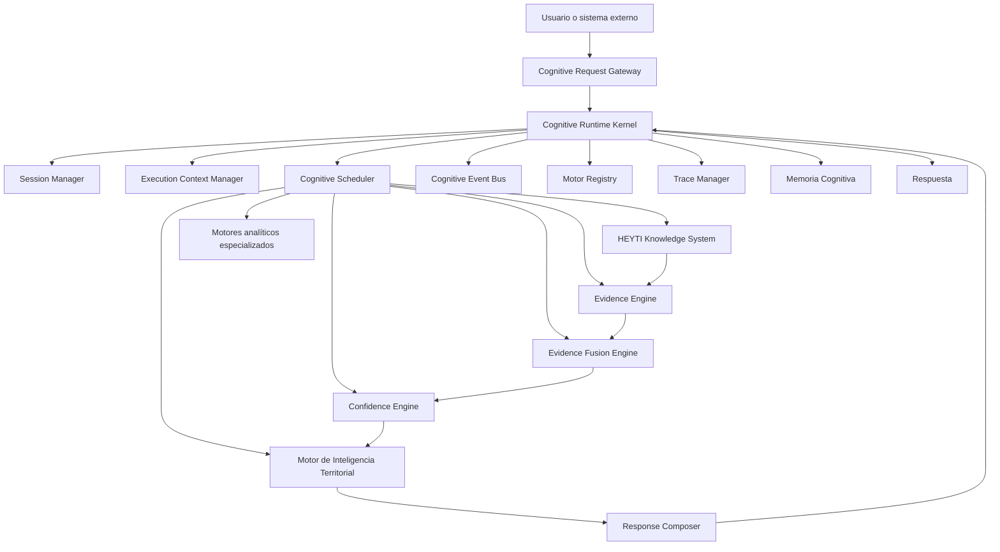
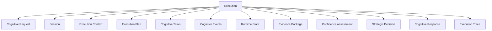
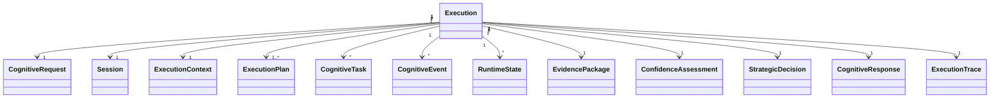
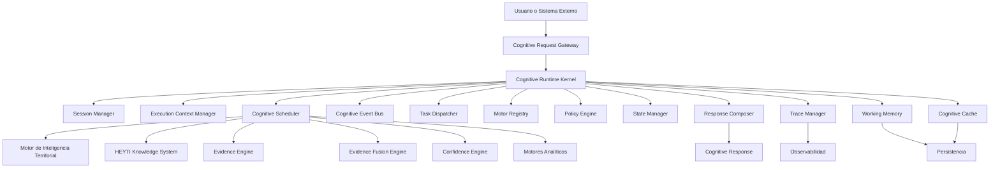
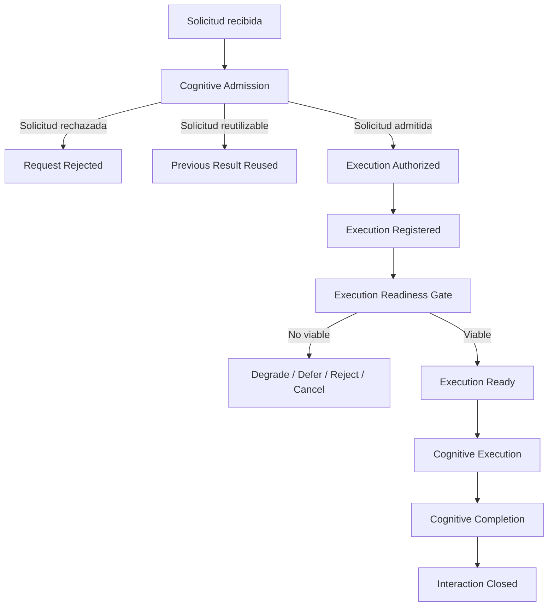
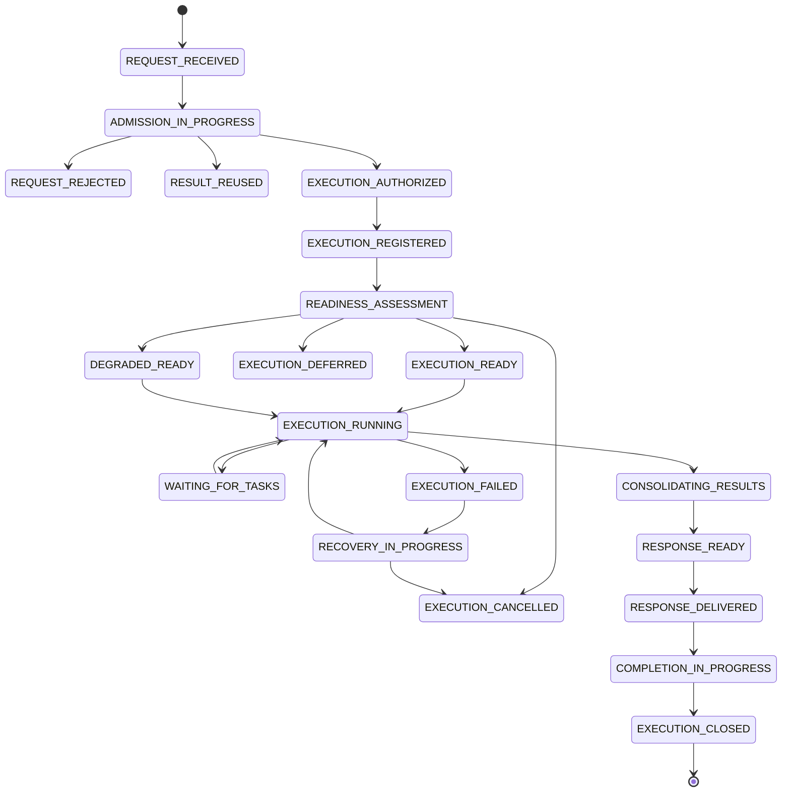

# Sprint 9.4 – Arquitectura del Runtime Cognitivo HEYTI

**Proyecto:** HEYTI – Sistema de Inteligencia Territorial
**Componente:** Arquitectura Cognitiva
**Sprint:** 9.4
**Documento:** Arquitectura del Runtime Cognitivo HEYTI
**Versión:** 1.0
**Estado:** En diseño
**Clasificación:** Documento de arquitectura
**Propietario arquitectónico:** Proyecto HEYTI
**Fecha de inicio:** Julio de 2026

---

## Control del documento

| Campo                        | Valor                                                                     |
| ---------------------------- | ------------------------------------------------------------------------- |
| Nombre del documento         | Sprint 9.4 – Arquitectura del Runtime Cognitivo HEYTI                     |
| Archivo                      | `Sprint_9_4_Arquitectura_Runtime_Cognitivo_HEYTI.md`                      |
| Versión                      | 1.0                                                                       |
| Estado                       | En diseño                                                                 |
| Dominio                      | Arquitectura Cognitiva                                                    |
| Subdominio                   | Runtime Cognitivo                                                         |
| Sprint relacionado           | Sprint 9.4                                                                |
| Documento predecesor         | Sprint 9.3 – Consolidación y Auditoría de la Arquitectura Cognitiva HEYTI |
| Decisión principal pendiente | Incorporación formal del Cognitive Runtime Kernel                         |
| Próxima fase                 | Diseño técnico e implementación del runtime cognitivo                     |

---

# Índice

## 1. Introducción

### 1.1 Contexto del Sprint 9.4

### 1.2 Evolución de HEYTI hacia un sistema cognitivo ejecutable

### 1.3 Problema arquitectónico que resuelve el Runtime Cognitivo

### 1.4 Propósito del documento

### 1.5 Alcance del sprint

### 1.6 Elementos fuera de alcance

### 1.7 Relación con la arquitectura cognitiva existente

---

## 2. Declaración Fundacional del Runtime Cognitivo HEYTI

### 2.1 El Runtime Cognitivo como sistema operativo de HEYTI

### 2.2 Separación entre razonamiento y ejecución

### 2.3 Principio de coordinación cognitiva

### 2.4 Principio de especialización de motores

### 2.5 Principio de trazabilidad integral

### 2.6 Principio de ejecución gobernada

### 2.7 Declaración arquitectónica fundacional

---

## 3. Resolución del Hallazgo de Auditoría: Cognitive Runtime Kernel

### 3.1 Antecedentes del hallazgo

### 3.2 Problema de asignar la orquestación al MIT

### 3.3 Alternativas arquitectónicas evaluadas

### 3.4 Decisión adoptada

### 3.5 Definición del Cognitive Runtime Kernel

### 3.6 Responsabilidades del Kernel

### 3.7 Responsabilidades que no pertenecen al Kernel

### 3.8 Relación entre el Kernel y el MIT

### 3.9 Impacto sobre la arquitectura cognitiva

### 3.10 Consecuencias positivas y compromisos arquitectónicos

### 3.11 Evidencia requerida para cerrar el hallazgo

### 3.12 ADR asociado

---

## 4. Principios Arquitectónicos del Runtime

### 4.1 Separación de responsabilidades

### 4.2 Bajo acoplamiento entre motores

### 4.3 Alta cohesión funcional

### 4.4 Ejecución determinista cuando sea posible

### 4.5 Ejecución probabilística controlada

### 4.6 Inmutabilidad del contexto de entrada

### 4.7 Versionado del estado cognitivo

### 4.8 Idempotencia de operaciones

### 4.9 Tolerancia a fallos parciales

### 4.10 Degradación controlada

### 4.11 Observabilidad por diseño

### 4.12 Explicabilidad por diseño

### 4.13 Seguridad y gobernanza

### 4.14 Escalabilidad horizontal

### 4.15 Independencia tecnológica

---

## 5. Modelo Conceptual del Runtime Cognitivo

### 5.1 Definición del Runtime Cognitivo

### 5.2 Unidad de ejecución cognitiva

### 5.3 Consulta cognitiva

### 5.4 Sesión cognitiva

### 5.5 Tarea cognitiva

### 5.6 Evento cognitivo

### 5.7 Resultado cognitivo

### 5.8 Estado cognitivo

### 5.9 Evidencia de ejecución

### 5.10 Traza cognitiva

### 5.11 Relación entre los conceptos principales

---

## 6. Arquitectura General del Runtime

### 6.1 Vista de alto nivel

### 6.2 Capas arquitectónicas

### 6.3 Capa de entrada

### 6.4 Capa de coordinación

### 6.5 Capa de razonamiento

### 6.6 Capa de conocimiento y evidencia

### 6.7 Capa de confianza

### 6.8 Capa de memoria

### 6.9 Capa de persistencia

### 6.10 Capa de observabilidad

### 6.11 Capa de integración

### 6.12 Diagrama general de componentes

---

## 7. Componentes del Runtime Cognitivo

### 7.1 Cognitive Runtime Kernel

### 7.2 Cognitive Request Gateway

### 7.3 Session Manager

### 7.4 Execution Context Manager

### 7.5 Cognitive Scheduler

### 7.6 Cognitive Event Bus

### 7.7 Task Dispatcher

### 7.8 Motor Registry

### 7.9 Pipeline Manager

### 7.10 State Manager

### 7.11 Working Memory Manager

### 7.12 Context Store

### 7.13 Cognitive Cache

### 7.14 Policy Engine

### 7.15 Failure Manager

### 7.16 Response Composer

### 7.17 Trace Manager

### 7.18 Runtime Logger

### 7.19 Metrics Collector

### 7.20 Audit Recorder

---

## 8. Registro y Gobierno de Motores Cognitivos

### 8.1 Definición del Motor Registry

### 8.2 Registro de capacidades

### 8.3 Identidad de los motores

### 8.4 Versionado de motores

### 8.5 Contratos de entrada y salida

### 8.6 Dependencias entre motores

### 8.7 Disponibilidad y estado operativo

### 8.8 Prioridad de ejecución

### 8.9 Sustitución de motores

### 8.10 Desactivación controlada

### 8.11 Compatibilidad entre versiones

### 8.12 Catálogo inicial de motores HEYTI

---

## 9. Contextos Cognitivos

### 9.1 Definición de contexto cognitivo

### 9.2 Contexto global

### 9.3 Contexto institucional

### 9.4 Contexto territorial

### 9.5 Contexto de usuario

### 9.6 Contexto de sesión

### 9.7 Contexto de consulta

### 9.8 Contexto de ejecución

### 9.9 Contexto temporal

### 9.10 Contexto estratégico

### 9.11 Contexto de evidencia

### 9.12 Contexto de confianza

### 9.13 Herencia de contexto

### 9.14 Fusión de contextos

### 9.15 Resolución de conflictos

### 9.16 Caducidad del contexto

### 9.17 Persistencia del contexto

### 9.18 Seguridad y aislamiento de contexto

---

## 10. Modelo de Sesión Cognitiva

### 10.1 Definición de sesión

### 10.2 Creación de sesión

### 10.3 Identidad de sesión

### 10.4 Estado de sesión

### 10.5 Memoria activa de sesión

### 10.6 Historial de interacción

### 10.7 Continuidad cognitiva

### 10.8 Suspensión y reactivación

### 10.9 Expiración

### 10.10 Cierre de sesión

### 10.11 Recuperación ante fallos

### 10.12 Aislamiento entre sesiones

---

## 11. Ciclo de Vida de una Consulta Cognitiva

### 11.1 Recepción de la consulta

### 11.2 Validación de entrada

### 11.3 Normalización

### 11.4 Identificación de intención

### 11.5 Construcción del contexto

### 11.6 Creación del plan de ejecución

### 11.7 Selección de motores

### 11.8 Despacho de tareas

### 11.9 Ejecución cognitiva

### 11.10 Recolección de resultados

### 11.11 Fusión de resultados

### 11.12 Evaluación de evidencia

### 11.13 Evaluación de confianza

### 11.14 Resolución estratégica por el MIT

### 11.15 Composición de respuesta

### 11.16 Validación final

### 11.17 Persistencia de la traza

### 11.18 Entrega de respuesta

### 11.19 Cierre de la ejecución

---

## 12. Cognitive Scheduler

### 12.1 Propósito del Scheduler

### 12.2 Modelo de planificación

### 12.3 Tareas síncronas

### 12.4 Tareas asíncronas

### 12.5 Ejecución secuencial

### 12.6 Ejecución paralela

### 12.7 Ejecución condicional

### 12.8 Dependencias entre tareas

### 12.9 Priorización

### 12.10 Presupuesto de ejecución

### 12.11 Límites temporales

### 12.12 Cancelación

### 12.13 Reintentos

### 12.14 Prevención de ciclos

### 12.15 Prevención de ejecución infinita

### 12.16 Políticas de degradación

### 12.17 Estados de una tarea cognitiva

---

## 13. Cognitive Event Bus

### 13.1 Propósito del Event Bus

### 13.2 Arquitectura orientada a eventos

### 13.3 Productores de eventos

### 13.4 Consumidores de eventos

### 13.5 Tipos de eventos cognitivos

### 13.6 Estructura de un evento

### 13.7 Identidad y correlación

### 13.8 Orden de eventos

### 13.9 Entrega de eventos

### 13.10 Persistencia

### 13.11 Reprocesamiento

### 13.12 Manejo de eventos fallidos

### 13.13 Eventos críticos

### 13.14 Eventos de auditoría

### 13.15 Catálogo inicial de eventos HEYTI

---

## 14. Execution Pipeline

### 14.1 Definición del pipeline

### 14.2 Pipeline base

### 14.3 Etapas obligatorias

### 14.4 Etapas opcionales

### 14.5 Pipelines dinámicos

### 14.6 Pipelines especializados

### 14.7 Reglas de transición

### 14.8 Entradas y salidas por etapa

### 14.9 Puntos de control

### 14.10 Validaciones intermedias

### 14.11 Interrupciones

### 14.12 Reanudación

### 14.13 Finalización

### 14.14 Versionado de pipelines

---

## 15. Relación entre el Runtime y el MIT

### 15.1 Separación formal de responsabilidades

### 15.2 El MIT como motor de razonamiento estratégico

### 15.3 El Kernel como coordinador de ejecución

### 15.4 Solicitudes del Runtime al MIT

### 15.5 Respuestas del MIT al Runtime

### 15.6 Límites de autonomía del MIT

### 15.7 Límites de autonomía del Runtime

### 15.8 Contrato de integración

### 15.9 Manejo de errores del MIT

### 15.10 Sustitución o evolución del MIT

---

## 16. Integración con los Motores Cognitivos HEYTI

### 16.1 Knowledge System / HKS

### 16.2 Evidence Engine

### 16.3 Evidence Fusion Engine

### 16.4 Confidence Engine

### 16.5 Motores analíticos territoriales

### 16.6 Motores electorales

### 16.7 Motores socioeconómicos

### 16.8 Motores de estructura territorial

### 16.9 Motores de operación de campo

### 16.10 Motores de Día D

### 16.11 Motores de simulación

### 16.12 Motores futuros

### 16.13 Contrato común de integración

---

## 17. Memoria del Runtime

### 17.1 Memoria de trabajo

### 17.2 Memoria de sesión

### 17.3 Memoria episódica

### 17.4 Memoria semántica

### 17.5 Memoria estratégica

### 17.6 Memoria temporal

### 17.7 Memoria de errores

### 17.8 Memoria de decisiones

### 17.9 Políticas de escritura

### 17.10 Políticas de lectura

### 17.11 Consolidación de memoria

### 17.12 Caducidad

### 17.13 Eliminación

### 17.14 Privacidad

### 17.15 Trazabilidad de cambios

---

## 18. Estado Cognitivo y Persistencia

### 18.1 Modelo de estado

### 18.2 Estado inicial

### 18.3 Transiciones de estado

### 18.4 Estado parcial

### 18.5 Estado completado

### 18.6 Estado fallido

### 18.7 Estado cancelado

### 18.8 Persistencia temporal

### 18.9 Persistencia permanente

### 18.10 Recuperación del estado

### 18.11 Snapshots

### 18.12 Versionado

### 18.13 Consistencia

### 18.14 Concurrencia

### 18.15 Bloqueo y resolución de conflictos

---

## 19. Cognitive Cache

### 19.1 Propósito de la caché

### 19.2 Tipos de caché

### 19.3 Caché de datos

### 19.4 Caché de contexto

### 19.5 Caché de evidencia

### 19.6 Caché de resultados

### 19.7 Caché de planes de ejecución

### 19.8 Claves de caché

### 19.9 Invalidación

### 19.10 Caducidad

### 19.11 Consistencia

### 19.12 Evicción

### 19.13 Prevención de contaminación contextual

### 19.14 Métricas de caché

---

## 20. Manejo de Errores y Resiliencia

### 20.1 Clasificación de errores

### 20.2 Error de entrada

### 20.3 Error de contexto

### 20.4 Error de motor

### 20.5 Error de evidencia

### 20.6 Error de confianza

### 20.7 Error de persistencia

### 20.8 Error de integración

### 20.9 Error de infraestructura

### 20.10 Reintentos

### 20.11 Circuit Breaker

### 20.12 Timeouts

### 20.13 Fallbacks

### 20.14 Degradación funcional

### 20.15 Compensación

### 20.16 Recuperación

### 20.17 Dead Letter Queue cognitiva

### 20.18 Notificación de fallos críticos

---

## 21. Observabilidad Cognitiva

### 21.1 Observabilidad por diseño

### 21.2 Logs operativos

### 21.3 Logs cognitivos

### 21.4 Trazas distribuidas

### 21.5 Métricas técnicas

### 21.6 Métricas cognitivas

### 21.7 Métricas de confianza

### 21.8 Métricas de evidencia

### 21.9 Métricas de rendimiento

### 21.10 Correlation ID

### 21.11 Session ID

### 21.12 Execution ID

### 21.13 Task ID

### 21.14 Event ID

### 21.15 Dashboards

### 21.16 Alertas

### 21.17 Auditoría de decisiones

---

## 22. Trazabilidad y Explicabilidad

### 22.1 Traza completa de una consulta

### 22.2 Fuentes utilizadas

### 22.3 Evidencias consideradas

### 22.4 Evidencias descartadas

### 22.5 Motores ejecutados

### 22.6 Decisiones intermedias

### 22.7 Nivel de confianza

### 22.8 Reglas aplicadas

### 22.9 Supuestos

### 22.10 Incertidumbres

### 22.11 Limitaciones

### 22.12 Reconstrucción de una ejecución

### 22.13 Explicación para usuario

### 22.14 Explicación para auditoría técnica

---

## 23. Seguridad y Gobernanza del Runtime

### 23.1 Identidad

### 23.2 Autenticación

### 23.3 Autorización

### 23.4 Roles

### 23.5 Permisos por motor

### 23.6 Permisos por contexto

### 23.7 Aislamiento de sesiones

### 23.8 Protección de datos

### 23.9 Datos sensibles

### 23.10 Políticas de retención

### 23.11 Cifrado

### 23.12 Auditoría de acceso

### 23.13 Ejecución segura de herramientas

### 23.14 Prevención de acciones no autorizadas

### 23.15 Gobierno de decisiones cognitivas

---

## 24. Contratos de Datos del Runtime

### 24.1 Cognitive Request

### 24.2 Cognitive Response

### 24.3 Execution Context

### 24.4 Cognitive Task

### 24.5 Cognitive Event

### 24.6 Engine Request

### 24.7 Engine Response

### 24.8 Evidence Package

### 24.9 Confidence Assessment

### 24.10 Strategic Decision

### 24.11 Runtime Error

### 24.12 Audit Record

### 24.13 Esquemas de validación

### 24.14 Versionado de contratos

---

## 25. Runtime API

### 25.1 Propósito de la API

### 25.2 API interna

### 25.3 API externa

### 25.4 Endpoints de sesión

### 25.5 Endpoints de consulta

### 25.6 Endpoints de ejecución

### 25.7 Endpoints de estado

### 25.8 Endpoints de motores

### 25.9 Endpoints de trazabilidad

### 25.10 Endpoints de administración

### 25.11 Autenticación

### 25.12 Versionado

### 25.13 Idempotencia

### 25.14 Manejo de errores

### 25.15 Contratos de respuesta

---

## 26. Patrones de Ejecución Cognitiva

### 26.1 Ejecución directa

### 26.2 Ejecución secuencial

### 26.3 Ejecución paralela

### 26.4 Fan-out / Fan-in

### 26.5 Pipeline condicional

### 26.6 Ejecución iterativa

### 26.7 Refinamiento progresivo

### 26.8 Validación cruzada

### 26.9 Consenso entre motores

### 26.10 Escalamiento por incertidumbre

### 26.11 Ejecución con intervención humana

### 26.12 Ejecución degradada

---

## 27. Escenarios de Ejecución

### 27.1 Consulta territorial simple

### 27.2 Análisis electoral histórico

### 27.3 Evaluación de competitividad

### 27.4 Recomendación estratégica

### 27.5 Evaluación de estructura territorial

### 27.6 Consulta de operación de campo

### 27.7 Monitoreo de Día D

### 27.8 Simulación de escenario

### 27.9 Consulta con evidencia insuficiente

### 27.10 Consulta con fuentes contradictorias

### 27.11 Consulta con motor no disponible

### 27.12 Consulta de alta criticidad

---

## 28. Rendimiento y Escalabilidad

### 28.1 Objetivos de rendimiento

### 28.2 Latencia

### 28.3 Throughput

### 28.4 Concurrencia

### 28.5 Paralelización

### 28.6 Colas de trabajo

### 28.7 Priorización de cargas

### 28.8 Escalabilidad vertical

### 28.9 Escalabilidad horizontal

### 28.10 Particionamiento

### 28.11 Balanceo

### 28.12 Límites operativos

### 28.13 Pruebas de carga

### 28.14 Métricas de capacidad

---

## 29. Despliegue del Runtime

### 29.1 Modelo de despliegue

### 29.2 Runtime monolítico modular

### 29.3 Runtime distribuido

### 29.4 Servicios independientes

### 29.5 Contenedores

### 29.6 Configuración por entorno

### 29.7 Desarrollo

### 29.8 Pruebas

### 29.9 Preproducción

### 29.10 Producción

### 29.11 Alta disponibilidad

### 29.12 Recuperación ante desastres

### 29.13 Actualización sin interrupción

### 29.14 Rollback

---

## 30. Estrategia de Implementación

### 30.1 Principios de implementación

### 30.2 MVP del Runtime Cognitivo

### 30.3 Fase 1: Kernel básico

### 30.4 Fase 2: Contexto y sesiones

### 30.5 Fase 3: Scheduler y Event Bus

### 30.6 Fase 4: Integración de motores

### 30.7 Fase 5: Memoria y persistencia

### 30.8 Fase 6: Observabilidad

### 30.9 Fase 7: Resiliencia

### 30.10 Fase 8: Optimización

### 30.11 Criterios de avance

### 30.12 Dependencias técnicas

### 30.13 Riesgos de implementación

---

## 31. Estrategia de Pruebas

### 31.1 Pruebas unitarias

### 31.2 Pruebas de contratos

### 31.3 Pruebas de integración

### 31.4 Pruebas de pipelines

### 31.5 Pruebas de concurrencia

### 31.6 Pruebas de resiliencia

### 31.7 Pruebas de recuperación

### 31.8 Pruebas de rendimiento

### 31.9 Pruebas de seguridad

### 31.10 Pruebas de trazabilidad

### 31.11 Pruebas de explicabilidad

### 31.12 Pruebas de regresión cognitiva

---

## 32. Riesgos Arquitectónicos

### 32.1 Acoplamiento excesivo

### 32.2 Sobrecarga del Kernel

### 32.3 Orquestación centralizada excesiva

### 32.4 Dependencias circulares

### 32.5 Contextos inconsistentes

### 32.6 Pérdida de trazabilidad

### 32.7 Ejecuciones no deterministas

### 32.8 Saturación de motores

### 32.9 Estados huérfanos

### 32.10 Caché obsoleta

### 32.11 Crecimiento de memoria

### 32.12 Fallos en cascada

### 32.13 Riesgos de seguridad

### 32.14 Complejidad operativa

### 32.15 Estrategias de mitigación

---

## 33. Decisiones Arquitectónicas

### 33.1 Decisiones confirmadas

### 33.2 Decisiones pendientes

### 33.3 Decisiones diferidas

### 33.4 ADR del Cognitive Runtime Kernel

### 33.5 ADR del Cognitive Scheduler

### 33.6 ADR del Cognitive Event Bus

### 33.7 ADR del modelo de contexto

### 33.8 ADR del modelo de persistencia

### 33.9 ADR del modelo de observabilidad

### 33.10 Registro de decisiones

---

## 34. Registro de Hallazgos de Auditoría

### 34.1 Propósito del registro

### 34.2 Hallazgos heredados del Sprint 9.3

### 34.3 Nuevos hallazgos del Sprint 9.4

### 34.4 Estado de cada hallazgo

### 34.5 Decisión adoptada

### 34.6 Acción requerida

### 34.7 Prioridad

### 34.8 Momento de implementación

### 34.9 Evidencia de cierre

### 34.10 Tabla maestra de hallazgos

---

## 35. Backlog de Evolución Arquitectónica

### 35.1 Mejoras diferidas

### 35.2 Capacidades futuras

### 35.3 Runtime distribuido

### 35.4 Ejecución multiagente

### 35.5 Plan de reducción de incertidumbre

### 35.6 Evidencia Estratégica Emergente

### 35.7 Orquestación adaptativa

### 35.8 Autooptimización de pipelines

### 35.9 Aprendizaje de patrones de ejecución

### 35.10 Priorización dinámica

### 35.11 Gobierno autónomo supervisado

---

## 36. Criterios de Aceptación del Sprint

### 36.1 Arquitectura documentada

### 36.2 Kernel definido

### 36.3 Responsabilidades delimitadas

### 36.4 Flujos documentados

### 36.5 Contextos definidos

### 36.6 Contratos definidos

### 36.7 Estrategia de errores definida

### 36.8 Observabilidad definida

### 36.9 Seguridad definida

### 36.10 ADR identificados

### 36.11 Hallazgos registrados

### 36.12 Backlog actualizado

### 36.13 Preparación para implementación

---

## 37. Entregables del Sprint 9.4

### 37.1 Documento maestro del Runtime Cognitivo

### 37.2 Diagramas de arquitectura

### 37.3 Modelo de componentes

### 37.4 Modelo de contextos

### 37.5 Modelo de sesiones

### 37.6 Modelo de eventos

### 37.7 Modelo de tareas

### 37.8 Modelo de estados

### 37.9 Contratos de datos

### 37.10 ADR arquitectónicos

### 37.11 Registro de hallazgos

### 37.12 Backlog de evolución

### 37.13 Plan de implementación

---

## 38. Checklist de Cierre del Sprint

### 38.1 Revisión arquitectónica

### 38.2 Revisión editorial

### 38.3 Validación de diagramas

### 38.4 Validación de contratos

### 38.5 Revisión de ADR

### 38.6 Actualización del registro de hallazgos

### 38.7 Actualización del backlog

### 38.8 Actualización del Engineering Book

### 38.9 Actualización del Data Dictionary

### 38.10 Actualización del CHANGELOG

### 38.11 Evidencia de propiedad intelectual

### 38.12 Commit y push al repositorio

### 38.13 Respaldo de PostgreSQL

### 38.14 Verificación de pendientes

### 38.15 Autorización para iniciar implementación

---

## 39. Conclusiones

### 39.1 Resultado arquitectónico del Sprint 9.4

### 39.2 Impacto sobre HEYTI

### 39.3 Preparación para la construcción

### 39.4 Próximo sprint

### 39.5 Declaración de cierre

---

# Anexos

## Anexo A. Glosario del Runtime Cognitivo

## Anexo B. Catálogo de componentes

## Anexo C. Catálogo de motores

## Anexo D. Catálogo de eventos

## Anexo E. Catálogo de estados

## Anexo F. Catálogo de errores

## Anexo G. Contratos JSON de referencia

## Anexo H. Diagramas Mermaid

## Anexo I. Matriz de responsabilidades

## Anexo J. Matriz de trazabilidad

## Anexo K. Registro de ADR

## Anexo L. Registro de hallazgos

## Anexo M. Backlog arquitectónico

## Anexo N. Checklist de implementación


# 1. Introducción

## 1.1 Contexto del Sprint 9.4

El Sprint 9.4 marca la transición formal de HEYTI desde una arquitectura cognitiva conceptualmente definida hacia una arquitectura capaz de operar como un sistema ejecutable, coordinado, observable y gobernado.

Durante los sprints anteriores se establecieron los principales componentes que conforman la arquitectura cognitiva de HEYTI, entre ellos:

* el **Motor de Inteligencia Territorial — MIT**;
* el **HEYTI Knowledge System — HKS**;
* el **Evidence Engine**;
* el **Evidence Fusion Engine**;
* el **Confidence Engine**;
* los modelos de evidencia, confianza, razonamiento y decisión;
* los principios de trazabilidad, explicabilidad y gobernanza cognitiva.

Estos componentes definen qué capacidades cognitivas posee HEYTI, qué responsabilidades corresponden a cada motor y cómo deben interpretarse el conocimiento, la evidencia, la incertidumbre y las decisiones estratégicas.

Sin embargo, la definición aislada de los motores no es suficiente para construir un sistema cognitivo funcional.

Para que HEYTI pueda recibir una consulta, identificar su intención, recuperar contexto, activar motores especializados, coordinar dependencias, manejar errores, consolidar resultados, calcular confianza, generar una respuesta y registrar la traza completa de la ejecución, se requiere una capa adicional de arquitectura.

Esa capa es el **Runtime Cognitivo HEYTI**.

El Runtime Cognitivo constituye el entorno operativo en el que los motores, servicios, memorias, políticas y flujos de ejecución interactúan de forma controlada.

Su función no es sustituir el razonamiento de los motores ni determinar por sí mismo la estrategia territorial. Su función es hacer posible que el razonamiento ocurra bajo reglas claras, estados identificables, contratos verificables y mecanismos de supervisión.

Por esta razón, el Sprint 9.4 no representa la creación de un motor cognitivo adicional, sino la definición del sistema de ejecución que permitirá que la arquitectura cognitiva completa funcione como una unidad.

---

## 1.2 Evolución de HEYTI hacia un sistema cognitivo ejecutable

HEYTI inició como una evolución de la plataforma AT 27–30, concebida originalmente para integrar información cartográfica, electoral, territorial, socioeconómica y operativa dentro de una interfaz analítica.

En sus primeras etapas, la plataforma se concentró en representar datos, generar indicadores, visualizar condiciones territoriales y facilitar consultas sobre secciones, municipios, distritos, estructura territorial, operación de campo y procesos electorales.

La incorporación del concepto de copiloto territorial amplió esta visión.

HEYTI dejó de ser únicamente un sistema de consulta y visualización para convertirse progresivamente en una arquitectura capaz de:

* interpretar preguntas;
* relacionar fuentes;
* identificar patrones;
* evaluar evidencia;
* estimar niveles de confianza;
* construir escenarios;
* formular recomendaciones;
* señalar incertidumbres;
* registrar decisiones;
* explicar el origen de sus conclusiones.

Esta evolución produjo una nueva exigencia arquitectónica.

Un sistema que únicamente presenta información puede operar mediante consultas directas a bases de datos, servicios y componentes visuales.

Un sistema cognitivo, en cambio, necesita administrar procesos de razonamiento que pueden involucrar múltiples pasos, motores, fuentes, validaciones y decisiones intermedias.

La ejecución de una consulta cognitiva puede requerir, entre otras acciones:

1. interpretar la intención del usuario;
2. determinar el ámbito territorial;
3. recuperar el contexto de la sesión;
4. localizar datos electorales, territoriales y socioeconómicos;
5. solicitar evidencia a diferentes motores;
6. ejecutar procesos en paralelo;
7. evaluar la vigencia y calidad de las fuentes;
8. identificar contradicciones;
9. fusionar evidencias;
10. calcular la confianza disponible;
11. solicitar razonamiento estratégico al MIT;
12. construir una respuesta explicable;
13. registrar la traza de la ejecución;
14. actualizar la memoria correspondiente.

La arquitectura cognitiva define las capacidades involucradas en estas acciones.

El Runtime Cognitivo define cómo, cuándo, bajo qué reglas y en qué orden deben ejecutarse.

En consecuencia, la evolución de HEYTI puede representarse mediante cuatro etapas arquitectónicas:

| Etapa                  | Enfoque principal                                          | Resultado                    |
| ---------------------- | ---------------------------------------------------------- | ---------------------------- |
| Plataforma analítica   | Visualización y consulta de datos                          | AT 27–30                     |
| Copiloto territorial   | Asistencia para análisis e interpretación                  | HEYTI inicial                |
| Arquitectura cognitiva | Motores de conocimiento, evidencia, confianza y estrategia | Sistema cognitivo definido   |
| Runtime cognitivo      | Coordinación, ejecución, memoria, estado y observabilidad  | Sistema cognitivo ejecutable |

El Sprint 9.4 se ubica en la cuarta etapa.

A partir de este punto, HEYTI deja de ser únicamente una colección de motores diseñados y comienza a definirse como un sistema operativo cognitivo completo.

---

## 1.3 Problema arquitectónico que resuelve el Runtime Cognitivo

La existencia de múltiples motores especializados genera un problema central de coordinación.

Cada motor puede poseer una responsabilidad correctamente delimitada y, aun así, el sistema completo puede fallar si no existe una arquitectura que determine:

* qué motor debe ejecutarse;
* en qué momento debe ejecutarse;
* qué información debe recibir;
* qué dependencias debe resolver;
* qué ocurre si un motor no responde;
* cómo se consolidan resultados parciales;
* cómo se evita una ejecución infinita;
* cómo se conserva el contexto;
* cómo se registra la trazabilidad;
* cómo se protege la integridad del estado;
* cómo se controla el costo y duración de una consulta;
* cómo se entrega una respuesta aun cuando algunos componentes fallen.

Sin un Runtime Cognitivo, la coordinación entre motores podría terminar distribuida de forma desordenada dentro del MIT, de las APIs, de los servicios de integración o incluso de la interfaz de usuario.

Esta situación produciría diversos riesgos:

* acoplamiento excesivo entre motores;
* duplicación de lógica de coordinación;
* pérdida de trazabilidad;
* dependencias circulares;
* estados cognitivos inconsistentes;
* dificultad para identificar errores;
* imposibilidad de reanudar ejecuciones;
* sobrecarga de responsabilidades en el MIT;
* menor capacidad de evolución;
* dificultad para sustituir motores;
* comportamiento no determinista sin control;
* falta de gobierno sobre el razonamiento.

El Runtime Cognitivo resuelve este problema al introducir una capa especializada de ejecución y coordinación.

Esta capa será responsable de recibir las solicitudes cognitivas, construir el contexto de ejecución, crear el plan operativo, despachar tareas, supervisar resultados, administrar estados, procesar eventos, manejar fallos y entregar la información necesaria a los motores correspondientes.

De esta forma, la inteligencia estratégica permanece dentro de los motores cognitivos, mientras que la coordinación operativa se concentra en el Runtime.

La separación puede resumirse mediante el siguiente principio:

> El Runtime Cognitivo administra la ejecución del razonamiento; los motores cognitivos realizan el razonamiento.

---

## 1.4 Propósito del documento

El propósito de este documento es definir la arquitectura del Runtime Cognitivo HEYTI y establecer la base conceptual, funcional y técnica para su implementación posterior.

El documento deberá responder, de manera estructurada, las siguientes preguntas:

* ¿Qué es el Runtime Cognitivo?
* ¿Qué responsabilidades debe asumir?
* ¿Qué responsabilidades deben permanecer fuera de él?
* ¿Cómo se coordina con el MIT?
* ¿Cómo se registran y activan los motores cognitivos?
* ¿Cómo se construye y conserva el contexto?
* ¿Cómo se administra una sesión?
* ¿Cómo se representa una tarea cognitiva?
* ¿Cómo se planifica una ejecución?
* ¿Cómo se comunican los componentes?
* ¿Cómo se administra el estado?
* ¿Cómo se manejan los errores?
* ¿Cómo se registran evidencias, decisiones y niveles de confianza?
* ¿Cómo se garantiza la trazabilidad?
* ¿Cómo se protege el sistema?
* ¿Cómo se prepara el Runtime para crecer y distribuirse?

Este documento funcionará como referencia para:

* el diseño técnico del Runtime;
* la creación de ADR;
* la definición de contratos de datos;
* la construcción de APIs;
* el diseño del modelo de persistencia;
* la creación de tareas y eventos;
* la integración de los motores cognitivos;
* la implementación de observabilidad;
* la elaboración de pruebas;
* la preparación de los siguientes sprints de construcción.

El documento no pretende establecer únicamente una descripción general.

Su objetivo es proporcionar una especificación arquitectónica suficientemente precisa para permitir que la implementación posterior mantenga coherencia con la visión cognitiva de HEYTI.

---

## 1.5 Alcance del sprint

El Sprint 9.4 comprende el diseño arquitectónico completo del Runtime Cognitivo HEYTI.

El alcance incluye:

### Arquitectura general

* definición del Runtime Cognitivo;
* definición del Cognitive Runtime Kernel;
* separación formal entre coordinación y razonamiento;
* identificación de capas y componentes;
* establecimiento de responsabilidades;
* definición de relaciones entre componentes.

### Ejecución cognitiva

* ciclo de vida de una consulta;
* modelo de sesión;
* modelo de contexto;
* modelo de tarea;
* modelo de evento;
* modelo de pipeline;
* modelo de estado;
* planificación de ejecuciones;
* ejecución secuencial, paralela y condicional.

### Coordinación

* Cognitive Scheduler;
* Cognitive Event Bus;
* Task Dispatcher;
* Motor Registry;
* Pipeline Manager;
* Session Manager;
* Execution Context Manager.

### Memoria y persistencia

* memoria de trabajo;
* memoria de sesión;
* estado cognitivo;
* recuperación de ejecuciones;
* políticas de persistencia;
* snapshots;
* versionado de estado.

### Resiliencia

* clasificación de errores;
* reintentos;
* timeouts;
* fallbacks;
* degradación controlada;
* recuperación;
* prevención de ciclos;
* tratamiento de eventos fallidos.

### Observabilidad y auditoría

* logs técnicos;
* logs cognitivos;
* trazas;
* métricas;
* identificadores de correlación;
* reconstrucción de ejecuciones;
* auditoría de decisiones.

### Seguridad y gobernanza

* identidad;
* autenticación;
* autorización;
* aislamiento de sesiones;
* permisos por motor;
* políticas de ejecución;
* protección de contexto;
* control de acciones.

### Preparación para implementación

* contratos de datos;
* definición de APIs;
* diagramas;
* ADR;
* riesgos;
* estrategia de pruebas;
* fases de implementación;
* criterios de aceptación.

El resultado esperado del sprint es una arquitectura suficientemente consolidada para iniciar la construcción del Runtime Cognitivo sin trasladar decisiones fundamentales a la etapa de programación.

---

## 1.6 Elementos fuera de alcance

El Sprint 9.4 es un sprint de arquitectura.

Por lo tanto, quedan fuera de su alcance la implementación productiva de los componentes definidos.

No se desarrollarán todavía:

* servicios backend definitivos;
* endpoints productivos;
* microservicios;
* colas de mensajería reales;
* contenedores de producción;
* integración final con proveedores de modelos;
* integración definitiva con OpenAI, Ollama u otros modelos;
* agentes autónomos;
* herramientas MCP;
* interfaces conversacionales definitivas;
* esquemas SQL productivos del Runtime;
* dashboards operativos finales;
* mecanismos de escalamiento productivo;
* ejecución distribuida real;
* infraestructura en nube;
* pruebas de carga productivas;
* automatización de despliegues.

Tampoco corresponde a este sprint redefinir internamente los motores cognitivos ya documentados, salvo cuando sea necesario aclarar sus contratos de integración con el Runtime.

El Sprint 9.4 podrá definir:

* interfaces;
* responsabilidades;
* estructuras de datos;
* flujos;
* pseudocódigo;
* diagramas;
* políticas;
* estados;
* eventos;
* contratos;
* criterios de implementación.

Pero no deberá convertir esas definiciones en código productivo todavía.

Esta separación protege la coherencia arquitectónica y evita que decisiones estructurales sean tomadas de manera reactiva durante la programación.

---

## 1.7 Relación con la arquitectura cognitiva existente

El Runtime Cognitivo no sustituye la arquitectura cognitiva definida en los sprints anteriores.

La convierte en una arquitectura ejecutable.

Cada componente conserva su responsabilidad esencial.

| Componente               | Responsabilidad principal                               |
| ------------------------ | ------------------------------------------------------- |
| Cognitive Runtime Kernel | Coordinar y gobernar la ejecución cognitiva             |
| MIT                      | Realizar razonamiento estratégico territorial           |
| HKS                      | Organizar, recuperar y relacionar conocimiento          |
| Evidence Engine          | Identificar, validar y estructurar evidencia            |
| Evidence Fusion Engine   | Integrar evidencia proveniente de múltiples fuentes     |
| Confidence Engine        | Evaluar la confianza disponible                         |
| Motores analíticos       | Ejecutar cálculos y análisis especializados             |
| Memoria cognitiva        | Conservar contexto, episodios, decisiones y aprendizaje |
| Runtime                  | Integrar operativamente todos los componentes           |

La relación entre estos elementos puede representarse de la siguiente manera:



El flujo representado no deberá interpretarse como una secuencia rígida.

Dependiendo del tipo de consulta, el Runtime podrá ejecutar motores en distinto orden, repetir etapas, omitir componentes, activar procesos en paralelo o solicitar nuevas evidencias.

Lo importante es que la coordinación de estas decisiones operativas pertenezca al Runtime, mientras que la interpretación estratégica permanezca dentro del MIT.

Esta distinción resuelve uno de los principales hallazgos identificados durante la auditoría de la arquitectura cognitiva:

> El MIT no debe convertirse en un orquestador técnico de motores. Debe permanecer especializado en razonamiento estratégico.

El Sprint 9.4 formaliza esta separación y prepara la arquitectura necesaria para sostenerla.

---

## Síntesis del capítulo

El Runtime Cognitivo es la capa que permitirá transformar la arquitectura cognitiva HEYTI en un sistema operativo real.

Su creación responde a la necesidad de coordinar motores especializados, administrar contexto, controlar estados, manejar errores, preservar trazabilidad y ejecutar procesos cognitivos bajo reglas explícitas.

El Sprint 9.4 deberá definir esta arquitectura antes de iniciar su implementación.

El resultado no será simplemente un mecanismo técnico de integración.

Será el entorno operativo que permitirá que HEYTI piense, recuerde, evalúe, decida y explique sus respuestas de forma coordinada, auditable y escalable.


# 2. Declaración Fundacional del Runtime Cognitivo HEYTI

## 2.1 El Runtime Cognitivo como sistema operativo de HEYTI

El Runtime Cognitivo constituye el núcleo operativo del Sistema Cognitivo HEYTI.

Su propósito es proporcionar el entorno de ejecución donde los motores cognitivos, los mecanismos de memoria, las políticas de gobierno, los procesos de razonamiento y los servicios especializados puedan interactuar de forma coordinada, controlada, observable y verificable.

El Runtime no representa un motor de inteligencia adicional.

Tampoco sustituye al Motor de Inteligencia Territorial (MIT), ni participa directamente en la generación de estrategias, recomendaciones o inferencias.

Su responsabilidad consiste en proporcionar la infraestructura cognitiva necesaria para que dichas capacidades puedan ejecutarse de manera consistente.

En términos arquitectónicos, el Runtime desempeña un papel equivalente al de un sistema operativo respecto a una aplicación.

Así como un sistema operativo administra procesos, memoria, recursos, eventos, permisos y comunicación entre componentes sin ejecutar la lógica de negocio de las aplicaciones, el Runtime Cognitivo administra la ejecución del razonamiento sin convertirse en el responsable del razonamiento mismo.

Esta separación constituye uno de los principios fundamentales de la arquitectura HEYTI.

---

## 2.2 Separación entre razonamiento y ejecución

La arquitectura cognitiva de HEYTI distingue formalmente dos responsabilidades completamente diferentes:

**La ejecución cognitiva**, responsable de coordinar el funcionamiento del sistema.

**El razonamiento cognitivo**, responsable de construir conocimiento, evaluar evidencia y producir decisiones estratégicas.

La primera pertenece exclusivamente al Runtime.

La segunda pertenece exclusivamente a los motores cognitivos especializados.

Esta separación evita que la lógica operacional termine mezclándose con la lógica estratégica.

Como consecuencia:

* el Runtime nunca decidirá estrategias territoriales;
* el MIT nunca administrará procesos internos del Runtime;
* los motores cognitivos no coordinarán la ejecución de otros motores;
* ningún componente mezclará responsabilidades de infraestructura con responsabilidades cognitivas.

Cada componente conservará un propósito claramente delimitado.

Esta decisión permite que la evolución futura del sistema pueda realizarse mediante el reemplazo o incorporación de nuevos motores sin modificar el funcionamiento interno del Runtime.

---

## 2.3 Principio de coordinación cognitiva

Toda ejecución cognitiva deberá encontrarse gobernada por un único mecanismo de coordinación.

La coordinación de una consulta nunca dependerá de múltiples motores actuando de forma independiente.

El Runtime será el único responsable de:

* iniciar una ejecución;
* construir el contexto;
* planificar tareas;
* coordinar dependencias;
* administrar estados;
* controlar tiempos;
* gestionar eventos;
* supervisar errores;
* consolidar resultados;
* cerrar la ejecución.

Este principio garantiza que cada consulta posea un flujo identificable, reproducible y completamente trazable.

---

## 2.4 Principio de especialización de motores

Cada motor cognitivo deberá mantener una responsabilidad claramente definida.

El Runtime nunca sustituirá las funciones especializadas de los motores.

De la misma forma, ningún motor asumirá responsabilidades propias del Runtime.

Esta especialización favorece:

* bajo acoplamiento;
* alta cohesión;
* independencia tecnológica;
* facilidad de sustitución;
* mantenimiento evolutivo;
* escalabilidad funcional.

El crecimiento futuro de HEYTI deberá producirse mediante la incorporación de nuevos motores especializados y no mediante la expansión ilimitada de motores existentes.

---

## 2.5 Principio de trazabilidad integral

Toda consulta ejecutada dentro del Runtime deberá ser completamente reconstruible.

Para cada ejecución será posible identificar:

* quién inició la consulta;
* cuándo ocurrió;
* cuál fue el contexto disponible;
* qué motores participaron;
* qué evidencia fue utilizada;
* qué evidencia fue descartada;
* qué reglas fueron aplicadas;
* qué eventos ocurrieron;
* qué decisiones intermedias fueron tomadas;
* qué nivel de confianza fue calculado;
* cuál fue la respuesta final.

La trazabilidad no constituye un mecanismo de auditoría posterior.

Forma parte del diseño arquitectónico desde el inicio.

Ningún proceso cognitivo podrá ejecutarse fuera del sistema de trazabilidad.

---

## 2.6 Principio de ejecución gobernada

Toda ejecución cognitiva deberá desarrollarse bajo reglas explícitas.

El Runtime administrará políticas relacionadas con:

* permisos;
* prioridades;
* límites temporales;
* consumo de recursos;
* concurrencia;
* manejo de errores;
* degradación controlada;
* cancelación;
* reanudación;
* persistencia.

Estas políticas deberán permanecer independientes de los motores cognitivos.

Los motores producirán conocimiento.

El Runtime gobernará la forma en que dicho conocimiento es producido.

---

## 2.7 Declaración arquitectónica fundacional

A partir del Sprint 9.4, HEYTI adopta formalmente el siguiente principio arquitectónico:

> **El Runtime Cognitivo constituye el sistema operativo del ecosistema cognitivo HEYTI.**

Su misión consiste en coordinar la ejecución completa del sistema sin participar directamente en el razonamiento estratégico.

El razonamiento pertenece exclusivamente a los motores cognitivos especializados.

La coordinación pertenece exclusivamente al Runtime.

Ningún componente podrá asumir simultáneamente ambas responsabilidades.

Esta decisión arquitectónica garantiza:

* independencia entre infraestructura y conocimiento;
* evolución desacoplada de motores;
* trazabilidad integral;
* gobernanza cognitiva;
* resiliencia operacional;
* observabilidad completa;
* escalabilidad futura;
* mantenibilidad del sistema.

En consecuencia, toda evolución posterior de HEYTI deberá respetar este principio como una restricción arquitectónica obligatoria.

Cualquier modificación futura que implique transferir responsabilidades de coordinación al MIT, o responsabilidades de razonamiento al Runtime, deberá considerarse una excepción arquitectónica y requerirá la emisión de un Architecture Decision Record (ADR) específico que justifique dicha desviación.

---

## Síntesis del capítulo

La Declaración Fundacional establece la identidad permanente del Runtime Cognitivo HEYTI.

A partir de este documento, el Runtime deja de entenderse como un componente técnico auxiliar y pasa a reconocerse como el entorno operativo que hace posible el funcionamiento coordinado de todo el ecosistema cognitivo.

Esta declaración fija una separación definitiva entre ejecución y razonamiento, establece los principios que regirán la evolución futura del sistema y convierte al Runtime en la pieza responsable de garantizar coherencia, gobernanza, trazabilidad y estabilidad durante toda la vida operativa de HEYTI.

Con esta declaración, la arquitectura cognitiva de HEYTI adquiere un fundamento estructural equivalente al que un sistema operativo representa para una plataforma informática: invisible para el usuario final, pero indispensable para que cada capacidad cognitiva pueda ejecutarse de forma consistente, segura y escalable.


# 3. Resolución del Hallazgo de Auditoría: Cognitive Runtime Kernel

## 3.1 Antecedentes del hallazgo

Durante la auditoría arquitectónica realizada al cierre del Sprint 9.3 se identificó un posible riesgo de evolución relacionado con la asignación de responsabilidades dentro de la arquitectura cognitiva.

En la arquitectura existente, el Motor de Inteligencia Territorial (MIT) aparecía como el punto natural desde el cual iniciar el razonamiento estratégico y coordinar la participación de los distintos motores cognitivos.

Sin embargo, el análisis realizado durante la auditoría permitió identificar que esta aproximación podía conducir, conforme creciera el sistema, a una concentración excesiva de responsabilidades dentro del MIT.

Como resultado de dicha auditoría se registró formalmente el siguiente hallazgo:

**Evaluar la incorporación de una capa independiente de coordinación denominada Cognitive Runtime Kernel, responsable exclusivamente de la ejecución y orquestación del ecosistema cognitivo, preservando al MIT como motor especializado de razonamiento estratégico.**

El hallazgo fue aceptado como una mejora arquitectónica diferida y se estableció que su resolución debía realizarse antes del diseño definitivo del Runtime Cognitivo.

El presente capítulo constituye la resolución oficial de dicho hallazgo.

---

## 3.2 Problema de asignar la orquestación al MIT

Aunque inicialmente parecía razonable que el MIT coordinara la ejecución de los demás motores, un análisis más profundo reveló que esta aproximación violaba varios principios fundamentales de diseño.

Si el MIT asumiera simultáneamente responsabilidades de razonamiento y de coordinación, terminaría siendo responsable de:

* administrar sesiones;
* construir contextos;
* decidir el orden de ejecución;
* planificar tareas;
* administrar eventos;
* coordinar motores;
* controlar tiempos;
* manejar errores;
* recuperar estados;
* consolidar resultados;
* generar estrategias.

Esta acumulación convertiría al MIT en un componente excesivamente complejo.

Las principales consecuencias serían:

* incremento del acoplamiento;
* pérdida de cohesión funcional;
* mayor dificultad para mantenimiento;
* dependencia excesiva del MIT;
* menor reutilización de motores;
* dificultad para sustituir componentes;
* mayor riesgo de errores arquitectónicos;
* menor escalabilidad.

La auditoría concluyó que el MIT debía conservar una única responsabilidad principal:

**Realizar razonamiento estratégico.**

---

## 3.3 Alternativas arquitectónicas evaluadas

Durante la auditoría fueron consideradas tres alternativas principales.

### Alternativa A

Mantener al MIT como coordinador de toda la ejecución.

**Ventajas**

* menor número de componentes;
* arquitectura aparentemente sencilla.

**Desventajas**

* mezcla responsabilidades;
* limita la evolución;
* dificulta pruebas;
* aumenta complejidad.

Resultado:

**Descartada.**

---

### Alternativa B

Distribuir la coordinación entre los distintos motores.

Cada motor decidiría cuándo invocar a otros motores.

Resultado esperado:

* arquitectura distribuida.

Problemas detectados:

* dependencias circulares;
* pérdida de control global;
* duplicación de lógica;
* trazabilidad incompleta;
* difícil depuración.

Resultado:

**Descartada.**

---

### Alternativa C

Crear una capa especializada de coordinación independiente.

Características:

* administra ejecución;
* coordina motores;
* mantiene contexto;
* controla estados;
* administra eventos;
* gobierna sesiones;
* preserva trazabilidad.

El razonamiento permanece completamente dentro del MIT y de los motores especializados.

Resultado:

**Alternativa seleccionada.**

---

## 3.4 Decisión arquitectónica adoptada

Como resultado de la auditoría, HEYTI adopta oficialmente la siguiente decisión arquitectónica.

> **Toda coordinación operativa del ecosistema cognitivo será responsabilidad exclusiva del Cognitive Runtime Kernel.**

El MIT deja formalmente de ser considerado el coordinador del sistema.

A partir de esta decisión, el MIT pasa a ocupar el rol de motor especializado de razonamiento estratégico dentro del Runtime.

El Runtime constituye ahora la única autoridad responsable de administrar la ejecución cognitiva.

Esta decisión será formalizada posteriormente mediante un Architecture Decision Record (ADR).

---

## 3.5 Definición del Cognitive Runtime Kernel

El Cognitive Runtime Kernel es el núcleo operativo del Runtime Cognitivo HEYTI.

Su responsabilidad consiste en coordinar la ejecución completa del ecosistema cognitivo.

No interpreta estrategias.

No construye evidencia.

No calcula confianza.

No genera recomendaciones.

Su función consiste exclusivamente en administrar el funcionamiento del sistema.

Puede entenderse como el equivalente al Kernel de un sistema operativo.

Así como un sistema operativo administra procesos, memoria y comunicación entre aplicaciones, el Cognitive Runtime Kernel administra el flujo operativo entre motores cognitivos.

---

## 3.6 Responsabilidades del Kernel

El Cognitive Runtime Kernel será responsable de:

* iniciar una ejecución cognitiva;
* construir el Execution Context;
* crear la sesión correspondiente;
* generar identificadores de ejecución;
* registrar eventos;
* activar el Scheduler;
* coordinar el Event Bus;
* localizar motores disponibles;
* despachar tareas;
* controlar dependencias;
* administrar prioridades;
* controlar tiempos máximos;
* aplicar políticas de ejecución;
* consolidar resultados;
* administrar memoria temporal;
* registrar la trazabilidad;
* cerrar la ejecución.

El Kernel constituye el punto central de coordinación del Runtime.

---

## 3.7 Responsabilidades que no pertenecen al Kernel

El Kernel no realizará actividades cognitivas.

Nunca deberá:

* interpretar información electoral;
* analizar territorios;
* inferir patrones;
* evaluar evidencia;
* calcular confianza;
* seleccionar estrategias;
* construir hipótesis;
* decidir recomendaciones;
* aprender conocimiento.

Estas actividades pertenecen exclusivamente a los motores especializados.

---

## 3.8 Relación entre el Kernel y el MIT

La relación entre ambos componentes será estrictamente jerárquica desde el punto de vista operativo, pero completamente independiente desde el punto de vista funcional.

El Kernel podrá solicitar al MIT la resolución de un problema estratégico.

El MIT responderá mediante una decisión fundamentada.

El Kernel no modificará dicha decisión.

El MIT no modificará la planificación del Runtime.

Ambos componentes colaboran, pero ninguno invade las responsabilidades del otro.

---

## 3.9 Impacto sobre la arquitectura cognitiva

La incorporación del Cognitive Runtime Kernel produce los siguientes cambios estructurales.

| Antes                      | Después                               |
| -------------------------- | ------------------------------------- |
| MIT inicia la coordinación | Runtime Kernel inicia la coordinación |
| MIT coordina motores       | Runtime coordina motores              |
| MIT administra contexto    | Runtime administra contexto           |
| MIT controla ejecución     | Runtime controla ejecución            |
| MIT razona y coordina      | MIT únicamente razona                 |
| No existe Kernel           | Kernel como núcleo operativo          |

Como consecuencia, la arquitectura adquiere una separación mucho más clara entre infraestructura y cognición.

---

## 3.10 Consecuencias positivas y compromisos arquitectónicos

La adopción del Cognitive Runtime Kernel aporta beneficios significativos.

Entre ellos:

* separación estricta de responsabilidades;
* menor acoplamiento;
* mayor cohesión;
* mayor capacidad de pruebas;
* sustitución independiente de motores;
* escalabilidad horizontal;
* incorporación sencilla de nuevos motores;
* observabilidad centralizada;
* trazabilidad completa;
* resiliencia operacional;
* mantenimiento simplificado.

A cambio, la arquitectura incorpora un nuevo componente crítico cuya estabilidad será esencial para el funcionamiento del ecosistema cognitivo.

Por esta razón, el Kernel deberá diseñarse con criterios de alta disponibilidad, bajo acoplamiento, observabilidad completa y gobierno explícito.

---

## 3.11 Evidencia requerida para cerrar el hallazgo

El hallazgo identificado durante la auditoría del Sprint 9.3 se considerará completamente resuelto cuando exista evidencia documental de:

* definición formal del Cognitive Runtime Kernel;
* delimitación de responsabilidades;
* actualización de la arquitectura general;
* actualización del modelo de componentes;
* actualización de diagramas;
* emisión del ADR correspondiente;
* incorporación del Kernel al Runtime;
* actualización del Engineering Book.

Una vez cumplidos estos elementos, el hallazgo podrá registrarse como **CERRADO** dentro del Registro de Hallazgos Arquitectónicos.

---

## 3.12 ADR asociado

La presente decisión deberá documentarse mediante un Architecture Decision Record específico.

Información preliminar:

| Campo     | Valor                                      |
| --------- | ------------------------------------------ |
| ADR       | ADR-010                                    |
| Título    | Incorporación del Cognitive Runtime Kernel |
| Estado    | Aceptado                                   |
| Tipo      | Decisión arquitectónica                    |
| Prioridad | Alta                                       |
| Impacto   | Arquitectura Cognitiva                     |
| Sprint    | 9.4                                        |
| Fecha     | Julio 2026                                 |

Este ADR constituirá el documento oficial que formaliza la separación entre coordinación operativa y razonamiento estratégico dentro de la arquitectura HEYTI.

---

## Síntesis del capítulo

La resolución del hallazgo de auditoría consolida una de las decisiones arquitectónicas más relevantes del proyecto HEYTI.

A partir de este Sprint, el Motor de Inteligencia Territorial deja de ser considerado el coordinador del ecosistema cognitivo y pasa a desempeñar exclusivamente el papel para el cual fue concebido: realizar razonamiento estratégico de alto nivel.

La coordinación integral de la ejecución se transfiere al Cognitive Runtime Kernel, que se establece como el núcleo operativo del sistema.

Esta separación fortalece la arquitectura, mejora su capacidad de evolución y crea una base sólida para incorporar nuevos motores cognitivos, nuevos mecanismos de memoria y futuras capacidades distribuidas sin comprometer la coherencia del modelo arquitectónico.

Con esta decisión queda oficialmente resuelto el hallazgo identificado durante la auditoría del Sprint 9.3 y se establece el fundamento estructural sobre el cual se construirá el Runtime Cognitivo de HEYTI.


# 4. Principios Arquitectónicos del Runtime

## 4.0 Marco normativo de los Cognitive Runtime Principles

Los **Cognitive Runtime Principles — CRP** constituyen el conjunto de normas arquitectónicas obligatorias que deberán regir el diseño, implementación, evolución y auditoría del Runtime Cognitivo HEYTI.

Estos principios no representan recomendaciones opcionales ni buenas prácticas generales.

Constituyen restricciones arquitectónicas formales.

Todo componente, servicio, motor, contrato, pipeline, evento, sesión, contexto o mecanismo de persistencia que forme parte del Runtime deberá demostrar su conformidad con los principios aplicables.

El incumplimiento de un CRP deberá considerarse una desviación arquitectónica.

Toda desviación deberá:

1. identificarse explícitamente;
2. justificar su necesidad;
3. documentar sus riesgos;
4. definir medidas de mitigación;
5. aprobarse mediante un Architecture Decision Record;
6. registrarse en el sistema de hallazgos arquitectónicos.

La conformidad con los CRP deberá verificarse durante:

* el diseño arquitectónico;
* la revisión de contratos;
* la implementación;
* las pruebas;
* la revisión de código;
* la integración de motores;
* la auditoría del Runtime;
* la incorporación de nuevas capacidades.

La versión inicial de los Cognitive Runtime Principles queda definida mediante la siguiente matriz:

| Código | Principio                                 | Carácter    |
| ------ | ----------------------------------------- | ----------- |
| CRP-01 | Separación de responsabilidades           | Obligatorio |
| CRP-02 | Bajo acoplamiento entre motores           | Obligatorio |
| CRP-03 | Alta cohesión funcional                   | Obligatorio |
| CRP-04 | Ejecución determinista cuando sea posible | Obligatorio |
| CRP-05 | Ejecución probabilística controlada       | Obligatorio |
| CRP-06 | Inmutabilidad del contexto de entrada     | Obligatorio |
| CRP-07 | Versionado del estado cognitivo           | Obligatorio |
| CRP-08 | Idempotencia de operaciones               | Obligatorio |
| CRP-09 | Tolerancia a fallos parciales             | Obligatorio |
| CRP-10 | Degradación controlada                    | Obligatorio |
| CRP-11 | Observabilidad por diseño                 | Obligatorio |
| CRP-12 | Explicabilidad por construcción           | Obligatorio |
| CRP-13 | Seguridad y gobernanza                    | Obligatorio |
| CRP-14 | Escalabilidad horizontal                  | Obligatorio |
| CRP-15 | Independencia tecnológica                 | Obligatorio |

---

## 4.1 Separación de responsabilidades — CRP-01

### Definición

Cada componente del Runtime deberá poseer una responsabilidad principal claramente delimitada.

La coordinación operativa, el razonamiento estratégico, la recuperación de conocimiento, la evaluación de evidencia, el cálculo de confianza, la administración de sesiones, la persistencia y la observabilidad deberán permanecer separadas.

### Justificación

La mezcla de responsabilidades produce componentes difíciles de comprender, probar, sustituir y escalar.

Dentro de un sistema cognitivo, esta separación resulta especialmente crítica porque la lógica de ejecución no debe confundirse con la lógica de razonamiento.

### Implicaciones arquitectónicas

* El Kernel coordina, pero no razona.
* El MIT razona, pero no administra la ejecución.
* El Evidence Engine evalúa evidencia, pero no calcula confianza.
* El Confidence Engine calcula confianza, pero no determina estrategias.
* El Session Manager administra sesiones, pero no modifica decisiones cognitivas.
* El Trace Manager registra ejecuciones, pero no interviene en ellas.

### Consecuencias si se viola

* acoplamiento excesivo;
* responsabilidades ambiguas;
* dificultad de pruebas;
* pérdida de trazabilidad;
* dependencia de componentes centrales;
* mayor riesgo de errores;
* evolución limitada.

---

## 4.2 Bajo acoplamiento entre motores — CRP-02

### Definición

Los motores cognitivos no deberán depender directamente de la implementación interna de otros motores.

Toda interacción deberá realizarse mediante contratos explícitos y ser coordinada por el Runtime.

### Justificación

Los motores evolucionarán con ritmos, tecnologías y ciclos de vida diferentes.

El bajo acoplamiento permitirá reemplazar, actualizar, desactivar o escalar un motor sin afectar innecesariamente al resto del sistema.

### Implicaciones arquitectónicas

* ningún motor invocará directamente a otro motor;
* la comunicación se realizará mediante contratos;
* el Runtime resolverá dependencias;
* las respuestas deberán mantenerse tecnológicamente neutrales;
* las capacidades se descubrirán mediante el Motor Registry.

### Consecuencias si se viola

* dependencias circulares;
* fallos en cascada;
* dificultad para sustituir motores;
* pruebas complejas;
* pérdida de aislamiento;
* rigidez arquitectónica.

---

## 4.3 Alta cohesión funcional — CRP-03

### Definición

Cada componente deberá agrupar únicamente funciones directamente relacionadas con su propósito principal.

### Justificación

La cohesión permite que un componente posea identidad funcional clara y pueda evolucionar sin incorporar responsabilidades ajenas.

### Implicaciones arquitectónicas

El Cognitive Scheduler deberá concentrarse en:

* priorización;
* dependencias;
* planificación;
* control temporal;
* reintentos.

No deberá incorporar:

* lógica territorial;
* evaluación de evidencia;
* cálculo de confianza;
* composición semántica de respuestas.

### Consecuencias si se viola

* componentes sobredimensionados;
* duplicación de lógica;
* mantenimiento difícil;
* comportamiento impredecible;
* límites funcionales difusos.

---

## 4.4 Ejecución determinista cuando sea posible — CRP-04

### Definición

Las decisiones operativas del Runtime deberán ser deterministas siempre que la naturaleza del proceso lo permita.

Ante las mismas entradas, políticas, versiones y contexto, el Runtime deberá producir el mismo plan de ejecución.

### Justificación

La coordinación determinista facilita la reproducción, auditoría, depuración y validación de ejecuciones.

### Implicaciones arquitectónicas

* las reglas de selección de motores deberán ser explícitas;
* las prioridades deberán estar documentadas;
* los criterios de transición deberán ser verificables;
* los pipelines deberán estar versionados;
* las políticas deberán ser identificables;
* los desempates deberán resolverse mediante reglas predefinidas.

### Consecuencias si se viola

* ejecuciones difíciles de reproducir;
* resultados inconsistentes;
* auditorías incompletas;
* errores intermitentes;
* pérdida de confianza operativa.

---

## 4.5 Ejecución probabilística controlada — CRP-05

### Definición

Cuando una operación dependa de inferencias probabilísticas, modelos generativos, selección heurística o razonamiento no determinista, dicha variabilidad deberá permanecer controlada, registrada y limitada.

### Justificación

El comportamiento probabilístico puede ser necesario para interpretar lenguaje, generar hipótesis o construir escenarios.

Sin embargo, no deberá introducir incertidumbre invisible dentro del Runtime.

### Implicaciones arquitectónicas

Toda operación probabilística deberá registrar:

* motor utilizado;
* versión;
* parámetros relevantes;
* contexto de entrada;
* alternativas consideradas;
* resultado producido;
* nivel de confianza;
* límites aplicados.

El Runtime deberá diferenciar entre:

* decisión operativa determinista;
* inferencia cognitiva probabilística.

### Consecuencias si se viola

* resultados no reproducibles;
* variabilidad no explicada;
* dificultad de auditoría;
* decisiones aparentemente arbitrarias;
* pérdida de control cognitivo.

---

## 4.6 Inmutabilidad del contexto de entrada — CRP-06

### Definición

El contexto original recibido por una ejecución no deberá modificarse directamente.

Toda transformación deberá producir una nueva versión derivada.

### Justificación

La inmutabilidad permite conservar el estado original de una consulta y reconstruir todas las transformaciones posteriores.

### Implicaciones arquitectónicas

* el Cognitive Request original será inmutable;
* el contexto inicial será preservado;
* las ampliaciones producirán nuevas versiones;
* las correcciones no sobrescribirán el contexto anterior;
* toda transformación deberá registrar origen y versión.

### Consecuencias si se viola

* pérdida de evidencia original;
* dificultad para reconstruir decisiones;
* modificaciones no auditables;
* inconsistencias entre motores;
* errores de concurrencia.

---

## 4.7 Versionado del estado cognitivo — CRP-07

### Definición

Todo estado cognitivo relevante deberá poseer versión, fecha, origen y relación con su estado precedente.

### Justificación

Una ejecución cognitiva puede evolucionar mediante múltiples tareas, eventos, evidencias y decisiones.

El versionado permite reconstruir dicha evolución.

### Implicaciones arquitectónicas

Deberán versionarse:

* Execution Context;
* estado de sesión;
* planes de ejecución;
* evidencia consolidada;
* evaluación de confianza;
* decisiones estratégicas;
* respuestas intermedias;
* snapshots de recuperación.

### Consecuencias si se viola

* pérdida de historial;
* estados sobrescritos;
* imposibilidad de recuperación;
* auditoría incompleta;
* conflictos de concurrencia.

---

## 4.8 Idempotencia de operaciones — CRP-08

### Definición

Una operación idempotente deberá poder repetirse con la misma entrada sin producir efectos acumulativos no deseados.

### Justificación

El Runtime necesitará reintentar tareas ante fallos de red, timeouts, reinicios o errores parciales.

Sin idempotencia, un reintento podría duplicar eventos, registros, evidencias o acciones.

### Implicaciones arquitectónicas

* cada tarea deberá poseer identificador único;
* las escrituras deberán detectar duplicados;
* los eventos deberán incluir claves de idempotencia;
* los reintentos deberán reconocer ejecuciones previas;
* las operaciones no idempotentes deberán declararse explícitamente.

### Consecuencias si se viola

* duplicación de registros;
* evidencia repetida;
* estados inconsistentes;
* respuestas incorrectas;
* efectos operativos múltiples.

---

## 4.9 Tolerancia a fallos parciales — CRP-09

### Definición

El fallo de un componente no deberá implicar automáticamente el fallo total de la ejecución.

### Justificación

Un sistema cognitivo puede depender de múltiples motores, fuentes y servicios.

Algunos pueden no estar disponibles temporalmente sin que toda la consulta deba cancelarse.

### Implicaciones arquitectónicas

El Runtime deberá poder:

* aislar el componente fallido;
* conservar resultados válidos;
* aplicar reintentos;
* utilizar motores alternativos;
* continuar con información parcial;
* reducir el alcance;
* informar la pérdida de capacidad.

### Consecuencias si se viola

* fallos en cascada;
* baja disponibilidad;
* pérdida completa de consultas recuperables;
* dependencia excesiva de componentes;
* mala experiencia operativa.

---

## 4.10 Degradación controlada — CRP-10

### Definición

Cuando el sistema no pueda completar una ejecución en condiciones ideales, deberá reducir su capacidad de manera explícita, segura y explicable.

### Justificación

Responder parcialmente con limitaciones declaradas puede ser preferible a no responder o producir una conclusión falsa.

### Implicaciones arquitectónicas

El Runtime podrá degradar:

* número de motores utilizados;
* profundidad de análisis;
* actualidad de fuentes;
* nivel territorial;
* complejidad del escenario;
* nivel de personalización.

Toda degradación deberá informar:

* qué capacidad no estuvo disponible;
* qué impacto produjo;
* qué confianza permanece;
* qué información falta;
* si la respuesta puede utilizarse.

### Consecuencias si se viola

* respuestas silenciosamente incompletas;
* falsa apariencia de certeza;
* errores no visibles;
* decisiones basadas en información insuficiente.

---

## 4.11 Observabilidad por diseño — CRP-11

### Definición

Todo componente deberá producir la información necesaria para comprender su comportamiento operativo sin requerir modificaciones posteriores.

### Justificación

Un Runtime cognitivo no puede administrarse como una caja negra.

La observabilidad deberá existir desde la primera ejecución.

### Implicaciones arquitectónicas

Todo componente deberá emitir:

* logs estructurados;
* métricas;
* trazas;
* eventos de estado;
* tiempos de ejecución;
* errores;
* consumo de recursos;
* identificadores de correlación.

La observabilidad deberá permitir responder:

* qué ocurrió;
* dónde ocurrió;
* cuándo ocurrió;
* por qué ocurrió;
* qué impacto produjo.

### Consecuencias si se viola

* fallos invisibles;
* diagnósticos lentos;
* imposibilidad de medir rendimiento;
* baja capacidad de auditoría;
* mantenimiento reactivo.

---

## 4.12 Explicabilidad por construcción — CRP-12

### Definición

Toda ejecución deberá producir simultáneamente su resultado y los elementos necesarios para explicar cómo fue construido.

La explicación no deberá generarse como una justificación posterior separada del proceso real.

### Justificación

Una explicación creada después de la respuesta puede omitir, reinterpretar o inventar razones que no formaron parte de la ejecución.

HEYTI deberá construir explicaciones a partir de la traza real.

### Implicaciones arquitectónicas

Cada etapa deberá registrar:

* entrada recibida;
* transformación aplicada;
* reglas utilizadas;
* fuentes consultadas;
* evidencia aceptada;
* evidencia descartada;
* incertidumbres detectadas;
* resultado producido;
* relación con la etapa anterior.

La respuesta explicable deberá derivarse de estos registros.

### Consecuencias si se viola

* explicaciones no verificables;
* justificaciones retrospectivas;
* pérdida de confianza;
* imposibilidad de auditoría;
* divergencia entre ejecución y explicación.

---

## 4.13 Seguridad y gobernanza — CRP-13

### Definición

Toda ejecución deberá desarrollarse bajo políticas explícitas de identidad, autorización, acceso, privacidad, retención y control.

### Justificación

El Runtime podrá procesar información territorial, electoral, institucional, operativa y potencialmente sensible.

La seguridad no podrá depender exclusivamente de componentes externos.

### Implicaciones arquitectónicas

* toda solicitud deberá poseer identidad;
* cada motor deberá declarar permisos;
* los contextos deberán aislarse;
* los accesos deberán auditarse;
* las herramientas deberán ejecutarse bajo autorización;
* las acciones críticas deberán requerir políticas adicionales;
* la información sensible deberá clasificarse.

### Consecuencias si se viola

* accesos no autorizados;
* fuga de información;
* mezcla de contextos;
* uso indebido de capacidades;
* pérdida de gobernanza;
* riesgo operativo y legal.

---

## 4.14 Escalabilidad horizontal — CRP-14

### Definición

Los componentes del Runtime deberán diseñarse para permitir múltiples instancias coordinadas cuando la carga lo requiera.

### Justificación

El crecimiento de HEYTI podrá incrementar el número de usuarios, sesiones, tareas, motores y consultas simultáneas.

La arquitectura no deberá depender permanentemente de una única instancia.

### Implicaciones arquitectónicas

* evitar estado local no compartido;
* utilizar identificadores globales;
* diseñar tareas distribuibles;
* externalizar persistencia;
* permitir colas de trabajo;
* administrar concurrencia;
* definir bloqueos y consistencia;
* separar coordinación lógica de infraestructura física.

### Consecuencias si se viola

* límites rígidos de capacidad;
* puntos únicos de saturación;
* dificultad para distribuir carga;
* baja disponibilidad;
* migraciones costosas.

---

## 4.15 Independencia tecnológica — CRP-15

### Definición

La arquitectura conceptual del Runtime no deberá depender de un lenguaje, proveedor, modelo, base de datos, framework o infraestructura específica.

### Justificación

Las tecnologías cambian con mayor rapidez que los principios arquitectónicos.

HEYTI deberá poder evolucionar sin redefinir su identidad cognitiva.

### Implicaciones arquitectónicas

Los contratos deberán permanecer separados de:

* lenguajes de programación;
* frameworks;
* motores de bases de datos;
* proveedores de IA;
* servicios de mensajería;
* plataformas de nube;
* herramientas de observabilidad.

Las decisiones tecnológicas deberán implementarse mediante adaptadores.

### Consecuencias si se viola

* dependencia de proveedor;
* sustituciones costosas;
* obsolescencia acelerada;
* menor capacidad de evolución;
* mezcla entre arquitectura e implementación.

---

## 4.16 Principios cognitivos complementarios

Además de los quince principios normativos principales, la implementación deberá observar los siguientes principios complementarios.

### CRP-C01 — Contexto antes que cómputo

Ningún motor deberá ejecutarse antes de que el Runtime haya construido y validado el contexto mínimo requerido.

### CRP-C02 — Registrar todo lo significativo

Toda transición que pueda alterar el resultado, el estado, la confianza o la explicación deberá quedar registrada.

### CRP-C03 — Runtime con estado; motores preferentemente sin estado

El Runtime administrará sesiones, contexto y continuidad.

Los motores deberán recibir entradas explícitas y devolver resultados explícitos, evitando conservar estado oculto.

### CRP-C04 — La confianza se calcula, nunca se presupone

Ninguna evidencia, motor, fuente o resultado deberá considerarse confiable sin evaluación explícita.

### CRP-C05 — Ninguna decisión sin procedencia

Todo resultado deberá conservar relación con sus fuentes, reglas, motores y contexto de origen.

### CRP-C06 — Ninguna autonomía sin límites

Toda capacidad autónoma deberá poseer restricciones, presupuesto, permisos, criterios de interrupción y mecanismos de supervisión.

Estos principios complementarios podrán convertirse posteriormente en principios normativos mediante una nueva versión del catálogo CRP.

---

## 4.17 Aplicación de los CRP por componente

La siguiente matriz establece una relación inicial entre los principales componentes y los principios de cumplimiento prioritario.

| Componente                | Principios prioritarios                        |
| ------------------------- | ---------------------------------------------- |
| Cognitive Runtime Kernel  | CRP-01, CRP-04, CRP-07, CRP-09, CRP-11, CRP-13 |
| Cognitive Scheduler       | CRP-03, CRP-04, CRP-08, CRP-09, CRP-10         |
| Cognitive Event Bus       | CRP-02, CRP-07, CRP-08, CRP-09, CRP-14         |
| Session Manager           | CRP-06, CRP-07, CRP-11, CRP-13                 |
| Execution Context Manager | CRP-06, CRP-07, CRP-12, CRP-13                 |
| Motor Registry            | CRP-02, CRP-03, CRP-11, CRP-15                 |
| Task Dispatcher           | CRP-04, CRP-08, CRP-09, CRP-14                 |
| Policy Engine             | CRP-01, CRP-04, CRP-11, CRP-13                 |
| Evidence Engine           | CRP-03, CRP-05, CRP-12                         |
| Confidence Engine         | CRP-03, CRP-05, CRP-12                         |
| MIT                       | CRP-01, CRP-03, CRP-05, CRP-12                 |
| Trace Manager             | CRP-07, CRP-11, CRP-12                         |
| State Manager             | CRP-06, CRP-07, CRP-08, CRP-14                 |
| Cognitive Cache           | CRP-06, CRP-08, CRP-10, CRP-14                 |
| Response Composer         | CRP-05, CRP-10, CRP-12                         |

Esta matriz no limita la aplicación de otros principios.

Todo componente deberá cumplir todos los CRP que resulten relevantes para su responsabilidad.

---

## 4.18 Evaluación de conformidad arquitectónica

Cada componente deberá evaluarse mediante una matriz de conformidad.

Formato de referencia:

| CRP    | Cumple            | Evidencia                    | Riesgo              | Acción requerida  |
| ------ | ----------------- | ---------------------------- | ------------------- | ----------------- |
| CRP-01 | Sí / No / Parcial | Documento, contrato o prueba | Bajo / Medio / Alto | Acción correctiva |
| CRP-02 | Sí / No / Parcial | Documento, contrato o prueba | Bajo / Medio / Alto | Acción correctiva |
| CRP-03 | Sí / No / Parcial | Documento, contrato o prueba | Bajo / Medio / Alto | Acción correctiva |

La conformidad no deberá declararse únicamente mediante afirmaciones.

Deberá demostrarse mediante evidencia verificable, como:

* diagramas;
* contratos;
* pruebas;
* código;
* logs;
* trazas;
* políticas;
* ADR;
* resultados de auditoría.

---

## 4.19 Gobierno y evolución de los CRP

Los Cognitive Runtime Principles deberán mantenerse como un catálogo versionado.

Cada versión deberá incluir:

* código del principio;
* nombre;
* definición;
* justificación;
* implicaciones;
* fecha de adopción;
* estado;
* cambios respecto a la versión anterior.

Estados posibles:

| Estado       | Descripción                                |
| ------------ | ------------------------------------------ |
| Propuesto    | Principio bajo evaluación                  |
| Aceptado     | Principio aprobado y obligatorio           |
| Experimental | Principio aplicado de forma controlada     |
| Deprecado    | Principio en proceso de sustitución        |
| Sustituido   | Principio reemplazado por otro             |
| Retirado     | Principio que ya no forma parte del modelo |

La modificación de un principio aceptado deberá requerir:

1. análisis de impacto;
2. revisión arquitectónica;
3. ADR;
4. actualización del catálogo;
5. revisión de componentes afectados;
6. plan de migración.

---

## Síntesis del capítulo

Los Cognitive Runtime Principles establecen las normas fundamentales que deberán gobernar toda la arquitectura del Runtime Cognitivo HEYTI.

Estos principios convierten conceptos como separación de responsabilidades, trazabilidad, resiliencia, observabilidad, explicabilidad y seguridad en obligaciones verificables.

A partir de este capítulo, la calidad arquitectónica del Runtime no dependerá únicamente de decisiones individuales de implementación.

Podrá evaluarse mediante reglas explícitas, matrices de conformidad, evidencia documental y auditorías formales.

Los CRP constituyen, por tanto, el marco técnico y normativo que permitirá que HEYTI evolucione sin perder coherencia, gobernanza ni identidad arquitectónica.


# 5. Modelo Conceptual del Runtime Cognitivo

## 5.1 Definición del Runtime Cognitivo

El Runtime Cognitivo HEYTI se materializa mediante un conjunto de entidades conceptuales que representan los objetos fundamentales de toda ejecución cognitiva.

Estas entidades no corresponden directamente a clases, tablas, contratos JSON, estructuras de memoria o componentes tecnológicos específicos.

Constituyen el **MetaModelo Cognitivo del Runtime**, es decir, el modelo conceptual que describe la naturaleza, identidad y relaciones de los elementos que participan en la ejecución del sistema.

El MetaModelo Cognitivo representa la fuente oficial de definición para:

* la arquitectura del Runtime;
* los contratos de integración;
* el diseño de APIs;
* el modelo de persistencia;
* los eventos;
* las sesiones;
* la memoria;
* la observabilidad;
* la auditoría;
* la implementación futura.

Toda representación tecnológica deberá derivarse de este modelo conceptual y no modificar su significado.

En consecuencia, cualquier cambio conceptual deberá realizarse primero sobre este documento y posteriormente reflejarse en las implementaciones correspondientes.

---

## 5.2 Principios del MetaModelo Cognitivo

El MetaModelo Cognitivo se construye bajo los siguientes principios:

* independencia tecnológica;
* consistencia conceptual;
* trazabilidad completa;
* relaciones explícitas;
* evolución controlada;
* versionado conceptual;
* extensibilidad;
* reutilización;
* explicabilidad por construcción;
* alineación con los Cognitive Runtime Principles.

Ningún componente podrá redefinir de manera independiente el significado de las entidades aquí descritas.

Este documento constituye el lenguaje compartido oficial del Runtime Cognitivo.

---

## 5.3 Vista general del MetaModelo Cognitivo

Toda actividad realizada por el Runtime se organiza alrededor de una única entidad raíz:

**Execution**.

Una ejecución representa el ciclo completo de vida de una solicitud cognitiva.

Durante su existencia podrá crear, utilizar o modificar diversas entidades relacionadas.

El MetaModelo general puede representarse de la siguiente forma:



La entidad **Execution** constituye el punto de referencia de todas las relaciones conceptuales del Runtime.

Toda información relevante deberá poder asociarse, directa o indirectamente, a una ejecución específica.

---

# 5.4 Unidad de ejecución cognitiva (Execution)

## Definición

Una **Execution** representa una instancia completa del procesamiento cognitivo iniciado a partir de una solicitud.

Es la unidad fundamental del Runtime.

Toda consulta, tarea, evento, decisión, evidencia, memoria y respuesta pertenecen exactamente a una ejecución.

Una ejecución comienza cuando el Runtime acepta una solicitud válida y finaliza cuando la respuesta ha sido entregada y la traza correspondiente ha sido registrada.

---

## Responsabilidad

La Execution tiene como responsabilidad representar el ciclo completo de vida de una consulta cognitiva.

No ejecuta operaciones.

No toma decisiones.

Representa el marco dentro del cual dichas operaciones ocurren.

---

## Relaciones

Una Execution contiene:

* un Cognitive Request;
* un Execution Context;
* una Session;
* uno o varios Execution Plans;
* múltiples Cognitive Tasks;
* múltiples Cognitive Events;
* múltiples Runtime States;
* un Evidence Package;
* un Confidence Assessment;
* una Strategic Decision;
* una Cognitive Response;
* una Execution Trace.

---

## Identidad

Toda Execution deberá poseer un identificador global único.

Ejemplo conceptual:

```text
EXEC-20260713-000000045
```

---

## Ciclo de vida

```text
Creada

↓

Planificada

↓

En ejecución

↓

Consolidación

↓

Respuesta generada

↓

Traza registrada

↓

Finalizada
```

---

# 5.5 Consulta Cognitiva (Cognitive Request)

## Definición

El Cognitive Request representa la intención original que origina una ejecución.

Contiene la solicitud realizada por un usuario, un proceso automático o un sistema externo.

No representa únicamente un texto.

Representa la intención completa de la consulta.

---

## Responsabilidad

Su función consiste en preservar el estado original de la solicitud.

Nunca deberá modificarse.

Las transformaciones posteriores generarán nuevas estructuras derivadas dentro del Execution Context.

---

## Relaciones

Pertenece exactamente a una Execution.

Una Execution posee un único Cognitive Request.

---

## Ejemplo conceptual

```text
Usuario:

"¿Qué municipios presentan mayor riesgo de pérdida electoral en el Distrito Federal 03 considerando la evolución 2018-2024?"
```

Ese texto constituye únicamente la representación visible de un Cognitive Request.

---

# 5.6 Sesión Cognitiva (Session)

## Definición

Una Session representa la continuidad cognitiva entre múltiples ejecuciones realizadas dentro de un mismo contexto de interacción.

Permite conservar memoria temporal, preferencias, historial y continuidad conversacional.

---

## Responsabilidad

Mantener el estado compartido entre varias ejecuciones independientes.

---

## Relaciones

Una Session contiene muchas Executions.

Cada Execution pertenece a una sola Session.

---

## Ejemplo conceptual

```text
Sesión

├── Execution 001
├── Execution 002
├── Execution 003
└── Execution 004
```

---

# 5.7 Contexto Cognitivo (Execution Context)

## Definición

El Execution Context representa el conjunto de información contextual utilizada durante una ejecución.

No contiene únicamente parámetros técnicos.

Representa el conocimiento operativo disponible para interpretar correctamente la consulta.

---

## Puede incluir

* usuario;
* permisos;
* ubicación;
* fecha;
* contexto territorial;
* contexto institucional;
* memoria activa;
* restricciones;
* políticas;
* idioma;
* preferencias;
* resultados previos;
* referencias conversacionales.

---

## Principio

El Context nunca modifica el Request.

El Context interpreta el Request.

---

# 5.8 Plan de Ejecución (Execution Plan)

## Definición

El Execution Plan representa la estrategia operativa definida por el Runtime para resolver una consulta.

No contiene la estrategia territorial.

Contiene la estrategia de ejecución.

---

## Incluye

* motores requeridos;
* dependencias;
* paralelismo;
* prioridades;
* reintentos;
* políticas;
* restricciones;
* presupuesto de ejecución.

---

## Ejemplo

```text
1. Recuperar contexto

↓

2. Consultar HKS

↓

3. Ejecutar Evidence Engine

↓

4. Ejecutar Confidence Engine

↓

5. Solicitar razonamiento al MIT

↓

6. Construir respuesta

↓

7. Registrar traza
```

---

# 5.9 Tarea Cognitiva (Cognitive Task)

## Definición

Una Cognitive Task representa una unidad mínima de trabajo ejecutable dentro del Runtime.

Toda tarea posee un propósito específico y un resultado identificable.

---

## Ejemplos

* consultar conocimiento;
* recuperar evidencia;
* evaluar confianza;
* consultar memoria;
* generar hipótesis;
* consolidar resultados.

---

## Relaciones

Una Execution contiene muchas Tasks.

---

# 5.10 Evento Cognitivo (Cognitive Event)

## Definición

Un Cognitive Event representa un hecho significativo ocurrido durante una ejecución.

No representa necesariamente una acción.

Representa un cambio observable.

---

## Ejemplos

* ejecución iniciada;
* tarea completada;
* motor activado;
* evidencia recibida;
* timeout;
* error;
* respuesta consolidada.

---

# 5.11 Estado Cognitivo (Runtime State)

## Definición

El Runtime State representa la situación operacional de una ejecución en un instante determinado.

No representa únicamente estados técnicos.

También representa estados cognitivos.

---

## Ejemplos

* esperando contexto;
* consultando conocimiento;
* evaluando evidencia;
* consolidando resultados;
* calculando confianza;
* generando respuesta;
* finalizada.

---

# 5.12 Evidencia de Ejecución (Evidence Package)

## Definición

El Evidence Package representa el conjunto organizado de evidencias utilizadas durante una ejecución.

No constituye una única evidencia.

Constituye el paquete completo que respalda la decisión final.

---

## Contiene

* evidencias aceptadas;
* evidencias descartadas;
* conflictos;
* procedencia;
* vigencia;
* calidad;
* relaciones.

---

# 5.13 Evaluación de Confianza (Confidence Assessment)

## Definición

Representa el resultado producido por el Confidence Engine respecto al grado de confianza disponible para la ejecución.

No pertenece a una evidencia individual.

Corresponde a la ejecución completa.

---

## Incluye

* nivel de confianza;
* incertidumbres;
* limitaciones;
* factores de reducción;
* evidencia faltante;
* justificación.

---

# 5.14 Decisión Estratégica (Strategic Decision)

## Definición

Representa la conclusión estratégica producida por el MIT.

No representa la respuesta textual.

Representa la decisión cognitiva.

---

## Ejemplo

```text
Incrementar operación territorial en
las secciones rurales del municipio X
debido a pérdida sostenida de competitividad
y baja cobertura de estructura.
```

---

# 5.15 Respuesta Cognitiva (Cognitive Response)

## Definición

Representa la información entregada finalmente al usuario.

Se construye a partir de la Strategic Decision, la Confidence Assessment y el Evidence Package.

---

## Contiene

* respuesta principal;
* explicación;
* evidencia;
* confianza;
* advertencias;
* referencias;
* recomendaciones.

---

# 5.16 Traza Cognitiva (Execution Trace)

## Definición

La Execution Trace representa el registro completo de todo lo ocurrido durante una ejecución.

Es la reconstrucción cronológica del razonamiento operativo del Runtime.

---

## Incluye

* Request;
* Context;
* Plan;
* Tasks;
* Events;
* Estados;
* Evidencias;
* Confianza;
* Decisión;
* Respuesta.

---

## Propósito

Permitir reconstruir una ejecución completa sin necesidad de volver a ejecutarla.

---

# 5.17 Relaciones del MetaModelo

Las entidades definidas anteriormente mantienen las siguientes relaciones conceptuales.



Este diagrama constituye el modelo conceptual base del Runtime Cognitivo HEYTI y servirá como referencia para los modelos lógicos, físicos y de implementación.

---

## Síntesis del capítulo

El MetaModelo Cognitivo define el lenguaje compartido oficial del Runtime Cognitivo HEYTI.

A partir de este modelo, conceptos como **Execution**, **Session**, **Execution Context**, **Cognitive Task**, **Evidence Package**, **Confidence Assessment** y **Execution Trace** adquieren una definición única, independiente de cualquier implementación tecnológica.

Este modelo constituye la referencia conceptual sobre la cual se construirán los contratos de datos, las APIs, la persistencia, los mecanismos de observabilidad y los componentes internos del Runtime, garantizando que toda evolución futura del sistema preserve un mismo significado arquitectónico para sus entidades fundamentales.


# 6. Arquitectura General del Runtime

## 6.1 Vista de alto nivel

El Runtime Cognitivo constituye la infraestructura operativa que permite ejecutar de forma coordinada todas las capacidades cognitivas de HEYTI.

No representa un motor especializado ni un componente aislado.

Representa el entorno completo donde las solicitudes cognitivas son recibidas, interpretadas, planificadas, ejecutadas, supervisadas y registradas.

La arquitectura del Runtime organiza sus responsabilidades mediante componentes especializados que cooperan bajo la coordinación del **Cognitive Runtime Kernel**, preservando en todo momento la separación entre ejecución y razonamiento establecida en los capítulos anteriores.

Desde una perspectiva de alto nivel, la arquitectura puede representarse de la siguiente manera.



Esta representación resume la arquitectura conceptual completa del Runtime.

Cada componente será desarrollado en capítulos posteriores.

---

## 6.2 Principios de organización

La organización del Runtime responde a los siguientes principios:

* coordinación centralizada;
* componentes altamente especializados;
* bajo acoplamiento;
* alta cohesión;
* contratos explícitos;
* ejecución gobernada;
* observabilidad permanente;
* memoria desacoplada;
* integración mediante eventos;
* independencia tecnológica.

Estos principios garantizan que el crecimiento futuro del sistema no implique reorganizar la arquitectura principal.

---

## 6.3 Arquitectura por capas

La arquitectura del Runtime se organiza mediante seis capas funcionales.

### Capa de Entrada

Responsable de recibir solicitudes provenientes de usuarios, APIs o sistemas externos.

Componentes principales:

* Cognitive Request Gateway
* Authentication
* Validation

---

### Capa de Coordinación

Constituye el núcleo operativo del Runtime.

Responsabilidades:

* sesiones;
* contexto;
* planificación;
* despacho;
* eventos;
* políticas;
* estados.

Componentes:

* Cognitive Runtime Kernel
* Session Manager
* Execution Context Manager
* Cognitive Scheduler
* Task Dispatcher
* Event Bus
* Policy Engine
* State Manager

---

### Capa Cognitiva

Responsable del razonamiento estratégico.

Incluye:

* MIT
* motores especializados

Esta capa nunca administra infraestructura.

---

### Capa de Conocimiento y Evidencia

Incluye:

* HKS
* Evidence Engine
* Evidence Fusion Engine
* Confidence Engine

Produce conocimiento estructurado para el MIT.

---

### Capa de Memoria

Administra:

* Working Memory
* Session Memory
* Cache
* Persistencia
* Historial

---

### Capa de Observabilidad

Incluye:

* Trace Manager
* Logger
* Metrics
* Auditoría
* Correlation IDs
* Dashboards

Esta capa registra absolutamente toda la ejecución.

---

## 6.4 Flujo general del Runtime

Toda consulta seguirá, de manera conceptual, el siguiente flujo.

```text
Usuario

↓

Request Gateway

↓

Runtime Kernel

↓

Construcción de Contexto

↓

Planificación

↓

Selección de Motores

↓

Ejecución

↓

Consolidación

↓

Confianza

↓

MIT

↓

Respuesta

↓

Traza

↓

Persistencia
```

Cada etapa podrá contener múltiples tareas paralelas, eventos y reintentos.

---

## 6.5 Relación entre componentes

Los componentes del Runtime no mantienen dependencias arbitrarias.

Cada interacción deberá respetar las siguientes reglas:

* el Kernel coordina;
* el Scheduler planifica;
* el Event Bus comunica;
* el Dispatcher ejecuta;
* el Registry localiza motores;
* el MIT razona;
* el Response Composer construye la respuesta;
* el Trace Manager registra;
* la Memoria conserva contexto.

Esta separación constituye uno de los principales mecanismos de mantenibilidad del Runtime.

---

## 6.6 Responsabilidades generales

| Componente                | Responsabilidad                  |
| ------------------------- | -------------------------------- |
| Cognitive Runtime Kernel  | Coordinar toda la ejecución      |
| Session Manager           | Administrar sesiones             |
| Execution Context Manager | Construir y mantener el contexto |
| Scheduler                 | Planificar tareas                |
| Event Bus                 | Distribuir eventos               |
| Task Dispatcher           | Ejecutar tareas                  |
| Motor Registry            | Registrar motores                |
| Policy Engine             | Aplicar reglas                   |
| State Manager             | Administrar estados              |
| Working Memory            | Mantener memoria temporal        |
| Cache                     | Optimizar consultas              |
| Response Composer         | Construir respuesta              |
| Trace Manager             | Registrar ejecución              |

---

## 6.7 Integración con los motores cognitivos

El Runtime no contiene inteligencia estratégica.

Toda capacidad cognitiva especializada permanece dentro de los motores correspondientes.

El Runtime únicamente:

* prepara información;
* coordina ejecución;
* administra estados;
* recibe resultados;
* consolida información;
* construye la respuesta.

Los motores conservan autonomía funcional.

---

## 6.8 Modelo de dependencias

La arquitectura establece una dirección única de dependencia.

```text
Usuario

↓

Runtime

↓

Motores Cognitivos

↓

Conocimiento

↓

Respuesta
```

Ningún motor podrá depender directamente de otro motor.

Toda coordinación deberá pasar por el Runtime.

---

## 6.9 Escalabilidad estructural

La arquitectura permite crecer mediante la incorporación de nuevos componentes sin alterar la estructura principal.

Podrán agregarse:

* nuevos motores;
* nuevas memorias;
* nuevos adaptadores;
* nuevos conectores;
* nuevos Scheduler Policies;
* nuevos mecanismos de observabilidad.

El Runtime conservará la misma organización.

---

## 6.10 Síntesis arquitectónica

La Arquitectura General del Runtime establece la organización estructural que permitirá ejecutar el ecosistema cognitivo HEYTI como una unidad coherente.

Cada componente posee una responsabilidad claramente delimitada y todas las interacciones se realizan bajo la coordinación del Cognitive Runtime Kernel.

Esta arquitectura garantiza que la evolución futura del sistema pueda realizarse mediante la incorporación de nuevas capacidades sin comprometer la estabilidad del núcleo operativo.

El Runtime se consolida así como el Sistema Operativo Cognitivo de HEYTI, proporcionando el entorno donde el conocimiento, la evidencia, la confianza y el razonamiento estratégico pueden ejecutarse de forma coordinada, trazable, gobernada y escalable.


# 7. Componentes del Runtime Cognitivo

Los componentes del Runtime Cognitivo constituyen las unidades funcionales responsables de materializar la arquitectura descrita en los capítulos anteriores.

Cada componente posee una responsabilidad claramente delimitada, interactúa mediante contratos explícitos y opera bajo los Cognitive Runtime Principles (CRP).

Para garantizar uniformidad, todos los componentes del Runtime se documentan mediante una **Architectural Component Specification (ACS)**.

Una ACS representa la especificación arquitectónica oficial de un componente e incluye su propósito, responsabilidades, contratos, relaciones, estados, eventos, restricciones y criterios de evolución.

Las ACS forman parte integral del presente documento y constituyen la base para la implementación futura del Runtime Cognitivo HEYTI.


## 7.1 Cognitive Runtime Kernel

### ACS-001 — Architectural Component Specification

---

# ACS-001 — Cognitive Runtime Kernel

## Estado

**Aceptado**

---

## Clasificación

**Componente Núcleo del Runtime Cognitivo**

---

## Versión

**1.0**

---

## Propósito

El **Cognitive Runtime Kernel** constituye el núcleo operativo del Runtime Cognitivo HEYTI.

Es el componente responsable de coordinar el ciclo de vida completo de toda ejecución cognitiva, garantizando que las solicitudes sean procesadas de forma consistente, gobernada, trazable, observable y desacoplada.

El Kernel no implementa capacidades cognitivas especializadas.

Su misión consiste exclusivamente en coordinar la ejecución del ecosistema cognitivo.

---

## Misión

Garantizar que toda ejecución cognitiva del Runtime HEYTI ocurra bajo un proceso único de coordinación, preservando la separación entre infraestructura operativa y razonamiento estratégico, asegurando trazabilidad integral, gobernanza explícita, resiliencia operacional y evolución desacoplada del sistema.

---

## Descripción

El Cognitive Runtime Kernel representa el punto único de entrada al ciclo de ejecución cognitiva.

Toda solicitud válida aceptada por el Runtime deberá iniciar bajo el control del Kernel y concluir únicamente cuando éste determine que la ejecución ha finalizado correctamente o ha sido cancelada conforme a las políticas establecidas.

El Kernel actúa como el coordinador central del Runtime.

No interpreta el contenido de las consultas, no construye conocimiento, no evalúa evidencia y no toma decisiones estratégicas.

Su responsabilidad consiste en administrar el flujo de ejecución necesario para que los motores especializados puedan realizar dichas actividades.

En consecuencia, el Kernel constituye la autoridad operativa del Runtime Cognitivo.

---

# Objetivos arquitectónicos

El Cognitive Runtime Kernel deberá cumplir los siguientes objetivos permanentes:

* coordinar todas las ejecuciones cognitivas;
* garantizar una única autoridad de coordinación;
* mantener la separación entre ejecución y razonamiento;
* administrar el ciclo de vida completo de cada Execution;
* construir el contexto inicial de ejecución;
* activar los mecanismos de planificación;
* coordinar los componentes internos del Runtime;
* consolidar resultados;
* garantizar la trazabilidad completa;
* preservar la estabilidad del ecosistema cognitivo.

---

# Alcance

El Kernel administra exclusivamente responsabilidades relacionadas con la ejecución del Runtime.

Todo proceso relacionado con infraestructura operativa deberá encontrarse bajo su coordinación.

El Kernel no invade responsabilidades pertenecientes a los motores cognitivos especializados.

---

# Posición dentro de la arquitectura

El Cognitive Runtime Kernel ocupa el nivel más alto dentro del Runtime Cognitivo.

Todos los componentes operativos dependen funcionalmente del Kernel.

El Kernel depende únicamente de las políticas arquitectónicas definidas para el Runtime.

Conceptualmente:

```text
Usuario
      │
      ▼
Request Gateway
      │
      ▼
Cognitive Runtime Kernel
      │
      ├── Session Manager
      ├── Execution Context Manager
      ├── Scheduler
      ├── Event Bus
      ├── Task Dispatcher
      ├── Policy Engine
      ├── State Manager
      ├── Response Composer
      ├── Trace Manager
      └── Working Memory
```

El Kernel nunca depende del MIT.

El MIT participa como un motor especializado coordinado por el Runtime.

---

# Responsabilidades

El Cognitive Runtime Kernel es responsable de:

* aceptar una ejecución válida;
* crear la entidad **Execution**;
* asignar un identificador único de ejecución;
* iniciar el ciclo de vida operativo;
* solicitar la construcción del Execution Context;
* activar el Scheduler;
* coordinar el Task Dispatcher;
* supervisar el flujo de eventos;
* aplicar políticas de ejecución;
* administrar estados globales;
* controlar tiempos máximos;
* coordinar reintentos;
* consolidar resultados parciales;
* determinar el cierre de la ejecución;
* activar el registro completo de la traza.

---

# Responsabilidades explícitamente excluidas

El Kernel nunca deberá:

* interpretar consultas;
* analizar información territorial;
* generar hipótesis;
* construir conocimiento;
* seleccionar estrategias;
* evaluar evidencia;
* calcular confianza;
* producir recomendaciones;
* aprender patrones;
* modificar resultados cognitivos producidos por otros motores.

Estas responsabilidades pertenecen exclusivamente a los motores especializados.

---

# Invariantes del Kernel (KI)

Los siguientes principios constituyen restricciones arquitectónicas exclusivas del Cognitive Runtime Kernel.

## KI-01 — El Kernel nunca razona

El Kernel coordina la ejecución.

El razonamiento pertenece exclusivamente a los motores cognitivos.

---

## KI-02 — El Kernel nunca modifica evidencia

Toda evidencia permanece bajo responsabilidad del Evidence Engine y de los mecanismos especializados de fusión.

---

## KI-03 — El Kernel nunca calcula confianza

La evaluación de confianza pertenece exclusivamente al Confidence Engine.

---

## KI-04 — El Kernel nunca produce decisiones estratégicas

Las decisiones estratégicas pertenecen exclusivamente al Motor de Inteligencia Territorial (MIT).

---

## KI-05 — Toda ejecución válida inicia y termina bajo control del Kernel

No podrá existir ninguna Execution fuera del ciclo de vida administrado por el Kernel.

---

## KI-06 — El Kernel constituye la autoridad operativa del Runtime

Ningún otro componente podrá coordinar de forma autónoma el ciclo completo de ejecución.

---

# Principios arquitectónicos aplicables

El Cognitive Runtime Kernel deberá cumplir prioritariamente los siguientes Cognitive Runtime Principles:

* CRP-01 — Separación de responsabilidades.
* CRP-04 — Ejecución determinista cuando sea posible.
* CRP-07 — Versionado del estado cognitivo.
* CRP-09 — Tolerancia a fallos parciales.
* CRP-10 — Degradación controlada.
* CRP-11 — Observabilidad por diseño.
* CRP-12 — Explicabilidad por construcción.
* CRP-13 — Seguridad y gobernanza.
* CRP-14 — Escalabilidad horizontal.
* CRP-15 — Independencia tecnológica.

---

# Relaciones arquitectónicas

El Kernel coordina directamente:

* Session Manager;
* Execution Context Manager;
* Cognitive Scheduler;
* Task Dispatcher;
* Event Bus;
* Policy Engine;
* State Manager;
* Working Memory;
* Trace Manager;
* Response Composer.

Indirectamente coordina la interacción con:

* MIT;
* HEYTI Knowledge System;
* Evidence Engine;
* Evidence Fusion Engine;
* Confidence Engine;
* Motores Cognitivos Especializados.

El Kernel nunca interactúa directamente con la lógica interna de dichos motores.

Toda interacción ocurre mediante contratos definidos por el Runtime.

---

# Resultado esperado

El resultado esperado del Cognitive Runtime Kernel consiste en garantizar que toda ejecución cognitiva del sistema se desarrolle de manera uniforme, gobernada, reproducible y completamente trazable, independientemente de la complejidad de los motores especializados involucrados.

El éxito del Kernel no se mide por la calidad del razonamiento estratégico.

Se mide por la calidad de la coordinación que hace posible dicho razonamiento.

---

## Síntesis de la especificación

El **Cognitive Runtime Kernel** constituye el núcleo operativo del Runtime Cognitivo HEYTI y la máxima autoridad responsable de coordinar el ciclo de vida de toda ejecución cognitiva.

Su diseño se fundamenta en una estricta separación entre coordinación y razonamiento, preservando la autonomía funcional de los motores especializados y garantizando que toda interacción ocurra bajo un modelo gobernado, observable y trazable.

Como consecuencia, el Kernel se convierte en el componente estructural más importante del Runtime y en la pieza sobre la cual se construirá el resto de la infraestructura cognitiva de HEYTI.


# Comportamiento Operativo del Cognitive Runtime Kernel

## 7.1.1 Modelo operativo general

El Cognitive Runtime Kernel administra el ciclo completo de una interacción cognitiva mediante tres fases operativas claramente diferenciadas:

1. **Cognitive Admission**
2. **Cognitive Execution**
3. **Cognitive Completion**

Estas fases separan formalmente:

* la preparación previa;
* la ejecución cognitiva;
* el cierre operativo posterior.

La separación evita que la entidad `Execution` incorpore actividades que todavía pertenecen a la recepción, identificación, autorización o evaluación inicial de una solicitud.



La responsabilidad del Kernel consiste en gobernar la transición entre estas fases sin realizar razonamiento especializado.

---

## 7.1.2 Fase I — Cognitive Admission

### Definición

**Cognitive Admission** es la fase previa a la creación de una `Execution`.

Su propósito es determinar si una solicitud posee las condiciones mínimas para convertirse en una operación cognitiva válida.

Durante esta fase el Runtime recibe información, identifica al solicitante, valida permisos, interpreta el propósito operativo de la solicitud y determina las capacidades necesarias.

Todavía no existe una `Execution`.

### Principio rector

> No toda solicitud recibida debe producir una ejecución cognitiva.

Una solicitud podrá:

* ser rechazada;
* requerir aclaración;
* ser resuelta mediante reutilización;
* quedar diferida;
* ser admitida para ejecución.

### Preguntas fundamentales de admisión

El Kernel deberá obtener respuestas verificables para las siguientes preguntas:

1. ¿Quién realiza la solicitud?
2. ¿Desde qué sesión y contexto la realiza?
3. ¿Qué permisos posee?
4. ¿Qué ámbito territorial e institucional tiene autorizado?
5. ¿Qué problema desea resolver?
6. ¿Cuál es la intención operativa de la consulta?
7. ¿Qué capacidades cognitivas serán necesarias?
8. ¿Existe una ejecución previa reutilizable?
9. ¿La solicitud cumple las políticas mínimas de admisión?
10. ¿Debe autorizarse una nueva `Execution`?

---

## 7.1.3 Cognitive Admission Protocol — CAP

El **Cognitive Admission Protocol — CAP** define la secuencia obligatoria mediante la cual el Runtime evalúa una solicitud antes de autorizar una ejecución.

```text
REQUEST_RECEIVED
        ↓
REQUEST_REGISTERED
        ↓
REQUESTER_IDENTIFICATION_PENDING
        ↓
REQUESTER_IDENTIFIED
        ↓
AUTHORIZATION_EVALUATED
        ↓
INTENT_RESOLVED
        ↓
OPERATIONAL_OBJECTIVE_RESOLVED
        ↓
REQUIRED_CAPABILITIES_IDENTIFIED
        ↓
REUSE_ELIGIBILITY_EVALUATED
        ↓
ADMISSION_DECISION
```

### Resultados posibles del CAP

| Resultado                | Descripción                                                |
| ------------------------ | ---------------------------------------------------------- |
| `ADMITTED`               | La solicitud puede generar una nueva Execution             |
| `REUSED`                 | Se reutiliza una ejecución previa válida                   |
| `REJECTED`               | La solicitud no cumple identidad, autorización o políticas |
| `CLARIFICATION_REQUIRED` | Falta información para resolver intención u objetivo       |
| `DEFERRED`               | La solicitud es válida, pero no puede procesarse todavía   |
| `ROUTED_EXTERNALLY`      | La solicitud corresponde a otro servicio autorizado        |

---

## 7.1.4 Requester Context

### Definición

El **Requester Context** representa la identidad operativa de quien origina una solicitud.

No contiene únicamente datos de autenticación.

Incluye los elementos necesarios para determinar:

* qué puede solicitar;
* qué información puede consultar;
* qué nivel de detalle puede recibir;
* qué acciones puede ejecutar;
* qué territorio puede analizar;
* cómo debe componerse la respuesta.

### Estructura conceptual

```text
Requester Context
├── requester_id
├── requester_type
├── authenticated_identity
├── role
├── permissions
├── institutional_scope
├── territorial_scope
├── session_id
├── preferred_language
├── response_profile
├── security_classification
└── authorization_constraints
```

### Regla arquitectónica

> HEYTI no responde únicamente a una pregunta; responde a una solicitud realizada por alguien, desde un contexto, con un propósito y bajo permisos determinados.

---

## 7.1.5 Identidad de una solicitud

Toda solicitud recibida deberá poseer tres mecanismos de identificación diferenciados.

### Request ID

Identifica una recepción concreta.

```text
REQ-20260714-00000125
```

Cada nueva recepción obtiene un `request_id`, aunque el texto sea idéntico a una solicitud anterior.

### Request Fingerprint

Representa una huella contextual utilizada para determinar equivalencia funcional.

Podrá considerar:

* consulta normalizada;
* intención;
* objetivo operativo;
* perfil del solicitante;
* ámbito territorial;
* permisos;
* fecha de corte;
* versiones de datos;
* versiones de políticas;
* parámetros relevantes.

```text
RFP-a9f25e7c83d4
```

### Execution ID

Identifica una ejecución cognitiva autorizada.

```text
EXEC-20260714-00000046
```

No toda solicitud genera un `execution_id`.

---

## 7.1.6 Reutilización de ejecuciones

La igualdad textual entre dos solicitudes no implica equivalencia cognitiva.

El Kernel solo podrá reutilizar una ejecución anterior cuando se verifique:

| Criterio  | Validación                                                |
| --------- | --------------------------------------------------------- |
| Intención | La intención operativa es equivalente                     |
| Objetivo  | El problema que se desea resolver es el mismo             |
| Identidad | El solicitante puede recibir el resultado                 |
| Permisos  | La autorización continúa vigente                          |
| Ámbito    | El territorio y la institución coinciden                  |
| Datos     | Las fuentes no han cambiado de forma relevante            |
| Vigencia  | El resultado no ha caducado                               |
| Versiones | Motores, políticas y contratos son compatibles            |
| Calidad   | La ejecución previa finalizó correctamente                |
| Confianza | El nivel de confianza sigue siendo suficiente             |
| Política  | La reutilización está permitida para ese tipo de consulta |

### Resultado de reutilización

Cuando la reutilización sea válida:

* se registra la nueva solicitud;
* se crea una relación con la ejecución anterior;
* no se repite el procesamiento completo;
* se genera una respuesta adaptada al solicitante;
* se registra la reutilización en la traza y auditoría.

---

## 7.1.7 Autorización de una Execution

Una `Execution` no nace automáticamente.

Debe ser autorizada.

La autorización representa la decisión operativa mediante la cual el Runtime confirma que posee suficiente información para comprometer recursos y asumir la responsabilidad de coordinar una operación cognitiva.

```text
ADMISSION_COMPLETED
        ↓
EXECUTION_AUTHORIZATION_EVALUATED
        ↓
EXECUTION_AUTHORIZED
```

La autorización deberá registrar:

* solicitud de origen;
* solicitante;
* intención;
* objetivo;
* capacidades requeridas;
* políticas aplicadas;
* resultado de reutilización;
* razones de autorización;
* restricciones iniciales.

---

## 7.1.8 Registro de una Execution

Después de ser autorizada, la `Execution` deberá registrarse formalmente.

Registrar una ejecución significa declarar:

> A partir de este momento existe una operación cognitiva bajo responsabilidad del Runtime HEYTI.

### Execution Record mínimo

```text
Execution Record
├── execution_id
├── request_id
├── request_fingerprint
├── session_id
├── requester_context_reference
├── original_request_reference
├── normalized_intent
├── operational_objective
├── required_capabilities
├── territorial_scope
├── authorization_snapshot
├── policy_version
├── correlation_id
├── priority
├── execution_budget
├── initial_state
├── registered_at
├── parent_execution_id
└── reuse_source_execution_id
```

### Diferencia entre crear y registrar

Crear es una operación técnica.

Registrar es una decisión operativa y auditable.

---

## 7.1.9 Resolución de capacidades

El Kernel no deberá solicitar motores por nombre.

Deberá identificar capacidades.

### Forma incorrecta

```text
Necesito ejecutar el MIT.
```

### Forma correcta

```text
Necesito razonamiento estratégico territorial.
```

El Motor Registry resolverá:

```text
Capacidad requerida
        ↓
Proveedor disponible
        ↓
Motor y versión seleccionados
```

### Ejemplos de capacidades

* recuperación de conocimiento;
* análisis electoral histórico;
* análisis territorial;
* evaluación de evidencia;
* fusión de evidencia;
* cálculo de confianza;
* simulación;
* razonamiento estratégico;
* composición explicable de respuesta.

### Regla arquitectónica

> El Kernel conoce capacidades; el Motor Registry conoce los componentes que las implementan.

---

## 7.1.10 Execution Readiness Gate — ERG

### Definición

El **Execution Readiness Gate — ERG** es el punto formal de control que determina si una `Execution` registrada posee las condiciones suficientes para iniciar su actividad cognitiva.

Una ejecución registrada todavía no está necesariamente lista para trabajar.

### Objetivo

Garantizar:

> que nada esencial falte y que nada innecesario sobre.

### Validaciones mínimas

El ERG deberá comprobar:

* disponibilidad de capacidades;
* disponibilidad de motores compatibles;
* existencia de fuentes mínimas;
* vigencia suficiente de los datos;
* contexto mínimo resuelto;
* presupuesto de tiempo;
* presupuesto de recursos;
* prioridad atendible;
* políticas satisfechas;
* dependencias resolubles;
* mecanismos de degradación disponibles;
* trazabilidad inicializada;
* memoria de trabajo disponible.

### Flujo conceptual

```text
EXECUTION_REGISTERED
        ↓
READINESS_ASSESSMENT
        ↓
PRELIMINARY_EXECUTION_PLAN
        ↓
MINIMUM_CONTEXT_RESOLVED
        ↓
RESOURCE_RESERVATION
        ↓
READINESS_DECISION
```

### Resultados posibles

| Resultado          | Acción                                    |
| ------------------ | ----------------------------------------- |
| `READY`            | La Execution puede iniciar                |
| `DEGRADED_READY`   | Puede iniciar con capacidades reducidas   |
| `DEFERRED`         | Debe esperar disponibilidad o información |
| `REPLAN_REQUIRED`  | El plan preliminar debe ajustarse         |
| `CANCELLED`        | No existen condiciones viables            |
| `FAILED_READINESS` | La preparación falló por error técnico    |

---

## 7.1.11 Reserva de recursos

La reserva de recursos deberá ocurrir después de contar con un plan preliminar y un contexto mínimo.

El Kernel podrá coordinar la reserva de:

* capacidad de procesamiento;
* disponibilidad de motores;
* memoria de trabajo;
* acceso a fuentes;
* cuotas de servicios;
* ventanas temporales;
* canales de eventos;
* espacio de trazabilidad;
* presupuesto de reintentos;
* presupuesto de ejecución.

La reserva deberá ser proporcional al objetivo autorizado.

No deberán asignarse motores, datos o recursos sin relación directa con el problema que se pretende resolver.

---

## 7.1.12 Estado Execution Ready

Una Execution entra en estado `EXECUTION_READY` cuando:

* fue autorizada;
* fue registrada;
* superó el ERG;
* posee contexto mínimo;
* dispone de capacidades resolubles;
* cuenta con plan preliminar;
* tiene recursos suficientes;
* puede iniciar bajo políticas vigentes.

```text
EXECUTION_REGISTERED
        ↓
READINESS_CONFIRMED
        ↓
EXECUTION_READY
```

A partir de este estado podrá comenzar la actividad cognitiva.

---

# Fase II — Cognitive Execution

## 7.1.13 Inicio de la ejecución cognitiva

La fase de ejecución comienza mediante un evento explícito:

```text
EXECUTION_START_AUTHORIZED
        ↓
EXECUTION_STARTED
```

El inicio deberá registrar:

* estado anterior;
* plan activo;
* versión del contexto;
* capacidades seleccionadas;
* proveedores seleccionados;
* recursos comprometidos;
* presupuesto disponible;
* timestamp de inicio.

El Kernel no ejecutará el trabajo especializado.

Ordenará su ejecución mediante comandos dirigidos al Task Dispatcher y al Scheduler.

---

## 7.1.14 Modelo dirigido por eventos

El Kernel deberá operar como una máquina de estados impulsada por eventos.

Los motores:

* reciben tareas;
* ejecutan capacidades;
* producen resultados;
* publican eventos.

Los motores no:

* deciden quién trabaja después;
* modifican el plan global;
* cambian directamente el estado;
* invocan a otros motores.

### Flujo estándar

```text
Kernel / Scheduler
        ↓
Emite comando
        ↓
Task Dispatcher
        ↓
Motor ejecuta
        ↓
Motor publica evento
        ↓
Event Bus
        ↓
Kernel valida
        ↓
State Manager actualiza
        ↓
Scheduler resuelve continuidad
```

---

## 7.1.15 Eventos, comandos y estados

| Elemento | Propósito                         | Ejemplo                        |
| -------- | --------------------------------- | ------------------------------ |
| Evento   | Informa algo que ya ocurrió       | `MIT_COMPLETED`                |
| Comando  | Solicita que algo ocurra          | `EXECUTE_STRATEGIC_REASONING`  |
| Estado   | Representa la situación actual    | `STRATEGIC_REASONING_RUNNING`  |
| Plan     | Define dependencias y continuidad | Execution Plan                 |
| Política | Limita o gobierna la acción       | Timeout, permisos, presupuesto |

### Regla

Un evento informa.

Un comando solicita.

Un estado describe.

El Kernel coordina.

---

## 7.1.16 Validación de eventos

Antes de aceptar un evento, el Kernel deberá verificar:

* identidad del productor;
* versión del productor;
* `execution_id`;
* `task_id`;
* `correlation_id`;
* `causation_id`;
* compatibilidad con el estado actual;
* autorización del productor;
* vigencia de la tarea;
* integridad del payload;
* ausencia de procesamiento previo;
* cumplimiento del contrato.

Un evento inválido no podrá modificar el estado de la `Execution`.

---

## 7.1.17 Contrato conceptual de evento

```text
Cognitive Event
├── event_id
├── event_type
├── execution_id
├── task_id
├── correlation_id
├── causation_id
├── producer_id
├── producer_type
├── producer_version
├── occurred_at
├── received_at
├── payload
├── result_reference
├── contract_version
├── idempotency_key
├── security_context
└── trace_metadata
```

---

## 7.1.18 Máquina de estados base



Esta máquina constituye el modelo general inicial.

Los capítulos posteriores podrán detallar subestados especializados sin romper el ciclo de vida principal.

---

## 7.1.19 Coordinación de motores

Cuando un motor completa una tarea deberá publicar un evento.

Ejemplo:

```text
MIT_COMPLETED
```

El MIT no podrá ordenar la ejecución del siguiente componente.

El Kernel deberá:

1. validar el evento;
2. registrar el resultado;
3. solicitar actualización del estado;
4. consultar el Execution Plan;
5. verificar políticas;
6. determinar la siguiente transición;
7. emitir el siguiente comando.

```text
MIT_COMPLETED
        ↓
EVENT_VALIDATED
        ↓
STRATEGY_READY
        ↓
EXECUTION_PLAN_EVALUATED
        ↓
COMPOSE_RESPONSE
```

---

## 7.1.20 Supervisión operativa

Durante la ejecución, el Kernel deberá supervisar:

* tareas activas;
* tareas pendientes;
* tiempos de ejecución;
* dependencias;
* recursos;
* eventos;
* fallos;
* reintentos;
* presupuesto restante;
* degradaciones;
* consistencia del estado.

Supervisar no significa ejecutar el trabajo de los motores.

Significa garantizar que el proceso completo avance conforme al plan y a las políticas.

---

## 7.1.21 Consolidación de resultados

El Kernel coordinará la consolidación, pero no interpretará cognitivamente los resultados.

La consolidación podrá incluir:

* verificar que los resultados esperados existen;
* comprobar contratos;
* identificar resultados faltantes;
* resolver referencias;
* solicitar fusiones especializadas;
* preparar paquetes para motores posteriores;
* confirmar que el plan puede avanzar.

Cuando una consolidación requiera interpretación de evidencia o razonamiento, deberá delegarse al motor especializado correspondiente.

---

# Fase III — Cognitive Completion

## 7.1.22 Definición

**Cognitive Completion** es la fase posterior a la finalización de la actividad cognitiva principal.

Su propósito es cerrar la operación de forma íntegra, auditable y recuperable.

La respuesta puede estar lista, pero el Runtime todavía debe concluir tareas operativas.

### Actividades de cierre

* registrar respuesta;
* persistir traza;
* cerrar estados;
* liberar recursos;
* actualizar métricas;
* registrar auditoría;
* actualizar memoria autorizada;
* notificar eventos de finalización;
* cerrar canales;
* aplicar políticas de retención;
* verificar pendientes.

---

## 7.1.23 Condiciones de cierre

Una Execution no podrá declararse cerrada hasta comprobar:

* respuesta entregada o resultado terminal registrado;
* tareas concluidas o canceladas;
* recursos liberados;
* eventos pendientes procesados;
* traza persistida;
* estado final registrado;
* auditoría completada;
* errores documentados;
* memoria actualizada cuando corresponda;
* métricas emitidas.

```text
RESPONSE_DELIVERED
        ↓
COMPLETION_IN_PROGRESS
        ↓
TRACE_PERSISTED
        ↓
RESOURCES_RELEASED
        ↓
AUDIT_RECORDED
        ↓
EXECUTION_CLOSED
```

---

## 7.1.24 Estados terminales

| Estado                      | Descripción                            |
| --------------------------- | -------------------------------------- |
| `EXECUTION_CLOSED`          | Finalización correcta                  |
| `EXECUTION_CLOSED_DEGRADED` | Finalización con capacidades reducidas |
| `EXECUTION_CANCELLED`       | Cancelación controlada                 |
| `EXECUTION_REJECTED`        | Solicitud no admitida                  |
| `EXECUTION_FAILED`          | Fallo no recuperado                    |
| `RESULT_REUSED`             | Resultado previo reutilizado           |
| `EXECUTION_EXPIRED`         | Superó vigencia o tiempo permitido     |

Todo estado terminal deberá registrar su causa y evidencia de cierre.

---

# Invariantes adicionales del Kernel

## KI-07 — Identidad y autorización previas

Ninguna `Execution` cognitiva podrá iniciarse sin identidad operativa y autorización resueltas, salvo solicitudes anónimas expresamente permitidas por política.

## KI-08 — Equivalencia contextual

La igualdad textual entre solicitudes no implica equivalencia cognitiva.

La reutilización deberá validarse mediante identidad, intención, ámbito, vigencia, políticas, datos y versiones.

## KI-09 — Readiness obligatorio

Ninguna `Execution` podrá entrar en ejecución activa sin superar el Execution Readiness Gate.

## KI-10 — Asignación proporcional

El Kernel asignará únicamente el contexto, capacidades y recursos necesarios para cumplir el objetivo autorizado.

## KI-11 — Ausencia de coordinación entre motores

Ningún motor podrá invocar, ordenar o determinar directamente la ejecución de otro motor.

## KI-12 — Transiciones gobernadas por eventos

Todo cambio de estado deberá originarse en un evento válido, autorizado, correlacionado e idempotente.

## KI-13 — Validación antes de confianza

Ningún evento, resultado o respuesta de motor se considerará válido por defecto.

## KI-14 — Cierre integral

Una Execution no se considerará cerrada únicamente porque la respuesta haya sido generada o entregada.

## KI-15 — Trazabilidad continua

Toda decisión operativa del Kernel deberá producir evidencia de coordinación y quedar incorporada a la Execution Trace.

---

# Matriz resumida del ciclo de vida

| Fase          | Pregunta principal                            | Resultado                               |
| ------------- | --------------------------------------------- | --------------------------------------- |
| Admission     | ¿Debe existir una Execution?                  | Admitir, rechazar, aclarar o reutilizar |
| Registration  | ¿Cuál es la identidad formal de la operación? | Execution registrada                    |
| Readiness     | ¿Puede ejecutarse correctamente?              | Ready, degradada, diferida o cancelada  |
| Execution     | ¿Cómo avanza conforme al plan?                | Tareas, eventos, estados y resultados   |
| Consolidation | ¿Están completos los elementos requeridos?    | Resultado consolidado                   |
| Completion    | ¿La operación puede cerrarse íntegramente?    | Execution cerrada y auditable           |

---

## Síntesis del comportamiento operativo

El Cognitive Runtime Kernel administra una interacción cognitiva completa desde la recepción de la solicitud hasta el cierre operativo de la ejecución.

Su comportamiento se organiza mediante:

* admisión;
* autorización;
* registro;
* preparación;
* ejecución;
* supervisión;
* consolidación;
* cierre.

El Kernel no genera conocimiento ni toma decisiones estratégicas.

Reduce incertidumbre operacional, protege la integridad de la `Execution`, dirige la participación de las capacidades cognitivas y garantiza que todo resultado se produzca bajo condiciones verificables, gobernadas y trazables.


# Interfaces y Gobierno del Cognitive Runtime Kernel

## 7.1.25 Entradas del Kernel

El Cognitive Runtime Kernel recibe información proveniente de componentes internos y externos del Runtime.

Toda entrada deberá:

* utilizar un contrato versionado;
* incluir identidad verificable;
* poseer identificadores de correlación;
* cumplir las políticas de seguridad;
* ser validada antes de alterar el estado;
* conservar trazabilidad de origen.

Las principales entradas del Kernel son las siguientes:

| Entrada                 | Origen                                             | Propósito                                   |
| ----------------------- | -------------------------------------------------- | ------------------------------------------- |
| Cognitive Request       | Cognitive Request Gateway                          | Iniciar el proceso de admisión              |
| Requester Context       | Identity y Session Services                        | Identificar al solicitante y sus permisos   |
| Admission Assessment    | Policy Engine y resolutores de contexto            | Autorizar o rechazar la solicitud           |
| Capability Resolution   | Motor Registry                                     | Identificar proveedores de capacidades      |
| Readiness Assessment    | Scheduler, Registry y servicios de infraestructura | Determinar si la ejecución puede iniciar    |
| Cognitive Event         | Event Bus                                          | Informar hechos ocurridos                   |
| Task Result             | Task Dispatcher                                    | Registrar resultados de tareas              |
| State Transition Result | State Manager                                      | Confirmar cambios de estado                 |
| Failure Notification    | Failure Manager                                    | Informar errores y condiciones anómalas     |
| Policy Decision         | Policy Engine                                      | Gobernar continuidad, límites o cancelación |
| Completion Confirmation | Trace, Audit, Memory y Metrics                     | Autorizar el cierre integral                |

El Kernel no deberá aceptar entradas directas desde la implementación interna de los motores.

Toda comunicación deberá pasar por contratos oficiales del Runtime.

---

## 7.1.26 Salidas del Kernel

Las salidas del Kernel representan decisiones operativas, comandos, solicitudes de coordinación y confirmaciones del ciclo de vida.

| Salida                         | Destino                          | Propósito                                |
| ------------------------------ | -------------------------------- | ---------------------------------------- |
| Admission Decision             | Request Gateway                  | Admitir, rechazar, aclarar o reutilizar  |
| Execution Authorization        | State Manager y persistencia     | Autorizar el nacimiento de una Execution |
| Execution Registration Command | State Manager                    | Registrar la operación cognitiva         |
| Capability Resolution Request  | Motor Registry                   | Localizar proveedores compatibles        |
| Readiness Evaluation Request   | Scheduler y servicios operativos | Validar condiciones de inicio            |
| Task Command                   | Task Dispatcher                  | Solicitar la ejecución de una tarea      |
| State Transition Command       | State Manager                    | Solicitar un cambio de estado            |
| Policy Evaluation Request      | Policy Engine                    | Resolver una decisión de gobierno        |
| Recovery Command               | Failure Manager                  | Iniciar recuperación o compensación      |
| Response Composition Command   | Response Composer                | Construir la respuesta final             |
| Completion Command             | Trace, Audit, Memory y Metrics   | Iniciar cierre integral                  |
| Runtime Event                  | Event Bus                        | Informar cambios relevantes del ciclo    |

El Kernel no deberá producir directamente:

* análisis;
* evidencia;
* confianza;
* decisiones estratégicas;
* contenido final para el usuario.

---

## 7.1.27 Contratos principales

El Kernel operará mediante contratos explícitos y versionados.

Los contratos mínimos asociados al ACS-001 son:

| Contrato                         | Propósito                               |
| -------------------------------- | --------------------------------------- |
| Cognitive Request Contract       | Representar la solicitud original       |
| Admission Decision Contract      | Registrar el resultado del CAP          |
| Execution Authorization Contract | Autorizar una nueva Execution           |
| Execution Registration Contract  | Crear el expediente operativo           |
| Capability Requirement Contract  | Declarar capacidades necesarias         |
| Capability Resolution Contract   | Asociar capacidades con proveedores     |
| Readiness Assessment Contract    | Registrar la evaluación del ERG         |
| Task Command Contract            | Ordenar una unidad de trabajo           |
| Cognitive Event Contract         | Informar un hecho ocurrido              |
| State Transition Contract        | Solicitar y confirmar cambios de estado |
| Runtime Failure Contract         | Representar fallos operativos           |
| Completion Contract              | Confirmar condiciones de cierre         |
| Kernel Decision Record           | Registrar una decisión de coordinación  |

Todos los contratos deberán incluir:

* identificador;
* versión;
* fecha de emisión;
* origen;
* destino;
* `execution_id`, cuando exista;
* `correlation_id`;
* contexto de seguridad;
* metadatos de trazabilidad;
* esquema de validación.

---

## 7.1.28 Kernel Decision Record

### Definición

El **Kernel Decision Record** representa una decisión operativa tomada por el Kernel durante el ciclo de vida de una solicitud o Execution.

No constituye una decisión estratégica.

Registra exclusivamente decisiones de coordinación.

### Ejemplos

* admitir una solicitud;
* rechazar una solicitud;
* reutilizar una ejecución previa;
* autorizar una Execution;
* permitir una transición;
* ordenar un reintento;
* degradar una ejecución;
* cancelar una tarea;
* cerrar una Execution.

### Estructura conceptual

```text
Kernel Decision Record
├── decision_id
├── decision_type
├── request_id
├── execution_id
├── current_state
├── triggering_event_id
├── evaluated_policy_ids
├── evaluated_conditions
├── decision
├── decision_reason
├── resulting_command
├── resulting_state
├── decided_at
└── trace_metadata
```

### Regla

> Toda decisión operativa que modifique la dirección, el estado, los recursos o el resultado terminal de una Execution deberá producir un Kernel Decision Record.

---

## 7.1.29 Dependencias obligatorias

El Kernel depende funcionalmente de los siguientes componentes:

| Componente                | Tipo de dependencia                    |
| ------------------------- | -------------------------------------- |
| Cognitive Request Gateway | Recepción y entrega de solicitudes     |
| Session Manager           | Identidad de sesión y continuidad      |
| Execution Context Manager | Construcción y versionado del contexto |
| Cognitive Scheduler       | Evaluación del plan y continuidad      |
| Cognitive Event Bus       | Recepción y publicación de eventos     |
| Task Dispatcher           | Despacho de tareas                     |
| Motor Registry            | Resolución de capacidades              |
| Pipeline Manager          | Definición del flujo activo            |
| State Manager             | Persistencia y validación de estados   |
| Policy Engine             | Gobierno de decisiones operativas      |
| Failure Manager           | Resiliencia y recuperación             |
| Response Composer         | Construcción de respuestas             |
| Trace Manager             | Registro completo de ejecución         |
| Runtime Logger            | Logs estructurados                     |
| Metrics Collector         | Métricas operativas                    |
| Audit Recorder            | Evidencia formal de auditoría          |

Estas dependencias deberán expresarse mediante interfaces.

El Kernel no deberá acoplarse a implementaciones concretas.

---

## 7.1.30 Dependencias prohibidas

El Kernel no deberá depender de:

* lógica interna del MIT;
* tablas o consultas específicas de un dominio;
* estructuras privadas de los motores;
* formatos particulares de proveedores de IA;
* APIs concretas de modelos;
* interfaces de usuario;
* librerías tecnológicas no abstraídas;
* reglas electorales, territoriales o socioeconómicas;
* decisiones estratégicas de negocio.

Toda dependencia tecnológica deberá quedar detrás de un adaptador.

Toda dependencia cognitiva deberá expresarse como capacidad.

---

## 7.1.31 Observabilidad del Kernel

El Kernel constituye el principal punto de observación del Runtime.

Deberá producir información suficiente para reconstruir y supervisar todas las decisiones operativas.

### Logs obligatorios

El Kernel deberá registrar:

* solicitud recibida;
* decisión de admisión;
* autorización de Execution;
* registro de Execution;
* resultado del ERG;
* cambios de estado;
* comandos emitidos;
* eventos aceptados;
* eventos rechazados;
* reintentos;
* degradaciones;
* cancelaciones;
* fallos;
* decisiones de cierre.

### Identificadores obligatorios

Todo registro deberá incluir, cuando corresponda:

```text
request_id
execution_id
session_id
task_id
event_id
correlation_id
causation_id
decision_id
trace_id
```

### Métricas mínimas

| Métrica                   | Descripción                      |
| ------------------------- | -------------------------------- |
| Requests Received         | Solicitudes recibidas            |
| Requests Admitted         | Solicitudes admitidas            |
| Requests Rejected         | Solicitudes rechazadas           |
| Results Reused            | Resultados reutilizados          |
| Executions Registered     | Ejecuciones registradas          |
| Executions Ready          | Ejecuciones que superaron el ERG |
| Executions Completed      | Ejecuciones completadas          |
| Executions Failed         | Ejecuciones fallidas             |
| Executions Degraded       | Ejecuciones degradadas           |
| Average Admission Time    | Tiempo promedio de admisión      |
| Average Readiness Time    | Tiempo promedio de preparación   |
| Average Execution Time    | Tiempo promedio de ejecución     |
| Average Completion Time   | Tiempo promedio de cierre        |
| Invalid Events            | Eventos rechazados               |
| State Transition Failures | Transiciones fallidas            |
| Recovery Success Rate     | Recuperaciones exitosas          |

### Trazas distribuidas

Toda ejecución deberá producir una traza que permita seguir:

```text
Request
→ Admission
→ Authorization
→ Registration
→ Readiness
→ Tasks
→ Events
→ State Transitions
→ Consolidation
→ Response
→ Completion
```

---

## 7.1.32 Seguridad del Kernel

El Kernel es un componente crítico y deberá operar bajo un modelo de confianza cero.

### Principios de seguridad

* ninguna entrada se considera confiable por defecto;
* toda identidad deberá validarse;
* toda acción deberá autorizarse;
* toda transición deberá verificarse;
* todo evento deberá correlacionarse;
* todo comando deberá firmarse o autenticarse;
* toda decisión deberá auditarse;
* todo contexto deberá aislarse.

### Controles mínimos

El Kernel deberá validar:

* autenticidad del emisor;
* integridad del mensaje;
* permisos;
* alcance territorial;
* alcance institucional;
* clasificación de datos;
* políticas de ejecución;
* vigencia de credenciales;
* compatibilidad de contrato;
* límites de consumo.

### Acciones críticas

Las siguientes acciones deberán requerir controles reforzados:

* ejecutar herramientas externas;
* modificar información persistente;
* enviar comunicaciones;
* activar operaciones de campo;
* realizar cambios de estatus;
* acceder a datos sensibles;
* cancelar ejecuciones críticas;
* sustituir motores durante una ejecución;
* modificar políticas activas.

---

## 7.1.33 Aislamiento de ejecuciones

Cada `Execution` deberá operar dentro de un límite lógico aislado.

El Kernel deberá evitar:

* mezcla de contextos;
* intercambio accidental de evidencia;
* reutilización no autorizada;
* acceso cruzado entre sesiones;
* contaminación de memoria;
* modificación de estados de otra ejecución;
* propagación de errores entre ejecuciones.

### Regla

> Ningún artefacto de una Execution podrá incorporarse a otra sin una relación explícita, autorizada, trazable y compatible con las políticas vigentes.

---

## 7.1.34 Escalabilidad del Kernel

El Kernel deberá diseñarse para evolucionar desde una implementación modular inicial hacia una arquitectura distribuida.

### Principios

* estado persistido fuera de la instancia;
* decisiones idempotentes;
* identificadores globales;
* bloqueo distribuido cuando corresponda;
* procesamiento de eventos deduplicado;
* separación entre control y ejecución;
* particionamiento por `execution_id`;
* recuperación desde estado persistido.

### Modelo inicial recomendado

Para la primera implementación, el Kernel podrá desarrollarse como un componente modular dentro de una aplicación única, siempre que:

* sus interfaces estén desacopladas;
* el estado no dependa exclusivamente de memoria local;
* los contratos estén versionados;
* pueda extraerse posteriormente sin redefinir su comportamiento.

### Evolución futura

```text
Kernel modular
        ↓
Kernel con workers externos
        ↓
Kernel distribuido
        ↓
Kernel altamente disponible
```

La evolución física no deberá modificar el modelo conceptual.

---

## 7.1.35 Alta disponibilidad

Debido a su criticidad, el Kernel deberá evitar convertirse en un punto único de fallo.

La implementación futura deberá considerar:

* múltiples instancias;
* elección o coordinación de líder;
* persistencia transaccional del estado;
* recuperación automática;
* reanudación de ejecuciones;
* detección de instancias no disponibles;
* procesamiento idempotente;
* protección contra doble coordinación.

### Restricción

Dos instancias del Kernel no podrán coordinar simultáneamente la misma transición de una Execution sin un mecanismo explícito de control de concurrencia.

---

## 7.1.36 Concurrencia

El Kernel deberá administrar múltiples ejecuciones simultáneas preservando aislamiento e integridad.

Cada transición deberá verificar:

* versión actual del estado;
* bloqueo o control optimista;
* evento esperado;
* ausencia de transición concurrente incompatible;
* presupuesto disponible;
* secuencia de causalidad.

### Conflicto de transición

Cuando dos eventos intenten modificar el mismo estado:

1. se valida la versión;
2. se acepta únicamente la transición compatible;
3. se rechaza o reevalúa la segunda;
4. se registra el conflicto;
5. se activa recuperación cuando corresponda.

---

## 7.1.37 Manejo de errores

El Kernel deberá distinguir entre diferentes tipos de error.

| Tipo                 | Ejemplo                            |
| -------------------- | ---------------------------------- |
| Admission Error      | Identidad no resuelta              |
| Authorization Error  | Permisos insuficientes             |
| Registration Error   | No se pudo persistir la Execution  |
| Readiness Error      | Motor requerido no disponible      |
| Contract Error       | Evento con esquema inválido        |
| State Error          | Transición incompatible            |
| Timeout Error        | Tarea excedió su tiempo            |
| Dependency Error     | Componente operativo no disponible |
| Concurrency Error    | Conflicto de versión               |
| Completion Error     | No pudo persistirse la traza       |
| Security Error       | Evento no autorizado               |
| Infrastructure Error | Fallo de red o persistencia        |

Cada error deberá registrar:

* clasificación;
* severidad;
* componente;
* fase;
* causa;
* impacto;
* posibilidad de recuperación;
* política aplicada;
* acción tomada.

---

## 7.1.38 Estrategias de recuperación

El Kernel podrá coordinar:

* reintento;
* replanificación;
* sustitución de proveedor;
* reducción de alcance;
* degradación;
* espera;
* compensación;
* reanudación;
* cancelación controlada;
* escalamiento humano.

### Orden preferente

```text
Retry
→ Alternate Provider
→ Replan
→ Degrade
→ Defer
→ Human Escalation
→ Cancel
```

El orden podrá variar según políticas, criticidad y tipo de Execution.

El Kernel no deberá ocultar la degradación o recuperación aplicada.

---

## 7.1.39 Comportamiento ante indisponibilidad del Kernel

Si una instancia del Kernel falla durante una Execution:

1. el estado persistido deberá permanecer íntegro;
2. las tareas activas deberán conservar su identidad;
3. los eventos deberán quedar disponibles;
4. otra instancia podrá recuperar la coordinación;
5. la Execution deberá reanudarse desde el último estado confirmado;
6. no deberán repetirse efectos no idempotentes;
7. la interrupción deberá quedar registrada.

### Regla

> El reinicio del Kernel no deberá implicar la pérdida de la historia ni la reinicialización arbitraria de una Execution.

---

## 7.1.40 Configuración del Kernel

La configuración deberá mantenerse separada de la lógica del componente.

Podrá incluir:

* timeouts;
* prioridades;
* límites de concurrencia;
* presupuestos;
* políticas de reintento;
* umbrales de degradación;
* tiempos de expiración;
* reglas de admisión;
* reglas de reutilización;
* políticas de cierre.

Toda configuración deberá:

* estar versionada;
* poseer entorno;
* registrar fecha de vigencia;
* ser auditable;
* permitir rollback;
* quedar asociada a las ejecuciones que la utilizaron.

---

## 7.1.41 Modos operativos

El Kernel podrá operar bajo diferentes modos definidos por política.

| Modo          | Comportamiento                            |
| ------------- | ----------------------------------------- |
| Normal        | Ejecuta todas las capacidades disponibles |
| Degradado     | Reduce capacidades no esenciales          |
| Conservador   | Limita costos, riesgos y autonomía        |
| Crítico       | Prioriza ejecuciones de alta importancia  |
| Solo lectura  | Impide acciones que modifiquen datos      |
| Auditoría     | Incrementa trazabilidad y controles       |
| Mantenimiento | Restringe nuevas ejecuciones              |
| Emergencia    | Aplica políticas operativas especiales    |

El modo operativo deberá formar parte del Execution Context y de la traza.

---

## 7.1.42 Riesgos arquitectónicos del Kernel

| Riesgo                          | Impacto                     | Mitigación                                  |
| ------------------------------- | --------------------------- | ------------------------------------------- |
| Sobrecarga de responsabilidades | Kernel monolítico           | Delegar funciones a managers especializados |
| Punto único de fallo            | Interrupción total          | Alta disponibilidad y recuperación          |
| Acoplamiento con motores        | Dificultad de evolución     | Resolución por capacidades                  |
| Estado local oculto             | Pérdida de recuperación     | Persistencia externa                        |
| Eventos duplicados              | Transiciones múltiples      | Idempotencia y deduplicación                |
| Transiciones inválidas          | Corrupción de estado        | State Manager y validación                  |
| Exceso de centralización        | Cuello de botella           | Separar control y ejecución                 |
| Falta de trazabilidad           | Imposibilidad de auditoría  | Kernel Decision Record                      |
| Reutilización incorrecta        | Respuesta inválida          | Fingerprint contextual                      |
| Degradación silenciosa          | Falsa confianza             | Notificación y registro obligatorio         |
| Configuración inconsistente     | Comportamiento impredecible | Versionado y control                        |
| Escalada de privilegios         | Riesgo de seguridad         | Policy Engine y Zero Trust                  |

---

## 7.1.43 Anti-patrones prohibidos

El diseño e implementación del Kernel deberán evitar los siguientes anti-patrones:

### God Kernel

Concentrar dentro del Kernel lógica perteneciente a todos los componentes.

### Smart Kernel

Permitir que el Kernel interprete, infiera o razone.

### Direct Motor Invocation

Acoplar el Kernel a clases o APIs concretas de motores.

### Hidden State

Conservar información crítica únicamente en memoria local.

### Silent Transition

Modificar estados sin evento, decisión o evidencia.

### Blind Trust

Aceptar eventos o resultados sin validación.

### Infinite Coordination

Permitir ciclos sin presupuesto ni condición de salida.

### Premature Execution

Iniciar trabajo sin superar Admission y Readiness.

### Silent Degradation

Reducir capacidades sin informar al usuario ni registrar la causa.

### Response Equals Completion

Considerar cerrada una Execution únicamente porque se generó una respuesta.

---

## 7.1.44 Criterios de aceptación del ACS-001

El Cognitive Runtime Kernel podrá considerarse arquitectónicamente definido cuando se cumplan los siguientes criterios:

### Identidad

* existe una misión formal;
* sus responsabilidades están delimitadas;
* sus no responsabilidades están documentadas;
* sus invariantes están aprobados.

### Ciclo de vida

* Admission está separado de Execution;
* Completion está separado de la entrega de respuesta;
* existe una máquina de estados;
* las transiciones están gobernadas por eventos.

### Contratos

* están definidos los contratos principales;
* los eventos poseen identidad y correlación;
* las decisiones operativas producen registros;
* las interfaces son tecnológicamente independientes.

### Gobernanza

* existe validación de identidad;
* existe autorización;
* existe Readiness Gate;
* existen políticas de degradación;
* existe control de cierre.

### Resiliencia

* existen reintentos;
* existe recuperación;
* existe idempotencia;
* existe control de concurrencia;
* existe reanudación desde estado persistido.

### Observabilidad

* existen logs estructurados;
* existen métricas;
* existe traza;
* existen identificadores de correlación;
* existe auditoría de decisiones.

### Evolución

* el Kernel conoce capacidades y no motores;
* puede escalar horizontalmente;
* puede extraerse de una implementación modular;
* no depende de tecnologías específicas.

---

## 7.1.45 Evidencia de implementación futura

Cuando el ACS-001 sea implementado, su conformidad deberá demostrarse mediante:

* código fuente;
* contratos;
* pruebas unitarias;
* pruebas de integración;
* pruebas de estados;
* pruebas de idempotencia;
* pruebas de concurrencia;
* pruebas de recuperación;
* trazas completas;
* métricas;
* auditorías;
* ADR asociados;
* matriz de cumplimiento CRP;
* evidencia de cierre de hallazgos.

---

## 7.1.46 Decisiones diferidas relacionadas

Las siguientes capacidades no forman parte de la primera implementación del Kernel, pero deberán conservarse en el backlog arquitectónico:

| Elemento                                     | Momento sugerido                          |
| -------------------------------------------- | ----------------------------------------- |
| Ejecución distribuida multi-región           | Después de estabilizar el Runtime básico  |
| Orquestación multiagente                     | Cuando exista gobierno de agentes         |
| Optimización automática de planes            | Después de obtener métricas históricas    |
| Aprendizaje de patrones de ejecución         | Después de consolidar memoria episódica   |
| Execution Reuse avanzado                     | Después de implementar caché y versionado |
| Autoajuste de presupuestos                   | Después de observar costos reales         |
| Priorización adaptativa                      | Después de estabilizar el Scheduler       |
| Resolución semántica avanzada de capacidades | Después del Motor Registry básico         |

---

## 7.1.47 Estado final de la especificación

| Campo              | Valor                                      |
| ------------------ | ------------------------------------------ |
| ACS                | ACS-001                                    |
| Componente         | Cognitive Runtime Kernel                   |
| Versión            | 1.0                                        |
| Estado             | Arquitectura definida                      |
| Implementación     | Pendiente                                  |
| ADR principal      | Incorporación del Cognitive Runtime Kernel |
| Criticidad         | Máxima                                     |
| Propietario        | Arquitectura HEYTI                         |
| Revisión requerida | Antes de implementación                    |
| Fuente de verdad   | Documento maestro Sprint 9.4               |

---

## Cierre del ACS-001

El Cognitive Runtime Kernel queda definido como la autoridad operativa responsable de administrar el ciclo completo de una interacción cognitiva HEYTI.

Su función comienza con la evaluación de una solicitud y concluye únicamente después de que la operación ha sido cerrada, persistida, auditada y liberada.

El Kernel:

* recibe;
* verifica;
* autoriza;
* registra;
* prepara;
* coordina;
* supervisa;
* protege;
* consolida;
* cierra.

Nunca:

* interpreta estratégicamente;
* produce conocimiento;
* evalúa evidencia;
* calcula confianza;
* toma decisiones territoriales;
* sustituye a los motores cognitivos.

Su diseño garantiza que toda capacidad cognitiva pueda operar dentro de un entorno gobernado, trazable, seguro, resiliente y evolutivo.

Con la consolidación del ACS-001, el Runtime Cognitivo HEYTI dispone de una definición arquitectónica formal de su núcleo operativo y queda preparado para especificar los componentes especializados que ejecutarán sus responsabilidades delegadas.


# 7.2 ACS-002 — Cognitive Request Gateway

## Propósito

El **Cognitive Request Gateway (ACS-002)** constituye el punto oficial de entrada al Runtime Cognitivo HEYTI.

Su misión es recibir cualquier solicitud proveniente del exterior, independientemente del canal de comunicación utilizado, transformarla en un contrato canónico común para el Runtime y proteger al Cognitive Runtime Kernel de la complejidad, heterogeneidad y evolución de los canales externos.

El Gateway representa la frontera entre el mundo exterior y el Runtime Cognitivo.

```text
                 Mundo Exterior

     Web
     API REST
     Aplicación Móvil
     WhatsApp
     Telegram
     Voz
     Sistemas Externos

                │
                ▼

     Cognitive Request Gateway
                │
                ▼

     Canonical Cognitive Request
                │
                ▼

     Cognitive Runtime Kernel
```

El Kernel nunca deberá conocer el origen físico de una solicitud.

Para el Runtime todas las solicitudes deberán presentarse mediante un único contrato canónico.

---

# 7.2.1 Misión

La misión del Cognitive Request Gateway es:

> **Aislar al Runtime Cognitivo de la diversidad tecnológica de los canales externos, garantizando que toda solicitud válida sea transformada en un Canonical Cognitive Request sin alterar su significado, preservando su origen y manteniendo la trazabilidad completa de la interacción.**

---

# 7.2.2 Objetivos

El Gateway deberá cumplir los siguientes objetivos:

* recibir solicitudes provenientes de cualquier canal autorizado;
* validar el contrato de entrada;
* preservar íntegramente la solicitud original;
* registrar el canal de origen;
* registrar metadatos técnicos;
* generar la identidad inicial de la solicitud;
* iniciar la trazabilidad;
* normalizar la estructura del mensaje;
* conservar referencias a archivos adjuntos;
* entregar un Canonical Cognitive Request al Cognitive Admission Protocol.

El Gateway **no participa en el razonamiento cognitivo**.

---

# 7.2.3 Responsabilidades

El Cognitive Request Gateway será responsable exclusivamente de:

### Recepción

Recibir solicitudes desde cualquier canal autorizado.

---

### Validación

Validar estructura, tamaño, contrato y consistencia básica.

---

### Normalización

Transformar diferentes formatos de entrada hacia un único formato interno.

---

### Preservación

Conservar:

* mensaje original;
* canal;
* formato;
* idioma;
* adjuntos;
* metadatos técnicos.

---

### Identificación

Generar:

* request_id;
* correlation_id;
* timestamp inicial.

---

### Inicio de trazabilidad

Crear el primer registro de la interacción.

---

### Entrega

Enviar un Canonical Cognitive Request al proceso de Cognitive Admission.

---

# 7.2.4 No responsabilidades

El Gateway nunca deberá:

* interpretar intención;
* resolver contexto;
* identificar capacidades;
* crear una Execution;
* autorizar solicitudes;
* razonar;
* consultar motores;
* leer archivos adjuntos;
* interpretar documentos;
* consultar bases de datos estratégicas;
* calcular confianza;
* generar estrategias;
* construir respuestas cognitivas.

Estas responsabilidades pertenecen a otros componentes del Runtime.

---

# 7.2.5 Principios Arquitectónicos

## GP-01 — Protección del Runtime

El Gateway existe para proteger al Runtime de la complejidad del mundo exterior.

---

## GP-02 — Normalización

Toda solicitud deberá convertirse en un Canonical Cognitive Request.

---

## GP-03 — Fidelidad

La normalización podrá modificar el formato.

Nunca el significado.

---

## GP-04 — Preservación

Toda solicitud conservará su representación original.

---

## GP-05 — Independencia de canal

El Runtime nunca dependerá del canal utilizado por el usuario.

---

## GP-06 — Trazabilidad

Toda solicitud iniciará su trazabilidad desde el Gateway.

---

# 7.2.6 Flujo General

```text
Solicitud Externa
        │
        ▼
Recepción
        │
        ▼
Validación
        │
        ▼
Normalización
        │
        ▼
Preservación
        │
        ▼
Asignación de Identidad
        │
        ▼
Canonical Cognitive Request
        │
        ▼
Cognitive Admission
```

---

# 7.2.7 Regla Fundamental

El Gateway nunca deberá decidir qué desea el usuario.

Su única responsabilidad consiste en garantizar que la solicitud llegue al Runtime de forma íntegra, consistente, identificable y tecnológicamente independiente.

---

# 7.2.8 Filosofía Operativa

El Gateway no interpreta.

No analiza.

No razona.

No decide.

Su responsabilidad consiste únicamente en garantizar que el Runtime reciba una representación fiel, completa y normalizada de la solicitud original.

En términos del Laboratorio de Arquitectura HEYTI:

> **"Cada quien haga su chamba."**

El Gateway hace la suya.

El Runtime hará el resto.

