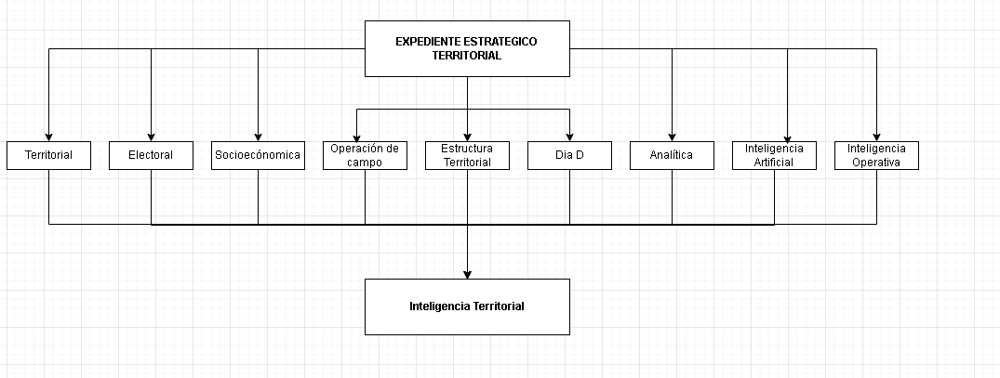

# Section Strategic File
## v1.0

### Documento Maestro del Expediente Estratégico Territorial

---

**Proyecto**

HEYTI-CORE

Arquitectura Empresarial de Inteligencia Territorial

---

**Versión**

1.0

---

**Estado**

En construcción

---

**Clasificación**

Documento Fundacional

---

**Dominio**

Territorial

---

**Autoría**

Proyecto HEYTI-CORE

---

> "Comprender el territorio antes de intentar transformarlo."

---

## Declaración

Este documento constituye la especificación conceptual oficial de la Sección Electoral dentro de HEYTI-CORE.

Define su filosofía, propósito, modelo de inteligencia, responsabilidades, relaciones con el resto de la plataforma y evolución futura.

Toda implementación técnica relacionada con la entidad Section deberá mantener consistencia con las definiciones establecidas en este documento.

---

Constituye el documento rector para el diseño, implementación y evolución del modelo de inteligencia territorial de HEYTI-CORE.

---

=============================================================================

 "La inteligencia territorial comienza en la Sección Electoral."

PF-0001

==============================================================================

# Prólogo

Durante décadas, la Sección Electoral ha sido utilizada como una unidad administrativa para organizar los procesos electorales.

Para HEYTI-CORE, esa visión resulta insuficiente.

El territorio no solamente debe administrarse.

Debe comprenderse.

Porque únicamente comprendiendo el comportamiento del territorio es posible diseñar estrategias capaces de transformar los resultados de un proceso electoral.

Bajo esa premisa nace el concepto de **Expediente Estratégico Territorial**.

No como una nueva división geográfica.

Sino como una nueva forma de integrar, interpretar y utilizar el conocimiento territorial.

# Introducción

La mayor parte de los sistemas electorales consideran a la Sección Electoral como una división geográfica utilizada para organizar los procesos de votación.

HEYTI-CORE adopta una visión distinta.

Para HEYTI, la Sección Electoral constituye la unidad mínima de inteligencia territorial sobre la cual convergen todos los procesos de análisis, organización, operación, evaluación y toma de decisiones.

La Sección deja de ser únicamente una delimitación geográfica para convertirse en un Expediente Estratégico Territorial capaz de integrar información proveniente de múltiples dominios, generar conocimiento estratégico y servir como base para la recomendación de acciones orientadas a mejorar la competitividad territorial durante un proceso electoral.

En consecuencia, toda la plataforma HEYTI-CORE gira alrededor de la Sección Electoral.

Cada módulo del sistema aporta una capa distinta de conocimiento que, integrada dentro del Expediente Estratégico Territorial, permite comprender el comportamiento del territorio y apoyar la toma de decisiones mediante inteligencia territorial.

---

# 1. ¿Qué es una Sección Electoral para HEYTI?

## Definición Estratégica

Dentro de HEYTI-CORE, la Sección Electoral representa mucho más que una delimitación geográfica utilizada para organizar un proceso electoral.

Constituye la unidad mínima de inteligencia territorial sobre la cual convergen todos los procesos de análisis, organización, operación, evaluación y toma de decisiones de la plataforma.

Cada Sección integra información proveniente de múltiples dominios funcionales, permitiendo construir una visión integral del territorio y generar conocimiento estratégico para apoyar la toma de decisiones.

Por esta razón, HEYTI define a la Sección Electoral como un **Expediente Estratégico Territorial**, capaz de concentrar el comportamiento histórico y actual del territorio, así como la información necesaria para planear, ejecutar, evaluar y mejorar las estrategias implementadas durante un proceso electoral.

---

### DS-0001 — Definición Estratégica Oficial

> **La Sección Electoral constituye la unidad mínima de inteligencia territorial de HEYTI-CORE. En ella se concentra el comportamiento geográfico, demográfico, socioeconómico, organizacional y electoral de un territorio, permitiendo analizar, planear, ejecutar y evaluar estrategias que incrementen la capacidad de comprension del territorio, la competitividad y la probabilidad de obtener el triunfo de un candidato o proyecto político durante un proceso electoral.**

---

### Nota de Ingeniería

Esta definición corresponde al modelo conceptual propio de HEYTI-CORE y representa la forma en que la plataforma comprende el territorio para construir inteligencia territorial. No sustituye la definición jurídica o administrativa de una Sección Electoral establecida por las autoridades electorales, sino que constituye una abstracción estratégica utilizada para el diseño de la plataforma.

---

# 2. La Arquitectura del Expediente Estratégico Territorial

La Sección Electoral constituye el núcleo funcional de HEYTI-CORE.

Toda la información administrada por la plataforma converge en el Expediente Estratégico Territorial, integrándose mediante capas de inteligencia que permiten construir una visión multidimensional del territorio.

Cada capa representa un dominio de conocimiento independiente, pero estrechamente relacionado con el resto, formando un modelo integral para el análisis, la operación y la toma de decisiones.

La fortaleza de HEYTI-CORE no radica únicamente en almacenar información, sino en la capacidad de integrar estas capas para generar inteligencia territorial.

En consecuencia, cada Sección Electoral deja de ser únicamente una referencia geográfica para convertirse en un modelo dinámico de conocimiento estratégico.

## 2.1 Capas de Inteligencia

Cada una de estas capas aporta información especializada sobre una misma Sección Electoral.

De manera individual permiten comprender aspectos específicos del territorio.

Integradas, constituyen el modelo de inteligencia territorial utilizado por HEYTI-CORE para apoyar la toma de decisiones estratégicas.

Principio Arquitectónico

La inteligencia territorial no proviene de una fuente de información, sino de la integración coherente de múltiples capas de conocimiento sobre un mismo territorio

PF-0002

La inteligencia territorial emerge de la integración de capas de conocimiento, no de la acumulación de datos.

---

# 3. Modelo de Capas de Inteligencia Territorial

## 3.1 Concepto

El Expediente Estratégico Territorial se construye mediante la integración de múltiples capas de inteligencia, donde cada una representa un dominio especializado del conocimiento sobre una misma Sección Electoral.

Cada capa posee objetivos, fuentes de información, indicadores y procesos propios.

Sin embargo, el verdadero valor de HEYTI-CORE no reside en cada capa de manera aislada, sino en la capacidad de integrarlas para construir una comprensión integral del territorio.

En consecuencia, la inteligencia territorial emerge de la interacción entre estas capas y no únicamente del análisis individual de los datos que las componen.

## 3.2 Principio Arquitectónico

Cada Sección Electoral constituye un único Expediente Estratégico Territorial.

Todas las capas de inteligencia describen el mismo territorio desde perspectivas distintas.

Por ello, ninguna capa sustituye a otra.

Cada una complementa y enriquece la comprensión del territorio.

La inteligencia territorial surge únicamente cuando todas las capas son interpretadas de forma integrada.

# 4. Capital Territorial

## Propósito

El Capital Territorial constituye la dimensión del Expediente Estratégico Territorial que permite comprender la capacidad real de influencia, organización y movilización existente dentro de una Sección Electoral.

Mientras otras capas describen las características del territorio o el comportamiento histórico de sus habitantes, el Capital Territorial identifica a las personas, organizaciones y redes sociales que poseen la capacidad de influir en las decisiones colectivas, convocar ciudadanos, fortalecer estructuras o modificar el comportamiento electoral.

Su objetivo no consiste únicamente en registrar actores políticos, sino en comprender el equilibrio de fuerzas que opera dentro del territorio para apoyar el diseño de estrategias electorales más eficaces.

## Objetivos del Capital Territorial

El análisis del Capital Territorial persigue los siguientes objetivos:

- Identificar la capacidad de organización existente dentro de una Sección Electoral.
- Reconocer los liderazgos propios y adversarios con influencia territorial.
- Identificar redes sociales y organizaciones con capacidad de movilización.
- Evaluar el equilibrio político entre las distintas fuerzas presentes en el territorio.
- Detectar fortalezas, debilidades y oportunidades para el desarrollo de la estrategia electoral.
- Proporcionar información al Copilot para generar recomendaciones estratégicas sobre la asignación de recursos humanos, materiales y financieros.

## 4.1 Actores Territoriales

El Capital Territorial se encuentra conformado por los actores que participan directa o indirectamente en la dinámica política, social y organizacional de una Sección Electoral.

Dentro de HEYTI-CORE, un actor territorial no se define únicamente por su afiliación política, sino por la capacidad real que posee para influir, organizar, convocar, movilizar o modificar el comportamiento de una comunidad.

En consecuencia, una misma Sección Electoral puede contener actores con distintos niveles de influencia, intereses y objetivos, cuya interacción determina el equilibrio político existente dentro del territorio.

Para efectos del Expediente Estratégico Territorial, los actores se clasifican de la siguiente manera:

| Tipo de Actor | Descripción | Valor Estratégico |
|---------------|-------------|-------------------|
| Simpatizante | Persona que manifiesta afinidad hacia el proyecto político. | Bajo |
| Activista | Participa de forma constante en actividades de promoción o movilización. | Medio |
| Promotor | Responsable de desarrollar actividades permanentes de organización y contacto ciudadano. | Alto |
| Coordinador Territorial | Organiza equipos de trabajo y coordina la operación política dentro de una zona determinada. | Muy Alto |
| Líder Comunitario | Persona reconocida por su capacidad de convocatoria e influencia dentro de la comunidad. | Muy Alto |
| Líder Adversario | Actor con capacidad comprobada para fortalecer a una fuerza política distinta. | Crítico |
| Influenciador Social | Persona cuya opinión genera impacto dentro de la comunidad, independientemente de su participación política. | Alto |
| Organización | Asociación, agrupación o institución con presencia e influencia territorial. | Variable |

La clasificación anterior constituye un modelo conceptual que podrá ampliarse conforme evolucione la plataforma y se incorporen nuevos tipos de actores territoriales.

## 4.2 Valor Estratégico

No todos los actores territoriales generan el mismo impacto sobre una Sección Electoral.

Dentro de HEYTI-CORE, el Valor Estratégico representa la capacidad estimada que posee un actor para influir positiva o negativamente en el desarrollo de una estrategia electoral.

La valoración de un actor no depende exclusivamente de su cargo o posición dentro de una estructura política, sino del conjunto de atributos que determinan su capacidad real de convocatoria, liderazgo, organización e influencia social.

Entre los principales factores considerados para estimar el Valor Estratégico de un actor se encuentran:

| Factor de Evaluación | Objetivo |
|-----------------------|----------|
| Capacidad de convocatoria | Número estimado de personas que puede movilizar. |
| Cobertura territorial | Alcance geográfico de su influencia dentro de la Sección. |
| Credibilidad social | Nivel de confianza y reconocimiento dentro de la comunidad. |
| Actividad reciente | Participación efectiva en actividades políticas o comunitarias. |
| Historial de colaboración | Participación previa en procesos electorales o actividades organizacionales. |
| Afinidad política | Nivel de identificación con el proyecto político. |
| Disponibilidad operativa | Capacidad real para participar durante la campaña. |

La integración de estos factores permitirá, en futuras versiones de HEYTI-CORE, calcular indicadores compuestos de influencia territorial y priorizar aquellos actores cuya incorporación o fortalecimiento represente un mayor beneficio estratégico para la campaña.

El Valor Estratégico constituye uno de los elementos fundamentales para que el Copilot pueda emitir recomendaciones relacionadas con la asignación de brigadas, fortalecimiento de estructuras, construcción de liderazgos, distribución de recursos y definición de prioridades territoriales.

---

# 5. Modelo de Conocimiento

## Propósito

El Expediente Estratégico Territorial representa el modelo de conocimiento mediante el cual HEYTI-CORE comprende una Sección Electoral.

A diferencia de los sistemas tradicionales, donde la información permanece distribuida en múltiples bases de datos y módulos independientes, HEYTI integra dicho conocimiento dentro de una única unidad estratégica capaz de responder preguntas, generar diagnósticos, construir escenarios y recomendar acciones sobre un territorio específico.

En consecuencia, la Sección Electoral deja de ser un simple contenedor de datos para convertirse en un modelo dinámico de conocimiento que evoluciona continuamente conforme se incorporan nuevos indicadores, eventos, resultados y procesos de aprendizaje.

El propósito de este modelo consiste en transformar información dispersa en inteligencia territorial útil para apoyar la toma de decisiones estratégicas durante todas las etapas de un proceso electoral.

## 5.1 Conocimiento Fundamental

Toda Sección Electoral concentra un conjunto de conocimientos fundamentales que permiten comprender integralmente el territorio.

Cada elemento del conocimiento responde a una pregunta estratégica que un candidato, un coordinador de campaña o el propio Copilot pueden formular durante el análisis de una Sección Electoral.

El conocimiento fundamental del Expediente Estratégico Territorial incluye, entre otros, los siguientes componentes:

- Conocer la ubicación geográfica del territorio.
- Conocer la identidad política predominante de la Sección.
- Conocer la evolución histórica de los resultados electorales.
- Conocer las características demográficas y socioeconómicas de la población.
- Conocer el Capital Territorial existente.
- Conocer el nivel de organización política dentro de la Sección.
- Conocer los riesgos operativos y condiciones del territorio.
- Conocer las fortalezas y debilidades estratégicas.
- Conocer las oportunidades de crecimiento electoral.
- Conocer las recomendaciones generadas por HEYTI para incrementar la competitividad territorial.

## 5.2 El Ciclo del Conocimiento Territorial

Dentro de HEYTI-CORE, el conocimiento territorial se construye mediante un proceso continuo de integración, análisis, aprendizaje y recomendación.

Cada nuevo dato incorporado al Expediente Estratégico Territorial fortalece la comprensión del territorio y mejora la capacidad del Copilot para emitir diagnósticos y recomendaciones estratégicas.

Este proceso puede representarse mediante el siguiente ciclo:

Información

↓

Integración

↓

Análisis

↓

Conocimiento

↓

Inteligencia Territorial

↓

Recomendaciones Estratégicas

↓

Toma de Decisiones

↓

Nuevos Resultados

↓

Aprendizaje Territorial

↓

Actualización del Expediente Estratégico Territorial

## 5.3 Principio del Conocimiento Territorial

> La inteligencia territorial no se genera por la cantidad de información disponible, sino por la capacidad de transformarla en conocimiento útil para apoyar la toma de decisiones.

El conocimiento constituye el activo estratégico más importante de HEYTI-CORE.

Cada indicador, cada actor territorial, cada resultado electoral y cada evento registrado adquieren valor únicamente cuando contribuyen a comprender mejor el territorio y permiten diseñar estrategias más eficaces.

## 5.4 Preguntas Estratégicas

Toda interacción entre un usuario y HEYTI-CORE deberá orientarse a responder preguntas estratégicas relacionadas con el territorio.

Entre las principales preguntas que el Expediente Estratégico Territorial deberá responder se encuentran:

- ¿Dónde se encuentra la Sección Electoral?
- ¿Cuál es su identidad política predominante?
- ¿Cómo ha evolucionado históricamente su comportamiento electoral?
- ¿Quiénes ejercen influencia dentro del territorio?
- ¿Qué fortalezas y debilidades presenta la Sección?
- ¿Qué riesgos operativos existen para desarrollar actividades de campaña?
- ¿Qué oportunidades estratégicas pueden aprovecharse?
- ¿Qué recursos conviene invertir en esta Sección?
- ¿Qué probabilidad existe de incrementar la competitividad electoral?
- ¿Qué recomienda HEYTI para alcanzar el objetivo estratégico de la campaña?

---

# 6. Modelo de Decisión Estratégica

## Propósito

El propósito fundamental de HEYTI-CORE no consiste únicamente en almacenar información territorial, sino en apoyar la toma de decisiones estratégicas mediante el análisis integrado del conocimiento contenido en el Expediente Estratégico Territorial.

Cada recomendación generada por el Copilot deberá sustentarse en evidencia proveniente de las distintas capas de inteligencia que conforman una Sección Electoral.

En consecuencia, toda decisión propuesta por HEYTI deberá ser explicable, justificable y trazable a partir de la información disponible en el territorio.

## 6.1 El Proceso de Decisión

Dentro de HEYTI-CORE, toda decisión estratégica sigue un proceso estructurado de razonamiento territorial.

El Copilot no genera recomendaciones de manera arbitraria, sino que integra información proveniente de las distintas capas del Expediente Estratégico Territorial para construir un diagnóstico, identificar oportunidades y proponer acciones concretas.

El proceso general puede resumirse de la siguiente forma:

Observación del territorio

↓

Integración de información

↓

Construcción de conocimiento

↓

Diagnóstico territorial

↓

Identificación de oportunidades y riesgos

↓

Generación de escenarios

↓

Recomendaciones estratégicas

↓

Toma de decisiones

↓

Acciones territoriales

↓

Evaluación de resultados

↓

Aprendizaje

## 6.2 La Regla de Oro de HEYTI

Toda recomendación emitida por HEYTI deberá responder, al menos, las siguientes preguntas:

- ¿Qué ocurre en esta Sección?
- ¿Por qué ocurre?
- ¿Qué riesgo representa?
- ¿Qué oportunidad existe?
- ¿Qué conviene hacer?
- ¿Qué recursos serán necesarios?
- ¿Qué impacto se espera obtener?

---

# 7. Modelo de Interacción Estratégica

## Propósito

El Modelo de Interacción Estratégica define la forma en que HEYTI-CORE transforma una consulta realizada por el usuario en conocimiento útil para la toma de decisiones.

A diferencia de un asistente conversacional tradicional, cuyo objetivo consiste en responder preguntas de manera aislada, HEYTI conduce un proceso estructurado de comprensión territorial que integra información proveniente de todas las capas del Expediente Estratégico Territorial.

Cada interacción representa un recorrido guiado por el territorio, permitiendo construir progresivamente un diagnóstico, identificar riesgos y oportunidades, generar recomendaciones y producir productos de inteligencia que apoyen la operación estratégica.

## 7.1 Principios de Interacción

Toda interacción entre el usuario y HEYTI-CORE deberá cumplir los siguientes principios:

- Comprender el contexto antes de emitir una recomendación.
- Integrar información proveniente de todas las capas del Expediente Estratégico Territorial.
- Justificar cada recomendación mediante evidencia verificable.
- Priorizar la generación de conocimiento sobre la simple presentación de datos.
- Traducir el conocimiento generado en acciones concretas sobre el territorio.
- Adaptar la profundidad de la información al perfil y necesidades del usuario.

## 7.2 Flujo de Interacción

Toda consulta estratégica deberá seguir un proceso ordenado de análisis territorial.

El objetivo no consiste únicamente en responder una pregunta, sino en construir una comprensión integral de la Sección Electoral antes de emitir recomendaciones.

El flujo general de interacción es el siguiente:

1. Identificación del territorio.
2. Identidad política de la Sección.
3. Comportamiento histórico electoral.
4. Capital Territorial.
5. Caracterización socioeconómica.
6. Riesgos operativos.
7. Diagnóstico territorial.
8. Recomendaciones estratégicas.
9. Recursos necesarios para la operación.
10. Generación del Producto de Inteligencia.

## 7.3 Productos de Inteligencia

Toda interacción estratégica podrá concluir con la generación automática de uno o más Productos de Inteligencia.

Estos productos constituyen la representación ejecutiva del conocimiento construido por HEYTI durante el proceso de análisis territorial.

Entre los principales Productos de Inteligencia considerados por la plataforma se encuentran:

| Producto | Objetivo |
|----------|----------|
| Resumen Ejecutivo | Presentar una visión rápida del territorio para la toma inmediata de decisiones. |
| Expediente Ejecutivo Territorial | Integrar toda la información estratégica de una Sección Electoral en un documento ejecutivo. |
| Dashboard Estratégico | Mostrar indicadores, mapas y gráficas de manera interactiva. |
| Plan de Acción Territorial | Traducir las recomendaciones en actividades concretas para los equipos operativos. |
| Informe Técnico | Presentar el análisis detallado para especialistas y equipos de estrategia. |

## 7.4 Adaptación al Perfil del Usuario

El nivel de detalle y la forma de presentación del conocimiento deberán adaptarse al perfil del usuario que interactúa con HEYTI-CORE.

Un candidato requiere una visión ejecutiva orientada a la toma de decisiones.

Un coordinador territorial necesita conocer prioridades operativas y distribución de recursos.

Un analista requiere acceso al detalle de indicadores, modelos y evidencia.

Por esta razón, HEYTI generará distintos Productos de Inteligencia a partir del mismo Expediente Estratégico Territorial, manteniendo consistencia en el conocimiento, pero adaptando su profundidad y presentación a las necesidades específicas de cada usuario.

## 7.5 Regla de Oro

Toda interacción con HEYTI-CORE deberá concluir generando conocimiento accionable.

El éxito del Copilot no se medirá por la cantidad de información presentada, sino por su capacidad para apoyar decisiones estratégicas mediante recomendaciones claras, justificadas y orientadas a la acción.

---

# 8. Modelo Conceptual del Expediente Estratégico Territorial

## Propósito

El Modelo Conceptual del Expediente Estratégico Territorial define la estructura mediante la cual HEYTI-CORE organiza, relaciona e interpreta el conocimiento asociado a una Sección Electoral.

Su objetivo no consiste en describir la implementación física de una base de datos, sino en representar la forma en que la plataforma comprende el territorio como una unidad integral de inteligencia.

Cada elemento conceptual representa un dominio especializado de conocimiento que interactúa con los demás para construir una visión única, consistente y dinámica del territorio.

## 8.1 La Sección Electoral como Núcleo del Modelo

La Sección Electoral constituye la entidad central de todo el modelo conceptual de HEYTI-CORE.

Todos los procesos de análisis, captura, organización, operación, evaluación y generación de conocimiento convergen sobre una única Sección Electoral.

En consecuencia, ninguna capa de inteligencia existe de manera independiente.

Cada dominio aporta una perspectiva distinta sobre el mismo territorio, enriqueciendo progresivamente el Expediente Estratégico Territorial y fortaleciendo la capacidad del Copilot para comprender el contexto y generar recomendaciones estratégicas.

La Sección Electoral representa, por tanto, el punto de integración entre el territorio físico, la información histórica, la operación política y el conocimiento generado por la plataforma.

## 8.2 Dominios Conceptuales

El conocimiento contenido dentro del Expediente Estratégico Territorial se organiza mediante dominios conceptuales especializados.

Cada dominio administra información específica del territorio y mantiene relaciones permanentes con la Sección Electoral.

Los principales dominios conceptuales de HEYTI-CORE son:

| Dominio | Propósito |
|----------|-----------|
| Territorial | Describe la ubicación geográfica y organización administrativa del territorio. |
| Electoral | Registra el comportamiento histórico y actual de los procesos electorales. |
| Socioeconómico | Caracteriza la población y las condiciones sociales del territorio. |
| Capital Territorial | Describe los actores, liderazgos, estructuras y redes de influencia existentes. |
| Operación Territorial | Registra las actividades desarrolladas durante la campaña. |
| Operación Electoral | Administra la información correspondiente a la jornada electoral (Día D). |
| Inteligencia Territorial | Integra indicadores, escenarios, modelos predictivos y recomendaciones. |
| Inteligencia Artificial | Genera explicaciones, recomendaciones y aprendizaje continuo a partir del conocimiento disponible. |

## 8.3 Relaciones Conceptuales

El Modelo Conceptual establece que todos los dominios de conocimiento mantienen una relación directa con la Sección Electoral.

No existen relaciones jerárquicas entre los dominios.

Cada uno aporta información complementaria sobre el mismo territorio.

La integración de estos dominios permite construir una representación única del conocimiento territorial, evitando duplicidad de información y garantizando consistencia entre los distintos procesos de análisis y operación.

## 8.4 representacion Conceptual

                           HEYTI-CORE

                                │

                    EXPEDIENTE ESTRATÉGICO

                                │

                     SECCIÓN ELECTORAL

────────────────────────────────────────────────────

 Territorial

 Electoral

 Socioeconómico

 Capital Territorial

 Operación Territorial

 Operación Electoral

 Inteligencia Territorial

 Inteligencia Artificial

────────────────────────────────────────────────────

              CONOCIMIENTO TERRITORIAL

                                │

                   DECISIONES ESTRATÉGICAS

## 8.5 Principio del Modelo Conceptual

El Modelo Conceptual de HEYTI-CORE establece que toda la información relacionada con un territorio deberá integrarse alrededor de una única Sección Electoral, evitando duplicidad de conocimiento y garantizando una visión consistente del territorio.

Cada nuevo dominio incorporado a la plataforma deberá enriquecer el Expediente Estratégico Territorial sin alterar la identidad conceptual de la Sección Electoral como unidad mínima de inteligencia territorial.                   

---

# 9. Modelo de Aprendizaje Territorial

## Propósito

El Modelo de Aprendizaje Territorial establece los principios mediante los cuales HEYTI-CORE incrementa progresivamente su capacidad para comprender el territorio y mejorar la calidad de sus recomendaciones estratégicas.

El aprendizaje no depende exclusivamente de algoritmos de Inteligencia Artificial, sino de la incorporación sistemática de nuevos datos, resultados electorales, experiencias operativas, observaciones territoriales y conocimiento generado por los usuarios de la plataforma.

Cada proceso electoral constituye una nueva fuente de aprendizaje para enriquecer el Expediente Estratégico Territorial y fortalecer el conocimiento acumulado sobre cada Sección Electoral.

## 9.1 Fuentes de Aprendizaje

El aprendizaje de HEYTI-CORE se construye mediante la integración continua de múltiples fuentes de información.

Entre las principales fuentes de aprendizaje se encuentran:

- Resultados oficiales de procesos electorales.
- Información generada durante las actividades de campo.
- Actualización del Capital Territorial.
- Cambios en la estructura organizacional.
- Indicadores socioeconómicos.
- Observaciones realizadas por coordinadores y promotores.
- Productos de inteligencia generados durante campañas anteriores.
- Retroalimentación proporcionada por los usuarios del sistema.
- Información proveniente de fuentes oficiales y públicas.

## 9.2 Ciclo de Aprendizaje

Captura de Información

↓

Validación

↓

Integración

↓

Análisis

↓

Generación de Conocimiento

↓

Recomendaciones

↓

Implementación

↓

Resultados

↓

Retroalimentación

↓

Aprendizaje Territorial

↓

Actualización del Expediente Estratégico Territorial

## 9.3 Aprendizaje Colaborativo

Dentro de HEYTI-CORE, el conocimiento territorial se construye mediante la colaboración entre la experiencia humana y las capacidades analíticas de la Inteligencia Artificial.

Los estrategas, coordinadores y operadores territoriales aportan experiencia, contexto y conocimiento práctico del territorio.

La Inteligencia Artificial integra, organiza y analiza dicha información para generar recomendaciones consistentes, identificar patrones y fortalecer el aprendizaje territorial.

En consecuencia, HEYTI no busca sustituir la experiencia humana, sino potenciarla mediante herramientas de inteligencia territorial.

## 9.4 Principio de Evolución

Cada nueva campaña, cada nueva elección y cada nueva interacción con el territorio representan oportunidades para enriquecer el conocimiento acumulado por HEYTI-CORE.

El valor de la plataforma aumenta conforme incrementa su capacidad para comprender el comportamiento del territorio y generar recomendaciones estratégicas más precisas y mejor fundamentadas.

---

# 10. Motor de Inteligencia Territorial (MIT)

## Propósito

El Motor de Inteligencia Territorial constituye el núcleo de razonamiento de HEYTI-CORE.

Su función consiste en transformar la información contenida en el Expediente Estratégico Territorial en conocimiento útil para apoyar la toma de decisiones estratégicas.

El MIT no representa un modelo específico de Inteligencia Artificial ni depende de una tecnología determinada.

Constituye un modelo de razonamiento estratégico diseñado para comprender el territorio, formular hipótesis, generar diagnósticos, construir escenarios y recomendar acciones sustentadas en evidencia.

En consecuencia, el MIT representa el cerebro operativo de HEYTI-CORE y el principal responsable de convertir información territorial en inteligencia estratégica.

## 10.1 Principios del Motor de Inteligencia Territorial

El Motor de Inteligencia Territorial opera bajo los siguientes principios fundamentales:

- Todo razonamiento deberá sustentarse en evidencia territorial.
- Ninguna recomendación podrá emitirse sin justificar las razones que la respaldan.
- Las hipótesis deberán validarse mediante información proveniente de múltiples dominios del Expediente Estratégico Territorial.
- Toda decisión deberá traducirse en acciones concretas sobre el territorio.
- Cada interacción deberá fortalecer la Memoria Territorial de HEYTI.

## 10.2 Ciclo Cognitivo del MIT

OBSERVAR

↓

COMPRENDER

↓

FORMULAR HIPÓTESIS

↓

VALIDAR EVIDENCIA

↓

DIAGNOSTICAR

↓

GENERAR ESCENARIOS

↓

RECOMENDAR

↓

PLANIFICAR

↓

EJECUTAR

↓

EVALUAR

↓

APRENDER

↓

ACTUALIZAR LA MEMORIA TERRITORIAL

## 10.3 Funciones Cognitivas

Y aquí quiero una tabla.

Función	Descripción

Observar	           -> Integrar información proveniente de todos los dominios territoriales.
Comprender	           -> Construir una representación coherente del territorio.
Formular Hipótesis	   -> Identificar posibles explicaciones y oportunidades estratégicas.
Validar Evidencia	   -> Contrastar las hipótesis con información objetiva.
Diagnosticar	       -> Explicar la situación actual de la Sección Electoral.
Generar Escenarios	   -> Simular alternativas de intervención territorial.
Recomendar	           -> Proponer estrategias sustentadas en evidencia.
Planificar	           -> Traducir recomendaciones en acciones operativas.
Aprender	           ->Incorporar nuevos resultados a la Memoria Territorial

## 10.4 Evidencia

Toda recomendación generada por el Motor de Inteligencia Territorial deberá acompañarse de la evidencia territorial que sustenta el razonamiento.

HEYTI no emitirá recomendaciones opacas.

Cada conclusión deberá poder explicarse mediante indicadores, actores territoriales, resultados históricos, información operativa y conocimiento previamente acumulado en el Expediente Estratégico Territorial.

## 10.5 Misión del Motor de Inteligencia Territorial

La misión del Motor de Inteligencia Territorial consiste en transformar datos territoriales en decisiones estratégicas mediante la integración de conocimiento, evidencia y aprendizaje continuo.

El éxito del MIT no se medirá por la cantidad de respuestas generadas, sino por su capacidad para mejorar la calidad de las decisiones tomadas sobre el territorio.

---

# 11. Productos de Inteligencia Territorial (PIT)

## Propósito

El propósito del Motor de Inteligencia Territorial no consiste únicamente en generar conocimiento, sino en entregarlo de forma clara, útil y accionable para cada tipo de usuario.

Dentro de HEYTI-CORE, el conocimiento estratégico se materializa mediante Productos de Inteligencia Territorial, los cuales representan la forma en que el Copilot comunica diagnósticos, recomendaciones y planes de acción.

Cada Producto de Inteligencia constituye una representación ejecutiva del Expediente Estratégico Territorial y tiene como objetivo facilitar la comprensión del territorio y apoyar la toma de decisiones estratégicas.

## 11.1 Filosofía

El conocimiento únicamente adquiere valor cuando puede ser comprendido y utilizado por las personas responsables de tomar decisiones.

Por esta razón, HEYTI-CORE adapta la forma de presentar la información según el perfil del usuario, el contexto de la consulta y el objetivo estratégico perseguido.

Cada Producto de Inteligencia deberá sintetizar el conocimiento generado por el Expediente Estratégico Territorial y presentarlo mediante una combinación equilibrada de texto, indicadores, mapas, gráficos, alertas y recomendaciones.

## 11.2 Clasificación de los Productos de Inteligencia Territorial

Los Productos de Inteligencia Territorial constituyen el mecanismo oficial mediante el cual HEYTI-CORE comunica el conocimiento generado por el Motor de Inteligencia Territorial.

Cada producto responde a un objetivo específico, considera el perfil del usuario que lo utilizará y presenta la información con el nivel de profundidad adecuado para apoyar la toma de decisiones.

Todos los Productos de Inteligencia se generan a partir del Expediente Estratégico Territorial, garantizando consistencia entre la información utilizada para el análisis y la presentada al usuario final.

La siguiente clasificación representa la primera versión del modelo de Productos de Inteligencia de HEYTI-CORE.

| Código | Producto de Inteligencia | Usuario Principal | Objetivo |
|----------|-------------------------|-------------------|----------|
| PIT-01 | Resumen Ejecutivo | Candidato | Presentar una visión ejecutiva de la Sección Electoral para apoyar decisiones inmediatas. |
| PIT-02 | Expediente Ejecutivo Territorial | Coordinadores de campaña | Integrar el análisis estratégico completo de una Sección Electoral. |
| PIT-03 | Dashboard Estratégico | Directores y responsables estatales | Visualizar indicadores, mapas y tendencias en tiempo real. |
| PIT-04 | Plan de Acción Territorial | Equipos operativos | Traducir las recomendaciones del Copilot en actividades concretas. |
| PIT-05 | Informe Técnico | Analistas | Presentar el detalle metodológico, indicadores y evidencia territorial. |
| PIT-06 | Presentación Ejecutiva | Reuniones estratégicas | Generar automáticamente una presentación con los principales hallazgos del análisis. |

## 11.3 Expediente Ejecutivo Territorial

El Expediente Ejecutivo Territorial constituye el principal Producto de Inteligencia generado por HEYTI-CORE.

Su propósito consiste en sintetizar el conocimiento contenido en el Expediente Estratégico Territorial y presentarlo mediante un documento ejecutivo orientado a facilitar la toma de decisiones.

El Expediente Ejecutivo Territorial no representa una copia de la base de datos ni un conjunto de reportes independientes.

Constituye una interpretación estratégica del territorio elaborada por el Motor de Inteligencia Territorial, integrando información proveniente de todos los dominios de conocimiento y priorizando aquella que resulta relevante para el usuario.

En consecuencia, cada Expediente Ejecutivo representa una fotografía estratégica del territorio en un momento determinado y podrá regenerarse automáticamente conforme evolucione el conocimiento disponible sobre la Sección Electoral.

## 11.4 Estructura del Expediente Ejecutivo Territorial

Como referencia conceptual, el Expediente Ejecutivo Territorial podrá integrar los siguientes apartados:

1. Portada e identificación de la Sección Electoral.
2. Resumen Ejecutivo.
3. Ubicación territorial y contexto geográfico.
4. Identidad política y color predominante.
5. Evolución histórica de los resultados electorales.
6. Capital Territorial.
7. Caracterización demográfica y socioeconómica.
8. Seguridad y Atlas de Riesgos.
9. Diagnóstico Territorial.
10. Escenarios estratégicos.
11. Recomendaciones del Motor de Inteligencia Territorial.
12. Plan de Acción Territorial.
13. Recursos estimados para la operación.
14. Indicadores de seguimiento.
15. Conclusiones estratégicas.

## 11.5 Principios de los Productos de Inteligencia Territorial

Todo Producto de Inteligencia Territorial generado por HEYTI-CORE deberá cumplir, como mínimo, los siguientes principios:

- Claridad.
- Objetividad.
- Fundamentación en evidencia.
- Trazabilidad de la información utilizada.
- Comprensión inmediata para el usuario objetivo.
- Orientación a la acción.
- Actualización automática conforme evolucione el conocimiento territorial.
- Consistencia con el Expediente Estratégico Territorial.

## 11.6 Inteligencia Explicable

Todo Producto de Inteligencia Territorial deberá permitir comprender las razones que sustentan sus conclusiones y recomendaciones.

En consecuencia, las recomendaciones emitidas por el Motor de Inteligencia Territorial deberán acompañarse de la evidencia territorial utilizada para construir el razonamiento, permitiendo que el usuario comprenda no solamente la conclusión alcanzada, sino también los elementos que la justifican.

Este principio fortalece la transparencia, la confianza y la capacidad del usuario para validar las recomendaciones propuestas por HEYTI-CORE.

---

# 12. Modelo de Evolución Territorial

## Propósito

El territorio constituye un sistema dinámico sujeto a cambios políticos, sociales, económicos, demográficos y organizacionales.

En consecuencia, el Expediente Estratégico Territorial deberá registrar no solamente el estado actual de una Sección Electoral, sino también los eventos relevantes que expliquen su evolución a lo largo del tiempo.

El Modelo de Evolución Territorial permite comprender cómo cambia una Sección, cuáles son las causas de dichos cambios y qué impacto pueden tener sobre las estrategias futuras.

## 12.1 Eventos Territoriales

Se considera Evento Territorial cualquier hecho que modifique de manera significativa las condiciones de una Sección Electoral y pueda afectar su comportamiento político, social, organizacional o estratégico.

Los Eventos Territoriales representan una de las principales fuentes de aprendizaje para el Motor de Inteligencia Territorial y enriquecen permanentemente la Memoria Territorial de HEYTI-CORE.

| Tipo                  | Ejemplos                                                       |
| --------------------- | -------------------------------------------------------------- |
| Electoral             | Elecciones, redistritación, reformas.                          |
| Demográfico           | Crecimiento poblacional, nuevos fraccionamientos, migración.   |
| Social                | Conflictos, movimientos ciudadanos, participación comunitaria. |
| Económico             | Empresas, cierres, inversiones, desempleo.                     |
| Infraestructura       | Hospitales, carreteras, escuelas, transporte.                  |
| Seguridad             | Violencia, Atlas de Riesgo, Protección Civil.                  |
| Organización Política | Incorporación o salida de liderazgos, cambios en estructuras.  |
| Operación Territorial | Brigadas, campañas, reuniones, recorridos.                     |

## 12.2 Impacto Estratégico de los Eventos

No todos los Eventos Territoriales producen el mismo efecto sobre una Sección Electoral.

Algunos modifican únicamente indicadores específicos, mientras que otros transforman de manera significativa el comportamiento político, social, económico u organizacional del territorio.

Por esta razón, HEYTI-CORE deberá evaluar el impacto estratégico asociado a cada Evento Territorial, estimando su influencia sobre el Expediente Estratégico Territorial y actualizando el conocimiento disponible conforme se incorporen nuevas evidencias.

El impacto de un evento podrá manifestarse de forma inmediata o progresiva, por lo que la plataforma deberá conservar el historial de cambios y permitir analizar la evolución del territorio a través del tiempo.

## 12.3 Memoria Territorial

La Memoria Territorial constituye el conocimiento acumulado por HEYTI-CORE sobre la evolución histórica de cada Sección Electoral.

A diferencia de una base de datos convencional, cuya función principal consiste en almacenar registros, la Memoria Territorial conserva la experiencia adquirida mediante procesos electorales, actividades operativas, cambios demográficos, transformaciones sociales, eventos relevantes y resultados obtenidos a lo largo del tiempo.

Cada nuevo dato incorporado al Expediente Estratégico Territorial fortalece esta memoria y permite comprender con mayor precisión la evolución del territorio, identificar patrones de comportamiento y mejorar progresivamente la calidad de las recomendaciones emitidas por el Motor de Inteligencia Territorial.

## 12.4 Evolución del Conocimiento

El conocimiento territorial no constituye un estado permanente.

Cada interacción con el territorio representa una oportunidad para confirmar, ajustar o ampliar el conocimiento previamente disponible.

En consecuencia, HEYTI-CORE deberá considerar que toda recomendación estratégica se encuentra sujeta a revisión conforme evolucionen las condiciones del territorio y se incorporen nuevos eventos, indicadores o evidencias.

La evolución permanente del conocimiento constituye uno de los principios fundamentales del Motor de Inteligencia Territorial.

## 12.5 Principio de Evolución

El territorio cambia constantemente.

Por esta razón, ninguna representación estratégica de una Sección Electoral puede considerarse definitiva.

El Expediente Estratégico Territorial deberá evolucionar de manera continua, integrando nueva información, preservando el conocimiento previamente adquirido y fortaleciendo la capacidad del Motor de Inteligencia Territorial para comprender el comportamiento del territorio.

La evolución permanente constituye una condición indispensable para mantener vigente el conocimiento estratégico contenido en HEYTI-CORE.

---

# 13. Evolución de HEYTI-CORE

## Propósito

HEYTI-CORE ha sido concebido como una plataforma evolutiva de Inteligencia Territorial.

Su arquitectura permite incorporar nuevos dominios de conocimiento, nuevas fuentes de información, nuevos modelos analíticos y nuevas capacidades tecnológicas sin modificar los principios fundamentales establecidos en este documento.

En consecuencia, la evolución de la plataforma no implica sustituir el conocimiento previamente construido, sino enriquecer progresivamente el Expediente Estratégico Territorial mediante nuevas capacidades que fortalezcan el proceso de comprensión del territorio.

## 13.1 Principio de Evolución Modular

Cada nueva funcionalidad incorporada a HEYTI-CORE deberá integrarse como un nuevo dominio de conocimiento o como una ampliación de un dominio existente.

Ninguna evolución de la plataforma deberá comprometer la coherencia del Expediente Estratégico Territorial ni alterar la Sección Electoral como unidad mínima de inteligencia territorial.

Este principio garantiza la estabilidad conceptual de la plataforma y facilita su crecimiento sostenido a largo plazo.

## 13.2 Escalabilidad Territorial

La arquitectura de HEYTI-CORE ha sido diseñada para operar inicialmente sobre una entidad federativa, manteniendo la capacidad de escalar progresivamente hacia múltiples estados, regiones o países sin modificar el modelo conceptual del Expediente Estratégico Territorial.

La incorporación de nuevos territorios deberá realizarse mediante la integración de nuevos catálogos, dominios administrativos y fuentes oficiales de información, preservando siempre la consistencia del conocimiento territorial.

## 13.3 Evolución Tecnológica

HEYTI-CORE mantiene independencia respecto de tecnologías específicas de almacenamiento, motores de Inteligencia Artificial o herramientas de visualización.

La plataforma podrá incorporar nuevos modelos de Inteligencia Artificial, motores analíticos, servicios geoespaciales o tecnologías emergentes sin alterar los principios conceptuales que sustentan el Expediente Estratégico Territorial y el Motor de Inteligencia Territorial.

De esta manera, la evolución tecnológica fortalece la plataforma sin modificar su identidad.

## 13.4 Incorporación de Nuevos Dominios de Conocimiento

La arquitectura de HEYTI-CORE permite incorporar nuevos dominios de conocimiento conforme evolucionen las necesidades de la plataforma.

Entre las posibles líneas de evolución se consideran, de manera enunciativa mas no limitativa:

- Atlas de Riesgos.
- Seguridad Pública.
- Desarrollo Urbano.
- Infraestructura.
- Movilidad.
- Salud Pública.
- Educación.
- Desarrollo Social.
- Medio Ambiente.
- Catastro.
- Información Satelital.
- Sensores Territoriales.
- Redes Sociales.
- Inteligencia Económica.

La incorporación de estos dominios deberá enriquecer el conocimiento territorial sin alterar la estructura conceptual del Expediente Estratégico Territorial.

## 13.5 Visión de Largo Plazo

La visión de HEYTI-CORE consiste en consolidarse como una plataforma integral de Inteligencia Territorial capaz de transformar información dispersa en conocimiento estratégico para apoyar la toma de decisiones.

Su evolución deberá orientarse permanentemente hacia una comprensión cada vez más profunda del territorio, fortaleciendo la capacidad analítica, predictiva y colaborativa del Motor de Inteligencia Territorial.

El propósito último de HEYTI-CORE no consiste únicamente en responder preguntas, sino en convertirse en un aliado estratégico capaz de acompañar a las personas responsables de comprender, planificar y transformar el territorio mediante decisiones sustentadas en evidencia.

---

# 14. Declaración Fundacional

## 14.1 El Origen

HEYTI-CORE nace de la convicción de que comprender un territorio constituye el primer paso para transformarlo de manera responsable.

Durante años, el análisis territorial, la operación política, la organización electoral y la toma de decisiones estratégicas se han apoyado en información dispersa, herramientas independientes y conocimiento acumulado únicamente en la experiencia de las personas.

Esta situación dificulta preservar el conocimiento, compartirlo y convertirlo en una capacidad permanente de las organizaciones.

El propósito de HEYTI-CORE consiste en integrar ese conocimiento dentro de una plataforma capaz de comprender el territorio, aprender de su evolución y apoyar la toma de decisiones mediante inteligencia territorial.

## 14.2 La Convicción

En HEYTI-CORE creemos que el territorio constituye un sistema vivo, dinámico y en permanente evolución.

Creemos que ninguna decisión estratégica debería sustentarse únicamente en intuiciones, percepciones aisladas o información fragmentada.

Creemos que el conocimiento territorial puede construirse mediante la integración responsable de evidencia proveniente de múltiples dominios, fortaleciendo la comprensión del contexto y mejorando la calidad de las decisiones.

Creemos que la Inteligencia Artificial no sustituye la experiencia humana.

La complementa.

La fortalece.

Y contribuye a preservar el conocimiento construido a lo largo del tiempo.

## 14.3 El Compromiso

HEYTI-CORE asume el compromiso de evolucionar de manera permanente, incorporando nuevos conocimientos, nuevas capacidades tecnológicas y nuevas fuentes de información, sin perder los principios fundamentales que dieron origen a esta plataforma.

Toda evolución deberá orientarse a fortalecer el Expediente Estratégico Territorial, el Motor de Inteligencia Territorial y la capacidad de transformar datos en conocimiento útil para apoyar decisiones estratégicas.

El propósito de HEYTI-CORE no consiste únicamente en responder preguntas.

Su propósito consiste en acompañar a las personas responsables de comprender el territorio, construir estrategias y transformar la realidad mediante decisiones sustentadas en evidencia.

## 14.4 Declaración Final

HEYTI-CORE representa una nueva forma de comprender el territorio.

No como un conjunto de mapas, tablas o indicadores independientes.

Sino como un sistema integrado de conocimiento capaz de aprender, razonar, explicar y apoyar decisiones estratégicas.

El Expediente Estratégico Territorial constituye el corazón de este modelo.

El Motor de Inteligencia Territorial representa su capacidad para comprender y generar conocimiento.

Los Productos de Inteligencia Territorial constituyen el medio para transformar dicho conocimiento en acciones concretas.

Esta plataforma nace con la convicción de que el conocimiento constituye el recurso estratégico más valioso para comprender el territorio y construir mejores decisiones.

Porque comprender el territorio...

siempre será el primer paso para transformarlo.

==================================

---

# Epílogo

HEYTI-CORE no nació como un proyecto de software.

Nació como la necesidad de comprender el territorio de una manera distinta.

Durante años, la información territorial permaneció dispersa entre mapas, hojas de cálculo, bases de datos, documentos y la experiencia acumulada por quienes recorren diariamente el territorio.

El propósito de esta plataforma consiste en integrar ese conocimiento, preservarlo y transformarlo en inteligencia útil para apoyar decisiones responsables.

El presente documento representa la primera declaración formal de los principios, conceptos y fundamentos que dan origen a HEYTI-CORE.

A partir de este momento, la arquitectura aquí descrita constituye el referente conceptual para el desarrollo presente y futuro de la plataforma.

Toda evolución deberá respetar estos principios, fortaleciendo la capacidad de comprender el territorio sin perder la visión que dio origen al proyecto.

Porque las tecnologías cambian.

Los procesos evolucionan.

Las herramientas se transforman.

Pero comprender el territorio seguirá siendo el primer paso para construir mejores decisiones.

============================================

---

> **"Transformar datos territoriales en decisiones estratégicas."**

**HEYTI-CORE**

Versión Fundacional 1.0

Proyecto iniciado como evolución conceptual de AT 27-30.

Junio – Julio 2026.

